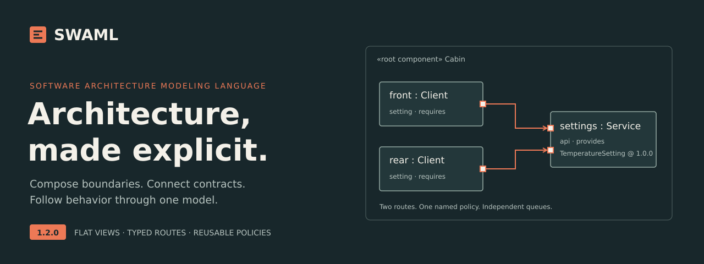
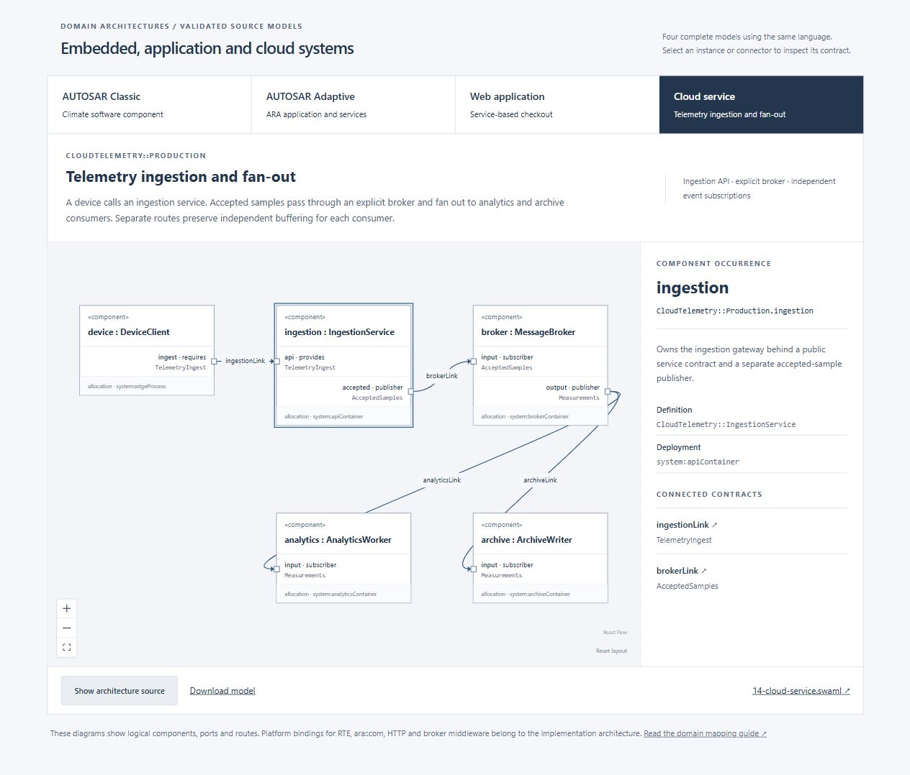
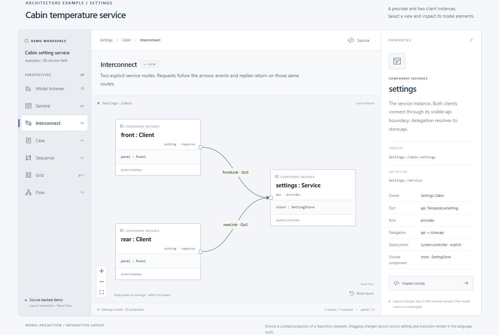
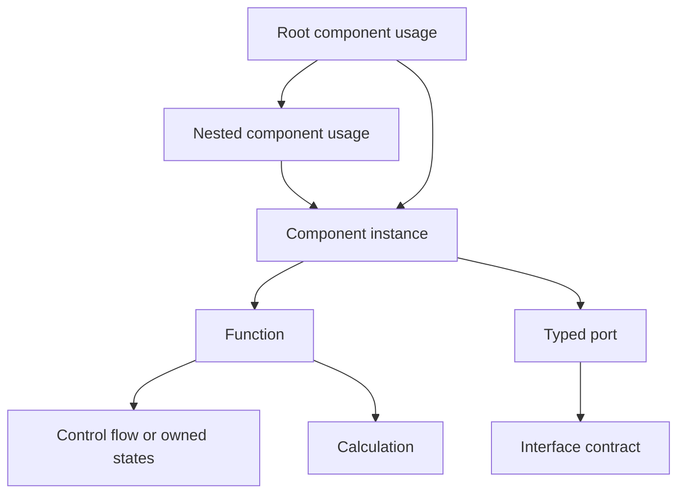

[Graphical overview](docs/MODELING_OVERVIEW.md) · [Quick start](docs/QUICK_START.md) · [Architecture examples](docs/ARCHITECTURE_PATTERNS.md) · [Live showcase](https://voidaliot.github.io/swaml/)

# Software Architecture Modeling Language

**Development version 1.4.0** adds local executable completion activation: `function B() on completion A { ... }`. It releases a fresh same-owner activation after each successful whole completion of A, with no forwarded result or cross-component shortcut. Select parser family 1.4 and profile `swaml-reference/1.4`; see the [development migration guide](docs/MIGRATION_1_4.md). This development revision has no published PDF edition. Published 1.3.1 assets and their exact source remain unchanged.

**SWAML** describes software structure, typed communication and function behavior in one model. Compose components, keep state private, and follow every exchange through an explicit contract. Use the same language for AUTOSAR Classic and Adaptive architecture, service-based applications and cloud software.

[Ontology & flat views](docs/ONTOLOGY_AND_VIEWS.md) · [Full user guide](docs/USER_GUIDE.md) · [Specification](docs/LANGUAGE_SPECIFICATION.md) · [1.3.1 release notes](docs/RELEASE_1_3_1.md)

**Published version 1.3.1 added class/component and operation/function specialization, ball/socket service notation, dedicated `tv` timing views, Box in box / Tree structure layouts, and named event inputs for operators and test drivers.** See the [1.3.1 migration guide](docs/MIGRATION_1_3_1.md). Published [1.3.0](https://github.com/voidaliot/swaml/releases/tag/v1.3.0) adds `for`, `forEach`, `do … while`, interruptible regions and function timing diagrams. Follow the [migration notes](docs/MIGRATION_1_3.md) and [control-flow guide](docs/CONTROL_FLOW_AND_TIMING.md). Software structure uses classes/components, operations/functions and pure calculations, with explicit specialization, typed ports and external deployment references. Those published assets select language **1.3**; the current development checkout selects **1.4**. Pin the package revision too for reproducibility. A working parser, validator and bounded reference simulator support the documented rules. This is an independent language with a proposed KerML semantic mapping; production runtime, KerML export and graphical source editing remain separate milestones.

## Start modeling

1. **Define a contract.** Choose sender–receiver data, client–server calls, publish–subscribe events, or a combined service.
2. **Own the behavior.** A `component def` owns typed ports, private values and functions. Incoming members bind to their handling function.
3. **Compose and connect.** Instantiate child components inside a root, or give the root local behavior. Connect complementary ports and select explicit QoS values.
4. **Validate and review.** Check the model with the CLI, then inspect its composition, routes, cases and function behavior.

The [five-minute guide](docs/QUICK_START.md) gives you a complete model to copy, the validation command and a map of the views. The website includes the same quick guide with selectable steps and a complete source example.

## From a use case to software

The [graphical modeling overview](docs/MODELING_OVERVIEW.md) shows what SWAML can describe and how its concepts relate. Follow one checkout example through **use case → interaction flow → function flow → function ownership → software structure**. The landing page presents the same diagrams as a selectable walkthrough with source-linked details.


## Explore the architecture examples

| Architecture | Complete example | Main concepts |
| --- | --- | --- |
| AUTOSAR Classic | [Climate software component](examples/11-autosar-classic.swaml) | Sampled data, calibration call, timing and MCU allocation |
| AUTOSAR Adaptive | [Diagnostic application](examples/12-autosar-adaptive.swaml) | ARA-style service methods/events, audit subscription and processes |
| Service-based web application | [Web shop](examples/13-web-application.swaml) | Checkout, inventory reservation and asynchronous receipt handling |
| Cloud service | [Telemetry pipeline](examples/14-cloud-service.swaml) | Ingestion, explicit broker, independent consumers and duplicate handling |

The [architecture patterns guide](docs/ARCHITECTURE_PATTERNS.md) explains each mapping and the implementation bindings needed for RTE, ara::com, HTTP and message middleware. All four models have interactive diagrams with selectable occurrences and connectors, exact interface and policy source, and model downloads.



## Explore the language views

The static React showcase also projects the real [Settings/Cabin model](examples/08-service-field.swaml): two independent client instances, one setting service, typed routes and a shared policy. Switch views, select elements, inspect contracts, move cards and read or download the source.

The [interface reference preview](docs/assets/interface-reference.png) adds five selectable patterns: queued data, sampled measurements, request/response, event publication and combined services. Each shows its actual source contract, port roles, traffic direction, connection cardinality and connector policy. Start with the [UML transition guide](docs/UML_GUIDE.md) for familiar concepts and their precise SWAML meaning.



| Surface | What you see |
| --- | --- |
| Browser | Ownership tree, definitions and distinct occurrence paths |
| gv · General | Software structure, types and deployment in flat frames |
| iv · Interconnect | Square boundary ports, typed connectors and delegations |
| cv · Case | Cases, requirements and claimed coverage |
| sv · Sequence | Contract messages, dependencies and reply correlation |
| grv · Grid | Searchable model identities, properties and policies |
| fv · Flow | Function-local control flow, directly owned states and explicit local completion dependencies |
| tv · Time | Declared contracts and identified bounded activation observations |

Run the showcase locally:

```sh
npm --prefix showcase ci
npm --prefix showcase run dev
```

The [showcase](showcase/README.md) is ready for GitHub Pages: build with `npm --prefix showcase run build` to produce a static `showcase/dist/` site. The [Pages workflow](.github/workflows/pages.yml) verifies pull requests and deploys on manual dispatch from the default branch once Pages uses GitHub Actions. Its project URL will be [voidaliot.github.io/swaml](https://voidaliot.github.io/swaml/). Publication is a separate step.

## Reuse components and calculations

A `component def` may specialize one base. Use `redefines` for compatible inherited replacements; every instance still owns independent state. The [component reuse example](examples/15-component-specialization.swaml) demonstrates inherited behavior, a specialized child, root-owned functions and external system/part deployment.

At the start of a function body, a pure calculation declares its inputs and output: `calc twice { in value: real; return result: real = value * 2.0; }`. Use `twice(3.0)` within that function’s expressions. Use `call helper(...) as value;` to reuse a value-returning function. Functions carry decisions, loops, local calls or states; calculations supply effect-free values.

## Reuse complete communication policies

Declare a complete policy once, then name it on every route:

```text
qos def LocalLink {
    delivery atMostOnce; ordering fifo; capacity 8; overflow reject;
}
// Inside your component:
connect frontLink: front.setting -> settings.api qos LocalLink;
connect rearLink: rear.setting -> settings.api qos LocalLink;
```

Both connectors keep independent queues. Inline QoS blocks still work, and the same interface, sampled-data, idempotency and timing checks apply. See the complete [demo model](examples/08-service-field.swaml), [policy example](examples/10-reusable-qos.swaml) and [1.3 migration guide](docs/MIGRATION_1_3.md).

## Read the complete specification

[Full Markdown reference](docs/SWAML-1.3.1-Reference.md) · [Full PDF](output/pdf/SWAML-1.3.1-Specification.pdf) · [By concern](docs/CONCERN_GUIDE.md) · [Alphabetical keywords](docs/KEYWORD_REFERENCE.md)

The specification covers every reserved word, formal syntax/typing/execution rules, static and dynamic architecture, communication policies, timing, deployment, cases and graphical notation. The PDF includes clickable navigation, all model examples, exact grammar, vector diagrams and embedded source files. [Publication and verification](docs/PDF_PUBLICATION.md) · [1.3.1 release notes](docs/RELEASE_1_3_1.md) · [Historical v0.1.0](https://github.com/voidaliot/swaml/releases/tag/v0.1.0).

## Start here

- [User guide](docs/USER_GUIDE.md): learn the language through complete models.
- [Quick start](docs/QUICK_START.md): author and validate your first model.
- [Domain architecture patterns](docs/ARCHITECTURE_PATTERNS.md): Classic, Adaptive, web and cloud models with platform mappings.
- [Normative document set](docs/LANGUAGE_SPECIFICATION.md): the rules and conformance obligations.
- [Reference simulation](docs/SIMULATION.md): execute models and inspect reproducible traces.
- [Graphical examples](docs/GRAPHICAL_EXAMPLES.md): Browser, both gv layouts, iv, cv, sv, grv, function flow/states in fv, and timing in tv.
- [Architecture comparison](docs/ARCHITECTURE_COMPARISON.md): AUTOSAR Classic/Adaptive, UML, SysML and AADL.
- [UML transformation assessment](docs/UML_COMPATIBILITY.md): compatible notation and semantic mapping boundaries.
- [Grammar](src/language/swaml.langium) and [tool integration](docs/TOOLING.md): reusable language services and command-line tools.
- [Implementation status](docs/IMPLEMENTATION_STATUS.md) and [migration](docs/MIGRATION_1_2.md): precise scope and version changes.

## Canonical graphical notation

The [concept catalog](docs/GRAPHICAL_CATALOG.md) pairs each graphical concept with its SWAML textual notation and constraints, organized by concern and indexed by term. Download original [SVG and PNG assets](docs/notation/), or read the drawings in the full specification. The [coverage inventory](spec/notation.json) explicitly accounts for every grammar rule and keyword, including terms represented only as labels or text.

The presentation follows the concept/graphical/textual organization reviewed in the [official SysML v2 specification](docs/SYSML_STYLE_REVIEW.md), using SWAML-specific drawings and semantics. [Worked diagrams](docs/GRAPHICAL_EXAMPLES.md) cover all view families.

## Compact syntax, explicit meaning

Reusable types use `def`. A top-level component usage is the root, and functions own their states directly. Files begin with packages; select the pinned SWAML 1.4 development parser through your tool or the CLI's `--language-version 1.4` option. See the [1.4 migration guide](docs/MIGRATION_1_4.md) when upgrading a host.

```swaml
package CounterExample {
    component def Counter {
        var value: int = 0;
        function increment() on start { value = value + 1; }
    }
    component demo { component counter: Counter; }
}
```

`component def Assembly { ... }` defines a reusable composition. `component demo: Assembly;` creates a named root from it. All exchange between distinct component occurrences still requires typed ports and explicit connections.

## The model



Components own data, nested components and functions. Functions own calculations and either control flow or states.

Every exchange between distinct components crosses typed ports and an explicit connector. Interfaces support sender–receiver data, client–server functions, publish–subscribe events, and combined services. An event has an interface declaration, an emitting function and a receiving function or state transition.

## Parse, validate and simulate

Requires Node.js 22+ and npm 10.2.3+.

```sh
npm ci
npm run check
node out/src/cli/main.js examples/03-service-pubsub.swaml
node out/src/cli/simulate.js Commerce::Shop examples/simulation/03-service-pubsub.json examples/03-service-pubsub.swaml
```

`npm run check` generates the parser, typechecks the TypeScript, runs semantic, simulator and language-server tests, validates and simulates every example, checks documentation and keyword coverage, and verifies the complete grammar mapping inventory and graphical subjects. The CLI exits 0 for accepted models, 1 for validation errors, and 2 for invocation or I/O errors. Supply all related files together when a model imports another package.

## Models

| Example | What it demonstrates |
| --- | --- |
| [Hello](examples/01-hello.swaml) | Smallest complete exchange and composition |
| [Realtime controller](examples/02-realtime-controller.swaml) | Sampled data, periodic execution, WCET/deadline contracts, MCU deployment |
| [Services and pub/sub](examples/03-service-pubsub.swaml) | Client/server, service events, separate audit subscription, delegation, sequence case |
| [Stateful function](examples/04-stateful-function.swaml) | States inside a function, port-bound triggers, timeouts, lifecycle |
| [Values and flow](examples/05-values-and-flow.swaml) | Records, enums, fixed arrays, calculations, local calls, bounded loops |
| [Mixed gateway](examples/06-mixed-gateway.swaml) | Explicit conversion between sampled embedded data and service events |
| [Client–server](examples/07-client-server.swaml) | Standalone RPC, idempotent query, timeout and correlated reply |
| [Service field](examples/08-service-field.swaml) | Explicit getter/setter/event, multiple consumers, reentrant snapshot query |
| [Component roots](examples/09-component-roots.swaml) | Reusable definitions, typed roots, realtime deployment bindings and inline roots with direct component children |
| [Reusable QoS](examples/10-reusable-qos.swaml) | Shared complete policies, explicit references and independent routes |
| [AUTOSAR Classic](examples/11-autosar-classic.swaml) | Climate software component, sampled data, calibration calls and MCU allocation |
| [AUTOSAR Adaptive](examples/12-autosar-adaptive.swaml) | Diagnostic application, health service, audit and process boundaries |
| [Web application](examples/13-web-application.swaml) | Checkout service, inventory reservation and receipt worker |
| [Cloud service](examples/14-cloud-service.swaml) | Ingestion service, explicit broker, analytics and archive fan-out |
| [Invalid models](examples/invalid/README.md) | Rejected attempts to bypass an interface |

## Repository layout

```text
docs/                 Specification, guides, notation catalog, research, decisions
docs/notation/        Canonical SVG, PNG and vector-scene assets
src/language/         Grammar, scoping, validation and generated AST (build output)
src/cli/              Headless validation and simulation
src/simulation/       Portable logical-time reference interpreter
src/server/           Language Server Protocol entry point
examples/             Valid/invalid models, simulation options and trace evidence
spec/                 Mapping, keyword and graphical-source inventories
showcase/             Static React Flow website and GitHub Pages build
scripts/              Reference/figure/PDF builders and consistency checks
syntax/               Generated TextMate grammar (build output)
test/                 Static, behavioral, CLI and LSP integration tests
```

The simulator implements a documented deterministic logical-time profile. Passing a bounded run does not prove physical realtime schedulability or safety across every possible schedule. KerML serialization, platform export and graphical editing have defined language-side contracts and need their own backends. This repository contains the independent language specification, reference implementation and public examples.

Contributions follow [CONTRIBUTING.md](CONTRIBUTING.md). Coding agents follow [AGENTS.md](AGENTS.md). Original code and documentation use the existing [MIT license](LICENSE); referenced standards retain their own terms.

Read [events and external inputs](docs/EVENTS_AND_INPUTS.md) for typed operator commands, explicit event routes and reproducible test-driver schedules.

### Requirements, documentation and traceability

Use `requirement` with typed attributes and one formal `doc /* ... */` block. Connect design with `satisfy` and verification cases with `verify`; use cases describe intended use. Ordinary comments stay informal notes. Compose views with multiple `include` selections and Boolean filters.

Read the [quick guide](docs/REQUIREMENTS_AND_DOCUMENTATION.md) or open the [interactive traceability example](https://voidaliot.github.io/swaml/#traceability).


