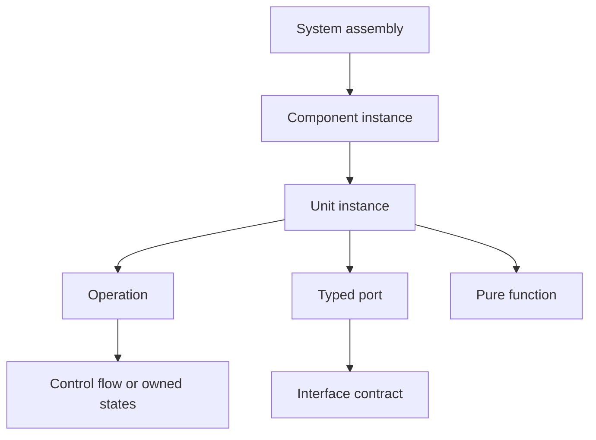

# SWAML — Software Architecture Modeling Language

SWAML is a software-focused modeling language designed on the KerML semantic foundation. It combines architectural structure, executable-operation contracts, state behavior, and interface-controlled communication for embedded realtime software and services.

**Version 0.1 is a language design and a working Langium reference core.** It is an independent project, informally motivated by an “unofficial UML 3.0”; it is not an OMG UML release, an AUTOSAR implementation, or a certified KerML tool.

## Start here

- [User guide](docs/USER_GUIDE.md): learn SWAML through models you can validate.
- [Full language specification](docs/LANGUAGE_SPECIFICATION.md): normative 0.1 rules and semantics.
- [Architecture comparison](docs/ARCHITECTURE_COMPARISON.md): AUTOSAR Classic/Adaptive, UML, SysML, AADL and the resulting decisions.
- [Graphical notation](docs/GRAPHICAL_NOTATION.md): Browser, GV, IV, CV, SV, GRV, FV.
- [Grammar](src/language/swaml.langium): the authoritative concrete syntax.
- [Tooling and VS Code integration](docs/TOOLING.md): consume the language core in `swaml-vsc-ext`.
- [Implementation status](docs/IMPLEMENTATION_STATUS.md): what is checked today and what remains for a full workbench.

## The model



Components compose units and components. Units own data, operations and pure functions. Operations own their control flow or state machine directly. There are no performers or separate action allocations.

Every exchange between units or components crosses typed ports and an explicit connector. Interfaces support sender–receiver data, client–server operations, publish–subscribe events, and combined services. An event has an interface declaration, an emitting operation and a receiving operation or state transition. There is no global event bus hidden in the syntax.

## Run the workbench

Requires Node.js 22+ and npm 10.2.3+.

```sh
npm ci
npm run check
node out/src/cli/main.js examples/03-service-pubsub.swaml
```

`npm run check` generates the parser, typechecks the TypeScript, runs semantic and language-server tests, validates the examples and checks documentation links/snippets. The CLI exits 0 for accepted models, 1 for validation errors, and 2 for invocation or I/O errors. Supply all related files together when a model imports another package.

## Models

| Example | What it demonstrates |
| --- | --- |
| [Hello](examples/01-hello.swaml) | Smallest complete exchange and composition |
| [Realtime controller](examples/02-realtime-controller.swaml) | Sampled data, periodic execution, WCET/deadline contracts, MCU deployment |
| [Services and pub/sub](examples/03-service-pubsub.swaml) | Client/server, service events, separate audit subscription, delegation, sequence case |
| [Stateful operation](examples/04-stateful-operation.swaml) | States inside an operation, port-bound triggers, timeouts, lifecycle |
| [Values and flow](examples/05-values-and-flow.swaml) | Records, enums, fixed arrays, functions, local calls, bounded loops |
| [Mixed gateway](examples/06-mixed-gateway.swaml) | Explicit conversion between sampled embedded data and service events |
| [Client–server](examples/07-client-server.swaml) | Standalone RPC, idempotent query, timeout and correlated reply |
| [Invalid models](examples/invalid/README.md) | Rejected attempts to bypass an interface |

## Repository layout

```text
docs/                 Specification, user guide, notation, research, decisions
src/language/         Grammar, scoping, validation and generated AST (build output)
src/cli/              Headless model validation
src/server/           Language Server Protocol entry point
examples/             Executable parser/validator fixtures
spec/                 Machine-readable KerML mapping contract
scripts/              Documentation checks
syntax/               Generated TextMate grammar (build output)
test/                 Positive, negative and LSP integration tests
```

This repository does not yet contain a simulator, a KerML serializer, an AUTOSAR ARXML exporter, graphical editing, or a packaged VS Code extension. Those are implementation work items with defined contracts, rather than implied capabilities of the validator.

Contributions follow [CONTRIBUTING.md](CONTRIBUTING.md). Coding agents follow [AGENTS.md](AGENTS.md). Original code and documentation use the existing [MIT license](LICENSE); referenced standards retain their own terms.
