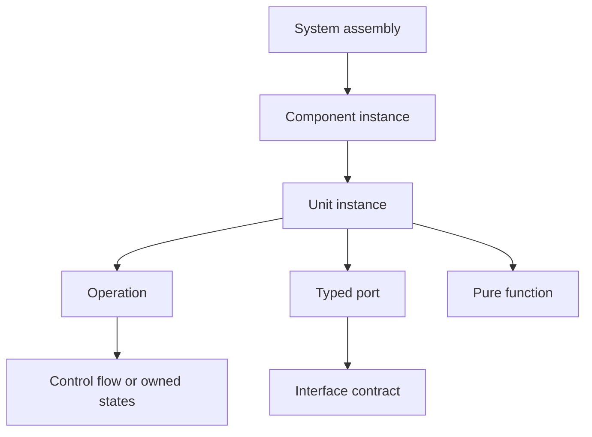

# SWAML — Software Architecture Modeling Language

SWAML is a software-focused modeling language designed on the KerML semantic foundation. It combines architectural structure, executable-operation contracts, state behavior, and interface-controlled communication for embedded realtime software and services.

**Version 1.0.0 defines the language and includes a working Langium parser, validator and reference simulator.** It is an independent project, informally motivated by an “unofficial UML 3.0”; it is not an OMG UML release, an AUTOSAR implementation, or a certified KerML tool.

## Read the complete specification

[Full Markdown reference](docs/SWAML-1.0.0-Reference.md) · [Full PDF](output/pdf/SWAML-1.0.0-Specification.pdf) · [By concern](docs/CONCERN_GUIDE.md) · [Alphabetical keywords](docs/KEYWORD_REFERENCE.md)

The specification covers all 129 reserved words, formal syntax/typing/execution rules, static and dynamic architecture, communication policies, timing, deployment, cases and graphical notation. The PDF includes clickable navigation, all model examples, exact grammar, vector diagrams and embedded source files. [Publication and verification](docs/PDF_PUBLICATION.md) · [1.0 evidence](docs/RELEASE_1_0.md) · [Historical v0.1.0](https://github.com/voidaliot/swaml/releases/tag/v0.1.0).

## Start here

- [User guide](docs/USER_GUIDE.md): learn the language through complete models.
- [Normative document set](docs/LANGUAGE_SPECIFICATION.md): the rules and conformance obligations.
- [Reference simulation](docs/SIMULATION.md): execute models and inspect reproducible traces.
- [Graphical examples](docs/GRAPHICAL_EXAMPLES.md): Browser, GV, IV, CV, SV, GRV and both FV forms.
- [Architecture comparison](docs/ARCHITECTURE_COMPARISON.md): AUTOSAR Classic/Adaptive, UML, SysML and AADL.
- [Grammar](src/language/swaml.langium) and [tool integration](docs/TOOLING.md): reusable Langium core for a separately implemented VS Code extension.
- [Implementation status](docs/IMPLEMENTATION_STATUS.md) and [migration](docs/MIGRATION_1_0.md): precise scope and version changes.

## The model



Components compose units and components. Units own data, operations and pure functions. Operations own their control flow or state machine directly. There are no performers or separate action allocations.

Every exchange between units or components crosses typed ports and an explicit connector. Interfaces support sender–receiver data, client–server operations, publish–subscribe events, and combined services. An event has an interface declaration, an emitting operation and a receiving operation or state transition. There is no global event bus hidden in the syntax.

## Parse, validate and simulate

Requires Node.js 22+ and npm 10.2.3+.

```sh
npm ci
npm run check
node out/src/cli/main.js examples/03-service-pubsub.swaml
node out/src/cli/simulate.js Commerce::Shop examples/simulation/03-service-pubsub.json examples/03-service-pubsub.swaml
```

`npm run check` generates the parser, typechecks the TypeScript, runs semantic, simulator and language-server tests, validates and simulates every example, checks documentation and keyword coverage, and verifies the complete grammar mapping inventory and graphical subjects. The CLI exits 0 for accepted models, 1 for validation errors, and 2 for invocation or I/O errors. Supply all related files together when a model imports another package.

## Models

| Example | What it demonstrates |
| --- | --- |
| [Hello](examples/01-hello.swaml) | Smallest complete exchange and composition |
| [Realtime controller](examples/02-realtime-controller.swaml) | Sampled data, periodic execution, WCET/deadline contracts, MCU deployment |
| [Services and pub/sub](examples/03-service-pubsub.swaml) | Client/server, service events, separate audit subscription, delegation, sequence case |
| [Stateful operation](examples/04-stateful-operation.swaml) | States inside an operation, port-bound triggers, timeouts, lifecycle |
| [Values and flow](examples/05-values-and-flow.swaml) | Records, enums, fixed arrays, functions, local calls, bounded loops |
| [Mixed gateway](examples/06-mixed-gateway.swaml) | Explicit conversion between sampled embedded data and service events |
| [Client–server](examples/07-client-server.swaml) | Standalone RPC, idempotent query, timeout and correlated reply |
| [Service field](examples/08-service-field.swaml) | Explicit getter/setter/event, multiple consumers, reentrant snapshot query |
| [Invalid models](examples/invalid/README.md) | Rejected attempts to bypass an interface |

## Repository layout

```text
docs/                 Specification, user guide, notation, research, decisions
src/language/         Grammar, scoping, validation and generated AST (build output)
src/cli/              Headless validation and simulation
src/simulation/       Portable logical-time reference interpreter
src/server/           Language Server Protocol entry point
examples/             Valid/invalid models, simulation options and trace evidence
spec/                 Mapping, keyword and graphical-source inventories
scripts/              Reference/figure/PDF builders and consistency checks
syntax/               Generated TextMate grammar (build output)
test/                 Static, behavioral, CLI and LSP integration tests
```

The simulator implements a documented deterministic logical-time profile. Passing a bounded run does not prove physical realtime schedulability or safety across every possible schedule. KerML serialization, platform export and graphical editing have defined language-side contracts and need their own backends. The actual VS Code extension is implemented elsewhere; this repository owns the language.

Contributions follow [CONTRIBUTING.md](CONTRIBUTING.md). Coding agents follow [AGENTS.md](AGENTS.md). Original code and documentation use the existing [MIT license](LICENSE); referenced standards retain their own terms.
