# swa.ml 2.0 canonical graphical catalog

Generated from spec/notation.json. Original monochrome notation; no OMG notation-conformance claim. Every drawing preserves source ownership and identity.

## Packages and imports

swa.ml 2.0; Hello::Demo.

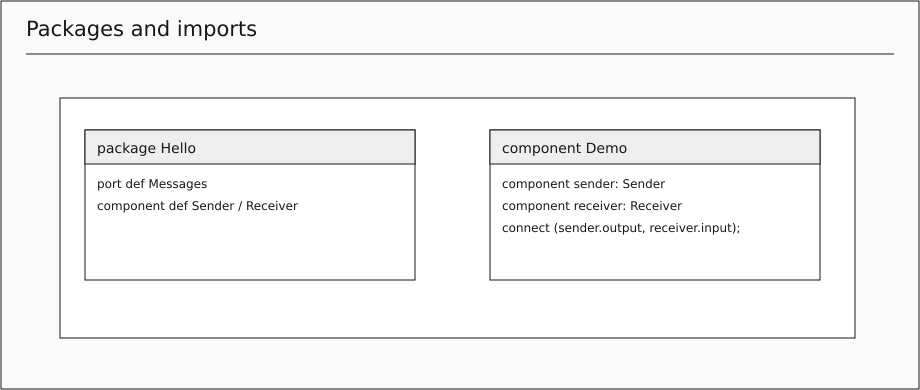

**Source:** [Hello::Demo](../examples/01-hello.swaml). **Grammar:** Model, Package, Import, QualifiedName.

Preserve owned source and distinct definition/occurrence identities. Drawing is a projection; it does not add execution semantics. A canonical source-backed projection; geometry is separate from semantics.

## Typed copied values

swa.ml 2.0; Values::Demo.

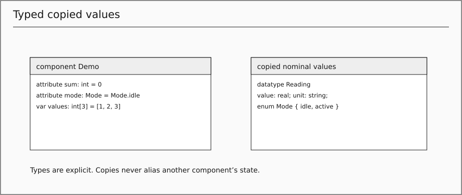

**Source:** [Values::Demo](../examples/05-values-and-flow.swaml). **Grammar:** DataType, Field, EnumType, TypeRef, ValueType, RecordLiteral, FieldValue, ArrayLiteral.

Preserve owned source and distinct definition/occurrence identities. Drawing is a projection; it does not add execution semantics. A canonical source-backed projection; geometry is separate from semantics.

## Component definitions and usages

swa.ml 2.0; Reuse::Demo.

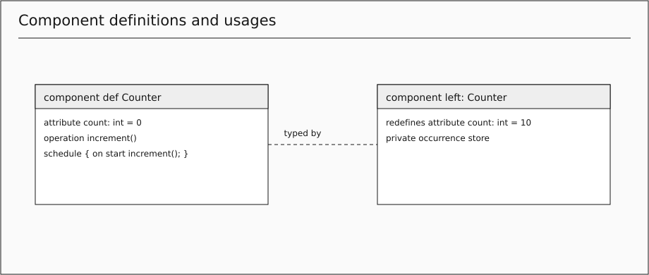

**Source:** [Reuse::Demo](../examples/15-component-specialization.swaml). **Grammar:** ComponentDef, ComponentUsage, ComponentMember, Element.

Preserve owned source and distinct definition/occurrence identities. Drawing is a projection; it does not add execution semantics. A canonical source-backed projection; geometry is separate from semantics.

## Indexed occurrence identity

swa.ml 2.0; Multiplicity::Demo.

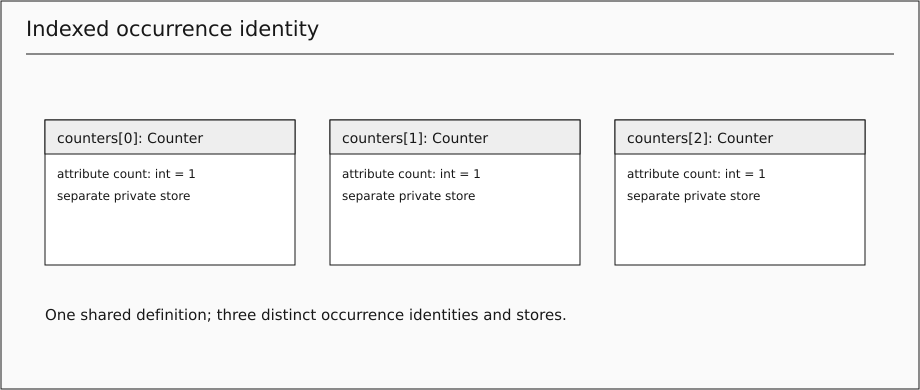

**Source:** [Multiplicity::Demo](../examples/23-multiplicity.swaml). **Grammar:** .

Preserve owned source and distinct definition/occurrence identities. Drawing is a projection; it does not add execution semantics. A canonical source-backed projection; geometry is separate from semantics.

## Attributes and lexical locals

swa.ml 2.0; Values::Demo.

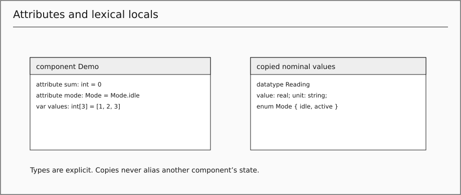

**Source:** [Values::Demo](../examples/05-values-and-flow.swaml). **Grammar:** Attribute, LocalVariable, Argument.

Preserve owned source and distinct definition/occurrence identities. Drawing is a projection; it does not add execution semantics. A canonical source-backed projection; geometry is separate from semantics.

## Mixed directed port members

swa.ml 2.0; Mixed::Boundary.

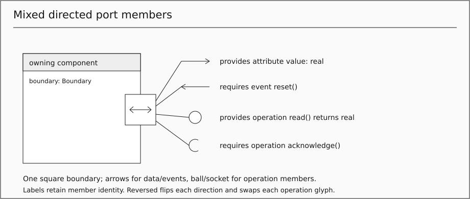

**Source:** [Mixed::Boundary](../examples/27-mixed-port.swaml). **Grammar:** PortDef, PortUsage, PortMember, MemberPath, Send.

One square boundary can contain attribute, event and operation members together. Arrowheads show data/event direction; an outward arrow means provides and inward means requires. A ball marks a provided operation; an open socket marks a required operation. These are member glyphs, not port types. A compact double arrow summarizes opposite data/event directions only; expanded labels retain each member name and type. Reversed flips every direction, arrow and operation glyph; geometry never adds members or routes. A canonical source-backed projection; geometry is separate from semantics.

## Policy-bearing connection

swa.ml 2.0; Policies::Demo.

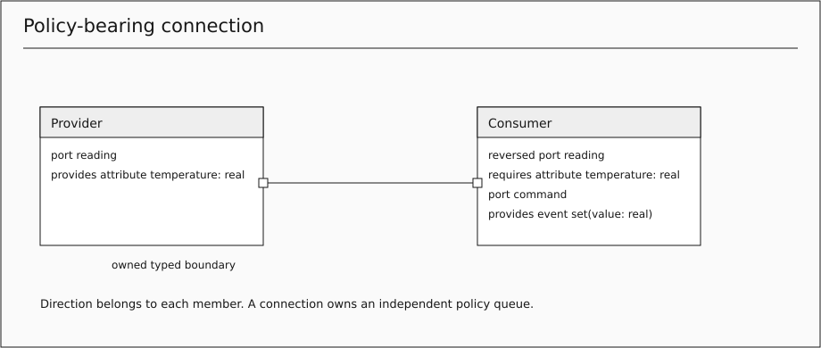

**Source:** [Policies::Demo](../examples/10-reusable-qos.swaml). **Grammar:** Connect, QosPolicy, PolicySetting.

Preserve owned source and distinct definition/occurrence identities. Drawing is a projection; it does not add execution semantics. A canonical source-backed projection; geometry is separate from semantics.

## Queue-free boundary forwarding

swa.ml 2.0; Boundary::Demo.

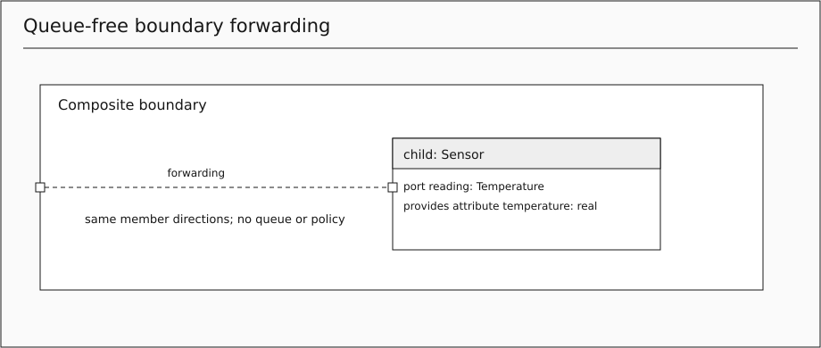

**Source:** [Boundary::Demo](../examples/26-boundary-forwarding.swaml). **Grammar:** .

Preserve owned source and distinct definition/occurrence identities. Boundary alias adds no queue, policy or message. A canonical source-backed projection; geometry is separate from semantics.

## Operations and nested ownership

swa.ml 2.0; OperationUsage::Demo.

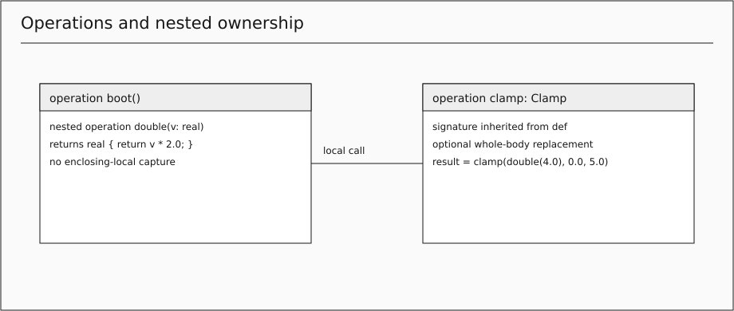

**Source:** [OperationUsage::Demo](../examples/24-operation-usage.swaml). **Grammar:** Operation, OperationUsage, Executable, OperationBody.

Preserve owned source and distinct definition/occurrence identities. Drawing is a projection; it does not add execution semantics. A canonical source-backed projection; geometry is separate from semantics.

## Expression calls and copied out values

swa.ml 2.0; ClientServer::Client.

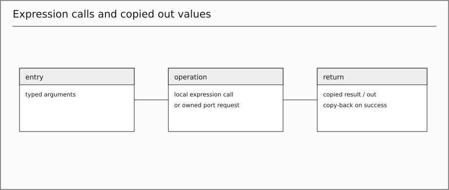

**Source:** [ClientServer::Client](../examples/07-client-server.swaml). **Grammar:** CallExpression, ExpressionStatement, Return.

Preserve owned source and distinct definition/occurrence identities. Drawing is a projection; it does not add execution semantics. A canonical source-backed projection; geometry is separate from semantics.

## Runtime failure and lazy fallback

swa.ml 2.0; ClientServer::Client.

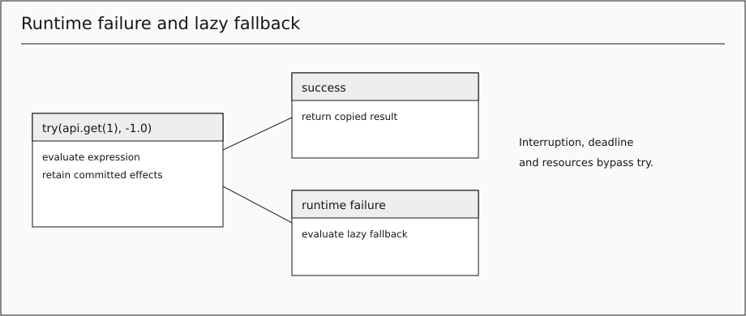

**Source:** [ClientServer::Client](../examples/07-client-server.swaml). **Grammar:** TryExpression, Fail, Assert.

Preserve owned source and distinct definition/occurrence identities. Drawing is a projection; it does not add execution semantics. A canonical source-backed projection; geometry is separate from semantics.

## Statements and decisions

swa.ml 2.0; Values::Demo.

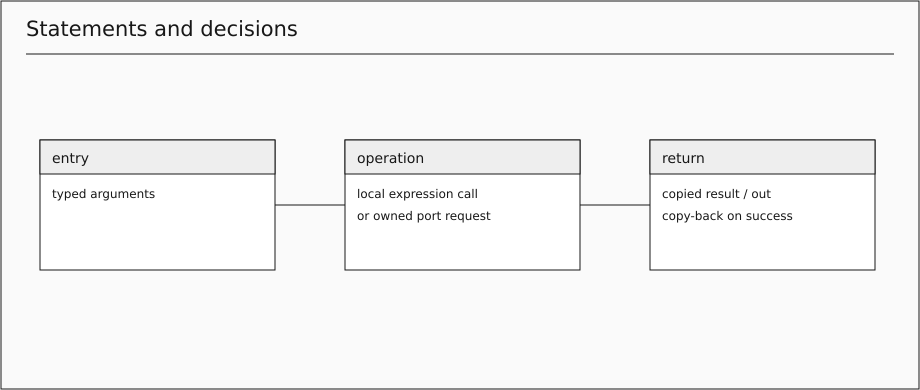

**Source:** [Values::Demo](../examples/05-values-and-flow.swaml). **Grammar:** Block, Statement, Assign, If.

Preserve owned source and distinct definition/occurrence identities. Drawing is a projection; it does not add execution semantics. A canonical source-backed projection; geometry is separate from semantics.

## Loops and copied iteration

swa.ml 2.0; Loops::Demo.

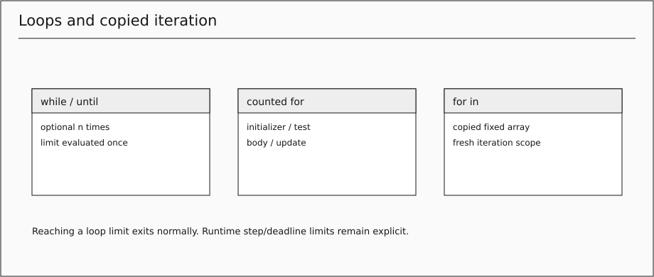

**Source:** [Loops::Demo](../examples/18-control-loops.swaml). **Grammar:** While, Until, For, ForUpdate, ForEach.

Preserve owned source and distinct definition/occurrence identities. Drawing is a projection; it does not add execution semantics. A canonical source-backed projection; geometry is separate from semantics.

## Schedule entry and successful chaining

swa.ml 2.0; Chaining::Demo.

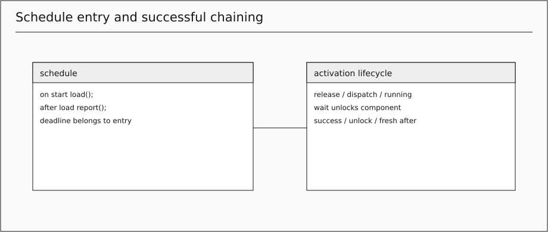

**Source:** [Chaining::Demo](../examples/25-function-completion.swaml). **Grammar:** Schedule, ScheduleEntry.

Preserve owned source and distinct definition/occurrence identities. Drawing is a projection; it does not add execution semantics. A canonical source-backed projection; geometry is separate from semantics.

## Suspending wait and receive

swa.ml 2.0; Receiving::Receiver.

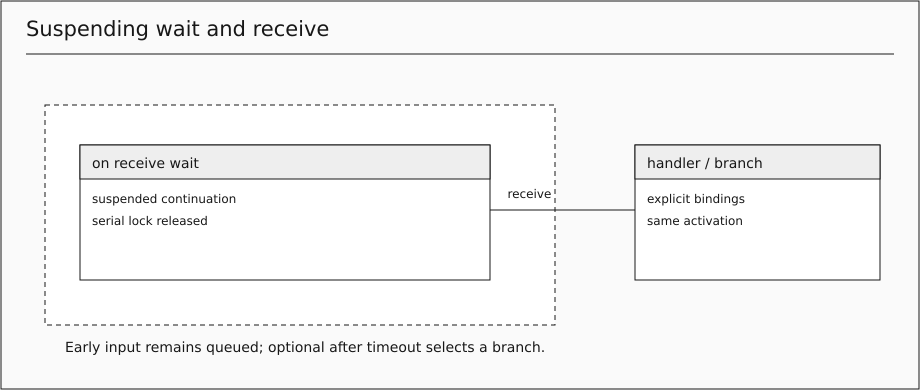

**Source:** [Receiving::Receiver](../examples/21-receive-and-try.swaml). **Grammar:** Wait, Receive, ReceiveBranch.

Preserve owned source and distinct definition/occurrence identities. Drawing is a projection; it does not add execution semantics. A canonical source-backed projection; geometry is separate from semantics.

## Armed interrupt and cancellation

swa.ml 2.0; Interrupts::Receiver.

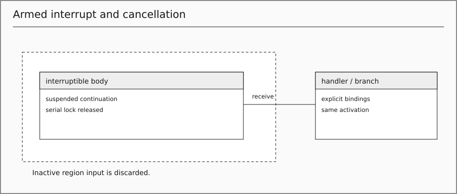

**Source:** [Interrupts::Receiver](../examples/19-interruptible-function.swaml). **Grammar:** Interruptible.

Preserve owned source and distinct definition/occurrence identities. Drawing is a projection; it does not add execution semantics. A canonical source-backed projection; geometry is separate from semantics.

## Ordered state transitions

swa.ml 2.0; States::Demo.lamp.

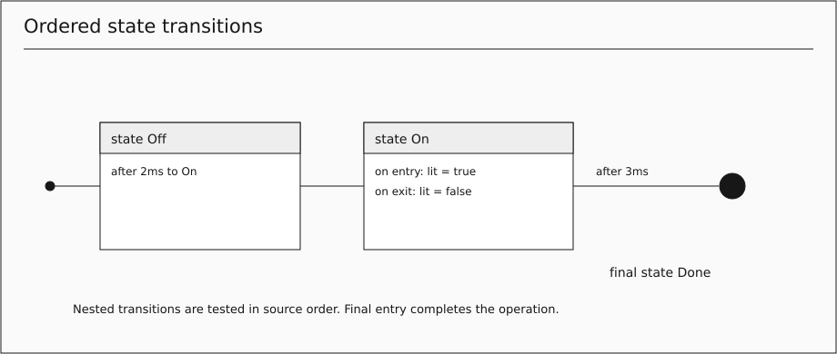

**Source:** [States::Demo.lamp](../examples/04-stateful-function.swaml). **Grammar:** State, StateAction, Transition.

Preserve owned source and distinct definition/occurrence identities. Drawing is a projection; it does not add execution semantics. A canonical source-backed projection; geometry is separate from semantics.

## Platform Nodes and placement

swa.ml 2.0; Placement::Demo.

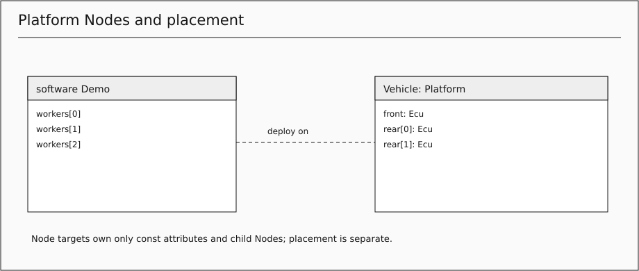

**Source:** [Placement::Demo](../examples/22-platform-deployment.swaml). **Grammar:** Deployment, Placement.

Preserve owned source and distinct definition/occurrence identities. Drawing is a projection; it does not add execution semantics. A canonical source-backed projection; geometry is separate from semantics.

## Requirements and intent links

swa.ml 2.0; Traceability::Delivery.

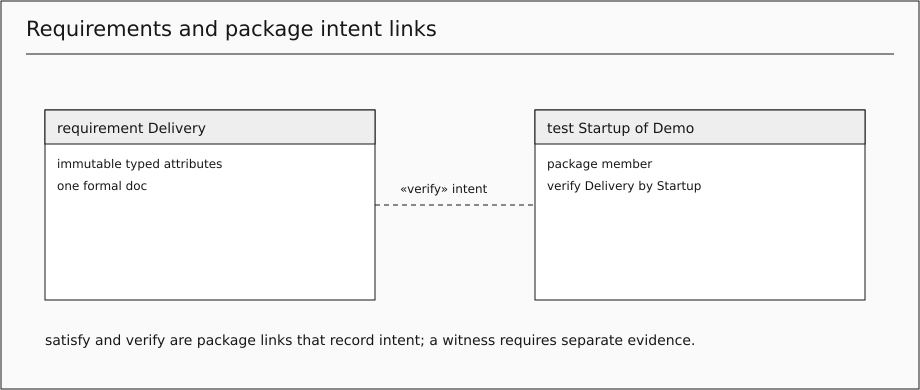

**Source:** [Traceability::Delivery](../examples/16-requirements-and-views.swaml). **Grammar:** Requirement, Satisfaction, Verification.

Preserve owned source and distinct definition/occurrence identities. Drawing is a projection; it does not add execution semantics. A canonical source-backed projection; geometry is separate from semantics.

## Use cases, actors and routed case steps

swa.ml 2.0; Cash Machine::ATM Controller.Withdraw cash.

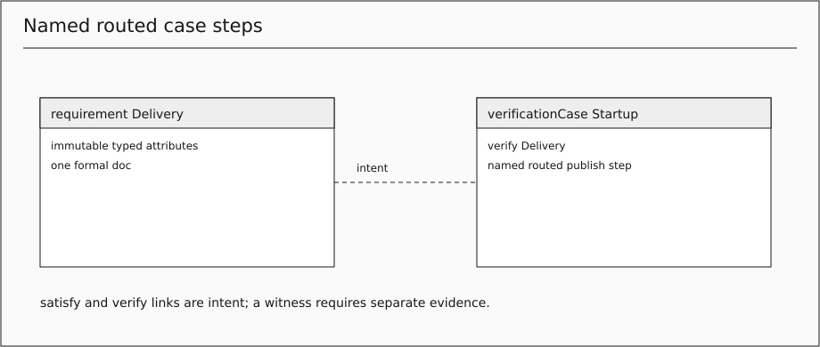

**Source:** [Cash Machine::ATM Controller.Withdraw cash](../examples/28-use-cases.swaml). **Grammar:** Scenario, CaseKind, CaseActor, CaseRelation, ScenarioStep.

Preserve owned source and distinct definition/occurrence identities. Drawing is a projection; it does not add execution semantics. A canonical source-backed projection; geometry is separate from semantics.

## Seven library view definitions

swa.ml 2.0; Traceability::Demo.

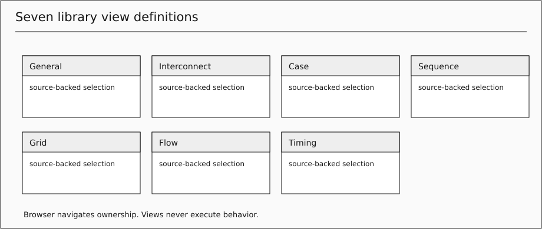

**Source:** [Traceability::Demo](../examples/16-requirements-and-views.swaml). **Grammar:** ViewDef, View, ViewSelection, FilterExpression, FilterOr, FilterAnd, FilterPrimary, FilterBinary, FilterNot, FilterComparison.

Preserve owned source and distinct definition/occurrence identities. Drawing is a projection; it does not add execution semantics. A canonical source-backed projection; geometry is separate from semantics.

## Declared and observed timing

swa.ml 2.0; Timing::Demo.sample.

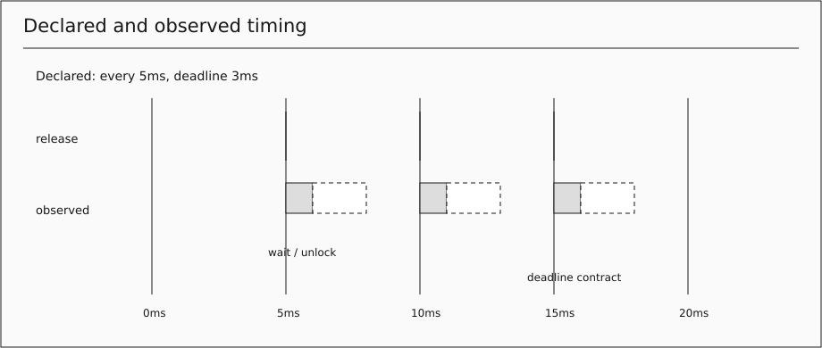

**Source:** [Timing::Demo.sample](../examples/17-function-timing.swaml). **Grammar:** .

Preserve owned source and distinct definition/occurrence identities. Drawing is a projection; it does not add execution semantics. A canonical source-backed projection; geometry is separate from semantics.

## Owned documentation and lexical notes

swa.ml 2.0; Traceability::Delivery.

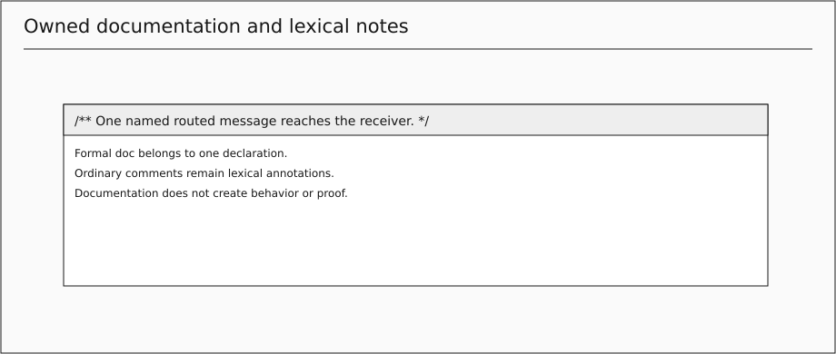

**Source:** [Traceability::Delivery](../examples/16-requirements-and-views.swaml). **Grammar:** Documentation, DOC_COMMENT.

Preserve owned source and distinct definition/occurrence identities. Drawing is a projection; it does not add execution semantics. A canonical source-backed projection; geometry is separate from semantics.

## Typed expressions and operators

swa.ml 2.0; Values::Demo.

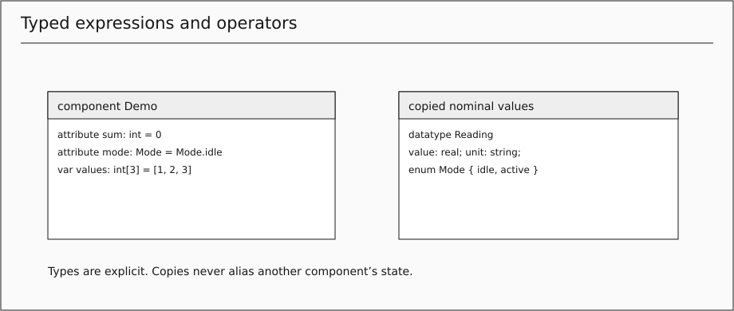

**Source:** [Values::Demo](../examples/05-values-and-flow.swaml). **Grammar:** Expression, OrExpression, AndExpression, EqualityExpression, RelationalExpression, AdditiveExpression, MultiplicativeExpression, UnaryExpression, PrimaryExpression, BinaryExpression, ReferenceExpression, ValuePath, Literal, Numeric.

Preserve owned source and distinct definition/occurrence identities. Drawing is a projection; it does not add execution semantics. A canonical source-backed projection; geometry is separate from semantics.

## Lexical and path spelling

swa.ml 2.0; Hello::Demo.

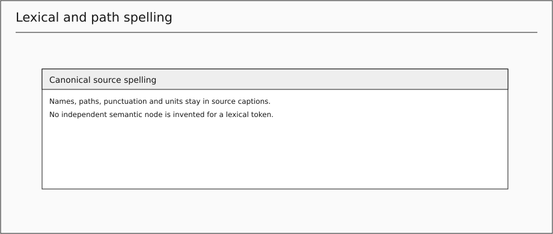

**Source:** [Hello::Demo](../examples/01-hello.swaml). **Grammar:** Duration, Name, Path, WS, ID, UNRESTRICTED_NAME, NUMBER, INT, STRING, ML_COMMENT, SL_COMMENT.

Text-only spelling; show as a source caption without invented semantic nodes. Drawing is a projection; it does not add execution semantics. Lexical spelling has no independent graphical identity.
