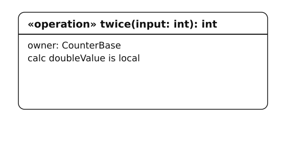
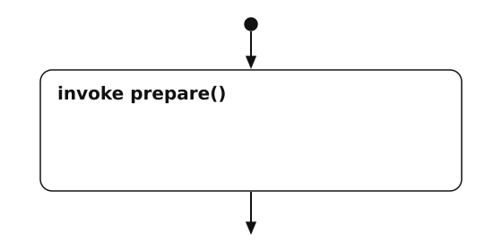
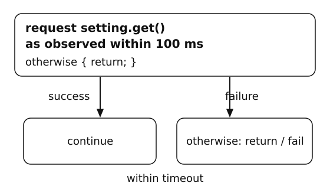
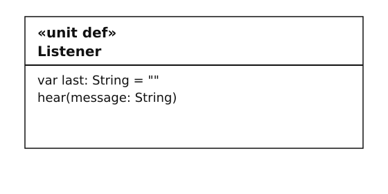
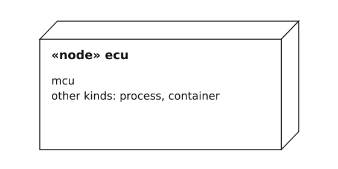

# Canonical graphical notation catalog

SWAML 1.1 · publication 1.1.1. This generated catalog defines the original monochrome notation for each authored concept and meaningful label group. All specimens derive from [the semantic inventory](../spec/notation.json); complete examples supply their validation context.

Each SVG, PNG and vector scene shares the same geometry. A graphical specimen is a projection of its textual model; it does not create additional ports, events, state owners or execution semantics. Labels such as QoS values and expression operators appear within their owning element rather than introducing independent nodes.

The following fragments are contextual notation samples, not standalone SWAML files. `def` identifies reusable component/unit types; a root is an occurrence selected for execution.

## Concept index

- [Assertion](#notation-assert) — Operation flow.
- [Assignment](#notation-assignment) — Operation flow.
- [Boundary delegation](#notation-delegation) — Interfaces and connections.
- [Bounded loop](#notation-bounded-loop) — Operation flow.
- [Browser](#notation-view-browser) — View projections.
- [Case](#notation-case) — Cases and evidence.
- [Case causal order](#notation-case-causal-order) — Cases and evidence.
- [Case data exchange](#notation-case-data-exchange) — Cases and evidence.
- [Case event exchange](#notation-case-event-exchange) — Cases and evidence.
- [Case request](#notation-case-request) — Cases and evidence.
- [Case View](#notation-view-cv) — View projections.
- [Client–server interface](#notation-client-server-interface) — Interfaces and connections.
- [Completion transition](#notation-completion-transition) — Operation states.
- [Component definition](#notation-component-definition) — Structure and values.
- [Component usage](#notation-component-usage) — Structure and values.
- [Concurrency mode](#notation-concurrency-mode) — Timing and deployment.
- [Conditional branch](#notation-conditional) — Operation flow.
- [Correlated case reply](#notation-case-reply) — Cases and evidence.
- [Data member](#notation-data-member) — Interfaces and connections.
- [Data receiver port](#notation-port-receiver) — Interfaces and connections.
- [Data send](#notation-send) — Operation flow.
- [Data sender port](#notation-port-sender) — Interfaces and connections.
- [Delivery policy](#notation-delivery-policy) — Interfaces and connections.
- [Deployment binding](#notation-deployment) — Timing and deployment.
- [Duration value](#notation-duration) — Timing and deployment.
- [Enumeration](#notation-enumeration) — Structure and values.
- [Enumeration value](#notation-enum-value) — Structure and values.
- [Event member](#notation-event-member) — Interfaces and connections.
- [Event publication](#notation-publish) — Operation flow.
- [Event publisher port](#notation-port-publisher) — Interfaces and connections.
- [Event subscriber port](#notation-port-subscriber) — Interfaces and connections.
- [Executable operation](#notation-operation) — Operation flow.
- [Execution node](#notation-execution-node) — Timing and deployment.
- [Expressions and value paths](#notation-expression) — Structure and values.
- [Failure](#notation-fail) — Operation flow.
- [Final state](#notation-final-state) — Operation states.
- [Fixed array type and value](#notation-array-value) — Structure and values.
- [Flow View](#notation-view-fv) — View projections.
- [General View](#notation-view-gv) — View projections.
- [Grid View](#notation-view-grv) — View projections.
- [Initial state reference](#notation-initial-state) — Operation states.
- [Inline root composition](#notation-inline-root) — Structure and values.
- [Interconnect View](#notation-view-iv) — View projections.
- [Interface connector](#notation-connector) — Interfaces and connections.
- [Interface operation signature](#notation-operation-signature) — Interfaces and connections.
- [Local declaration](#notation-local-declaration) — Operation flow.
- [Local operation invocation](#notation-invoke) — Operation flow.
- [Manual activation](#notation-trigger-manual) — Operation flow.
- [Message freshness bound](#notation-freshness-bound) — Interfaces and connections.
- [Occurrence lifeline](#notation-sequence-lifeline) — Cases and evidence.
- [Occurrence typing relationship](#notation-type-relationship) — Structure and values.
- [Operation return](#notation-return) — Operation flow.
- [Operation timing contract](#notation-timing-contract) — Timing and deployment.
- [Operation with states](#notation-stateful-operation) — Operation states.
- [Optional port](#notation-optional-port) — Interfaces and connections.
- [Overflow behavior](#notation-overflow-policy) — Interfaces and connections.
- [Package](#notation-package) — Structure and values.
- [Package import](#notation-import) — Structure and values.
- [Parameter or record field](#notation-parameter) — Structure and values.
- [Periodic activation](#notation-trigger-periodic) — Operation flow.
- [Port receive activation](#notation-trigger-receive) — Operation flow.
- [Primitive types](#notation-primitive-types) — Structure and values.
- [Private unit variable](#notation-private-variable) — Structure and values.
- [Publish–subscribe interface](#notation-publish-subscribe-interface) — Interfaces and connections.
- [Pure local function](#notation-pure-function) — Structure and values.
- [Queue capacity](#notation-capacity-policy) — Interfaces and connections.
- [Queue ordering](#notation-ordering-policy) — Interfaces and connections.
- [Record construction](#notation-record-value) — Structure and values.
- [Record datatype](#notation-datatype) — Structure and values.
- [Requirement](#notation-requirement) — Cases and evidence.
- [Requirement coverage link](#notation-satisfies-link) — Cases and evidence.
- [Residence timer transition](#notation-timer-transition) — Operation states.
- [Root component](#notation-root-component) — Structure and values.
- [Root execution profile](#notation-execution-profile) — Timing and deployment.
- [RPC client port](#notation-port-client) — Interfaces and connections.
- [RPC handler activation](#notation-trigger-call) — Operation flow.
- [RPC request and failure continuation](#notation-request) — Operation flow.
- [RPC server port](#notation-port-server) — Interfaces and connections.
- [Sender–receiver interface](#notation-sender-receiver-interface) — Interfaces and connections.
- [Sequence View](#notation-view-sv) — View projections.
- [Service consumer port](#notation-port-requires) — Interfaces and connections.
- [Service interface](#notation-service-interface) — Interfaces and connections.
- [Service provider port](#notation-port-provides) — Interfaces and connections.
- [Startup activation](#notation-trigger-start) — Operation flow.
- [State](#notation-state) — Operation states.
- [State entry behavior](#notation-state-entry) — Operation states.
- [State exit behavior](#notation-state-exit) — Operation states.
- [State transition](#notation-transition) — Operation states.
- [Transition guard](#notation-transition-guard) — Operation states.
- [Transition priority](#notation-transition-priority) — Operation states.
- [Transport latency bound](#notation-latency-bound) — Interfaces and connections.
- [Unit definition](#notation-unit-definition) — Structure and values.
- [Unit usage](#notation-unit-usage) — Structure and values.

## Cases and evidence

## Notation: case

**Case**

| Element | Graphical notation | Textual notation |
| --- | --- | --- |
| Case (node) |  | `case Change for Cabin satisfies VisibleSetting` |

Case. Draw a case frame or rectangle labeled «case», its name and for Root identity.

**Context:** Scenario header in Settings; steps reference Cabin’s root-level connectors. **Views:** CV, SV.

- Draw a case frame or rectangle labeled «case», its name and for Root identity.
- Cases describe routed exchanges; they MUST NOT introduce performers, free channels or a second executable operation body.

[Complete model](../examples/08-service-field.swaml) · `Settings::Change`.

[SVG](notation/case.svg) · [PNG](notation/case.png) · [Vector scene](notation/case.scene.json)

## Notation: case-causal-order

**Case causal order**

| Element | Graphical notation | Textual notation |
| --- | --- | --- |
| Case causal order (edge) |  | `after sent label answered` |

Case causal order. Draw an explicitly labeled after dependency between step labels, or show the predecessor in the arrow label.

**Context:** Dependency fragment of Rpc::Poll’s reply step. **Views:** CV, SV.

- Draw an explicitly labeled after dependency between step labels, or show the predecessor in the arrow label.
- Unrelated steps remain unordered; source order and vertical placement are layout choices, not happens-before edges.

[Complete model](../examples/07-client-server.swaml) · `Rpc::Poll`.

[SVG](notation/case-causal-order.svg) · [PNG](notation/case-causal-order.png) · [Vector scene](notation/case-causal-order.scene.json)

## Notation: case-data-exchange

**Case data exchange**

| Element | Graphical notation | Textual notation |
| --- | --- | --- |
| Case data exchange (edge) |  | `send source.output.value -> sink.input.value via counts label sent;` |

Case data exchange. Draw a sequence arrow between occurrence lifelines labeled send, port.member paths, connector and step label.

**Context:** Step in Notation::Observe; source and destination are immediate child port/member paths. **Views:** CV, SV.

- Draw a sequence arrow between occurrence lifelines labeled send, port.member paths, connector and step label.
- The arrow projects an existing sender–receiver route; it creates neither a free event nor a connector by itself.

[Complete model](../examples/notation/catalog.swaml) · `Notation::Observe`.

[SVG](notation/case-data-exchange.svg) · [PNG](notation/case-data-exchange.png) · [Vector scene](notation/case-data-exchange.scene.json)

## Notation: case-event-exchange

**Case event exchange**

| Element | Graphical notation | Textual notation |
| --- | --- | --- |
| Case event exchange (edge) |  | `publish settings.api.changed -> front.setting.changed via frontLink after adjust label frontNotice;` |

Case event exchange. Draw a publication arrow labeled publish and the exact connector/member, retaining its step identity.

**Context:** Step in Settings::Change, using the reverse event direction of a service route. **Views:** CV, SV.

- Draw a publication arrow labeled publish and the exact connector/member, retaining its step identity.
- For service contracts events travel provider-to-consumer; line orientation follows that role even when opposite the connector’s request orientation.

[Complete model](../examples/08-service-field.swaml) · `Settings::Change`.

[SVG](notation/case-event-exchange.svg) · [PNG](notation/case-event-exchange.png) · [Vector scene](notation/case-event-exchange.scene.json)

## Notation: case-request

**Case request**

| Element | Graphical notation | Textual notation |
| --- | --- | --- |
| Case request (edge) |  | `request caller.health.check -> serviceUnit.health.check via healthCheck label sent;` |

Case request. Draw a request arrow between occurrence lifelines, labeled the member, connector and step identity.

**Context:** Request step in Rpc::Poll. **Views:** CV, SV.

- Draw a request arrow between occurrence lifelines, labeled the member, connector and step identity.
- Its later reply must be uniquely correlated by case ancestry and route/member; vertical spacing does not create that relationship.

[Complete model](../examples/07-client-server.swaml) · `Rpc::Poll`.

[SVG](notation/case-request.svg) · [PNG](notation/case-request.png) · [Vector scene](notation/case-request.scene.json)

## Notation: case-reply

**Correlated case reply**

| Element | Graphical notation | Textual notation |
| --- | --- | --- |
| Correlated case reply (edge) |  | `reply serviceUnit.health.check -> caller.health.check via healthCheck after sent label answered;` |

Correlated case reply. Draw a dashed reply arrow reversing the matching request route and label its step identity and correlation.

**Context:** Reply step in Rpc::Poll; after sent identifies its causal request ancestor. **Views:** CV, SV.

- Draw a dashed reply arrow reversing the matching request route and label its step identity and correlation.
- A reply cannot be matched by visual proximity alone; preserve the unique causal request ancestor.

[Complete model](../examples/07-client-server.swaml) · `Rpc::Poll`.

[SVG](notation/case-reply.svg) · [PNG](notation/case-reply.png) · [Vector scene](notation/case-reply.scene.json)

## Notation: sequence-lifeline

**Occurrence lifeline**

| Element | Graphical notation | Textual notation |
| --- | --- | --- |
| Occurrence lifeline (node) |  | `component caller: Caller;` |

Occurrence lifeline. Draw a lifeline headed by the occurrence name: Type and a dashed vertical line.

**Context:** Occurrence in Rpc::HealthCheck used as a sequence lifeline. **Views:** CV, SV.

- Draw a lifeline headed by the occurrence name: Type and a dashed vertical line.
- A lifeline identifies an existing component/unit occurrence; an actor/performer glyph MUST NOT replace a modeled communication boundary.

[Complete model](../examples/07-client-server.swaml) · `Rpc::HealthCheck.caller`.

[SVG](notation/sequence-lifeline.svg) · [PNG](notation/sequence-lifeline.png) · [Vector scene](notation/sequence-lifeline.scene.json)

## Notation: requirement

**Requirement**

| Element | Graphical notation | Textual notation |
| --- | --- | --- |
| Requirement (node) |  | `requirement LimitedDuty "Applied duty shall be at most 0.8.";` |

Requirement. Draw a requirement rectangle labeled «requirement», its name and text compartment.

**Context:** Requirement declaration in Control. **Views:** CV, SV.

- Draw a requirement rectangle labeled «requirement», its name and text compartment.
- Text is a named obligation; the shape does not imply formal verification or executable behavior.

[Complete model](../examples/02-realtime-controller.swaml) · `Control::LimitedDuty`.

[SVG](notation/requirement.svg) · [PNG](notation/requirement.png) · [Vector scene](notation/requirement.scene.json)

## Notation: satisfies-link

**Requirement coverage link**

| Element | Graphical notation | Textual notation |
| --- | --- | --- |
| Requirement coverage link (edge) |  | `satisfies VisibleSetting` |

Requirement coverage link. Draw a dashed arrow labeled satisfies from the case to the requirement.

**Context:** Trace clause on Settings::Change. **Views:** CV, SV.

- Draw a dashed arrow labeled satisfies from the case to the requirement.
- The link records intended coverage; display verification status separately and never infer proof from the arrow.

[Complete model](../examples/08-service-field.swaml) · `Settings::Change`.

[SVG](notation/satisfies-link.svg) · [PNG](notation/satisfies-link.png) · [Vector scene](notation/satisfies-link.scene.json)

## Interfaces and connections

## Notation: delegation

**Boundary delegation**

| Element | Graphical notation | Textual notation |
| --- | --- | --- |
| Boundary delegation (edge) |  | `delegate api -> store.api;` |

Boundary delegation. Draw a solid unarrowed line labeled delegate from a boundary port to one immediate child port inside its owner.

**Context:** Boundary-to-immediate-child alias inside Settings::Service. **Views:** IV.

- Draw a solid unarrowed line labeled delegate from a boundary port to one immediate child port inside its owner.
- Both endpoints keep identical interface identity and role; this alias creates no queue, service call, adapter or extra message.

[Complete model](../examples/08-service-field.swaml) · `Settings::Service`.

[SVG](notation/delegation.svg) · [PNG](notation/delegation.png) · [Vector scene](notation/delegation.scene.json)

## Notation: client-server-interface

**Client–server interface**

| Element | Graphical notation | Textual notation |
| --- | --- | --- |
| Client–server interface (node) |  | `interface clientServer Health version "1.0.0"` |

Client–server interface. Draw an interface classifier rectangle with the exact interface kind, nominal name and version in its heading.

**Context:** Interface declaration header; member rows occupy the contract body. **Views:** IV.

- Draw an interface classifier rectangle with the exact interface kind, nominal name and version in its heading.
- Keep member categories visible; a contract box is a reusable type and MUST NOT be mistaken for a runtime broker or unit.

[Complete model](../examples/07-client-server.swaml) · `Rpc::Health`.

[SVG](notation/client-server-interface.svg) · [PNG](notation/client-server-interface.png) · [Vector scene](notation/client-server-interface.scene.json)

## Notation: data-member

**Data member**

| Element | Graphical notation | Textual notation |
| --- | --- | --- |
| Data member (compartment) |  | `data temperature: Real sampled;` |

Data member. Show data name: Type and sampled or queued on one interface-compartment row.

**Context:** Member of Control::Samples; queued is the alternative retention mode. **Views:** IV.

- Show data name: Type and sampled or queued on one interface-compartment row.
- Retention mode is explicit text, not color; sampled uses latest-value buffering while queued retains individual values under QoS.

[Complete model](../examples/02-realtime-controller.swaml) · `Control::Samples`.

[SVG](notation/data-member.svg) · [PNG](notation/data-member.png) · [Vector scene](notation/data-member.scene.json)

## Notation: port-receiver

**Data receiver port**

| Element | Graphical notation | Textual notation |
| --- | --- | --- |
| Data receiver port (node) |  | `port input: Greeting receiver;` |

Data receiver port. Draw a small square centered on the owning boundary and label its name: Interface and exact role.

**Context:** Port declaration on the displayed unit/component boundary. **Views:** IV.

- Draw a small square centered on the owning boundary and label its name: Interface and exact role.
- Data flows inward to the owned receiving operation. Do not infer direction only from left/right placement; role text remains mandatory.

[Complete model](../examples/01-hello.swaml) · `Hello::Listener.input`.

[SVG](notation/port-receiver.svg) · [PNG](notation/port-receiver.png) · [Vector scene](notation/port-receiver.scene.json)

## Notation: port-sender

**Data sender port**

| Element | Graphical notation | Textual notation |
| --- | --- | --- |
| Data sender port (node) |  | `port output: Greeting sender;` |

Data sender port. Draw a small square centered on the owning boundary and label its name: Interface and exact role.

**Context:** Port declaration on the displayed unit/component boundary. **Views:** IV.

- Draw a small square centered on the owning boundary and label its name: Interface and exact role.
- Data flows outward from the owned port. Do not infer direction only from left/right placement; role text remains mandatory.

[Complete model](../examples/01-hello.swaml) · `Hello::Speaker.output`.

[SVG](notation/port-sender.svg) · [PNG](notation/port-sender.png) · [Vector scene](notation/port-sender.scene.json)

## Notation: delivery-policy

**Delivery policy**

| Element | Graphical notation | Textual notation |
| --- | --- | --- |
| Delivery policy (label) |  | `delivery atLeastOnce;` |

Delivery policy. Attach a QoS property compartment to its connector; write the exact delivery value.

**Context:** QoS property on Rpc::HealthCheck.healthCheck; the signature is idempotent. **Views:** IV.

- Attach a QoS property compartment to its connector; write the exact delivery value.
- atLeastOnce, atMostOnce and bestEffort are textual alternatives, not three different edge shapes; atLeastOnce RPC requires idempotent signatures.

[Complete model](../examples/07-client-server.swaml) · `Rpc::HealthCheck.healthCheck`.

[SVG](notation/delivery-policy.svg) · [PNG](notation/delivery-policy.png) · [Vector scene](notation/delivery-policy.scene.json)

## Notation: event-member

**Event member**

| Element | Graphical notation | Textual notation |
| --- | --- | --- |
| Event member (compartment) |  | `event changed(value: String);` |

Event member. Show event name(parameters) in its interface compartment; draw no free-floating event definition.

**Context:** Member of Lifecycle::Status. **Views:** IV.

- Show event name(parameters) in its interface compartment; draw no free-floating event definition.
- Every graphical emission or receive label identifies this member through an owned port and operation.

[Complete model](../examples/04-stateful-operation.swaml) · `Lifecycle::Status`.

[SVG](notation/event-member.svg) · [PNG](notation/event-member.png) · [Vector scene](notation/event-member.scene.json)

## Notation: port-publisher

**Event publisher port**

| Element | Graphical notation | Textual notation |
| --- | --- | --- |
| Event publisher port (node) |  | `port status: Status publisher;` |

Event publisher port. Draw a small square centered on the owning boundary and label its name: Interface and exact role.

**Context:** Port declaration on the displayed unit/component boundary. **Views:** IV.

- Draw a small square centered on the owning boundary and label its name: Interface and exact role.
- Events leave this port through explicit subscription connectors. Do not infer direction only from left/right placement; role text remains mandatory.

[Complete model](../examples/04-stateful-operation.swaml) · `Lifecycle::Device.status`.

[SVG](notation/port-publisher.svg) · [PNG](notation/port-publisher.png) · [Vector scene](notation/port-publisher.scene.json)

## Notation: port-subscriber

**Event subscriber port**

| Element | Graphical notation | Textual notation |
| --- | --- | --- |
| Event subscriber port (node) |  | `port status: Status subscriber;` |

Event subscriber port. Draw a small square centered on the owning boundary and label its name: Interface and exact role.

**Context:** Port declaration on the displayed unit/component boundary. **Views:** IV.

- Draw a small square centered on the owning boundary and label its name: Interface and exact role.
- Events enter the declared handling operation through this port. Do not infer direction only from left/right placement; role text remains mandatory.

[Complete model](../examples/04-stateful-operation.swaml) · `Lifecycle::Monitor.status`.

[SVG](notation/port-subscriber.svg) · [PNG](notation/port-subscriber.png) · [Vector scene](notation/port-subscriber.scene.json)

## Notation: connector

**Interface connector**

| Element | Graphical notation | Textual notation |
| --- | --- | --- |
| Interface connector (edge) |  | `connect greeting: speaker.output -> listener.input qos { delivery atMostOnce; ordering fifo; capacity 4; overflow reject; };` |

Interface connector. Draw a solid directed connector between port squares, with connector identity and interface name visible.

**Context:** Connection between immediate child ports of Hello::Conversation. **Views:** IV.

- Draw a solid directed connector between port squares, with connector identity and interface name visible.
- The arrow follows declared source-to-target roles; replies/service events reverse that route rather than creating a second hidden channel.

[Complete model](../examples/01-hello.swaml) · `Hello::Conversation.greeting`.

[SVG](notation/connector.svg) · [PNG](notation/connector.png) · [Vector scene](notation/connector.scene.json)

## Notation: operation-signature

**Interface operation signature**

| Element | Graphical notation | Textual notation |
| --- | --- | --- |
| Interface operation signature (compartment) |  | `operation check(): Bool idempotent;` |

Interface operation signature. Show operation name(parameters): Result and idempotent when declared, inside the interface contract.

**Context:** RPC contract member of Rpc::Health. **Views:** IV.

- Show operation name(parameters): Result and idempotent when declared, inside the interface contract.
- The signature is distinct from its unit implementation; a contract row has no executable body.

[Complete model](../examples/07-client-server.swaml) · `Rpc::Health`.

[SVG](notation/operation-signature.svg) · [PNG](notation/operation-signature.png) · [Vector scene](notation/operation-signature.scene.json)

## Notation: freshness-bound

**Message freshness bound**

| Element | Graphical notation | Textual notation |
| --- | --- | --- |
| Message freshness bound (label) |  | `maxAge 20 ms;` |

Message freshness bound. Write maxAge and its explicit unit in the connector QoS compartment.

**Context:** QoS freshness bound on Control::Controller.measured. **Views:** IV.

- Write maxAge and its explicit unit in the connector QoS compartment.
- Age is measured from original emission, including retries; show expiry as a trace observation only when supported by a run.

[Complete model](../examples/02-realtime-controller.swaml) · `Control::Controller.measured`.

[SVG](notation/freshness-bound.svg) · [PNG](notation/freshness-bound.png) · [Vector scene](notation/freshness-bound.scene.json)

## Notation: optional-port

**Optional port**

| Element | Graphical notation | Textual notation |
| --- | --- | --- |
| Optional port (label) |  | `port notices: Notices publisher optional;` |

Optional port. Use the same square port symbol and append optional to its role label.

**Context:** Reusable unit NotationOptions::Emitter; its outgoing member is tied to an operation. **Views:** IV.

- Use the same square port symbol and append optional to its role label.
- Optionality only permits an unconnected route; it does not remove contract, provenance or receiving-handler obligations.

[Complete model](../examples/notation/catalog.swaml) · `NotationOptions::Emitter.notices`.

[SVG](notation/optional-port.svg) · [PNG](notation/optional-port.png) · [Vector scene](notation/optional-port.scene.json)

## Notation: overflow-policy

**Overflow behavior**

| Element | Graphical notation | Textual notation |
| --- | --- | --- |
| Overflow behavior (label) |  | `overflow dropNewest;` |

Overflow behavior. Write overflow plus dropNewest, dropOldest or reject in the connector QoS compartment.

**Context:** QoS property on Notation::Demo.events. **Views:** IV.

- Write overflow plus dropNewest, dropOldest or reject in the connector QoS compartment.
- The label determines retention/rejection semantics; no style variation may silently substitute another policy.

[Complete model](../examples/notation/catalog.swaml) · `Notation::Demo.events`.

[SVG](notation/overflow-policy.svg) · [PNG](notation/overflow-policy.png) · [Vector scene](notation/overflow-policy.scene.json)

## Notation: publish-subscribe-interface

**Publish–subscribe interface**

| Element | Graphical notation | Textual notation |
| --- | --- | --- |
| Publish–subscribe interface (node) |  | `interface publishSubscribe Status version "1.0.0"` |

Publish–subscribe interface. Draw an interface classifier rectangle with the exact interface kind, nominal name and version in its heading.

**Context:** Interface declaration header; member rows occupy the contract body. **Views:** IV.

- Draw an interface classifier rectangle with the exact interface kind, nominal name and version in its heading.
- Keep member categories visible; a contract box is a reusable type and MUST NOT be mistaken for a runtime broker or unit.

[Complete model](../examples/04-stateful-operation.swaml) · `Lifecycle::Status`.

[SVG](notation/publish-subscribe-interface.svg) · [PNG](notation/publish-subscribe-interface.png) · [Vector scene](notation/publish-subscribe-interface.scene.json)

## Notation: capacity-policy

**Queue capacity**

| Element | Graphical notation | Textual notation |
| --- | --- | --- |
| Queue capacity (label) |  | `capacity 4;` |

Queue capacity. Write the positive capacity value in the connector QoS compartment.

**Context:** QoS property on Hello::Conversation.greeting. **Views:** IV.

- Write the positive capacity value in the connector QoS compartment.
- Capacity counts pending logical messages for the route/direction/member; do not encode capacity as line thickness.

[Complete model](../examples/01-hello.swaml) · `Hello::Conversation.greeting`.

[SVG](notation/capacity-policy.svg) · [PNG](notation/capacity-policy.png) · [Vector scene](notation/capacity-policy.scene.json)

## Notation: ordering-policy

**Queue ordering**

| Element | Graphical notation | Textual notation |
| --- | --- | --- |
| Queue ordering (label) |  | `ordering unordered;` |

Queue ordering. Write ordering fifo or ordering unordered in the connector QoS compartment.

**Context:** QoS property on Notation::Demo.events. **Views:** IV.

- Write ordering fifo or ordering unordered in the connector QoS compartment.
- Ordering applies per route, direction and member; line position or crossing MUST NOT imply a global order.

[Complete model](../examples/notation/catalog.swaml) · `Notation::Demo.events`.

[SVG](notation/ordering-policy.svg) · [PNG](notation/ordering-policy.png) · [Vector scene](notation/ordering-policy.scene.json)

## Notation: port-client

**RPC client port**

| Element | Graphical notation | Textual notation |
| --- | --- | --- |
| RPC client port (node) |  | `port health: Health client;` |

RPC client port. Draw a small square centered on the owning boundary and label its name: Interface and exact role.

**Context:** Port declaration on the displayed unit/component boundary. **Views:** IV.

- Draw a small square centered on the owning boundary and label its name: Interface and exact role.
- Requests leave and correlated results return through this same port. Do not infer direction only from left/right placement; role text remains mandatory.

[Complete model](../examples/07-client-server.swaml) · `Rpc::Client.health`.

[SVG](notation/port-client.svg) · [PNG](notation/port-client.png) · [Vector scene](notation/port-client.scene.json)

## Notation: port-server

**RPC server port**

| Element | Graphical notation | Textual notation |
| --- | --- | --- |
| RPC server port (node) |  | `port health: Health server;` |

RPC server port. Draw a small square centered on the owning boundary and label its name: Interface and exact role.

**Context:** Port declaration on the displayed unit/component boundary. **Views:** IV.

- Draw a small square centered on the owning boundary and label its name: Interface and exact role.
- Requests enter and correlated results leave through this same port. Do not infer direction only from left/right placement; role text remains mandatory.

[Complete model](../examples/07-client-server.swaml) · `Rpc::Server.health`.

[SVG](notation/port-server.svg) · [PNG](notation/port-server.png) · [Vector scene](notation/port-server.scene.json)

## Notation: sender-receiver-interface

**Sender–receiver interface**

| Element | Graphical notation | Textual notation |
| --- | --- | --- |
| Sender–receiver interface (node) |  | `interface senderReceiver Greeting version "1.0.0"` |

Sender–receiver interface. Draw an interface classifier rectangle with the exact interface kind, nominal name and version in its heading.

**Context:** Interface declaration header; member rows occupy the contract body. **Views:** IV.

- Draw an interface classifier rectangle with the exact interface kind, nominal name and version in its heading.
- Keep member categories visible; a contract box is a reusable type and MUST NOT be mistaken for a runtime broker or unit.

[Complete model](../examples/01-hello.swaml) · `Hello::Greeting`.

[SVG](notation/sender-receiver-interface.svg) · [PNG](notation/sender-receiver-interface.png) · [Vector scene](notation/sender-receiver-interface.scene.json)

## Notation: port-requires

**Service consumer port**

| Element | Graphical notation | Textual notation |
| --- | --- | --- |
| Service consumer port (node) |  | `port setting: TemperatureSetting requires;` |

Service consumer port. Draw a small square centered on the owning boundary and label its name: Interface and exact role.

**Context:** Port declaration on the displayed unit/component boundary. **Views:** IV.

- Draw a small square centered on the owning boundary and label its name: Interface and exact role.
- RPC requests leave; results and provider events enter. Do not infer direction only from left/right placement; role text remains mandatory.

[Complete model](../examples/08-service-field.swaml) · `Settings::Panel.setting`.

[SVG](notation/port-requires.svg) · [PNG](notation/port-requires.png) · [Vector scene](notation/port-requires.scene.json)

## Notation: service-interface

**Service interface**

| Element | Graphical notation | Textual notation |
| --- | --- | --- |
| Service interface (node) |  | `interface service TemperatureSetting version "1.0.0"` |

Service interface. Draw an interface classifier rectangle with the exact interface kind, nominal name and version in its heading.

**Context:** Interface declaration header; member rows occupy the contract body. **Views:** IV.

- Draw an interface classifier rectangle with the exact interface kind, nominal name and version in its heading.
- Keep member categories visible; a contract box is a reusable type and MUST NOT be mistaken for a runtime broker or unit.

[Complete model](../examples/08-service-field.swaml) · `Settings::TemperatureSetting`.

[SVG](notation/service-interface.svg) · [PNG](notation/service-interface.png) · [Vector scene](notation/service-interface.scene.json)

## Notation: port-provides

**Service provider port**

| Element | Graphical notation | Textual notation |
| --- | --- | --- |
| Service provider port (node) |  | `port api: TemperatureSetting provides;` |

Service provider port. Draw a small square centered on the owning boundary and label its name: Interface and exact role.

**Context:** Port declaration on the displayed unit/component boundary. **Views:** IV.

- Draw a small square centered on the owning boundary and label its name: Interface and exact role.
- RPC requests enter; results and provider events leave. Do not infer direction only from left/right placement; role text remains mandatory.

[Complete model](../examples/08-service-field.swaml) · `Settings::SettingStore.api`.

[SVG](notation/port-provides.svg) · [PNG](notation/port-provides.png) · [Vector scene](notation/port-provides.scene.json)

## Notation: latency-bound

**Transport latency bound**

| Element | Graphical notation | Textual notation |
| --- | --- | --- |
| Transport latency bound (label) |  | `maxLatency 1 ms;` |

Transport latency bound. Write maxLatency and an explicitly unit-bearing duration beside the corresponding connector.

**Context:** QoS bound on Control::Controller.measured. **Views:** IV.

- Write maxLatency and an explicitly unit-bearing duration beside the corresponding connector.
- This bound ends at transport readiness; it MUST NOT be labeled as total execution or dispatch deadline.

[Complete model](../examples/02-realtime-controller.swaml) · `Control::Controller.measured`.

[SVG](notation/latency-bound.svg) · [PNG](notation/latency-bound.png) · [Vector scene](notation/latency-bound.scene.json)

## Operation flow

## Notation: assert

**Assertion**

| Element | Graphical notation | Textual notation |
| --- | --- | --- |
| Assertion (node) |  | `assert accepted;` |

Assertion. Draw an owned statement box with the exact statement label and directed control-flow succession.

**Context:** Statement inside the displayed owning operation; the FV node is a projection. **Views:** FV.

- Draw an owned statement box with the exact statement label and directed control-flow succession.
- False fails the activation; this step is an execution check, not proof of a requirement.

[Complete model](../examples/08-service-field.swaml) · `Settings::Panel.adjust`.

[SVG](notation/assert.svg) · [PNG](notation/assert.png) · [Vector scene](notation/assert.scene.json)

## Notation: assignment

**Assignment**

| Element | Graphical notation | Textual notation |
| --- | --- | --- |
| Assignment (node) |  | `i = i + 1;` |

Assignment. Draw an owned statement box with the exact statement label and directed control-flow succession.

**Context:** Statement inside the displayed owning operation; the FV node is a projection. **Views:** FV.

- Draw an owned statement box with the exact statement label and directed control-flow succession.
- Replaces an existing permitted whole value; a field path or another unit is not an assignment target.

[Complete model](../examples/05-values-and-flow.swaml) · `Values::Producer.prepare`.

[SVG](notation/assignment.svg) · [PNG](notation/assignment.png) · [Vector scene](notation/assignment.scene.json)

## Notation: bounded-loop

**Bounded loop**

| Element | Graphical notation | Textual notation |
| --- | --- | --- |
| Bounded loop (node) |  | `while (i < 3) bound 3` |

Bounded loop. Draw a loop frame with explicit while condition and positive bound label, and a return control edge for iteration.

**Context:** Loop header in Values::Producer.prepare; the body is rendered as the loop compartment. **Views:** FV.

- Draw a loop frame with explicit while condition and positive bound label, and a return control edge for iteration.
- The bound is semantic, not decoration; a still-true condition after the limit leads to failure rather than silent completion.

[Complete model](../examples/05-values-and-flow.swaml) · `Values::Producer.prepare`.

[SVG](notation/bounded-loop.svg) · [PNG](notation/bounded-loop.png) · [Vector scene](notation/bounded-loop.scene.json)

## Notation: conditional

**Conditional branch**

| Element | Graphical notation | Textual notation |
| --- | --- | --- |
| Conditional branch (node) |  | `if (duty > 0.8) { send output.duty(0.8); } else { send output.duty(duty); }` |

Conditional branch. Draw a decision diamond with the Bool condition and distinct true/false control exits, followed by a merge when control continues.

**Context:** If/else statement in Control::Regulator.regulate. **Views:** FV.

- Draw a decision diamond with the Bool condition and distinct true/false control exits, followed by a merge when control continues.
- Exactly one branch executes; the diamond is an if-statement projection, not an independent behavior definition.

[Complete model](../examples/02-realtime-controller.swaml) · `Control::Regulator.regulate`.

[SVG](notation/conditional.svg) · [PNG](notation/conditional.png) · [Vector scene](notation/conditional.scene.json)

## Notation: send

**Data send**

| Element | Graphical notation | Textual notation |
| --- | --- | --- |
| Data send (node) |  | `send output.text("Hello, SWAML");` |

Data send. Draw an owned statement box with the exact statement label and directed control-flow succession.

**Context:** Statement inside the displayed owning operation; the FV node is a projection. **Views:** FV.

- Draw an owned statement box with the exact statement label and directed control-flow succession.
- The text identifies the emitting operation’s owned sender port and data member.

[Complete model](../examples/01-hello.swaml) · `Hello::Speaker.greet`.

[SVG](notation/send.svg) · [PNG](notation/send.png) · [Vector scene](notation/send.scene.json)

## Notation: publish

**Event publication**

| Element | Graphical notation | Textual notation |
| --- | --- | --- |
| Event publication (node) |  | `publish api.changed(currentValue);` |

Event publication. Draw an owned statement box with the exact statement label and directed control-flow succession.

**Context:** Statement inside the displayed owning operation; the FV node is a projection. **Views:** FV.

- Draw an owned statement box with the exact statement label and directed control-flow succession.
- The text identifies the emitting operation’s owned publisher/provider port and event member.

[Complete model](../examples/08-service-field.swaml) · `Settings::SettingStore.update`.

[SVG](notation/publish.svg) · [PNG](notation/publish.png) · [Vector scene](notation/publish.scene.json)

## Notation: operation

**Executable operation**

| Element | Graphical notation | Textual notation |
| --- | --- | --- |
| Executable operation (node) |  | `operation greet() on start` |

Executable operation. Draw an operation frame or compartment with its name, ordered parameters, result and activation label.

**Context:** Header of Hello::Speaker.greet; its statement body is projected inside the operation frame. **Views:** FV.

- Draw an operation frame or compartment with its name, ordered parameters, result and activation label.
- Every FV step is an owned statement projection within this frame; it MUST NOT create an independently allocated action or performer.

[Complete model](../examples/01-hello.swaml) · `Hello::Speaker.greet`.

[SVG](notation/operation.svg) · [PNG](notation/operation.png) · [Vector scene](notation/operation.scene.json)

## Notation: fail

**Failure**

| Element | Graphical notation | Textual notation |
| --- | --- | --- |
| Failure (node) |  | `fail "setting unavailable";` |

Failure. Draw an owned statement box with the exact statement label and directed control-flow succession.

**Context:** Statement inside the displayed owning operation; the FV node is a projection. **Views:** FV.

- Draw an owned statement box with the exact statement label and directed control-flow succession.
- Failure unwinds the activation without rollback; it does not imply an unmodeled broadcast.

[Complete model](../examples/08-service-field.swaml) · `Settings::Panel.adjust`.

[SVG](notation/fail.svg) · [PNG](notation/fail.png) · [Vector scene](notation/fail.scene.json)

## Notation: local-declaration

**Local declaration**

| Element | Graphical notation | Textual notation |
| --- | --- | --- |
| Local declaration (node) |  | `let i: Int = 0;` |

Local declaration. Draw an owned statement box with the exact statement label and directed control-flow succession.

**Context:** Statement inside the displayed owning operation; the FV node is a projection. **Views:** FV.

- Draw an owned statement box with the exact statement label and directed control-flow succession.
- Creates a copied typed local value in the enclosing lexical block.

[Complete model](../examples/05-values-and-flow.swaml) · `Values::Producer.prepare`.

[SVG](notation/local-declaration.svg) · [PNG](notation/local-declaration.png) · [Vector scene](notation/local-declaration.scene.json)

## Notation: invoke

**Local operation invocation**

| Element | Graphical notation | Textual notation |
| --- | --- | --- |
| Local operation invocation (node) |  | `invoke prepare();` |

Local operation invocation. Draw an owned statement box with the exact statement label and directed control-flow succession.

**Context:** Statement inside the displayed owning operation; the FV node is a projection. **Views:** FV.

- Draw an owned statement box with the exact statement label and directed control-flow succession.
- Calls an untriggered Void operation in the same unit, borrowing the activation lock/snapshot.

[Complete model](../examples/05-values-and-flow.swaml) · `Values::Producer.boot`.

[SVG](notation/invoke.svg) · [PNG](notation/invoke.png) · [Vector scene](notation/invoke.scene.json)

## Notation: trigger-manual

**Manual activation**

| Element | Graphical notation | Textual notation |
| --- | --- | --- |
| Manual activation (label) |  | `operation adjust() on manual` |

Manual activation. Attach the activation text to its operation header; use no free event symbol or standalone trigger object.

**Context:** Activation annotation on the displayed operation. **Views:** FV.

- Attach the activation text to its operation header; use no free event symbol or standalone trigger object.
- Harness activation carries no modeled data; external commands still use ports.

[Complete model](../examples/08-service-field.swaml) · `Settings::Panel.adjust`.

[SVG](notation/trigger-manual.svg) · [PNG](notation/trigger-manual.png) · [Vector scene](notation/trigger-manual.scene.json)

## Notation: return

**Operation return**

| Element | Graphical notation | Textual notation |
| --- | --- | --- |
| Operation return (node) |  | `return true;` |

Operation return. Show a labeled return terminal in the owning operation flow; retain the returned expression when present.

**Context:** Return statement in Rpc::Server.checkHealth. **Views:** FV.

- Show a labeled return terminal in the owning operation flow; retain the returned expression when present.
- Return from a helper resumes its local caller; return from a state body terminates the owning stateful operation.

[Complete model](../examples/07-client-server.swaml) · `Rpc::Server.checkHealth`.

[SVG](notation/return.svg) · [PNG](notation/return.png) · [Vector scene](notation/return.scene.json)

## Notation: trigger-periodic

**Periodic activation**

| Element | Graphical notation | Textual notation |
| --- | --- | --- |
| Periodic activation (label) |  | `on every 10 ms` |

Periodic activation. Attach the activation text to its operation header; use no free event symbol or standalone trigger object.

**Context:** Activation annotation on the displayed operation. **Views:** FV.

- Attach the activation text to its operation header; use no free event symbol or standalone trigger object.
- Release occurs at positive multiples of the declared period.

[Complete model](../examples/02-realtime-controller.swaml) · `Control::Sensor.sample`.

[SVG](notation/trigger-periodic.svg) · [PNG](notation/trigger-periodic.png) · [Vector scene](notation/trigger-periodic.scene.json)

## Notation: trigger-receive

**Port receive activation**

| Element | Graphical notation | Textual notation |
| --- | --- | --- |
| Port receive activation (label) |  | `on receive input.text` |

Port receive activation. Attach the activation text to its operation header; use no free event symbol or standalone trigger object.

**Context:** Activation annotation on the displayed operation. **Views:** FV.

- Attach the activation text to its operation header; use no free event symbol or standalone trigger object.
- The port/member label identifies the one incoming handler owner.

[Complete model](../examples/01-hello.swaml) · `Hello::Listener.hear`.

[SVG](notation/trigger-receive.svg) · [PNG](notation/trigger-receive.png) · [Vector scene](notation/trigger-receive.scene.json)

## Notation: trigger-call

**RPC handler activation**

| Element | Graphical notation | Textual notation |
| --- | --- | --- |
| RPC handler activation (label) |  | `on call health.check` |

RPC handler activation. Attach the activation text to its operation header; use no free event symbol or standalone trigger object.

**Context:** Activation annotation on the displayed operation. **Views:** FV.

- Attach the activation text to its operation header; use no free event symbol or standalone trigger object.
- Requests and correlated results remain on the originating interface route.

[Complete model](../examples/07-client-server.swaml) · `Rpc::Server.checkHealth`.

[SVG](notation/trigger-call.svg) · [PNG](notation/trigger-call.png) · [Vector scene](notation/trigger-call.scene.json)

## Notation: request

**RPC request and failure continuation**

| Element | Graphical notation | Textual notation |
| --- | --- | --- |
| RPC request and failure continuation (node) |  | `request setting.get() as observed within 100 ms otherwise { return; };` |

RPC request and failure continuation. Draw one request step labeled port.member, result binding and timeout, with distinct success and otherwise continuations.

**Context:** Statement in Settings::Panel.refresh; successful completion binds observed. **Views:** FV.

- Draw one request step labeled port.member, result binding and timeout, with distinct success and otherwise continuations.
- The failure continuation remains explicit and terminating; request arrows outside this operation must use the corresponding interface route.

[Complete model](../examples/08-service-field.swaml) · `Settings::Panel.refresh`.

[SVG](notation/request.svg) · [PNG](notation/request.png) · [Vector scene](notation/request.scene.json)

## Notation: trigger-start

**Startup activation**

| Element | Graphical notation | Textual notation |
| --- | --- | --- |
| Startup activation (label) |  | `operation greet() on start` |

Startup activation. Attach the activation text to its operation header; use no free event symbol or standalone trigger object.

**Context:** Activation annotation on the displayed operation. **Views:** FV.

- Attach the activation text to its operation header; use no free event symbol or standalone trigger object.
- Once after unit initialization and route readiness.

[Complete model](../examples/01-hello.swaml) · `Hello::Speaker.greet`.

[SVG](notation/trigger-start.svg) · [PNG](notation/trigger-start.png) · [Vector scene](notation/trigger-start.scene.json)

## Operation states

## Notation: completion-transition

**Completion transition**

| Element | Graphical notation | Textual notation |
| --- | --- | --- |
| Completion transition (edge) |  | `transition finish: Active -> Done on completion when (count > 0) {}` |

Completion transition. Label the state edge on completion explicitly, with its guard if present.

**Context:** Completion transition in Notation::Controller.lifecycle. **Views:** FV.

- Label the state edge on completion explicitly, with its guard if present.
- Completion is local to the owning operation and MUST NOT be drawn as an emitted global event.

[Complete model](../examples/notation/catalog.swaml) · `Notation::Controller.lifecycle.finish`.

[SVG](notation/completion-transition.svg) · [PNG](notation/completion-transition.png) · [Vector scene](notation/completion-transition.scene.json)

## Notation: final-state

**Final state**

| Element | Graphical notation | Textual notation |
| --- | --- | --- |
| Final state (node) |  | `state Done final {}` |

Final state. Draw a named final-state symbol with a bullseye marker; preserve the declared name and any entry behavior.

**Context:** Named final state inside Notation::Controller.lifecycle. **Views:** FV.

- Draw a named final-state symbol with a bullseye marker; preserve the declared name and any entry behavior.
- No outgoing transition is permitted; finality occurs after entry finishes, so the marker MUST NOT hide an entry block.

[Complete model](../examples/notation/catalog.swaml) · `Notation::Controller.lifecycle.Done`.

[SVG](notation/final-state.svg) · [PNG](notation/final-state.png) · [Vector scene](notation/final-state.scene.json)

## Notation: initial-state

**Initial state reference**

| Element | Graphical notation | Textual notation |
| --- | --- | --- |
| Initial state reference (node) |  | `initial Idle;` |

Initial state reference. Draw a solid initial pseudonode with one outgoing unlabeled initialization edge to the named initial state.

**Context:** First clause of Lifecycle::Device.lifecycle. **Views:** FV.

- Draw a solid initial pseudonode with one outgoing unlabeled initialization edge to the named initial state.
- This projects the operation’s unique initial reference; it is not a transmitted event or a second start operation.

[Complete model](../examples/04-stateful-operation.swaml) · `Lifecycle::Device.lifecycle`.

[SVG](notation/initial-state.svg) · [PNG](notation/initial-state.png) · [Vector scene](notation/initial-state.scene.json)

## Notation: stateful-operation

**Operation with states**

| Element | Graphical notation | Textual notation |
| --- | --- | --- |
| Operation with states (node) |  | `operation lifecycle() on start` |

Operation with states. Draw the state graph inside the owning operation frame, keeping the operation name and on start label visible.

**Context:** Operation header in Lifecycle::Device; its direct body begins with initial. **Views:** FV.

- Draw the state graph inside the owning operation frame, keeping the operation name and on start label visible.
- There is no machine box, performer, or separate authored state allocation; StateBody contributes only the operation’s contents.

[Complete model](../examples/04-stateful-operation.swaml) · `Lifecycle::Device.lifecycle`.

[SVG](notation/stateful-operation.svg) · [PNG](notation/stateful-operation.png) · [Vector scene](notation/stateful-operation.scene.json)

## Notation: timer-transition

**Residence timer transition**

| Element | Graphical notation | Textual notation |
| --- | --- | --- |
| Residence timer transition (edge) |  | `transition elapsed: Active -> Done on after 1 s {}` |

Residence timer transition. Label the transition on after with an explicit duration and unit.

**Context:** Timer transition in Notation::Controller.lifecycle. **Views:** FV.

- Label the transition on after with an explicit duration and unit.
- The duration starts after state entry completes; leaving the state cancels that entry generation’s timers.

[Complete model](../examples/notation/catalog.swaml) · `Notation::Controller.lifecycle.elapsed`.

[SVG](notation/timer-transition.svg) · [PNG](notation/timer-transition.png) · [Vector scene](notation/timer-transition.scene.json)

## Notation: state

**State**

| Element | Graphical notation | Textual notation |
| --- | --- | --- |
| State (node) |  | `state Active {}` |

State. Draw a rounded state rectangle bearing the operation-local state name, with optional entry/exit compartments.

**Context:** State declaration in Notation::Controller.lifecycle. **Views:** FV.

- Draw a rounded state rectangle bearing the operation-local state name, with optional entry/exit compartments.
- State rectangles live inside one owning operation; position does not allocate them to components or performers.

[Complete model](../examples/notation/catalog.swaml) · `Notation::Controller.lifecycle.Active`.

[SVG](notation/state.svg) · [PNG](notation/state.png) · [Vector scene](notation/state.scene.json)

## Notation: state-entry

**State entry behavior**

| Element | Graphical notation | Textual notation |
| --- | --- | --- |
| State entry behavior (compartment) |  | `entry { count = 0; }` |

State entry behavior. Show entry and its statements in a compartment inside the owning state.

**Context:** Entry block on Notation::Controller.lifecycle.Idle. **Views:** FV.

- Show entry and its statements in a compartment inside the owning state.
- Entry has no incoming payload bindings; its completion starts residence timers.

[Complete model](../examples/notation/catalog.swaml) · `Notation::Controller.lifecycle.Idle`.

[SVG](notation/state-entry.svg) · [PNG](notation/state-entry.png) · [Vector scene](notation/state-entry.scene.json)

## Notation: state-exit

**State exit behavior**

| Element | Graphical notation | Textual notation |
| --- | --- | --- |
| State exit behavior (compartment) |  | `exit { assert count >= 0; }` |

State exit behavior. Show exit and its statements in a compartment inside the owning state.

**Context:** Exit block on Notation::Controller.lifecycle.Idle. **Views:** FV.

- Show exit and its statements in a compartment inside the owning state.
- Exit precedes transition effect and state update, and does not inherit the incoming payload environment.

[Complete model](../examples/notation/catalog.swaml) · `Notation::Controller.lifecycle.Idle`.

[SVG](notation/state-exit.svg) · [PNG](notation/state-exit.png) · [Vector scene](notation/state-exit.scene.json)

## Notation: transition

**State transition**

| Element | Graphical notation | Textual notation |
| --- | --- | --- |
| State transition (edge) |  | `transition begin: Idle -> Active on receive signal.pulse when (value > 0) priority 1 { count = value; }` |

State transition. Draw a directed edge between states in the same operation; label its identity, stimulus, optional guard/priority and effect.

**Context:** Transition in Notation::Controller.lifecycle. **Views:** FV.

- Draw a directed edge between states in the same operation; label its identity, stimulus, optional guard/priority and effect.
- Receive labels MUST include port.member; the transition edge is local control, not the interface connector carrying the message.

[Complete model](../examples/notation/catalog.swaml) · `Notation::Controller.lifecycle.begin`.

[SVG](notation/transition.svg) · [PNG](notation/transition.png) · [Vector scene](notation/transition.scene.json)

## Notation: transition-guard

**Transition guard**

| Element | Graphical notation | Textual notation |
| --- | --- | --- |
| Transition guard (label) |  | `when (value > 0)` |

Transition guard. Show the Bool guard in brackets or with its explicit when keyword on the transition label.

**Context:** Guard on Notation::Controller.lifecycle.begin. **Views:** FV.

- Show the Bool guard in brackets or with its explicit when keyword on the transition label.
- A false guard disables that transition for the current stimulus; guard text is not a separate executable action.

[Complete model](../examples/notation/catalog.swaml) · `Notation::Controller.lifecycle.begin`.

[SVG](notation/transition-guard.svg) · [PNG](notation/transition-guard.png) · [Vector scene](notation/transition-guard.scene.json)

## Notation: transition-priority

**Transition priority**

| Element | Graphical notation | Textual notation |
| --- | --- | --- |
| Transition priority (label) |  | `priority 1` |

Transition priority. Display priority as an explicit nonnegative integer on a transition label; omitted means zero.

**Context:** Priority on Notation::Controller.lifecycle.begin. **Views:** FV.

- Display priority as an explicit nonnegative integer on a transition label; omitted means zero.
- Larger wins only among enabled transitions for the same state and stimulus; it is not an operation scheduler priority.

[Complete model](../examples/notation/catalog.swaml) · `Notation::Controller.lifecycle.begin`.

[SVG](notation/transition-priority.svg) · [PNG](notation/transition-priority.png) · [Vector scene](notation/transition-priority.scene.json)

## Structure and values

## Notation: component-definition

**Component definition**

| Element | Graphical notation | Textual notation |
| --- | --- | --- |
| Component definition (node) |  | `component def Conversation` |

Component definition. Draw a sharp-corner classifier rectangle with the component double-tab marker and explicit «component def» heading above its type name.

**Context:** Reusable component type header inside package Hello. **Views:** GV, GRV.

- Draw a sharp-corner classifier rectangle with the component double-tab marker and explicit «component def» heading above its type name.
- Separate the name from structural member compartments; never depict the definition itself as a running singleton.

[Complete model](../examples/01-hello.swaml) · `Hello::Conversation`.

[SVG](notation/component-definition.svg) · [PNG](notation/component-definition.png) · [Vector scene](notation/component-definition.scene.json)

## Notation: component-usage

**Component usage**

| Element | Graphical notation | Textual notation |
| --- | --- | --- |
| Component usage (node) |  | `component conversation: Conversation;` |

Component usage. Draw a structural rectangle with the component double-tab marker, labeled conversation: Conversation with «component» visible; preserve occurrence and type names.

**Context:** Contained component occurrence in root Hello::Demo. **Views:** GV, GRV.

- Draw a structural rectangle with the component double-tab marker, labeled conversation: Conversation with «component» visible; preserve occurrence and type names.
- Each occurrence has its own path context; two rectangles typed by the same definition MUST NOT merge private storage.

[Complete model](../examples/01-hello.swaml) · `Hello::Demo`.

[SVG](notation/component-usage.svg) · [PNG](notation/component-usage.png) · [Vector scene](notation/component-usage.scene.json)

## Notation: enumeration

**Enumeration**

| Element | Graphical notation | Textual notation |
| --- | --- | --- |
| Enumeration (node) |  | `enum Health { Good, Failed }` |

Enumeration. Draw a classifier rectangle headed «enum», with one literal per row in a literals compartment.

**Context:** Nominal enum declaration inside Values. **Views:** GV, GRV.

- Draw a classifier rectangle headed «enum», with one literal per row in a literals compartment.
- The literal order is display order, not an implied integer encoding or state-transition order.

[Complete model](../examples/05-values-and-flow.swaml) · `Values::Health`.

[SVG](notation/enumeration.svg) · [PNG](notation/enumeration.png) · [Vector scene](notation/enumeration.scene.json)

## Notation: enum-value

**Enumeration value**

| Element | Graphical notation | Textual notation |
| --- | --- | --- |
| Enumeration value (label) |  | `Health.Good` |

Enumeration value. Render the exact nominal value text Type.Literal, or Package::Type.Literal when qualification is needed.

**Context:** Expression inside Values::Producer.prepare. **Views:** GV, GRV.

- Render the exact nominal value text Type.Literal, or Package::Type.Literal when qualification is needed.
- An accessible local first segment denotes a value-field read instead; the graphic MUST preserve the resolved identity rather than guessing from the dot.

[Complete model](../examples/05-values-and-flow.swaml) · `Values::Producer.prepare`.

[SVG](notation/enum-value.svg) · [PNG](notation/enum-value.png) · [Vector scene](notation/enum-value.scene.json)

## Notation: expression

**Expressions and value paths**

| Element | Graphical notation | Textual notation |
| --- | --- | --- |
| Expressions and value paths (label) |  | `assert not false and (1 + 2 * 3 >= 7) or true;` |

Expressions and value paths. Keep literals, operators, parentheses and value paths as expression text in the owning label or compartment.

**Context:** Expression inside Notation::Sink.check. **Views:** GV, GRV.

- Keep literals, operators, parentheses and value paths as expression text in the owning label or compartment.
- Expression layout MUST preserve precedence and short-circuit order; it does not add flow nodes for operators unless the FV is explicitly an explanatory expansion.

[Complete model](../examples/notation/catalog.swaml) · `Notation::Sink.check`.

[SVG](notation/expression.svg) · [PNG](notation/expression.png) · [Vector scene](notation/expression.scene.json)

## Notation: array-value

**Fixed array type and value**

| Element | Graphical notation | Textual notation |
| --- | --- | --- |
| Fixed array type and value (label) |  | `let samples: Real[3] = [1.0, 2.0, 3.0];` |

Fixed array type and value. Display fixed extent in the type label T[n] and ordered elements in brackets within the owning expression.

**Context:** Local declaration in Values::Producer.prepare. **Views:** GV, GRV.

- Display fixed extent in the type label T[n] and ordered elements in brackets within the owning expression.
- Array elements are copied values; no array icon may imply reference-valued payloads or dynamic multiplicity.

[Complete model](../examples/05-values-and-flow.swaml) · `Values::Producer.prepare`.

[SVG](notation/array-value.svg) · [PNG](notation/array-value.png) · [Vector scene](notation/array-value.scene.json)

## Notation: inline-root

**Inline root composition**

| Element | Graphical notation | Textual notation |
| --- | --- | --- |
| Inline root composition (node) |  | `component Minimal { unit counter: Counter; }` |

Inline root composition. Draw a root-component frame containing direct unit occurrences, with no invented wrapper definition.

**Context:** Top-level inline component occurrence in Roots. **Views:** GV, GRV.

- Draw a root-component frame containing direct unit occurrences, with no invented wrapper definition.
- Inline roots have no outward port/delegation compartment; all cross-unit exchanges still require child ports and connectors.

[Complete model](../examples/09-component-roots.swaml) · `Roots::Minimal`.

[SVG](notation/inline-root.svg) · [PNG](notation/inline-root.png) · [Vector scene](notation/inline-root.scene.json)

## Notation: type-relationship

**Occurrence typing relationship**

| Element | Graphical notation | Textual notation |
| --- | --- | --- |
| Occurrence typing relationship (edge) |  | `component conversation: Conversation;` |

Occurrence typing relationship. A dashed type arrow points from the occurrence to its reusable definition.

**Context:** Occurrence typing in Hello::Demo; the same type identity is normally shown by the name: Type label. **Views:** GV, GRV.

- When typing is shown as a separate relationship, draw a dashed line with a hollow triangular arrowhead pointing from the occurrence to its definition and label it type.
- This is a typing dependency, never inheritance, delegation or a communication route; the name: Type label remains authoritative.

[Complete model](../examples/01-hello.swaml) · `Hello::Demo.conversation`.

[SVG](notation/type-relationship.svg) · [PNG](notation/type-relationship.png) · [Vector scene](notation/type-relationship.scene.json)

## Notation: package

**Package**

| Element | Graphical notation | Textual notation |
| --- | --- | --- |
| Package (node) |  | `package Hello` |

Package. Draw a tabbed rectangular namespace frame; the tab contains the package name.

**Context:** Package header; declarations occupy its body. **Views:** GV, GRV.

- Draw a tabbed rectangular namespace frame; the tab contains the package name.
- Nested compartments show owned declarations, not runtime instances created by package membership.

[Complete model](../examples/01-hello.swaml) · `Hello`.

[SVG](notation/package.svg) · [PNG](notation/package.png) · [Vector scene](notation/package.scene.json)

## Notation: import

**Package import**

| Element | Graphical notation | Textual notation |
| --- | --- | --- |
| Package import (edge) |  | `import Shared::*;` |

Package import. Draw a dashed open-arrow dependency from the importing package to the imported package, labeled import Shared::*.

**Context:** Inside package Notation; the target package is loaded in the same workspace. **Views:** GV, GRV.

- Draw a dashed open-arrow dependency from the importing package to the imported package, labeled import Shared::*.
- This is namespace visibility only; it MUST NOT resemble or create an interface communication route.

[Complete model](../examples/notation/catalog.swaml) · `Notation`.

[SVG](notation/import.svg) · [PNG](notation/import.png) · [Vector scene](notation/import.scene.json)

## Notation: parameter

**Parameter or record field**

| Element | Graphical notation | Textual notation |
| --- | --- | --- |
| Parameter or record field (compartment) |  | `hear(message: String)` |

Parameter or record field. Show ordered parameters as name: Type within the operation signature; show record fields as name: Type rows in their datatype.

**Context:** Operation signature fragment inside Hello::Listener. **Views:** GV, GRV.

- Show ordered parameters as name: Type within the operation signature; show record fields as name: Type rows in their datatype.
- Parameter order is semantic; a graphical editor MUST retain it when reordering unrelated compartments.

[Complete model](../examples/01-hello.swaml) · `Hello::Listener.hear`.

[SVG](notation/parameter.svg) · [PNG](notation/parameter.png) · [Vector scene](notation/parameter.scene.json)

## Notation: primitive-types

**Primitive types**

| Element | Graphical notation | Textual notation |
| --- | --- | --- |
| Primitive types (label) |  | `operation acknowledge(): Void;` |

Primitive types. Display Bool, Int, Real, String or Void as textual type labels after a colon in the owning compartment.

**Context:** Void is shown as an interface result; other primitive types label fields/parameters/results. **Views:** GV, GRV.

- Display Bool, Int, Real, String or Void as textual type labels after a colon in the owning compartment.
- Void labels results only; omission of an operation result also means Void and requires no separate glyph.

[Complete model](../examples/notation/catalog.swaml) · `Notation::Completion`.

[SVG](notation/primitive-types.svg) · [PNG](notation/primitive-types.png) · [Vector scene](notation/primitive-types.scene.json)

## Notation: private-variable

**Private unit variable**

| Element | Graphical notation | Textual notation |
| --- | --- | --- |
| Private unit variable (compartment) |  | `var last: String = "";` |

Private unit variable. Show a var name: Type = initializer row inside its unit boundary.

**Context:** Private values compartment of Hello::Listener. **Views:** GV, GRV.

- Show a var name: Type = initializer row inside its unit boundary.
- Do not draw shared-storage connectors to this row; another unit cannot read or write it directly.

[Complete model](../examples/01-hello.swaml) · `Hello::Listener.last`.

[SVG](notation/private-variable.svg) · [PNG](notation/private-variable.png) · [Vector scene](notation/private-variable.scene.json)

## Notation: pure-function

**Pure local function**

| Element | Graphical notation | Textual notation |
| --- | --- | --- |
| Pure local function (compartment) |  | `function twice(x: Real): Real = x * 2.0;` |

Pure local function. Show a function signature and expression row in the owning unit, with an explicit result type.

**Context:** Function member of Values::Producer. **Views:** GV, GRV.

- Show a function signature and expression row in the owning unit, with an explicit result type.
- A function call is expression text such as twice(samples[i]); it is never a cross-unit message or independent activity allocation.

[Complete model](../examples/05-values-and-flow.swaml) · `Values::Producer.twice`.

[SVG](notation/pure-function.svg) · [PNG](notation/pure-function.png) · [Vector scene](notation/pure-function.scene.json)

## Notation: record-value

**Record construction**

| Element | Graphical notation | Textual notation |
| --- | --- | --- |
| Record construction (label) |  | `record Measurement { value = twice(samples[i]); health = Health.Good; }` |

Record construction. Display record construction as expression text attached to its owning statement/field, with the nominal type visible.

**Context:** Initializer fragment inside Values::Producer.prepare; samples and i are local values. **Views:** GV, GRV.

- Display record construction as expression text attached to its owning statement/field, with the nominal type visible.
- All declared fields are present exactly once; a record value MUST NOT be drawn as a mutable component occurrence.

[Complete model](../examples/05-values-and-flow.swaml) · `Values::Producer.prepare`.

[SVG](notation/record-value.svg) · [PNG](notation/record-value.png) · [Vector scene](notation/record-value.scene.json)

## Notation: datatype

**Record datatype**

| Element | Graphical notation | Textual notation |
| --- | --- | --- |
| Record datatype (node) |  | `datatype Measurement { value: Real; health: Health; }` |

Record datatype. Draw a classifier rectangle headed «datatype» and the nominal type name, followed by a field compartment.

**Context:** Nominal datatype declaration inside Values. **Views:** GV, GRV.

- Draw a classifier rectangle headed «datatype» and the nominal type name, followed by a field compartment.
- Fields retain declared names/types; identical-looking declarations remain distinct nominal types.

[Complete model](../examples/05-values-and-flow.swaml) · `Values::Measurement`.

[SVG](notation/datatype.svg) · [PNG](notation/datatype.png) · [Vector scene](notation/datatype.scene.json)

## Notation: root-component

**Root component**

| Element | Graphical notation | Textual notation |
| --- | --- | --- |
| Root component (node) |  | `component Demo: Pair;` |

Root component. Draw a containing component frame labeled «root component» and the selected occurrence name/type.

**Context:** Top-level named occurrence; its type is Roots::Pair. **Views:** GV, GRV.

- Draw a containing component frame labeled «root component» and the selected occurrence name/type.
- Root selection is explicit; the frame is composition context and MUST NOT be drawn as an executable operation or another authored system element.

[Complete model](../examples/09-component-roots.swaml) · `Roots::Demo`.

[SVG](notation/root-component.svg) · [PNG](notation/root-component.png) · [Vector scene](notation/root-component.scene.json)

## Notation: unit-definition

**Unit definition**

| Element | Graphical notation | Textual notation |
| --- | --- | --- |
| Unit definition (node) |  | `unit def Listener` |

Unit definition. Draw a classifier rectangle headed «unit def» with separate private values and operation compartments.

**Context:** Reusable implementation-boundary type header inside Hello. **Views:** GV, GRV.

- Draw a classifier rectangle headed «unit def» with separate private values and operation compartments.
- Only units own executable operations/functions; do not introduce performer or action-allocation shapes.

[Complete model](../examples/01-hello.swaml) · `Hello::Listener`.

[SVG](notation/unit-definition.svg) · [PNG](notation/unit-definition.png) · [Vector scene](notation/unit-definition.scene.json)

## Notation: unit-usage

**Unit usage**

| Element | Graphical notation | Textual notation |
| --- | --- | --- |
| Unit usage (node) |  | `unit listener: Listener;` |

Unit usage. Draw a structural rectangle labeled listener: Listener and «unit»; show its owned ports on its boundary when needed.

**Context:** Contained occurrence within component definition Hello::Conversation. **Views:** GV, GRV.

- Draw a structural rectangle labeled listener: Listener and «unit»; show its owned ports on its boundary when needed.
- The label denotes an occurrence; private values displayed inside are contextual to this occurrence.

[Complete model](../examples/01-hello.swaml) · `Hello::Conversation`.

[SVG](notation/unit-usage.svg) · [PNG](notation/unit-usage.png) · [Vector scene](notation/unit-usage.scene.json)

## Timing and deployment

## Notation: concurrency-mode

**Concurrency mode**

| Element | Graphical notation | Textual notation |
| --- | --- | --- |
| Concurrency mode (label) |  | `concurrency reentrant;` |

Concurrency mode. Write serial or reentrant in the operation timing compartment; no color or parallel-lane icon substitutes for it.

**Context:** Timing property on Settings::SettingStore.read. **Views:** GV, GRV.

- Write serial or reentrant in the operation timing compartment; no color or parallel-lane icon substitutes for it.
- Reentrant activations read dispatch snapshots and cannot mutate unit data; helper calls inherit the activation’s lock/snapshot context.

[Complete model](../examples/08-service-field.swaml) · `Settings::SettingStore.read`.

[SVG](notation/concurrency-mode.svg) · [PNG](notation/concurrency-mode.png) · [Vector scene](notation/concurrency-mode.scene.json)

## Notation: deployment

**Deployment binding**

| Element | Graphical notation | Textual notation |
| --- | --- | --- |
| Deployment binding (edge) |  | `deploy controller on ecu;` |

Deployment binding. Draw a dashed allocation arrow labeled deploy from the occurrence to its named execution node.

**Context:** Binding in Control::Heating. **Views:** GV, GRV.

- Draw a dashed allocation arrow labeled deploy from the occurrence to its named execution node.
- Allocation is separate from communication: it MUST NOT be rendered as a data connector, and it targets an occurrence path rather than a definition.

[Complete model](../examples/02-realtime-controller.swaml) · `Control::Heating`.

[SVG](notation/deployment.svg) · [PNG](notation/deployment.png) · [Vector scene](notation/deployment.scene.json)

## Notation: duration

**Duration value**

| Element | Graphical notation | Textual notation |
| --- | --- | --- |
| Duration value (label) |  | `wcet 1 us;` |

Duration value. Render an integer and its explicit time unit together in timing, period, timeout or state-timer labels.

**Context:** Duration value in Roots::Counter.initialize; ns/us/ms/s are explicit alternatives. **Views:** GV, GRV.

- Render an integer and its explicit time unit together in timing, period, timeout or state-timer labels.
- ns, us, ms and s are label units, not separate symbols; never imply a unit from diagram scale.

[Complete model](../examples/09-component-roots.swaml) · `Roots::Counter.initialize`.

[SVG](notation/duration.svg) · [PNG](notation/duration.png) · [Vector scene](notation/duration.scene.json)

## Notation: execution-node

**Execution node**

| Element | Graphical notation | Textual notation |
| --- | --- | --- |
| Execution node (node) |  | `node ecu mcu;` |

Execution node. Draw a distinct execution-location rectangle with «node», its name and mcu/process/container kind.

**Context:** Execution-node declaration in Control::Heating. **Views:** GV, GRV.

- Draw a distinct execution-location rectangle with «node», its name and mcu/process/container kind.
- A node is deployment metadata, never a component/unit or a permission for bypassing typed interfaces.

[Complete model](../examples/02-realtime-controller.swaml) · `Control::Heating.ecu`.

[SVG](notation/execution-node.svg) · [PNG](notation/execution-node.png) · [Vector scene](notation/execution-node.scene.json)

## Notation: timing-contract

**Operation timing contract**

| Element | Graphical notation | Textual notation |
| --- | --- | --- |
| Operation timing contract (label) |  | `timing { wcet 1 ms; deadline 3 ms; concurrency serial; }` |

Operation timing contract. Attach a timing compartment to the operation, listing wcet, deadline and concurrency explicitly.

**Context:** Contract on Control::Sensor.sample. **Views:** GV, GRV.

- Attach a timing compartment to the operation, listing wcet, deadline and concurrency explicitly.
- WCET counts active execution, deadline counts elapsed release-to-completion; the graphic alone supplies no schedulability proof.

[Complete model](../examples/02-realtime-controller.swaml) · `Control::Sensor.sample`.

[SVG](notation/timing-contract.svg) · [PNG](notation/timing-contract.png) · [Vector scene](notation/timing-contract.scene.json)

## Notation: execution-profile

**Root execution profile**

| Element | Graphical notation | Textual notation |
| --- | --- | --- |
| Root execution profile (label) |  | `component Product mixed` |

Root execution profile. Write the selected service, realtime or mixed profile in the root-component header or property compartment.

**Context:** Root header in Gateway; realtime and service are alternative profiles. **Views:** GV, GRV.

- Write the selected service, realtime or mixed profile in the root-component header or property compartment.
- An omitted profile means service; suppressing a realtime/mixed label MUST NOT weaken the actual model’s timing obligations.

[Complete model](../examples/06-mixed-gateway.swaml) · `Gateway::Product`.

[SVG](notation/execution-profile.svg) · [PNG](notation/execution-profile.png) · [Vector scene](notation/execution-profile.scene.json)

## View projections

## Notation: view-browser

**Browser**

| Element | Graphical notation | Textual notation |
| --- | --- | --- |
| Browser (projection) |  | `package Roots` |

Browser. Draw a containment/navigation tree of existing packages, definitions, occurrences and owned members.

**Context:** Package header used as Browser navigation context, not a separate Browser declaration. **Views:** Browser.

- Draw a containment/navigation tree of existing packages, definitions, occurrences and owned members.
- Browser has no authored view keyword; navigation expansion does not create semantic containment or allocate behavior.

[Complete model](../examples/09-component-roots.swaml) · `Roots`.

[SVG](notation/view-browser.svg) · [PNG](notation/view-browser.png) · [Vector scene](notation/view-browser.scene.json)

## Notation: view-cv

**Case View**

| Element | Graphical notation | Textual notation |
| --- | --- | --- |
| Case View (projection) |  | `view cases CV of Shop;` |

Case View. Draw a framed projection titled CV with the semantic subject identity visible; use the canonical element symbols within it.

**Context:** View projection context; syntax refers to an existing semantic subject. **Views:** CV.

- Draw a framed projection titled CV with the semantic subject identity visible; use the canonical element symbols within it.
- The view adds presentation only. It MUST NOT introduce new routes, operations, performers or execution semantics.

[Complete model](../examples/03-service-pubsub.swaml) · `Commerce::cases`.

[SVG](notation/view-cv.svg) · [PNG](notation/view-cv.png) · [Vector scene](notation/view-cv.scene.json)

## Notation: view-fv

**Flow View**

| Element | Graphical notation | Textual notation |
| --- | --- | --- |
| Flow View (projection) |  | `view lifecycle FV of Device.lifecycle;` |

Flow View. Draw a framed projection titled FV with the semantic subject identity visible; use the canonical element symbols within it.

**Context:** View projection context; syntax refers to an existing semantic subject. **Views:** FV.

- Draw a framed projection titled FV with the semantic subject identity visible; use the canonical element symbols within it.
- FV supports both statement flow and operation-owned states. Keep the owning operation frame and never reintroduce separate action/state views or a machine element.

[Complete model](../examples/04-stateful-operation.swaml) · `Lifecycle::lifecycle`.

[SVG](notation/view-fv.svg) · [PNG](notation/view-fv.png) · [Vector scene](notation/view-fv.scene.json)

## Notation: view-gv

**General View**

| Element | Graphical notation | Textual notation |
| --- | --- | --- |
| General View (projection) |  | `view overview GV of Demo;` |

General View. Draw a framed projection titled GV with the semantic subject identity visible; use the canonical element symbols within it.

**Context:** View projection context; syntax refers to an existing semantic subject. **Views:** GV.

- Draw a framed projection titled GV with the semantic subject identity visible; use the canonical element symbols within it.
- The view adds presentation only. It MUST NOT introduce new routes, operations, performers or execution semantics.

[Complete model](../examples/01-hello.swaml) · `Hello::overview`.

[SVG](notation/view-gv.svg) · [PNG](notation/view-gv.png) · [Vector scene](notation/view-gv.scene.json)

## Notation: view-grv

**Grid View**

| Element | Graphical notation | Textual notation |
| --- | --- | --- |
| Grid View (projection) |  | `view inventory GRV of Demo;` |

Grid View. Draw a framed projection titled GRV with the semantic subject identity visible; use the canonical element symbols within it.

**Context:** View projection context; syntax refers to an existing semantic subject. **Views:** GRV.

- Draw a framed projection titled GRV with the semantic subject identity visible; use the canonical element symbols within it.
- The view adds presentation only. It MUST NOT introduce new routes, operations, performers or execution semantics.

[Complete model](../examples/01-hello.swaml) · `Hello::inventory`.

[SVG](notation/view-grv.svg) · [PNG](notation/view-grv.png) · [Vector scene](notation/view-grv.scene.json)

## Notation: view-iv

**Interconnect View**

| Element | Graphical notation | Textual notation |
| --- | --- | --- |
| Interconnect View (projection) |  | `view wiring IV of Conversation;` |

Interconnect View. Draw a framed projection titled IV with the semantic subject identity visible; use the canonical element symbols within it.

**Context:** View projection context; syntax refers to an existing semantic subject. **Views:** IV.

- Draw a framed projection titled IV with the semantic subject identity visible; use the canonical element symbols within it.
- The view adds presentation only. It MUST NOT introduce new routes, operations, performers or execution semantics.

[Complete model](../examples/01-hello.swaml) · `Hello::wiring`.

[SVG](notation/view-iv.svg) · [PNG](notation/view-iv.png) · [Vector scene](notation/view-iv.scene.json)

## Notation: view-sv

**Sequence View**

| Element | Graphical notation | Textual notation |
| --- | --- | --- |
| Sequence View (projection) |  | `view interaction SV of Poll;` |

Sequence View. Draw a framed projection titled SV with the semantic subject identity visible; use the canonical element symbols within it.

**Context:** View projection context; syntax refers to an existing semantic subject. **Views:** SV.

- Draw a framed projection titled SV with the semantic subject identity visible; use the canonical element symbols within it.
- The view adds presentation only. It MUST NOT introduce new routes, operations, performers or execution semantics.

[Complete model](../examples/07-client-server.swaml) · `Rpc::interaction`.

[SVG](notation/view-sv.svg) · [PNG](notation/view-sv.png) · [Vector scene](notation/view-sv.scene.json)

## Coverage and interpretation

The inventory explicitly assigns every current grammar production and keyword to a graphical concept or a justified text-only role. This is a notation coverage claim, not an assertion that an editor or layout engine is implemented. Run `node scripts/check-notation.mjs` for semantic coverage and context checks, and `python3 scripts/build-notation.py --check` for reproducible artifacts.

## Keyword coverage

| Term | Representation | Concept and rationale |
| --- | --- | --- |
| `after` | glyph | [Residence timer transition](#notation-timer-transition), [Case causal order](#notation-case-causal-order). Represented by the named semantic construct; the keyword remains explicit in its heading/edge label. |
| `and` | label | [Expressions and value paths](#notation-expression). Rendered as text in its owning compartment/property; no independent semantic glyph is introduced. |
| `as` | glyph | [RPC request and failure continuation](#notation-request). Represented by the named semantic construct; the keyword remains explicit in its heading/edge label. |
| `assert` | glyph | [Assertion](#notation-assert). Represented by the named semantic construct; the keyword remains explicit in its heading/edge label. |
| `atLeastOnce` | label | [Delivery policy](#notation-delivery-policy). Rendered as text in its owning compartment/property; no independent semantic glyph is introduced. |
| `atMostOnce` | label | [Delivery policy](#notation-delivery-policy). Rendered as text in its owning compartment/property; no independent semantic glyph is introduced. |
| `bestEffort` | label | [Delivery policy](#notation-delivery-policy). Rendered as text in its owning compartment/property; no independent semantic glyph is introduced. |
| `Bool` | label | [Primitive types](#notation-primitive-types). Rendered as text in its owning compartment/property; no independent semantic glyph is introduced. |
| `bound` | glyph | [Bounded loop](#notation-bounded-loop). Represented by the named semantic construct; the keyword remains explicit in its heading/edge label. |
| `call` | label | [RPC handler activation](#notation-trigger-call). Rendered as text in its owning compartment/property; no independent semantic glyph is introduced. |
| `capacity` | label | [Queue capacity](#notation-capacity-policy). Rendered as text in its owning compartment/property; no independent semantic glyph is introduced. |
| `case` | glyph | [Case](#notation-case). Represented by the named semantic construct; the keyword remains explicit in its heading/edge label. |
| `client` | glyph | [RPC client port](#notation-port-client). Represented by the named semantic construct; the keyword remains explicit in its heading/edge label. |
| `clientServer` | glyph | [Client–server interface](#notation-client-server-interface). Represented by the named semantic construct; the keyword remains explicit in its heading/edge label. |
| `completion` | glyph | [Completion transition](#notation-completion-transition). Represented by the named semantic construct; the keyword remains explicit in its heading/edge label. |
| `component` | glyph | [Component definition](#notation-component-definition), [Component usage](#notation-component-usage), [Root component](#notation-root-component), [Inline root composition](#notation-inline-root), [Occurrence typing relationship](#notation-type-relationship). Represented by the named semantic construct; the keyword remains explicit in its heading/edge label. |
| `concurrency` | label | [Concurrency mode](#notation-concurrency-mode). Rendered as text in its owning compartment/property; no independent semantic glyph is introduced. |
| `connect` | glyph | [Interface connector](#notation-connector). Represented by the named semantic construct; the keyword remains explicit in its heading/edge label. |
| `container` | glyph | [Execution node](#notation-execution-node). Represented by the named semantic construct; the keyword remains explicit in its heading/edge label. |
| `CV` | glyph | [Case View](#notation-view-cv). Represented by the named semantic construct; the keyword remains explicit in its heading/edge label. |
| `data` | label | [Data member](#notation-data-member). Rendered as text in its owning compartment/property; no independent semantic glyph is introduced. |
| `datatype` | glyph | [Record datatype](#notation-datatype). Represented by the named semantic construct; the keyword remains explicit in its heading/edge label. |
| `deadline` | label | [Operation timing contract](#notation-timing-contract). Rendered as text in its owning compartment/property; no independent semantic glyph is introduced. |
| `def` | glyph | [Component definition](#notation-component-definition), [Unit definition](#notation-unit-definition). Represented by the named semantic construct; the keyword remains explicit in its heading/edge label. |
| `delegate` | glyph | [Boundary delegation](#notation-delegation). Represented by the named semantic construct; the keyword remains explicit in its heading/edge label. |
| `delivery` | label | [Delivery policy](#notation-delivery-policy). Rendered as text in its owning compartment/property; no independent semantic glyph is introduced. |
| `deploy` | glyph | [Deployment binding](#notation-deployment). Represented by the named semantic construct; the keyword remains explicit in its heading/edge label. |
| `dropNewest` | label | [Overflow behavior](#notation-overflow-policy). Rendered as text in its owning compartment/property; no independent semantic glyph is introduced. |
| `dropOldest` | label | [Overflow behavior](#notation-overflow-policy). Rendered as text in its owning compartment/property; no independent semantic glyph is introduced. |
| `else` | glyph | [Conditional branch](#notation-conditional). Represented by the named semantic construct; the keyword remains explicit in its heading/edge label. |
| `entry` | label | [State entry behavior](#notation-state-entry). Rendered as text in its owning compartment/property; no independent semantic glyph is introduced. |
| `enum` | glyph | [Enumeration](#notation-enumeration). Represented by the named semantic construct; the keyword remains explicit in its heading/edge label. |
| `event` | label | [Event member](#notation-event-member). Rendered as text in its owning compartment/property; no independent semantic glyph is introduced. |
| `every` | label | [Periodic activation](#notation-trigger-periodic). Rendered as text in its owning compartment/property; no independent semantic glyph is introduced. |
| `exit` | label | [State exit behavior](#notation-state-exit). Rendered as text in its owning compartment/property; no independent semantic glyph is introduced. |
| `fail` | glyph | [Failure](#notation-fail). Represented by the named semantic construct; the keyword remains explicit in its heading/edge label. |
| `false` | label | [Expressions and value paths](#notation-expression). Rendered as text in its owning compartment/property; no independent semantic glyph is introduced. |
| `fifo` | label | [Queue ordering](#notation-ordering-policy). Rendered as text in its owning compartment/property; no independent semantic glyph is introduced. |
| `final` | glyph | [Final state](#notation-final-state). Represented by the named semantic construct; the keyword remains explicit in its heading/edge label. |
| `for` | glyph | [Case](#notation-case). Represented by the named semantic construct; the keyword remains explicit in its heading/edge label. |
| `function` | label | [Pure local function](#notation-pure-function). Rendered as text in its owning compartment/property; no independent semantic glyph is introduced. |
| `FV` | glyph | [Flow View](#notation-view-fv). Represented by the named semantic construct; the keyword remains explicit in its heading/edge label. |
| `GRV` | glyph | [Grid View](#notation-view-grv). Represented by the named semantic construct; the keyword remains explicit in its heading/edge label. |
| `GV` | glyph | [General View](#notation-view-gv). Represented by the named semantic construct; the keyword remains explicit in its heading/edge label. |
| `idempotent` | label | [Interface operation signature](#notation-operation-signature). Rendered as text in its owning compartment/property; no independent semantic glyph is introduced. |
| `if` | glyph | [Conditional branch](#notation-conditional). Represented by the named semantic construct; the keyword remains explicit in its heading/edge label. |
| `import` | glyph | [Package import](#notation-import). Represented by the named semantic construct; the keyword remains explicit in its heading/edge label. |
| `initial` | glyph | [Operation with states](#notation-stateful-operation), [Initial state reference](#notation-initial-state). Represented by the named semantic construct; the keyword remains explicit in its heading/edge label. |
| `Int` | label | [Primitive types](#notation-primitive-types). Rendered as text in its owning compartment/property; no independent semantic glyph is introduced. |
| `interface` | glyph | [Sender–receiver interface](#notation-sender-receiver-interface), [Client–server interface](#notation-client-server-interface), [Publish–subscribe interface](#notation-publish-subscribe-interface), [Service interface](#notation-service-interface). Represented by the named semantic construct; the keyword remains explicit in its heading/edge label. |
| `invoke` | glyph | [Local operation invocation](#notation-invoke). Represented by the named semantic construct; the keyword remains explicit in its heading/edge label. |
| `IV` | glyph | [Interconnect View](#notation-view-iv). Represented by the named semantic construct; the keyword remains explicit in its heading/edge label. |
| `label` | glyph | [Case data exchange](#notation-case-data-exchange), [Case event exchange](#notation-case-event-exchange), [Case request](#notation-case-request), [Correlated case reply](#notation-case-reply), [Case causal order](#notation-case-causal-order). Represented by the named semantic construct; the keyword remains explicit in its heading/edge label. |
| `let` | glyph | [Local declaration](#notation-local-declaration). Represented by the named semantic construct; the keyword remains explicit in its heading/edge label. |
| `manual` | label | [Manual activation](#notation-trigger-manual). Rendered as text in its owning compartment/property; no independent semantic glyph is introduced. |
| `maxAge` | label | [Message freshness bound](#notation-freshness-bound). Rendered as text in its owning compartment/property; no independent semantic glyph is introduced. |
| `maxLatency` | label | [Transport latency bound](#notation-latency-bound). Rendered as text in its owning compartment/property; no independent semantic glyph is introduced. |
| `mcu` | glyph | [Execution node](#notation-execution-node). Represented by the named semantic construct; the keyword remains explicit in its heading/edge label. |
| `mixed` | label | [Root execution profile](#notation-execution-profile). Rendered as text in its owning compartment/property; no independent semantic glyph is introduced. |
| `ms` | label | [Duration value](#notation-duration). Rendered as text in its owning compartment/property; no independent semantic glyph is introduced. |
| `node` | glyph | [Execution node](#notation-execution-node). Represented by the named semantic construct; the keyword remains explicit in its heading/edge label. |
| `not` | label | [Expressions and value paths](#notation-expression). Rendered as text in its owning compartment/property; no independent semantic glyph is introduced. |
| `ns` | label | [Duration value](#notation-duration). Rendered as text in its owning compartment/property; no independent semantic glyph is introduced. |
| `of` | glyph | [General View](#notation-view-gv), [Interconnect View](#notation-view-iv), [Case View](#notation-view-cv), [Sequence View](#notation-view-sv), [Grid View](#notation-view-grv), [Flow View](#notation-view-fv). Represented by the named semantic construct; the keyword remains explicit in its heading/edge label. |
| `on` | glyph | [Startup activation](#notation-trigger-start), [Manual activation](#notation-trigger-manual), [Periodic activation](#notation-trigger-periodic), [Port receive activation](#notation-trigger-receive), [RPC handler activation](#notation-trigger-call), [State transition](#notation-transition), [Deployment binding](#notation-deployment). Represented by the named semantic construct; the keyword remains explicit in its heading/edge label. |
| `operation` | glyph | [Interface operation signature](#notation-operation-signature), [Executable operation](#notation-operation), [Operation with states](#notation-stateful-operation). Represented by the named semantic construct; the keyword remains explicit in its heading/edge label. |
| `optional` | label | [Optional port](#notation-optional-port). Rendered as text in its owning compartment/property; no independent semantic glyph is introduced. |
| `or` | label | [Expressions and value paths](#notation-expression). Rendered as text in its owning compartment/property; no independent semantic glyph is introduced. |
| `ordering` | label | [Queue ordering](#notation-ordering-policy). Rendered as text in its owning compartment/property; no independent semantic glyph is introduced. |
| `otherwise` | glyph | [RPC request and failure continuation](#notation-request). Represented by the named semantic construct; the keyword remains explicit in its heading/edge label. |
| `overflow` | label | [Overflow behavior](#notation-overflow-policy). Rendered as text in its owning compartment/property; no independent semantic glyph is introduced. |
| `package` | glyph | [Package](#notation-package). Represented by the named semantic construct; the keyword remains explicit in its heading/edge label. |
| `port` | glyph | [Data sender port](#notation-port-sender), [Data receiver port](#notation-port-receiver), [RPC client port](#notation-port-client), [RPC server port](#notation-port-server), [Event publisher port](#notation-port-publisher), [Event subscriber port](#notation-port-subscriber), [Service provider port](#notation-port-provides), [Service consumer port](#notation-port-requires). Represented by the named semantic construct; the keyword remains explicit in its heading/edge label. |
| `priority` | label | [Transition priority](#notation-transition-priority). Rendered as text in its owning compartment/property; no independent semantic glyph is introduced. |
| `process` | glyph | [Execution node](#notation-execution-node). Represented by the named semantic construct; the keyword remains explicit in its heading/edge label. |
| `provides` | glyph | [Service provider port](#notation-port-provides). Represented by the named semantic construct; the keyword remains explicit in its heading/edge label. |
| `publish` | glyph | [Event publication](#notation-publish), [Case event exchange](#notation-case-event-exchange). Represented by the named semantic construct; the keyword remains explicit in its heading/edge label. |
| `publisher` | glyph | [Event publisher port](#notation-port-publisher). Represented by the named semantic construct; the keyword remains explicit in its heading/edge label. |
| `publishSubscribe` | glyph | [Publish–subscribe interface](#notation-publish-subscribe-interface). Represented by the named semantic construct; the keyword remains explicit in its heading/edge label. |
| `qos` | label | [Delivery policy](#notation-delivery-policy). Rendered as text in its owning compartment/property; no independent semantic glyph is introduced. |
| `queued` | label | [Data member](#notation-data-member). Rendered as text in its owning compartment/property; no independent semantic glyph is introduced. |
| `Real` | label | [Primitive types](#notation-primitive-types). Rendered as text in its owning compartment/property; no independent semantic glyph is introduced. |
| `realtime` | label | [Root execution profile](#notation-execution-profile). Rendered as text in its owning compartment/property; no independent semantic glyph is introduced. |
| `receive` | glyph | [Port receive activation](#notation-trigger-receive), [State transition](#notation-transition). Represented by the named semantic construct; the keyword remains explicit in its heading/edge label. |
| `receiver` | glyph | [Data receiver port](#notation-port-receiver). Represented by the named semantic construct; the keyword remains explicit in its heading/edge label. |
| `record` | label | [Record construction](#notation-record-value). Rendered as text in its owning compartment/property; no independent semantic glyph is introduced. |
| `reentrant` | label | [Concurrency mode](#notation-concurrency-mode). Rendered as text in its owning compartment/property; no independent semantic glyph is introduced. |
| `reject` | label | [Overflow behavior](#notation-overflow-policy). Rendered as text in its owning compartment/property; no independent semantic glyph is introduced. |
| `reply` | glyph | [Correlated case reply](#notation-case-reply). Represented by the named semantic construct; the keyword remains explicit in its heading/edge label. |
| `request` | glyph | [RPC request and failure continuation](#notation-request), [Case request](#notation-case-request). Represented by the named semantic construct; the keyword remains explicit in its heading/edge label. |
| `requirement` | glyph | [Requirement](#notation-requirement). Represented by the named semantic construct; the keyword remains explicit in its heading/edge label. |
| `requires` | glyph | [Service consumer port](#notation-port-requires). Represented by the named semantic construct; the keyword remains explicit in its heading/edge label. |
| `return` | glyph | [Operation return](#notation-return). Represented by the named semantic construct; the keyword remains explicit in its heading/edge label. |
| `s` | label | [Duration value](#notation-duration). Rendered as text in its owning compartment/property; no independent semantic glyph is introduced. |
| `sampled` | label | [Data member](#notation-data-member). Rendered as text in its owning compartment/property; no independent semantic glyph is introduced. |
| `satisfies` | glyph | [Requirement coverage link](#notation-satisfies-link). Represented by the named semantic construct; the keyword remains explicit in its heading/edge label. |
| `send` | glyph | [Data send](#notation-send), [Case data exchange](#notation-case-data-exchange). Represented by the named semantic construct; the keyword remains explicit in its heading/edge label. |
| `sender` | glyph | [Data sender port](#notation-port-sender). Represented by the named semantic construct; the keyword remains explicit in its heading/edge label. |
| `senderReceiver` | glyph | [Sender–receiver interface](#notation-sender-receiver-interface). Represented by the named semantic construct; the keyword remains explicit in its heading/edge label. |
| `serial` | label | [Concurrency mode](#notation-concurrency-mode). Rendered as text in its owning compartment/property; no independent semantic glyph is introduced. |
| `server` | glyph | [RPC server port](#notation-port-server). Represented by the named semantic construct; the keyword remains explicit in its heading/edge label. |
| `service` | glyph | [Service interface](#notation-service-interface), [Root execution profile](#notation-execution-profile). Represented by the named semantic construct; the keyword remains explicit in its heading/edge label. |
| `start` | label | [Startup activation](#notation-trigger-start). Rendered as text in its owning compartment/property; no independent semantic glyph is introduced. |
| `state` | glyph | [State](#notation-state), [Final state](#notation-final-state). Represented by the named semantic construct; the keyword remains explicit in its heading/edge label. |
| `String` | label | [Primitive types](#notation-primitive-types). Rendered as text in its owning compartment/property; no independent semantic glyph is introduced. |
| `subscriber` | glyph | [Event subscriber port](#notation-port-subscriber). Represented by the named semantic construct; the keyword remains explicit in its heading/edge label. |
| `SV` | glyph | [Sequence View](#notation-view-sv). Represented by the named semantic construct; the keyword remains explicit in its heading/edge label. |
| `timing` | label | [Operation timing contract](#notation-timing-contract). Rendered as text in its owning compartment/property; no independent semantic glyph is introduced. |
| `transition` | glyph | [State transition](#notation-transition). Represented by the named semantic construct; the keyword remains explicit in its heading/edge label. |
| `true` | label | [Expressions and value paths](#notation-expression). Rendered as text in its owning compartment/property; no independent semantic glyph is introduced. |
| `unit` | glyph | [Inline root composition](#notation-inline-root), [Unit definition](#notation-unit-definition), [Unit usage](#notation-unit-usage), [Occurrence typing relationship](#notation-type-relationship). Represented by the named semantic construct; the keyword remains explicit in its heading/edge label. |
| `unordered` | label | [Queue ordering](#notation-ordering-policy). Rendered as text in its owning compartment/property; no independent semantic glyph is introduced. |
| `us` | label | [Duration value](#notation-duration). Rendered as text in its owning compartment/property; no independent semantic glyph is introduced. |
| `var` | label | [Private unit variable](#notation-private-variable). Rendered as text in its owning compartment/property; no independent semantic glyph is introduced. |
| `version` | glyph | [Sender–receiver interface](#notation-sender-receiver-interface), [Client–server interface](#notation-client-server-interface), [Publish–subscribe interface](#notation-publish-subscribe-interface), [Service interface](#notation-service-interface). Represented by the named semantic construct; the keyword remains explicit in its heading/edge label. |
| `via` | glyph | [Case data exchange](#notation-case-data-exchange), [Case event exchange](#notation-case-event-exchange), [Case request](#notation-case-request), [Correlated case reply](#notation-case-reply). Represented by the named semantic construct; the keyword remains explicit in its heading/edge label. |
| `view` | glyph | [General View](#notation-view-gv), [Interconnect View](#notation-view-iv), [Case View](#notation-view-cv), [Sequence View](#notation-view-sv), [Grid View](#notation-view-grv), [Flow View](#notation-view-fv). Represented by the named semantic construct; the keyword remains explicit in its heading/edge label. |
| `Void` | label | [Primitive types](#notation-primitive-types). Rendered as text in its owning compartment/property; no independent semantic glyph is introduced. |
| `wcet` | label | [Operation timing contract](#notation-timing-contract). Rendered as text in its owning compartment/property; no independent semantic glyph is introduced. |
| `when` | label | [Transition guard](#notation-transition-guard). Rendered as text in its owning compartment/property; no independent semantic glyph is introduced. |
| `while` | glyph | [Bounded loop](#notation-bounded-loop). Represented by the named semantic construct; the keyword remains explicit in its heading/edge label. |
| `within` | glyph | [RPC request and failure continuation](#notation-request). Represented by the named semantic construct; the keyword remains explicit in its heading/edge label. |

## Grammar production coverage

| Term | Representation | Concept and rationale |
| --- | --- | --- |
| `AdditiveExpression` | text-only | Precedence grouping only; arithmetic text belongs to the expression label. |
| `AndExpression` | text-only | Precedence grouping only; operator text belongs to the expression label. |
| `Argument` | label | [Parameter or record field](#notation-parameter). Owned textual value, member or property rendered in the referenced concept. |
| `ArrayLiteral` | label | [Fixed array type and value](#notation-array-value). Owned textual value, member or property rendered in the referenced concept. |
| `Assert` | glyph | [Assertion](#notation-assert). Concrete semantic concept projected using the referenced canonical notation. |
| `Assign` | glyph | [Assignment](#notation-assignment). Concrete semantic concept projected using the referenced canonical notation. |
| `Block` | text-only | A lexical ordered grouping projected as its owning flow/state compartment; no independent executable identity. |
| `Component` | glyph | [Component definition](#notation-component-definition). Concrete semantic concept projected using the referenced canonical notation. |
| `ComponentMember` | text-only | Grammar union of component members; represented by the concrete member not by another box. |
| `Connect` | glyph | [Interface connector](#notation-connector). Concrete semantic concept projected using the referenced canonical notation. |
| `DataMember` | label | [Data member](#notation-data-member). Owned textual value, member or property rendered in the referenced concept. |
| `DataType` | glyph | [Record datatype](#notation-datatype). Concrete semantic concept projected using the referenced canonical notation. |
| `Definition` | text-only | A type union of component/unit definitions; concrete definitions carry the graphical symbols. |
| `Delegate` | glyph | [Boundary delegation](#notation-delegation). Concrete semantic concept projected using the referenced canonical notation. |
| `Deployment` | glyph | [Deployment binding](#notation-deployment). Concrete semantic concept projected using the referenced canonical notation. |
| `Duration` | glyph | [Transport latency bound](#notation-latency-bound), [Message freshness bound](#notation-freshness-bound), [Residence timer transition](#notation-timer-transition), [Duration value](#notation-duration). Concrete semantic concept projected using the referenced canonical notation. |
| `Element` | text-only | Grammar union selecting a top-level element; each concrete alternative has its own notation. |
| `EnumType` | glyph | [Enumeration](#notation-enumeration). Concrete semantic concept projected using the referenced canonical notation. |
| `EqualityExpression` | text-only | Precedence grouping only; equality text belongs to the expression label. |
| `EventMember` | label | [Event member](#notation-event-member). Owned textual value, member or property rendered in the referenced concept. |
| `Expression` | label | [Expressions and value paths](#notation-expression). Owned textual value, member or property rendered in the referenced concept. |
| `Fail` | glyph | [Failure](#notation-fail). Concrete semantic concept projected using the referenced canonical notation. |
| `FieldValue` | label | [Record construction](#notation-record-value). Owned textual value, member or property rendered in the referenced concept. |
| `FunctionCall` | label | [Pure local function](#notation-pure-function). Owned textual value, member or property rendered in the referenced concept. |
| `FunctionDef` | label | [Pure local function](#notation-pure-function). Owned textual value, member or property rendered in the referenced concept. |
| `ID` | text-only | Identifier token supplies names on shapes and labels; no independent glyph. |
| `If` | glyph | [Conditional branch](#notation-conditional). Concrete semantic concept projected using the referenced canonical notation. |
| `Import` | glyph | [Package import](#notation-import). Concrete semantic concept projected using the referenced canonical notation. |
| `Instance` | glyph | [Component usage](#notation-component-usage), [Unit usage](#notation-unit-usage), [Occurrence lifeline](#notation-sequence-lifeline), [Occurrence typing relationship](#notation-type-relationship). Concrete semantic concept projected using the referenced canonical notation. |
| `INT` | text-only | Integer literal token is rendered as exact expression/property text; no independent glyph. |
| `Interface` | glyph | [Sender–receiver interface](#notation-sender-receiver-interface), [Client–server interface](#notation-client-server-interface), [Publish–subscribe interface](#notation-publish-subscribe-interface), [Service interface](#notation-service-interface). Concrete semantic concept projected using the referenced canonical notation. |
| `InterfaceMember` | text-only | A member union; data/event/signature rows are shown in their interface compartment. |
| `Invoke` | glyph | [Local operation invocation](#notation-invoke). Concrete semantic concept projected using the referenced canonical notation. |
| `Let` | glyph | [Local declaration](#notation-local-declaration). Concrete semantic concept projected using the referenced canonical notation. |
| `Literal` | label | [Expressions and value paths](#notation-expression). Owned textual value, member or property rendered in the referenced concept. |
| `ML_COMMENT` | text-only | Source comments are nonsemantic annotations and are not model elements. |
| `Model` | text-only | A source/workspace container, shown by Browser/package context; it has no additional authored glyph. |
| `MultiplicativeExpression` | text-only | Precedence grouping only; arithmetic text belongs to the expression label. |
| `Node` | glyph | [Execution node](#notation-execution-node). Concrete semantic concept projected using the referenced canonical notation. |
| `NUMBER` | text-only | Real literal token is rendered as exact expression text; no independent glyph. |
| `Numeric` | text-only | Number conversion/lexical grouping; render the resulting value text in its owning label. |
| `Operation` | glyph | [Executable operation](#notation-operation), [Operation with states](#notation-stateful-operation). Concrete semantic concept projected using the referenced canonical notation. |
| `OrExpression` | text-only | Precedence grouping only; operator text belongs to the expression label. |
| `Package` | glyph | [Package](#notation-package), [Browser](#notation-view-browser). Concrete semantic concept projected using the referenced canonical notation. |
| `Parameter` | label | [Parameter or record field](#notation-parameter). Owned textual value, member or property rendered in the referenced concept. |
| `Path` | text-only | Containment/member path text identifies diagram subjects or endpoints, not an independent shape. |
| `Port` | glyph | [Data sender port](#notation-port-sender), [Data receiver port](#notation-port-receiver), [RPC client port](#notation-port-client), [RPC server port](#notation-port-server), [Event publisher port](#notation-port-publisher), [Event subscriber port](#notation-port-subscriber), [Service provider port](#notation-port-provides), [Service consumer port](#notation-port-requires), [Optional port](#notation-optional-port). Concrete semantic concept projected using the referenced canonical notation. |
| `PrimaryExpression` | text-only | Grammar grouping of concrete expression forms; no separate authored semantic element. |
| `Qos` | label | [Delivery policy](#notation-delivery-policy), [Queue ordering](#notation-ordering-policy), [Queue capacity](#notation-capacity-policy), [Overflow behavior](#notation-overflow-policy), [Transport latency bound](#notation-latency-bound), [Message freshness bound](#notation-freshness-bound). Owned textual value, member or property rendered in the referenced concept. |
| `QualifiedName` | text-only | Package-qualified declaration identity is text in the owning label. |
| `RecordLiteral` | label | [Record construction](#notation-record-value). Owned textual value, member or property rendered in the referenced concept. |
| `ReferenceExpression` | label | [Enumeration value](#notation-enum-value), [Expressions and value paths](#notation-expression). Owned textual value, member or property rendered in the referenced concept. |
| `RelationalExpression` | text-only | Precedence grouping only; comparison text belongs to the expression label. |
| `Request` | glyph | [RPC request and failure continuation](#notation-request). Concrete semantic concept projected using the referenced canonical notation. |
| `Requirement` | glyph | [Requirement](#notation-requirement). Concrete semantic concept projected using the referenced canonical notation. |
| `Return` | glyph | [Operation return](#notation-return). Concrete semantic concept projected using the referenced canonical notation. |
| `RootComponent` | glyph | [Root component](#notation-root-component), [Inline root composition](#notation-inline-root), [Root execution profile](#notation-execution-profile), [Occurrence typing relationship](#notation-type-relationship). Concrete semantic concept projected using the referenced canonical notation. |
| `RootMember` | text-only | A grammar union of root composition/binding members; it adds no separate graphical node. |
| `Scenario` | glyph | [Case](#notation-case), [Requirement coverage link](#notation-satisfies-link). Concrete semantic concept projected using the referenced canonical notation. |
| `ScenarioStep` | glyph | [Case data exchange](#notation-case-data-exchange), [Case event exchange](#notation-case-event-exchange), [Case request](#notation-case-request), [Correlated case reply](#notation-case-reply), [Case causal order](#notation-case-causal-order). Concrete semantic concept projected using the referenced canonical notation. |
| `Send` | glyph | [Data send](#notation-send), [Event publication](#notation-publish). Concrete semantic concept projected using the referenced canonical notation. |
| `Signature` | label | [Interface operation signature](#notation-operation-signature). Owned textual value, member or property rendered in the referenced concept. |
| `SL_COMMENT` | text-only | Source comments are nonsemantic annotations and are not model elements. |
| `State` | glyph | [State](#notation-state), [Final state](#notation-final-state), [State entry behavior](#notation-state-entry), [State exit behavior](#notation-state-exit). Concrete semantic concept projected using the referenced canonical notation. |
| `StateBody` | text-only | Direct state contents grouped by the owning operation; no independent machine element, allocation or glyph. |
| `Statement` | text-only | A statement union; concrete flow statements have their own owned projections. |
| `STRING` | text-only | String literal token supplies values/requirement text; preserve escaping in source notation. |
| `Timing` | label | [Operation timing contract](#notation-timing-contract), [Concurrency mode](#notation-concurrency-mode). Owned textual value, member or property rendered in the referenced concept. |
| `Transition` | glyph | [State transition](#notation-transition), [Transition guard](#notation-transition-guard), [Transition priority](#notation-transition-priority), [Completion transition](#notation-completion-transition), [Residence timer transition](#notation-timer-transition). Concrete semantic concept projected using the referenced canonical notation. |
| `Trigger` | label | [Startup activation](#notation-trigger-start), [Manual activation](#notation-trigger-manual), [Periodic activation](#notation-trigger-periodic), [Port receive activation](#notation-trigger-receive), [RPC handler activation](#notation-trigger-call). Owned textual value, member or property rendered in the referenced concept. |
| `TypeRef` | label | [Primitive types](#notation-primitive-types), [Fixed array type and value](#notation-array-value). Owned textual value, member or property rendered in the referenced concept. |
| `UnaryExpression` | label | [Expressions and value paths](#notation-expression). Owned textual value, member or property rendered in the referenced concept. |
| `Unit` | glyph | [Unit definition](#notation-unit-definition). Concrete semantic concept projected using the referenced canonical notation. |
| `UnitMember` | text-only | Grammar union of unit members; represented by ports, values, functions and operations. |
| `ValuePath` | label | [Enumeration value](#notation-enum-value). Owned textual value, member or property rendered in the referenced concept. |
| `ValueType` | text-only | A type union of records/enums; concrete value declarations carry the symbols. |
| `Variable` | label | [Private unit variable](#notation-private-variable). Owned textual value, member or property rendered in the referenced concept. |
| `View` | glyph | [General View](#notation-view-gv), [Interconnect View](#notation-view-iv), [Case View](#notation-view-cv), [Sequence View](#notation-view-sv), [Grid View](#notation-view-grv), [Flow View](#notation-view-fv). Concrete semantic concept projected using the referenced canonical notation. |
| `While` | glyph | [Bounded loop](#notation-bounded-loop). Concrete semantic concept projected using the referenced canonical notation. |
| `WS` | text-only | Whitespace affects textual layout only; no semantic graphical representation. |
