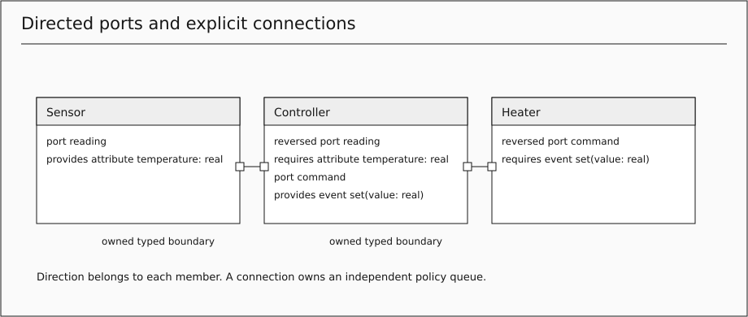
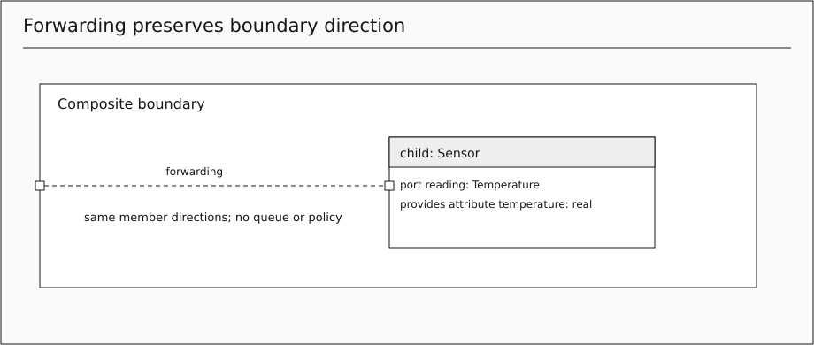
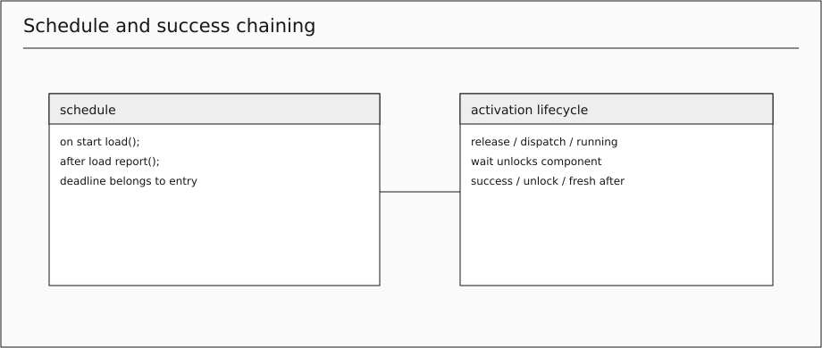
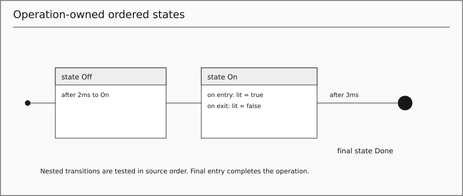
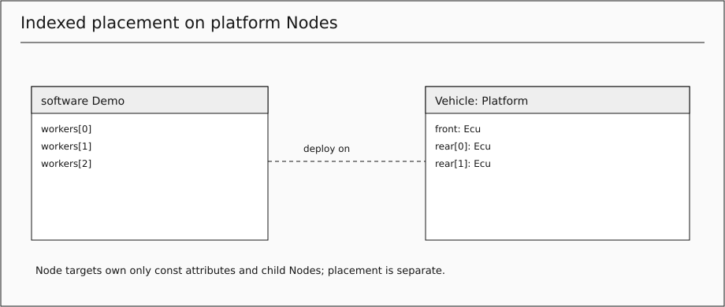
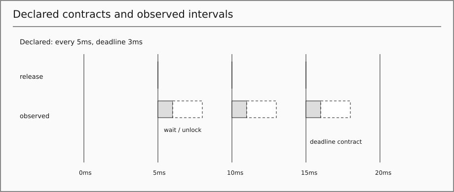

# swa.ml 2.2 worked diagrams

Generated from original scene geometry; source subjects remain authoritative.

## Directed ports and explicit connections

Source: [Control::Demo](../examples/02-realtime-controller.swaml).

## Forwarding preserves boundary direction

Source: [Boundary::Demo](../examples/26-boundary-forwarding.swaml).

## Schedule and success chaining

Source: [Chaining::Demo](../examples/25-function-completion.swaml).

## Operation-owned ordered states

Source: [States::Demo.lamp](../examples/04-stateful-function.swaml).

## Indexed placement on platform Nodes

Source: [Placement::Demo](../examples/22-platform-deployment.swaml).

## Declared contracts and observed intervals

Source: [Timing::Demo.sample](../examples/17-function-timing.swaml).
