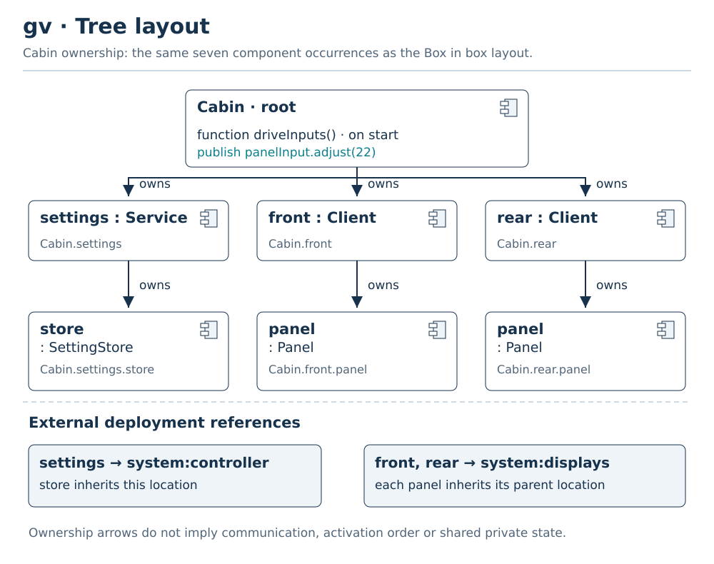
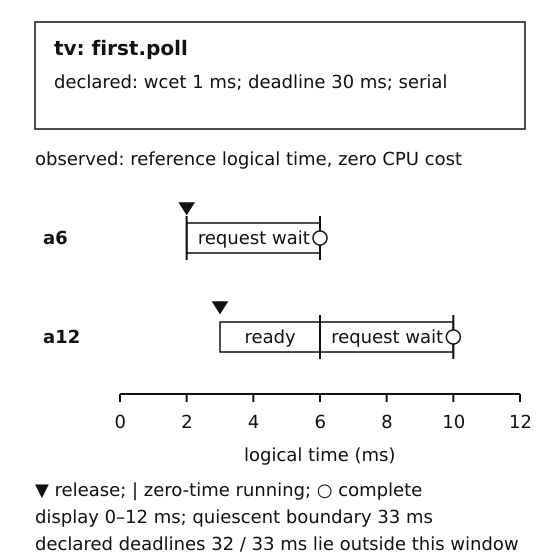

# Graphical notation examples

These rendered figures illustrate the normative [view contract](GRAPHICAL_NOTATION.md). The same vector scene sources are rendered into the PDF so labels and lines remain sharp; PNG copies support tools that require raster images. Every figure has accessible text and a specific model source; the source model remains authoritative.

For individual language concepts, use the [canonical notation catalog](GRAPHICAL_CATALOG.md), with paired SVG/PNG downloads and textual counterparts. The [notation inventory](../spec/notation.json) covers every grammar production and keyword, distinguishing standalone glyphs from compartments, labels and text-only syntax. The figures below are worked compositions of those rules, not the exhaustive symbol index.

The structure, interconnection, case, sequence, grid and flow figures use the [service setting model](../examples/08-service-field.swaml). A provider owns the setting, two client components use its RPC/events, and private storage remains behind component ports. The state figure uses the [lifecycle model](../examples/04-stateful-function.swaml); the timing figure uses [example 17](../examples/17-function-timing.swaml). The [figure manifest](../spec/graphical-examples.json) links each illustration to its model and semantic subject.

## Model Browser: actual ownership

[SVG](figures/browser.svg) · [PNG](figures/browser.png)

The tree distinguishes `SettingStore` as a component definition from `Cabin.settings.store` as an occurrence. Selection of `update` retains its instance context. A declaration command navigates to the shared definition; an fv command opens the function's body. There is no performer or separate action allocation node. Collapsed rows are presentation choices, not omitted semantics.

## gv: general structure and allocation

[SVG](figures/gv.svg) · [PNG](figures/gv.png)

`Cabin` is the root component occurrence and its profile is service. Its owned `driveInputs` function publishes the named `panelInput.adjust(22)` command. `settings`, `front` and `rear` are component occurrences. Each owns a child component instance. Dashed `deploy` edges assign settings to controller and the panels to displays; descendant components inherit those locations. These are allocation edges, not communication lines. The two Panel occurrences have distinct private stores despite sharing one definition.

## gv: the same structure as a tree

[SVG](figures/gv-tree.svg) · [PNG](figures/gv-tree.png)

Tree edges labeled `owns` replace geometric containment. Both gv layouts show seven component occurrences and six ownership relationships. Shared `Client` and `Panel` definitions retain separate `front` and `rear` occurrence paths and stores. External deployment references stay outside the ownership tree. Choose the layout in presentation metadata; the `gv` source declaration is identical.

## iv: explicit interconnection and delegation

[SVG](figures/iv.svg) · [PNG](figures/iv.png)

The two service connectors are oriented from `requires` to `provides`. The root driver publishes a typed adjustment event through its `panelInput` port and the separate `adjustCommand` connector into `front.control`, delegated to `front.panel.control`. The rear's optional control input remains unbound. Each visible boundary port is a square and delegates to a child port with the same contract/role. The shared provided port can serve both clients. The arrows indicate connector orientation; member inspection exposes reverse provider-event and response directions. Every route has its own capacity-8 FIFO queue policy per member/direction. There is no line directly coupling panel data to store data.

## cv: cases and claimed requirement coverage

[SVG](figures/cv.svg) · [PNG](figures/cv.png)

The dashed `satisfy` / `verify` link records intended coverage. It does not assert that the case is executable or verified. A future tool may attach actual analysis/test evidence; it must retain evidence identity and assumptions before showing verified status.

## sv: interface exchanges and partial order

[SVG](figures/sv.svg) · [PNG](figures/sv.png)

Lifelines are component occurrences; every message names its exposed port/member and connector. `adjust` precedes both notifications; `frontNotice` precedes `accepted`. `rearNotice` is unordered relative to `frontNotice` and `accepted`, even though the drawing places its row between them. The pale branch and explicit causal summary prevent vertical placement from inventing a total order. The reply retains the `adjust` correlation. This diagram depicts the case's partial order, not a simulator's chosen trace.

## grv: inspect properties without changing semantics

[SVG](figures/grv.svg) · [PNG](figures/grv.png)

The grid shows effective occurrence paths and source-declared contracts. A dash means the service-profile function has no timing declaration; it never means zero physical execution time. `read` is reentrant; other activation roots use the serial default. The rear row summarizes the same three declarations in a different occurrence context. Sorting a grid does not reorder source statements, queues or case dependencies.

## fv: function statement flow

[SVG](figures/fv-flow.svg) · [PNG](figures/fv-flow.png)

The frame belongs directly to `SettingStore.update`. The decision tests the actual source condition. A valid value updates private state, emits `api.changed(currentValue)` through the provider port, then returns true to the correlated request. An invalid value returns false without mutation/publication. A connector is not drawn from this local flow node to another function: the iv and port path describe the architectural exchange.

## fv: function-owned states

[SVG](figures/fv-state.svg) · [PNG](figures/fv-state.png)

`Idle`, `Running` and `Stopped` belong directly to `Device.lifecycle`. Initial entry publishes idle status. The interface event `commands.begin` enters Running; entry increments cycles and publishes running. Either `commands.stop` or the local 30-second timer enters the final state. The timer edge first publishes timeout in its effect. Final entry publishes stopped and terminates its owning function. Leaving Running cancels the old timer generation. fv projects both state behavior and statement flow from their owning functions.

## tv: observed function timing and declared contracts

[SVG](figures/tv.svg) · [PNG](figures/tv.png)

The timing view explicitly selects four client/server function occurrences. This specimen focuses on `Demo.first.poll` in the identified `success` run from [the timing artifact](../spec/function-timing-demo.json). Activations `a6` and `a12` retain separate release and terminal identities; the named polling inputs traverse their own typed routes before releasing the handlers. The root driver's activations remain in the complete trace. Declared WCET and deadline limits occupy a separate compartment; zero CPU cost in the reference simulator is not a physical execution measurement. The host binds the trace; selecting `tv` does not run the model.

## Reproduction and semantic checks

Run `python3 scripts/build-graphical-examples.py` to regenerate the ten SVG/scene pairs, and use `--check` to detect stale figures. Run `python3 scripts/build-notation.py` to regenerate their PNG copies together with the canonical catalog; its `--check` mode verifies decoded pixels. `node scripts/check-graphical-examples.mjs` resolves every manifest subject against its validated source model and verifies that all view families have an illustration. The semantic test establishes subject/reference validity; it is not a graphical editor conformance certification. Publication QA additionally renders and visually inspects the figures in the PDF.
