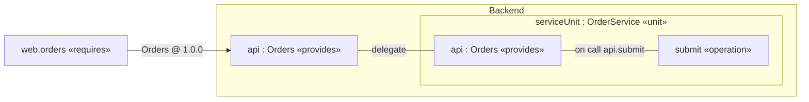
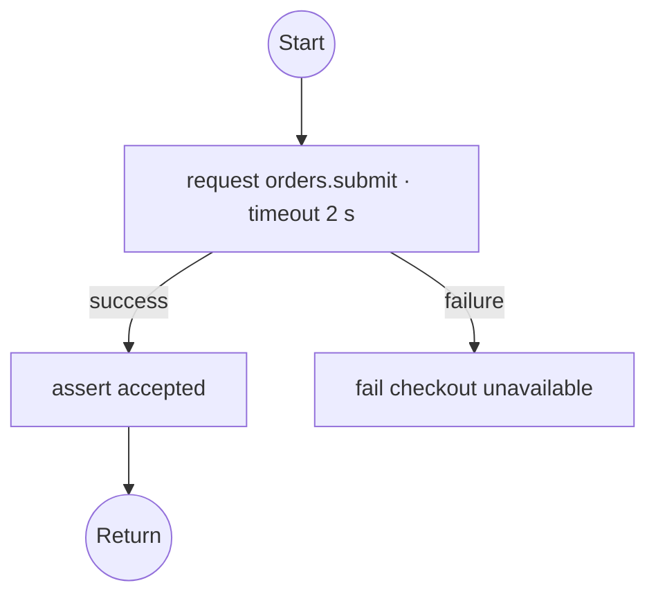
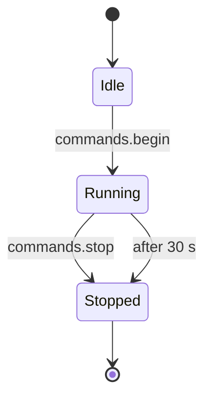

# SWAML graphical notation, version 0.1

This is the normative notation and interaction contract for a future workbench. The current repository defines the model, grammar and language server; it does not claim to ship these diagram editors.

## 1. Views and navigation

SWAML retains the user's existing view family with these exact names. GRV is interpreted as Grid View, following the existing Aliot convention.

| ID | Name | Primary subject | Contents |
| --- | --- | --- | --- |
| Browser | Model Browser | workspace / selected subtree | ownership tree, definitions/usages, errors, references |
| GV | General View | package, system, component, unit or declaration | owned elements, types, properties and relations |
| IV | Interconnect View | system or component occurrence/definition | immediate children, exposed ports, connectors, delegation |
| CV | Case View | system or case | cases, requirements and intended coverage |
| SV | Sequence View | case, or case selected from a system | interface exchanges and happens-before dependencies |
| GRV | Grid View | package or named semantic declaration | model inventory, interfaces, operations, timing, allocation or traces |
| FV | Flow View | operation | statement flow or states/transitions owned by that operation |

GV/GRV subjects exclude other views. IV accepts only a component or system; a unit is inspected through GV/FV or its containing IV. A package subject is its own name alone. These categories are validated.

GEV is absent. AFV and STV are not separate SWAML view kinds; both become FV according to the operation's body. There are no performer swimlanes. If grouping is useful, label a frame with its actual component/unit/operation path.

The Browser shows packages → definitions/system instances → child occurrences → ports, variables, functions and operations → flow statements or states/transitions. A definition and a usage MUST have distinct badges. Opening a usage preserves its instance path even when the editor displays members inherited from its definition.

Selection updates Properties; **Open declaration** selects the shared declaration. **Diagram** opens the most appropriate view for the selected semantic element, and **Up** goes to its owning element. These commands are requirements for the future host, not implemented commands in this package.

## 2. Visual alphabet

| Element | Shape and required labels |
| --- | --- |
| System | framed rectangle, `«system»`, name, profile |
| Component | rectangle with double-tab component marker, name/type; children may be nested |
| Unit | plain rectangle with `«unit»` and name/type |
| Definition | `«component def»` / `«unit def»`; no occurrence underline |
| Instance | `name : Type`, occurrence badge; unique instance path in tooltip |
| Port | small boundary square labeled `name : Interface @ version` and role abbreviation |
| Interface | contract rectangle with kind and member signatures; optional lollipop/socket glyph supplements, never replaces, text |
| Function | rounded rectangle with `ƒ`, signature and purity badge |
| Operation | rounded rectangle with `op`, signature, trigger and optional timing |
| State | rounded rectangle with `state`, name and optional entry/exit compartments |
| Initial / final | filled circle / circle with inner filled circle, plus accessible labels |
| Requirement | rectangle with `«requirement»`, name, text or synopsis |
| Case | rounded case node with name; links to requirements are dashed and labeled `satisfies (claimed)` |
| Execution node | framed box with node name and mcu/process/container badge |

A unit is not shown as a UML actor or a performer. Physical quantities, devices and hardware drawings may appear as named external software-facing adapters, not as geometry elements. Color MAY distinguish types but MUST NOT carry meaning without shape/text redundancy.

Port role labels are `S`, `R`, `C`, `Svr`, `Pub`, `Sub`, `Prov`, and `Req`. The full role appears in Properties and accessible text. An optional unconnected port is shown with a hollow center and `optional`, never hidden by default.

## 3. Lines and direction

| Relation | Line |
| --- | --- |
| Sender–receiver | solid arrow from sender to receiver; `«data»` and interface label |
| Publish–subscribe | solid arrow with event marker from publisher to subscriber; one branch per connector |
| Client–server / combined service | solid connector from client/required to server/provided, labeled `«rpc»` or `«service»`; opposite event/reply direction indicated in member inspection |
| Delegation | solid elbow from boundary port to child port, labeled `delegate`; roles remain unchanged |
| Definition typing | dashed open-triangle reference labeled `type`; not runtime communication |
| Deployment | dashed arrow labeled `deploy` to execution node |
| State transition | arrow labeled `trigger [guard] / effect`, with priority when set |
| Flow edge | directed line for local control succession; conditional branches labeled true/false |
| Requirement trace | dashed arrow labeled `satisfies (claimed)` |

Every communication line MUST terminate at a visible or explicitly elided port, never at an operation box that conceals a cross-unit bypass. An elided path must expose the full route on inspection. A connector label includes QoS at expanded detail. Invalid connectors are shown with a diagnostic badge and text; they are not restyled into apparently valid ones.

This Mermaid figure illustrates topology only; a production IV uses the boundary-square port glyphs above:

The handler association inside the unit is not a second communication connector. Only the external `req`–`bp` line denotes an intercomponent exchange.

## 4. Flow View

FV has two projections under one view ID:

- **Statement body:** start, ordered statement nodes, decisions, bounded-loop back edges, request success/failure branches, local invoke nodes and end/failure terminals. A send/publish/request node carries its exact `port.member` path. Data values are labels or optional local edges, not global event nodes.
- **Stateful body:** initial state, state nodes, entry/exit compartments, transitions, timer/event labels and final states. State rectangles remain inside the owning operation frame. A state is not allocated later to a performer.

The state diagram is the FV of `Device.lifecycle`, not an independent STV. In a full renderer, the frame and port-trigger labels link back to that exact operation and its interface contract.

## 5. Sequence and case views

SV lifelines represent component or unit **instances**, with the visible port path on each message. A request has a solid arrow and correlation label; its reply is dashed with the same correlation. Data/events use asynchronous arrows. Provider events on a combined service go in the reverse direction to client requests.

An SV renderer MUST preserve `after` dependencies and show unrelated steps as unordered/concurrent rather than inventing semantic ordering from vertical placement. It MAY choose a stable topological arrangement for readability, but must mark independent groups and expose the dependency relation. A case cannot create an operation, free event, implicit connector or arbitrary actor bypass merely by drawing a message.

CV shows the system's named cases and explicit requirement links. A filled verification checkmark requires linked evidence from a verification tool; a `satisfies` assertion alone is shown as claimed coverage.

## 6. Grid View

GRV is a table projection, not geometry. Available grids SHOULD include:

| Grid | Minimum columns |
| --- | --- |
| Inventory | name, kind, owning path, definition/usage, diagnostic count |
| Interfaces | interface/version, member, parameters/result, port roles, emitter/handler |
| Connections | source, target, interface, delivery, capacity, overflow, latency, age |
| Operations | unit path, signature, trigger, WCET, deadline, period, concurrency |
| Deployment | instance, effective node, explicit/inherited allocation |
| Trace | requirement, case, evidence status, source location |

Sorting and filtering do not change semantic order. Editing a value performs a validated source edit with undo; computed effective values must reveal the declaration that owns them.

## 7. Synchronization, layout and editor safety

Text and diagrams project one semantic model. A layout file stores view ID, subject identity, node positions, edge bends, collapsed regions, filters and styling only. It MUST NOT store a competing definition of ports, triggers, interfaces or connections. Source remains authoritative for semantics.

A graphical mutation MUST resolve selected semantic IDs, prepare a source edit, parse/link/validate the proposed result, report new errors, apply the edit atomically, and preserve undo. A tool may intentionally apply an incomplete editing step only if it remains visibly invalid. Moving a node changes layout only; reparenting an operation changes semantics and must validate references and interface access.

Deleting a port must reveal impacted connectors, statements and handlers. Renaming must update every typed cross-reference and path string, including cases and view subjects. Diagram nodes need stable IDs and source ranges; generated AST object identity is not stable across reparses.

The Browser, property panes and diagrams MUST support keyboard navigation and text alternatives. Error states need icons and labels in addition to color. Large models may elide details, but hidden exchanges must remain discoverable through the Browser and interface grid.
