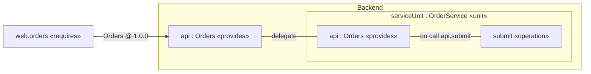
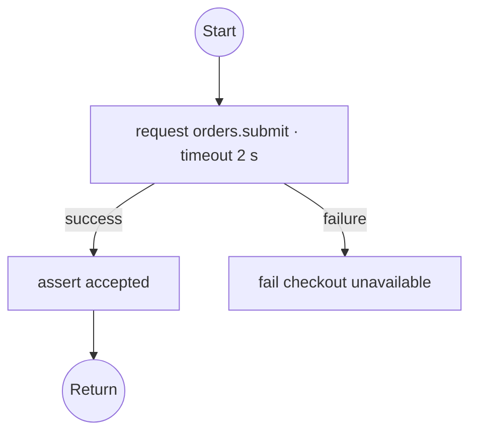
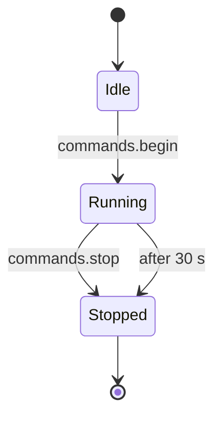

# SWAML 1.0.0 — Complete language reference

**Software Architecture Modeling Language** · Language header `swaml "1.0";` · Independently authored, KerML-based semantic design.

This is the complete user-facing Markdown edition, generated from the maintained source chapters. Navigate by the alphabetical concern map or the exhaustive alphabetical keyword reference. Normative chapters define meaning; tutorials, comparisons and examples illustrate it. The portable reference parser and logical simulator provide executable evidence with the limitations stated below.

## Contents

- [Document scope](#source-ffe5ff67da37)
- [Getting started](#source-c9e79bd9c348)
- [Alphabetical concern map](#source-62d51cd6e7d4)
- [Architecture comparison](#source-3ffb1a6eb6e5)
- [Behavior and states](#source-af5c925f5118)
- [Communication](#source-410a83e3a0f0)
- [Conformance and evidence](#source-7edf1a193e2a)
- [Formal semantics](#source-cf1f654f62f1)
- [Graphical notation](#source-5798f00f85a6)
- [Kernel mapping](#source-237cbcd491f2)
- [Kernel normalization](#source-0db79669e756)
- [Runtime contract](#source-34105487b7a4)
- [Simulation](#source-fedc6631cb48)
- [Structure, names and values](#source-4efedf58f92b)
- [Systems, timing, deployment and cases](#source-1f8b7bb89e5f)
- [Version migration](#source-5407baa56901)
- [Alphabetical keyword reference](#source-a10a03d9b23f)
- [Implementation evidence](#source-f25fc4312adb)
- [Tool integration](#source-5ec3282569db)
- [Complete concrete grammar](#complete-concrete-grammar)
- [Model examples](#model-examples)

<a id="source-ffe5ff67da37"></a>

# SWAML language specification

**Version:** 1.0.0 · **Language header:** `swaml "1.0";` · **Status:** 1.0 release candidate · **Date:** 2026-10-14

SWAML means Software Architecture Modeling Language. This document and its normative chapters define a software architecture language over a KerML-based semantic model. SWAML is independently authored; “unofficial UML 3.0” describes its motivation and does not denote an OMG standard or compatibility level.

## 1. Normative document set

Read these chapters together. Their requirements have equal standing:

1. [Structure, names and types](#source-4efedf58f92b).
2. [Interfaces and communication](#source-410a83e3a0f0).
3. [Operation and state semantics](#source-af5c925f5118).
4. [Timing, deployment, cases and conformance](#source-1f8b7bb89e5f).
5. [KerML semantic mapping](#source-237cbcd491f2).
6. [Graphical notation](#source-5798f00f85a6).
7. [Concrete grammar](../src/language/swaml.langium).
8. [Operational contract and target bindings](#source-34105487b7a4).
9. [Normalized semantic model](#source-0db79669e756).
10. [Conformance obligations and evidence](#source-7edf1a193e2a).
11. [Formal core and simulation relation](#source-cf1f654f62f1).
12. [Machine-readable mapping inventory](../spec/kerml-mapping.json).

The [user guide](#source-c9e79bd9c348), [architecture comparison](#source-3ffb1a6eb6e5), examples and design decisions are informative. The [implementation matrix](#source-f25fc4312adb) reports current tool support; a missing implementation does not waive a language rule.

## 2. Normative terms and precedence

MUST and MUST NOT state conformance requirements. SHOULD states a recommendation with an explicitly documented justification needed for deviation. MAY grants permission. “Error” means a model is not valid under this version. An implementation may retain an invalid model for editing but MUST NOT report it as fully valid.

The grammar determines tokens and parse structure. Prose determines validity and meaning. If grammar accepts text that violates a semantic rule, that text is invalid. If a discovered conflict makes the two impossible to satisfy, record a specification defect; do not silently choose a runtime meaning. Unknown syntax and unknown language versions MUST be rejected.

The language is closed at version 1.0: constructs not listed in the grammar are not implicitly inherited from UML, SysML or KerML. Definitions may be reused by instantiation, but inheritance, generics, redefinition, unrestricted KerML embedding and dynamic creation are not part of this version. This constraint makes the whole v1.0 language implementable without pretending to reproduce three other standards.

## 3. Design invariants

- **I1 — Boundary:** every exchange between distinct unit instances crosses port instances typed by the same interface contract and a permitted connector/delegation path.
- **I2 — Ownership:** components own composition; units own private data, functions and operations; operations own statement flow or states. No performer element, behavior allocation, free action, free signal, or global variable exists.
- **I3 — Event provenance:** every outgoing data/event member of a unit port has at least one syntactically associated emitting operation. Every incoming member has exactly one handling operation, including a stateful operation where applicable.
- **I4 — Type safety:** payloads and results conform to nominal contracts. Messages transfer values, never aliases to another unit's private state.
- **I5 — Explicit communication policy:** every connector declares delivery, ordering, capacity and overflow. Time-sensitive connections add latency/freshness bounds.
- **I6 — Views preserve meaning:** views reference existing semantic elements. Drawing a message cannot create a hidden communication channel.

Local calls, calculation values, timer expiration, initial activation and state completion do not constitute exchanges between units. They are the only exceptions needed for local computation and lifecycle. An external actor or device that exchanges model data MUST be represented through a component/unit port; a case actor label cannot bypass I1.

## 4. Abstract model inventory

| Element | Owns | References / meaning |
| --- | --- | --- |
| Model | packages | exact language version |
| Package | imports, named elements | namespace |
| DataType / EnumType | fields / literals | immutable value shape |
| Interface | data, event or operation members | nominal versioned contract |
| Component definition | ports, child instances, connectors, delegation | reusable composition type |
| Unit definition | ports, private variables, operations, functions | reusable behavior/data boundary |
| Instance | no inline definitions in 1.0 | one component or unit definition |
| Port | role and optionality | one interface |
| Connector | QoS | source and target port paths |
| Delegation | no data conversion | outer port and immediate child port |
| Operation | parameters, result, trigger, timing; flow **or** machine | executable behavior owned by a unit |
| Function | parameters, result, expression | pure local calculation |
| Machine | states, transitions, initial reference | lifetime of a stateful operation |
| State | entry and exit blocks | one operation-local condition |
| Transition | guard, effect, priority, trigger | source and target states |
| System | component instances, connectors, execution nodes, deployment | closed assembly and profile |
| Requirement | text | named obligation |
| Case | exchange steps, trace links | one system and requirements |
| View | kind | one subject, no runtime semantics |

All named elements have stable identity within a model version. Tools SHOULD persist a separate UUID identity map for editing; the language's normative textual identity is its qualified declaration/instance path. A rename is an identity-preserving edit only when the tool updates that map and all references atomically.

## 5. Conformance summary

A parser supports concrete syntax. A semantic validator additionally enforces static rules. A KerML mapper additionally produces the normalized representation in chapter 5. An execution backend additionally realizes chapter 3 and communication policies. A graphical editor additionally satisfies the view/editing contract. A tool MUST state which levels it implements; success at one level MUST NOT imply the others.

This repository supplies a parser, LSP foundation, documented static validation and a [reference simulator](#source-fedc6631cb48). The specification defines more than that implementation, especially runtime delivery, idempotency, target snapshot realization, timing proof, interchange and graphical editing. See the [exact support matrix](#source-f25fc4312adb).

---

<a id="source-c9e79bd9c348"></a>

# SWAML 1.0 user guide

SWAML describes what software contains, how it communicates, and how operations and state evolve. The model remains independent of C++, Rust, an RTOS, a cloud runtime, or a particular network protocol.

## 1. Install and check a model

From the repository root:

```sh
npm ci
npm run build
node out/src/cli/main.js examples/01-hello.swaml
```

A successful result is `Checked 1 model(s): 0 error(s)`. This checks the implemented rules; it does not execute the software or prove schedulability. `npm run check` also runs the repository tests. Open the [implementation matrix](#source-f25fc4312adb) before interpreting a passed check as a stronger assurance claim.

A file starts with `swaml "1.0";` and contains named packages. Names are case sensitive. Keywords cannot be identifiers. Use `orderLink`, for example, rather than the reserved word `ordering`.

## 2. Write the contract first

Choose the communication model by the meaning of the exchange:

| Need | Interface | Roles | Operation statement |
| --- | --- | --- | --- |
| A current sensor value | `senderReceiver`, `sampled` data | sender → receiver | `send p.member(value);` |
| Every queued reading | `senderReceiver`, `queued` data | sender → receiver | `send p.member(value);` |
| Request and correlated response | `clientServer` | client → server | `request p.member(...) as result within … otherwise …;` |
| One event to many subscribers | `publishSubscribe` | publisher → subscriber | `publish p.member(...);` |
| RPC plus server notifications | `service` | requires → provides | request and publish |

Each connector uses one nominal interface definition. Equal-looking interfaces are not automatically interchangeable. Create an adapter unit when their meaning, payload, or version differs.

This is a complete small model; save it as `example.swaml`:

```swaml
swaml "1.0";
package First {
    interface senderReceiver Reading version "1.0.0" {
        data value: Real sampled;
    }
    unit def Source {
        port output: Reading sender;
        operation sample(): Void on start {
            send output.value(21.5);
            return;
        }
    }
    unit def Sink {
        port input: Reading receiver;
        var last: Real = 0.0;
        operation update(value: Real): Void on receive input.value {
            set last = value;
            return;
        }
    }
    component def Pair {
        unit source: Source;
        unit sink: Sink;
        connect readings: source.output -> sink.input qos {
            delivery atMostOnce; ordering fifo; capacity 1; overflow dropOldest;
        };
    }
    system Demo service { component pair: Pair; }
    view overview GV of Demo;
    view wiring IV of Pair;
    view updateFlow FV of Sink.update;
}
```

`Reading` defines the payload. Both ports use it with complementary roles. `sample` sends through its own port, and `update` declares that same port-member contract as its activation source. The connector allows the transfer. The variable `last` belongs to each `Sink` instance, not to every instance of its definition.

## 3. Choose component and unit boundaries

Use a **component** for a reusable architecture boundary: an embedded controller, a service backend, or a subsystem. Use a **unit** for a cohesive implementation boundary that owns operations and private data. A unit need not be a thread, file, class, or process; deployment is separate.

A component owns component/unit instances, ports and connectors. It does not own executable statements. A unit owns operations, pure functions and private variables. This keeps executable ownership unambiguous.

An operation can call a local helper with `invoke helper(...);`. The helper must be an untriggered `Void` operation in the same unit. Use `compute functionName(...)` for pure calculation results. These local calls do not need ports because they do not cross the agreed unit boundary.

Never write `otherUnit.operation()` or `otherUnit.privateValue`. The syntax and validator reject that access. To reach another unit, declare a port, choose an interface, connect it in their common parent, and use `request`, `send` or `publish`.

For a nested component, expose a boundary port and delegate it to one immediate child port. The [service example](../examples/03-service-pubsub.swaml) demonstrates `Backend.api` delegating to `serviceUnit.api`. Delegation preserves the port's role and interface; it does not reverse them or convert data.

## 4. Describe operation control flow

Operations contain ordered statements: typed local declarations, assignments, assertions, conditionals, bounded loops, local calls, interface exchanges, returns and failures. Read [Values and flow](../examples/05-values-and-flow.swaml) as a worked example.

Functions are expressions with typed parameters and results. They cannot read mutable unit data, issue requests, or emit events. Pass their inputs explicitly. Records, enums and arrays are values, so sending them does not expose a remote reference to local mutable data.

A `while` includes a maximum iteration count. Exceeding that count at runtime is a failure, not permission to silently stop the loop. This makes the bound useful to a later analysis or code generator.

Use `assert` for a model-level assumption that must hold at that point. A requirement is a named prose obligation. A case can link to requirements using `satisfies`; that trace link is not proof that the requirement is met.

## 5. Model a service call and its failure

Read [Services and pub/sub](../examples/03-service-pubsub.swaml). The service declares `submit` in its interface; the server unit implements it with `on call api.submit`. The client's `request` includes a timeout and an `otherwise` block.

A request binds its result only on success. The failure block has a local `failure: String` value and must return from or fail the current operation. This prevents subsequent statements from reading an uninitialized result. A timeout says the caller stopped waiting; it does not prove the server did nothing. Later responses to that timed-out request are ignored.

For application-specific errors, use an enum or result record in the operation's declared return type. Transport failures and application results are different concepts. Do not retry a request unless its idempotency and retry budget are established. The core rejects `atLeastOnce` RPC when the operation is not declared idempotent; proving that declaration is an implementation obligation.

## 6. Use publish/subscribe without a hidden event bus

An event is a member of a `publishSubscribe` or `service` interface. Only an operation can publish it, through one of its own outgoing ports. Subscribers receive it through their own typed ports. The normal handler uses `on receive input.eventName` with the event's parameter types in order.

Fan-out is multiple explicit connectors from a publisher port to subscriber ports. Each subscription has its own queue and QoS. A slow subscriber does not silently change the queue of another subscriber. Multiple publishers may connect to one subscriber; ordering is per connector, not global.

In a combined service, the connector is drawn from `requires` to `provides` for requests. Service events travel back from provider to consumer, and replies return on the originating request's correlation. Both remain members of the same declared interface.

Model a broker as a component with incoming and outgoing interfaces if broker behavior, failure, buffering or deployment matters. A connector alone represents a logical subscription, without selecting MQTT, DDS, Kafka or SOME/IP. Dynamic discovery and unsubscribe operations are reserved for future language versions.

## 7. Put states inside an operation

The [stateful operation example](../examples/04-stateful-operation.swaml) owns `Idle`, `Running`, and `Stopped` inside `Device.lifecycle`. It starts once with its unit. No performer or external behavior allocation is required.

A stateful operation returns `Void`, has no parameters and uses `on start machine { … }`. It declares an initial state, states with optional entry/exit blocks, and transitions. Triggers are an incoming port member, a positive delay after entering a state, or completion. A receiving transition makes event parameter names available in its guard and effect; sender–receiver data uses `payload`.

On a transition: run the source exit block, the transition effect, then the destination entry block. A final state completes the stateful operation. A received event with no enabled transition in the current state is consumed and ignored. Add an explicit transition if ignoring it is unacceptable.

Use one stateful operation as the receiver for a given member, or one ordinary operation. Do not bind the same member to both: that would create ambiguous delivery.

## 8. Model realtime constraints

The [controller example](../examples/02-realtime-controller.swaml) uses `on every 10 ms`, execution-time bounds and deadlines. A realtime or mixed system requires timing contracts for every used operation and maximum connector latency. Sampled realtime data also needs `maxAge`.

The validator checks positivity, `wcet <= deadline`, and `deadline <= period` for a periodic operation. These are necessary checks, not a scheduling proof. Document the actual RTOS policy, interrupt load, CPU allocation, priorities, clock assumptions, transport timing and measured/analyzed WCET in the implementation project. A production backend must establish them before claiming hard realtime execution.

`serial` is the default unit-local execution policy. `reentrant` requires independent activations and must not mutate shared unit state, including through helpers. An operation waiting for a service response consumes elapsed deadline time even when it consumes no CPU execution time.

## 9. Separate deployment from architecture

A system can declare execution nodes with kind `mcu`, `process`, or `container`, and `deploy instance.path on nodeName;`. A component deployment applies to descendants unless a more specific descendant deployment overrides it. Each explicit instance path may be deployed only once.

Nodes are allocation targets, not units and not communication shortcuts. Moving a unit to another process cannot make a previously illegal direct data access legal. Network addresses, credentials, task schedules and generated code are outside the 1.0 model.

The [mixed gateway](../examples/06-mixed-gateway.swaml) shows how one unit explicitly converts sampled values into event notifications. An adapter owns the conversion, timing and failure policy.

## 10. Organize a larger model

Packages are flat namespaces in 1.0. Write `import Contracts::*;` to use another package's declarations unqualified, or name a declaration `Contracts::Reading`. All relevant files must be loaded together. Two imports exposing the same short name make it ambiguous; use the qualified name.

The editor host should load the whole model workspace. The CLI deliberately loads the files you supply and does not search unrelated directories. Do not put secrets in model payloads, examples or deployment notes.

## 11. Navigate through views

| Surface | Purpose |
| --- | --- |
| Browser | Navigate packages → definitions → instances → ports/operations → states |
| GV — General View | Inspect structure, declarations and their relationships |
| IV — Interconnect View | Inspect connected ports and component delegation |
| CV — Case View | Inspect cases and linked requirements |
| SV — Sequence View | Inspect the partial ordering of interface exchanges in a case |
| GRV — Grid View | Inspect sortable model, interface, timing and deployment tables |
| FV — Flow View | Inspect an operation's control flow or owned state transitions |

These are specified editor behaviors. The current package supplies the model syntax and language server, not a diagram renderer. View declarations can already be parsed and checked. See [graphical notation](#source-5798f00f85a6) for the drawing and editing contract. There is no GEV, and AFV/STV are combined into FV.

## 12. Resolve diagnostics

| Diagnostic | Typical fix |
| --- | --- |
| `SW030` | Connect immediate child ports; expose/delegate a port across each component boundary |
| `SW031` / `SW032` | Use the same interface definition and complementary port roles |
| `SW034` | Connect the port in a closed system, or mark an intentionally unbound port `optional` |
| `SW050` / `SW051` | Use a local port member and the correct communication verb/direction |
| `SW052` / `SW055` | Match handler parameters/results and give each incoming member one owner |
| `SW057` | Make every failure path return or fail |
| `SW062` | Give competing transitions distinct priorities |

A parser error usually means a reserved identifier, missing delimiter, or malformed block. Resolve syntax errors first; semantic checks are skipped on syntactically incomplete documents to avoid misleading secondary errors.

## Service fields, repeated consumers and checked traces

[Service field](../examples/08-service-field.swaml) models one temperature setting with explicit `get`, `setPoint` and `changed` interface members. The service stores the value privately. Its serial setter publishes through its provided port, which fans out to two required ports on separate panel instances. Each panel owns a distinct displayed value and its own receiving operation.

The getter is reentrant and reads the private-state snapshot taken when it is dispatched. It can safely overlap the serial setter because it does not mutate storage, directly or through a helper. Snapshot implementation is an execution-backend obligation; parsing this example does not simulate it.

A case reply must follow a unique unanswered matching request through its `after` ancestry. Two outstanding requests on the same route/member cannot be disambiguated by drawing one reply lower on the page. Order the pairs or use separate cases. Requests may remain unanswered in a partial trace. A route-valid case still needs an operation-level witness before it counts as verified behavior.

Use the owning package's name as a GV/GRV subject for an inventory. IV takes a component/system; FV takes an operation, including an occurrence path such as `Cabin.settings.store.update`. CV/SV take a case or system. A view cannot use another view as its semantic subject.

If a request returns Void, its required `as` name marks completion but cannot be read as a value. Reserve `failure` for the implicit error-path binding. Write string line breaks with `\n`; raw line breaks, tabs and unsupported escapes inside strings are rejected.

The [operational contract](#source-34105487b7a4) defines execution edge cases, and the [conformance obligations](#source-7edf1a193e2a) distinguish validator acceptance from runtime and analysis evidence.

## Find a construct or run an example

Use the [alphabetical keyword reference](#source-a10a03d9b23f) for exact words and context, the [concern guide](#source-62d51cd6e7d4) for architectural questions, or the [complete Markdown book](SWAML-1.0.0-Reference.md) for a single user-facing document. All eight examples have executable [simulation configurations](../examples/simulation/runs.json); follow the [reference simulation guide](#source-fedc6631cb48) to run them and inspect their traces.

---

<a id="source-62d51cd6e7d4"></a>

# Language reference by concern

Use this alphabetical map to navigate SWAML 1.0 by architectural question. The [alphabetical keyword reference](#source-a10a03d9b23f) provides the other reading order; the [complete Markdown edition](SWAML-1.0.0-Reference.md) contains both maps, all normative chapters, user guidance, grammar and model examples in one document. Rules are normative where their source chapter says so; a tutorial or illustration never overrides those rules.

## Architecture selection and platform correspondence

Start with the [architecture comparison](#source-3ffb1a6eb6e5). SWAML borrows strict interface boundaries from component/service architectures and familiar structural/behavioral concepts from UML/SysML. Its authoring model is deliberately software-specific. A Classic-like control loop uses sampled senderReceiver members, periodic operations and explicit timing. A service architecture uses operation/event contracts, correlated requests, timeout handling and static subscriber connections. A gateway explicitly translates between these through its own unit ports.

Choose a `realtime`, `service` or `mixed` system according to the contracts you intend to supply. The choice does not turn the model into AUTOSAR configuration or prove a scheduling property. Use an adapter unit when hardware or middleware behavior matters to the architecture. External devices cannot enter a case through an untyped actor shortcut.

## Behavior and state ownership

See [operations, flow and states](#source-af5c925f5118) and the [operational contract](#source-34105487b7a4). Units own executable operations directly. A function is a pure returned calculation; an untriggered Void operation is a local imperative helper; a triggered operation is a root activation. Components compose these units and do not add a second behavior allocation layer.

Choose a statement body for sequential calculation and requests. Choose a machine body when the operation remains in named states between inputs. States, guards and transitions remain inside that operation. There are no independent actions or performers. The operation's flow/state body is the subject of FV. Entry/exit cannot read a transition payload; save a needed value in private unit data in the effect.

## Cases, requirements and evidence

See [systems and cases](#source-1f8b7bb89e5f). Requirements are named natural-language obligations. A case describes permitted interface exchanges in a chosen system and may claim requirement coverage. Case steps reference actual top-level connectors and member paths. `after` gives causality; independent steps remain unordered.

A reply needs one unanswered matching request in its causal ancestry. Route validity is checked statically. A simulation or analysis witness is separate evidence that the operation bodies can realize the described case. Neither a `satisfies` keyword nor a green line in a diagram establishes that evidence. CV shows coverage claims; SV shows the causal exchanges.

## Communication and interface boundaries

See [interfaces and communication](#source-410a83e3a0f0). Choose senderReceiver for data, clientServer for RPC, publishSubscribe for events, or service for RPC plus provider events. Contracts are nominal and versioned. Unit ports bind those contracts to operations; component boundary ports delegate them through the hierarchy. Connect only immediate child ports at each composition level.

A sender/publisher can fan out. A subscriber can receive multiple publisher routes, each with its own queue. A receiver/client/requires port has at most one route. Required ports must be connected in a selected closed system; optional unbound RPC reports Unavailable. Reading another unit's fields, invoking its operation directly, sending a free event, or adding a topic string outside a contract is invalid.

Queue delivery, order, capacity and overflow are mandatory. Data/event admission can partially succeed across fanout, so atomic broadcast needs an explicit protocol. Requests wait for one correlated result and require a failure branch. Timeout does not cancel server effects. A field-like service property is modeled as getter, setter and changed event, with private storage; see [the setting example](../examples/08-service-field.swaml).

## Conformance and formal accuracy

Read the [obligation classification](#source-7edf1a193e2a), [formal rules](#source-cf1f654f62f1) and [implementation matrix](#source-f25fc4312adb). S means grammar support, V static validity, K kernel mapping, E execution and G graphical editing. Their obligations are distinct. The reference implementation supplies parsing, broad static checks and a defined logical simulation binding; independent complete certification is not asserted.

A parsed but invalid model is not executable. A valid model may deliberately fail an assertion, overflow a queue, exceed a loop bound, time out, or violate a timing contract at runtime. Report those observations; do not weaken the language to make every accepted model look successful. Unknown syntax and unknown headers must be rejected.

## Graphical views and navigation

See [graphical notation](#source-5798f00f85a6). The Model Browser exposes ownership and definition/occurrence identity. GV shows general structure, IV connections, CV cases/coverage, SV exchanges, GRV tabular properties, and FV operation flow or states. A selected occurrence retains its instance path when its shared declaration is displayed.

A diagram is a projection of the same semantic model as the text. Layout belongs in a sidecar. Port/member paths and connector identities must remain discoverable; a drawing cannot create a hidden channel. Source edits require parse/link/validation and undo. Full VS Code extension/editor implementation belongs in a separate repository.

## Kernel foundation and interchange

Read [KerML mapping](#source-237cbcd491f2) and the [normalized model](#source-0db79669e756). They specify identities, ownership, value types, routes, behavior lowering, metadata and reverse traces. The [mapping inventory](../spec/kerml-mapping.json) covers every grammar rule and type alias, including syntax that contributes to an owner's semantics rather than creating its own kernel node.

SWAML is defined over a proposed KerML-based semantic contract. This release does not export a kernel-validated artifact or publish a formal SWAML KerML library. The Langium AST is an authoring representation. A backend must preserve SWAML-specific queues, copying, snapshots, correlation and reaction order through a versioned library; kernel metadata alone is not execution support.

## Names, structure and reusable types

See [structure, names and types](#source-4efedf58f92b). A package owns top-level declarations; `A::T` selects a package member, while dots follow structural or local-value paths. Imports are direct, not transitive. Short-name ambiguity is an error across declaration kinds. Local operations/functions never resolve to another unit by fallback.

Definitions are reusable types. Instances create distinct boundaries, stores and activations. A component can contain units and components; a system contains components. Containment is acyclic. A unit variable belongs to one occurrence and is initialized before any startup work runs. Reusing a definition never creates shared singleton state.

## Simulation and runtime failures

Use the [reference execution profile](#source-fedc6631cb48). Every example has a checked run configuration. Supply the entire validated workspace, selected system and finite horizon. The output records exact sources, options, chronological observations and final stores/states. Exercise adverse conditions with the offer-indexed fault schedule and inspect whether the intended offer occurred.

Simulation fixes one deterministic ordering among core-permitted schedules, uses bounded resources and zero local CPU cost. It can expose behavioral failures, queue effects and elapsed-time violations; it cannot prove all schedules safe or establish hardware schedulability. Keep evidence linked to exact source versions and target assumptions.

## Timing, deployment and concurrency

See [timing and deployment](#source-1f8b7bb89e5f) and [dispatch rules](#source-34105487b7a4). WCET is active execution, deadline is elapsed time from release, maxLatency ends at destination readiness, and maxAge measures original message age until dispatch. Periodic deadlines cannot exceed their periods. A state machine's contract applies per reaction, not to its whole lifetime.

Serial roots retain their unit lock across RPC waits; a callback to that same serial unit may have to wait. Reentrant roots use read-only dispatch-time snapshots and may not mutate private unit state through helpers. Allocation inherits from the nearest explicitly deployed ancestor. MCU/process/container labels do not supply a scheduler or bypass interface isolation.

## Values and calculation

See [value and expression rules](#source-4efedf58f92b). Values are Bool, bounded Int, finite binary64 Real, String, nominal records/enums and fixed arrays. Parameters, locals and messages contain copies. There are no pointers, dynamic collections, implicit remote references or global mutable data.

Use whole-value assignment. Record field and final array-index reads are local value operations; field/index mutation is absent. Pure functions cannot read unit variables. Int-to-Real widening is scalar only. Division returns Real; integer remainder follows the dividend's sign. Arithmetic range, general array bounds and finite loop/microstep behavior are runtime obligations.

## Versioning and language evolution

The language header is `swaml "1.0";`, while this specification/package revision is 1.0.0. Interface versions are independent nominal contract labels. Follow the [migration guide](#source-5407baa56901) for 0.1 models and preserve the historical release artifacts.

Inheritance, generics, dynamic instance/subscription/discovery lifecycle, unbounded arrays, reference payloads, hierarchical/orthogonal states, unrestricted fork/join and host-language code are outside this closed version. A proposal adding them must define syntax, ownership, typing, operational meaning, graphical projection, mapping, migration and tests before it is accepted. These concerns must not appear as undocumented backend shortcuts.

---

<a id="source-3ffb1a6eb6e5"></a>

# Architecture analysis and SWAML design rationale

This is an original design comparison, not a declaration of compatibility with the referenced standards. Research checked on 2026-10-14. The detailed AUTOSAR comparisons use the accessible R21-11/R19-11 specification material as a stable conceptual baseline; they are not a feature-by-feature review of the latest release.

## Comparison

| Concern | AUTOSAR Classic | AUTOSAR Adaptive | UML 2.5.1 / SysML 2.0 | SWAML decision |
| --- | --- | --- | --- | --- |
| Architectural focus | Embedded software components, RTE and BSW | Service-oriented adaptive applications | General software / systems modeling | Software units and components with separate deployment |
| Contract style | Sender–receiver and client–server interfaces | Methods, events and fields | Interfaces, ports, connectors and behavioral constructs | Four explicit interface kinds; fields expand to operations/events |
| Behavior ownership | Runnable entities and activation events | Application behavior behind service APIs | UML behaviors/operations; SysML actions, states and usages | Operations own flow/states directly in their unit |
| Exchange boundary | Ports and runtime integration | Service communication | General-purpose mechanisms can be used in several modeling styles | Cross-unit communication must always use ports/interfaces |
| Timing | Strong embedded integration context | Distributed execution and communication concerns | Expressible constraints; target analyses vary | Period, WCET, deadline, latency and age; no implied scheduling proof |
| Deployment | ECU/BSW/RTE integration | Processes/machines and middleware | Deployment/allocation abstractions | Logical nodes and separate target binding |
| Graphics | Tool-specific architecture views | Tool-specific service views | Broad diagram/view families | Browser + GV/IV/CV/SV/GRV/FV |

The table's SWAML column is our design judgment. The following paragraphs identify the source concepts and the choices drawn from them.

## AUTOSAR Classic

Classic's application, RTE and basic-software layers separate application software from its integration infrastructure. Its virtual functional bus uses dedicated ports. The software-component template distinguishes sender–receiver data and operation-oriented client–server communication; runnable activation links interface activity to executable behavior. [Classic Platform overview](https://www.autosar.org/standards/classic-platform/), [Software Component Template, R21-11](https://www.autosar.org/fileadmin/standards/R21-11/CP/AUTOSAR_TPS_SoftwareComponentTemplate.pdf), [R19-11 runnable/operation specification](https://www.autosar.org/fileadmin/standards/R19-11/CP/AUTOSAR_TPS_SoftwareComponentTemplate.pdf).

**SWAML inference:** retain strict port contracts and explicit activation, but make them platform-neutral. A unit is not automatically a runnable, and a component is not automatically an AUTOSAR atomic SWC. A Classic backend could map a suitable unit operation to a runnable, `on every` to timing activation and `on call` to operation activation, subject to target restrictions. WCET and queue semantics must survive the mapping.

**Do not infer:** SWAML does not supply RTE generation, ECU extract completeness, BSW configuration or ARXML conformance. A valid SWAML model may need additional target constraints before export.

## AUTOSAR Adaptive

Adaptive communication management distinguishes service methods, events and fields, with proxy/skeleton roles and subscription behavior. That separation is useful for a contract that contains both RPC and asynchronous notification. [Communication Management, R21-11](https://www.autosar.org/fileadmin/standards/R21-11/AP/AUTOSAR_SWS_CommunicationManagement.pdf), [Communication Management, R19-11](https://www.autosar.org/fileadmin/standards/R19-11/AP/AUTOSAR_SWS_CommunicationManagement.pdf).

**SWAML inference:** a `service` interface combines operation and event members; requires/provides ports capture consumer/provider roles. A field is explicitly represented by getter, setter and changed-event members, with storage private to the provider. Separate `publishSubscribe` contracts also support event-only architecture without forcing an RPC service.

**Do not infer:** a combined service connector is not automatically SOME/IP, DDS, ara::com, discovery configuration or an Adaptive manifest. Dynamic discovery and subscription lifecycle are deferred rather than approximated by undocumented behavior. Adapter units provide explicit mappings between Classic-style data and service events.

## UML

UML supplies rich structural and behavioral modeling: components, interfaces, ports, operations, activities, state machines and interactions. Its breadth permits many modeling styles; a software-architecture discipline must choose which relationships constitute legal runtime exchange. [OMG UML 2.5.1](https://www.omg.org/spec/UML/2.5.1).

**SWAML inference:** preserve familiar components, operation signatures, state/flow and sequence concepts while making the communication boundary a language invariant. Replace free signals and arbitrary cross-object access with interface-member paths. Keep simple value types rather than importing the full UML class/object feature set.

“Unofficial UML 3.0” is a useful aspiration—modern textual software modeling on KerML—but not a version or compliance claim. SWAML is named independently and does not reuse UML certification marks.

## SysML 2.0 and KerML 1.0

SysML 2.0 uses KerML as its foundation and provides definition/usage modeling, typed features and behavior constructs. KerML offers general modeling elements suitable for a separate domain language. [SysML 2.0](https://www.omg.org/spec/SysML/2.0), [KerML 1.0](https://www.omg.org/spec/KerML/1.0).

**SWAML inference:** keep type versus occurrence and a common semantic foundation, but scope the authoring language to software. Operations and states live where they are used, removing a separate performer allocation from the user model. The [mapping contract](#source-237cbcd491f2) states what kernel normalization must preserve; the reference Langium AST is not advertised as a conforming kernel implementation.

The existing Aliot view family supplies the navigation vocabulary. Its public guide describes Browser navigation and structural/behavioral views. SWAML preserves General, Interconnect, Case, Sequence and Grid views, removes geometry and combines flow/state views into FV. [Existing Aliot documentation](https://github.com/voidaliot/sysml-v2-vscext-release/blob/main/README.md).

## Additional architecture lessons

AADL emphasizes architecture-level analysis of performance-critical properties and real-time embedded systems. [SEI introduction to AADL](https://www.sei.cmu.edu/library/the-architecture-analysis-design-language-aadl-an-introduction/), [SEI control-systems modeling guide](https://www.sei.cmu.edu/library/developing-aadl-models-for-control-systems-a-practitioners-guide/).

**SWAML inference:** timing and deployment need first-class declarations, but an operation deadline is not evidence of schedulability. Keep the logical architecture and platform execution assumptions separate. A backend can translate suitable subsets to an analysis model rather than claim the small reference validator performs scheduling analysis.

For service and event-driven software, our design additionally makes queue capacity, overflow, duplicate delivery, partial publication and timeout uncertainty explicit. These are original SWAML semantic choices. An event broker is a modeled intermediary when its behavior matters. Local shared-memory coupling, hidden topic names and transport-specific callbacks cannot erase the interface boundary.

## Mapping examples and limits

| Source concept | Candidate SWAML representation | Additional evidence needed for an exporter |
| --- | --- | --- |
| Classic SW component composition | component definitions and instances | supported target categories and composition rules |
| Runnable | unit operation | activation, argument, task and scheduling mapping |
| S/R data element | sampled or queued data member | precise buffering and freshness correspondence |
| Client/server operation | interface operation + handler | error/result mapping, timeout and invocation policy |
| Adaptive method | service operation member | target method signature and middleware binding |
| Adaptive event | service event + publishing/receiving operation | subscription/delivery behavior |
| Service field | explicit read/write/change members | coherent state and notification protocol |
| UML activity | operation statement flow | subset restrictions and exception/concurrency mapping |
| UML state machine | stateful operation | flattening or rejection of unsupported hierarchy/regions |
| SysML part definition/usage | component/unit definition and instance | software-specific ownership interpretation |
| Physical/external endpoint | adapter unit with typed ports | how actual I/O enters the implementation |

## Decisions recorded for 0.1

1. Unit is the smallest interface-protected software boundary. Pure local computation does not require a port.
2. Components compose; units execute. Do not make both own independent execution semantics.
3. Interface signatures are contracts; unit operations provide their implementation.
4. All message/data/event exchange names a local port and interface member.
5. Definitions are reusable, but behavior is owned directly where used. No performers.
6. Publish/subscribe is explicit and supports fan-out without assuming a particular broker.
7. A service can combine requests and events, but implicit fields are avoided.
8. State and flow share FV because both belong to operations.
9. A complete, bounded 0.1 language is preferable to undefined syntax for advanced features. Deferred constructs are listed in the implementation/roadmap documents.
10. Tool claims must distinguish parsing, validation, kernel mapping, execution and graphical editing.

## Source handling

Links point to the primary standards/publisher sources. Some AUTOSAR PDF endpoints intermittently failed full downloads during research; their official indexed material and platform pages were available. No standard PDF or proprietary template content is redistributed in this repository. The comparison intentionally focuses on the concepts described above rather than claiming exhaustive standard coverage.

---

<a id="source-af5c925f5118"></a>

# 3. Operations, flow and states

Normative chapter of the [SWAML 1.0 specification](#source-ffe5ff67da37).

## 3.1 Operation identity and activation

An operation belongs directly to a unit definition and is instantiated per unit instance. It has a name, ordered parameters, result type, optional trigger, optional timing contract, and exactly one body form: a statement block or an owned state machine. A component does not execute operations; execution lives in its contained units.

| Trigger | Activation and permitted signature |
| --- | --- |
| omitted | local `invoke`; the callable operation must return Void |
| `on manual` | parameterless Void root activated by a test/administrative harness, carrying no model data |
| `on start` | parameterless Void operation, once after unit initialization and connector readiness |
| `on every D` | parameterless Void operation released at unit start + kD, for positive integer k |
| `on receive p.m` | copied data/event arguments, Void result |
| `on call p.m` | copied RPC arguments and exact contract result |

Manual activation is a control of the modeling environment, not a way to inject an external data exchange without a port. A modeled UI command, interrupt payload, device sample, network event or external client MUST use an interface. Timers and initial activation are local lifecycle mechanisms.

Several ordinary operations may exist in one unit. There is no UML-style separate “method implementation of action definition” layer. The interface signature describes an RPC contract, while the unit operation triggered by that member is its implementation. A stateful operation directly contains its states. Reuse of algorithms is through functions or local operations, and reuse of architecture is through definitions and instances.

## 3.2 Flow execution

An activation holds its copied parameters, locals, a program position, its unit reference and any request correlation. Execute statements in source order. Blocks introduce lexical scope and discard block-local variables on leaving the block.

| Statement | Semantics |
| --- | --- |
| `let x: T = e;` | evaluate e, typecheck, create a local mutable value |
| `set x = e;` | replace an existing local/parameter/unit-variable value; no field or remote assignment |
| `invoke op(args);` | execute an untriggered local Void operation synchronously; return resumes the caller |
| `return;` / `return e;` | complete the current operation; return a copied value when required |
| `if (e) { … } else { … }` | evaluate a Bool once and execute the selected block; else is optional |
| `while (e) bound n { … }` | evaluate the Bool before each iteration; at most n body executions |
| `assert e;` | require a Bool true; false fails the current activation |
| `fail "reason";` | terminate the activation with a local failure reason |
| `send` / `publish` / `request` | execute chapter 2's interface exchanges |

Reaching the end of a Void operation completes it. A value-returning operation MUST return a value or fail on every path. If the loop condition remains true after n iterations, execution fails with a bound violation; the nth iteration is allowed. Local recursion is forbidden for both operations and functions. `invoke` cannot call a triggered operation, a stateful operation, or a non-Void operation. Use functions for side-effect-free returned values, and a local Void operation plus owned data for local imperative work.

Failure unwinds the current activation and its synchronous local callers. It does not undo earlier variable assignments, published messages, responses, or external effects. For an RPC handler, failure produces a RemoteFailure response through the originating interface. For a periodic/start/manual/receive activation it produces a local diagnostic occurrence, not an implicit broadcast. To notify another unit, model a fault event and publish it explicitly on a declared interface in an explicit branch before failing.

Conditionals, bounded loops, expression evaluation and sequential local calls are the full flow language in 1.0. There is no generic fork/join statement, exception hierarchy, arbitrary host-language body or independent action node. Concurrent architectural behavior is expressed by separately activated operations and connected units. A later fork/join extension must define data-race and cancellation semantics before entering the grammar.

## 3.3 Scheduling and concurrency

All ordinary operations and state-machine reactions are serial by default. The unit has one logical serial dispatch lock. A serial activation holds this lock until completion, including while suspended on a request; the logical lock is not required to consume a physical thread. A local invoke borrows its caller's lock and does not acquire a second lock.

A callback to the same unit while a serial request is pending cannot execute until the serial activation ends. Cycles of requests can therefore time out or deadlock absent timeouts; all requests have finite timeouts. The language does not silently release the lock and allow reentrant state mutation. Authors SHOULD avoid synchronous request cycles.

`concurrency reentrant` permits overlapping activations with separate local frames. Such an operation MUST NOT mutate unit data directly or through local helpers, and MUST NOT invoke an operation that mutates shared state. It may read the unit's state snapshot captured at dispatch, and functions receive copied parameters. A conforming backend must preserve that snapshot or reject the model if its target cannot realize it. The reference validator follows local helper calls to check this prohibition. Snapshot realizability remains a backend obligation.

Input queues are per connector/member. FIFO constrains order within one queue. Across independent ready queues, the scheduler may choose any ready activation consistent with deadlines and the target profile; no global total order is inferred. Periodic activations released while the serial unit is busy remain pending; a target profile MUST bound that activation backlog; exceeding the bound records ActivationOverflow and stops the system, as defined in chapter 6. Deadlines are measured from release, not eventual dispatch. Merely listing WCET/deadline does not define thread priorities.

The core semantics is therefore a set of allowed execution traces. An execution backend may add a deterministic scheduling policy that narrows this set but must document it. A model requiring determinism across sources must explicitly order exchanges or provide a coordinating operation.

## 3.4 Stateful operations

A stateful operation MUST have no parameters, result Void, and `on start`. It owns one flat state machine with one or more states, exactly one initial reference and zero or more transitions. State and transition names are unique in the machine namespace. Hierarchical/orthogonal states, history pseudostates, entry/exit points and state inheritance are absent in 1.0.

Starting the operation enters its initial state and executes that state's entry block once. The operation remains alive between reactions without holding the serial unit lock. Each entry/exit/transition reaction is scheduled as a serial activation unless its timing contract explicitly says reentrant; a stateful operation nevertheless MUST have at most one reaction in progress and cannot reenter its own state machine.

A state owns an optional entry block and optional exit block. A `final` state completes the operation after its entry finishes and MUST have no outgoing transition. Ordinary completion is not an event emitted to another unit. A notification on completion must be published explicitly before completing.

## 3.5 Transition triggers and selection

A transition names source and destination states in the same machine. It has one trigger and optional Bool guard and nonnegative safe integer priority. Missing priority means 0; larger values take precedence.

- `on receive port.member` consumes one incoming data/event for the machine. Event parameter names are available as copied values in the guard and effect. Data has the local name `payload`. These names MUST NOT collide with unit variables. RPC operations are not allowed as machine transition triggers.
- `on after D` becomes eligible after D elapsed time since completing the source state's entry block. Leaving the source cancels its timer. Reentering starts a fresh timer.
- `on completion` is eligible after the state's entry and any prior reaction have finished, before waiting for a new external message.

For one stimulus, first select transitions from the current state with matching trigger, then evaluate guards, then choose the highest-priority enabled transition. Potentially competing transitions with the same source and identical trigger MUST have distinct priorities even when an author believes their guards are mutually exclusive. A missing guard means true. Unrelated queued stimuli are dispatched one at a time, in the scheduler order permitted by 3.3.

A received message with no enabled transition is consumed and ignored. A timer with no enabled transition expires once and is not retriggered until reentry. Completion transitions are reevaluated after each successful state entry and each machine reaction, including an ignored stimulus. Models MUST NOT contain unconditional completion cycles. Guarded cycles must reach quiescence; a checking executor MUST fail a reaction after 1,024 completion microsteps rather than spin forever. This limit is a semantic protection, not a proof of useful behavior.

## 3.6 Transition execution

A selected transition executes atomically with respect to this unit's other serial reactions:

1. Consume the matching stimulus, if any, and cancel all timers for the source state's entry generation.
2. Run the source state's exit block.
3. Run the transition effect with the stimulus payload in scope.
4. Update the current-state identity to the destination.
5. Run the destination state's entry block.
6. Complete if final; otherwise evaluate completion transitions or await a stimulus.

Entry and exit blocks do not inherit event parameters; only the guard/effect does. Copy a needed payload to unit data in the effect if entry behavior needs it. A self-transition exits and reenters, including entry/exit effects and resetting timers.

`return;` in any state block terminates the owning stateful operation immediately and cancels pending timers; remaining transition phases are skipped. `fail` terminates it with failure and also cancels timers. Neither rolls back prior side effects. Other queued messages still belong to the unit, but a terminated machine no longer dispatches its members; a target runtime must record these as undeliverable until unit restart.

Every state MUST be reachable from the initial state in the transition graph, ignoring guards for this static check. Reachability through satisfiable guards and eventual completion are stronger analysis obligations, not consequences of graph reachability. No state, operation or component may use an unbound global event to change another unit's behavior.

The [operational contract](#source-34105487b7a4) further defines initialization barriers, snapshots, timer generations, stimulus ties, failure and resource bounds.

---

<a id="source-410a83e3a0f0"></a>

# 2. Interfaces and communication

Normative chapter of the [SWAML 1.0 specification](#source-ffe5ff67da37).

## 2.1 Contract identity and members

An interface declaration has a kind, package-qualified name, explicit `major.minor.patch` version string, and at least one member. Its identity is its declaration plus that version. Member names are unique across the entire interface; operation overloading is absent.

| Kind | Permitted members | Port roles |
| --- | --- | --- |
| `senderReceiver` | `data name: T sampled;` or `queued;` | `sender`, `receiver` |
| `clientServer` | operation signatures | `client`, `server` |
| `publishSubscribe` | event signatures | `publisher`, `subscriber` |
| `service` | operation and event signatures | `provides`, `requires` |

An operation signature declares ordered input parameters, a result, and optionally `idempotent`. An event signature declares zero or more ordered payload parameters and no result. Data is one typed value. A notification without payload uses a zero-parameter event. No event may be declared directly in a package, unit, component or state.

A service field is modeled explicitly as a getter operation, optional setter operation and changed event. This avoids a second implicit communication mechanism. A setter returns an application result; its implementation owns the decision whether and when to publish the changed event. Property storage never becomes remotely writable data.

Version strings document compatibility intent: a breaking change SHOULD increase major; additive changes SHOULD increase minor; a meaning-preserving correction SHOULD increase patch. However, 1.0 performs **exact nominal matching**, not automatic version negotiation. Use a differently named declaration for another version in the same package and an adapter between versions. Adding an event may require a new receiver and is not automatically compatible with an existing complete implementation.

## 2.2 Ports and boundary exposure

A port belongs to one unit or component and references exactly one interface. Its role must be legal for that interface kind. `optional` permits the port to have zero connections in a closed system; it does not relax type, direction, handler or emission requirements.

A connector joins immediate child ports of its owner: `connect name: child.port -> child.port qos { … };`. Its owner is a component or system. Both paths MUST have exactly two segments and reference ports, not members, operations, variables, states or grandchildren. The interface declarations MUST be identical.

Legal connector orientations are sender → receiver, client → server, publisher → subscriber, and requires → provides. The last two roles support provider-to-consumer event traffic over the same service contract; the arrow denotes the request orientation, not a unidirectional transport restriction.

A component port MUST have exactly one delegation to an immediate child port: `delegate outer -> child.port;`. Delegation MUST preserve role and nominal interface. It is a forwarding boundary, with no implicit queue, payload conversion, delivery retry or additional source. Child components can delegate again. To cross a hierarchy, expose a port at each boundary; no connector may tunnel to a grandchild.

At system closure, recursively expand instances, resolve each delegation to a leaf unit port, and inspect actual connector endpoints. Every nonoptional port, including boundary aliases, MUST resolve to a connected leaf. Receiver ports have exactly one source; client/requires ports have exactly one provider. Sender, publisher, server and provides ports can participate in multiple connectors. Subscriber ports may receive from multiple publishers. A duplicate connector resolving to the same directed leaf pair is an error; it must not create an accidental duplicate subscription. A component may not expose the same child port under two aliases in 1.0.

## 2.3 Emission and reception ownership

A unit's outgoing data/event member MUST occur in at least one `send`/`publish` statement inside one of its operations, including a state entry, exit or transition effect. This is a static provenance relationship, not a proof of reachability or a promise that the operation always emits.

Each incoming data/event member MUST have exactly one handler owner: an ordinary operation triggered by that member, or one stateful operation containing one or more receiving transitions for it. An operation signature on a server/provides port MUST have exactly one ordinary operation with `on call port.member`. Several transitions in one stateful operation count as one owner. Two different operations receiving the same member are invalid. To intentionally fan out processing, use a local coordinating handler that invokes helpers, or explicit subscriber units.

An ordinary handler MUST reproduce the member's ordered parameter types. Names may differ. A data handler has one parameter of the data type; an event handler has the event's parameter list. Both return Void. An RPC handler MUST also reproduce the signature's result type.

## 2.4 Exchange semantics

`send p.data(value);` emits one typed data value through a sender port. `publish p.event(args);` emits one typed event through a publisher/provides port. Both paths are exactly `localPort.member`. The transfer copies the value; a target implementation may use zero-copy storage only if it preserves isolation and observable value semantics.

For each outgoing permitted connector, the communication system independently offers the message to that connector's destination queue. Emission does not execute a remote handler on the caller's stack. All fanout offers are attempted. Any `reject` fails the emitting activation after those decisions; accepted offers cannot be rolled back. No interconnector offer order is implied. Programs needing atomic broadcast must model a protocol explicitly.

`request p.operation(args) as result within duration otherwise { … };` issues one correlated RPC to the single provider selected by its connector. The result name becomes available in the current block only after successful completion. The caller is suspended until a result or failure; this is an awaited request in the model, independent of whether generated code uses a blocking call or a future.

The communication system creates a fresh correlation identity for each request and carries its response back through the same interface/port/connector route. That response is the operation's declared result, not an independent event or unmodeled channel. A server return and a service event are distinct occurrences and have no implicit order beyond their operation's control flow.

The `otherwise` block executes on timeout, unavailable optional provider, admission rejection, transport failure or server `fail`. Its local `failure: String` is respectively `Timeout`, `Unavailable`, `Rejected`, `Transport`, or `RemoteFailure`. Remote implementation error strings are not automatically disclosed. Every path of the failure block MUST return from or fail the enclosing operation. No result is bound on failure. The implicit failure name must not shadow a live value. A Void success name labels completion only and cannot be used as data.

The timeout starts at issuance and includes admission, queueing, service execution and return transport. Timeout does not cancel committed server effects. A late response to that correlation is discarded. Automatic application-level retry is absent. A backend using retries to satisfy delivery policy MUST preserve correlation and timeout budgets. Application-specific unsuccessful results remain typed results, not communication failures.

An outgoing optional unbound data/event port accepts an emission with no receivers; an unbound request fails as Unavailable. Incoming optional ports retain their handlers even if no external source is connected.

## 2.5 Queue and delivery policy

Every connector MUST specify all four base QoS fields, in the grammar's order:

| Field | Meaning |
| --- | --- |
| `delivery bestEffort` | messages may be lost, no retransmission obligation; accepted unique transmissions are not deliberately duplicated |
| `delivery atMostOnce` | delivery may be absent, but a given logical message is presented to a handler no more than once |
| `delivery atLeastOnce` | admitted messages may be retried and duplicated; eventual delivery is required only under a live connection, available receiver and unexpired lifetime/budget |
| `ordering fifo` | per connector and per member, presented messages preserve sender emission order; duplicates may repeat an item before the next item |
| `ordering unordered` | presentation order is unspecified |
| `capacity n` | positive bound on buffered messages per connector, direction and member; executing activations are not in this queue |
| `overflow dropOldest` | remove the oldest buffered message and admit the new one |
| `overflow dropNewest` | discard the incoming message |
| `overflow reject` | refuse admission and signal the emitting activation |

Overflow and expiration govern admission/retention and may intentionally discard messages even when delivery is atLeastOnce. This policy is therefore not a promise of lossless application execution. Reliability is separate from handler success; processing that fails is not silently repeated. AtLeastOnce RPC is permitted only when every operation on the interface is declared idempotent. A runtime/implementation MUST substantiate idempotency (including event side effects); the declaration alone is not a proof.

Exactly-once delivery is deliberately not a QoS option. Application-level deduplication and transactional processing can be modeled as operations and state, but depend on storage and failure assumptions outside the connector.

Sampled data retains only the latest pending value for that member. Any connector on an interface containing sampled members MUST use capacity 1 and dropOldest; this single connector policy also applies to other members of that interface. Use separate interfaces if mixed buffering policies are needed. Queued data preserves individual samples subject to explicit capacity/overflow. Receiving a sampled value is an activation with that value; there is no hidden cross-unit shared variable or implicit read operation.

Subscriptions are active while their endpoint units are alive. Pub/sub does not require a central broker; a logical connector describes the allowed subscription. Broker placement and behavior can be modeled explicitly. Runtime discovery, topic wildcards, content filters, retention persistence and dynamic subscription management are outside 1.0 and MUST NOT be assumed. Use explicit alternate systems or adapter components to document such deployment variants.

## 2.6 Timing of messages

`maxLatency` is a bound from accepted emission to availability for destination dispatch, excluding handler execution. `maxAge` is a maximum age since the producing emission timestamp; expired messages are discarded before dispatch. Clock translation across nodes is an implementation obligation. If a backend cannot establish a sufficiently bounded common time basis, it cannot claim the corresponding bound.

Request and response each have their own directional queue. A service event has its provider-to-consumer event queue. The connector QoS applies to each independently. Capacity is not shared between request, response and event traffic. A timed-out correlation does not keep its response queue alive indefinitely.

`maxLatency` and `maxAge` are obligations, not simulated delay values. Violations must be observable as runtime contract violations by a conforming checking executor. A declaration is not a measured proof. Security, authorization, integrity, serialization, encryption and transport binding belong to a target implementation profile and MUST preserve these interface boundaries. [Chapter 6](#source-34105487b7a4) defines admission, timeout races, lifetime and failure details.

---

<a id="source-7edf1a193e2a"></a>

# 8. Conformance obligations and evidence

Normative classification of the [SWAML 1.0 specification](#source-ffe5ff67da37). This chapter separates static language validity, runtime behavior and proof claims. It prevents acceptance by one tool from being mistaken for evidence supplied by another.

## 8.1 Static acceptance

Static validity is determined from the complete loaded source workspace without executing a model. The grammar plus the following obligations define the static core. The reference core implements these groups, but remains advertised as partial V pending an independent clause-by-clause conformance suite.

| ID | Static obligation | Reference-core evidence |
| --- | --- | --- |
| V01 | Exact header; portable tokens, escapes and safe literal domains | parser, SW001/SW025; lexical audit tests |
| V02 | Unique package/scoped names; imports exist; references resolve uniquely before kind filtering | SW002/SW004, owner-aware linker; multi-file tests |
| V03 | Finite nominal records/enums/arrays; no Void data; complete typed constructions | SW020–SW028; values/flow and audit fixtures |
| V04 | Pure initializer/function environments, no cross-unit value lookup, compatible operands/arguments/results | SW022–SW024; isolation and type tests |
| V05 | Legal interface members/port roles, exact nominal matching and signature implementations | SW010/SW011/SW031/SW032/SW052 |
| V06 | Acyclic composition, correct occurrence kinds, immediate-child routes, one delegation per boundary, no duplicate aliases/routes | SW012/SW013/SW030/SW033/SW035 |
| V07 | Required-port closure through every alias; single source/provider where required | SW034/SW035; closure fixtures |
| V08 | Every outgoing member has syntactic emission provenance; every incoming member has one handler owner | SW050/SW051/SW055 |
| V09 | Positive safe durations, capacities, array extents, loop bounds and priorities; complete QoS; sampled buffering and idempotent RPC declaration | SW020/SW040/SW041/SW043/SW059/SW062 |
| V10 | WCET <= deadline; periodic deadline <= period; realtime/mixed required timing/latency/age metadata | SW042/SW044/SW045 |
| V11 | Local acyclic calls; legal invoke targets; copied input parameters; no live-name shadowing | linker, SW002/SW056/SW058 |
| V12 | Value returns and request failure paths terminate; Void completion is not a value | SW020/SW022/SW023/SW053/SW057 |
| V13 | Reentrant roots do not write unit data directly or through any reachable helper | SW054; transitive-effect audit tests |
| V14 | Machine signature, initial reference, graph reachability, final-state rules, competing priorities and no unconditional completion cycle | SW060–SW064 |
| V15 | Valid occurrence deployment/node targets; no duplicate exact allocation | SW070 |
| V16 | View subject kind, case member/route/direction, earlier predecessor and uniquely correlated reply | SW080–SW083 |

“Every path returns” in V12 is structural definite termination: a sequential block contains return/fail or an if with both branches definitely terminating. A loop is never sufficient by itself, because it may run zero times or hit its bound. A request failure block obeys the same rule. This rule is intentionally conservative and does not require solving guard predicates. A request's success continuation is checked independently from its failure block.

Literal array indices, including unary sign expressions, are checked statically. General expression-derived bounds and arithmetic overflow are execution checks; a validator may additionally reject a proven inevitable failure with an explained analysis diagnostic. Syntactically present but unreachable emission still satisfies provenance; proving that an interface is useful is a stronger claim.

Imported declarations and string-valued semantic paths MUST be revalidated after a dependency change, addition or deletion. Correctness includes negative lookups: a newly added declaration can make an existing short reference ambiguous. A conservative implementation may rebuild all loaded language documents. Source recovery may suspend semantic checks on a syntactically invalid document, but syntax errors and unresolved references remain visible and the document cannot pass validation.

## 8.2 Runtime obligations

| ID | Obligation | Required evidence for E |
| --- | --- | --- |
| E01 | Distinct instance stores, copied payloads and activation frames | isolation traces for reused definitions and transports |
| E02 | Startup barrier, release epochs, serial lock, snapshots and bounded activation resources | scheduler traces including suspended RPCs and reentrant readers |
| E03 | Per-route queues, sampled replacement, overflow, ordering, age and delivery policies | adversarial queue/duplicate/drop tests |
| E04 | Unique correlations, response route, timeout race, failure outcome and late-response suppression | concurrent request/timeout/reply traces |
| E05 | Structured statement order, bounded loops, failure unwinding and numeric/index checks | reference evaluator cases and failure traces |
| E06 | State reaction order, timer generations, priority, completion bound and termination | competing input/timer and self-transition traces |
| E07 | Timing observation and explicit deployment/resource assumptions | target binding plus measured/proved scheduling evidence |

The runtime must detect dynamic out-of-bounds access, non-finite arithmetic, integer overflow, division by zero and loop/microstep-limit violations. V does not have to prove that these failures never occur. A static accepted model can describe a failing execution. Likewise V checks the idempotent declaration where required; a deployment claim that it is true requires implementation evidence.

## 8.3 Analysis claims

A **case realization** claim requires at least one operation-level witness trace consistent with all case dependencies, route/member identities and model assumptions. A route-valid case is only a candidate until such evidence exists. Invalid correlation is statically rejectable; guard feasibility is not implied by correlation validity.

A **requirement satisfied** claim links named requirements to cases plus test/analysis/review evidence; `satisfies` syntax alone denotes intent. A **schedulable** claim identifies the target scheduler, release assumptions, execution costs, transport/queue bounds and proof or measurement envelope. A **deterministic** claim accounts for independent stimulus ordering and reentrant completion. A **deadlock-free** claim accounts for synchronous request dependency cycles and retained serial locks.

These analyses may be conservative, bounded or incomplete, but MUST state assumptions and limitations. Failure to find a witness is not automatically proof that no witness exists. Runtime snapshot realizability is a backend obligation, not something syntax validation can establish.

## 8.4 Kernel, editor and graphical acceptance

K requires the complete [normalized model](#source-0db79669e756), an implemented versioned semantic library/exporter, kernel validation and round-trip evidence. The production inventory checks coverage of the mapping design; it does not validate generated KerML because no such exporter exists yet.

G requires Browser and all six view projections, instance-aware identity, accessible notation, validated source edits, layout separation and atomic undo/redo. An LSP with generated TextMate tokens is an editor foundation, not G. Full IDE refactoring additionally requires path-aware rename/reference/navigation and persistent identity handling.

A tool's conformance report MUST identify language version, implementation version, levels claimed, rule groups checked, unsupported capabilities and evidence references. It MUST NOT promote S or partial V to K/E/G by implication. [Implementation status](#source-f25fc4312adb) is this repository's report.

## 8.5 Scope and future evolution

Completeness of this draft means every 1.0 construct has syntax, ownership, reference/type rules, static constraints, operational or descriptive meaning, a normalization contract and a conformance category. It does not mean every future software architecture concern is a built-in keyword or that all backends are implemented.

The finite boundary remains explicit: no inheritance, generics, reference-valued payloads, dynamic object creation/subscriptions/discovery, unrestricted fork/join, hierarchical/orthogonal state machines or arbitrary host-language code. Model adapters and protocols can express supported interactions; a new construct needs a versioned proposal with the same obligations. Patch clarification fixes retain the `1.0` header only when valid-model meaning is unchanged; incompatible changes require versioned migration.

---

<a id="source-cf1f654f62f1"></a>

# 9. Formal core and simulation relation

Normative chapter of the [SWAML 1.0 specification](#source-ffe5ff67da37). These judgments constrain implementations alongside chapters 1–8. They make explicit the distinction between static validity, allowed executions, and a particular target's choice among them. They do not assert a mechanically proved metatheory.

## 9.1 Domains and judgments

Let D be the resolved declaration graph; O the finite expanded occurrence tree; Γ a lexical environment mapping names to types; σ an occurrence-indexed store of copied values; ρ an activation's parameter/local store; Q the connector queues; A the live activations; M the machine states and timer generations; R the correlation table; L the unit serial locks; B the released lifecycle/timer work; and t an integer nanosecond time. A runtime configuration is:

```text
C = (D, O, σ, Q, A, M, R, L, B, t)
D ⊢ O valid                  closed assembly validity
D; Γ ⊢ e : T                expression typing
D; Γ ⊢ s ⇒ Γ'               statement typing and resulting lexical scope
D; σ; ρ ⊢ e ⇓ v : T         successful pure expression evaluation
D; σ; ρ ⊢ e ⇑ f             expression failure
C —label→ C'                one permitted observable/local step
trace(C) = label₀ label₁ …   finite or infinite execution trace
```

A value is a Bool, bounded Int, finite Real, String, nominal enum literal, finite nominal record of values, or fixed array of values. Void has no inhabitants. Record identity includes its qualified declaration identity; arrays include element type and extent. Values never contain references into O, σ, A or Q. An environment binding also carries its declared type; widening an Int into a Real binding preserves Real type even when its mathematical value is integral.

The only assignment compatibility relation is T ≤ T and Int ≤ Real for scalars. Numeric common type is Real if either operand is Real, otherwise Int. There is no array covariance. A scope extension Γ[x:T] requires x absent from the live environment. Block-local extensions are discarded at block exit; assignments to existing cells remain.

## 9.2 Static rule schemas

The schemas below apply recursively, together with the name, ownership, route and contract restrictions in chapters 1–4. A failed premise rejects the construct, rather than adding an implicit conversion or exchange.

| Construct | Premises | Conclusion |
| --- | --- | --- |
| Reference x | x:T in Γ | Γ ⊢ x:T |
| Field e.f | e has nominal record T; T declares f:U | e.f:U |
| Index e[i] | e:T[n], i:Int | e[i]:T; runtime requires 0 ≤ i < n |
| Record T | one value for every declared field; each value assignable to that field | constructed value:T |
| Array | nonempty values have one nominal type or numeric common type T | value:T[n] |
| Arithmetic | numeric operands, `%` additionally Int operands | `/`:Real; `%`:Int; other operators:numeric common type |
| Boolean/comparison | chapter 1 operand conditions | result:Bool |
| compute f(args) | f owned by current unit; signature-compatible copied args; pure acyclic graph | result has f's declared non-Void type |
| let x:T=e | e:U, U ≤ T, fresh x | Γ ⇒ Γ[x:T] |
| set x=e | x:T in Γ, e:U, U ≤ T; root effect rules permit write | Γ ⇒ Γ |
| invoke f(args) | same-unit untriggered Void operation; signature-compatible args; acyclic graph | Γ ⇒ Γ |
| send/publish p.m | p owned by current unit; correct outward member and verb; compatible args | Γ ⇒ Γ |
| request p.m as x | p owned by unit; outward RPC; compatible args; positive timeout; fresh x and failure name; failure block cannot fall through | Γ ⇒ Γ[x:result] on success; Void x is reserved but uninhabited |
| return e | e assignable to owning operation result | current operation terminates |
| if / while / assert | condition:Bool; loop bound positive safe integer | each nested block checked in a fresh child scope |
| transition | states in same operation; legal stimulus; Bool guard; effect typed with payload; distinct competing priorities | transition belongs to owning machine |

Let F(op) be the set of unit-variable assignments in op and recursively in every locally invoked helper. For every reentrant root, F(op) = ∅. Pure functions have no unit-variable environment and no operation edges. These finite graphs are acyclic, so both checks terminate.

For every normalized connector (p,q), contracts(p) = contracts(q) by declaration identity and roles(p,q) are complementary in the orientation defined in chapter 2. Delegation preserves both identity and role and introduces no queue. Every cross-unit effect is an offer to a member projection of such a connector. Thus a successful path lookup into a remote private store is never an execution rule.

## 9.3 Local execution rules

Expressions evaluate operands left to right, except short-circuit `and`/`or`. A checked arithmetic operation either produces a value in its result domain or raises a local Arithmetic failure. Integer arithmetic is mathematically exact before checking the bounded result; implementations MUST NOT let floating-point rounding turn an out-of-range integer into a valid one. Remainder uses truncation toward zero. Real arithmetic uses binary64. Equality recursively compares typed values; Int/Real numerics compare after scalar promotion.

A let creates a new local cell initialized by a copied, widened value. A set evaluates first, then atomically replaces the target cell. An invoke pushes a copied parameter frame on the existing root, preserving its lock and snapshot. A helper return pops only that frame. A root return completes the activation. A failure unwinds all frames of that root without rollback. A loop tracks completed body iterations: after n executions, it evaluates the condition once more and fails if still true.

A reentrant dispatch snapshots σ for its unit. All unit reads by that activation, including helpers after suspension, use that snapshot. A serial dispatch reads the live store and holds its lock through requests. Local statements may interleave with other enabled roots at statement boundaries, but no competing serial root can acquire the same lock.

## 9.4 Communication transition schemas

Let q be a route/direction/member queue, capacity k, m a copied message, and c a fresh correlation. `offer(q,m)` is atomic. Each accepted logical message retains its original timestamp through all attempts.

| Rule | Preconditions | State change and observation |
| --- | --- | --- |
| Admit | retained(q) < k | append/admit m; emit admission |
| Reject | full(q), overflow=reject | q unchanged; report rejection to producer/correlation |
| Drop newest | full(q), overflow=dropNewest | q unchanged; emit drop(m); producer admission succeeds |
| Drop oldest | full(q), overflow=dropOldest | discard oldest retained logical message; admit m; observe both |
| Ready | message has reached destination transport boundary | set ready time; check maxLatency against original emission |
| Expire | t − emitted(m) > maxAge | discard before dispatch; no receiver effect |
| Dispatch | m ready, live handler, lock/limit available; FIFO head when required | remove dispatchable occurrence; copy args into root; record delivery/release/dispatch |
| Request | outward RPC statement, no other awaited statement in that frame | create Pending c with expiry=t+timeout; offer request; suspend caller |
| Respond | handler returned/failed | offer copied result/RemoteFailure on reverse route referencing c |
| Complete | response ready, R(c)=Pending, t < expiry(c) | R(c)=Succeeded/Failed exactly once; resume caller |
| Timeout | R(c)=Pending, t ≥ expiry(c) | R(c)=Failed(Timeout); resume failure block |
| Late response | R(c) terminal | discard; no caller state change |

Fanout applies offer independently to every selected route before propagating any rejection. Running handlers are not queue entries. A dispatch or response cannot fabricate another member, route or correlation. Lifecycle releases, observations and local failures are not message offers. All queue loss and duplicate dispatch must be visible in a checking trace. Delivery policies constrain allowed traces, not source-language branches.

## 9.5 Machine transition schemas

M(op) contains (state, generation, ready, live, reacting). One reaction at a time may execute. Initialization runs initial entry before setting ready. For stimulus z in state s, form candidates with matching source and trigger, evaluate their guards in the appropriate copied payload environment, and select the enabled candidate of maximum priority. No candidate means consume/ignore z. Selection is not applied across unrelated stimuli.

For selected transition s→u: invalidate s's timers; execute exit(s); execute effect with z's payload; change state to u and increase generation; execute entry(u); install one timer per distinct outgoing duration. Any return/failure stops these phases immediately. Final entry terminates the machine. Completion selection then repeats until no transition is enabled or the machine terminates, with at most 1,024 taken completion edges per reaction. Entry/exit lack payload bindings. Completion reconsideration also follows an ignored external stimulus.

A timer stores its machine generation. A stale timer has only a discard transition. A valid timer is released at entry-completion time plus duration, and competes with independent work under the target scheduler. A terminated machine never regains liveness inside the same run.

## 9.6 Time, traces and refinement

Logical time never decreases. A target may advance to the next release, transport availability, deadline or timer event when its scheduling policy permits. Time addition MUST remain exact; a simulator encountering an unrepresentable time stops with an explicit resource/clock failure. Deadline elapsed time includes dispatch delay and suspension; WCET active time excludes suspension. A zero-cost logical simulation can check ordering, queues and elapsed waits but cannot certify physical WCET or schedulability.

An implementation binding refines this specification when every trace it produces can be matched by the core relation, with any internal bookkeeping steps hidden, and it satisfies its declared progress/fairness assumptions. A deterministic simulator chooses one such trace. Passing that run does not establish universal safety or liveness across all allowed schedules, nor realize every descriptive case automatically.

The [reference simulation profile](#source-fedc6631cb48) specifies a concrete, bounded choice of these rules. Reproducible inputs include all model source digests, selected system, profile version, time horizon, harness releases, transport parameters and resource limits. No theorem of type preservation, kernel compatibility or trace equivalence is claimed without a separately checked proof artifact.

---

<a id="source-5798f00f85a6"></a>

# SWAML graphical notation, version 1.0

This is the normative notation and interaction contract for a future workbench. The current repository defines the model, grammar and language server; it does not claim to ship these diagram editors.

## 1. Views and navigation

SWAML retains the user's existing view family with these exact names. GRV is interpreted as Grid View, following the existing Aliot convention.

| ID | Name | Primary subject | Contents |
| --- | --- | --- | --- |
| Browser | Model Browser | workspace / selected subtree | ownership tree, definitions/usages, errors, references |
| GV | General View | package, system, component, unit or declaration | owned elements, types, properties and relations |
| IV | Interconnect View | system or component occurrence/definition | immediate children, exposed ports, connectors, delegation |
| CV | Case View | system or case | cases, requirements and intended coverage |
| SV | Sequence View | case, or case selected from a system | interface exchanges and happens-before dependencies |
| GRV | Grid View | package or named semantic declaration | model inventory, interfaces, operations, timing, allocation or traces |
| FV | Flow View | operation | statement flow or states/transitions owned by that operation |

GV/GRV subjects exclude other views. IV accepts only a component or system; a unit is inspected through GV/FV or its containing IV. A package subject is its own name alone. These categories are validated.

GEV is absent. AFV and STV are not separate SWAML view kinds; both become FV according to the operation's body. There are no performer swimlanes. If grouping is useful, label a frame with its actual component/unit/operation path.

The Browser shows packages → definitions/system instances → child occurrences → ports, variables, functions and operations → flow statements or states/transitions. A definition and a usage MUST have distinct badges. Opening a usage preserves its instance path even when the editor displays members inherited from its definition.

Selection updates Properties; **Open declaration** selects the shared declaration. **Diagram** opens the most appropriate view for the selected semantic element, and **Up** goes to its owning element. These commands are requirements for the future host, not implemented commands in this package.

## 2. Visual alphabet

| Element | Shape and required labels |
| --- | --- |
| System | framed rectangle, `«system»`, name, profile |
| Component | rectangle with double-tab component marker, name/type; children may be nested |
| Unit | plain rectangle with `«unit»` and name/type |
| Definition | `«component def»` / `«unit def»`; no occurrence underline |
| Instance | `name : Type`, occurrence badge; unique instance path in tooltip |
| Port | small boundary square labeled `name : Interface @ version` and role abbreviation |
| Interface | contract rectangle with kind and member signatures; optional lollipop/socket glyph supplements, never replaces, text |
| Function | rounded rectangle with `ƒ`, signature and purity badge |
| Operation | rounded rectangle with `op`, signature, trigger and optional timing |
| State | rounded rectangle with `state`, name and optional entry/exit compartments |
| Initial / final | filled circle / circle with inner filled circle, plus accessible labels |
| Requirement | rectangle with `«requirement»`, name, text or synopsis |
| Case | rounded case node with name; links to requirements are dashed and labeled `satisfies (claimed)` |
| Execution node | framed box with node name and mcu/process/container badge |

A unit is not shown as a UML actor or a performer. Physical quantities, devices and hardware drawings may appear as named external software-facing adapters, not as geometry elements. Color MAY distinguish types but MUST NOT carry meaning without shape/text redundancy.

Port role labels are `S`, `R`, `C`, `Svr`, `Pub`, `Sub`, `Prov`, and `Req`. The full role appears in Properties and accessible text. An optional unconnected port is shown with a hollow center and `optional`, never hidden by default.

## 3. Lines and direction

| Relation | Line |
| --- | --- |
| Sender–receiver | solid arrow from sender to receiver; `«data»` and interface label |
| Publish–subscribe | solid arrow with event marker from publisher to subscriber; one branch per connector |
| Client–server / combined service | solid connector from client/required to server/provided, labeled `«rpc»` or `«service»`; opposite event/reply direction indicated in member inspection |
| Delegation | solid elbow from boundary port to child port, labeled `delegate`; roles remain unchanged |
| Definition typing | dashed open-triangle reference labeled `type`; not runtime communication |
| Deployment | dashed arrow labeled `deploy` to execution node |
| State transition | arrow labeled `trigger [guard] / effect`, with priority when set |
| Flow edge | directed line for local control succession; conditional branches labeled true/false |
| Requirement trace | dashed arrow labeled `satisfies (claimed)` |

Every communication line MUST terminate at a visible or explicitly elided port, never at an operation box that conceals a cross-unit bypass. An elided path must expose the full route on inspection. A connector label includes QoS at expanded detail. Invalid connectors are shown with a diagnostic badge and text; they are not restyled into apparently valid ones.

This Mermaid figure illustrates topology only; a production IV uses the boundary-square port glyphs above:



The handler association inside the unit is not a second communication connector. Only the external `req`–`bp` line denotes an intercomponent exchange.

## 4. Flow View

FV has two projections under one view ID:

- **Statement body:** start, ordered statement nodes, decisions, bounded-loop back edges, request success/failure branches, local invoke nodes and end/failure terminals. A send/publish/request node carries its exact `port.member` path. Data values are labels or optional local edges, not global event nodes.
- **Stateful body:** initial state, state nodes, entry/exit compartments, transitions, timer/event labels and final states. State rectangles remain inside the owning operation frame. A state is not allocated later to a performer.





The state diagram is the FV of `Device.lifecycle`, not an independent STV. In a full renderer, the frame and port-trigger labels link back to that exact operation and its interface contract.

## 5. Sequence and case views

SV lifelines represent component or unit **instances**, with the visible port path on each message. A request has a solid arrow and correlation label; its reply is dashed with the same correlation. Data/events use asynchronous arrows. Provider events on a combined service go in the reverse direction to client requests.

An SV renderer MUST preserve `after` dependencies and show unrelated steps as unordered/concurrent rather than inventing semantic ordering from vertical placement. It MAY choose a stable topological arrangement for readability, but must mark independent groups and expose the dependency relation. A case cannot create an operation, free event, implicit connector or arbitrary actor bypass merely by drawing a message.

CV shows the system's named cases and explicit requirement links. A filled verification checkmark requires linked evidence from a verification tool; a `satisfies` assertion alone is shown as claimed coverage.

## 6. Grid View

GRV is a table projection, not geometry. Available grids SHOULD include:

| Grid | Minimum columns |
| --- | --- |
| Inventory | name, kind, owning path, definition/usage, diagnostic count |
| Interfaces | interface/version, member, parameters/result, port roles, emitter/handler |
| Connections | source, target, interface, delivery, capacity, overflow, latency, age |
| Operations | unit path, signature, trigger, WCET, deadline, period, concurrency |
| Deployment | instance, effective node, explicit/inherited allocation |
| Trace | requirement, case, evidence status, source location |

Sorting and filtering do not change semantic order. Editing a value performs a validated source edit with undo; computed effective values must reveal the declaration that owns them.

## 7. Synchronization, layout and editor safety

Text and diagrams project one semantic model. A layout file stores view ID, subject identity, node positions, edge bends, collapsed regions, filters and styling only. It MUST NOT store a competing definition of ports, triggers, interfaces or connections. Source remains authoritative for semantics.

A graphical mutation MUST resolve selected semantic IDs, prepare a source edit, parse/link/validate the proposed result, report new errors, apply the edit atomically, and preserve undo. A tool may intentionally apply an incomplete editing step only if it remains visibly invalid. Moving a node changes layout only; reparenting an operation changes semantics and must validate references and interface access.

Deleting a port must reveal impacted connectors, statements and handlers. Renaming must update every typed cross-reference and path string, including cases and view subjects. Diagram nodes need stable IDs and source ranges; generated AST object identity is not stable across reparses.

The Browser, property panes and diagrams MUST support keyboard navigation and text alternatives. Error states need icons and labels in addition to color. Large models may elide details, but hidden exchanges must remain discoverable through the Browser and interface grid.

---

<a id="source-237cbcd491f2"></a>

# 5. KerML semantic mapping

Normative SWAML mapping contract, with implementation status stated explicitly. Part of the [SWAML 1.0 specification](#source-ffe5ff67da37).

## 5.1 Foundation and boundary

SWAML defines software-specific specializations and constraints over a normalized KerML model. Its concrete syntax is independent: a `.swaml` file is not automatically valid `.kerml` text. The Langium AST is an authoring representation, not itself the KerML abstract syntax.

The selected foundation is [OMG KerML 1.0](https://www.omg.org/spec/KerML/1.0). KerML supplies structural classifiers/features, behavior classifiers/steps, connectors, successions and expressions. The relevant normative kernel concepts are in clauses 7.3–7.4 and their abstract-syntax/semantic counterparts. SWAML's mapping below is this project's proposed specialization contract, not an OMG-approved extension. [KerML specification](https://www.omg.org/spec/KerML/1.0/PDF).

The [mapping inventory](../spec/kerml-mapping.json) is a machine-readable design contract. This release does not implement or validate a KerML exporter, does not bundle a kernel semantic library, and does not claim K conformance. Implementers must test the normalized representation against the selected KerML metamodel and library before making that claim.

## 5.2 Semantic specializations

| SWAML element | Proposed KerML base/representation | SWAML restriction or additional meaning |
| --- | --- | --- |
| Package | Package | flat authoring namespace |
| Component definition | Structure | only composition, interfaces and connectors |
| Unit definition | Structure | encapsulated state and local executable features |
| Component/unit instance | composite Feature typed by its Structure | exactly-one multiplicity and acyclic composition |
| Value datatype / enum | DataType | finite value semantics; enum domain restriction |
| Interface contract | Classifier | nominal version, legal members and communication mode |
| Port | Feature typed by contract Classifier | direction/role projection and boundary ownership |
| Operation signature | Behavior plus typed parameter Features | no implementation; copied request/result contract |
| Operation implementation | Behavior and an owning-unit executable Step typed by it | direct ownership, activation, serialization and timing |
| Pure function | Function | parameter-only environment and no side effects |
| Connector | Connector between port Features | permitted interface exchange and QoS obligations |
| Delegation | Connector plus identity-preserving forwarding constraint | same role and contract; no extra queue |
| Ordered flow | contained Steps and Successions | structured branches/loops, bounded execution |
| Message emission | Step typed by a SWAML-library communication Behavior | source activation, route and correlation metadata |
| State / transition | contained behavior steps, state predicate and succession relations | SWAML state-selection and reaction semantics |
| Requirement / case / view | annotated named elements and trace memberships | SWAML-specific interpretation |

The table establishes a mapping target, not a claim that names such as “SWAML state” already exist as native KerML metaclasses. A full exporter needs a versioned SWAML semantic library for the additional predicates, activation and communication constraints. [Chapter 7](#source-0db79669e756) completes the information model, reference edges and lowering rules for every syntax family; the inventory covers all 80 grammar rule/type names.

## 5.3 Normalization algorithm

A mapper MUST perform the following in dependency order:

1. Validate the complete workspace and resolve every textual reference. Allocate stable IDs for package declarations and each named semantic element. Retain file URI and source range as provenance, not as identity.
2. Create value types and interface classifiers. Materialize every data/event/operation parameter and result as a typed feature with copied-value semantics. Preserve interface version and member order.
3. Create component/unit structures and owned instance features, with membership and typing links. Keep definition identity separate from every instance-path identity. A reused definition must not merge the states of its occurrences.
4. Create each port feature in its owning structure. Apply role-specific direction to each member projection: RPC inputs/results have opposite directions; service events run provider-to-consumer. Do not assign a single simplistic “out” bit to an entire bidirectional service contract.
5. Create operation behaviors within their unit's ownership. Add a synthetic owned executable step typed by that behavior and a unit-instance context binding. This lowering artifact gives execution a structural context; it is not a user-visible performer or a second editable allocation model.
6. Lower statement blocks to structured steps with explicit sequencing. A branch has a Boolean selection predicate and branch result control; a bounded loop has condition, body, count and failure edge. Lower expressions as typed expressions/functions. A mapper must preserve source order and short-circuit evaluation.
7. Lower each stateful operation to one state identity feature per activation, nested state-entry/exit/effect behaviors, trigger predicates, priority selection and succession relationships. Preserve finality, timer start/cancel and the run-to-completion relation. A bare succession graph without these constraints is not an equivalent mapping.
8. Lower communication statements to message occurrences linked to the emitting activation, sending port, interface member, connector/delegation route and destination port. Requests additionally carry correlation, timeout and response/error continuation. An event cannot become an unowned signal merely because a kernel target permits it.
9. Materialize queues, policy constraints, timing/deployment annotations and case happens-before relations in the SWAML semantic library vocabulary. Keep queue identity per connector/direction/member.
10. Produce a reverse mapping from every generated element to its authoring element, including synthetic lowering elements. Validate kernel typing/membership constraints and SWAML constraints separately. Report failures at the source element, not only at generated IDs.

## 5.4 Required extension predicates

The semantic library MUST define, or a mapper MUST carry as explicit constrained metadata, at least:

- `ownsExecutable(unit, operation)` and instance-local `contextOf(activation)`;
- `contractOf(port)`, `roleOf(port)`, `memberOf(contract, member)`;
- `route(sourcePort, destinationPort, connectorPath)`;
- `emits(activation, port, member, copiedPayload)` and `handles(operation, port, member)`;
- `correlates(request, response)`, `expiresAt(request)` and `lateResponseDiscarded(response)`;
- `queueOf(connector, direction, member)`, capacity, overflow, ordering and delivery policy;
- `currentState(activation)`, `enabled(transition, stimulus)`, priority and final-state completion;
- `wcet(operation)`, `deadline(operation)`, `period(operation)` and instance allocation;
- `happensBefore(caseStepA, caseStepB)` and `tracesTo(case, requirement)`.

These predicates are part of SWAML meaning even if an exchange format stores them as metadata. A consumer lacking their interpretation MUST report a partial import and MUST NOT execute a “best guess.” A generic KerML consumer can preserve structural content while lacking SWAML runtime semantics.

## 5.5 Interchange and round-trip obligations

A future exporter SHOULD use the standard KerML interchange representation supported by its chosen backend, with a declared SWAML semantic library version. No new unregistered MIME type, XMI metamodel URI, or fake OMG namespace is assigned by this document. SWAML library identifiers must use a project-controlled namespace when published.

Round-trip tests MUST compare semantic identities, typing, owned instances, routes, triggers, guards, flow ordering, queue policies, timing and trace dependencies. Byte-for-byte textual equality is not required. Comments, formatting and diagram layouts are separate preservation requirements for an authoring tool.

Dropping a guard, converting a queued event to a sampled value, merging per-subscriber queues, or omitting a request's response path is a semantic loss and must be reported as an error for K conformance. The mapping must not infer a performer allocation that changes the operation's direct owning unit.

---

<a id="source-0db79669e756"></a>

# 7. Normalized semantic model

Normative SWAML contract extending [chapter 5](#source-237cbcd491f2). This chapter defines the complete information a mapper must preserve. It specifies SWAML normalization, not a new OMG metamodel or an implemented serializer.

## 7.1 Identity, ownership and source trace

Normalization consumes a resolved workspace and emits a finite declaration graph plus instance expansions for selected systems. Each semantic node has an immutable identity within that normalized artifact, a semantic kind, at most one owning node, ordered owned children where order matters, typed reference edges, and source provenance. Except for model roots, every semantic node has exactly one owner. Reference edges never imply containment.

The deterministic textual identity of a declaration is its package plus owned-name path, for example `Settings::SettingStore.update`. Anonymous syntax nodes use the owning declaration ID plus a structural slot path such as `/body/statements/2/condition`; these IDs are stable for an unchanged syntax tree, not across arbitrary edits. Synthetic elements append a reserved role segment such as `/@execution` or `/@failure`. No source identifier contains `/` or `@`, so generated roles cannot collide with source names.

An occurrence identity consists of the system declaration ID and the child-instance path. A port occurrence adds the owned port name. An operation occurrence additionally refers to its shared operation declaration and unit occurrence. Runtime activations add a run ID and unique activation ordinal. A mapper MUST NOT collapse occurrence paths merely because they share a definition. Persistent editor UUIDs are a separate identity map with explicit rename/move history; source locations and in-memory AST addresses are never persistent IDs.

A reverse trace relation maps every generated element to one or more authoring node identities and their URI/ranges. Synthetic nodes retain their source owner and generation role. No generated constraint may be untraceable. An import can have an import-declaration source location while referencing a package located in another document.

## 7.2 Declaration graph and links

| Normalized family | Required information and constraints |
| --- | --- |
| Workspace/package | language version, packages, direct import edges, unique declaration namespaces |
| Record/enum | nominal identity, ordered fields or ordered unique literal names, finite domain/containment |
| Type use | primitive or nominal target, optional array extent; never encode a type solely by a display label |
| Interface | kind, version, ordered data/event/RPC members, signatures, data mode and idempotency claims |
| Structure definition | component/unit kind, owned ports, contained instance features, private variables, owned executable declarations as applicable |
| Instance feature | component/unit kind, exactly one definition target, composite ownership, multiplicity one |
| Port feature | interface target, role, optionality and derived member directions |
| Connection/delegation | owner, endpoint feature references, explicit path provenance, interface identity, queue policy for a connection; no queue for delegation |
| Variable/local/parameter | declared type, ownership/scope, initializer where present, mutable copied-value semantics |
| Executable | signature, trigger, concurrency/timing, one body or machine, context bound to the owning unit |
| System/binding | component occurrence tree, execution nodes, explicit and effective deployment, service/realtime/mixed profile |
| Requirement/case/view | text, trace edges, scenario step graph, view kind and resolved subject with definition/occurrence distinction |

All textual references MUST resolve before normalization. A `TypeRef` is a use, not a new nominal declaration. Array extents are carried as shape constraints and do not create element aliasing. Empty records have one value. Void results create no output-value feature. Parameters preserve order, independent of parameter names at a handler implementation.

A component instance expands its definition's child features recursively. Expansion preserves each connector's owner path, so two uses of the same component produce distinct connector occurrences and queues. Effective deployment is computed by the nearest explicitly deployed ancestor, including the occurrence itself. An absent ancestor yields an explicit Unallocated value, not an invented node.

## 7.3 Contract projection and route normalization

For every port occurrence and interface member, derive a member projection with contract/member identity and role-specific directions:

| Role | Data/event projection | RPC request | RPC result/failure |
| --- | --- | --- | --- |
| sender / receiver | out / in data | absent | absent |
| publisher / subscriber | out / in event | absent | absent |
| client / server | absent | out / in | in / out |
| requires / provides | in / out event | out / in | in / out |

Contract signatures remain shared; these projections belong to specific port occurrences. One bit on a service port cannot replace this table. Every receiving projection references exactly one handling operation declaration within its unit context. Every outgoing data/event projection references the nonempty set of syntactic emission sites. Those links do not assert reachability.

Resolve a connection by following each boundary port's unique delegation chain to a unit port. Preserve the ordered original boundary chain as provenance. The normalized route is `(connectorOccurrence, sourceLeafPort, destinationLeafPort, interface)`. Delegation aliases do not add storage, queues, dispatch, retries or observable messages. Distinct connectors resolving to the same directed leaf pair are invalid. Optionality is checked at every port along a boundary chain; one optional declaration cannot erase a required declaration.

A queue key is `(connectorOccurrence, direction, memberIdentity)` with direction relative to the connector's declared orientation. RPC responses and requests use opposite directions. Service events use the response direction but their distinct event member identities prevent queue sharing with results. Correlation state is separate from queue storage.

## 7.4 Executable normalization

Every operation has a behavior declaration and one synthetic executable feature owned by its unit structure. The feature is typed by that behavior and binds an activation to a unit occurrence. It MUST NOT create a user-visible performer, an independently editable implementation allocation, or permission to call it across a unit boundary.

A statement body normalizes to an entry, ordered steps, exit/failure terminals and lexical scopes. Every step records its source construct and ordered operands. The following lowerings are required:

| Source construct | Normalized meaning |
| --- | --- |
| let / set | evaluate expression, then create/replace copied local or private value |
| send / publish | operand evaluation followed by per-route message offers, emission provenance and success/rejection continuation |
| request | issuance/correlation creation, suspended frame, timeout, typed success binding or terminating failure branch |
| invoke | synchronous same-unit call edge, copied arguments, borrowed root context/snapshot and caller continuation |
| return / fail | terminate the current frame; unwind callers on failure; correlated result/failure for RPC roots |
| if | evaluate Bool once, mutually exclusive selected branch and merge of control only |
| while | repeated condition, body, iteration counter and bound-failure edge; no implicit unbounded loop |
| assert | Bool evaluation and failure edge when false |
| function | expression tree with parameter-only environment and explicit acyclic function call edges |

Expressions carry inferred type and evaluation order. Binary short-circuit nodes conditionally skip their right operand. A record value maps fields to declared identities, not input order; an array preserves value order and fixed extent; enum values retain enum and literal identity. Numeric failures and invalid index edges are part of the expression contract. A mapper MUST NOT silently substitute mathematical unbounded integers for SWAML bounded Int execution.

A machine is a behavior region owned by one operation. It normalizes to state identities, initial reference, entry/exit/effect step groups, trigger matchers, pure guards, priorities, finality, current-state feature, timer-generation features and the chapter 6 dispatch/reaction rules. A transition is not merely an unconstrained edge: its priority selection, source-state condition, payload environment and ordered exit/effect/update/entry phases are required semantics.

## 7.5 Kernel representation and SWAML library responsibilities

The `kernel` field of the [mapping inventory](../spec/kerml-mapping.json) lists proposed KerML bases; the `semantic` field names the SWAML meaning to preserve. Empty kernel lists mean a lexical/grouping node contributes to its owner's representation, not that its meaning may be discarded. The inventory covers every authored grammar rule and type alias; punctuation and reserved keywords are covered by their productions.

Kernel ownership, membership, typing, parameter, feature-value and reference relationships MUST be instantiated according to the selected KerML backend. The inventory is not a recipe to instantiate abstract metaclasses blindly. A backend must choose suitable concrete subclasses for abstract bases such as Expression and validate all resulting relationships. Source grouping rules do not generate duplicate nodes for the same AST element.

The SWAML library supplies typed semantics for activation/context, copied values, versioned port contracts, queue offers, request correlation, failure outcomes, bounded flow and machine reactions. A communication lowering uses a Step typed by the library's send/publish/request behavior, with typed features for its ports, member and payload. It MUST NOT serialize a made-up kernel class called `SWAML-library-message-interaction`. The kernel Step is the base; the library behavior is the additional meaning.

Requirements, timing, QoS, deployment, case and view annotations use project-owned metadata definitions with typed fields and explicit references. Cases additionally carry a scenario behavior/step graph and happens-before edges; they do not become an independently executing program. A view's subject uses semantic identity and occurrence context; geometry/layout stays in a separate sidecar.

A K-conforming artifact MUST include or resolvably identify its exact SWAML library version and declare which constraints are checked. Carrying uninterpreted metadata is preservation, not proof that a generic kernel tool understands or executes it. The project has not yet selected/published a library namespace or implemented this backend; these obligations define its acceptance criteria.

## 7.6 Case and view normalization

Normalize each case label to a distinct step identity, resolve its route/member and orientation, and translate `after` to an explicit happens-before edge. The transitive closure determines causal ancestry. A reply links to its unique unanswered request ancestor with reversed endpoints and the same connector/member. A request is already answered for candidate selection only if its reply is also a causal ancestor; an independent branch cannot settle the choice. Ambiguous candidates and multiple replies to one request are invalid. Source position contributes display order only. An unanswered request is allowed in a partial trace; no synthetic reply is inserted.

A case realization claim records a witness execution and assumptions, including payload values absent from the diagram, dispatch choices and operation paths. Mere route validity does not supply that witness. A graphical renderer can display an unverified case but must not show it as proven.

Normalize views to `(kind, subjectDeclaration, occurrenceContext?)`. GV/GRV can inspect any resolvable named semantic declaration or the owning package, except another view. IV requires a system or component; CV/SV require a case or system; FV requires an operation. A package name colliding with a top-level declaration makes that root ambiguous and is rejected for view lookup. The dot path begins at a top-level declaration in the owning package or is the package's name alone. Descents follow component/unit instances, their structural members and interface members exposed through ports. State-level navigation is Browser/FV selection within an operation, not a second view subject syntax.

## 7.7 Equivalence and completeness

Two normalized artifacts are equivalent when an identity-respecting graph correspondence preserves ownership, types, value shapes, interface versions, instance contexts, routes, evaluation order, triggers, state selection, policies, deployments, case dependencies/correlations and view subjects. Whitespace, comments, source offsets and diagram geometry are excluded. Requirements text and failure reasons remain observable documentation/diagnostic values and must be preserved.

A round trip may rename anonymous lowering IDs while retaining their owner/role trace. It may not remove guarded branches, reorder effects, merge queues, weaken timing contracts, convert copied payloads into remote references, or drop SWAML metadata because a receiver lacks support. Unsupported meaning requires an explicit partial-import result. This information-preservation contract is complete for the closed 1.0 syntax; implementing and validating a KerML backend is a separate milestone.

---

<a id="source-34105487b7a4"></a>

# 6. Operational contract and target bindings

Normative chapter of the [SWAML 1.0 specification](#source-ffe5ff67da37). This chapter makes the allowed traces precise; it does not prescribe an implementation thread model. The [reference simulation binding](#source-fedc6631cb48) makes a deterministic logical-time choice within this contract; production backends require their own binding and evidence.

## 6.1 Configuration and observable occurrences

A running configuration consists of: the selected system instance tree; private variable stores per unit instance; live activation frames and their local call stacks; one serial lock per unit; the state and timer generation of each live stateful operation; message queues keyed by connector occurrence, direction and member; pending request correlations; released lifecycle activations; and a monotonic logical time.

Each message has a logical identity, original emission time, producing activation identity, typed copied payload, source/destination port occurrences, interface member, connector occurrence and delegation route. A retry keeps the logical identity and original timestamp. A transport attempt has a separate identity. An RPC response additionally references its request correlation. Occurrence identities MUST be unique within a run and cannot be declaration IDs reused for every emission.

The minimum observable trace alphabet is initialization, release, dispatch, statement completion, emission, admission, drop, delivery, request completion, timeout, state entry/exit, activation completion/failure, and contract violation. Each record includes logical time, occurrence identity and relevant source identities. A backend may omit detailed statement traces in normal operation, but MUST provide sufficient checking instrumentation to diagnose violated obligations. Trace records and diagnostics are observations, not implicit interface messages.

A step of execution is either a local statement/expression step, communication admission/delivery, dispatch, reaction microstep, or time advancement. Independent units may step in either order. No text-file order between units creates a happens-before edge. Elapsed physical execution time must be represented when checking deadlines; treating each statement as zero-time cannot establish production timing compliance.

## 6.2 Initialization and release

Initialization has a barrier with the following phases:

1. Expand the acyclic instance tree, establish effective deployments, create private stores from pure initializers, resolve all routes and install all queues/handlers.
2. Install each stateful operation's initial state identity and arm its initialization reaction. It is not yet ready to consume a stimulus. Register all ordinary startup roots.
3. Establish one system epoch `t0`. Release every startup/initialization activation at `t0`; activate periodic releases at `t0 + k * period`, with k starting at 1. All ports may now admit traffic.

The scheduler may interleave startup roots across units and within a unit subject to its lock. Messages arriving before a machine finishes initial entry remain in their connector queue; they are not discarded merely because initial entry is pending. Timers start when entry finishes, not when the initialization reaction was released. A startup operation may request a service whose unit's startup root has not run: handlers and initialized data already exist. If an application needs an additional readiness protocol, it MUST model that protocol through an interface.

Each startup root is released exactly once per system run. The core defines no automatic component restart. A deployment implementation restarting a failed unit starts a new run epoch for the affected binding and MUST report its reset, queue-retention and correlation policy; it cannot imply uninterrupted E conformance for a reset it has not modeled.

Periodic releases are independent of earlier completions. Serial dispatch does not merge or silently skip them. Manual activations are parameterless local harness releases. Input-triggered work remains in the input queue until dispatch is possible; it is not copied into an unbounded second activation queue. Admission of an RPC response resumes its suspended frame without acquiring another unit lock.

## 6.3 Dispatch, backlog and snapshots

A serial root acquires its unit's lock at dispatch and releases it on completion/failure. Local invokes execute on the root's stack and inherit its concurrency mode and snapshot, regardless of a helper's own timing declaration. A reentrant root may overlap other roots, but neither it nor any reachable helper may assign unit data. Assigning its own parameters/locals is allowed.

A reentrant root captures an atomic value snapshot of all unit variables at dispatch, before its first expression. All reads by that root and its helpers use that snapshot throughout suspension and resumption. An assignment by a serial activation is atomic at the whole-value level; snapshots observe some consistent store between assignments. A machine's next reaction captures a fresh snapshot if it is reentrant. Reentrant does not allow overlapping reactions of the same machine.

Between independent ready queues and lifecycle releases, the scheduler chooses any enabled root. For a FIFO queue, dispatch preserves queue order; completion order of reentrant handlers need not match dispatch order. A target backend MUST specify fairness and scheduling policy, and MUST NOT introduce starvation while claiming eventual at-least-once delivery under continuously enabled receivers.

An executable target binding MUST bound pending start/manual/periodic activations separately from connector queues. On exceeding that bound it MUST record `ActivationOverflow` and stop the affected system execution; silently dropping or coalescing releases is not an implementation of this core. A simulator may expose an explicitly unbounded mathematical backlog, but cannot use it as evidence for a bounded production deployment. The binding also bounds simultaneous reentrant roots; when full, subsequent work remains pending rather than exceeding the limit.

WCET includes local helpers and active reaction microsteps; request wait consumes deadline budget but no active CPU budget. The root's deadline is measured from release. For input reactions release occurs when the message is ready in its destination queue. A timer reaction is released at its due time even if dispatch is later. Local helpers have no independent release; a backend checks their declared execution bounds over the invocation and also includes them in the root's bounds.

## 6.4 Queue offers and fanout

`send` and `publish` evaluate all arguments once and snapshot the matching active connector set. They offer a distinct per-connector logical message to **every** connector in that set, even if an earlier offer rejects. Offers are independent and have no specified interconnector order. The statement finishes after all local admission decisions. If any offer rejects, the activation fails with an admission failure; successful offers remain committed. Loss through dropOldest/dropNewest is not rejection and does not fail the sender. Atomic broadcast requires a modeled protocol.

For a given queue, offer and dispatch are atomic decisions. Capacity counts retained messages waiting for dispatch, including ones whose transport availability is pending; it excludes running handlers. Removing an old message or discarding a new one MUST be observable to a checking executor. An optional port with no connectors produces no offers and succeeds for data/events.

| Condition | Data/event emission | RPC request | RPC response |
| --- | --- | --- | --- |
| No live endpoint | optional unbound succeeds; failed bound route reports transport failure | `Unavailable` if unbound; otherwise `Transport` when detected | requester gets `Transport` if detectable, otherwise timeout |
| Full queue with reject | producer activation fails after all fanout offers | caller executes `otherwise` with `Rejected` | requester gets `Rejected` if the binding can report it; otherwise timeout; server's completed effects remain |
| dropOldest/dropNewest | dropped occurrence is observable; statement can succeed | dropped request waits until timeout unless transport reports failure | dropped response leaves request waiting until timeout |
| Age expired | discard before dispatch | no service dispatch; caller eventually times out unless already failed | discard; no successful completion |
| Receiver handler fails | receiver records local failure; sender is not retrospectively failed | correlated `RemoteFailure` | not a second handler; resume request failure path |

Control failures such as admission rejection use the same request route/correlation. They are transport outcomes of that interface exchange, not arbitrary model event channels. A binding unable to signal a failure cannot fabricate a successful result.

An admitted message becomes ready no later than emission plus maxLatency when such a bound is claimed. Deadline miss is a violation even if the message is later delivered; it is not itself a new delivery policy. `maxAge` eligibility is inclusive: age <= maxAge may dispatch; age > maxAge is expired. Discarded/expired messages have no eventual-delivery obligation. Without maxAge, asynchronous messages have no core expiry before connection teardown; a backend must maintain its delivery obligation or explicitly report loss of availability. Retry policy, finite memory and resource exhaustion behavior belong in the target binding, not undocumented defaults.

## 6.5 RPC completion and races

A request correlation has states Pending, Succeeded or Failed. Creation precedes the first request offer. Its expiry is issuance time plus timeout. At most one terminal completion may win. A response can succeed only if it is observed at the requester at a time **strictly earlier** than expiry and the correlation is Pending. At expiry timeout wins ties. Terminal state is immutable; later responses and duplicate replies are discarded and observable.

AtLeastOnce may dispatch multiple handler activations with the same logical request/correlation. Idempotency must cover storage writes and published side effects; returning the same value alone is insufficient. The first eligible response completes the caller. Retrying must never create a new caller-visible correlation or extend its timeout. A binding may deduplicate repeated requests while preserving required behavior.

The mandatory `as name` on a Void RPC labels successful completion without introducing an inhabitable value. It reserves that name in the enclosing lexical scope but it MUST NOT be read or assigned as data. A Void handler uses bare `return;`. The failure block has an implicit copied `failure: String`; an existing live value with that name is a static error. Failure blocks cannot fall through to the successful continuation.

A timeout does not retract messages already sent or cancel a server frame. Pending requests cannot be used as detached futures; each statement awaits its own outcome. Synchronous dependency cycles remain expressible but may time out. A static validator is not required to prove their absence; an execution/timing claim must account for them.

## 6.6 State reaction ordering

A machine has one initialization reaction and then a sequence of reactions. Each reaction includes all immediately enabled completion transitions until quiescent/final/failure. Completion selection precedes dispatch of the next external stimulus. If no completion guard holds, the machine becomes quiescent. A write by another operation does not itself awaken completion transitions; they are reconsidered after the next machine reaction, including one that consumed an unhandled message or expired a timer with no enabled transition.

On completing a state's entry, create one timer stimulus per distinct `after` duration on its outgoing transitions, tagged with the current state-entry generation. All transitions with that duration compete using guard/priority. Distinct durations produce distinct stimuli. Leaving a state cancels every timer from that generation. A queued timer from an obsolete generation is discarded. Reentering, including a self-transition, creates a new generation. Entry code time is outside the residence timer; the timer measures time since entry completion.

A due timer and a ready input are independent stimuli. Their selection order is unspecified unless the target scheduler constrains it. Transition priority selects among transitions for the **same** stimulus; it is not a task/queue priority. A consumed stimulus is not retained merely because all guards were false. Entry/exit blocks have no event payload scope. Exit and effect run before state identity changes; destination entry follows that change.

The completion microstep counter is zero at the start of a reaction and increases once per taken completion transition. Taking a 1,025th completion transition fails the reaction before executing that transition. External dispatch does not occur between those microsteps. Guards are pure expressions and cannot send, mutate, or consume another message. A guard evaluation failure fails the owning activation.

Final entry completion, bare return or failure terminates the machine, cancels all its timers and disables its dispatch. Future messages to its members become undeliverable occurrences; they are not rerouted to another operation. Other operations in the same unit may remain alive. No implicit exit behavior runs on return/failure unless it has already been reached in the specified transition phases.

## 6.7 Execution binding contract

Every backend claiming E MUST identify its backend version, supported SWAML version, system, model digest and target configuration. It MUST supply explicit values or a justified symbolic abstraction for:

- effective deployment of every unit; clock basis, precision and cross-node error bounds;
- scheduler, fairness, serial locking, snapshot implementation and reentrant limits;
- lifecycle backlog limits and overflow observation;
- transport, serialization, copying/isolation, queue storage and retry/deduplication policy;
- deadline/latency/age measurement points and what happens after a reported violation;
- external adapter behavior and assumptions, startup readiness, shutdown/reset and queue retention;
- resource failure handling, correlation uniqueness, observability and evidence artifacts.

Timing/resource failure policies may stop execution after recording a violation. Continuing is permitted only with the violation visible, and cannot count as a satisfying execution for the violated contract. An execution trace is conforming when all observed steps obey core transitions; satisfying a particular model additionally requires its declared assertions and contracts to hold. A runtime that correctly reports a failed assertion is not thereby a broken interpreter.

Security and target-specific bus/OS policies can strengthen this contract, but cannot add hidden model exchanges. AUTOSAR Classic task/RTE mappings, Adaptive service bindings and broker configurations must preserve the same identities, member directions and copied-value boundaries.

---

<a id="source-fedc6631cb48"></a>

# Reference simulation profile 1.0

This document specifies the **swaml-reference/1.0** execution binding. The portable TypeScript [interpreter](../src/simulation/simulator.ts) and [value evaluator](../src/simulation/values.ts) execute valid SWAML 1.0 systems. The profile implements logical behavior with explicit resource bounds. It does not model instruction duration, operating-system scheduling, hardware or network deployment.

## Run a model

Build with `npm ci` and `npm run build`. Then run:

```sh
npm run simulate -- Commerce::Shop examples/simulation/03-service-pubsub.json examples/03-service-pubsub.swaml
npm run simulate -- Lifecycle::Product examples/simulation/04-stateful-operation.json examples/04-stateful-operation.swaml
node scripts/check-simulations.mjs
```

The command takes a qualified system name, a JSON options file and all workspace model files. It validates the entire input before executing. JSON output contains the trace, final stores, machine states, effective deployments, exact source text and per-source SHA-256 digests. Redirect stdout to a file when collecting evidence. The direct `node out/src/cli/simulate.js ...` command emits only JSON to stdout on a valid invocation; `npm run` additionally prints its script banner.

Exit status is 0 when no failure was observed, 1 for invalid models, a failed activation, a contract violation or a resource limit, and 2 for an invocation/configuration error. A bounded horizon with no observed failure is not proof of eventual success. Descriptive `case` declarations are not a second executable script and are not automatically proven by this command.

The [run catalog](../examples/simulation/runs.json) names all eight published systems, options and expected final values. The [hello trace](../examples/simulation/hello-trace.json) is a complete reproducible observation artifact, including its exact model source. CI reruns every catalog entry, compares final values, checks repeatability and detects a stale published trace.

## Binding parameters

All times and counts are safe integers. Times are nanoseconds. Unknown options and invalid numeric bounds are rejected.

| JSON property | Default / domain | Meaning |
| --- | --- | --- |
| `untilNs` | required; ≥ 0 | Process events at times ≤ this horizon. Start epoch is zero. |
| `maxSteps` | 100000; ≥ 1 | Fuel for expansion, events, statements, expressions and transition work. Stops explicitly on exhaustion; it is a resource count, not elapsed CPU time. |
| `maxPending` | 1024; ≥ 1 | Global bound on pending lifecycle/manual/periodic/timer work, excluding active frames and connector queues. |
| `maxReentrant` | 64; ≥ 1 | Maximum simultaneous reentrant roots per unit. Serial roots have their separate one-lock rule. |
| `latencyNs` | 0; ≥ 0 | Constant one-way transport delay for accepted request, response, data and event offers. |
| `manual` | empty list | Parameterless harness releases: `{ "atNs": 0, "operation": "web.frontend.checkout" }`. Path is relative to selected system. Only `on manual` operations may be selected. |
| `faults` | empty list | Fault schedule keyed by the one-based `offer` ordinal shown in the trace. Each offer has at most one entry. |

Example options:

```json
{
  "untilNs": 3000000000,
  "latencyNs": 1000,
  "maxSteps": 100000,
  "maxPending": 1024,
  "maxReentrant": 64,
  "manual": [{ "atNs": 0, "operation": "web.frontend.checkout" }],
  "faults": [{ "offer": 1, "kind": "drop" }]
}
```

Manual releases at the same time retain their list order. A release carries no model payload. Use modeled adapter operations and their typed ports to represent external commands or data. The simulator never allows a harness to call a remote handler directly.

## Deterministic scheduling and time

The event ordering key is `(timeNs, phase, insertionOrdinal)`. At one timestamp, phase 0 processes request expiries; phase 1 processes lifecycle/timer releases and transport readiness; phase 2 advances execution; phase 3 checks deadlines/latency. Thus timeout wins an exactly simultaneous response, while an activation completing exactly at its deadline satisfies the bound. Each event is followed by a dispatch pass: pending lifecycle work in release order, then connector queues in first-offer order. Enabled work may acquire a lock during that pass; newly released work does not preempt an already held serial lock.

Execution advances between completed statements, local operation steps, loop iterations and state transitions. Pure expressions and individual assignments are atomic. Root activations interleave through the stable event ordinal. FIFO delivery is maintained per connector/direction/member. `unordered` permits this FIFO choice too; the simulator does not randomize it. Independent queues have a deterministic tie-break for reproducibility, not a source-language happens-before relation.

All local CPU costs are abstracted to zero. Transport delay, timeout, period, timer residence, suspension and queue delay advance logical time. Deadline observation begins at lifecycle/timer release or input readiness, including a message awaiting a busy unit. Helpers receive their own elapsed deadline watchdog at invocation. A detected deadline or latency violation stops this run and remains in the trace. Zero-cost execution cannot establish a physical WCET bound; deployment nodes retain their declared identities and do not become simulated processors.

Serial roots retain their lock while awaiting RPC. Reentrant roots read a deep dispatch-time snapshot; their helpers share that snapshot and mode. Reentrant roots may coexist with the serial root, subject to the reentrant limit. A machine allows one reaction at a time. Input stays in its connector queue until the relevant dispatch limit/lock permits execution. Pending lifecycle capacity is checked before adding another release; overflow stops with `ActivationOverflow`.

The finite-fuel policy also bounds non-progressing or Zeno model executions. No fairness or liveness result beyond the observed finite trace is claimed. There is no randomness, wall-clock dependency or automatic restart.

## Transport and fault interpretation

Each connector occurrence, direction and member owns a separate queue. Delegation resolves boundary aliases to leaf unit ports without adding queues. Capacity includes messages waiting for transport readiness; dispatched handlers are excluded. A send/publish attempts every matching route before reporting rejection. Offers that succeeded remain committed.

| Fault `kind` | Meaning |
| --- | --- |
| `drop` | For bestEffort/atMostOnce, discard the admitted message observably. For atLeastOnce, lose the first attempt, retain the logical identity/timestamp and retry once after an additional `max(1, delayNs)`; the retry succeeds unless overflow, age or availability terminates its obligation. |
| `duplicate` | Only legal on atLeastOnce. Dispatch two attempts of the same logical message/correlation. The retained logical queue entry reserves capacity until both attempts have been dispatched, with both preceding the next FIFO message. Response duplicates are observed and ignored after terminal completion. |
| `transport` | Detect a failed route immediately at emission. Report `Transport` to the relevant producer/correlation. This is an interface transport outcome, not a free event. |

An entry may set `delayNs` to override the normal delay for that offer. Default transport is reliable with one attempt for every admitted offer; this is a permitted trace of each delivery policy. The finite injected loss/retry model exercises failure rules but does not simulate arbitrary networks or prove eventual delivery. An entry targeting an offer beyond the chosen horizon remains unused; inspect `emission.offer` to verify that the intended fault was exercised.

Queue reject fails a data/event producer after fanout. RPC admission rejection enters `otherwise` with `Rejected`. Drop policies do not fail the producer. Age is measured from original emission, inclusive at the declared maximum, with expiry on the next nanosecond. A timed-out request does not cancel server effects. Remote handler failure returns `RemoteFailure`; late/duplicate replies cannot resume a caller again. An optional unbound RPC reports `Unavailable`; an unbound optional data/event send succeeds without offers.

## Values, flow and state coverage

Every expression and statement in the grammar is interpreted: primitives, enums, nominal records, fixed arrays, field/index reads, pure functions, local operations, copied parameters, lexical scopes, assignment, branches, bounded loops, assertions, returns, explicit failure, send, publish and awaited request. Int arithmetic uses exact intermediate integer operations before range checks. Real uses binary64. Scalar Int-to-Real widening preserves the declared Real type. Payloads, parameters and results are copied values.

State initialization, entry/exit, event payloads, guards, priority, timer generations, self transitions, completion reactions and finality are interpreted. Entry/exit lack event payload scope. Stale timers and inputs to a terminated machine are observable discards. A return or failure terminates the machine without completing later transition phases. A guarded completion cycle fails before taking edge 1,025.

These rules have regression tests for both success and failure, including callback blocking, snapshots across suspension, fanout partial rejection, freshness boundaries, retry identity, duplicate RPC, exact-time timeout races, arithmetic/bounds failures, timer cancellation, backlog limits and queued-input deadlines. They exercise observable semantics rather than only mirroring parser implementation.

## Evidence and limitations

`status` reports why scheduling stopped: `quiescent` (no scheduled events), `horizon` (future events remain), `violation` (system contract/resource failure), or `limit` (fuel exhausted). `outcome` is `failed` when a failure/violation occurred and `no-failure-observed` otherwise. A failed ordinary activation need not stop unrelated units, so a quiescent run may still have a failed outcome. `timeNs` is the last processed event time, including inert expiry/deadline bookkeeping; it is not necessarily the horizon or last visible effect.

Trace records have monotonically increasing `ordinal`, nondecreasing `timeNs`, `kind`, and `subject`. Activation (`a`), correlation (`r`) and logical message (`m`) IDs are unique within a run; pair them with the evidence artifact's run identity when combining runs. Emissions carry producing activation, leaf endpoints, member, route, offer number and copied payload; source text preserves the boundary delegation provenance. Deliveries carry attempts and correlation where relevant. Statement records include source lines. Final stores and machine states remain available after limits and violations.

The CLI supplies SHA-256 per source; the portable library returns exact sources and leaves hashing/storage to its host. Keep those sources, digests, system, complete options, profile version and output together. Absolute source URIs may identify the local workspace; the published hello artifact uses stable repository-relative file URIs.

The implementation provides **reference simulation evidence with an explicit logical-time abstraction**. It is not a blanket E certification, model checker, production runtime, KerML exporter, AUTOSAR generator or graphical editor. Physical WCET/schedulability, distributed clock error, real serialization, middleware outages and independent conformance assessment still require separate evidence. An extension can invoke the portable API after building and validating the entire referenced workspace; that host implementation belongs in its own repository.

---

<a id="source-4efedf58f92b"></a>

# 1. Structure, names and types

Normative chapter of the [SWAML 1.0 specification](#source-ffe5ff67da37).

## 1.1 Lexical model

Source files MUST use UTF-8 and the `.swaml` extension. Whitespace and `//` line comments and `/* … */` block comments are insignificant outside strings. Block comments do not nest. Identifiers match `[_a-zA-Z][a-zA-Z0-9_]*` and are case sensitive. Every quoted word in the grammar is reserved. This version has no escaped identifiers.

Strings use double quotes and backslash escapes. A conforming implementation MUST support `\"`, `\\`, `\n`, `\r`, and `\t`; other escape sequences are invalid in conforming source. Raw control characters U+0000–U+001F, including line breaks and tabs, MUST NOT occur inside strings; use the permitted escapes. The lexer enforces this portable subset.

Unsigned decimal integers and decimal real literals are supported; a minus sign is a unary operator. Decimal real literals require digits on both sides of the point. Hexadecimal, exponent and suffix forms are absent. Duration literals consist of a positive integer followed by `ns`, `us`, `ms` or `s`. A duration MUST normalize to an exact integer nanosecond count no larger than 2^53−1. Time has no implicit unit.

The document grammar is `swaml STRING ;` followed by zero or more packages. Only the header value `1.0` is supported. An empty model is valid as an editing/library artifact, but contains no closed system.

## 1.2 Namespaces and resolution

Packages are top-level and non-nested in 1.0. A package name MUST be unique in the loaded model workspace. A package is declared in one file, although one file may contain several packages. Named elements in the same namespace MUST be unique; overload resolution is not supported.

`A::Type` identifies a package declaration. `import A::*;` exposes A's top-level declarations by short name in the importing package. Imports are not transitive. A short reference MUST resolve to exactly one declaration across the local package and its direct imports. Ambiguity is an error even when one candidate is local. Fully qualified references do not require an import.

Periods express containment/feature paths, not package qualification. A structural instance path follows actual child instances. A behavior communication path has exactly two identifiers: `localPort.member`. Directly following another unit's data or operation is forbidden. Pure record field paths follow only values already in the operation's local environment.

Local operation and function references resolve only in the owning unit. State names resolve only in the owning machine. Deployment nodes resolve only in the owning system. No lookup fallback may expose a similarly named declaration from another unit.

## 1.3 Definitions and occurrences

`component def C` and `unit def U` declare reusable types. `component c: C;` and `unit u: U;` declare contained occurrences. The keyword MUST agree with the referenced definition kind. An instance has multiplicity exactly one in this version. Repeated instances require separate declarations.

A component owns ports, unit/component instances, connectors and delegation. A unit owns ports, private variables, functions and operations. A system owns component instances, connectors, execution nodes and deployments. A system-level unit instance is syntactically recognizable but invalid; wrap it in a component to make the architecture boundary explicit.

The containment graph of component definitions MUST be acyclic. Every occurrence of a unit receives distinct variable storage and operation activations. Two instances of the same definition are distinct communication boundaries and still require ports between them.

Definitions are not runtime singletons. Defining an unused component or unit creates no runtime participant. Library definitions may leave their nonoptional ports unconnected until instantiated. A closed system MUST connect every nonoptional port, including boundary aliases, after resolving delegation. An optional leaf cannot weaken a required boundary, nor the reverse.

Unit state is private to its instance. A variable has a declared type and a pure initializer. Initializers MUST be independent of other mutable variables and all communication. Operation/function parameters and local variables MUST NOT shadow unit variables or other live values in their scope. Blocks create nested lexical scopes; a variable declared in a branch does not exist after that branch. Parameters are copied input values; assignment changes the local copy only.

## 1.4 Value types

| Type | Domain / semantics |
| --- | --- |
| `Bool` | `true` or `false` |
| `Int` | exact signed integers between −(2^53−1) and 2^53−1 |
| `Real` | finite IEEE 754 binary64 values, with nearest-even arithmetic |
| `String` | finite Unicode text; no implicit encoding or transport size guarantee |
| `Void` | no result value; only an operation/signature result, never a variable, parameter, field, array or pure-function result |
| `datatype` | a finite record with named typed fields |
| `enum` | a nominal set of one or more unique literals |
| `T[n]` | a fixed array of exactly n values, n a positive safe integer |

Datatypes and enums are nominal: two declarations with identical members are distinct types. Recursive records, including recursion through arrays, MUST be rejected. There are no pointers, references, nullable values, dynamic collections, aliases, generics or inheritance in 1.0. Bounded strings and machine integer widths may be added by future target profiles; they are not inferred from these primitives.

`record T { field = expression; … }` MUST assign every field of T exactly once and no others. `enumValue T.Literal` MUST name a declared literal. `array [e1, e2, …]` constructs a nonempty fixed array; its elements MUST have one type, allowing numeric Int-to-Real promotion inside the literal. Arrays of differing lengths are incompatible.

Record fields may be read by `value.field.subfield`. `arrayValue[index]` reads one array element, with an Int index. Only one final index suffix is available in 1.0; a local variable can hold an intermediate array value. Bounds are zero inclusive to length exclusive. Out-of-bounds access fails the current operation at runtime and MUST NOT produce an undefined value. Whole-value assignment is supported; mutating a record field or array element in place is not part of 1.0.

Assignment, argument passing and return require the same nominal type and array length, with one exception: a scalar Int may widen to Real. Arrays do not implicitly widen. No numeric narrowing or conversion between enums and integers is implicit.

Numeric overflow, non-finite results, division by zero and invalid indexing fail execution. The parser/validator rejects out-of-range literal integers, but proving arithmetic ranges requires execution or additional analysis.

## 1.5 Expression rules

From lowest to highest precedence: `or`, `and`, `== !=`, `< <= > >=`, `+ -`, `* / %`, unary `not -`, primary expressions. Binary operators associate left. Parentheses override precedence. `and` and `or` short-circuit left-to-right. Other operands and call arguments are evaluated left-to-right.

Boolean operators require Bool operands. Ordered comparison and arithmetic require numeric operands. Equality compares equal nominal value types recursively (records by declared fields, arrays by ordered values), or two numerics after promotion. String equality is exact code-point equality with no normalization; no ordering or concatenation operator is defined. `%` is integer remainder with the sign of the dividend and requires Int operands. `/` always returns Real. Other arithmetic returns Real if either input is Real and Int otherwise.

A pure function has the syntax `function name(parameters): Type = expression;`. Its environment consists only of parameters, literals, record/enum/array construction and other functions in the same unit. It MUST NOT read unit variables, call operations, or communicate. Local call graphs MUST be acyclic in 1.0. `compute name(arguments)` evaluates the expression once with copied arguments and returns its value.

## 1.6 Requirements for tools

A reference that cannot be resolved, has the wrong target kind, or is ambiguous is an error. Tools MUST distinguish declaration paths, instance paths and local value paths even when their spelling is similar. A tool supporting rename MUST update cross-references and string-valued path references together; generic Langium rename alone is not sufficient for the latter in this prototype.

---

<a id="source-1f8b7bb89e5f"></a>

# 4. Systems, timing, cases and conformance

Normative chapter of the [SWAML 1.0 specification](#source-ffe5ff67da37).

## 4.1 Systems and profiles

A system is a closed architecture assembly. Its top-level occurrences are components. Several systems in one package may describe alternative assemblies of the same definitions. Instantiation recursively creates children and local variable storage, resolves delegation and connectors, and then enables startup/periodic activation. No unit may publish during a partially connected startup phase.

The system profile is `service`, `realtime` or `mixed`:

| Obligation | service | realtime | mixed |
| --- | --- | --- | --- |
| Explicit connector QoS | required | required | required |
| Operation WCET/deadline/concurrency | optional | required for all used operations | required for all used operations |
| Connector maxLatency | optional | required | required |
| Sampled data maxAge | optional | required | required |
| Interface isolation and handler checks | required | required | required |
| Production scheduling evidence | target dependent | required for hard realtime claims | required for realtime claims |

The mixed profile is intentionally conservative: all used operations and connectors carry timing contracts. It does not infer that a cloud-facing operation has no timing requirement. A future subassembly profile can relax this with explicit partitioning; no such implicit relaxation exists in 1.0.

A timing contract declares positive `wcet`, positive `deadline`, and `concurrency serial|reentrant`. WCET MUST be no larger than deadline. For periodic operations, deadline MUST be no larger than the period. A stateful operation's timing contract applies separately to each run-to-completion reaction, including entry/exit/effect and any completion microsteps, not to the lifetime of the machine.

WCET is active CPU execution time for the activation including synchronous local helpers. Deadline is elapsed time from activation release to completion, including waiting and interference. Connector maxLatency excludes destination dispatch wait. For a chain of operations, the end-to-end bound must account for release delay, queue delay, interference, transport, WCET and response delay; simply summing WCET is insufficient.

A conforming validator checks arithmetic consistency. A conforming target backend must additionally prove or measure its declared timing assumptions with an appropriate execution model. The core specifies no rate-monotonic/EDF policy, task mapping, interrupt priorities, memory size, hardware access mechanism or clock synchronization algorithm. Such a backend MUST supply a named external deployment profile, and MUST NOT claim timing conformance without evidence for those obligations.

## 4.2 Deployment

An execution node is named and has kind `mcu`, `process` or `container`. A deployment maps an existing component or descendant unit/component instance path onto a node declared in the same system. It does not reference a definition. The same explicit instance path may occur in only one deployment.

A component deployment applies to all its descendants by default. A deployment of a more specific descendant overrides that inherited location for its subtree. If no deployment exists for an instance or ancestor, the instance is logically modeled but unallocated. An unallocated architecture can be valid; an executable target configuration cannot silently pick a node and call it specified.

Deployment does not change interfaces, connector identity, callback ownership or private-data visibility. Interprocess or intermachine implementations must preserve value and correlation semantics. Serialization formats, discovery identifiers, service addresses, credentials, broker topics and physical channels belong to a separate target binding document. Any exported backend MUST record the SWAML element identity for every generated mapping.

## 4.3 Requirements and cases

`requirement Name "text";` declares a named natural-language obligation. `case Name for System satisfies Requirement, … { … }` defines a scenario and optional trace links. A `satisfies` link is an assertion of intended coverage, not verified fulfillment. Verification evidence belongs to a test, analysis or review artifact linked by an implementation tool.

A case step has a kind (`send`, `publish`, `request`, `reply`), two endpoint-member paths, a named top-level system connector, an optional earlier-step predecessor and a unique label. Case endpoints must be visible system-level component ports; internal component interactions require a separate scenario in a system assembled at that abstraction level. This limitation keeps case paths subject to the same hierarchy rule as structural connectors.

Both endpoints MUST identify the same member of the connector's interface. Sender–receiver steps use data, publish steps use events, and request/reply steps use operation signatures. A request follows client → server or requires → provides orientation; a reply reverses the matching request. A service publish goes from provides → requires; ordinary pub/sub follows publisher → subscriber.

`after label` imposes a happens-before dependency on an earlier declared step. No predecessor means no ordering is imposed relative to other steps. Source order is only a stable display tie-break, not an implicit total order. Thus unrelated notifications can remain concurrent in SV. A reply MUST have exactly one unanswered matching request among its transitive `after` ancestors, with reversed endpoints and the same connector/member. Zero or multiple candidates is an error (SW083); each request has at most one reply. A request may remain unanswered in a partial trace. A prior reply closes a candidate only when that reply is itself an ancestor of the current step. A reply on an independent causal branch cannot resolve ambiguity merely by appearing earlier in the file. Source order never chooses between ambiguous correlations. Realization by operation bodies is a separate analysis claim requiring a witness; route-valid cases remain unverified until that evidence exists.

Cases describe representative traces, not exhaustive behavior. They do not execute a second program, introduce independent event definitions, or loosen operation guards. A complete behavioral verification must check traces against operation semantics and environmental assumptions.

## 4.4 View declarations

A view declaration names a view kind and a dot-separated subject in its own package. GV and GRV may reference any resolvable named semantic declaration or the owning package, except another view; IV requires a system or component; CV references a case or system, SV references a case or system (for case selection), and FV references an operation. A view of an instance resolves through its definition while retaining the occurrence path and identity.

View declarations carry no executable behavior. Layout, color, filters and collapsed regions are presentation data. The full [graphical contract](#source-5798f00f85a6) defines representation and source-edit invariants.

## 4.5 Static validity rule groups

The following groups collectively define semantic validity. Diagnostic numbers identify the present implementation's related checks, not a license to omit unimplemented clauses.

| Group | Required checks | Prototype family |
| --- | --- | --- |
| Names | version, uniqueness, imports, reference target kind, ambiguity, lexical scopes | SW001–SW004, linker |
| Contracts | interface kind/member compatibility, role compatibility, exact interface identity | SW010–SW013, SW031–SW032 |
| Values | nominal typing, arity, field completeness, enum membership, array shape, literal ranges, purity, no recursive value containment | SW020–SW028 |
| Architecture | acyclic composition, immediate-child boundaries, one delegation, no duplicate links/aliases, closure/cardinality | SW030–SW035 |
| Time/QoS | positive/bounded values, explicit policy, sampled buffering, WCET/deadline/period, realtime completeness | SW040–SW045 |
| Behavior | local-only calls/data, outgoing provenance, signatures, unique handlers, return coverage, terminating error paths, bounded loops, no recursion | SW050–SW059 |
| States | legal stateful signature, final-state rules, priority, reachability, completion-cycle restrictions | SW060–SW064 |
| Allocation | existing instances and nodes, no duplicate exact deployments | SW070 |
| Presentation/cases | subject kind, connector/member paths, happens-before and uniquely correlated replies | SW080–SW083 |

## 4.6 Conformance levels

**Syntax conformance (S):** the complete concrete grammar, exact version, tokenization and AST construction. Recovery during editing must retain syntax diagnostics; an incomplete AST is not a valid model.

**Static conformance (V):** S plus every static validity rule in this specification, classified explicitly in [chapter 8](#source-7edf1a193e2a). A partial validator MUST enumerate checks that it lacks. It must not hide unresolved links or a validator crash as success.

**KerML mapping conformance (K):** V plus chapter 5's normalized elements and preserved SWAML semantic constraints, with a tested mapping against KerML 1.0 and its selected libraries. Export must retain a reverse trace map and stable identity. K does not automatically imply SWAML execution.

**Execution conformance (E):** V plus the operational, correlation, queue, timing-observation, failure and concurrency semantics. Target binding assumptions must be explicit. A simulator may abstract physical time while still reporting which timing obligations it does not check.

**Graphical conformance (G):** S and the graphical specification's projection and edit rules. G may present invalid models with diagnostics, but must not invent valid connectivity from layout. FV combines flow/state projection; GEV/AFV/STV are not SWAML view kinds.

A tool claiming `SWAML 1.0 S, partial V` accurately describes this repository's current core. It must not advertise K, E or G until those implementations and checks exist. Future versions must use a new language header when breaking syntax or semantics; migration tooling must not change the meaning of models silently.

---

<a id="source-5407baa56901"></a>

# Migrating to SWAML 1.0

SWAML 1.0.0 stabilizes the closed architecture language introduced in 0.1. The source header is now `swaml "1.0";`; the reference parser rejects old and unknown headers. Change the header in every loaded file together. Interface versions remain independently chosen contract versions: do not change them merely to match the language version.

The 0.1 constructs, ownership rules, port roles, direct operations/states and six view IDs remain. Version 1.0 adds an explicit formal rule chapter, a reproducible reference execution profile, a complete concern/keyword reference and rendered notation examples. These make existing semantic obligations executable and reviewable; they do not add a host-language escape, remote field access, separate performer, dynamic subscription or implicit event channel.

Revalidate the entire workspace using `npm run check` or the CLI. Exercise the selected system with the reference simulator; fix assertion, arithmetic, queue, loop, timeout and machine failures uncovered by actual execution. A formerly accepted model was never a guarantee that all its runs would succeed. Do not suppress a runtime failure simply because the source parses.

The v0.1.0 Git tag and its published PDF remain historical, immutable artifacts. That release packaged draft/core revision 0.1.1 with header 0.1. From this release forward, package, specification and release use the same semantic version (1.0.0); the source header identifies the compatible major/minor language (1.0). Patch errata cannot silently change valid-model meaning. A later incompatible semantic or syntax change requires a new header version and a migration document.

VS Code extension implementation is maintained separately. This repository owns the language definition, parser/validator foundation, reference semantics, examples and publication artifacts. An extension must declare which language versions and conformance obligations it supports.

---

<a id="source-a10a03d9b23f"></a>

# Alphabetical keyword reference

This user-facing reference covers every reserved word in the SWAML 1.0 grammar. Entries are sorted alphabetically, ignoring case for sorting only; source keywords remain case-sensitive. Example fragments illustrate a use and are not standalone models. Read the linked normative concern for full constraints. Punctuation and operator precedence follow the final section.

[`after`](#keyword-after) · [`and`](#keyword-and) · [`array`](#keyword-array) · [`as`](#keyword-as) · [`assert`](#keyword-assert) · [`atLeastOnce`](#keyword-atleastonce) · [`atMostOnce`](#keyword-atmostonce) · [`bestEffort`](#keyword-besteffort) · [`Bool`](#keyword-bool) · [`bound`](#keyword-bound) · [`call`](#keyword-call) · [`capacity`](#keyword-capacity) · [`case`](#keyword-case) · [`client`](#keyword-client) · [`clientServer`](#keyword-clientserver) · [`completion`](#keyword-completion) · [`component`](#keyword-component) · [`compute`](#keyword-compute) · [`concurrency`](#keyword-concurrency) · [`connect`](#keyword-connect) · [`container`](#keyword-container) · [`CV`](#keyword-cv) · [`data`](#keyword-data) · [`datatype`](#keyword-datatype) · [`deadline`](#keyword-deadline) · [`def`](#keyword-def) · [`delegate`](#keyword-delegate) · [`delivery`](#keyword-delivery) · [`deploy`](#keyword-deploy) · [`dropNewest`](#keyword-dropnewest) · [`dropOldest`](#keyword-dropoldest) · [`else`](#keyword-else) · [`entry`](#keyword-entry) · [`enum`](#keyword-enum) · [`enumValue`](#keyword-enumvalue) · [`event`](#keyword-event) · [`every`](#keyword-every) · [`exit`](#keyword-exit) · [`fail`](#keyword-fail) · [`false`](#keyword-false) · [`fifo`](#keyword-fifo) · [`final`](#keyword-final) · [`for`](#keyword-for) · [`function`](#keyword-function) · [`FV`](#keyword-fv) · [`GRV`](#keyword-grv) · [`GV`](#keyword-gv) · [`idempotent`](#keyword-idempotent) · [`if`](#keyword-if) · [`import`](#keyword-import) · [`initial`](#keyword-initial) · [`Int`](#keyword-int) · [`interface`](#keyword-interface) · [`invoke`](#keyword-invoke) · [`IV`](#keyword-iv) · [`label`](#keyword-label) · [`let`](#keyword-let) · [`machine`](#keyword-machine) · [`manual`](#keyword-manual) · [`maxAge`](#keyword-maxage) · [`maxLatency`](#keyword-maxlatency) · [`mcu`](#keyword-mcu) · [`mixed`](#keyword-mixed) · [`ms`](#keyword-ms) · [`node`](#keyword-node) · [`not`](#keyword-not) · [`ns`](#keyword-ns) · [`of`](#keyword-of) · [`on`](#keyword-on) · [`operation`](#keyword-operation) · [`optional`](#keyword-optional) · [`or`](#keyword-or) · [`ordering`](#keyword-ordering) · [`otherwise`](#keyword-otherwise) · [`overflow`](#keyword-overflow) · [`package`](#keyword-package) · [`port`](#keyword-port) · [`priority`](#keyword-priority) · [`process`](#keyword-process) · [`provides`](#keyword-provides) · [`publish`](#keyword-publish) · [`publisher`](#keyword-publisher) · [`publishSubscribe`](#keyword-publishsubscribe) · [`qos`](#keyword-qos) · [`queued`](#keyword-queued) · [`Real`](#keyword-real) · [`realtime`](#keyword-realtime) · [`receive`](#keyword-receive) · [`receiver`](#keyword-receiver) · [`record`](#keyword-record) · [`reentrant`](#keyword-reentrant) · [`reject`](#keyword-reject) · [`reply`](#keyword-reply) · [`request`](#keyword-request) · [`requirement`](#keyword-requirement) · [`requires`](#keyword-requires) · [`return`](#keyword-return) · [`s`](#keyword-s) · [`sampled`](#keyword-sampled) · [`satisfies`](#keyword-satisfies) · [`send`](#keyword-send) · [`sender`](#keyword-sender) · [`senderReceiver`](#keyword-senderreceiver) · [`serial`](#keyword-serial) · [`server`](#keyword-server) · [`service`](#keyword-service) · [`set`](#keyword-set) · [`start`](#keyword-start) · [`state`](#keyword-state) · [`String`](#keyword-string) · [`subscriber`](#keyword-subscriber) · [`SV`](#keyword-sv) · [`swaml`](#keyword-swaml) · [`system`](#keyword-system) · [`timing`](#keyword-timing) · [`transition`](#keyword-transition) · [`true`](#keyword-true) · [`unit`](#keyword-unit) · [`unordered`](#keyword-unordered) · [`us`](#keyword-us) · [`var`](#keyword-var) · [`version`](#keyword-version) · [`via`](#keyword-via) · [`view`](#keyword-view) · [`Void`](#keyword-void) · [`wcet`](#keyword-wcet) · [`when`](#keyword-when) · [`while`](#keyword-while) · [`within`](#keyword-within)

## Keyword: after

**Concern:** [Behavior and states](#source-af5c925f5118). **Grammar:** `Transition`, `ScenarioStep`.

In a transition, creates a timer measured from source-state entry completion; leaving the state cancels its generation. In a case step, names one earlier causal predecessor, not a delay or source-order convention.

**Example fragment:** `on after 10 ms / via link after sent label received;`

## Keyword: and

**Concern:** [Values and calculation](#source-4efedf58f92b). **Grammar:** `AndExpression`.

Short-circuit Boolean conjunction. Both operands must be Bool; the right operand is evaluated only when the left is true.

**Example fragment:** `ready and enabled`

## Keyword: array

**Concern:** [Values and calculation](#source-4efedf58f92b). **Grammar:** `ArrayLiteral`.

Constructs a nonempty fixed array. Elements share one nominal type, with numeric common-type widening inside the literal. The inferred extent is the element count.

**Example fragment:** `array [1, 2, 3]`

## Keyword: as

**Concern:** [Communication](#source-410a83e3a0f0). **Grammar:** `Request`.

Names the successful awaited RPC result. A Void result reserves the name without creating a readable value. The name must be fresh in the live lexical environment.

**Example fragment:** `request api.read() as value within 1 s otherwise { return; };`

## Keyword: assert

**Concern:** [Behavior and states](#source-af5c925f5118). **Grammar:** `Assert`.

Evaluates a Bool; false fails the activation without rollback. A failed RPC handler returns RemoteFailure through its correlation. Assertions are executable checks, not static proofs.

**Example fragment:** `assert measured <= 100;`

## Keyword: atLeastOnce

**Concern:** [Communication](#source-410a83e3a0f0). **Grammar:** `Qos`.

Permits retries and duplicate delivery subject to liveness, overflow and freshness. RPC members on such a connector must declare idempotent behavior. It never implies exactly-once effects.

**Example fragment:** `delivery atLeastOnce;`

## Keyword: atMostOnce

**Concern:** [Communication](#source-410a83e3a0f0). **Grammar:** `Qos`.

Allows loss but no duplicate delivery for a logical message. A lost request or response can still lead to timeout. This policy does not guarantee admission or successful execution.

**Example fragment:** `delivery atMostOnce;`

## Keyword: bestEffort

**Concern:** [Communication](#source-410a83e3a0f0). **Grammar:** `Qos`.

Permits loss without an eventual-delivery guarantee and without duplicate delivery. Queue capacity, overflow and declared timing bounds still apply.

**Example fragment:** `delivery bestEffort;`

## Keyword: Bool

**Concern:** [Values and calculation](#source-4efedf58f92b). **Grammar:** `TypeRef`.

Primitive two-valued Boolean type. Conditions and logical operators require Bool; numbers and strings are not truthy substitutes.

**Example fragment:** `let ready: Bool = true;`

## Keyword: bound

**Concern:** [Behavior and states](#source-af5c925f5118). **Grammar:** `While`.

Sets the positive safe-integer maximum number of loop-body executions. After that many iterations the condition is reevaluated; a still-true condition fails execution.

**Example fragment:** `while (i < 3) bound 3 { set i = i + 1; }`

## Keyword: call

**Concern:** [Behavior and states](#source-af5c925f5118). **Grammar:** `Trigger`.

Activates a unit operation for an incoming RPC interface member. Parameters and result must match the contract, and the member has exactly one handler owner.

**Example fragment:** `operation read(): Int on call api.get { return current; }`

## Keyword: capacity

**Concern:** [Communication](#source-410a83e3a0f0). **Grammar:** `Qos`.

Positive safe-integer retained-message limit per connector occurrence, direction and member. Transport-pending messages count; running handlers do not. Sampled data requires capacity 1.

**Example fragment:** `capacity 8;`

## Keyword: case

**Concern:** [Cases and evidence](#source-1f8b7bb89e5f). **Grammar:** `Scenario`.

Defines a descriptive scenario for a system with labeled interface exchanges and optional requirement traces. It does not execute or prove itself and cannot introduce hidden traffic.

**Example fragment:** `case Checkout for Shop satisfies Accepted { ... }`

## Keyword: client

**Concern:** [Communication](#source-410a83e3a0f0). **Grammar:** `Port`.

Port role for the requesting side of a clientServer interface. A closed client port has at most one route; replies return through the same route and correlation.

**Example fragment:** `port api: Health client;`

## Keyword: clientServer

**Concern:** [Communication](#source-410a83e3a0f0). **Grammar:** `Interface`.

Interface kind containing operation signatures only. A client issues request; a server implements on call handlers. Events belong in service or publishSubscribe contracts.

**Example fragment:** `interface clientServer Health version "1.0.0" { operation check(): Bool; }`

## Keyword: completion

**Concern:** [Behavior and states](#source-af5c925f5118). **Grammar:** `Transition`.

Local machine stimulus reconsidered after entry and each reaction until quiescent. It is not an interface event. Unconditional cycles are invalid; guarded cycles have a 1,024-edge runtime limit.

**Example fragment:** `transition next: A -> B on completion {}`

## Keyword: component

**Concern:** [Structure and names](#source-4efedf58f92b). **Grammar:** `Component`, `Instance`.

Declares a reusable composition definition with def, or a contained occurrence without def. Components own ports, units/components, connections and delegations; execution belongs to units.

**Example fragment:** `component def Service { unit store: Store; } / component backend: Service;`

## Keyword: compute

**Concern:** [Values and calculation](#source-4efedf58f92b). **Grammar:** `FunctionCall`.

Calls a pure function owned by the same unit with copied arguments. Functions cannot observe unit state or invoke operations. The function result retains its declared type.

**Example fragment:** `compute clamp(temperature)`

## Keyword: concurrency

**Concern:** [Timing and deployment](#source-1f8b7bb89e5f). **Grammar:** `Timing`.

Selects serial or reentrant root activation policy in a timing contract. Helpers inherit the root mode. Machines never overlap their own reactions.

**Example fragment:** `concurrency serial;`

## Keyword: connect

**Concern:** [Communication](#source-410a83e3a0f0). **Grammar:** `Connect`.

Creates an explicit connector between immediate child ports of a component/system. Contracts must be identical and roles complementary. Every connector supplies QoS.

**Example fragment:** `connect samples: sensor.output -> controller.input qos { ... };`

## Keyword: container

**Concern:** [Timing and deployment](#source-1f8b7bb89e5f). **Grammar:** `Node`.

Execution-node kind representing a container deployment location. It does not create a component, communication channel or container runtime configuration.

**Example fragment:** `node application container;`

## Keyword: CV

**Concern:** [Graphical views](#source-5798f00f85a6). **Grammar:** `View`.

Case View kind: displays cases, requirements and claimed coverage for a case or system. Verified coverage requires separate linked evidence.

**Example fragment:** `view coverage CV of Shop;`

## Keyword: data

**Concern:** [Communication](#source-410a83e3a0f0). **Grammar:** `DataMember`.

Declares one senderReceiver member with a value type and sampled or queued mode. Outgoing use is send; incoming handling is on receive with one typed argument.

**Example fragment:** `data sample: Real sampled;`

## Keyword: datatype

**Concern:** [Values and calculation](#source-4efedf58f92b). **Grammar:** `DataType`.

Declares a nominal finite record. Field names are unique, every literal supplies all fields once, and recursive value containment is invalid. Empty records have one value.

**Example fragment:** `datatype Point { x: Real; y: Real; }`

## Keyword: deadline

**Concern:** [Timing and deployment](#source-1f8b7bb89e5f). **Grammar:** `Timing`.

Positive elapsed-time bound from root release to completion, including queueing and request suspension. For machines it applies per reaction. WCET must not exceed it.

**Example fragment:** `deadline 5 ms;`

## Keyword: def

**Concern:** [Structure and names](#source-4efedf58f92b). **Grammar:** `Component`, `Unit`.

Distinguishes a reusable component or unit definition from a contained occurrence. Defining a type creates no runtime storage; each occurrence receives its own state.

**Example fragment:** `unit def Worker { ... }`

## Keyword: delegate

**Concern:** [Communication](#source-410a83e3a0f0). **Grammar:** `Delegate`.

Aliases a component boundary port to one immediate child port of the same role and interface. Every component port delegates once. Delegation adds neither conversion nor a queue.

**Example fragment:** `delegate api -> worker.api;`

## Keyword: delivery

**Concern:** [Communication](#source-410a83e3a0f0). **Grammar:** `Qos`.

Chooses bestEffort, atMostOnce or atLeastOnce for all member queues of a connector. Delivery is separate from FIFO ordering, admission and application success.

**Example fragment:** `delivery atMostOnce;`

## Keyword: deploy

**Concern:** [Timing and deployment](#source-1f8b7bb89e5f). **Grammar:** `Deployment`.

Assigns an existing component or descendant occurrence to a system node. Descendants inherit the nearest explicit allocation. Duplicate exact-path allocations are invalid.

**Example fragment:** `deploy backend.worker on application;`

## Keyword: dropNewest

**Concern:** [Communication](#source-410a83e3a0f0). **Grammar:** `Qos`.

On a full queue, discards the offered message observably. Admission does not fail the producer; an RPC can later time out. Existing retained messages stay.

**Example fragment:** `overflow dropNewest;`

## Keyword: dropOldest

**Concern:** [Communication](#source-410a83e3a0f0). **Grammar:** `Qos`.

On a full queue, discards the oldest retained message and admits the new one. Required with capacity 1 for sampled data. It does not undo effects of already dispatched handlers.

**Example fragment:** `overflow dropOldest;`

## Keyword: else

**Concern:** [Behavior and states](#source-af5c925f5118). **Grammar:** `If`.

Optional alternative block of an if statement. Only the chosen branch executes; branch-local declarations do not escape that branch.

**Example fragment:** `if (ready) { return; } else { fail "not ready"; }`

## Keyword: entry

**Concern:** [Behavior and states](#source-af5c925f5118). **Grammar:** `State`.

State-entry block executed after that state becomes current. It has no incoming payload scope. Residence timers begin after entry finishes; return/fail terminates the machine.

**Example fragment:** `state Idle { entry { set count = 0; } }`

## Keyword: enum

**Concern:** [Values and calculation](#source-4efedf58f92b). **Grammar:** `EnumType`.

Declares a nominal type with one or more unique named literals. Distinct enum declarations are incompatible even if names match; no implicit integer conversion exists.

**Example fragment:** `enum Health { Good, Failed }`

## Keyword: enumValue

**Concern:** [Values and calculation](#source-4efedf58f92b). **Grammar:** `EnumLiteral`.

Constructs one declared literal of an enum type. The dot selects an enum literal, not a component path or variable field.

**Example fragment:** `enumValue Health.Good`

## Keyword: event

**Concern:** [Communication](#source-410a83e3a0f0). **Grammar:** `EventMember`.

Declares a typed asynchronous member in publishSubscribe or service. It must be emitted by an operation through a port and owned by one receiving operation; free global events are absent.

**Example fragment:** `event changed(value: Real);`

## Keyword: every

**Concern:** [Behavior and states](#source-af5c925f5118). **Grammar:** `Trigger`.

Periodic parameterless Void activation at epoch plus k periods, k starting at 1. Releases do not merge when earlier activations are busy; pending work is bounded by the binding.

**Example fragment:** `operation sample(): Void on every 10 ms { ... }`

## Keyword: exit

**Concern:** [Behavior and states](#source-af5c925f5118). **Grammar:** `State`.

State-exit block runs after timer cancellation and before the transition effect. It lacks payload scope. Return/failure skips remaining transition phases.

**Example fragment:** `state Running { exit { set active = false; } }`

## Keyword: fail

**Concern:** [Behavior and states](#source-af5c925f5118). **Grammar:** `Fail`.

Raises a local failure with a String literal reason, unwinds synchronous callers, and preserves committed effects. An RPC caller receives the correlated RemoteFailure outcome.

**Example fragment:** `fail "invalid operating mode";`

## Keyword: false

**Concern:** [Values and calculation](#source-4efedf58f92b). **Grammar:** `Literal`.

The false Bool literal. Distinct from numeric zero, empty strings or absent values; no implicit coercion exists.

**Example fragment:** `let ready: Bool = false;`

## Keyword: fifo

**Concern:** [Communication](#source-410a83e3a0f0). **Grammar:** `Qos`.

Dispatches retained messages in queue order for one connector/direction/member. Independent queues and handler completion order are not globally ordered.

**Example fragment:** `ordering fifo;`

## Keyword: final

**Concern:** [Behavior and states](#source-af5c925f5118). **Grammar:** `State`.

Marks a state that completes its owning operation after entry. It has no outgoing transition. Future input to that machine is undeliverable, not rerouted.

**Example fragment:** `state Stopped final {}`

## Keyword: for

**Concern:** [Cases and evidence](#source-1f8b7bb89e5f). **Grammar:** `Scenario`.

Selects the system described by a case. The steps must use top-level connectors and exposed component port/member paths of that system.

**Example fragment:** `case Poll for HealthCheck { ... }`

## Keyword: function

**Concern:** [Values and calculation](#source-4efedf58f92b). **Grammar:** `FunctionDef`.

Defines a pure expression with a non-Void result. It sees only copied parameters and other local pure functions, never unit variables. The call graph is acyclic.

**Example fragment:** `function twice(x: Real): Real = x * 2.0;`

## Keyword: FV

**Concern:** [Graphical views](#source-5798f00f85a6). **Grammar:** `View`.

Flow View of an operation. Projects either its statement body or its owned states/transitions in the same view family. There are no performer allocations or separate AFV/STV kinds.

**Example fragment:** `view control FV of Controller.regulate;`

## Keyword: GRV

**Concern:** [Graphical views](#source-5798f00f85a6). **Grammar:** `View`.

Grid View of a package or named semantic declaration other than a view. Presents inventory, contracts, timing, allocation or trace tables; sorting does not change model meaning.

**Example fragment:** `view inventory GRV of Architecture;`

## Keyword: GV

**Concern:** [Graphical views](#source-5798f00f85a6). **Grammar:** `View`.

General View of a package or resolvable named semantic declaration other than a view. Shows ownership, types, attributes and relations, retaining definition/occurrence distinction.

**Example fragment:** `view overview GV of Product;`

## Keyword: idempotent

**Concern:** [Communication](#source-410a83e3a0f0). **Grammar:** `Signature`.

Contract assertion required for RPC under atLeastOnce delivery. Repeated requests must have idempotent effects including published side effects. The keyword alone is not a proof.

**Example fragment:** `operation read(): Int idempotent;`

## Keyword: if

**Concern:** [Behavior and states](#source-af5c925f5118). **Grammar:** `If`.

Evaluates one Bool and executes the selected lexical block. It supplies no concurrency or implicit variable merging. Value-returning operations must cover both paths or fail.

**Example fragment:** `if (value > limit) { return false; } else { return true; }`

## Keyword: import

**Concern:** [Structure and names](#source-4efedf58f92b). **Grammar:** `Import`.

Imports top-level names from one package using namespace::*; imports are not transitive. A short name must be unique across local and directly imported declarations.

**Example fragment:** `import Common::*;`

## Keyword: initial

**Concern:** [Behavior and states](#source-af5c925f5118). **Grammar:** `Machine`.

References exactly one state in the owning machine. Initialization enters it once per system epoch before the machine consumes input.

**Example fragment:** `initial Idle;`

## Keyword: Int

**Concern:** [Values and calculation](#source-4efedf58f92b). **Grammar:** `TypeRef`.

Exact signed integer type from -(2^53-1) through 2^53-1. Overflow, invalid indexing and division/remainder by zero fail execution. Scalar Int may widen to Real.

**Example fragment:** `var count: Int = 0;`

## Keyword: interface

**Concern:** [Communication](#source-410a83e3a0f0). **Grammar:** `Interface`.

Declares a nominal, versioned contract of one of four kinds. Port endpoints must reference the same declaration; matching names or version strings alone are insufficient.

**Example fragment:** `interface service Orders version "1.0.0" { ... }`

## Keyword: invoke

**Concern:** [Behavior and states](#source-af5c925f5118). **Grammar:** `Invoke`.

Synchronously calls an untriggered Void operation in the same unit. It shares the root lock and snapshot; copied parameters are local. Remote invocation requires request through a port.

**Example fragment:** `invoke prepare();`

## Keyword: IV

**Concern:** [Graphical views](#source-5798f00f85a6). **Grammar:** `View`.

Interconnect View of a system/component definition or occurrence. Shows immediate children, boundary ports, connectors and delegation with exact interface paths.

**Example fragment:** `view wiring IV of Product;`

## Keyword: label

**Concern:** [Cases and evidence](#source-1f8b7bb89e5f). **Grammar:** `ScenarioStep`.

Assigns a unique name to a scenario step. Later after clauses use that label as a causal predecessor; source position alone imposes no ordering.

**Example fragment:** `via orderLink label submitted;`

## Keyword: let

**Concern:** [Behavior and states](#source-af5c925f5118). **Grammar:** `Let`.

Creates a typed mutable local value from a copied initializer. It cannot shadow a live local, parameter or unit variable, and disappears at block exit.

**Example fragment:** `let count: Int = 0;`

## Keyword: machine

**Concern:** [Behavior and states](#source-af5c925f5118). **Grammar:** `Machine`.

Alternative body of a parameterless Void on start operation. Owns one flat set of states and transitions. State behavior is directly owned by the operation, without a performer layer.

**Example fragment:** `operation lifecycle(): Void on start machine { initial Idle; state Idle {} }`

## Keyword: manual

**Concern:** [Behavior and states](#source-af5c925f5118). **Grammar:** `Trigger`.

Parameterless Void operation trigger released by a harness. It is control of execution, not a route for injecting external model payloads or bypassing interfaces.

**Example fragment:** `operation refresh(): Void on manual { ... }`

## Keyword: maxAge

**Concern:** [Communication](#source-410a83e3a0f0). **Grammar:** `Qos`.

Maximum message age measured from original emission through retries. Eligibility is inclusive; greater age discards before dispatch. Required for sampled data in realtime/mixed systems.

**Example fragment:** `maxAge 20 ms;`

## Keyword: maxLatency

**Concern:** [Communication](#source-410a83e3a0f0). **Grammar:** `Qos`.

Positive bound from admitted emission to destination readiness, excluding dispatch wait. Exceeding it is an observable contract violation. Required on realtime/mixed connectors.

**Example fragment:** `maxLatency 1 ms;`

## Keyword: mcu

**Concern:** [Timing and deployment](#source-1f8b7bb89e5f). **Grammar:** `Node`.

Execution-node kind for an embedded microcontroller location. The core does not infer interrupts, task priorities, processor speed or memory limits.

**Example fragment:** `node controller mcu;`

## Keyword: mixed

**Concern:** [Timing and deployment](#source-1f8b7bb89e5f). **Grammar:** `System`.

System profile covering embedded/service combinations. All used operations carry timing and all connectors latency; sampled data also carries age. It does not silently exempt cloud-facing paths.

**Example fragment:** `system Product mixed { ... }`

## Keyword: ms

**Concern:** [Timing and deployment](#source-1f8b7bb89e5f). **Grammar:** `Duration`.

Millisecond duration unit; one ms equals 1,000,000 ns. Duration magnitude must be a positive integer and normalize exactly within the safe range.

**Example fragment:** `within 25 ms`

## Keyword: node

**Concern:** [Timing and deployment](#source-1f8b7bb89e5f). **Grammar:** `Node`.

Declares a named execution location in a system with mcu, process or container kind. Nodes affect allocation only; traffic still follows interfaces.

**Example fragment:** `node edge process;`

## Keyword: not

**Concern:** [Values and calculation](#source-4efedf58f92b). **Grammar:** `UnaryExpression`.

Unary Bool negation with precedence above multiplication. No numeric or string coercion is allowed.

**Example fragment:** `not ready`

## Keyword: ns

**Concern:** [Timing and deployment](#source-1f8b7bb89e5f). **Grammar:** `Duration`.

Nanosecond duration unit and the reference simulation clock's integral base. All specified durations are positive, with safe exact conversion.

**Example fragment:** `after 1 ns`

## Keyword: of

**Concern:** [Graphical views](#source-5798f00f85a6). **Grammar:** `View`.

Introduces a view subject path rooted in the owning package or its top-level declaration. Allowed subject kinds depend on the view kind.

**Example fragment:** `view flow FV of Product.controller.worker.run;`

## Keyword: on

**Concern:** [Behavior and states](#source-af5c925f5118). **Grammar:** `Deployment`, `Trigger`, `Transition`.

Introduces an operation or transition trigger. Operations use start/manual/every/receive/call; transitions use completion/after/receive. Triggers do not introduce free signals.

**Example fragment:** `on receive input.sample`

## Keyword: operation

**Concern:** [Behavior and states](#source-af5c925f5118). **Grammar:** `Signature`, `Operation`.

In an interface, declares an RPC signature. In a unit, declares executable flow or an owned machine. An incoming signature is implemented by exactly one on call operation.

**Example fragment:** `operation get(): Int; / operation read(): Int on call api.get { return value; }`

## Keyword: optional

**Concern:** [Communication](#source-410a83e3a0f0). **Grammar:** `Port`.

Allows a port to remain unconnected in a closed system. It does not change contract, role or handler rules. Unbound data/event sends succeed; unbound RPC reports Unavailable.

**Example fragment:** `port diagnostics: Notices publisher optional;`

## Keyword: or

**Concern:** [Values and calculation](#source-4efedf58f92b). **Grammar:** `OrExpression`.

Short-circuit Boolean disjunction. The right Bool operand is evaluated only when the left is false.

**Example fragment:** `ready or retryAllowed`

## Keyword: ordering

**Concern:** [Communication](#source-410a83e3a0f0). **Grammar:** `Qos`.

Selects fifo or unordered independently of delivery reliability. Ordering applies per connector occurrence, direction and member, not across an entire interface or system.

**Example fragment:** `ordering fifo;`

## Keyword: otherwise

**Concern:** [Communication](#source-410a83e3a0f0). **Grammar:** `Request`.

Mandatory request failure block with implicit copied failure:String. It must return or fail on every path and cannot fall through to successful result use.

**Example fragment:** `within 1 s otherwise { set lastError = failure; return; };`

## Keyword: overflow

**Concern:** [Communication](#source-410a83e3a0f0). **Grammar:** `Qos`.

Required admission policy when a member queue is full: dropOldest, dropNewest or reject. Policies apply independently to every route in fanout.

**Example fragment:** `overflow reject;`

## Keyword: package

**Concern:** [Structure and names](#source-4efedf58f92b). **Grammar:** `Package`.

Top-level, non-nested namespace for declarations and direct imports. A package is declared once in the loaded workspace; multiple packages may share a file.

**Example fragment:** `package Control { ... }`

## Keyword: port

**Concern:** [Communication](#source-410a83e3a0f0). **Grammar:** `Port`.

Owned communication boundary feature typed by one interface, with a compatible role and optionality. Component ports delegate to children; unit ports bind operations to members.

**Example fragment:** `port api: Orders requires;`

## Keyword: priority

**Concern:** [Behavior and states](#source-af5c925f5118). **Grammar:** `Transition`.

Nonnegative safe-integer tie-break among matching transitions for the same state and stimulus; larger wins, default 0. It is not an operation scheduling priority.

**Example fragment:** `on receive commands.begin priority 2 {}`

## Keyword: process

**Concern:** [Timing and deployment](#source-1f8b7bb89e5f). **Grammar:** `Node`.

Execution-node kind for a logical process. It supplies no hidden IPC access, shared memory or task scheduling policy.

**Example fragment:** `node worker process;`

## Keyword: provides

**Concern:** [Communication](#source-410a83e3a0f0). **Grammar:** `Port`.

Provider role of a service interface. Handles incoming RPC, returns correlated results/failures and publishes its declared events in reverse connector direction.

**Example fragment:** `port api: Orders provides;`

## Keyword: publish

**Concern:** [Communication](#source-410a83e3a0f0). **Grammar:** `Send`, `ScenarioStep`.

Emits an outgoing event through a publisher/provides port. In a case, describes a routed event step. Arguments are evaluated once and copied per route; no free event syntax exists.

**Example fragment:** `publish api.changed(current);`

## Keyword: publisher

**Concern:** [Communication](#source-410a83e3a0f0). **Grammar:** `Port`.

Outgoing role for a publishSubscribe contract. One port may fan out through several connectors; every outgoing member is tied to an emitting operation.

**Example fragment:** `port events: Notices publisher;`

## Keyword: publishSubscribe

**Concern:** [Communication](#source-410a83e3a0f0). **Grammar:** `Interface`.

Event-only contract kind with publisher/subscriber ports. Subscriptions are explicit static connectors. Runtime subscribe/unsubscribe and wildcard topics are outside 1.0.

**Example fragment:** `interface publishSubscribe Notices version "1.0.0" { event changed(); }`

## Keyword: qos

**Concern:** [Communication](#source-410a83e3a0f0). **Grammar:** `Qos`.

Introduces connector delivery, ordering, capacity and overflow, followed by optional latency and age in the grammar's order. Each connector must supply the block.

**Example fragment:** `qos { delivery atMostOnce; ordering fifo; capacity 4; overflow reject; }`

## Keyword: queued

**Concern:** [Communication](#source-410a83e3a0f0). **Grammar:** `DataMember`.

SenderReceiver data mode representing a sequence of retained values under queue policy. It does not imply losslessness or unbounded history.

**Example fragment:** `data text: String queued;`

## Keyword: Real

**Concern:** [Values and calculation](#source-4efedf58f92b). **Grammar:** `TypeRef`.

Finite IEEE 754 binary64 type. Arithmetic is nearest-even; non-finite results and division by zero fail. Scalar Int widens, but fixed arrays do not implicitly widen.

**Example fragment:** `var temperature: Real = 20.0;`

## Keyword: realtime

**Concern:** [Timing and deployment](#source-1f8b7bb89e5f). **Grammar:** `System`.

System profile requiring operation timing, connector latency and sampled freshness contracts. Those declarations require target evidence before any hard realtime claim.

**Example fragment:** `system Heating realtime { ... }`

## Keyword: receive

**Concern:** [Behavior and states](#source-af5c925f5118). **Grammar:** `Trigger`, `Transition`.

Consumes an incoming data/event member through a receiver/subscriber/requires port. An ordinary operation receives copied parameters; a transition exposes event parameters or data payload in guard/effect.

**Example fragment:** `on receive commands.begin`

## Keyword: receiver

**Concern:** [Communication](#source-410a83e3a0f0). **Grammar:** `Port`.

Incoming senderReceiver role. Every data member has one handler owner; at most one route feeds a closed receiver port. Multiple sources require an explicit merge/adaptor unit.

**Example fragment:** `port input: Samples receiver;`

## Keyword: record

**Concern:** [Values and calculation](#source-4efedf58f92b). **Grammar:** `RecordLiteral`.

Constructs a nominal datatype value by assigning each declared field exactly once. Field order in the literal does not change record equality; fields remain copied values.

**Example fragment:** `record Point { x = 1.0; y = 2.0; }`

## Keyword: reentrant

**Concern:** [Timing and deployment](#source-1f8b7bb89e5f). **Grammar:** `Timing`.

Allows overlapping roots with independent dispatch-time unit snapshots. Direct or helper writes to unit state are statically invalid. Local variables remain mutable; one machine reaction cannot overlap itself.

**Example fragment:** `concurrency reentrant;`

## Keyword: reject

**Concern:** [Communication](#source-410a83e3a0f0). **Grammar:** `Qos`.

On full queue, rejects the offer. Data/event producers fail after all fanout offers; requests take otherwise with Rejected. Previously accepted offers and effects are preserved.

**Example fragment:** `overflow reject;`

## Keyword: reply

**Concern:** [Cases and evidence](#source-1f8b7bb89e5f). **Grammar:** `ScenarioStep`.

Describes a response step in a case, reversing an existing connector/member request. It must have one unanswered causal request ancestor. Executable handlers reply by returning, not by a reply statement.

**Example fragment:** `reply backend.api.get -> client.api.get via link after asked label answered;`

## Keyword: request

**Concern:** [Communication](#source-410a83e3a0f0). **Grammar:** `Request`, `ScenarioStep`.

Awaits one RPC on a local client/requires port with fresh correlation, result name, finite timeout and explicit failure block. In cases it describes the corresponding routed exchange.

**Example fragment:** `request api.get() as value within 1 s otherwise { return; };`

## Keyword: requirement

**Concern:** [Cases and evidence](#source-1f8b7bb89e5f). **Grammar:** `Requirement`.

Named natural-language obligation. It has descriptive text and can be referenced by cases; the core supplies no implicit requirements solver or verified checkmark.

**Example fragment:** `requirement Safe "Duty shall remain within the allowed range.";`

## Keyword: requires

**Concern:** [Communication](#source-410a83e3a0f0). **Grammar:** `Port`.

Consumer role of a service interface. Issues RPC and handles reverse-direction provider events. It has at most one route in a closed system.

**Example fragment:** `port orders: Orders requires;`

## Keyword: return

**Concern:** [Behavior and states](#source-af5c925f5118). **Grammar:** `Return`.

Completes the current operation with a copied typed result or bare Void. Inside an invoked helper it resumes the caller; inside state behavior it terminates the owning machine immediately.

**Example fragment:** `return accepted;`

## Keyword: s

**Concern:** [Timing and deployment](#source-1f8b7bb89e5f). **Grammar:** `Duration`.

Second duration unit; one s equals 1,000,000,000 ns. A duration must still fit the exact safe nanosecond range.

**Example fragment:** `within 2 s`

## Keyword: sampled

**Concern:** [Communication](#source-410a83e3a0f0). **Grammar:** `DataMember`.

SenderReceiver data mode retaining the latest pending sample: capacity 1 and dropOldest are mandatory. Dispatch removes the sample; the core does not define a remote shared-variable read.

**Example fragment:** `data temperature: Real sampled;`

## Keyword: satisfies

**Concern:** [Cases and evidence](#source-1f8b7bb89e5f). **Grammar:** `Scenario`.

Links a case to one or more requirement declarations as intended coverage. It is a claim requiring test/analysis/review evidence, not a proof by syntax.

**Example fragment:** `case Checkout for Shop satisfies Accepted, Audited { ... }`

## Keyword: send

**Concern:** [Communication](#source-410a83e3a0f0). **Grammar:** `Send`, `ScenarioStep`.

Emits an outgoing senderReceiver data member through a sender port with exactly one value. In a case it describes a data exchange. It cannot publish events or bypass another unit's interface.

**Example fragment:** `send output.temperature(23.5);`

## Keyword: sender

**Concern:** [Communication](#source-410a83e3a0f0). **Grammar:** `Port`.

Outgoing senderReceiver role. May fan out through multiple explicit connectors; each member has at least one syntactically associated emitting operation.

**Example fragment:** `port output: Samples sender;`

## Keyword: senderReceiver

**Concern:** [Communication](#source-410a83e3a0f0). **Grammar:** `Interface`.

Data-only contract kind with sampled/queued members and sender/receiver roles. No RPC operations or event members may be declared inside it.

**Example fragment:** `interface senderReceiver Samples version "1.0.0" { data value: Real sampled; }`

## Keyword: serial

**Concern:** [Timing and deployment](#source-1f8b7bb89e5f). **Grammar:** `Timing`.

Default root mode: acquire the unit's one serial lock until completion/failure, including RPC waits. Local invokes share the root lock. Independent unit roots may still interleave.

**Example fragment:** `concurrency serial;`

## Keyword: server

**Concern:** [Communication](#source-410a83e3a0f0). **Grammar:** `Port`.

Provider role for clientServer contracts. Each operation signature has exactly one on call handler; results/failures follow the request correlation.

**Example fragment:** `port health: Health server;`

## Keyword: service

**Concern:** [Communication](#source-410a83e3a0f0). **Grammar:** `Interface`, `System`.

As an interface kind, combines RPC operations and events with requires/provides roles. As a system profile, makes timing contracts optional while retaining interfaces, QoS and static validity.

**Example fragment:** `interface service Orders version "1.0.0" { ... } / system Shop service { ... }`

## Keyword: set

**Concern:** [Behavior and states](#source-af5c925f5118). **Grammar:** `Assign`.

Replaces an existing mutable local, parameter or permitted unit variable with a copied assignable value. Field/index mutation and remote/private access are absent.

**Example fragment:** `set current = desired;`

## Keyword: start

**Concern:** [Behavior and states](#source-af5c925f5118). **Grammar:** `Trigger`.

Once-per-run startup trigger for a parameterless Void operation. State machines require it. All stores/routes/handlers exist before startup work runs; readiness protocols still need explicit ports.

**Example fragment:** `operation boot(): Void on start { ... }`

## Keyword: state

**Concern:** [Behavior and states](#source-af5c925f5118). **Grammar:** `State`.

Declares a named operation-owned state with optional entry/exit and final marker. States are flat, directly owned and never assigned later to performers.

**Example fragment:** `state Idle { entry { set active = false; } }`

## Keyword: String

**Concern:** [Values and calculation](#source-4efedf58f92b). **Grammar:** `TypeRef`.

Finite Unicode text with exact equality and no normalization. Strings support portable escapes; implicit concatenation, ordering and bounded transport size are absent.

**Example fragment:** `var lastError: String = "";`

## Keyword: subscriber

**Concern:** [Communication](#source-410a83e3a0f0). **Grammar:** `Port`.

Incoming publishSubscribe role. Multiple publishers may feed one subscriber port through distinct queues. Each event has one handler owner; cross-source ordering is unspecified.

**Example fragment:** `port input: Notices subscriber;`

## Keyword: SV

**Concern:** [Graphical views](#source-5798f00f85a6). **Grammar:** `View`.

Sequence View of a case or a system's selected case. Lifelines are occurrences; arrows show port/member/connector and request correlation. Independent steps must remain visibly unordered.

**Example fragment:** `view checkout SV of Checkout;`

## Keyword: swaml

**Concern:** [Structure and names](#source-4efedf58f92b). **Grammar:** `Model`.

Mandatory document introducer followed by the exact language major/minor header string and semicolon. All loaded sources must use supported version 1.0.

**Example fragment:** `swaml "1.0";`

## Keyword: system

**Concern:** [Structure and names](#source-4efedf58f92b). **Grammar:** `System`.

Closed assembly of top-level component occurrences, connectors, execution nodes and deployment. Each selected system expands definitions into distinct runtime instances.

**Example fragment:** `system Product mixed { component root: Assembly; ... }`

## Keyword: timing

**Concern:** [Timing and deployment](#source-1f8b7bb89e5f). **Grammar:** `Timing`.

Operation contract containing wcet, deadline and concurrency in that order. Required on used operations in realtime/mixed systems; machine timing applies per reaction.

**Example fragment:** `timing { wcet 1 ms; deadline 5 ms; concurrency serial; }`

## Keyword: transition

**Concern:** [Behavior and states](#source-af5c925f5118). **Grammar:** `Transition`.

Named state edge owned by one machine, with source/target, stimulus, optional guard/priority and effect. Execution orders exit, effect, state update, entry, then completion processing.

**Example fragment:** `transition beginRun: Idle -> Running on receive commands.begin {}`

## Keyword: true

**Concern:** [Values and calculation](#source-4efedf58f92b). **Grammar:** `Literal`.

The true Bool literal, with no implicit equivalence to numeric one or other nonempty values.

**Example fragment:** `assert true;`

## Keyword: unit

**Concern:** [Structure and names](#source-4efedf58f92b). **Grammar:** `Unit`, `Instance`.

Smallest interface-protected software boundary. Defines private data/functions/operations or instantiates a unit inside a component. Systems wrap top-level units in components.

**Example fragment:** `unit def Worker { ... } / unit worker: Worker;`

## Keyword: unordered

**Concern:** [Communication](#source-410a83e3a0f0). **Grammar:** `Qos`.

No source-language dispatch ordering guarantee beyond other causal rules. A deterministic backend may still choose FIFO; this choice must not be mistaken for a model guarantee.

**Example fragment:** `ordering unordered;`

## Keyword: us

**Concern:** [Timing and deployment](#source-1f8b7bb89e5f). **Grammar:** `Duration`.

Microsecond duration unit; one us equals 1,000 ns. The source spelling is ASCII us, not the micro sign.

**Example fragment:** `wcet 100 us;`

## Keyword: var

**Concern:** [Values and calculation](#source-4efedf58f92b). **Grammar:** `Variable`.

Declares private per-unit mutable state with a typed pure initializer independent of mutable variables. Each unit occurrence owns separate storage; other units cannot read it directly.

**Example fragment:** `var count: Int = 0;`

## Keyword: version

**Concern:** [Communication](#source-410a83e3a0f0). **Grammar:** `Interface`.

Required interface semantic-version string major.minor.patch. Compatibility is nominal declaration identity, not automatic version-range matching or structural subtyping.

**Example fragment:** `interface clientServer API version "1.0.0" { ... }`

## Keyword: via

**Concern:** [Cases and evidence](#source-1f8b7bb89e5f). **Grammar:** `ScenarioStep`.

Names the top-level system connector used by a case exchange. Endpoint-member paths must resolve on its visible component ports with a legal orientation.

**Example fragment:** `via orderLink label submitted;`

## Keyword: view

**Concern:** [Graphical views](#source-5798f00f85a6). **Grammar:** `View`.

Declares a named projection of an existing semantic subject with GV/IV/CV/SV/GRV/FV kind. It carries no executable behavior or diagram geometry.

**Example fragment:** `view wiring IV of Product;`

## Keyword: Void

**Concern:** [Values and calculation](#source-4efedf58f92b). **Grammar:** `TypeRef`.

Uninhabited operation/signature result type. Invalid for stored values, parameters, record fields, arrays and pure-function results. A Void RPC result name is reserved but unreadable.

**Example fragment:** `operation notify(): Void { return; }`

## Keyword: wcet

**Concern:** [Timing and deployment](#source-1f8b7bb89e5f). **Grammar:** `Timing`.

Positive active-execution-time bound including local helpers and machine microsteps, excluding request wait. Must not exceed deadline; physical evidence belongs to a target binding.

**Example fragment:** `wcet 1 ms;`

## Keyword: when

**Concern:** [Behavior and states](#source-af5c925f5118). **Grammar:** `Transition`.

Optional pure Bool transition guard evaluated against the unit snapshot/live environment and stimulus payload as applicable. False consumes/ignores the stimulus when no other transition matches.

**Example fragment:** `on receive commands.begin when (enabled) {}`

## Keyword: while

**Concern:** [Behavior and states](#source-af5c925f5118). **Grammar:** `While`.

Pretest Bool loop with mandatory positive bound. Each iteration has a lexical body scope. A still-true condition after the bound fails instead of silently exiting.

**Example fragment:** `while (i < 3) bound 3 { set i = i + 1; }`

## Keyword: within

**Concern:** [Communication](#source-410a83e3a0f0). **Grammar:** `Request`.

Required positive RPC timeout measured from issuance. Only a response observed strictly before expiry can win; equal-time expiry wins and late server effects are not canceled.

**Example fragment:** `within 100 ms otherwise { return; };`

## Punctuation and operator reference

| Token | Meaning |
| --- | --- |
| `;` | Declaration/statement terminator where the production requires it. |
| `{ }` | Owned declarations, block scope, record assignments, QoS or timing block according to context. |
| `( )` | Arguments, parameters, conditions or precedence grouping. |
| `[ ]` | Fixed type extent, array literal or one final index read. |
| `:` | Name/type separator, operation result or connector/transition header separator. |
| `,` | List separator; no implicit trailing comma. |
| `::` | Package qualification; imports append `::*`. |
| `.` | Structural/member path, local record field, enum literal separator or real-literal decimal point. |
| `->` | Connector, delegation, state transition or case exchange direction. |
| `=` | Initialization, assignment, pure function body or record field assignment; never equality. |
| `== !=` | Typed recursive equality/inequality; numeric scalar promotion permitted. |
| `< <= > >=` | Numeric ordering; no String ordering. |
| `+ - * / %` | Checked numeric arithmetic; slash always Real, remainder Int only; minus also unary. |
| `//` / `/* */` | Line / non-nested block comments outside strings. |

Precedence, lowest first: or; and; equality; ordered comparison; addition/subtraction; multiplication/division/remainder; unary not/minus; primary. Binary operators associate left. Only and/or short-circuit. Identifiers, strings, numerics and durations have the exact lexical rules in [chapter 1](#source-4efedf58f92b); the [complete grammar](../src/language/swaml.langium) is authoritative for concrete syntax.

---

<a id="source-f25fc4312adb"></a>

# Implementation status — 1.0.0

The normative specification defines the complete bounded 1.0 language. The repository implements the Langium parser, CLI, language-server foundation and broad static checking. It also implements a bounded logical-time reference simulator; it does not implement a production runtime, KerML exporter or graphical editor. See the [audit report](SPECIFICATION_AUDIT.md) and [conformance obligations](#source-7edf1a193e2a).

## Implemented and tested

| Capability | Evidence |
| --- | --- |
| Complete grammar, portable string escapes, generated AST/TextMate syntax | generator, all examples, lexical regressions |
| Imports, qualified names, ambiguity across declaration kinds and owner-scoped references | multi-document and namespace tests |
| Interface member/role/signature checks; no cross-unit operation/data bypass | contract and isolation tests |
| Composition, delegation, required boundary/leaf closure, route uniqueness and cardinality | topology tests |
| Emitting-operation provenance and unique handler ownership | SW050/SW055 tests |
| Value typing, records/enums/arrays, expressions, pure functions, Void completion restrictions | values/flow and audit tests |
| Local calls, acyclic call/containment graphs, transitive reentrant write analysis | call-cycle and helper-effect tests |
| Explicit QoS, sampled buffering and idempotency declaration checks | QoS tests |
| Positive safe bounds, WCET/deadline/period consistency and realtime completeness | timing and numeric tests |
| Stateful signature, transition priorities, graph reachability, finality and unconditional-cycle checks | state tests |
| Deployment references, case direction/dependencies and unique causal reply correlation | allocation/case regressions |
| All six view subject categories, package and occurrence contexts | view regressions |
| Conservative workspace relink/revalidation after change/addition/deletion | editor update tests including newly ambiguous names |
| LSP initialize/diagnostics/shutdown and CLI exit behavior | integration tests |
| Reference execution | all statements/expressions, startup/periodic/manual activation, machines, queue policies, RPC, snapshots, fault injection and bounded trace evidence |
| Production-to-spec/normalized mapping inventory | automatic coverage for all 80 grammar rule/type names |

`npm run check` rebuilds, runs tests, validates every example, checks documentation links and executable snippets, and detects missing/duplicate grammar mappings. Mapping coverage is a documentation consistency check, not a KerML validation result.

## Limits of static acceptance

The reference core checks the static groups listed in chapter 8; it remains labeled **S, partial V** until an independent conformance suite audits every normative clause and boundary case. It is not a model checker. Acceptance does not establish useful emissions, guard feasibility, case realization, idempotency of implemented effects, termination without runtime failure, schedulability, absence of request cycles, or snapshot support on a particular target.

General arithmetic ranges and computed array bounds are runtime checks. Guarded completion cycles are protected by a specified runtime limit. Activation backlog is bounded by a required execution binding. These are specified execution/analysis obligations, not unimplemented syntax disguised as successful static proof.

String-valued paths now receive conservative dependency invalidation. Path-aware rename, navigation, reference search and persisted editor IDs still need dedicated IDE providers. The all-document rebuild is correct for the loaded workspace but may be expensive on large projects.

## Specified, not implemented

| Capability | Remaining implementation |
| --- | --- |
| KerML K backend | versioned SWAML library, normalized mapper, kernel validation, reverse traces and round-trip tests |
| Production E backend | physical CPU/scheduling, real middleware/serialization, platform clock/resource evidence and independent assessment; logical reference simulation is implemented |
| Timing/behavioral analysis | target scheduling model, case witnesses, idempotency and safety/liveness evidence |
| Browser and graphical G workbench | projections, layout sidecars, Properties, validated source edits and undo |
| Complete IDE refactoring | path-aware rename/find references/navigation and stable identity map |
| VS Code package | language client activation, bundling, desktop/web entry points, commands and release pipeline |
| Platform exports | target bindings and serialization such as AUTOSAR ARXML |

No blanket K, E or G certification is claimed. The [reference simulation profile](#source-fedc6631cb48) documents its executable scope and time abstraction. These implementation milestones have complete language-side contracts; they are not necessary to claim that the 1.0 specification has defined its syntax and meaning.

## Intentionally outside 1.0

Inheritance/redefinition, generics, dynamic object creation, unbounded arrays, reference-valued payloads, hierarchical/orthogonal state regions, fork/join syntax, host-language code blocks, dynamic service discovery, runtime subscribe/unsubscribe, topic wildcards, exactly-once delivery, full requirements algebra and geometry require a versioned language proposal. They cannot be introduced as undocumented backend behavior.

---

<a id="source-5ec3282569db"></a>

# Langium setup and VS Code integration

## Package contract

The current package is a reusable language core. It is marked `private` to prevent accidental npm publication. The existing `voidaliot/swaml-vsc-ext` repository can consume a reviewed version through a local workspace dependency or a future published package; that repository has not been modified by this setup.

The source of concrete syntax is [swaml.langium](../src/language/swaml.langium). Langium generates AST types, grammar metadata, reflection and TextMate syntax. Generated files and `out/` are ignored; rebuild them after checkout.

The implementation follows Langium's grammar → generated AST → references → validation workflow. [Langium grammar reference](https://langium.org/docs/reference/grammar-language/), [reference-resolution guide](https://langium.org/docs/learn/workflow/resolve_cross_references/).

## Reproducible commands

```sh
npm ci
npm run build
npm test
npm run validate:examples
npm run check
node out/src/cli/main.js examples/01-hello.swaml
node out/src/server/main.js --stdio
```

Node 22 and 24 are the CI targets; Node 22+ is required. Dependencies are pinned in `package-lock.json`. `npm run build` regenerates the grammar before compiling. Never hand-edit generated files.

The package exports `createSwamlServices` from `out/src/language/swaml-module.js`, and AST declarations from `out/src/language/generated/ast.js`. Example usage after a build:

```ts
import { EmptyFileSystem } from 'langium';
import { parseHelper } from 'langium/test';
import { createSwamlServices } from './out/src/language/swaml-module.js';

const { Swaml } = createSwamlServices(EmptyFileSystem);
const parse = parseHelper(Swaml);
const document = await parse(source, { validation: true });
console.log(document.diagnostics);
```

For multiple files, create all documents first and build them together so that imported declarations are available. CLI arguments are the complete loaded workspace. Definitions in unloaded files cannot resolve.

## Services and source ownership

| File | Responsibility |
| --- | --- |
| [swaml-module.ts](../src/language/swaml-module.ts) | Dependency injection and registration |
| [swaml-document-builder.ts](../src/language/swaml-document-builder.ts) | Conservative workspace revalidation for paths and negative lookups |
| [swaml-scope.ts](../src/language/swaml-scope.ts) | Local-owner scopes, imported/qualified declarations, ambiguity |
| [semantic.ts](../src/language/semantic.ts) | Instance/port/member paths, type identities, time conversion |
| [swaml-validator.ts](../src/language/swaml-validator.ts) | Model invariants and typed behavior validation |
| [CLI](../src/cli/main.ts) | File loading, diagnostics, exit status |
| [LSP server](../src/server/main.ts) | Standard language-server transport and startup |

Cross-references use Langium references for declarations, functions, local operations, states and nodes. Composite endpoint/value/view paths are strings with explicit SWAML resolution. This keeps encapsulation checks explicit, but **generic rename/find-references/navigation does not cover those strings**. The extension must supply those providers before advertising full refactoring.

The current scope provider scans loaded documents for clarity. Every changed/added/deleted document conservatively relinks and revalidates all loaded SWAML models, including string paths and previously absent declarations. This favors correct editor diagnostics over incremental performance. Large-model dependency indexing and cancellation-aware expensive checks remain optimization work. The validator skips semantic checks after parser/lexer errors; built-in diagnostics still report malformed input.

## Desktop extension scaffold contract

The extension manifest should register:

```json
{
  "activationEvents": ["onLanguage:swaml"],
  "contributes": {
    "languages": [{ "id": "swaml", "aliases": ["SWAML"], "extensions": [".swaml"], "configuration": "./language-configuration.json" }],
    "grammars": [{ "language": "swaml", "scopeName": "source.swaml", "path": "./syntaxes/swaml.tmLanguage.json" }]
  }
}
```

This is a contribution fragment, not a complete publishable `package.json`. Supply the extension's own name, publisher, version, VS Code engine, entry point and client dependency. Copy the generated TextMate file from this package's `syntax/` after building.

Use a `vscode-languageclient` client compatible with the selected `vscode-languageserver` version. Launch a bundled `src/server/main.ts` Node target with IPC or stdio. For example, the server entry already accepts `--stdio`; the host should not send logs on stdout. Diagnostics must be presented in Problems and linked to source ranges.

A language-configuration file can declare `//`, `/* */`, bracket pairs `{}`, `[]`, `()`, and matching quotes. Do not use semantic indentation that changes SWAML meaning.

Suggested host commands: `swaml.validateWorkspace`, `swaml.openBrowser`, `swaml.showView`, `swaml.openDeclaration`, `swaml.restartLanguageServer`. These are proposed command IDs; this repository does not register them in VS Code.

## Browser extension path

The reusable grammar/validator should remain independent of Node filesystem APIs. The server and CLI import `NodeFileSystem`; the language core does not. A browser host can create services with an in-memory/browser filesystem, bundle a web-worker language server, and supply model documents through LSP. The current Node server is not a browser-worker bundle, so a web extension needs a separate entry point and transport integration.

Test browser dependency bundling and import resolution explicitly. Do not carry the CLI's filesystem assumptions into `vscode.dev` or `github.dev`.

## Graphical architecture

Implement a semantic projection layer between Langium and diagrams. It should produce stable node/edge IDs, instance-aware paths, source ranges, declaration references, roles, signatures, diagnostics and presentation kinds. View renderers consume that projection, never parse source text independently.

All edits go through a source-edit service. Layout-only edits update a presentation sidecar. Semantic edits update `.swaml`, then parse/link/validate. Reject silent creation of unmodeled exchanges. [Graphical contract](#source-5798f00f85a6).

## Kernel backend boundary

Build a separate normalized model from the linked/validated authoring AST, then lower through a versioned SWAML semantic library onto KerML. Keep kernel IDs and authoring IDs traceable. The [mapping chapter](#source-237cbcd491f2) defines obligations; the JSON inventory is design metadata, not serialized KerML.

## Validation and release gates

Before an extension consumes a new language-core version, run `npm ci && npm run check`, inspect the spec/grammar changes and update versioned fixtures. A grammar change, even if additive, can reserve an identifier previously used in source. Release notes must explain migration.

Tests cover valid fixtures, illegal interface access, scoping, type errors, QoS, state/timing rules and the LSP transport lifecycle. Broader conformance claims require the additional tests in [implementation status](#source-f25fc4312adb).

---

# Complete concrete grammar

The exact normative Langium grammar follows. Generated AST and syntax files are build outputs, not independent definitions.

```langium
grammar Swaml

entry Model: 'swaml' version=STRING ';' packages+=Package*;
Package: 'package' name=ID '{' (imports+=Import | elements+=Element)* '}';
Import: 'import' namespace=QualifiedName '::' '*' ';';
Element: DataType | EnumType | Interface | Component | Unit | System | Requirement | Scenario | View;
DataType: 'datatype' name=ID '{' fields+=Parameter* '}';
EnumType: 'enum' name=ID '{' literals+=ID (',' literals+=ID)* '}';
Parameter: name=ID ':' type=TypeRef ';';
TypeRef: (primitive=('Bool'|'Int'|'Real'|'String'|'Void') | type=[ValueType:QualifiedName]) ('[' size=INT ']')?;
type ValueType = DataType | EnumType;
Interface: 'interface' kind=('senderReceiver'|'clientServer'|'publishSubscribe'|'service') name=ID 'version' version=STRING '{' members+=InterfaceMember* '}';
InterfaceMember: DataMember | EventMember | Signature;
DataMember: 'data' name=ID ':' type=TypeRef mode=('sampled'|'queued') ';';
EventMember: 'event' name=ID '(' (parameters+=Argument (',' parameters+=Argument)*)? ')' ';';
Signature: 'operation' name=ID '(' (parameters+=Argument (',' parameters+=Argument)*)? ')' ':' result=TypeRef (idempotent?='idempotent')? ';';
Argument: name=ID ':' type=TypeRef;
Component: 'component' 'def' name=ID '{' members+=ComponentMember* '}';
ComponentMember: Port | Instance | Connect | Delegate;
Unit: 'unit' 'def' name=ID '{' members+=UnitMember* '}';
UnitMember: Port | Variable | Operation | FunctionDef;
type Definition = Component | Unit;
Instance: kind=('component'|'unit') name=ID ':' definition=[Definition:QualifiedName] ';';
Port: 'port' name=ID ':' interface=[Interface:QualifiedName] role=('sender'|'receiver'|'client'|'server'|'publisher'|'subscriber'|'provides'|'requires') (optional?='optional')? ';';
Variable: 'var' name=ID ':' type=TypeRef '=' value=Expression ';';
System: 'system' name=ID profile=('realtime'|'service'|'mixed') '{' members+=SystemMember* '}';
SystemMember: Instance | Connect | Node | Deployment;
Node: 'node' name=ID kind=('mcu'|'process'|'container') ';';
Deployment: 'deploy' target=Path 'on' node=[Node:ID] ';';
Connect: 'connect' name=ID ':' source=Path '->' target=Path qos=Qos? ';';
Delegate: 'delegate' outer=[Port:ID] '->' target=Path ';';
Qos: 'qos' '{' 'delivery' delivery=('bestEffort'|'atMostOnce'|'atLeastOnce') ';' 'ordering' ordering=('fifo'|'unordered') ';' 'capacity' capacity=INT ';' 'overflow' overflow=('dropOldest'|'dropNewest'|'reject') ';' ('maxLatency' maxLatency=Duration ';')? ('maxAge' maxAge=Duration ';')? '}';
Operation: 'operation' name=ID '(' (parameters+=Argument (',' parameters+=Argument)*)? ')' ':' result=TypeRef trigger=Trigger? timing=Timing? (body=Block | machine=Machine);
Trigger: 'on' (kind=('start'|'manual') | kind='every' period=Duration | kind=('receive'|'call') endpoint=Path);
Timing: 'timing' '{' 'wcet' wcet=Duration ';' 'deadline' deadline=Duration ';' 'concurrency' concurrency=('serial'|'reentrant') ';' '}';
FunctionDef: 'function' name=ID '(' (parameters+=Argument (',' parameters+=Argument)*)? ')' ':' result=TypeRef '=' value=Expression ';';
Block: '{' statements+=Statement* '}';
Statement: Let | Assign | Send | Request | Invoke | Return | If | While | Fail | Assert;
Let: 'let' name=ID ':' type=TypeRef '=' value=Expression ';';
Assign: 'set' target=ID '=' value=Expression ';';
Send: kind=('send'|'publish') endpoint=Path '(' (args+=Expression (',' args+=Expression)*)? ')' ';';
Request: 'request' endpoint=Path '(' (args+=Expression (',' args+=Expression)*)? ')' 'as' name=ID 'within' timeout=Duration 'otherwise' failure=Block ';';
Invoke: 'invoke' operation=[Operation:ID] '(' (args+=Expression (',' args+=Expression)*)? ')' ';';
Return: 'return' value=Expression? ';';
If: 'if' '(' condition=Expression ')' then=Block ('else' otherwise=Block)?;
While: 'while' '(' condition=Expression ')' 'bound' bound=INT body=Block;
Fail: 'fail' reason=STRING ';';
Assert: 'assert' condition=Expression ';';
Machine: 'machine' '{' 'initial' initial=[State:ID] ';' states+=State+ transitions+=Transition* '}';
State: 'state' name=ID (final?='final')? '{' ('entry' entry=Block)? ('exit' exit=Block)? '}';
Transition: 'transition' name=ID ':' from=[State:ID] '->' to=[State:ID] 'on' (kind='completion' | kind='after' delay=Duration | kind='receive' endpoint=Path) ('when' '(' guard=Expression ')')? ('priority' priority=INT)? effect=Block;
Requirement: 'requirement' name=ID text=STRING ';';
Scenario: 'case' name=ID 'for' system=[System:QualifiedName] ('satisfies' requirements+=[Requirement:QualifiedName] (',' requirements+=[Requirement:QualifiedName])*)? '{' steps+=ScenarioStep* '}';
ScenarioStep: kind=('send'|'publish'|'request'|'reply') source=Path '->' target=Path 'via' connector=ID ('after' predecessor=ID)? 'label' name=ID ';';
View: 'view' name=ID kind=('GV'|'IV'|'CV'|'SV'|'GRV'|'FV') 'of' subject=Path ';';
Duration: value=INT unit=('ns'|'us'|'ms'|'s');
Path returns string: ID ('.' ID)*;
QualifiedName returns string: ID ('::' ID)*;
type Expression = BinaryExpression | UnaryExpression | Literal | FunctionCall | ReferenceExpression | RecordLiteral | EnumLiteral | ArrayLiteral;
Expression returns Expression: OrExpression;
OrExpression returns Expression: AndExpression ({infer BinaryExpression.left=current} operator='or' right=AndExpression)*;
AndExpression returns Expression: EqualityExpression ({infer BinaryExpression.left=current} operator='and' right=EqualityExpression)*;
EqualityExpression returns Expression: RelationalExpression ({infer BinaryExpression.left=current} operator=('=='|'!=') right=RelationalExpression)*;
RelationalExpression returns Expression: AdditiveExpression ({infer BinaryExpression.left=current} operator=('<'|'<='|'>'|'>=') right=AdditiveExpression)*;
AdditiveExpression returns Expression: MultiplicativeExpression ({infer BinaryExpression.left=current} operator=('+'|'-') right=MultiplicativeExpression)*;
MultiplicativeExpression returns Expression: UnaryExpression ({infer BinaryExpression.left=current} operator=('*'|'/'|'%') right=UnaryExpression)*;
UnaryExpression returns Expression: {infer UnaryExpression} operator=('not'|'-') operand=UnaryExpression | PrimaryExpression;
PrimaryExpression returns Expression: Literal | FunctionCall | ReferenceExpression | RecordLiteral | EnumLiteral | ArrayLiteral | '(' Expression ')';
Literal: {infer Literal} (number=Numeric | text=STRING | boolean=('true'|'false'));
FunctionCall: 'compute' function=[FunctionDef:ID] '(' (args+=Expression (',' args+=Expression)*)? ')';
ReferenceExpression: path=Path ('[' index=Expression ']')?;
RecordLiteral: 'record' type=[DataType:QualifiedName] '{' fields+=FieldValue* '}';
FieldValue: name=ID '=' value=Expression ';';
EnumLiteral: 'enumValue' type=[EnumType:QualifiedName] '.' literal=ID;
ArrayLiteral: 'array' '[' (values+=Expression (',' values+=Expression)*)? ']';
Numeric returns number: NUMBER | INT;
hidden terminal WS: /\s+/;
terminal ID: /[_a-zA-Z][\w]*/;
terminal NUMBER returns number: /[0-9]+\.[0-9]+/;
terminal INT returns number: /[0-9]+/;
terminal STRING: /"([^"\\\x00-\x1F]|\\["\\nrt])*"/;
hidden terminal ML_COMMENT: /\/\*[\s\S]*?\*\//;
hidden terminal SL_COMMENT: /\/\/[^\n\r]*/;
```

# Model examples

## 01-hello

System: `Hello::Demo`. [Simulation options](../examples/simulation/01-hello.json).

```swaml
swaml "1.0";
package Hello {
    interface senderReceiver Greeting version "1.0.0" {
        data text: String queued;
    }
    unit def Speaker {
        port output: Greeting sender;
        operation greet(): Void on start {
            send output.text("Hello, SWAML");
            return;
        }
    }
    unit def Listener {
        port input: Greeting receiver;
        var last: String = "";
        operation hear(message: String): Void on receive input.text {
            set last = message;
            return;
        }
    }
    component def Conversation {
        unit speaker: Speaker;
        unit listener: Listener;
        connect greeting: speaker.output -> listener.input qos {
            delivery atMostOnce; ordering fifo; capacity 4; overflow reject;
        };
    }
    system Demo service { component conversation: Conversation; }
    view overview GV of Demo;
    view wiring IV of Conversation;
    view greetingFlow FV of Speaker.greet;
    view inventory GRV of Demo;
}
```

## 02-realtime-controller

System: `Control::Heating`. [Simulation options](../examples/simulation/02-realtime-controller.json).

```swaml
swaml "1.0";
package Control {
    interface senderReceiver Samples version "1.0.0" { data temperature: Real sampled; }
    interface senderReceiver Commands version "1.0.0" { data duty: Real sampled; }
    unit def Sensor {
        port output: Samples sender;
        operation sample(): Void on every 10 ms timing { wcet 1 ms; deadline 3 ms; concurrency serial; } {
            send output.temperature(23.5);
            return;
        }
    }
    unit def Regulator {
        port input: Samples receiver;
        port output: Commands sender;
        function clamp(x: Real): Real = x / 100.0;
        operation regulate(temperature: Real): Void on receive input.temperature timing { wcet 1 ms; deadline 3 ms; concurrency serial; } {
            let duty: Real = compute clamp(temperature);
            if (duty > 0.8) { send output.duty(0.8); }
            else { send output.duty(duty); }
            return;
        }
    }
    unit def Actuator {
        port input: Commands receiver;
        var applied: Real = 0.0;
        operation apply(duty: Real): Void on receive input.duty timing { wcet 1 ms; deadline 2 ms; concurrency serial; } {
            set applied = duty;
            assert applied <= 0.8;
            return;
        }
    }
    component def Controller {
        unit sensor: Sensor;
        unit regulator: Regulator;
        unit actuator: Actuator;
        connect measured: sensor.output -> regulator.input qos {
            delivery atMostOnce; ordering fifo; capacity 1; overflow dropOldest; maxLatency 1 ms; maxAge 20 ms;
        };
        connect commanded: regulator.output -> actuator.input qos {
            delivery atMostOnce; ordering fifo; capacity 1; overflow dropOldest; maxLatency 1 ms; maxAge 20 ms;
        };
    }
    system Heating realtime {
        component controller: Controller;
        node ecu mcu;
        deploy controller on ecu;
    }
    requirement LimitedDuty "Applied duty shall be at most 0.8.";
    view overview GV of Heating;
    view wiring IV of Controller;
    view regulating FV of Regulator.regulate;
    view deployment GRV of Heating;
}
```

## 03-service-pubsub

System: `Commerce::Shop`. [Simulation options](../examples/simulation/03-service-pubsub.json).

```swaml
swaml "1.0";
package Commerce {
    interface service Orders version "1.0.0" {
        // Submitting publishes effects, so this contract does not claim idempotency.
        operation submit(orderId: String): Bool;
        event accepted(orderId: String);
    }
    interface publishSubscribe Audit version "1.0.0" { event recorded(orderId: String); }
    unit def OrderService {
        port api: Orders provides;
        port audit: Audit publisher;
        operation submit(orderId: String): Bool on call api.submit {
            publish api.accepted(orderId);
            publish audit.recorded(orderId);
            return true;
        }
    }
    unit def Frontend {
        port orders: Orders requires;
        var lastAccepted: String = "";
        operation checkout(): Void on manual {
            request orders.submit("order-42") as accepted within 2 s otherwise { fail "checkout unavailable"; };
            assert accepted;
            return;
        }
        operation confirmation(orderId: String): Void on receive orders.accepted { set lastAccepted = orderId; return; }
    }
    unit def AuditStore {
        port input: Audit subscriber;
        var last: String = "";
        operation storeRecord(orderId: String): Void on receive input.recorded { set last = orderId; return; }
    }
    component def Backend {
        port api: Orders provides;
        port audit: Audit publisher;
        unit serviceUnit: OrderService;
        delegate api -> serviceUnit.api;
        delegate audit -> serviceUnit.audit;
    }
    component def Web {
        port orders: Orders requires;
        unit frontend: Frontend;
        delegate orders -> frontend.orders;
    }
    component def Archive {
        port input: Audit subscriber;
        unit store: AuditStore;
        delegate input -> store.input;
    }
    system Shop service {
        component web: Web;
        component backend: Backend;
        component archive: Archive;
        connect orderLink: web.orders -> backend.api qos { delivery atMostOnce; ordering fifo; capacity 32; overflow reject; };
        connect auditing: backend.audit -> archive.input qos { delivery atLeastOnce; ordering fifo; capacity 128; overflow dropOldest; };
        node edge container;
        node application container;
        node storage container;
        deploy web on edge;
        deploy backend on application;
        deploy archive on storage;
    }
    requirement AcceptedOrder "Accepted orders shall be published to audit subscribers.";
    case Checkout for Shop satisfies AcceptedOrder {
        request web.orders.submit -> backend.api.submit via orderLink label submitOrder;
        publish backend.api.accepted -> web.orders.accepted via orderLink after submitOrder label notification;
        publish backend.audit.recorded -> archive.input.recorded via auditing after submitOrder label auditRecord;
        reply backend.api.submit -> web.orders.submit via orderLink after notification label response;
    }
    view overview GV of Shop;
    view wiring IV of Shop;
    view cases CV of Shop;
    view checkout SV of Checkout;
    view services GRV of Shop;
    view submitFlow FV of OrderService.submit;
}
```

## 04-stateful-operation

System: `Lifecycle::Product`. [Simulation options](../examples/simulation/04-stateful-operation.json).

```swaml
swaml "1.0";
package Lifecycle {
    interface publishSubscribe Commands version "1.0.0" { event begin(); event stop(); }
    interface publishSubscribe Status version "1.0.0" { event changed(value: String); }
    unit def Operator {
        port commands: Commands publisher;
        operation startDevice(): Void on manual { publish commands.begin(); return; }
        operation stopDevice(): Void on manual { publish commands.stop(); return; }
    }
    unit def Device {
        port commands: Commands subscriber;
        port status: Status publisher;
        var cycles: Int = 0;
        operation lifecycle(): Void on start machine {
            initial Idle;
            state Idle { entry { publish status.changed("idle"); } }
            state Running { entry { set cycles = cycles + 1; publish status.changed("running"); } }
            state Stopped final { entry { publish status.changed("stopped"); } }
            transition beginRun: Idle -> Running on receive commands.begin {}
            transition stopRun: Running -> Stopped on receive commands.stop {}
            transition expire: Running -> Stopped on after 30 s { publish status.changed("timeout"); }
        }
    }
    unit def Monitor {
        port status: Status subscriber;
        var current: String = "unknown";
        operation observe(value: String): Void on receive status.changed { set current = value; return; }
    }
    component def Assembly {
        unit operatorUnit: Operator;
        unit device: Device;
        unit monitor: Monitor;
        connect commands: operatorUnit.commands -> device.commands qos { delivery atMostOnce; ordering fifo; capacity 8; overflow reject; };
        connect status: device.status -> monitor.status qos { delivery atMostOnce; ordering fifo; capacity 8; overflow dropOldest; };
    }
    system Product service { component assembly: Assembly; }
    view lifecycle FV of Device.lifecycle;
    view wiring IV of Assembly;
}
```

## 05-values-and-flow

System: `Values::Demo`. [Simulation options](../examples/simulation/05-values-and-flow.json).

```swaml
swaml "1.0";
package Values {
    enum Health { Good, Failed }
    datatype Measurement { value: Real; health: Health; }
    interface senderReceiver Measurements version "1.0.0" { data sample: Measurement queued; }
    unit def Producer {
        port output: Measurements sender;
        function twice(x: Real): Real = x * 2.0;
        operation prepare(): Void {
            let samples: Real[3] = array [1.0, 2.0, 3.0];
            let i: Int = 0;
            while (i < 3) bound 3 {
                let measurement: Measurement = record Measurement {
                    value = compute twice(samples[i]);
                    health = enumValue Health.Good;
                };
                send output.sample(measurement);
                set i = i + 1;
            }
            return;
        }
        operation boot(): Void on start { invoke prepare(); return; }
    }
    unit def Consumer {
        port input: Measurements receiver;
        var latest: Real = 0.0;
        operation update(measurement: Measurement): Void on receive input.sample {
            if (measurement.health == enumValue Health.Good) { set latest = measurement.value; }
            return;
        }
    }
    component def Pipeline {
        unit producer: Producer;
        unit consumer: Consumer;
        connect samples: producer.output -> consumer.input qos { delivery atMostOnce; ordering fifo; capacity 3; overflow reject; };
    }
    system Demo service { component pipeline: Pipeline; }
    view preparation FV of Producer.prepare;
}
```

## 06-mixed-gateway

System: `Gateway::Product`. [Simulation options](../examples/simulation/06-mixed-gateway.json).

```swaml
swaml "1.0";
package Gateway {
    interface senderReceiver Samples version "1.0.0" { data value: Real sampled; }
    interface service Telemetry version "1.0.0" {
        operation read(): Real idempotent;
        event observed(value: Real);
    }
    unit def Sensor {
        port output: Samples sender;
        operation sample(): Void on every 10 ms timing { wcet 1 ms; deadline 2 ms; concurrency serial; } {
            send output.value(21.0); return;
        }
    }
    unit def Adapter {
        port input: Samples receiver;
        port api: Telemetry provides;
        var latest: Real = 0.0;
        operation receiveSample(value: Real): Void on receive input.value timing { wcet 1 ms; deadline 3 ms; concurrency serial; } {
            set latest = value;
            publish api.observed(value);
            return;
        }
        operation readLatest(): Real on call api.read timing { wcet 1 ms; deadline 3 ms; concurrency serial; } { return latest; }
    }
    unit def Dashboard {
        port telemetry: Telemetry requires;
        var displayed: Real = 0.0;
        operation refresh(): Void on manual timing { wcet 1 ms; deadline 30 ms; concurrency serial; } {
            request telemetry.read() as measured within 25 ms otherwise { return; };
            set displayed = measured; return;
        }
        operation update(value: Real): Void on receive telemetry.observed timing { wcet 1 ms; deadline 5 ms; concurrency serial; } {
            set displayed = value; return;
        }
    }
    component def Acquisition {
        port output: Samples sender;
        unit sensor: Sensor;
        delegate output -> sensor.output;
    }
    component def Bridge {
        port input: Samples receiver;
        port api: Telemetry provides;
        unit adapter: Adapter;
        delegate input -> adapter.input;
        delegate api -> adapter.api;
    }
    component def Display {
        port telemetry: Telemetry requires;
        unit dashboard: Dashboard;
        delegate telemetry -> dashboard.telemetry;
    }
    system Product mixed {
        component acquisition: Acquisition;
        component bridge: Bridge;
        component display: Display;
        connect sensing: acquisition.output -> bridge.input qos {
            delivery atMostOnce; ordering fifo; capacity 1; overflow dropOldest; maxLatency 1 ms; maxAge 20 ms;
        };
        connect observing: display.telemetry -> bridge.api qos {
            delivery atMostOnce; ordering fifo; capacity 8; overflow reject; maxLatency 2 ms;
        };
        node controller mcu;
        node edge process;
        deploy acquisition on controller;
        deploy bridge on edge;
        deploy display on edge;
    }
    view overview GV of Product;
    view connections IV of Product;
    view conversion FV of Adapter.receiveSample;
    view allocation GRV of Product;
}
```

## 07-client-server

System: `Rpc::HealthCheck`. [Simulation options](../examples/simulation/07-client-server.json).

```swaml
swaml "1.0";
package Rpc {
    interface clientServer Health version "1.0.0" {
        operation check(): Bool idempotent;
    }
    unit def Server {
        port health: Health server;
        operation checkHealth(): Bool on call health.check { return true; }
    }
    unit def Client {
        port health: Health client;
        var healthy: Bool = false;
        operation poll(): Void on every 1 s {
            request health.check() as statusValue within 100 ms otherwise { set healthy = false; return; };
            set healthy = statusValue;
            return;
        }
    }
    component def Service {
        port health: Health server;
        unit serverUnit: Server;
        delegate health -> serverUnit.health;
    }
    component def Caller {
        port health: Health client;
        unit clientUnit: Client;
        delegate health -> clientUnit.health;
    }
    system HealthCheck service {
        component caller: Caller;
        component serviceUnit: Service;
        connect healthCheck: caller.health -> serviceUnit.health qos {
            delivery atLeastOnce; ordering fifo; capacity 4; overflow reject;
        };
    }
    case Poll for HealthCheck {
        request caller.health.check -> serviceUnit.health.check via healthCheck label sent;
        reply serviceUnit.health.check -> caller.health.check via healthCheck after sent label answered;
    }
    view interaction SV of Poll;
    view requestFlow FV of Client.poll;
}
```

## 08-service-field

System: `Settings::Cabin`. [Simulation options](../examples/simulation/08-service-field.json).

```swaml
swaml "1.0";
package Settings {
    // A remotely visible property is an explicit getter, setter and event contract.
    interface service TemperatureSetting version "1.0.0" {
        operation get(): Int idempotent;
        operation setPoint(desired: Int): Bool;
        event changed(current: Int);
    }
    unit def SettingStore {
        port api: TemperatureSetting provides;
        var currentValue: Int = 20;
        // Each reentrant query sees its dispatch-time snapshot.
        operation read(): Int on call api.get timing {
            wcet 1 ms; deadline 5 ms; concurrency reentrant;
        } { return currentValue; }
        operation update(desired: Int): Bool on call api.setPoint {
            if (desired < 10 or desired > 30) { return false; }
            set currentValue = desired;
            publish api.changed(currentValue);
            return true;
        }
    }
    unit def Panel {
        port setting: TemperatureSetting requires;
        var displayed: Int = 20;
        operation adjust(): Void on manual {
            request setting.setPoint(22) as accepted within 100 ms otherwise { fail "setting unavailable"; };
            assert accepted;
        }
        operation refresh(): Void on manual {
            request setting.get() as observed within 100 ms otherwise { return; };
            set displayed = observed;
        }
        operation display(current: Int): Void on receive setting.changed { set displayed = current; }
    }
    component def Service {
        port api: TemperatureSetting provides;
        unit store: SettingStore;
        delegate api -> store.api;
    }
    component def Client {
        port setting: TemperatureSetting requires;
        unit panel: Panel;
        delegate setting -> panel.setting;
    }
    system Cabin service {
        component settings: Service;
        component front: Client;
        component rear: Client;
        connect frontLink: front.setting -> settings.api qos {
            delivery atMostOnce; ordering fifo; capacity 8; overflow reject;
        };
        connect rearLink: rear.setting -> settings.api qos {
            delivery atMostOnce; ordering fifo; capacity 8; overflow reject;
        };
        node controller process;
        node displays container;
        deploy settings on controller;
        deploy front on displays;
        deploy rear on displays;
    }
    requirement VisibleSetting "Both panels can observe accepted temperature setting updates.";
    case Change for Cabin satisfies VisibleSetting {
        request front.setting.setPoint -> settings.api.setPoint via frontLink label adjust;
        publish settings.api.changed -> front.setting.changed via frontLink after adjust label frontNotice;
        publish settings.api.changed -> rear.setting.changed via rearLink after adjust label rearNotice;
        reply settings.api.setPoint -> front.setting.setPoint via frontLink after frontNotice label accepted;
    }
    view catalog GRV of Settings;
    view overview GV of Cabin;
    view wiring IV of Cabin;
    view coverage CV of Cabin;
    view exchanges SV of Change;
    view updateFlow FV of Cabin.settings.store.update;
}
```

