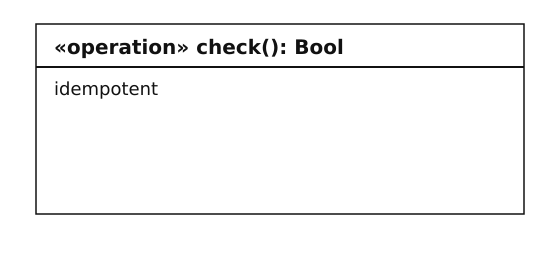
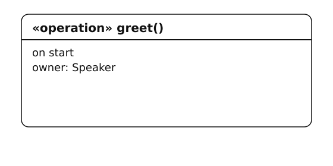
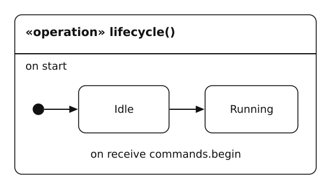
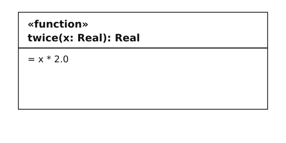
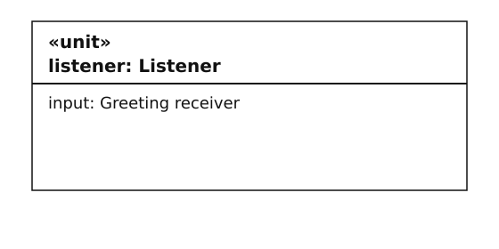

# SWAML 1.1.1 — Complete language reference

**Software Architecture Modeling Language** · Headerless language 1.1; explicit definitions and component usages · Independently authored, KerML-based semantic design.

This is the complete user-facing Markdown edition, generated from the maintained source chapters. Navigate by the alphabetical concern map or the exhaustive alphabetical keyword reference. Normative chapters define meaning; tutorials, comparisons and examples illustrate it. The portable reference parser and logical simulator provide executable evidence with the limitations stated below.

## Contents

- [Document scope](#source-ffe5ff67da37)
- [Getting started](#source-c9e79bd9c348)
- [Alphabetical concern map](#source-62d51cd6e7d4)
- [Architecture comparison](#source-3ffb1a6eb6e5)
- [Behavior and states](#source-af5c925f5118)
- [Communication](#source-410a83e3a0f0)
- [Conformance and evidence](#source-7edf1a193e2a)
- [Formal semantics](#source-cf1f654f62f1)
- [Graphical notation](#source-5798f00f85a6)
- [Graphical examples](#source-49c5dd8a67d1)
- [Canonical graphical catalog](#source-2d93a6cc8eab)
- [Graphical specification organization](#source-ceece64828e8)
- [Kernel mapping](#source-237cbcd491f2)
- [Kernel normalization](#source-0db79669e756)
- [Runtime contract](#source-34105487b7a4)
- [Simulation](#source-fedc6631cb48)
- [Structure, names and values](#source-4efedf58f92b)
- [Root components, timing, deployment and cases](#source-1f8b7bb89e5f)
- [Version migration](#source-23a5a389cd4b)
- [Alphabetical keyword reference](#source-a10a03d9b23f)
- [Implementation evidence](#source-f25fc4312adb)
- [Tool integration](#source-5ec3282569db)
- [Complete concrete grammar](#complete-concrete-grammar)
- [Model examples](#model-examples)

<a id="source-ffe5ff67da37"></a>

<a id="source-ffe5ff67da37-swaml-language-specification"></a>

# SWAML language specification

**Version:** 1.1.1 · **Source:** headerless packages; parser/host pinned to 1.1 · **Status:** complete 1.1 specification · **Date:** 2026-10-14

SWAML means Software Architecture Modeling Language. This document and its normative chapters define a software architecture language over a KerML-based semantic model. SWAML is independently authored; “unofficial UML 3.0” describes its motivation and does not denote an OMG standard or compatibility level.

<a id="source-ffe5ff67da37-1-normative-document-set"></a>

## 1. Normative document set

Read these chapters together. Their requirements have equal standing:

1. [Structure, names and types](#source-4efedf58f92b).
2. [Interfaces and communication](#source-410a83e3a0f0).
3. [Operation and state semantics](#source-af5c925f5118).
4. [Timing, deployment, cases and conformance](#source-1f8b7bb89e5f).
5. [KerML semantic mapping](#source-237cbcd491f2).
6. [Graphical notation](#source-5798f00f85a6) and [canonical concept catalog](#source-2d93a6cc8eab).
7. [Concrete grammar](../src/language/swaml.langium).
8. [Operational contract and target bindings](#source-34105487b7a4).
9. [Normalized semantic model](#source-0db79669e756).
10. [Conformance obligations and evidence](#source-7edf1a193e2a).
11. [Formal core and simulation relation](#source-cf1f654f62f1).
12. [Machine-readable mapping inventory](../spec/kerml-mapping.json).

The [user guide](#source-c9e79bd9c348), [architecture comparison](#source-3ffb1a6eb6e5), examples and design decisions are informative. The [implementation matrix](#source-f25fc4312adb) reports current tool support; a missing implementation does not waive a language rule.

<a id="source-ffe5ff67da37-2-normative-terms-and-precedence"></a>

## 2. Normative terms and precedence

MUST and MUST NOT state conformance requirements. SHOULD states a recommendation with an explicitly documented justification needed for deviation. MAY grants permission. “Error” means a model is not valid under this version. An implementation may retain an invalid model for editing but MUST NOT report it as fully valid.

The grammar determines tokens and parse structure. Prose determines validity and meaning. If grammar accepts text that violates a semantic rule, that text is invalid. If a discovered conflict makes the two impossible to satisfy, record a specification defect; do not silently choose a runtime meaning. Unknown syntax and unsupported requested language versions MUST be rejected. The host selects a pinned 1.1 parser before loading source; a file does not guess its own edition. See the [1.1 migration guide](#source-23a5a389cd4b) for the intentional syntax migration from 1.0.

The language is closed at version 1.1: constructs not listed in the grammar are not implicitly inherited from UML, SysML or KerML. Definitions may be reused by instantiation, but inheritance, generics, redefinition, unrestricted KerML embedding and dynamic creation are not part of this version. This constraint makes the whole v1.1 language implementable without pretending to reproduce three other standards.

<a id="source-ffe5ff67da37-3-design-invariants"></a>

## 3. Design invariants

- **I1 — Boundary:** every exchange between distinct unit instances crosses port instances typed by the same interface contract and a permitted connector/delegation path.
- **I2 — Ownership:** components own composition; units own private data, functions and operations; operations own statement flow or states. No performer element, behavior allocation, free action, free signal, or global variable exists.
- **I3 — Event provenance:** every outgoing data/event member of a unit port has at least one syntactically associated emitting operation. Every incoming member has exactly one handling operation, including a stateful operation where applicable.
- **I4 — Type safety:** payloads and results conform to nominal contracts. Messages transfer values, never aliases to another unit's private state.
- **I5 — Explicit communication policy:** every connector declares delivery, ordering, capacity and overflow. Time-sensitive connections add latency/freshness bounds.
- **I6 — Views preserve meaning:** views reference existing semantic elements. Drawing a message cannot create a hidden communication channel.

Local calls, calculation values, timer expiration, initial activation and state completion do not constitute exchanges between units. They are the only exceptions needed for local computation and lifecycle. An external actor or device that exchanges model data MUST be represented through a component/unit port; a case actor label cannot bypass I1.

<a id="source-ffe5ff67da37-4-abstract-model-inventory"></a>

## 4. Abstract model inventory

| Element | Owns | References / meaning |
| --- | --- | --- |
| Model | packages | language version supplied by the pinned parser/host |
| Package | imports, named elements | namespace |
| DataType / EnumType | fields / literals | immutable value shape |
| Interface | data, event or operation members | nominal versioned contract |
| Component definition | ports, child instances, connectors, delegation | reusable composition type |
| Unit definition | ports, private variables, operations, functions | reusable behavior/data boundary |
| Contained instance | no inline definitions | one component or unit definition |
| Port | role and optionality | one interface |
| Connector | QoS | source and target port paths |
| Delegation | no data conversion | outer port and immediate child port |
| Operation | parameters, result, trigger, timing; flow **or** owned states | executable behavior owned by a unit |
| Function | parameters, result, expression | pure local calculation |
| State body | states, transitions, initial reference | syntax grouping of one operation; not an independent model element |
| State | entry and exit blocks | one operation-local condition |
| Transition | guard, effect, priority, trigger | source and target states |
| Root component | inline unit/component occurrences and connectors, or one component definition; execution nodes/deployment | named closed occurrence; default service profile |
| Requirement | text | named obligation |
| Case | exchange steps, trace links | one root component and requirements |
| View | kind | one subject, no runtime semantics |

All named elements have stable identity within a model version. Tools SHOULD persist a separate UUID identity map for editing; the language's normative textual identity is its qualified declaration/instance path. A rename is an identity-preserving edit only when the tool updates that map and all references atomically.

<a id="source-ffe5ff67da37-5-conformance-summary"></a>

## 5. Conformance summary

A parser supports concrete syntax. A semantic validator additionally enforces static rules. A KerML mapper additionally produces the normalized representation in chapter 5. An execution backend additionally realizes chapter 3 and communication policies. A graphical editor additionally satisfies the view/editing contract. A tool MUST state which levels it implements; success at one level MUST NOT imply the others.

This repository supplies a parser, LSP foundation, documented static validation and a [reference simulator](#source-fedc6631cb48). The specification defines more than that implementation, especially runtime delivery, idempotency, target snapshot realization, timing proof, interchange and graphical editing. See the [exact support matrix](#source-f25fc4312adb).

---

<a id="source-c9e79bd9c348"></a>

<a id="source-c9e79bd9c348-swaml-11-user-guide"></a>

# SWAML 1.1 user guide

SWAML describes what software contains, how it communicates, and how operations and state evolve. The model remains independent of C++, Rust, an RTOS, a cloud runtime, or a particular network protocol.

<a id="source-c9e79bd9c348-1-install-and-check-a-model"></a>

## 1. Install and check a model

From the repository root:

```sh
npm ci
npm run build
node out/src/cli/main.js examples/01-hello.swaml
```

A successful result is `Checked 1 model(s): 0 error(s)`. This checks the implemented rules; it does not execute the software or prove schedulability. `npm run check` also runs the repository tests. Open the [implementation matrix](#source-f25fc4312adb) before interpreting a passed check as a stronger assurance claim.

A file begins directly with named packages. Use the 1.1 language core or pin SWAML 1.1 in the editor host; there is no per-file version header. The 1.1 parser rejects historical headers rather than guessing a version. Names are case sensitive. Keywords cannot be identifiers. Use `orderLink`, for example, rather than the reserved word `ordering`.

<a id="source-c9e79bd9c348-2-write-the-contract-first"></a>

## 2. Write the contract first

Choose the communication model by the meaning of the exchange:

| Need | Interface | Roles | Operation statement |
| --- | --- | --- | --- |
| A current sensor value | `senderReceiver`, `sampled` data | sender → receiver | `send p.member(value);` |
| Every queued reading | `senderReceiver`, `queued` data | sender → receiver | `send p.member(value);` |
| Request and correlated response | `clientServer` | client → server | `request p.member(...) as result within … otherwise …;` |
| One event to many subscribers | `publishSubscribe` | publisher → subscriber | `publish p.member(...);` |
| RPC plus server notifications | `service` | requires → provides | request and publish |

Each connector uses one nominal interface definition. Equal-looking interfaces are not automatically interchangeable. Create an adapter unit when their meaning, payload, or version differs.

This is a complete small model; save it as `example.swaml`:

```swaml
package First {
    interface senderReceiver Reading version "1.0.0" {
        data value: Real sampled;
    }
    unit def Source {
        port output: Reading sender;
        operation sample() on start {
            send output.value(21.5);
            return;
        }
    }
    unit def Sink {
        port input: Reading receiver;
        var last: Real = 0.0;
        operation update(value: Real) on receive input.value {
            last = value;
            return;
        }
    }
    component def Pair {
        unit source: Source;
        unit sink: Sink;
        connect readings: source.output -> sink.input qos {
            delivery atMostOnce; ordering fifo; capacity 1; overflow dropOldest;
        };
    }
    component Demo: Pair;
    view overview GV of Demo;
    view wiring IV of Pair;
    view updateFlow FV of Sink.update;
}
```

`component def Pair` is a reusable type; `component Demo: Pair;` selects one root occurrence for execution. Its omitted profile means service. `Reading` defines the payload. Both ports use it with complementary roles. `sample` sends through its own port, and `update` declares that same port-member contract as its activation source. The connector allows the transfer. The variable `last` belongs to each `Sink` instance, not to every instance of its definition.

<a id="source-c9e79bd9c348-3-choose-component-and-unit-boundaries"></a>

## 3. Choose component and unit boundaries

Use a **component** for a reusable architecture boundary: an embedded controller, a service backend, or a subsystem. Use a **unit** for a cohesive implementation boundary that owns operations and private data. A unit need not be a thread, file, class, or process; deployment is separate.

A component definition owns component/unit instances, ports and connectors. `def` makes this type declaration explicit, following the familiar SysML definition/usage distinction. A root is an occurrence: use `component Demo: Pair;` to instantiate a definition, or `component Demo { unit source: Source; … }` to assemble units/components directly. It does not own executable statements. A unit owns operations, pure functions and private variables. This keeps executable ownership unambiguous.

An operation can call a local helper with `invoke helper(...);`. The helper must be an untriggered `Void` operation in the same unit. Use `functionName(...)` for pure calculation results. These local calls do not need ports because they do not cross the agreed unit boundary.

Never write `otherUnit.operation()` or `otherUnit.privateValue`. The syntax and validator reject that access. To reach another unit, declare a port, choose an interface, connect it in their common parent, and use `request`, `send` or `publish`.

For a nested component, expose a boundary port and delegate it to one immediate child port. The [service example](../examples/03-service-pubsub.swaml) demonstrates `Backend.api` delegating to `serviceUnit.api`. Delegation preserves the port's role and interface; it does not reverse them or convert data.

<a id="source-c9e79bd9c348-4-describe-operation-control-flow"></a>

## 4. Describe operation control flow

Operations contain ordered statements: typed local declarations, assignments, assertions, conditionals, bounded loops, local calls, interface exchanges, returns and failures. Read [Values and flow](../examples/05-values-and-flow.swaml) as a worked example.

Operations and interface signatures may omit `: Void`; a missing result annotation means exactly Void. Functions are expressions with typed parameters and an explicit non-Void result. They cannot read mutable unit data, issue requests, or emit events. Pass their inputs explicitly. Records, enums and arrays are values, so sending them does not expose a remote reference to local mutable data. Write `count = count + 1;` for whole-value assignment, `clamp(value)` for a pure local calculation, `[1, 2, 3]` for an array, and `Status.Ready` for an enum value. Use `Contracts::Status.Ready` when a local value named `Status` would otherwise hide that enum.

A `while` includes a maximum iteration count. Exceeding that count at runtime is a failure, not permission to silently stop the loop. This makes the bound useful to a later analysis or code generator.

Use `assert` for a model-level assumption that must hold at that point. A requirement is a named prose obligation. A case can link to requirements using `satisfies`; that trace link is not proof that the requirement is met.

<a id="source-c9e79bd9c348-5-model-a-service-call-and-its-failure"></a>

## 5. Model a service call and its failure

Read [Services and pub/sub](../examples/03-service-pubsub.swaml). The service declares `submit` in its interface; the server unit implements it with `on call api.submit`. The client's `request` includes a timeout and an `otherwise` block.

A request binds its result only on success. The failure block has a local `failure: String` value and must return from or fail the current operation. This prevents subsequent statements from reading an uninitialized result. A timeout says the caller stopped waiting; it does not prove the server did nothing. Later responses to that timed-out request are ignored.

For application-specific errors, use an enum or result record in the operation's declared return type. Transport failures and application results are different concepts. Do not retry a request unless its idempotency and retry budget are established. The core rejects `atLeastOnce` RPC when the operation is not declared idempotent; proving that declaration is an implementation obligation.

<a id="source-c9e79bd9c348-6-use-publishsubscribe-without-a-hidden-event-bus"></a>

## 6. Use publish/subscribe without a hidden event bus

An event is a member of a `publishSubscribe` or `service` interface. Only an operation can publish it, through one of its own outgoing ports. Subscribers receive it through their own typed ports. The normal handler uses `on receive input.eventName` with the event's parameter types in order.

Fan-out is multiple explicit connectors from a publisher port to subscriber ports. Each subscription has its own queue and QoS. A slow subscriber does not silently change the queue of another subscriber. Multiple publishers may connect to one subscriber; ordering is per connector, not global.

In a combined service, the connector is drawn from `requires` to `provides` for requests. Service events travel back from provider to consumer, and replies return on the originating request's correlation. Both remain members of the same declared interface.

Model a broker as a component with incoming and outgoing interfaces if broker behavior, failure, buffering or deployment matters. A connector alone represents a logical subscription, without selecting MQTT, DDS, Kafka or SOME/IP. Dynamic discovery and unsubscribe operations are reserved for future language versions.

<a id="source-c9e79bd9c348-7-put-states-inside-an-operation"></a>

## 7. Put states inside an operation

The [stateful operation example](../examples/04-stateful-function.swaml) owns `Idle`, `Running`, and `Stopped` inside `Device.lifecycle`. It starts once with its unit. No performer or external behavior allocation is required.

A stateful operation has no parameters, a Void result (usually omitted), and `on start { initial Idle; … }`. The initial reference is the first item in its body. There is no extra behavior wrapper. It declares an initial state, states with optional entry/exit blocks, and transitions. Triggers are an incoming port member, a positive delay after entering a state, or completion. A receiving transition makes event parameter names available in its guard and effect; sender–receiver data uses `payload`.

This complete model places the states directly where they execute:

```swaml
package TimerExample {
    unit def Device {
        var cycles: Int = 0;
        operation lifecycle() on start {
            initial Waiting;
            state Waiting {
                entry { cycles = cycles + 1; }
            }
            state Finished final {}
            transition complete: Waiting -> Finished on after 10 ms {}
        }
    }
    component Demo { unit device: Device; }
    view lifecycle FV of Demo.device.lifecycle;
}
```

The root contains its unit directly. The delay is local to that operation; it is not a free event or cross-unit channel. The [interface-triggered lifecycle model](../examples/04-stateful-function.swaml) adds commands and status ports.

On a transition: run the source exit block, the transition effect, then the destination entry block. A final state completes the stateful operation. A received event with no enabled transition in the current state is consumed and ignored. Add an explicit transition if ignoring it is unacceptable.

Use one stateful operation as the receiver for a given member, or one ordinary operation. Do not bind the same member to both: that would create ambiguous delivery.

<a id="source-c9e79bd9c348-8-model-realtime-constraints"></a>

## 8. Model realtime constraints

The [controller example](../examples/02-realtime-controller.swaml) uses `on every 10 ms`, execution-time bounds and deadlines. A root with a realtime or mixed profile requires timing contracts for every used operation and maximum connector latency. Sampled realtime data also needs `maxAge`.

The validator checks positivity, `wcet <= deadline`, and `deadline <= period` for a periodic operation. These are necessary checks, not a scheduling proof. Document the actual RTOS policy, interrupt load, CPU allocation, priorities, clock assumptions, transport timing and measured/analyzed WCET in the implementation project. A production backend must establish them before claiming hard realtime execution.

`serial` is the default unit-local execution policy. `reentrant` requires independent activations and must not mutate shared unit state, including through helpers. An operation waiting for a service response consumes elapsed deadline time even when it consumes no CPU execution time.

<a id="source-c9e79bd9c348-9-separate-deployment-from-architecture"></a>

## 9. Separate deployment from architecture

A root component can declare execution nodes with kind `mcu`, `process`, or `container`, and `deploy instance.path on nodeName;`. A typed root may have a deployment-only body, for example `component Product: Controller realtime { node ecu mcu; deploy sensor on ecu; }`. Its `sensor` must already exist in `Controller`; this body cannot add children or connections. An inline root may put composition and deployment together. A component deployment applies to descendants unless a more specific descendant deployment overrides it. Each explicit instance path may be deployed only once.

The [component roots example](../examples/09-component-roots.swaml) shows a reusable assembly, a typed realtime deployment binding and a small inline root with direct unit children. No `system` wrapper is involved.

Nodes are allocation targets, not units and not communication shortcuts. Moving a unit to another process cannot make a previously illegal direct data access legal. Network addresses, credentials, task schedules and generated code are outside the 1.1 model.

The [mixed gateway](../examples/06-mixed-gateway.swaml) shows how one unit explicitly converts sampled values into event notifications. An adapter owns the conversion, timing and failure policy.

<a id="source-c9e79bd9c348-10-organize-a-larger-model"></a>

## 10. Organize a larger model

Packages are flat namespaces in 1.1. Write `import Contracts::*;` to use another package's declarations unqualified, or name a declaration `Contracts::Reading`. All relevant files must be loaded together. Two imports exposing the same short name make it ambiguous; use the qualified name.

The editor host should load the whole model workspace. The CLI deliberately loads the files you supply and does not search unrelated directories. Do not put secrets in model payloads, examples or deployment notes.

<a id="source-c9e79bd9c348-11-navigate-through-views"></a>

## 11. Navigate through views

| Surface | Purpose |
| --- | --- |
| Browser | Navigate packages → definitions → instances → ports/operations → states |
| GV — General View | Inspect structure, declarations and their relationships |
| IV — Interconnect View | Inspect connected ports and component delegation |
| CV — Case View | Inspect cases and linked requirements |
| SV — Sequence View | Inspect the partial ordering of interface exchanges in a case |
| GRV — Grid View | Inspect sortable model, interface, timing and deployment tables |
| FV — Flow View | Inspect an operation's control flow or owned state transitions |

These are specified editor behaviors. The current package supplies the model syntax and language server, not a diagram renderer. View declarations can already be parsed and checked. See [graphical notation](#source-5798f00f85a6) for the drawing and editing contract.

<a id="source-c9e79bd9c348-12-resolve-diagnostics"></a>

## 12. Resolve diagnostics

| Diagnostic | Typical fix |
| --- | --- |
| `SW030` | Connect immediate child ports; expose/delegate a port across each component boundary |
| `SW031` / `SW032` | Use the same interface definition and complementary port roles |
| `SW034` | Connect the port in a closed root component, or mark an intentionally unbound port `optional` |
| `SW050` / `SW051` | Use a local port member and the correct communication verb/direction |
| `SW052` / `SW055` | Match handler parameters/results and give each incoming member one owner |
| `SW057` | Make every failure path return or fail |
| `SW062` | Give competing transitions distinct priorities |

A parser error usually means a reserved identifier, missing delimiter, or malformed block. Resolve syntax errors first; semantic checks are skipped on syntactically incomplete documents to avoid misleading secondary errors.

<a id="source-c9e79bd9c348-service-fields-repeated-consumers-and-checked-traces"></a>

## Service fields, repeated consumers and checked traces

[Service field](../examples/08-service-field.swaml) models one temperature setting with explicit `get`, `setPoint` and `changed` interface members. The service stores the value privately. Its serial setter publishes through its provided port, which fans out to two required ports on separate panel instances. Each panel owns a distinct displayed value and its own receiving operation.

The getter is reentrant and reads the private-state snapshot taken when it is dispatched. It can safely overlap the serial setter because it does not mutate storage, directly or through a helper. Snapshot implementation is an execution-backend obligation; parsing this example does not simulate it.

A case reply must follow a unique unanswered matching request through its `after` ancestry. Two outstanding requests on the same route/member cannot be disambiguated by drawing one reply lower on the page. Order the pairs or use separate cases. Requests may remain unanswered in a partial trace. A route-valid case still needs an operation-level witness before it counts as verified behavior.

Use the owning package's name as a GV/GRV subject for an inventory. IV takes a component definition/root component; FV takes an operation, including an occurrence path such as `Cabin.settings.store.update`. CV/SV take a case or root component. A view cannot use another view as its semantic subject.

If a request returns Void, its required `as` name marks completion but cannot be read as a value. Reserve `failure` for the implicit error-path binding. Write string line breaks with `\n`; raw line breaks, tabs and unsupported escapes inside strings are rejected.

The [operational contract](#source-34105487b7a4) defines execution edge cases, and the [conformance obligations](#source-7edf1a193e2a) distinguish validator acceptance from runtime and analysis evidence.

<a id="source-c9e79bd9c348-find-a-construct-or-run-an-example"></a>

## Find a construct or run an example

Use the [alphabetical keyword reference](#source-a10a03d9b23f) for exact words and context, the [concern guide](#source-62d51cd6e7d4) for architectural questions, or the [complete Markdown book](SWAML-1.1.1-Reference.md) for a single user-facing document. The maintained examples have executable [simulation configurations](../examples/simulation/runs.json); follow the [reference simulation guide](#source-fedc6631cb48) to run them and inspect their traces.

---

<a id="source-62d51cd6e7d4"></a>

<a id="source-62d51cd6e7d4-language-reference-by-concern"></a>

# Language reference by concern

Use this alphabetical map to navigate SWAML 1.1 by architectural question. The [alphabetical keyword reference](#source-a10a03d9b23f) provides the other reading order; the [complete Markdown edition](SWAML-1.1.1-Reference.md) contains both maps, all normative chapters, user guidance, grammar and model examples in one document. Rules are normative where their source chapter says so; a tutorial or illustration never overrides those rules.

<a id="source-62d51cd6e7d4-architecture-selection-and-platform-correspondence"></a>

## Architecture selection and platform correspondence

Start with the [architecture comparison](#source-3ffb1a6eb6e5). SWAML borrows strict interface boundaries from component/service architectures and familiar structural/behavioral concepts from UML/SysML. Its authoring model is deliberately software-specific. A Classic-like control loop uses sampled senderReceiver members, periodic operations and explicit timing. A service architecture uses operation/event contracts, correlated requests, timeout handling and static subscriber connections. A gateway explicitly translates between these through its own unit ports.

Choose a root component profile (`realtime`, `service` or `mixed`) according to the contracts you intend to supply. The choice does not turn the model into AUTOSAR configuration or prove a scheduling property. Use an adapter unit when hardware or middleware behavior matters to the architecture. External devices cannot enter a case through an untyped actor shortcut.

<a id="source-62d51cd6e7d4-behavior-and-state-ownership"></a>

## Behavior and state ownership

See [operations, flow and states](#source-af5c925f5118) and the [operational contract](#source-34105487b7a4). Units own executable operations directly. A function is a pure returned calculation; an untriggered Void operation is a local imperative helper; a triggered operation is a root activation. Components compose these units and do not add a second behavior allocation layer.

Choose a statement body for sequential calculation and requests. Choose a state body when the operation remains in named states between inputs. States, guards and transitions remain inside that operation. There are no independent actions or performers. The operation's flow/state body is the subject of FV. Entry/exit cannot read a transition payload; save a needed value in private unit data in the effect.

<a id="source-62d51cd6e7d4-cases-requirements-and-evidence"></a>

## Cases, requirements and evidence

See [root components and cases](#source-1f8b7bb89e5f). Requirements are named natural-language obligations. A case describes permitted interface exchanges in a chosen root component and may claim requirement coverage. Case steps reference actual top-level connectors and member paths. `after` gives causality; independent steps remain unordered.

A reply needs one unanswered matching request in its causal ancestry. Route validity is checked statically. A simulation or analysis witness is separate evidence that the operation bodies can realize the described case. Neither a `satisfies` keyword nor a green line in a diagram establishes that evidence. CV shows coverage claims; SV shows the causal exchanges.

<a id="source-62d51cd6e7d4-communication-and-interface-boundaries"></a>

## Communication and interface boundaries

See [interfaces and communication](#source-410a83e3a0f0). Choose senderReceiver for data, clientServer for RPC, publishSubscribe for events, or service for RPC plus provider events. Contracts are nominal and versioned. Unit ports bind those contracts to operations; component boundary ports delegate them through the hierarchy. Connect only immediate child ports at each composition level.

A sender/publisher can fan out. A subscriber can receive multiple publisher routes, each with its own queue. A receiver/client/requires port has at most one route. Required ports must be connected in a selected closed root component; optional unbound RPC reports Unavailable. Reading another unit's fields, invoking its operation directly, sending a free event, or adding a topic string outside a contract is invalid.

Queue delivery, order, capacity and overflow are mandatory. Data/event admission can partially succeed across fanout, so atomic broadcast needs an explicit protocol. Requests wait for one correlated result and require a failure branch. Timeout does not cancel server effects. A field-like service property is modeled as getter, setter and changed event, with private storage; see [the setting example](../examples/08-service-field.swaml).

<a id="source-62d51cd6e7d4-conformance-and-formal-accuracy"></a>

## Conformance and formal accuracy

Read the [obligation classification](#source-7edf1a193e2a), [formal rules](#source-cf1f654f62f1) and [implementation matrix](#source-f25fc4312adb). S means grammar support, V static validity, K kernel mapping, E execution and G graphical editing. Their obligations are distinct. The reference implementation supplies parsing, broad static checks and a defined logical simulation binding; independent complete certification is not asserted.

A parsed but invalid model is not executable. A valid model may deliberately fail an assertion, overflow a queue, exceed a loop bound, time out, or violate a timing contract at runtime. Report those observations; do not weaken the language to make every accepted model look successful. Unknown syntax and unsupported requested editions must be rejected. The host pins the parser edition; historical file headers are not 1.1 syntax.

<a id="source-62d51cd6e7d4-graphical-views-and-navigation"></a>

## Graphical views and navigation

See [graphical notation](#source-5798f00f85a6) and the [canonical concept catalog](#source-2d93a6cc8eab), with original SVG/PNG drawings and graphical/textual notation tables. The Model Browser exposes ownership and definition/occurrence identity. GV shows general structure, IV connections, CV cases/coverage, SV exchanges, GRV tabular properties, and FV operation flow or states. A selected occurrence retains its instance path when its shared declaration is displayed.

A diagram is a projection of the same semantic model as the text. Layout belongs in a sidecar. Port/member paths and connector identities must remain discoverable; a drawing cannot create a hidden channel. Source edits require parse/link/validation and undo.

<a id="source-62d51cd6e7d4-kernel-foundation-and-interchange"></a>

## Kernel foundation and interchange

Read [KerML mapping](#source-237cbcd491f2) and the [normalized model](#source-0db79669e756). They specify identities, ownership, value types, routes, behavior lowering, metadata and reverse traces. The [mapping inventory](../spec/kerml-mapping.json) covers every grammar rule and type alias, including syntax that contributes to an owner's semantics rather than creating its own kernel node.

SWAML is defined over a proposed KerML-based semantic contract. This release does not export a kernel-validated artifact or publish a formal SWAML KerML library. The Langium AST is an authoring representation. A backend must preserve SWAML-specific queues, copying, snapshots, correlation and reaction order through a versioned library; kernel metadata alone is not execution support.

<a id="source-62d51cd6e7d4-names-structure-and-reusable-types"></a>

## Names, structure and reusable types

See [structure, names and types](#source-4efedf58f92b). A package owns top-level declarations; `A::T` selects a package member, while dots follow structural or local-value paths. Imports are direct, not transitive. Short-name ambiguity is an error across declaration kinds. Local operations/functions never resolve to another unit by fallback.

`component def` and `unit def` explicitly declare reusable types. Instances create distinct boundaries, stores and activations. A root component is a named occurrence, either inline composition or an instance of a component definition. Both root and nested components may contain units/components. Only a root carries an execution profile and node/deployment binding. Containment is acyclic. A unit variable belongs to one occurrence and is initialized before any startup work runs. Reusing a definition never creates shared singleton state.

<a id="source-62d51cd6e7d4-simulation-and-runtime-failures"></a>

## Simulation and runtime failures

Use the [reference execution profile](#source-fedc6631cb48). Every example has a checked run configuration. Supply the entire validated workspace, selected root component and finite horizon. The output records exact sources, options, chronological observations and final stores/states. Exercise adverse conditions with the offer-indexed fault schedule and inspect whether the intended offer occurred.

Simulation fixes one deterministic ordering among core-permitted schedules, uses bounded resources and zero local CPU cost. It can expose behavioral failures, queue effects and elapsed-time violations; it cannot prove all schedules safe or establish hardware schedulability. Keep evidence linked to exact source versions and target assumptions.

<a id="source-62d51cd6e7d4-timing-deployment-and-concurrency"></a>

## Timing, deployment and concurrency

See [timing and deployment](#source-1f8b7bb89e5f) and [dispatch rules](#source-34105487b7a4). WCET is active execution, deadline is elapsed time from release, maxLatency ends at destination readiness, and maxAge measures original message age until dispatch. Periodic deadlines cannot exceed their periods. A state machine's contract applies per reaction, not to its whole lifetime.

Serial activation roots retain their unit lock across RPC waits; a callback to that same serial unit may have to wait. Reentrant activation roots use read-only dispatch-time snapshots and may not mutate private unit state through helpers. Allocation inherits from the nearest explicitly deployed ancestor. MCU/process/container labels do not supply a scheduler or bypass interface isolation.

<a id="source-62d51cd6e7d4-values-and-calculation"></a>

## Values and calculation

See [value and expression rules](#source-4efedf58f92b). Values are Bool, bounded Int, finite binary64 Real, String, nominal records/enums and fixed arrays. Parameters, locals and messages contain copies. There are no pointers, dynamic collections, implicit remote references or global mutable data.

Use whole-value assignment. Record field and final array-index reads are local value operations; field/index mutation is absent. Pure functions cannot read unit variables. Int-to-Real widening is scalar only. Division returns Real; integer remainder follows the dividend's sign. Arithmetic range, general array bounds and finite loop/microstep behavior are runtime obligations.

<a id="source-62d51cd6e7d4-versioning-and-language-evolution"></a>

## Versioning and language evolution

The source is headerless; its parser/host is explicitly pinned to SWAML 1.1. This specification/package revision is 1.1.1. Interface versions remain independent nominal contract labels. Version 1.1 is an intentional syntax revision; it is not backward-compatible with 1.0 source despite the minor version number. Follow the [migration guide](#source-23a5a389cd4b) and preserve historical release artifacts.

Inheritance, generics, dynamic instance/subscription/discovery lifecycle, unbounded arrays, reference payloads, hierarchical/orthogonal states, unrestricted fork/join and host-language code are outside this closed version. A proposal adding them must define syntax, ownership, typing, operational meaning, graphical projection, mapping, migration and tests before it is accepted. These concerns must not appear as undocumented backend shortcuts.

---

<a id="source-3ffb1a6eb6e5"></a>

<a id="source-3ffb1a6eb6e5-architecture-analysis-and-swaml-design-rationale"></a>

# Architecture analysis and SWAML design rationale

This is an original design comparison, not a declaration of compatibility with the referenced standards. Research checked on 2026-10-14. The detailed AUTOSAR comparisons use the accessible R21-11/R19-11 specification material as a stable conceptual baseline; they are not a feature-by-feature review of the latest release.

<a id="source-3ffb1a6eb6e5-comparison"></a>

## Comparison

| Concern | AUTOSAR Classic | AUTOSAR Adaptive | UML 2.5.1 / SysML 2.0 | SWAML decision |
| --- | --- | --- | --- | --- |
| Architectural focus | Embedded software components, RTE and BSW | Service-oriented adaptive applications | General software / systems modeling | Software units and components with separate deployment |
| Contract style | Sender–receiver and client–server interfaces | Methods, events and fields | Interfaces, ports, connectors and behavioral constructs | Four explicit interface kinds; fields expand to operations/events |
| Behavior ownership | Runnable entities and activation events | Application behavior behind service APIs | UML behaviors/operations; SysML actions, states and usages | Operations own flow/states directly in their unit |
| Exchange boundary | Ports and runtime integration | Service communication | General-purpose mechanisms can be used in several modeling styles | Cross-unit communication must always use ports/interfaces |
| Timing | Strong embedded integration context | Distributed execution and communication concerns | Expressible constraints; target analyses vary | Period, WCET, deadline, latency and age; no implied scheduling proof |
| Deployment | ECU/BSW/RTE integration | Processes/machines and middleware | Deployment/allocation abstractions | Logical nodes and separate target binding |
| Graphics | Tool-specific architecture views | Tool-specific service views | Broad diagram/view families | Browser + GV/IV/CV/SV/GRV/FV |

The table's SWAML column is our design judgment. The following paragraphs identify the source concepts and the choices drawn from them.

<a id="source-3ffb1a6eb6e5-autosar-classic"></a>

## AUTOSAR Classic

Classic's application, RTE and basic-software layers separate application software from its integration infrastructure. Its virtual functional bus uses dedicated ports. The software-component template distinguishes sender–receiver data and operation-oriented client–server communication; runnable activation links interface activity to executable behavior. [Classic Platform overview](https://www.autosar.org/standards/classic-platform/), [Software Component Template, R21-11](https://www.autosar.org/fileadmin/standards/R21-11/CP/AUTOSAR_TPS_SoftwareComponentTemplate.pdf), [R19-11 runnable/operation specification](https://www.autosar.org/fileadmin/standards/R19-11/CP/AUTOSAR_TPS_SoftwareComponentTemplate.pdf).

**SWAML inference:** retain strict port contracts and explicit activation, but make them platform-neutral. A unit is not automatically a runnable, and a component is not automatically an AUTOSAR atomic SWC. A Classic backend could map a suitable unit operation to a runnable, `on every` to timing activation and `on call` to operation activation, subject to target restrictions. WCET and queue semantics must survive the mapping.

**Do not infer:** SWAML does not supply RTE generation, ECU extract completeness, BSW configuration or ARXML conformance. A valid SWAML model may need additional target constraints before export.

<a id="source-3ffb1a6eb6e5-autosar-adaptive"></a>

## AUTOSAR Adaptive

Adaptive communication management distinguishes service methods, events and fields, with proxy/skeleton roles and subscription behavior. That separation is useful for a contract that contains both RPC and asynchronous notification. [Communication Management, R21-11](https://www.autosar.org/fileadmin/standards/R21-11/AP/AUTOSAR_SWS_CommunicationManagement.pdf), [Communication Management, R19-11](https://www.autosar.org/fileadmin/standards/R19-11/AP/AUTOSAR_SWS_CommunicationManagement.pdf).

**SWAML inference:** a `service` interface combines operation and event members; requires/provides ports capture consumer/provider roles. A field is explicitly represented by getter, setter and changed-event members, with storage private to the provider. Separate `publishSubscribe` contracts also support event-only architecture without forcing an RPC service.

**Do not infer:** a combined service connector is not automatically SOME/IP, DDS, ara::com, discovery configuration or an Adaptive manifest. Dynamic discovery and subscription lifecycle are deferred rather than approximated by undocumented behavior. Adapter units provide explicit mappings between Classic-style data and service events.

<a id="source-3ffb1a6eb6e5-uml"></a>

## UML

UML supplies rich structural and behavioral modeling: components, interfaces, ports, operations, activities, state machines and interactions. Its breadth permits many modeling styles; a software-architecture discipline must choose which relationships constitute legal runtime exchange. [OMG UML 2.5.1](https://www.omg.org/spec/UML/2.5.1).

**SWAML inference:** preserve familiar components, operation signatures, state/flow and sequence concepts while making the communication boundary a language invariant. Replace free signals and arbitrary cross-object access with interface-member paths. Keep simple value types rather than importing the full UML class/object feature set.

“Unofficial UML 3.0” is a useful aspiration—modern textual software modeling on KerML—but not a version or compliance claim. SWAML is named independently and does not reuse UML certification marks.

<a id="source-3ffb1a6eb6e5-sysml-20-and-kerml-10"></a>

## SysML 2.0 and KerML 1.0

SysML 2.0 uses KerML as its foundation and provides definition/usage modeling, typed features and behavior constructs. KerML offers general modeling elements suitable for a separate domain language. [SysML 2.0](https://www.omg.org/spec/SysML/2.0), [KerML 1.0](https://www.omg.org/spec/KerML/1.0).

**SWAML inference:** keep type versus occurrence and a common semantic foundation, but scope the authoring language to software. Operations and states live where they are used, removing a separate performer allocation from the user model. The [mapping contract](#source-237cbcd491f2) states what kernel normalization must preserve; the reference Langium AST is not advertised as a conforming kernel implementation.

SWAML defines Browser navigation and six view families: General, Interconnect, Case, Sequence, Grid and Flow. Each view projects the same semantic model and retains links to its source declarations and occurrences.

SWAML 1.1 retains `component def` and `unit def` so reusable types remain visibly distinct from occurrences. A top-level component usage also supplies the closed execution root; no second `system` concept is needed. States remain directly inside their owning operation, distinguished by its initial-state declaration, rather than an extra authored `machine` wrapper. This reduces authoring vocabulary without changing interface boundaries or runtime state semantics.

<a id="source-3ffb1a6eb6e5-additional-architecture-lessons"></a>

## Additional architecture lessons

AADL emphasizes architecture-level analysis of performance-critical properties and real-time embedded systems. [SEI introduction to AADL](https://www.sei.cmu.edu/library/the-architecture-analysis-design-language-aadl-an-introduction/), [SEI control-systems modeling guide](https://www.sei.cmu.edu/library/developing-aadl-models-for-control-systems-a-practitioners-guide/).

**SWAML inference:** timing and deployment need first-class declarations, but an operation deadline is not evidence of schedulability. Keep the logical architecture and platform execution assumptions separate. A backend can translate suitable subsets to an analysis model rather than claim the small reference validator performs scheduling analysis.

For service and event-driven software, our design additionally makes queue capacity, overflow, duplicate delivery, partial publication and timeout uncertainty explicit. These are original SWAML semantic choices. An event broker is a modeled intermediary when its behavior matters. Local shared-memory coupling, hidden topic names and transport-specific callbacks cannot erase the interface boundary.

<a id="source-3ffb1a6eb6e5-mapping-examples-and-limits"></a>

## Mapping examples and limits

| Source concept | Candidate SWAML representation | Additional evidence needed for an exporter |
| --- | --- | --- |
| Classic SW component composition | component definitions and instances | supported target categories and composition rules |
| Runnable | unit operation | activation, argument, task and scheduling mapping |
| S/R data element | sampled or queued data member | precise buffering and freshness correspondence |
| Client/server operation | interface operation + handler | error/result mapping, timeout and invocation policy |
| Adaptive method | service operation member | target method signature and middleware binding |
| Adaptive event | service event + publishing/receiving operation | subscription/delivery behavior |
| Service field | explicit read/write/change members | coherent state and notification protocol |
| UML activity | operation statement flow | subset restrictions and exception/concurrency mapping |
| UML state machine | stateful operation | flattening or rejection of unsupported hierarchy/regions |
| SysML part definition/usage | component/unit definition and instance | software-specific ownership interpretation |
| Physical/external endpoint | adapter unit with typed ports | how actual I/O enters the implementation |

<a id="source-3ffb1a6eb6e5-decisions-retained-in-11"></a>

## Decisions retained in 1.1

1. Unit is the smallest interface-protected software boundary. Pure local computation does not require a port.
2. Components compose; units execute. Do not make both own independent execution semantics.
3. Interface signatures are contracts; unit operations provide their implementation.
4. All message/data/event exchange names a local port and interface member.
5. Definitions are reusable, but behavior is owned directly where used. No performers.
6. Publish/subscribe is explicit and supports fan-out without assuming a particular broker.
7. A service can combine requests and events, but implicit fields are avoided.
8. State and flow share FV because both belong to operations.
9. A complete, bounded 1.1 language is preferable to undefined syntax for advanced features. Deferred constructs are listed in the implementation/roadmap documents.
10. Tool claims must distinguish parsing, validation, kernel mapping, execution and graphical editing.

<a id="source-3ffb1a6eb6e5-source-handling"></a>

## Source handling

Links point to the primary standards/publisher sources. Some AUTOSAR PDF endpoints intermittently failed full downloads during research; their official indexed material and platform pages were available. No standard PDF or proprietary template content is redistributed in this repository. The comparison intentionally focuses on the concepts described above rather than claiming exhaustive standard coverage.

---

<a id="source-af5c925f5118"></a>

<a id="source-af5c925f5118-3-operations-flow-and-states"></a>

# 3. Operations, flow and states

Normative chapter of the [SWAML 1.1 specification](#source-ffe5ff67da37).

<a id="source-af5c925f5118-31-operation-identity-and-activation"></a>

## 3.1 Operation identity and activation

An operation belongs directly to a unit definition and is instantiated per unit instance. It has a name, ordered parameters, optional result annotation, optional trigger, optional timing contract, and exactly one body form: a statement block or directly owned states. Omitting `: Type` means Void; an explicit `: Void` has identical meaning. A component does not execute operations; execution lives in its contained units.

An **activation root** is one dispatched operation activation or state reaction and its synchronous local-call stack. It owns the execution lock/snapshot context inherited by helpers. This runtime term is distinct from a **root component**, which selects architecture and never executes statements itself.

| Trigger | Activation and permitted signature |
| --- | --- |
| omitted | local `invoke`; the callable operation must return Void |
| `on manual` | parameterless Void activation activated by a test/administrative harness, carrying no model data |
| `on start` | parameterless Void operation, once after unit initialization and connector readiness |
| `on every D` | parameterless Void operation released at unit start + kD, for positive integer k |
| `on receive p.m` | copied data/event arguments, Void result |
| `on call p.m` | copied RPC arguments and exact contract result |

Manual activation is a control of the modeling environment, not a way to inject an external data exchange without a port. A modeled UI command, interrupt payload, device sample, network event or external client MUST use an interface. Timers and initial activation are local lifecycle mechanisms.

Several ordinary operations may exist in one unit. There is no UML-style separate “method implementation of action definition” layer. The interface signature describes an RPC contract, while the unit operation triggered by that member is its implementation. A stateful operation directly contains its states. Reuse of algorithms is through functions or local operations, and reuse of architecture is through definitions and instances.

<a id="source-af5c925f5118-32-flow-execution"></a>

## 3.2 Flow execution

An activation holds its copied parameters, locals, a program position, its unit reference and any request correlation. Execute statements in source order. Blocks introduce lexical scope and discard block-local variables on leaving the block.

| Statement | Semantics |
| --- | --- |
| `let x: T = e;` | evaluate e, typecheck, create a local mutable value |
| `x = e;` | replace an existing local/parameter/unit-variable value; no field or remote assignment |
| `invoke op(args);` | execute an untriggered local Void operation synchronously; return resumes the caller |
| `return;` / `return e;` | complete the current operation; return a copied value when required |
| `if (e) { … } else { … }` | evaluate a Bool once and execute the selected block; else is optional |
| `while (e) bound n { … }` | evaluate the Bool before each iteration; at most n body executions |
| `assert e;` | require a Bool true; false fails the current activation |
| `fail "reason";` | terminate the activation with a local failure reason |
| `send` / `publish` / `request` | execute chapter 2's interface exchanges |

Reaching the end of a Void operation completes it. A value-returning operation MUST return a value or fail on every path. If the loop condition remains true after n iterations, execution fails with a bound violation; the nth iteration is allowed. Local recursion is forbidden for both operations and functions. `invoke` cannot call a triggered operation, a stateful operation, or a non-Void operation. Use functions for side-effect-free returned values, and a local Void operation plus owned data for local imperative work.

Failure unwinds the current activation and its synchronous local callers. It does not undo earlier variable assignments, published messages, responses, or external effects. For an RPC handler, failure produces a RemoteFailure response through the originating interface. For a periodic/start/manual/receive activation it produces a local diagnostic occurrence, not an implicit broadcast. To notify another unit, model a fault event and publish it explicitly on a declared interface in an explicit branch before failing.

Conditionals, bounded loops, expression evaluation and sequential local calls are the full flow language in 1.1. There is no generic fork/join statement, exception hierarchy, arbitrary host-language body or independent action node. Concurrent architectural behavior is expressed by separately activated operations and connected units. A later fork/join extension must define data-race and cancellation semantics before entering the grammar.

<a id="source-af5c925f5118-33-scheduling-and-concurrency"></a>

## 3.3 Scheduling and concurrency

All ordinary operations and state-machine reactions are serial by default. The unit has one logical serial dispatch lock. A serial activation holds this lock until completion, including while suspended on a request; the logical lock is not required to consume a physical thread. A local invoke borrows its caller's lock and does not acquire a second lock.

A callback to the same unit while a serial request is pending cannot execute until the serial activation ends. Cycles of requests can therefore time out or deadlock absent timeouts; all requests have finite timeouts. The language does not silently release the lock and allow reentrant state mutation. Authors SHOULD avoid synchronous request cycles.

`concurrency reentrant` permits overlapping activations with separate local frames. Such an operation MUST NOT mutate unit data directly or through local helpers, and MUST NOT invoke an operation that mutates shared state. It may read the unit's state snapshot captured at dispatch, and functions receive copied parameters. A conforming backend must preserve that snapshot or reject the model if its target cannot realize it. The reference validator follows local helper calls to check this prohibition. Snapshot realizability remains a backend obligation.

Input queues are per connector/member. FIFO constrains order within one queue. Across independent ready queues, the scheduler may choose any ready activation consistent with deadlines and the target profile; no global total order is inferred. Periodic activations released while the serial unit is busy remain pending; a target profile MUST bound that activation backlog; exceeding the bound records ActivationOverflow and stops the selected root execution, as defined in chapter 6. Deadlines are measured from release, not eventual dispatch. Merely listing WCET/deadline does not define thread priorities.

The core semantics is therefore a set of allowed execution traces. An execution backend may add a deterministic scheduling policy that narrows this set but must document it. A model requiring determinism across sources must explicitly order exchanges or provide a coordinating operation.

<a id="source-af5c925f5118-34-stateful-operations"></a>

## 3.4 Stateful operations

A stateful operation MUST have no parameters, result Void (explicit or omitted), and `on start`. Its body begins `{ initial StateName;`, followed by one or more states and zero or more transitions. There is no `machine` declaration or keyword. The grammar's `StateBody` only groups the owned syntax; it has no separate authored name, definition, allocation or runtime identity. `initial` MUST be first, so the body is unambiguously distinguished from a statement block. The behavior is mathematically a flat state machine with exactly one initial reference. State and transition names are unique within that operation's state body. Hierarchical/orthogonal states, history pseudostates, entry/exit points and state inheritance are absent in 1.1.

Starting the operation enters its initial state and executes that state's entry block once. The operation remains alive between reactions without holding the serial unit lock. Each entry/exit/transition reaction is scheduled as a serial activation unless its timing contract explicitly says reentrant; a stateful operation nevertheless MUST have at most one reaction in progress and cannot reenter its own state machine.

A state owns an optional entry block and optional exit block. A `final` state completes the operation after its entry finishes and MUST have no outgoing transition. Ordinary completion is not an event emitted to another unit. A notification on completion must be published explicitly before completing.

<a id="source-af5c925f5118-35-transition-triggers-and-selection"></a>

## 3.5 Transition triggers and selection

A transition names source and destination states in the same operation. It has one trigger and optional Bool guard and nonnegative safe integer priority. Missing priority means 0; larger values take precedence.

- `on receive port.member` consumes one incoming data/event for the machine. Event parameter names are available as copied values in the guard and effect. Data has the local name `payload`. These names MUST NOT collide with unit variables. RPC operations are not allowed as state transition triggers.
- `on after D` becomes eligible after D elapsed time since completing the source state's entry block. Leaving the source cancels its timer. Reentering starts a fresh timer.
- `on completion` is eligible after the state's entry and any prior reaction have finished, before waiting for a new external message.

For one stimulus, first select transitions from the current state with matching trigger, then evaluate guards, then choose the highest-priority enabled transition. Potentially competing transitions with the same source and identical trigger MUST have distinct priorities even when an author believes their guards are mutually exclusive. A missing guard means true. Unrelated queued stimuli are dispatched one at a time, in the scheduler order permitted by 3.3.

A received message with no enabled transition is consumed and ignored. A timer with no enabled transition expires once and is not retriggered until reentry. Completion transitions are reevaluated after each successful state entry and each machine reaction, including an ignored stimulus. Models MUST NOT contain unconditional completion cycles. Guarded cycles must reach quiescence; a checking executor MUST fail a reaction after 1,024 completion microsteps rather than spin forever. This limit is a semantic protection, not a proof of useful behavior.

<a id="source-af5c925f5118-36-transition-execution"></a>

## 3.6 Transition execution

A selected transition executes atomically with respect to this unit's other serial reactions:

1. Consume the matching stimulus, if any, and cancel all timers for the source state's entry generation.
2. Run the source state's exit block.
3. Run the transition effect with the stimulus payload in scope.
4. Update the current-state identity to the destination.
5. Run the destination state's entry block.
6. Complete if final; otherwise evaluate completion transitions or await a stimulus.

Entry and exit blocks do not inherit event parameters; only the guard/effect does. Copy a needed payload to unit data in the effect if entry behavior needs it. A self-transition exits and reenters, including entry/exit effects and resetting timers.

`return;` in any state block terminates the owning stateful operation immediately and cancels pending timers; remaining transition phases are skipped. `fail` terminates it with failure and also cancels timers. Neither rolls back prior side effects. Other queued messages still belong to the unit, but a terminated machine no longer dispatches its members; a target runtime must record these as undeliverable until unit restart.

Every state MUST be reachable from the initial state in the transition graph, ignoring guards for this static check. Reachability through satisfiable guards and eventual completion are stronger analysis obligations, not consequences of graph reachability. No state, operation or component may use an unbound global event to change another unit's behavior.

The [operational contract](#source-34105487b7a4) further defines initialization barriers, snapshots, timer generations, stimulus ties, failure and resource bounds.

---

<a id="source-410a83e3a0f0"></a>

<a id="source-410a83e3a0f0-2-interfaces-and-communication"></a>

# 2. Interfaces and communication

Normative chapter of the [SWAML 1.1 specification](#source-ffe5ff67da37).

<a id="source-410a83e3a0f0-21-contract-identity-and-members"></a>

## 2.1 Contract identity and members

An interface declaration has a kind, package-qualified name, explicit `major.minor.patch` version string, and at least one member. Its identity is its declaration plus that version. Member names are unique across the entire interface; operation overloading is absent.

| Kind | Permitted members | Port roles |
| --- | --- | --- |
| `senderReceiver` | `data name: T sampled;` or `queued;` | `sender`, `receiver` |
| `clientServer` | operation signatures | `client`, `server` |
| `publishSubscribe` | event signatures | `publisher`, `subscriber` |
| `service` | operation and event signatures | `provides`, `requires` |

An operation signature declares ordered input parameters, an optional result annotation, and optionally `idempotent`. Omitting `: Type` means Void, exactly as an explicit `: Void`. An event signature declares zero or more ordered payload parameters and no result. Data is one typed value. A notification without payload uses a zero-parameter event. No event may be declared directly in a package, unit, component or state.

A service field is modeled explicitly as a getter operation, optional setter operation and changed event. This avoids a second implicit communication mechanism. A setter returns an application result; its implementation owns the decision whether and when to publish the changed event. Property storage never becomes remotely writable data.

Version strings document compatibility intent: a breaking change SHOULD increase major; additive changes SHOULD increase minor; a meaning-preserving correction SHOULD increase patch. However, 1.1 performs **exact nominal matching**, not automatic version negotiation. Use a differently named declaration for another version in the same package and an adapter between versions. Adding an event may require a new receiver and is not automatically compatible with an existing complete implementation.

<a id="source-410a83e3a0f0-22-ports-and-boundary-exposure"></a>

## 2.2 Ports and boundary exposure

A port belongs to one unit or component and references exactly one interface. Its role must be legal for that interface kind. `optional` permits the port to have zero connections in a closed root component; it does not relax type, direction, handler or emission requirements.

A connector joins immediate child ports of its owner: `connect name: child.port -> child.port qos { … };`. Its owner is a component definition or inline root component. A typed root uses the connectors of its definition. Both paths MUST have exactly two segments and reference ports, not members, operations, variables, states or grandchildren. The interface declarations MUST be identical.

Legal connector orientations are sender → receiver, client → server, publisher → subscriber, and requires → provides. The last two roles support provider-to-consumer event traffic over the same service contract; the arrow denotes the request orientation, not a unidirectional transport restriction.

A component port MUST have exactly one delegation to an immediate child port: `delegate outer -> child.port;`. Delegation MUST preserve role and nominal interface. It is a forwarding boundary, with no implicit queue, payload conversion, delivery retry or additional source. Child components can delegate again. To cross a hierarchy, expose a port at each boundary; no connector may tunnel to a grandchild.

At root closure, recursively expand instances, resolve each delegation to a leaf unit port, and inspect actual connector endpoints. Every nonoptional port, including boundary aliases, MUST resolve to a connected leaf. Receiver ports have exactly one source; client/requires ports have exactly one provider. Sender, publisher, server and provides ports can participate in multiple connectors. Subscriber ports may receive from multiple publishers. A duplicate connector resolving to the same directed leaf pair is an error; it must not create an accidental duplicate subscription. A component may not expose the same child port under two aliases in 1.1.

<a id="source-410a83e3a0f0-23-emission-and-reception-ownership"></a>

## 2.3 Emission and reception ownership

A unit's outgoing data/event member MUST occur in at least one `send`/`publish` statement inside one of its operations, including a state entry, exit or transition effect. This is a static provenance relationship, not a proof of reachability or a promise that the operation always emits.

Each incoming data/event member MUST have exactly one handler owner: an ordinary operation triggered by that member, or one stateful operation containing one or more receiving transitions for it. An operation signature on a server/provides port MUST have exactly one ordinary operation with `on call port.member`. Several transitions in one stateful operation count as one owner. Two different operations receiving the same member are invalid. To intentionally fan out processing, use a local coordinating handler that invokes helpers, or explicit subscriber units.

An ordinary handler MUST reproduce the member's ordered parameter types. Names may differ. A data handler has one parameter of the data type; an event handler has the event's parameter list. Both return Void. An RPC handler MUST also reproduce the signature's result type.

<a id="source-410a83e3a0f0-24-exchange-semantics"></a>

## 2.4 Exchange semantics

`send p.data(value);` emits one typed data value through a sender port. `publish p.event(args);` emits one typed event through a publisher/provides port. Both paths are exactly `localPort.member`. The transfer copies the value; a target implementation may use zero-copy storage only if it preserves isolation and observable value semantics.

For each outgoing permitted connector, the communication system independently offers the message to that connector's destination queue. Emission does not execute a remote handler on the caller's stack. All fanout offers are attempted. Any `reject` fails the emitting activation after those decisions; accepted offers cannot be rolled back. No interconnector offer order is implied. Programs needing atomic broadcast must model a protocol explicitly.

`request p.operation(args) as result within duration otherwise { … };` issues one correlated RPC to the single provider selected by its connector. The result name becomes available in the current block only after successful completion. The caller is suspended until a result or failure; this is an awaited request in the model, independent of whether generated code uses a blocking call or a future.

The communication system creates a fresh correlation identity for each request and carries its response back through the same interface/port/connector route. That response is the operation's declared result, not an independent event or unmodeled channel. A server return and a service event are distinct occurrences and have no implicit order beyond their operation's control flow.

The `otherwise` block executes on timeout, unavailable optional provider, admission rejection, transport failure or server `fail`. Its local `failure: String` is respectively `Timeout`, `Unavailable`, `Rejected`, `Transport`, or `RemoteFailure`. Remote implementation error strings are not automatically disclosed. Every path of the failure block MUST return from or fail the enclosing operation. No result is bound on failure. The implicit failure name must not shadow a live value. A Void success name labels completion only and cannot be used as data.

The timeout starts at issuance and includes admission, queueing, service execution and return transport. Timeout does not cancel committed server effects. A late response to that correlation is discarded. Automatic application-level retry is absent. A backend using retries to satisfy delivery policy MUST preserve correlation and timeout budgets. Application-specific unsuccessful results remain typed results, not communication failures.

An outgoing optional unbound data/event port accepts an emission with no receivers; an unbound request fails as Unavailable. Incoming optional ports retain their handlers even if no external source is connected.

<a id="source-410a83e3a0f0-25-queue-and-delivery-policy"></a>

## 2.5 Queue and delivery policy

Every connector MUST specify all four base QoS fields, in the grammar's order:

| Field | Meaning |
| --- | --- |
| `delivery bestEffort` | messages may be lost, no retransmission obligation; accepted unique transmissions are not deliberately duplicated |
| `delivery atMostOnce` | delivery may be absent, but a given logical message is presented to a handler no more than once |
| `delivery atLeastOnce` | admitted messages may be retried and duplicated; eventual delivery is required only under a live connection, available receiver and unexpired lifetime/budget |
| `ordering fifo` | per connector and per member, presented messages preserve sender emission order; duplicates may repeat an item before the next item |
| `ordering unordered` | presentation order is unspecified |
| `capacity n` | positive bound on buffered messages per connector, direction and member; executing activations are not in this queue |
| `overflow dropOldest` | remove the oldest buffered message and admit the new one |
| `overflow dropNewest` | discard the incoming message |
| `overflow reject` | refuse admission and signal the emitting activation |

Overflow and expiration govern admission/retention and may intentionally discard messages even when delivery is atLeastOnce. This policy is therefore not a promise of lossless application execution. Reliability is separate from handler success; processing that fails is not silently repeated. AtLeastOnce RPC is permitted only when every operation on the interface is declared idempotent. A runtime/implementation MUST substantiate idempotency (including event side effects); the declaration alone is not a proof.

Exactly-once delivery is deliberately not a QoS option. Application-level deduplication and transactional processing can be modeled as operations and state, but depend on storage and failure assumptions outside the connector.

Sampled data retains only the latest pending value for that member. Any connector on an interface containing sampled members MUST use capacity 1 and dropOldest; this single connector policy also applies to other members of that interface. Use separate interfaces if mixed buffering policies are needed. Queued data preserves individual samples subject to explicit capacity/overflow. Receiving a sampled value is an activation with that value; there is no hidden cross-unit shared variable or implicit read operation.

Subscriptions are active while their endpoint units are alive. Pub/sub does not require a central broker; a logical connector describes the allowed subscription. Broker placement and behavior can be modeled explicitly. Runtime discovery, topic wildcards, content filters, retention persistence and dynamic subscription management are outside 1.1 and MUST NOT be assumed. Use explicit alternate root components or adapter components to document such deployment variants.

<a id="source-410a83e3a0f0-26-timing-of-messages"></a>

## 2.6 Timing of messages

`maxLatency` is a bound from accepted emission to availability for destination dispatch, excluding handler execution. `maxAge` is a maximum age since the producing emission timestamp; expired messages are discarded before dispatch. Clock translation across nodes is an implementation obligation. If a backend cannot establish a sufficiently bounded common time basis, it cannot claim the corresponding bound.

Request and response each have their own directional queue. A service event has its provider-to-consumer event queue. The connector QoS applies to each independently. Capacity is not shared between request, response and event traffic. A timed-out correlation does not keep its response queue alive indefinitely.

`maxLatency` and `maxAge` are obligations, not simulated delay values. Violations must be observable as runtime contract violations by a conforming checking executor. A declaration is not a measured proof. Security, authorization, integrity, serialization, encryption and transport binding belong to a target implementation profile and MUST preserve these interface boundaries. [Chapter 6](#source-34105487b7a4) defines admission, timeout races, lifetime and failure details.

---

<a id="source-7edf1a193e2a"></a>

<a id="source-7edf1a193e2a-8-conformance-obligations-and-evidence"></a>

# 8. Conformance obligations and evidence

Normative classification of the [SWAML 1.1 specification](#source-ffe5ff67da37). This chapter separates static language validity, runtime behavior and proof claims. It prevents acceptance by one tool from being mistaken for evidence supplied by another.

<a id="source-7edf1a193e2a-81-static-acceptance"></a>

## 8.1 Static acceptance

Static validity is determined from the complete loaded source workspace without executing a model. The grammar plus the following obligations define the static core. The reference core implements these groups, but remains advertised as partial V pending an independent clause-by-clause conformance suite.

| ID | Static obligation | Reference-core evidence |
| --- | --- | --- |
| V01 | Pinned edition, headerless package syntax; portable tokens, escapes and safe literal domains | parser/SW025; lexical and migration tests |
| V02 | Unique package/scoped names; imports exist; references resolve uniquely before kind filtering | SW002/SW004, owner-aware linker; multi-file tests |
| V03 | Finite nominal records/enums/arrays; no Void data; complete typed constructions | SW020–SW028; values/flow and audit fixtures |
| V04 | Pure initializer/function environments, no cross-unit value lookup, compatible operands/arguments/results | SW022–SW024; isolation and type tests |
| V05 | Legal interface members/port roles, exact nominal matching and signature implementations | SW010/SW011/SW031/SW032/SW052 |
| V06 | Acyclic composition, correct occurrence kinds, immediate-child routes, one delegation per boundary, no duplicate aliases/routes | SW012/SW013/SW030/SW033/SW035 |
| V07 | Required-port closure through every alias; single source/provider where required | SW034/SW035; closure fixtures |
| V08 | Every outgoing member has syntactic emission provenance; every incoming member has one handler owner | SW050/SW051/SW055 |
| V09 | Positive safe durations, capacities, array extents and loop bounds; nonnegative safe priorities; complete QoS; sampled buffering and idempotent RPC declaration | SW020/SW040/SW041/SW043/SW059/SW062 |
| V10 | WCET <= deadline; periodic deadline <= period; realtime/mixed required timing/latency/age metadata | SW042/SW044/SW045 |
| V11 | Local acyclic calls; legal invoke targets; copied input parameters; no live-name shadowing | linker, SW002/SW056/SW058 |
| V12 | Value returns and request failure paths terminate; Void completion is not a value | SW020/SW022/SW023/SW053/SW057 |
| V13 | Reentrant activation roots do not write unit data directly or through any reachable helper | SW054; transitive-effect audit tests |
| V14 | Stateful operation signature, initial reference, graph reachability, final-state rules, competing priorities and no unconditional completion cycle | SW060–SW064 |
| V15 | Valid occurrence deployment/node targets; no duplicate exact allocation | SW070 |
| V16 | View subject kind, case member/route/direction, earlier predecessor and uniquely correlated reply | SW080–SW083 |

“Every path returns” in V12 is structural definite termination: a sequential block contains return/fail or an if with both branches definitely terminating. A loop is never sufficient by itself, because it may run zero times or hit its bound. A request failure block obeys the same rule. This rule is intentionally conservative and does not require solving guard predicates. A request's success continuation is checked independently from its failure block.

Literal array indices, including unary sign expressions, are checked statically. General expression-derived bounds and arithmetic overflow are execution checks; a validator may additionally reject a proven inevitable failure with an explained analysis diagnostic. Syntactically present but unreachable emission still satisfies provenance; proving that an interface is useful is a stronger claim.

Imported declarations and string-valued semantic paths MUST be revalidated after a dependency change, addition or deletion. Correctness includes negative lookups: a newly added declaration can make an existing short reference ambiguous. A conservative implementation may rebuild all loaded language documents. Source recovery may suspend semantic checks on a syntactically invalid document, but syntax errors and unresolved references remain visible and the document cannot pass validation.

<a id="source-7edf1a193e2a-82-runtime-obligations"></a>

## 8.2 Runtime obligations

| ID | Obligation | Required evidence for E |
| --- | --- | --- |
| E01 | Distinct instance stores, copied payloads and activation frames | isolation traces for reused definitions and transports |
| E02 | Startup barrier, release epochs, serial lock, snapshots and bounded activation resources | scheduler traces including suspended RPCs and reentrant readers |
| E03 | Per-route queues, sampled replacement, overflow, ordering, age and delivery policies | adversarial queue/duplicate/drop tests |
| E04 | Unique correlations, response route, timeout race, failure outcome and late-response suppression | concurrent request/timeout/reply traces |
| E05 | Structured statement order, bounded loops, failure unwinding and numeric/index checks | reference evaluator cases and failure traces |
| E06 | State reaction order, timer generations, priority, completion bound and termination | competing input/timer and self-transition traces |
| E07 | Timing observation and explicit deployment/resource assumptions | target binding plus measured/proved scheduling evidence |

The runtime must detect dynamic out-of-bounds access, non-finite arithmetic, integer overflow, division by zero and loop/microstep-limit violations. V does not have to prove that these failures never occur. A static accepted model can describe a failing execution. Likewise V checks the idempotent declaration where required; a deployment claim that it is true requires implementation evidence.

<a id="source-7edf1a193e2a-83-analysis-claims"></a>

## 8.3 Analysis claims

A **case realization** claim requires at least one operation-level witness trace consistent with all case dependencies, route/member identities and model assumptions. A route-valid case is only a candidate until such evidence exists. Invalid correlation is statically rejectable; guard feasibility is not implied by correlation validity.

A **requirement satisfied** claim links named requirements to cases plus test/analysis/review evidence; `satisfies` syntax alone denotes intent. A **schedulable** claim identifies the target scheduler, release assumptions, execution costs, transport/queue bounds and proof or measurement envelope. A **deterministic** claim accounts for independent stimulus ordering and reentrant completion. A **deadlock-free** claim accounts for synchronous request dependency cycles and retained serial locks.

These analyses may be conservative, bounded or incomplete, but MUST state assumptions and limitations. Failure to find a witness is not automatically proof that no witness exists. Runtime snapshot realizability is a backend obligation, not something syntax validation can establish.

<a id="source-7edf1a193e2a-84-kernel-editor-and-graphical-acceptance"></a>

## 8.4 Kernel, editor and graphical acceptance

K requires the complete [normalized model](#source-0db79669e756), an implemented versioned semantic library/exporter, kernel validation and round-trip evidence. The production inventory checks coverage of the mapping design; it does not validate generated KerML because no such exporter exists yet.

G requires Browser and all six view projections, instance-aware identity, accessible notation, validated source edits, layout separation and atomic undo/redo. An LSP with generated TextMate tokens is an editor foundation, not G. Full IDE refactoring additionally requires path-aware rename/reference/navigation and persistent identity handling.

A tool's conformance report MUST identify language version, implementation version, levels claimed, rule groups checked, unsupported capabilities and evidence references. It MUST NOT promote S or partial V to K/E/G by implication. [Implementation status](#source-f25fc4312adb) is this repository's report.

<a id="source-7edf1a193e2a-85-scope-and-future-evolution"></a>

## 8.5 Scope and future evolution

Completeness of this specification means every 1.1 construct has syntax, ownership, reference/type rules, static constraints, operational or descriptive meaning, a normalization contract and a conformance category. It does not mean every future software architecture concern is a built-in keyword or that all backends are implemented.

The finite boundary remains explicit: no inheritance, generics, reference-valued payloads, dynamic object creation/subscriptions/discovery, unrestricted fork/join, hierarchical/orthogonal state machines or arbitrary host-language code. Model adapters and protocols can express supported interactions; a new construct needs a versioned proposal with the same obligations. Patch clarifications preserve valid-model meaning for the pinned edition. Incompatible changes require an explicitly selected new edition and migration notes. The 1.1 release intentionally migrates syntax from 1.0 despite using a minor version; it provides no silent legacy aliases.

---

<a id="source-cf1f654f62f1"></a>

<a id="source-cf1f654f62f1-9-formal-core-and-simulation-relation"></a>

# 9. Formal core and simulation relation

Normative chapter of the [SWAML 1.1 specification](#source-ffe5ff67da37). These judgments constrain implementations alongside chapters 1–8. They make explicit the distinction between static validity, allowed executions, and a particular target's choice among them. They do not assert a mechanically proved metatheory.

<a id="source-cf1f654f62f1-91-domains-and-judgments"></a>

## 9.1 Domains and judgments

Let D be the resolved declaration graph; O the finite expanded occurrence tree; Γ a lexical environment mapping names to types; σ an occurrence-indexed store of copied values; ρ an activation's parameter/local store; Q the connector queues; A the live activations; M the machine states and timer generations; R the correlation table; L the unit serial locks; B the released lifecycle/timer work; and t an integer nanosecond time. A runtime configuration is:

```text
C = (D, O, σ, Q, A, M, R, L, B, t)
D ⊢ O valid                  closed assembly validity
D; Γ ⊢ e : T                expression typing
D; Γ ⊢ s ⇒ Γ'               statement typing and resulting lexical scope
D; σ; ρ ⊢ e ⇓ v : T         successful pure expression evaluation
D; σ; ρ ⊢ e ⇑ f             expression failure
C —label→ C'                one permitted observable/local step
trace(C) = label₀ label₁ …   finite or infinite execution trace
```

A value is a Bool, bounded Int, finite Real, String, nominal enum literal, finite nominal record of values, or fixed array of values. Void has no inhabitants. Record identity includes its qualified declaration identity; arrays include element type and extent. Values never contain references into O, σ, A or Q. An environment binding also carries its declared type; widening an Int into a Real binding preserves Real type even when its mathematical value is integral.

The only assignment compatibility relation is T ≤ T and Int ≤ Real for scalars. Numeric common type is Real if either operand is Real, otherwise Int. There is no array covariance. A scope extension Γ[x:T] requires x absent from the live environment. Block-local extensions are discarded at block exit; assignments to existing cells remain.

<a id="source-cf1f654f62f1-92-static-rule-schemas"></a>

## 9.2 Static rule schemas

The schemas below apply recursively, together with the name, ownership, route and contract restrictions in chapters 1–4. A failed premise rejects the construct, rather than adding an implicit conversion or exchange.

| Construct | Premises | Conclusion |
| --- | --- | --- |
| Reference x | x:T in Γ | Γ ⊢ x:T |
| Enum T.literal | no first-segment value T in the current expression environment Γ; one unambiguous accessible enum T; literal in its domain | nominal value:T |
| Qualified enum P::T.literal | loaded package P declares enum T and its literal | nominal value:P::T, independent of lexical T |
| Field e.f | e has nominal record T; T declares f:U | e.f:U |
| Index e[i] | e:T[n], i:Int | e[i]:T; runtime requires 0 ≤ i < n |
| Record T | one value for every declared field; each value assignable to that field | constructed value:T |
| Array | nonempty values have one nominal type or numeric common type T | value:T[n] |
| Arithmetic | numeric operands, `%` additionally Int operands | `/`:Real; `%`:Int; other operators:numeric common type |
| Boolean/comparison | chapter 1 operand conditions | result:Bool |
| f(args) | f owned by current unit; signature-compatible copied args; pure acyclic graph | result has f's declared non-Void type |
| let x:T=e | e:U, U ≤ T, fresh x | Γ ⇒ Γ[x:T] |
| x=e | x:T in Γ, e:U, U ≤ T; activation effect rules permit write | Γ ⇒ Γ |
| invoke f(args) | same-unit untriggered Void operation; signature-compatible args; acyclic graph | Γ ⇒ Γ |
| send/publish p.m | p owned by current unit; correct outward member and verb; compatible args | Γ ⇒ Γ |
| request p.m as x | p owned by unit; outward RPC; compatible args; positive timeout; fresh x and failure name; failure block cannot fall through | Γ ⇒ Γ[x:result] on success; Void x is reserved but uninhabited |
| return e | e assignable to owning operation result | current operation terminates |
| if / while / assert | condition:Bool; loop bound positive safe integer | each nested block checked in a fresh child scope |
| transition | states in same operation; legal stimulus; Bool guard; effect typed with payload; distinct competing priorities | transition belongs directly to its operation |

For root validity, an inline root expands only its authored component/unit children and connectors; a typed root expands exactly its referenced component definition. Both require an acyclic expansion, distinct occurrence stores and port closure. A typed root binding contains only nodes/deployments and introduces no topology. An omitted profile normalizes to service. An omitted operation/signature result normalizes to Void; parameter/data/function result types cannot be omitted. These are defined elaborations, not inference from body behavior.

Let F(op) be the set of unit-variable assignments in op and recursively in every locally invoked helper. For every reentrant activation root, F(op) = ∅. Pure functions have no unit-variable environment and no operation edges. These finite graphs are acyclic, so both checks terminate.

For every normalized connector (p,q), contracts(p) = contracts(q) by declaration identity and roles(p,q) are complementary in the orientation defined in chapter 2. Delegation preserves both identity and role and introduces no queue. Every cross-unit effect is an offer to a member projection of such a connector. Thus a successful path lookup into a remote private store is never an execution rule.

<a id="source-cf1f654f62f1-93-local-execution-rules"></a>

## 9.3 Local execution rules

Expressions evaluate operands left to right, except short-circuit `and`/`or`. A checked arithmetic operation either produces a value in its result domain or raises a local Arithmetic failure. Integer arithmetic is mathematically exact before checking the bounded result; implementations MUST NOT let floating-point rounding turn an out-of-range integer into a valid one. Remainder uses truncation toward zero. Real arithmetic uses binary64. Equality recursively compares typed values; Int/Real numerics compare after scalar promotion.

A let creates a new local cell initialized by a copied, widened value. An assignment evaluates first, then atomically replaces the target cell. An invoke pushes a copied parameter frame on the existing activation root, preserving its lock and snapshot. A helper return pops only that frame. Returning from the outermost activation frame completes the activation. A failure unwinds all frames of that activation root without rollback. A loop tracks completed body iterations: after n executions, it evaluates the condition once more and fails if still true.

A reentrant dispatch snapshots σ for its unit. All unit reads by that activation, including helpers after suspension, use that snapshot. A serial dispatch reads the live store and holds its lock through requests. Local statements may interleave with other enabled activation roots at statement boundaries, but no competing serial activation root can acquire the same lock.

<a id="source-cf1f654f62f1-94-communication-transition-schemas"></a>

## 9.4 Communication transition schemas

Let q be a route/direction/member queue, capacity k, m a copied message, and c a fresh correlation. `offer(q,m)` is atomic. Each accepted logical message retains its original timestamp through all attempts.

| Rule | Preconditions | State change and observation |
| --- | --- | --- |
| Admit | retained(q) < k | append/admit m; emit admission |
| Reject | full(q), overflow=reject | q unchanged; report rejection to producer/correlation |
| Drop newest | full(q), overflow=dropNewest | q unchanged; emit drop(m); producer admission succeeds |
| Drop oldest | full(q), overflow=dropOldest | discard oldest retained logical message; admit m; observe both |
| Ready | message has reached destination transport boundary | set ready time; check maxLatency against original emission |
| Expire | t − emitted(m) > maxAge | discard before dispatch; no receiver effect |
| Dispatch | m ready, live handler, lock/limit available; FIFO head when required | remove dispatchable occurrence; copy args into an activation frame; record delivery/release/dispatch |
| Request | outward RPC statement, no other awaited statement in that frame | create Pending c with expiry=t+timeout; offer request; suspend caller |
| Respond | handler returned/failed | offer copied result/RemoteFailure on reverse route referencing c |
| Complete | response ready, R(c)=Pending, t < expiry(c) | R(c)=Succeeded/Failed exactly once; resume caller |
| Timeout | R(c)=Pending, t ≥ expiry(c) | R(c)=Failed(Timeout); resume failure block |
| Late response | R(c) terminal | discard; no caller state change |

Fanout applies offer independently to every selected route before propagating any rejection. Running handlers are not queue entries. A dispatch or response cannot fabricate another member, route or correlation. Lifecycle releases, observations and local failures are not message offers. All queue loss and duplicate dispatch must be visible in a checking trace. Delivery policies constrain allowed traces, not source-language branches.

<a id="source-cf1f654f62f1-95-stateful-operation-transition-schemas"></a>

## 9.5 Stateful operation transition schemas

M(op) contains (state, generation, ready, live, reacting). One reaction at a time may execute. Initialization runs initial entry before setting ready. For stimulus z in state s, form candidates with matching source and trigger, evaluate their guards in the appropriate copied payload environment, and select the enabled candidate of maximum priority. No candidate means consume/ignore z. Selection is not applied across unrelated stimuli.

For selected transition s→u: invalidate s's timers; execute exit(s); execute effect with z's payload; change state to u and increase generation; execute entry(u); install one timer per distinct outgoing duration. Any return/failure stops these phases immediately. Final entry terminates the machine. Completion selection then repeats until no transition is enabled or the machine terminates, with at most 1,024 taken completion edges per reaction. Entry/exit lack payload bindings. Completion reconsideration also follows an ignored external stimulus.

A timer stores its machine generation. A stale timer has only a discard transition. A valid timer is released at entry-completion time plus duration, and competes with independent work under the target scheduler. A terminated machine never regains liveness inside the same run.

<a id="source-cf1f654f62f1-96-time-traces-and-refinement"></a>

## 9.6 Time, traces and refinement

Logical time never decreases. A target may advance to the next release, transport availability, deadline or timer event when its scheduling policy permits. Time addition MUST remain exact; a simulator encountering an unrepresentable time stops with an explicit resource/clock failure. Deadline elapsed time includes dispatch delay and suspension; WCET active time excludes suspension. A zero-cost logical simulation can check ordering, queues and elapsed waits but cannot certify physical WCET or schedulability.

An implementation binding refines this specification when every trace it produces can be matched by the core relation, with any internal bookkeeping steps hidden, and it satisfies its declared progress/fairness assumptions. A deterministic simulator chooses one such trace. Passing that run does not establish universal safety or liveness across all allowed schedules, nor realize every descriptive case automatically.

The [reference simulation profile](#source-fedc6631cb48) specifies a concrete, bounded choice of these rules. Reproducible inputs include all model source digests, selected root component, profile version, time horizon, harness releases, transport parameters and resource limits. No theorem of type preservation, kernel compatibility or trace equivalence is claimed without a separately checked proof artifact.

---

<a id="source-5798f00f85a6"></a>

<a id="source-5798f00f85a6-swaml-graphical-notation"></a>

# SWAML graphical notation

**Language:** 1.1 · **Notation edition:** 1.1.1 · **Status:** normative

This chapter defines how every SWAML language concern is represented and inspected graphically. The [canonical notation catalog](#source-2d93a6cc8eab) pairs each element or property with original graphical and textual notation, contextual constraints, and downloadable SVG/PNG examples. The [worked view examples](#source-49c5dd8a67d1) show those ideas in complete architectures. The [notation inventory](../spec/notation.json) records coverage of the concrete grammar and reserved vocabulary.

The organization separates a concept catalog from construction and interaction rules, informed by the [SysML specification review](#source-ceece64828e8). The drawings and rules here are original SWAML material. They do not claim SysML graphical conformance or introduce language constructs absent from the SWAML grammar. A shipped renderer, editable workbench and kernel exporter remain separate implementation milestones.

<a id="source-5798f00f85a6-1-scope-authority-and-coverage"></a>

## 1. Scope, authority and coverage

The textual grammar and normative language chapters determine model meaning. A graphical representation MUST preserve that meaning. The catalog supplies canonical depictions of that model; it cannot legalize a missing connector, unsupported state region, free event, cross-unit reference or invalid source fragment.

Every grammar production and reserved keyword MUST have an explicit coverage entry in the inventory. Coverage either names a catalog concept or identifies a text-only contribution with a reason. Lexical trivia, precedence productions and grouping rules need no independently editable glyph. Their textual or ownership role must still be accounted for. Every view family also has a canonical projection example.

The classification is precise:

| Classification | Graphical contribution | Examples |
| --- | --- | --- |
| Node | a bounded selectable semantic element | component, unit, operation, state, interface |
| Edge | a relationship with typed endpoints | connector, delegation, deployment, case exchange |
| Compartment | owned content inside a node | parameters, members, entry/exit statements |
| Label | a value or modifier attached to its actual owner | timing, role, optionality, profile, guard, QoS |
| Projection | a view of existing identities and relationships | Browser, GV, IV, CV, SV, GRV, FV |
| Text-only coverage | source syntax contributing to an owner without a separate glyph | comments, punctuation, expression precedence and grammar unions |

A label sample drawn inside a card is not a new model node. Catalog IDs, concern headings and drawing templates are documentation identifiers, not additional SWAML keywords. Fragments in the textual-notation column require the stated context; only complete model examples can be parsed alone.

The chapter, catalog rules and inventory MUST agree. A conflicting image, label or rule is a notation defect to fix, not permission for tools to invent a third meaning. Normalization and runtime semantics remain those of the language specification.

<a id="source-5798f00f85a6-2-canonical-drawing-vocabulary"></a>

## 2. Canonical drawing vocabulary

Canonical SVG and PNG assets use dark strokes/text on a white background. Shape, line style and explicit wording carry meaning. Color is optional presentation data in a workbench or worked example and MUST NOT be the only carrier of type, role, direction, optionality or error state.

A semantic node has a header and optional horizontally separated compartments. The header shows its kind and name, with typing where applicable. The project labels `«component»`, `«unit def»` and similar guillemet labels identify SWAML concepts; they do not import a UML stereotype mechanism into the language.

| Element family | Required form and identification |
| --- | --- |
| Package | namespace frame with package name; a tab may identify its namespace role |
| Component definition | rectangular frame with component marker and `«component def» Name` |
| Unit definition | rectangular frame labeled `«unit def» Name` |
| Component/unit occurrence | corresponding frame with `name : Type` and occurrence context |
| Root component | component frame, root occurrence name, optional type and effective profile |
| Record/enum declaration | contract-style rectangle with kind/name and field/literal compartment |
| Interface | rectangle with kind, name, version and member signatures |
| Operation | rounded node or owning frame labeled `«operation»`, signature and activation source |
| Pure function | owned function compartment with purity indication, complete signature and expression |
| State | rounded rectangle, state name, optional entry and exit compartments |
| Requirement | rectangle with kind/name and text or inspectable synopsis |
| Case | rounded node or case frame with kind/name and selected root context |
| Execution node | rectangular allocation frame with name and mcu/process/container kind |

Definition and occurrence markings MUST be distinguishable without color. The `def` indication is mandatory for reusable component/unit types. A root usage has no `def`; a typed root retains its referenced type. The effective service profile may be shown as `service (default)` when omitted in source, with source spelling available on inspection. Diagrams MUST NOT add a `system` frame or authored `machine` node.

Empty compartments may be omitted. A nonempty collapsed compartment MUST have an omission indicator and a way to inspect its contents. Ordering of fields, parameters, statements and case dependencies follows language rules; visual sorting cannot change ordered semantics. Node size, location, elbow routing, typography and whitespace are layout choices unless a rule below assigns them meaning.

<a id="source-5798f00f85a6-3-names-ownership-types-and-values"></a>

## 3. Names, ownership, types and values

Names on diagrams resolve through the same package, import and local-scope rules as source. A short name may be displayed only when its fully qualified identity is available and the shortening cannot mislead the reader. An instance view retains both its occurrence path and shared declaration identity. A selected unit occurrence never denotes all same-type units' storage at once.

Semantic containment depicts real ownership. A view frame or explicitly labeled context frame identifies the projection’s subject; enclosure in that frame does not reparent elements. In particular, a case’s `for Root` context is a reference to the selected root, while the case remains owned by its package. Component frames contain child component/unit occurrences, ports and connectors. Unit frames contain private variables, functions and operations. An operation frame contains statement flow or directly owned states. No performer lane or action-allocation edge is introduced. External software-facing devices must be modeled as units/components with ports.

A typing reference is explicitly labeled `type` and joins an occurrence to its definition. It is descriptive, does not transport data and does not denote inheritance. SWAML has no inheritance or generalization construct in this edition. The `name : Type` header alone is sufficient when an additional typing edge would clutter the view.

Datatype fields show `field : Type`; enum compartments list their declared literals. Primitive names, fixed-array extents and result types are labels, not autonomous architecture nodes. A private variable may show its declared type and pure initializer. A local value belongs to its lexical operation/block scope. Record, enum and array construction are expressions displayed as source text or expression subtrees in that owner.

An expression subtree MUST preserve operand order, precedence, short-circuit conditions and nominal typing. Qualified enum text remains distinguishable from a local field read. Graphical editing MUST use the current expression environment for that distinction. No value edge may expose another unit's private state or imply reference-valued payloads. Whole-value assignment and copied payloads retain their source-language meaning.

<a id="source-5798f00f85a6-4-interfaces-members-and-ports"></a>

## 4. Interfaces, members and ports

An interface node shows one of the four kinds, its nominal name and exact version. Its member compartment distinguishes data, events and operation signatures:

| Kind | Member display | Permitted role pair |
| --- | --- | --- |
| senderReceiver | typed data with sampled/queued mode | sender / receiver |
| clientServer | ordered input parameters, result and optional idempotent label | client / server |
| publishSubscribe | event name and ordered payload parameters | publisher / subscriber |
| service | operation signatures and event signatures | requires / provides |

A missing operation result annotation has effective type Void. The diagram may display Void for clarity, but MUST expose whether it was explicit or omitted when editing source. Events have no result. An idempotent badge is an asserted contract property; it is not a verified-effects badge. A field-like service property remains separate getter/setter/event members with private storage, never a remotely writable attribute.

A port is a small square touching the boundary of its owning unit/component. Its label identifies `name : Interface` and role. The exact interface version must be visible in an expanded label (`name : Interface @ version`) or available through the identified contract’s inspectable details. Full role text is canonical; a workbench may abbreviate to `S`, `R`, `C`, `Svr`, `Pub`, `Sub`, `Req`, or `Prov` only with an available legend and full accessible text. Contract kind cannot be inferred from a square alone. In an isolated port specimen, arrows illustrate the role’s direction, rather than declare a connector to an unnamed participant. A dashed reverse arrow illustrates RPC replies; service events use solid reverse message arrows in an exchange projection.

Optionality and connectivity are different properties. An optional port MUST carry `optional`; the boundary square remains white like other ports. No separate optionality glyph is required. A required port MUST NOT be inferred merely from dark fill or a drawn line. An unconnected required port in a closed root is visibly invalid, not visually erased. An optional unbound request retains Unavailable semantics; a blank diagram region is not an implicit service.

Port inspection MUST expose its contract members, role-derived directions, handler owner, emitting operations and resolved delegation chain. The diagram may show a local association from a member to an operation as a labeled handler/emitter relationship. That association is not a second architectural connector and cannot point directly to a remote operation.

<a id="source-5798f00f85a6-5-architectural-edges-direction-and-communication-policy"></a>

## 5. Architectural edges, direction and communication policy

Every architectural exchange edge MUST terminate at visible port squares or an explicitly elided port endpoint whose full path is inspectable. A line ending at an operation box or a component's unlabeled center cannot stand in for a typed communication route. Crossings do not create junctions; each connector keeps its own identity and queue policy.

| Relation | Canonical line and endpoint | Required interpretation and label |
| --- | --- | --- |
| Sender–receiver connection | solid, filled triangular arrowhead at receiver port | sender → receiver; interface and data relation |
| Publish–subscribe connection | solid, filled triangular arrowhead at subscriber port | publisher → subscriber; interface and event relation |
| Client–server connection | solid, filled triangular arrowhead at server port | client → server; RPC request orientation |
| Service connection | solid, filled triangular arrowhead at provides port | requires → provides; reverse events/replies disclosed |
| Delegation | solid line without arrowhead between outer and child port | `delegate`, identical role/contract, no queue |
| Typing reference | dashed, hollow triangular arrowhead at definition | `type`, no exchange or inheritance |
| Import reference | dashed, open V arrowhead at imported package | `import`, no runtime relationship |
| Deployment | dashed, open V arrowhead at execution node | `deploy`, no communication |
| Requirement trace | dashed, open V arrowhead at requirement | `satisfies (claimed)` until separate evidence exists |

A connector's arrow indicates the declaration's orientation, not a promise that the middleware is one-way. Service notifications and RPC responses travel in the reverse role direction on their existing route. Fanout draws distinct named connectors, not an unnamed event bus or a junction that merges queue identity. Receiver/client/requires cardinality and duplicate-route checks remain mandatory.

Expanded connector detail MUST show delivery, ordering, capacity and overflow. Optional maxLatency/maxAge appear with units. A compact connector may show an inspectable QoS label or linked compartment, but cannot silently supply omitted mandatory fields. Sampled/queued, atLeastOnce, timeout and idempotent labels do not collapse into a single reliability icon.

Delegation is a forwarding alias. Its line MUST be visually distinguishable from an inter-child connector and labeled `delegate`; no queue, transform, handler or retry icon is added. Routing through a hierarchy preserves each boundary port. Drawing a shortcut to a grandchild without the corresponding chain is invalid.

<a id="source-5798f00f85a6-6-operation-signatures-triggers-and-control-flow"></a>

## 6. Operation signatures, triggers and control flow

An operation header identifies its owning unit, signature, effective result, trigger and optional timing contract. Its trigger may be start, manual, every with duration, receive with local port member, or call with local port member. Triggers are labels on operations, not free signal nodes. Missing trigger means a local helper subject to the normal invocation restrictions.

A function is a pure local expression with explicit non-Void result. Its signature and expression occupy the owning unit’s function compartment; a focused card depicts that compartment without introducing a separate architecture element. An `invoke` node references an untriggered same-unit Void operation; a function-call expression references a same-unit pure function. These depictions MUST NOT allow arbitrary cross-object calls merely because an edge can be drawn.

FV statement nodes are owned by the displayed operation/block. Text-only statements may be shown as a labeled rounded node or source compartment. Their text is authoritative, and they do not become independent action definitions. The minimum required forms are:

| Source concern | Required projection |
| --- | --- |
| let / assignment | typed declaration or assignment text in an ordered statement node |
| expression / function call | exact expression or inspectable ordered expression subtree |
| if / else | Boolean decision with true/false branches and a merge of control |
| bounded while | condition decision, body/back edge and explicit positive bound |
| assert | condition and failure outcome, distinct from a prose requirement |
| invoke | local operation reference and continuation |
| send / publish | verb, local port.member and payload expressions |
| request | local port.member, inputs, result/completion binding, finite timeout and failure branch |
| return | completion node with bare or typed-result text |
| fail | failure terminal with its reason; no implicit event |

The first flow marker is a filled circle identifying local activation entry. Ordered flow edges are solid with filled triangular arrowheads; a Boolean decision is a diamond. Return/failure nodes retain explicit terminal labels so neither is mistaken for an interface message. Flow edges sequence local execution and cannot cross an owning unit boundary. Decisions MUST show which branch is true/false; an absent else still has a false continuation. Loop depictions MUST show the bound and the bound-violation outcome, even if detailed failure edges are collapsed with an inspectable marker. A back edge is not permission for unbounded execution. Fork/join, parallel regions and arbitrary activity allocations have no notation because they have no SWAML 1.1 syntax.

A request has a success continuation and a terminating otherwise branch. The latter exposes Timeout, Unavailable, Rejected, Transport and RemoteFailure as possible interface outcomes and its local failure binding. The diagram MUST NOT suggest that timeout cancels committed server effects, that the result exists on failure, or that a Void completion name is data. A remote request node is still a local operation step; the architectural route is inspected through its port reference and IV.

<a id="source-5798f00f85a6-7-directly-owned-state-behavior"></a>

## 7. Directly owned state behavior

The state projection is the FV of one operation. It has an operation frame, one initial reference marker, state nodes and transitions. There is no independent machine owner, state definition/usage layer, performer or behavior allocation.

A filled initial circle with an outgoing local-control edge selects the declared initial state. It projects the operation’s unique initial reference, rather than adding another authored element. It denotes local initialization, not an interface event. Each state shows its name and optional entry/exit compartments. A final state remains a named state node and carries `final` plus a final marker consisting of an outer circle and filled center; it completes its operation after entry. The marker cannot replace the state name or hide its entry behavior. Finality MUST remain apparent when a compartment is collapsed.

State transition edges are solid with filled triangular arrowheads at the destination state. Their labels preserve source and destination, trigger, optional guard, priority and effect. The canonical textual content is `trigger [guard] / effect`, with explicit `priority n` when supplied; absent priority has effective zero. The transition's source name or source identity remains inspectable even when the diagram places text on its edge.

Receive triggers name the owned `port.member` and contract payload. Delay triggers show `after duration`; completion is labeled `completion`. Timer and completion edges are local control, not communication channels. A guard is a Boolean condition, not a new state. Priority resolves competing transitions for one stimulus; it does not globally schedule unrelated inputs.

Transition inspection exposes the exit → effect → state update → entry order. Payload bindings are available only to the guard/effect, not entry/exit. A self-transition visibly returns to the same state and still exits/reenters, resetting timers. A return/failure inside any phase terminates the operation and cancels timers; a graphic cannot imply later phases still occur.

Unconditional completion cycles remain invalid; guarded cycles retain the bounded completion-reaction rule. No-enabled-transition consumption, stale-timer discard and undeliverable input to a terminated operation may appear in trace overlays. These overlays are observations, not new model messages. Hierarchical/orthogonal regions, history, do-activity compartments and state inheritance are absent.

<a id="source-5798f00f85a6-8-timing-profiles-and-deployment"></a>

## 8. Timing, profiles and deployment

Timing is a label/compartment attached to the operation; it lists wcet, deadline and concurrency with exact durations. Every, maxLatency, maxAge and request timeout stay attached to their respective trigger, connector or request. Time units are always shown. A profile label belongs to the root component, not every nested component by visual implication.

The display distinguishes declared, defaulted and measured values. No timing declaration means unspecified physical timing, not zero execution cost. Serial/reentrant applies to operation activation roots and their helper context; it does not make a component execute or reenter. Reentrant snapshot semantics and state-reaction non-overlap remain inspectable constraints.

A deployment edge joins an existing occurrence path to an execution node in the selected root. Direct and inherited allocations MUST be distinguishable in Properties or GRV. A typed root's binding body adds nodes/deployment only; a drawing editor cannot create new topology there. A process/container/MCU glyph supplies no scheduler, middleware, address or proof of schedulability.

Runtime trace annotations may show elapsed deadlines, queue counts, timers and failures. They MUST identify the run/profile/source and distinguish observations from source contracts. Logical simulation results cannot be restyled as physical timing evidence.

<a id="source-5798f00f85a6-9-cases-requirements-and-sequence-exchanges"></a>

## 9. Cases, requirements and sequence exchanges

A requirement node shows its identity and text or inspectable synopsis. A case node identifies the selected root and its optional requirement claims. A `satisfies` edge is labeled as claimed coverage. Verified status requires linked evidence with identity, assumptions and result; the source link alone never earns a verification checkmark.

SV lifelines represent component/unit occurrences at the selected case's composition level. Each endpoint names its port and interface member. Exchange labels retain the case step label, kind, named connector and any predecessor. Requests follow client/server or requires/provides orientation; replies reverse their matched request; provider events follow provides/requires direction.

Sequence request/data/event arrows are solid with filled triangular arrowheads and explicit request/send/publish labels. A reply is dashed with an open V arrowhead in the reverse direction. Lifelines are dashed vertical guides; they are not channels. A request and its reply display one shared correlation reference derived from the uniquely matched causal request. A reply line does not create another interface member or independent return channel. An unanswered request remains visible as an incomplete partial trace, rather than receiving an invented reply.

An SV renderer MUST preserve `after` causality. Vertical location is a layout tie-break and MUST NOT impose order on independent steps. Independent groups must be marked as unordered/concurrent or expose the dependency relation explicitly. A reply with ambiguous or missing request ancestry is invalid even if its position looks plausible.

Case diagrams never introduce free actor messages, topic names, hidden connectors or independent action execution. Their routes and member directions are statically checked; realization by operation bodies still needs an execution/analysis witness.

<a id="source-5798f00f85a6-10-views-and-navigation"></a>

## 10. Views and navigation

| Surface | Primary subject | Required content |
| --- | --- | --- |
| Browser — Model Browser | workspace or selected subtree | ownership, definition/occurrence identity, references, diagnostics |
| GV — General View | package or named semantic declaration except another view | declarations, ownership, types, properties and relationships |
| IV — Interconnect View | root/nested component occurrence or component definition | immediate children, boundary ports, connectors and delegation |
| CV — Case View | case or root component | cases, requirements and claimed coverage |
| SV — Sequence View | case or case selection from a root | port/member exchanges and explicit dependencies |
| GRV — Grid View | package or named semantic declaration except another view | sortable identity-aware properties, contracts and allocation |
| FV — Flow View | operation | statement/control-flow or directly owned states |

These are the complete view families. FV projects both statement flow and operation-owned states. Browser is navigation, not a new declaration keyword. A package subject is its own name; nested view subjects retain occurrence context while resolving shared members through definitions.

The Browser follows packages → definitions/root occurrences → child occurrences → ports, variables, functions and operations → statements or states. Opening a usage keeps its occurrence context. Open declaration selects the shared definition; Up selects the owner; Diagram chooses an applicable view. Selection updates Properties. These are host requirements, not commands already implemented by this repository.

GRV minimum columns depend on concern: inventory identity/kind/owner; interface version/member/roles/emitter/handler; connection endpoints/QoS; operation signature/trigger/timing; deployment explicit/effective node; requirement case/evidence status. Sorting and filtering change presentation only. Computed values reveal their source and cannot be edited as independent declarations.

<a id="source-5798f00f85a6-11-canonical-assets-and-reproduction"></a>

## 11. Canonical assets and reproduction

Each catalog entry has a stable ID and an SVG, PNG and scene JSON under `docs/notation/`. The SVG is resolution-independent line art; the PNG provides the same drawing for tools that require raster images. Its pixels MUST depict the same geometry, labels and semantic distinctions. PNG compression or metadata differences are not semantic differences; reproduction checks compare decoded pixels.

The scene is a deterministic drawing source containing basic primitives and text, not another semantic model. Inventory entries identify the concept, classification, context, syntax fragment, normative rules and accessible description. The catalog also provides an alphabetical term index. Existing worked figures remain separately linked to complete validated models and illustrate composed views rather than replace concept coverage.

Run `python3 scripts/build-notation.py` to generate the canonical assets/catalog and `--check` to verify reproducibility. The semantic coverage checker validates exact keyword/production coverage and the declared contexts/links. A passed coverage check establishes documentation completeness, not parser correctness for arbitrary fragments, graphical-editor conformance or execution proof. Every edition also requires visual review of the assets and PDF renditions.

<a id="source-5798f00f85a6-12-editing-accessibility-and-graphical-conformance"></a>

## 12. Editing, accessibility and graphical conformance

Text and diagrams project one semantic model. Layout sidecars may store view/subject identity, geometry, bends, collapsed regions, filters and styling. They MUST NOT duplicate ports, interfaces, routes, triggers or operation bodies as independent semantics.

A graphical mutation resolves semantic identities, prepares a source edit, parses/links/validates the result, reports new errors and applies the edit atomically with undo. Incomplete editing states may be displayed only with visible diagnostics. Moving a node changes layout; reparenting changes ownership and must revalidate all affected scopes, routes and behavior.

Deleting a port reveals affected connectors and handlers. Renaming updates typed references and path-valued references together. Generated AST addresses and source offsets are not stable editor identities. A workbench must preserve a separate identity map or equivalent stable reference strategy.

All drawings and grids require keyboard navigation, visible selection, textual alternatives and non-color error indications. SVG examples contain accessible descriptions; PNG examples accompany those same captions. Labels must remain legible under scaling, and lines must not obscure text or make unrelated edges look joined. Hidden details must remain inspectable.

A graphical-conformance claim requires every applicable projection, identity rule, editing invariant and accessibility obligation in this chapter. Producing the canonical static catalog is useful reference material; it is not a claim that the repository already implements an interactive graphical editor.

---

<a id="source-49c5dd8a67d1"></a>

<a id="source-49c5dd8a67d1-graphical-notation-examples"></a>

# Graphical notation examples

These rendered figures illustrate the normative [view contract](#source-5798f00f85a6). The same vector scene sources are rendered into the PDF so labels and lines remain sharp; PNG copies support tools that require raster images. Every figure has accessible text and a specific model source; the source model remains authoritative.

For individual language concepts, use the [canonical notation catalog](#source-2d93a6cc8eab), with paired SVG/PNG downloads and textual counterparts. The [notation inventory](../spec/notation.json) covers every grammar production and keyword, distinguishing standalone glyphs from compartments, labels and text-only syntax. The figures below are worked compositions of those rules, not the exhaustive symbol index.

The first seven figures use the [service setting model](../examples/08-service-field.swaml). A provider owns the setting, two client components use its RPC/events, and private storage remains behind unit ports. The state figure uses the [lifecycle model](../examples/04-stateful-function.swaml). The [figure manifest](../spec/graphical-examples.json) links each illustration to its model and semantic subject.

<a id="source-49c5dd8a67d1-model-browser-actual-ownership"></a>

## Model Browser: actual ownership


[SVG](figures/browser.svg) · [PNG](figures/browser.png)

The tree distinguishes `SettingStore` as a unit definition from `Cabin.settings.store` as an occurrence. Selection of `update` retains its instance context. A declaration command navigates to the shared definition; an FV command opens the operation's body. There is no performer or separate action allocation node. Collapsed rows are presentation choices, not omitted semantics.

<a id="source-49c5dd8a67d1-gv-general-structure-and-allocation"></a>

## GV: general structure and allocation


[SVG](figures/gv.svg) · [PNG](figures/gv.png)

`Cabin` is the root component occurrence and its profile is service. `settings`, `front` and `rear` are component occurrences. Each owns its unit occurrence. Dashed `deploy` edges assign settings to controller and the panels to displays; descendant units inherit those locations. These are allocation edges, not communication lines. The two Panel occurrences have distinct private stores despite sharing one definition.

<a id="source-49c5dd8a67d1-iv-explicit-interconnection-and-delegation"></a>

## IV: explicit interconnection and delegation


[SVG](figures/iv.svg) · [PNG](figures/iv.png)

Both connectors are oriented from `requires` to `provides`. Each visible boundary port is a square and delegates to a child port with the same contract/role. The shared provided port can serve both clients. The arrows indicate connector orientation; member inspection exposes reverse provider-event and response directions. Every route has its own capacity-8 FIFO queue policy per member/direction. There is no line directly coupling panel data to store data.

<a id="source-49c5dd8a67d1-cv-cases-and-claimed-requirement-coverage"></a>

## CV: cases and claimed requirement coverage


[SVG](figures/cv.svg) · [PNG](figures/cv.png)

The dashed `satisfies (claimed)` link records intended coverage. It does not assert that the case is executable or verified. A future tool may attach actual analysis/test evidence; it must retain evidence identity and assumptions before showing verified status.

<a id="source-49c5dd8a67d1-sv-interface-exchanges-and-partial-order"></a>

## SV: interface exchanges and partial order


[SVG](figures/sv.svg) · [PNG](figures/sv.png)

Lifelines are component occurrences; every message names its exposed port/member and connector. `adjust` precedes both notifications; `frontNotice` precedes `accepted`. `rearNotice` is unordered relative to `frontNotice` and `accepted`, even though the drawing places its row between them. The pale branch and explicit causal summary prevent vertical placement from inventing a total order. The reply retains the `adjust` correlation. This diagram depicts the case's partial order, not a simulator's chosen trace.

<a id="source-49c5dd8a67d1-grv-inspect-properties-without-changing-semantics"></a>

## GRV: inspect properties without changing semantics


[SVG](figures/grv.svg) · [PNG](figures/grv.png)

The grid shows effective occurrence paths and source-declared contracts. A dash means the service-profile operation has no timing declaration; it never means zero physical execution time. `read` is reentrant; other activation roots use the serial default. The rear row summarizes the same three declarations in a different occurrence context. Sorting a grid does not reorder source statements, queues or case dependencies.

<a id="source-49c5dd8a67d1-fv-operation-statement-flow"></a>

## FV: operation statement flow


[SVG](figures/fv-flow.svg) · [PNG](figures/fv-flow.png)

The frame belongs directly to `SettingStore.update`. The decision tests the actual source condition. A valid value updates private state, emits `api.changed(currentValue)` through the provider port, then returns true to the correlated request. An invalid value returns false without mutation/publication. A connector is not drawn from this local flow node to another operation: the IV and port path describe the architectural exchange.

<a id="source-49c5dd8a67d1-fv-operation-owned-states"></a>

## FV: operation-owned states


[SVG](figures/fv-state.svg) · [PNG](figures/fv-state.png)

`Idle`, `Running` and `Stopped` belong directly to `Device.lifecycle`. Initial entry publishes idle status. The interface event `commands.begin` enters Running; entry increments cycles and publishes running. Either `commands.stop` or the local 30-second timer enters the final state. The timer edge first publishes timeout in its effect. Final entry publishes stopped and terminates its owning operation. Leaving Running cancels the old timer generation. FV projects both state behavior and statement flow from their owning operations.

<a id="source-49c5dd8a67d1-reproduction-and-semantic-checks"></a>

## Reproduction and semantic checks

Run `python3 scripts/build-graphical-examples.py` to regenerate the eight SVG/scene pairs, and use `--check` to detect stale figures. Run `python3 scripts/build-notation.py` to regenerate their PNG copies together with the canonical catalog; its `--check` mode verifies decoded pixels. `node scripts/check-graphical-examples.mjs` resolves every manifest subject against its validated source model and verifies that all view families have an illustration. The semantic test establishes subject/reference validity; it is not a graphical editor conformance certification. Publication QA additionally renders and visually inspects the figures in the PDF.

---

<a id="source-2d93a6cc8eab"></a>

<a id="source-2d93a6cc8eab-canonical-graphical-notation-catalog"></a>

# Canonical graphical notation catalog

SWAML 1.1 · publication 1.1.1. This generated catalog defines the original monochrome notation for each authored concept and meaningful label group. All specimens derive from [the semantic inventory](../spec/notation.json); complete examples supply their validation context.

Each SVG, PNG and vector scene shares the same geometry. A graphical specimen is a projection of its textual model; it does not create additional ports, events, state owners or execution semantics. Labels such as QoS values and expression operators appear within their owning element rather than introducing independent nodes.

The following fragments are contextual notation samples, not standalone SWAML files. `def` identifies reusable component/unit types; a root is an occurrence selected for execution.

<a id="source-2d93a6cc8eab-concept-index"></a>

## Concept index

- [Assertion](#source-2d93a6cc8eab-notation-assert) — Operation flow.
- [Assignment](#source-2d93a6cc8eab-notation-assignment) — Operation flow.
- [Boundary delegation](#source-2d93a6cc8eab-notation-delegation) — Interfaces and connections.
- [Bounded loop](#source-2d93a6cc8eab-notation-bounded-loop) — Operation flow.
- [Browser](#source-2d93a6cc8eab-notation-view-browser) — View projections.
- [Case](#source-2d93a6cc8eab-notation-case) — Cases and evidence.
- [Case causal order](#source-2d93a6cc8eab-notation-case-causal-order) — Cases and evidence.
- [Case data exchange](#source-2d93a6cc8eab-notation-case-data-exchange) — Cases and evidence.
- [Case event exchange](#source-2d93a6cc8eab-notation-case-event-exchange) — Cases and evidence.
- [Case request](#source-2d93a6cc8eab-notation-case-request) — Cases and evidence.
- [Case View](#source-2d93a6cc8eab-notation-view-cv) — View projections.
- [Client–server interface](#source-2d93a6cc8eab-notation-client-server-interface) — Interfaces and connections.
- [Completion transition](#source-2d93a6cc8eab-notation-completion-transition) — Operation states.
- [Component definition](#source-2d93a6cc8eab-notation-component-definition) — Structure and values.
- [Component usage](#source-2d93a6cc8eab-notation-component-usage) — Structure and values.
- [Concurrency mode](#source-2d93a6cc8eab-notation-concurrency-mode) — Timing and deployment.
- [Conditional branch](#source-2d93a6cc8eab-notation-conditional) — Operation flow.
- [Correlated case reply](#source-2d93a6cc8eab-notation-case-reply) — Cases and evidence.
- [Data member](#source-2d93a6cc8eab-notation-data-member) — Interfaces and connections.
- [Data receiver port](#source-2d93a6cc8eab-notation-port-receiver) — Interfaces and connections.
- [Data send](#source-2d93a6cc8eab-notation-send) — Operation flow.
- [Data sender port](#source-2d93a6cc8eab-notation-port-sender) — Interfaces and connections.
- [Delivery policy](#source-2d93a6cc8eab-notation-delivery-policy) — Interfaces and connections.
- [Deployment binding](#source-2d93a6cc8eab-notation-deployment) — Timing and deployment.
- [Duration value](#source-2d93a6cc8eab-notation-duration) — Timing and deployment.
- [Enumeration](#source-2d93a6cc8eab-notation-enumeration) — Structure and values.
- [Enumeration value](#source-2d93a6cc8eab-notation-enum-value) — Structure and values.
- [Event member](#source-2d93a6cc8eab-notation-event-member) — Interfaces and connections.
- [Event publication](#source-2d93a6cc8eab-notation-publish) — Operation flow.
- [Event publisher port](#source-2d93a6cc8eab-notation-port-publisher) — Interfaces and connections.
- [Event subscriber port](#source-2d93a6cc8eab-notation-port-subscriber) — Interfaces and connections.
- [Executable operation](#source-2d93a6cc8eab-notation-operation) — Operation flow.
- [Execution node](#source-2d93a6cc8eab-notation-execution-node) — Timing and deployment.
- [Expressions and value paths](#source-2d93a6cc8eab-notation-expression) — Structure and values.
- [Failure](#source-2d93a6cc8eab-notation-fail) — Operation flow.
- [Final state](#source-2d93a6cc8eab-notation-final-state) — Operation states.
- [Fixed array type and value](#source-2d93a6cc8eab-notation-array-value) — Structure and values.
- [Flow View](#source-2d93a6cc8eab-notation-view-fv) — View projections.
- [General View](#source-2d93a6cc8eab-notation-view-gv) — View projections.
- [Grid View](#source-2d93a6cc8eab-notation-view-grv) — View projections.
- [Initial state reference](#source-2d93a6cc8eab-notation-initial-state) — Operation states.
- [Inline root composition](#source-2d93a6cc8eab-notation-inline-root) — Structure and values.
- [Interconnect View](#source-2d93a6cc8eab-notation-view-iv) — View projections.
- [Interface connector](#source-2d93a6cc8eab-notation-connector) — Interfaces and connections.
- [Interface operation signature](#source-2d93a6cc8eab-notation-operation-signature) — Interfaces and connections.
- [Local declaration](#source-2d93a6cc8eab-notation-local-declaration) — Operation flow.
- [Local operation invocation](#source-2d93a6cc8eab-notation-invoke) — Operation flow.
- [Manual activation](#source-2d93a6cc8eab-notation-trigger-manual) — Operation flow.
- [Message freshness bound](#source-2d93a6cc8eab-notation-freshness-bound) — Interfaces and connections.
- [Occurrence lifeline](#source-2d93a6cc8eab-notation-sequence-lifeline) — Cases and evidence.
- [Occurrence typing relationship](#source-2d93a6cc8eab-notation-type-relationship) — Structure and values.
- [Operation return](#source-2d93a6cc8eab-notation-return) — Operation flow.
- [Operation timing contract](#source-2d93a6cc8eab-notation-timing-contract) — Timing and deployment.
- [Operation with states](#source-2d93a6cc8eab-notation-stateful-operation) — Operation states.
- [Optional port](#source-2d93a6cc8eab-notation-optional-port) — Interfaces and connections.
- [Overflow behavior](#source-2d93a6cc8eab-notation-overflow-policy) — Interfaces and connections.
- [Package](#source-2d93a6cc8eab-notation-package) — Structure and values.
- [Package import](#source-2d93a6cc8eab-notation-import) — Structure and values.
- [Parameter or record field](#source-2d93a6cc8eab-notation-parameter) — Structure and values.
- [Periodic activation](#source-2d93a6cc8eab-notation-trigger-periodic) — Operation flow.
- [Port receive activation](#source-2d93a6cc8eab-notation-trigger-receive) — Operation flow.
- [Primitive types](#source-2d93a6cc8eab-notation-primitive-types) — Structure and values.
- [Private unit variable](#source-2d93a6cc8eab-notation-private-variable) — Structure and values.
- [Publish–subscribe interface](#source-2d93a6cc8eab-notation-publish-subscribe-interface) — Interfaces and connections.
- [Pure local function](#source-2d93a6cc8eab-notation-pure-function) — Structure and values.
- [Queue capacity](#source-2d93a6cc8eab-notation-capacity-policy) — Interfaces and connections.
- [Queue ordering](#source-2d93a6cc8eab-notation-ordering-policy) — Interfaces and connections.
- [Record construction](#source-2d93a6cc8eab-notation-record-value) — Structure and values.
- [Record datatype](#source-2d93a6cc8eab-notation-datatype) — Structure and values.
- [Requirement](#source-2d93a6cc8eab-notation-requirement) — Cases and evidence.
- [Requirement coverage link](#source-2d93a6cc8eab-notation-satisfies-link) — Cases and evidence.
- [Residence timer transition](#source-2d93a6cc8eab-notation-timer-transition) — Operation states.
- [Root component](#source-2d93a6cc8eab-notation-root-component) — Structure and values.
- [Root execution profile](#source-2d93a6cc8eab-notation-execution-profile) — Timing and deployment.
- [RPC client port](#source-2d93a6cc8eab-notation-port-client) — Interfaces and connections.
- [RPC handler activation](#source-2d93a6cc8eab-notation-trigger-call) — Operation flow.
- [RPC request and failure continuation](#source-2d93a6cc8eab-notation-request) — Operation flow.
- [RPC server port](#source-2d93a6cc8eab-notation-port-server) — Interfaces and connections.
- [Sender–receiver interface](#source-2d93a6cc8eab-notation-sender-receiver-interface) — Interfaces and connections.
- [Sequence View](#source-2d93a6cc8eab-notation-view-sv) — View projections.
- [Service consumer port](#source-2d93a6cc8eab-notation-port-requires) — Interfaces and connections.
- [Service interface](#source-2d93a6cc8eab-notation-service-interface) — Interfaces and connections.
- [Service provider port](#source-2d93a6cc8eab-notation-port-provides) — Interfaces and connections.
- [Startup activation](#source-2d93a6cc8eab-notation-trigger-start) — Operation flow.
- [State](#source-2d93a6cc8eab-notation-state) — Operation states.
- [State entry behavior](#source-2d93a6cc8eab-notation-state-entry) — Operation states.
- [State exit behavior](#source-2d93a6cc8eab-notation-state-exit) — Operation states.
- [State transition](#source-2d93a6cc8eab-notation-transition) — Operation states.
- [Transition guard](#source-2d93a6cc8eab-notation-transition-guard) — Operation states.
- [Transition priority](#source-2d93a6cc8eab-notation-transition-priority) — Operation states.
- [Transport latency bound](#source-2d93a6cc8eab-notation-latency-bound) — Interfaces and connections.
- [Unit definition](#source-2d93a6cc8eab-notation-unit-definition) — Structure and values.
- [Unit usage](#source-2d93a6cc8eab-notation-unit-usage) — Structure and values.

<a id="source-2d93a6cc8eab-cases-and-evidence"></a>

## Cases and evidence

<a id="source-2d93a6cc8eab-notation-case"></a>

## Notation: case

**Case**

| Element | Graphical notation | Textual notation |
| --- | --- | --- |
| Case (node) |  | `case Change for Cabin satisfies VisibleSetting` |

Case. Draw a case frame or rectangle labeled «case», its name and for Root identity.

**Context:** Scenario header in Settings; steps reference Cabin’s root-level connectors. **Views:** CV, SV.

- Draw a case frame or rectangle labeled «case», its name and for Root identity.
- Cases describe routed exchanges; they MUST NOT introduce performers, free channels or a second executable operation body.

[Complete model](../examples/08-service-field.swaml) · `Settings::Change`.

[SVG](notation/case.svg) · [PNG](notation/case.png) · [Vector scene](notation/case.scene.json)

<a id="source-2d93a6cc8eab-notation-case-causal-order"></a>

## Notation: case-causal-order

**Case causal order**

| Element | Graphical notation | Textual notation |
| --- | --- | --- |
| Case causal order (edge) |  | `after sent label answered` |

Case causal order. Draw an explicitly labeled after dependency between step labels, or show the predecessor in the arrow label.

**Context:** Dependency fragment of Rpc::Poll’s reply step. **Views:** CV, SV.

- Draw an explicitly labeled after dependency between step labels, or show the predecessor in the arrow label.
- Unrelated steps remain unordered; source order and vertical placement are layout choices, not happens-before edges.

[Complete model](../examples/07-client-server.swaml) · `Rpc::Poll`.

[SVG](notation/case-causal-order.svg) · [PNG](notation/case-causal-order.png) · [Vector scene](notation/case-causal-order.scene.json)

<a id="source-2d93a6cc8eab-notation-case-data-exchange"></a>

## Notation: case-data-exchange

**Case data exchange**

| Element | Graphical notation | Textual notation |
| --- | --- | --- |
| Case data exchange (edge) |  | `send source.output.value -> sink.input.value via counts label sent;` |

Case data exchange. Draw a sequence arrow between occurrence lifelines labeled send, port.member paths, connector and step label.

**Context:** Step in Notation::Observe; source and destination are immediate child port/member paths. **Views:** CV, SV.

- Draw a sequence arrow between occurrence lifelines labeled send, port.member paths, connector and step label.
- The arrow projects an existing sender–receiver route; it creates neither a free event nor a connector by itself.

[Complete model](../examples/notation/catalog.swaml) · `Notation::Observe`.

[SVG](notation/case-data-exchange.svg) · [PNG](notation/case-data-exchange.png) · [Vector scene](notation/case-data-exchange.scene.json)

<a id="source-2d93a6cc8eab-notation-case-event-exchange"></a>

## Notation: case-event-exchange

**Case event exchange**

| Element | Graphical notation | Textual notation |
| --- | --- | --- |
| Case event exchange (edge) |  | `publish settings.api.changed -> front.setting.changed via frontLink after adjust label frontNotice;` |

Case event exchange. Draw a publication arrow labeled publish and the exact connector/member, retaining its step identity.

**Context:** Step in Settings::Change, using the reverse event direction of a service route. **Views:** CV, SV.

- Draw a publication arrow labeled publish and the exact connector/member, retaining its step identity.
- For service contracts events travel provider-to-consumer; line orientation follows that role even when opposite the connector’s request orientation.

[Complete model](../examples/08-service-field.swaml) · `Settings::Change`.

[SVG](notation/case-event-exchange.svg) · [PNG](notation/case-event-exchange.png) · [Vector scene](notation/case-event-exchange.scene.json)

<a id="source-2d93a6cc8eab-notation-case-request"></a>

## Notation: case-request

**Case request**

| Element | Graphical notation | Textual notation |
| --- | --- | --- |
| Case request (edge) |  | `request caller.health.check -> serviceUnit.health.check via healthCheck label sent;` |

Case request. Draw a request arrow between occurrence lifelines, labeled the member, connector and step identity.

**Context:** Request step in Rpc::Poll. **Views:** CV, SV.

- Draw a request arrow between occurrence lifelines, labeled the member, connector and step identity.
- Its later reply must be uniquely correlated by case ancestry and route/member; vertical spacing does not create that relationship.

[Complete model](../examples/07-client-server.swaml) · `Rpc::Poll`.

[SVG](notation/case-request.svg) · [PNG](notation/case-request.png) · [Vector scene](notation/case-request.scene.json)

<a id="source-2d93a6cc8eab-notation-case-reply"></a>

## Notation: case-reply

**Correlated case reply**

| Element | Graphical notation | Textual notation |
| --- | --- | --- |
| Correlated case reply (edge) |  | `reply serviceUnit.health.check -> caller.health.check via healthCheck after sent label answered;` |

Correlated case reply. Draw a dashed reply arrow reversing the matching request route and label its step identity and correlation.

**Context:** Reply step in Rpc::Poll; after sent identifies its causal request ancestor. **Views:** CV, SV.

- Draw a dashed reply arrow reversing the matching request route and label its step identity and correlation.
- A reply cannot be matched by visual proximity alone; preserve the unique causal request ancestor.

[Complete model](../examples/07-client-server.swaml) · `Rpc::Poll`.

[SVG](notation/case-reply.svg) · [PNG](notation/case-reply.png) · [Vector scene](notation/case-reply.scene.json)

<a id="source-2d93a6cc8eab-notation-sequence-lifeline"></a>

## Notation: sequence-lifeline

**Occurrence lifeline**

| Element | Graphical notation | Textual notation |
| --- | --- | --- |
| Occurrence lifeline (node) |  | `component caller: Caller;` |

Occurrence lifeline. Draw a lifeline headed by the occurrence name: Type and a dashed vertical line.

**Context:** Occurrence in Rpc::HealthCheck used as a sequence lifeline. **Views:** CV, SV.

- Draw a lifeline headed by the occurrence name: Type and a dashed vertical line.
- A lifeline identifies an existing component/unit occurrence; an actor/performer glyph MUST NOT replace a modeled communication boundary.

[Complete model](../examples/07-client-server.swaml) · `Rpc::HealthCheck.caller`.

[SVG](notation/sequence-lifeline.svg) · [PNG](notation/sequence-lifeline.png) · [Vector scene](notation/sequence-lifeline.scene.json)

<a id="source-2d93a6cc8eab-notation-requirement"></a>

## Notation: requirement

**Requirement**

| Element | Graphical notation | Textual notation |
| --- | --- | --- |
| Requirement (node) |  | `requirement LimitedDuty "Applied duty shall be at most 0.8.";` |

Requirement. Draw a requirement rectangle labeled «requirement», its name and text compartment.

**Context:** Requirement declaration in Control. **Views:** CV, SV.

- Draw a requirement rectangle labeled «requirement», its name and text compartment.
- Text is a named obligation; the shape does not imply formal verification or executable behavior.

[Complete model](../examples/02-realtime-controller.swaml) · `Control::LimitedDuty`.

[SVG](notation/requirement.svg) · [PNG](notation/requirement.png) · [Vector scene](notation/requirement.scene.json)

<a id="source-2d93a6cc8eab-notation-satisfies-link"></a>

## Notation: satisfies-link

**Requirement coverage link**

| Element | Graphical notation | Textual notation |
| --- | --- | --- |
| Requirement coverage link (edge) |  | `satisfies VisibleSetting` |

Requirement coverage link. Draw a dashed arrow labeled satisfies from the case to the requirement.

**Context:** Trace clause on Settings::Change. **Views:** CV, SV.

- Draw a dashed arrow labeled satisfies from the case to the requirement.
- The link records intended coverage; display verification status separately and never infer proof from the arrow.

[Complete model](../examples/08-service-field.swaml) · `Settings::Change`.

[SVG](notation/satisfies-link.svg) · [PNG](notation/satisfies-link.png) · [Vector scene](notation/satisfies-link.scene.json)


<a id="source-2d93a6cc8eab-interfaces-and-connections"></a>

## Interfaces and connections

<a id="source-2d93a6cc8eab-notation-delegation"></a>

## Notation: delegation

**Boundary delegation**

| Element | Graphical notation | Textual notation |
| --- | --- | --- |
| Boundary delegation (edge) |  | `delegate api -> store.api;` |

Boundary delegation. Draw a solid unarrowed line labeled delegate from a boundary port to one immediate child port inside its owner.

**Context:** Boundary-to-immediate-child alias inside Settings::Service. **Views:** IV.

- Draw a solid unarrowed line labeled delegate from a boundary port to one immediate child port inside its owner.
- Both endpoints keep identical interface identity and role; this alias creates no queue, service call, adapter or extra message.

[Complete model](../examples/08-service-field.swaml) · `Settings::Service`.

[SVG](notation/delegation.svg) · [PNG](notation/delegation.png) · [Vector scene](notation/delegation.scene.json)

<a id="source-2d93a6cc8eab-notation-client-server-interface"></a>

## Notation: client-server-interface

**Client–server interface**

| Element | Graphical notation | Textual notation |
| --- | --- | --- |
| Client–server interface (node) |  | `interface clientServer Health version "1.0.0"` |

Client–server interface. Draw an interface classifier rectangle with the exact interface kind, nominal name and version in its heading.

**Context:** Interface declaration header; member rows occupy the contract body. **Views:** IV.

- Draw an interface classifier rectangle with the exact interface kind, nominal name and version in its heading.
- Keep member categories visible; a contract box is a reusable type and MUST NOT be mistaken for a runtime broker or unit.

[Complete model](../examples/07-client-server.swaml) · `Rpc::Health`.

[SVG](notation/client-server-interface.svg) · [PNG](notation/client-server-interface.png) · [Vector scene](notation/client-server-interface.scene.json)

<a id="source-2d93a6cc8eab-notation-data-member"></a>

## Notation: data-member

**Data member**

| Element | Graphical notation | Textual notation |
| --- | --- | --- |
| Data member (compartment) |  | `data temperature: Real sampled;` |

Data member. Show data name: Type and sampled or queued on one interface-compartment row.

**Context:** Member of Control::Samples; queued is the alternative retention mode. **Views:** IV.

- Show data name: Type and sampled or queued on one interface-compartment row.
- Retention mode is explicit text, not color; sampled uses latest-value buffering while queued retains individual values under QoS.

[Complete model](../examples/02-realtime-controller.swaml) · `Control::Samples`.

[SVG](notation/data-member.svg) · [PNG](notation/data-member.png) · [Vector scene](notation/data-member.scene.json)

<a id="source-2d93a6cc8eab-notation-port-receiver"></a>

## Notation: port-receiver

**Data receiver port**

| Element | Graphical notation | Textual notation |
| --- | --- | --- |
| Data receiver port (node) |  | `port input: Greeting receiver;` |

Data receiver port. Draw a small square centered on the owning boundary and label its name: Interface and exact role.

**Context:** Port declaration on the displayed unit/component boundary. **Views:** IV.

- Draw a small square centered on the owning boundary and label its name: Interface and exact role.
- Data flows inward to the owned receiving operation. Do not infer direction only from left/right placement; role text remains mandatory.

[Complete model](../examples/01-hello.swaml) · `Hello::Listener.input`.

[SVG](notation/port-receiver.svg) · [PNG](notation/port-receiver.png) · [Vector scene](notation/port-receiver.scene.json)

<a id="source-2d93a6cc8eab-notation-port-sender"></a>

## Notation: port-sender

**Data sender port**

| Element | Graphical notation | Textual notation |
| --- | --- | --- |
| Data sender port (node) |  | `port output: Greeting sender;` |

Data sender port. Draw a small square centered on the owning boundary and label its name: Interface and exact role.

**Context:** Port declaration on the displayed unit/component boundary. **Views:** IV.

- Draw a small square centered on the owning boundary and label its name: Interface and exact role.
- Data flows outward from the owned port. Do not infer direction only from left/right placement; role text remains mandatory.

[Complete model](../examples/01-hello.swaml) · `Hello::Speaker.output`.

[SVG](notation/port-sender.svg) · [PNG](notation/port-sender.png) · [Vector scene](notation/port-sender.scene.json)

<a id="source-2d93a6cc8eab-notation-delivery-policy"></a>

## Notation: delivery-policy

**Delivery policy**

| Element | Graphical notation | Textual notation |
| --- | --- | --- |
| Delivery policy (label) |  | `delivery atLeastOnce;` |

Delivery policy. Attach a QoS property compartment to its connector; write the exact delivery value.

**Context:** QoS property on Rpc::HealthCheck.healthCheck; the signature is idempotent. **Views:** IV.

- Attach a QoS property compartment to its connector; write the exact delivery value.
- atLeastOnce, atMostOnce and bestEffort are textual alternatives, not three different edge shapes; atLeastOnce RPC requires idempotent signatures.

[Complete model](../examples/07-client-server.swaml) · `Rpc::HealthCheck.healthCheck`.

[SVG](notation/delivery-policy.svg) · [PNG](notation/delivery-policy.png) · [Vector scene](notation/delivery-policy.scene.json)

<a id="source-2d93a6cc8eab-notation-event-member"></a>

## Notation: event-member

**Event member**

| Element | Graphical notation | Textual notation |
| --- | --- | --- |
| Event member (compartment) |  | `event changed(value: String);` |

Event member. Show event name(parameters) in its interface compartment; draw no free-floating event definition.

**Context:** Member of Lifecycle::Status. **Views:** IV.

- Show event name(parameters) in its interface compartment; draw no free-floating event definition.
- Every graphical emission or receive label identifies this member through an owned port and operation.

[Complete model](../examples/04-stateful-function.swaml) · `Lifecycle::Status`.

[SVG](notation/event-member.svg) · [PNG](notation/event-member.png) · [Vector scene](notation/event-member.scene.json)

<a id="source-2d93a6cc8eab-notation-port-publisher"></a>

## Notation: port-publisher

**Event publisher port**

| Element | Graphical notation | Textual notation |
| --- | --- | --- |
| Event publisher port (node) |  | `port status: Status publisher;` |

Event publisher port. Draw a small square centered on the owning boundary and label its name: Interface and exact role.

**Context:** Port declaration on the displayed unit/component boundary. **Views:** IV.

- Draw a small square centered on the owning boundary and label its name: Interface and exact role.
- Events leave this port through explicit subscription connectors. Do not infer direction only from left/right placement; role text remains mandatory.

[Complete model](../examples/04-stateful-function.swaml) · `Lifecycle::Device.status`.

[SVG](notation/port-publisher.svg) · [PNG](notation/port-publisher.png) · [Vector scene](notation/port-publisher.scene.json)

<a id="source-2d93a6cc8eab-notation-port-subscriber"></a>

## Notation: port-subscriber

**Event subscriber port**

| Element | Graphical notation | Textual notation |
| --- | --- | --- |
| Event subscriber port (node) |  | `port status: Status subscriber;` |

Event subscriber port. Draw a small square centered on the owning boundary and label its name: Interface and exact role.

**Context:** Port declaration on the displayed unit/component boundary. **Views:** IV.

- Draw a small square centered on the owning boundary and label its name: Interface and exact role.
- Events enter the declared handling operation through this port. Do not infer direction only from left/right placement; role text remains mandatory.

[Complete model](../examples/04-stateful-function.swaml) · `Lifecycle::Monitor.status`.

[SVG](notation/port-subscriber.svg) · [PNG](notation/port-subscriber.png) · [Vector scene](notation/port-subscriber.scene.json)

<a id="source-2d93a6cc8eab-notation-connector"></a>

## Notation: connector

**Interface connector**

| Element | Graphical notation | Textual notation |
| --- | --- | --- |
| Interface connector (edge) |  | `connect greeting: speaker.output -> listener.input qos { delivery atMostOnce; ordering fifo; capacity 4; overflow reject; };` |

Interface connector. Draw a solid directed connector between port squares, with connector identity and interface name visible.

**Context:** Connection between immediate child ports of Hello::Conversation. **Views:** IV.

- Draw a solid directed connector between port squares, with connector identity and interface name visible.
- The arrow follows declared source-to-target roles; replies/service events reverse that route rather than creating a second hidden channel.

[Complete model](../examples/01-hello.swaml) · `Hello::Conversation.greeting`.

[SVG](notation/connector.svg) · [PNG](notation/connector.png) · [Vector scene](notation/connector.scene.json)

<a id="source-2d93a6cc8eab-notation-operation-signature"></a>

## Notation: operation-signature

**Interface operation signature**

| Element | Graphical notation | Textual notation |
| --- | --- | --- |
| Interface operation signature (compartment) |  | `operation check(): Bool idempotent;` |

Interface operation signature. Show operation name(parameters): Result and idempotent when declared, inside the interface contract.

**Context:** RPC contract member of Rpc::Health. **Views:** IV.

- Show operation name(parameters): Result and idempotent when declared, inside the interface contract.
- The signature is distinct from its unit implementation; a contract row has no executable body.

[Complete model](../examples/07-client-server.swaml) · `Rpc::Health`.

[SVG](notation-history/1.1/operation-signature.svg) · [PNG](notation-history/1.1/operation-signature.png) · [Vector scene](notation-history/1.1/operation-signature.scene.json)

<a id="source-2d93a6cc8eab-notation-freshness-bound"></a>

## Notation: freshness-bound

**Message freshness bound**

| Element | Graphical notation | Textual notation |
| --- | --- | --- |
| Message freshness bound (label) |  | `maxAge 20 ms;` |

Message freshness bound. Write maxAge and its explicit unit in the connector QoS compartment.

**Context:** QoS freshness bound on Control::Controller.measured. **Views:** IV.

- Write maxAge and its explicit unit in the connector QoS compartment.
- Age is measured from original emission, including retries; show expiry as a trace observation only when supported by a run.

[Complete model](../examples/02-realtime-controller.swaml) · `Control::Controller.measured`.

[SVG](notation/freshness-bound.svg) · [PNG](notation/freshness-bound.png) · [Vector scene](notation/freshness-bound.scene.json)

<a id="source-2d93a6cc8eab-notation-optional-port"></a>

## Notation: optional-port

**Optional port**

| Element | Graphical notation | Textual notation |
| --- | --- | --- |
| Optional port (label) |  | `port notices: Notices publisher optional;` |

Optional port. Use the same square port symbol and append optional to its role label.

**Context:** Reusable unit NotationOptions::Emitter; its outgoing member is tied to an operation. **Views:** IV.

- Use the same square port symbol and append optional to its role label.
- Optionality only permits an unconnected route; it does not remove contract, provenance or receiving-handler obligations.

[Complete model](../examples/notation/catalog.swaml) · `NotationOptions::Emitter.notices`.

[SVG](notation/optional-port.svg) · [PNG](notation/optional-port.png) · [Vector scene](notation/optional-port.scene.json)

<a id="source-2d93a6cc8eab-notation-overflow-policy"></a>

## Notation: overflow-policy

**Overflow behavior**

| Element | Graphical notation | Textual notation |
| --- | --- | --- |
| Overflow behavior (label) |  | `overflow dropNewest;` |

Overflow behavior. Write overflow plus dropNewest, dropOldest or reject in the connector QoS compartment.

**Context:** QoS property on Notation::Demo.events. **Views:** IV.

- Write overflow plus dropNewest, dropOldest or reject in the connector QoS compartment.
- The label determines retention/rejection semantics; no style variation may silently substitute another policy.

[Complete model](../examples/notation/catalog.swaml) · `Notation::Demo.events`.

[SVG](notation/overflow-policy.svg) · [PNG](notation/overflow-policy.png) · [Vector scene](notation/overflow-policy.scene.json)

<a id="source-2d93a6cc8eab-notation-publish-subscribe-interface"></a>

## Notation: publish-subscribe-interface

**Publish–subscribe interface**

| Element | Graphical notation | Textual notation |
| --- | --- | --- |
| Publish–subscribe interface (node) |  | `interface publishSubscribe Status version "1.0.0"` |

Publish–subscribe interface. Draw an interface classifier rectangle with the exact interface kind, nominal name and version in its heading.

**Context:** Interface declaration header; member rows occupy the contract body. **Views:** IV.

- Draw an interface classifier rectangle with the exact interface kind, nominal name and version in its heading.
- Keep member categories visible; a contract box is a reusable type and MUST NOT be mistaken for a runtime broker or unit.

[Complete model](../examples/04-stateful-function.swaml) · `Lifecycle::Status`.

[SVG](notation/publish-subscribe-interface.svg) · [PNG](notation/publish-subscribe-interface.png) · [Vector scene](notation/publish-subscribe-interface.scene.json)

<a id="source-2d93a6cc8eab-notation-capacity-policy"></a>

## Notation: capacity-policy

**Queue capacity**

| Element | Graphical notation | Textual notation |
| --- | --- | --- |
| Queue capacity (label) |  | `capacity 4;` |

Queue capacity. Write the positive capacity value in the connector QoS compartment.

**Context:** QoS property on Hello::Conversation.greeting. **Views:** IV.

- Write the positive capacity value in the connector QoS compartment.
- Capacity counts pending logical messages for the route/direction/member; do not encode capacity as line thickness.

[Complete model](../examples/01-hello.swaml) · `Hello::Conversation.greeting`.

[SVG](notation/capacity-policy.svg) · [PNG](notation/capacity-policy.png) · [Vector scene](notation/capacity-policy.scene.json)

<a id="source-2d93a6cc8eab-notation-ordering-policy"></a>

## Notation: ordering-policy

**Queue ordering**

| Element | Graphical notation | Textual notation |
| --- | --- | --- |
| Queue ordering (label) |  | `ordering unordered;` |

Queue ordering. Write ordering fifo or ordering unordered in the connector QoS compartment.

**Context:** QoS property on Notation::Demo.events. **Views:** IV.

- Write ordering fifo or ordering unordered in the connector QoS compartment.
- Ordering applies per route, direction and member; line position or crossing MUST NOT imply a global order.

[Complete model](../examples/notation/catalog.swaml) · `Notation::Demo.events`.

[SVG](notation/ordering-policy.svg) · [PNG](notation/ordering-policy.png) · [Vector scene](notation/ordering-policy.scene.json)

<a id="source-2d93a6cc8eab-notation-port-client"></a>

## Notation: port-client

**RPC client port**

| Element | Graphical notation | Textual notation |
| --- | --- | --- |
| RPC client port (node) |  | `port health: Health client;` |

RPC client port. Draw a small square centered on the owning boundary and label its name: Interface and exact role.

**Context:** Port declaration on the displayed unit/component boundary. **Views:** IV.

- Draw a small square centered on the owning boundary and label its name: Interface and exact role.
- Requests leave and correlated results return through this same port. Do not infer direction only from left/right placement; role text remains mandatory.

[Complete model](../examples/07-client-server.swaml) · `Rpc::Client.health`.

[SVG](notation/port-client.svg) · [PNG](notation/port-client.png) · [Vector scene](notation/port-client.scene.json)

<a id="source-2d93a6cc8eab-notation-port-server"></a>

## Notation: port-server

**RPC server port**

| Element | Graphical notation | Textual notation |
| --- | --- | --- |
| RPC server port (node) |  | `port health: Health server;` |

RPC server port. Draw a small square centered on the owning boundary and label its name: Interface and exact role.

**Context:** Port declaration on the displayed unit/component boundary. **Views:** IV.

- Draw a small square centered on the owning boundary and label its name: Interface and exact role.
- Requests enter and correlated results leave through this same port. Do not infer direction only from left/right placement; role text remains mandatory.

[Complete model](../examples/07-client-server.swaml) · `Rpc::Server.health`.

[SVG](notation/port-server.svg) · [PNG](notation/port-server.png) · [Vector scene](notation/port-server.scene.json)

<a id="source-2d93a6cc8eab-notation-sender-receiver-interface"></a>

## Notation: sender-receiver-interface

**Sender–receiver interface**

| Element | Graphical notation | Textual notation |
| --- | --- | --- |
| Sender–receiver interface (node) |  | `interface senderReceiver Greeting version "1.0.0"` |

Sender–receiver interface. Draw an interface classifier rectangle with the exact interface kind, nominal name and version in its heading.

**Context:** Interface declaration header; member rows occupy the contract body. **Views:** IV.

- Draw an interface classifier rectangle with the exact interface kind, nominal name and version in its heading.
- Keep member categories visible; a contract box is a reusable type and MUST NOT be mistaken for a runtime broker or unit.

[Complete model](../examples/01-hello.swaml) · `Hello::Greeting`.

[SVG](notation/sender-receiver-interface.svg) · [PNG](notation/sender-receiver-interface.png) · [Vector scene](notation/sender-receiver-interface.scene.json)

<a id="source-2d93a6cc8eab-notation-port-requires"></a>

## Notation: port-requires

**Service consumer port**

| Element | Graphical notation | Textual notation |
| --- | --- | --- |
| Service consumer port (node) |  | `port setting: TemperatureSetting requires;` |

Service consumer port. Draw a small square centered on the owning boundary and label its name: Interface and exact role.

**Context:** Port declaration on the displayed unit/component boundary. **Views:** IV.

- Draw a small square centered on the owning boundary and label its name: Interface and exact role.
- RPC requests leave; results and provider events enter. Do not infer direction only from left/right placement; role text remains mandatory.

[Complete model](../examples/08-service-field.swaml) · `Settings::Panel.setting`.

[SVG](notation/port-requires.svg) · [PNG](notation/port-requires.png) · [Vector scene](notation/port-requires.scene.json)

<a id="source-2d93a6cc8eab-notation-service-interface"></a>

## Notation: service-interface

**Service interface**

| Element | Graphical notation | Textual notation |
| --- | --- | --- |
| Service interface (node) |  | `interface service TemperatureSetting version "1.0.0"` |

Service interface. Draw an interface classifier rectangle with the exact interface kind, nominal name and version in its heading.

**Context:** Interface declaration header; member rows occupy the contract body. **Views:** IV.

- Draw an interface classifier rectangle with the exact interface kind, nominal name and version in its heading.
- Keep member categories visible; a contract box is a reusable type and MUST NOT be mistaken for a runtime broker or unit.

[Complete model](../examples/08-service-field.swaml) · `Settings::TemperatureSetting`.

[SVG](notation/service-interface.svg) · [PNG](notation/service-interface.png) · [Vector scene](notation/service-interface.scene.json)

<a id="source-2d93a6cc8eab-notation-port-provides"></a>

## Notation: port-provides

**Service provider port**

| Element | Graphical notation | Textual notation |
| --- | --- | --- |
| Service provider port (node) |  | `port api: TemperatureSetting provides;` |

Service provider port. Draw a small square centered on the owning boundary and label its name: Interface and exact role.

**Context:** Port declaration on the displayed unit/component boundary. **Views:** IV.

- Draw a small square centered on the owning boundary and label its name: Interface and exact role.
- RPC requests enter; results and provider events leave. Do not infer direction only from left/right placement; role text remains mandatory.

[Complete model](../examples/08-service-field.swaml) · `Settings::SettingStore.api`.

[SVG](notation/port-provides.svg) · [PNG](notation/port-provides.png) · [Vector scene](notation/port-provides.scene.json)

<a id="source-2d93a6cc8eab-notation-latency-bound"></a>

## Notation: latency-bound

**Transport latency bound**

| Element | Graphical notation | Textual notation |
| --- | --- | --- |
| Transport latency bound (label) |  | `maxLatency 1 ms;` |

Transport latency bound. Write maxLatency and an explicitly unit-bearing duration beside the corresponding connector.

**Context:** QoS bound on Control::Controller.measured. **Views:** IV.

- Write maxLatency and an explicitly unit-bearing duration beside the corresponding connector.
- This bound ends at transport readiness; it MUST NOT be labeled as total execution or dispatch deadline.

[Complete model](../examples/02-realtime-controller.swaml) · `Control::Controller.measured`.

[SVG](notation/latency-bound.svg) · [PNG](notation/latency-bound.png) · [Vector scene](notation/latency-bound.scene.json)


<a id="source-2d93a6cc8eab-operation-flow"></a>

## Operation flow

<a id="source-2d93a6cc8eab-notation-assert"></a>

## Notation: assert

**Assertion**

| Element | Graphical notation | Textual notation |
| --- | --- | --- |
| Assertion (node) |  | `assert accepted;` |

Assertion. Draw an owned statement box with the exact statement label and directed control-flow succession.

**Context:** Statement inside the displayed owning operation; the FV node is a projection. **Views:** FV.

- Draw an owned statement box with the exact statement label and directed control-flow succession.
- False fails the activation; this step is an execution check, not proof of a requirement.

[Complete model](../examples/08-service-field.swaml) · `Settings::Panel.adjust`.

[SVG](notation/assert.svg) · [PNG](notation/assert.png) · [Vector scene](notation/assert.scene.json)

<a id="source-2d93a6cc8eab-notation-assignment"></a>

## Notation: assignment

**Assignment**

| Element | Graphical notation | Textual notation |
| --- | --- | --- |
| Assignment (node) |  | `i = i + 1;` |

Assignment. Draw an owned statement box with the exact statement label and directed control-flow succession.

**Context:** Statement inside the displayed owning operation; the FV node is a projection. **Views:** FV.

- Draw an owned statement box with the exact statement label and directed control-flow succession.
- Replaces an existing permitted whole value; a field path or another unit is not an assignment target.

[Complete model](../examples/05-values-and-flow.swaml) · `Values::Producer.prepare`.

[SVG](notation/assignment.svg) · [PNG](notation/assignment.png) · [Vector scene](notation/assignment.scene.json)

<a id="source-2d93a6cc8eab-notation-bounded-loop"></a>

## Notation: bounded-loop

**Bounded loop**

| Element | Graphical notation | Textual notation |
| --- | --- | --- |
| Bounded loop (node) |  | `while (i < 3) bound 3` |

Bounded loop. Draw a loop frame with explicit while condition and positive bound label, and a return control edge for iteration.

**Context:** Loop header in Values::Producer.prepare; the body is rendered as the loop compartment. **Views:** FV.

- Draw a loop frame with explicit while condition and positive bound label, and a return control edge for iteration.
- The bound is semantic, not decoration; a still-true condition after the limit leads to failure rather than silent completion.

[Complete model](../examples/05-values-and-flow.swaml) · `Values::Producer.prepare`.

[SVG](notation/bounded-loop.svg) · [PNG](notation/bounded-loop.png) · [Vector scene](notation/bounded-loop.scene.json)

<a id="source-2d93a6cc8eab-notation-conditional"></a>

## Notation: conditional

**Conditional branch**

| Element | Graphical notation | Textual notation |
| --- | --- | --- |
| Conditional branch (node) |  | `if (duty > 0.8) { send output.duty(0.8); } else { send output.duty(duty); }` |

Conditional branch. Draw a decision diamond with the Bool condition and distinct true/false control exits, followed by a merge when control continues.

**Context:** If/else statement in Control::Regulator.regulate. **Views:** FV.

- Draw a decision diamond with the Bool condition and distinct true/false control exits, followed by a merge when control continues.
- Exactly one branch executes; the diamond is an if-statement projection, not an independent behavior definition.

[Complete model](../examples/02-realtime-controller.swaml) · `Control::Regulator.regulate`.

[SVG](notation/conditional.svg) · [PNG](notation/conditional.png) · [Vector scene](notation/conditional.scene.json)

<a id="source-2d93a6cc8eab-notation-send"></a>

## Notation: send

**Data send**

| Element | Graphical notation | Textual notation |
| --- | --- | --- |
| Data send (node) |  | `send output.text("Hello, SWAML");` |

Data send. Draw an owned statement box with the exact statement label and directed control-flow succession.

**Context:** Statement inside the displayed owning operation; the FV node is a projection. **Views:** FV.

- Draw an owned statement box with the exact statement label and directed control-flow succession.
- The text identifies the emitting operation’s owned sender port and data member.

[Complete model](../examples/01-hello.swaml) · `Hello::Speaker.greet`.

[SVG](notation/send.svg) · [PNG](notation/send.png) · [Vector scene](notation/send.scene.json)

<a id="source-2d93a6cc8eab-notation-publish"></a>

## Notation: publish

**Event publication**

| Element | Graphical notation | Textual notation |
| --- | --- | --- |
| Event publication (node) |  | `publish api.changed(currentValue);` |

Event publication. Draw an owned statement box with the exact statement label and directed control-flow succession.

**Context:** Statement inside the displayed owning operation; the FV node is a projection. **Views:** FV.

- Draw an owned statement box with the exact statement label and directed control-flow succession.
- The text identifies the emitting operation’s owned publisher/provider port and event member.

[Complete model](../examples/08-service-field.swaml) · `Settings::SettingStore.update`.

[SVG](notation/publish.svg) · [PNG](notation/publish.png) · [Vector scene](notation/publish.scene.json)

<a id="source-2d93a6cc8eab-notation-operation"></a>

## Notation: operation

**Executable operation**

| Element | Graphical notation | Textual notation |
| --- | --- | --- |
| Executable operation (node) |  | `operation greet() on start` |

Executable operation. Draw an operation frame or compartment with its name, ordered parameters, result and activation label.

**Context:** Header of Hello::Speaker.greet; its statement body is projected inside the operation frame. **Views:** FV.

- Draw an operation frame or compartment with its name, ordered parameters, result and activation label.
- Every FV step is an owned statement projection within this frame; it MUST NOT create an independently allocated action or performer.

[Complete model](../examples/01-hello.swaml) · `Hello::Speaker.greet`.

[SVG](notation-history/1.1/operation.svg) · [PNG](notation-history/1.1/operation.png) · [Vector scene](notation-history/1.1/operation.scene.json)

<a id="source-2d93a6cc8eab-notation-fail"></a>

## Notation: fail

**Failure**

| Element | Graphical notation | Textual notation |
| --- | --- | --- |
| Failure (node) |  | `fail "setting unavailable";` |

Failure. Draw an owned statement box with the exact statement label and directed control-flow succession.

**Context:** Statement inside the displayed owning operation; the FV node is a projection. **Views:** FV.

- Draw an owned statement box with the exact statement label and directed control-flow succession.
- Failure unwinds the activation without rollback; it does not imply an unmodeled broadcast.

[Complete model](../examples/08-service-field.swaml) · `Settings::Panel.adjust`.

[SVG](notation/fail.svg) · [PNG](notation/fail.png) · [Vector scene](notation/fail.scene.json)

<a id="source-2d93a6cc8eab-notation-local-declaration"></a>

## Notation: local-declaration

**Local declaration**

| Element | Graphical notation | Textual notation |
| --- | --- | --- |
| Local declaration (node) |  | `let i: Int = 0;` |

Local declaration. Draw an owned statement box with the exact statement label and directed control-flow succession.

**Context:** Statement inside the displayed owning operation; the FV node is a projection. **Views:** FV.

- Draw an owned statement box with the exact statement label and directed control-flow succession.
- Creates a copied typed local value in the enclosing lexical block.

[Complete model](../examples/05-values-and-flow.swaml) · `Values::Producer.prepare`.

[SVG](notation/local-declaration.svg) · [PNG](notation/local-declaration.png) · [Vector scene](notation/local-declaration.scene.json)

<a id="source-2d93a6cc8eab-notation-invoke"></a>

## Notation: invoke

**Local operation invocation**

| Element | Graphical notation | Textual notation |
| --- | --- | --- |
| Local operation invocation (node) |  | `invoke prepare();` |

Local operation invocation. Draw an owned statement box with the exact statement label and directed control-flow succession.

**Context:** Statement inside the displayed owning operation; the FV node is a projection. **Views:** FV.

- Draw an owned statement box with the exact statement label and directed control-flow succession.
- Calls an untriggered Void operation in the same unit, borrowing the activation lock/snapshot.

[Complete model](../examples/05-values-and-flow.swaml) · `Values::Producer.boot`.

[SVG](notation-history/1.1/invoke.svg) · [PNG](notation-history/1.1/invoke.png) · [Vector scene](notation-history/1.1/invoke.scene.json)

<a id="source-2d93a6cc8eab-notation-trigger-manual"></a>

## Notation: trigger-manual

**Manual activation**

| Element | Graphical notation | Textual notation |
| --- | --- | --- |
| Manual activation (label) |  | `operation adjust() on manual` |

Manual activation. Attach the activation text to its operation header; use no free event symbol or standalone trigger object.

**Context:** Activation annotation on the displayed operation. **Views:** FV.

- Attach the activation text to its operation header; use no free event symbol or standalone trigger object.
- Harness activation carries no modeled data; external commands still use ports.

[Complete model](../examples/08-service-field.swaml) · `Settings::Panel.adjust`.

[SVG](notation/trigger-manual.svg) · [PNG](notation/trigger-manual.png) · [Vector scene](notation/trigger-manual.scene.json)

<a id="source-2d93a6cc8eab-notation-return"></a>

## Notation: return

**Operation return**

| Element | Graphical notation | Textual notation |
| --- | --- | --- |
| Operation return (node) |  | `return true;` |

Operation return. Show a labeled return terminal in the owning operation flow; retain the returned expression when present.

**Context:** Return statement in Rpc::Server.checkHealth. **Views:** FV.

- Show a labeled return terminal in the owning operation flow; retain the returned expression when present.
- Return from a helper resumes its local caller; return from a state body terminates the owning stateful operation.

[Complete model](../examples/07-client-server.swaml) · `Rpc::Server.checkHealth`.

[SVG](notation/return.svg) · [PNG](notation/return.png) · [Vector scene](notation/return.scene.json)

<a id="source-2d93a6cc8eab-notation-trigger-periodic"></a>

## Notation: trigger-periodic

**Periodic activation**

| Element | Graphical notation | Textual notation |
| --- | --- | --- |
| Periodic activation (label) |  | `on every 10 ms` |

Periodic activation. Attach the activation text to its operation header; use no free event symbol or standalone trigger object.

**Context:** Activation annotation on the displayed operation. **Views:** FV.

- Attach the activation text to its operation header; use no free event symbol or standalone trigger object.
- Release occurs at positive multiples of the declared period.

[Complete model](../examples/02-realtime-controller.swaml) · `Control::Sensor.sample`.

[SVG](notation/trigger-periodic.svg) · [PNG](notation/trigger-periodic.png) · [Vector scene](notation/trigger-periodic.scene.json)

<a id="source-2d93a6cc8eab-notation-trigger-receive"></a>

## Notation: trigger-receive

**Port receive activation**

| Element | Graphical notation | Textual notation |
| --- | --- | --- |
| Port receive activation (label) |  | `on receive input.text` |

Port receive activation. Attach the activation text to its operation header; use no free event symbol or standalone trigger object.

**Context:** Activation annotation on the displayed operation. **Views:** FV.

- Attach the activation text to its operation header; use no free event symbol or standalone trigger object.
- The port/member label identifies the one incoming handler owner.

[Complete model](../examples/01-hello.swaml) · `Hello::Listener.hear`.

[SVG](notation/trigger-receive.svg) · [PNG](notation/trigger-receive.png) · [Vector scene](notation/trigger-receive.scene.json)

<a id="source-2d93a6cc8eab-notation-trigger-call"></a>

## Notation: trigger-call

**RPC handler activation**

| Element | Graphical notation | Textual notation |
| --- | --- | --- |
| RPC handler activation (label) |  | `on call health.check` |

RPC handler activation. Attach the activation text to its operation header; use no free event symbol or standalone trigger object.

**Context:** Activation annotation on the displayed operation. **Views:** FV.

- Attach the activation text to its operation header; use no free event symbol or standalone trigger object.
- Requests and correlated results remain on the originating interface route.

[Complete model](../examples/07-client-server.swaml) · `Rpc::Server.checkHealth`.

[SVG](notation/trigger-call.svg) · [PNG](notation/trigger-call.png) · [Vector scene](notation/trigger-call.scene.json)

<a id="source-2d93a6cc8eab-notation-request"></a>

## Notation: request

**RPC request and failure continuation**

| Element | Graphical notation | Textual notation |
| --- | --- | --- |
| RPC request and failure continuation (node) |  | `request setting.get() as observed within 100 ms otherwise { return; };` |

RPC request and failure continuation. Draw one request step labeled port.member, result binding and timeout, with distinct success and otherwise continuations.

**Context:** Statement in Settings::Panel.refresh; successful completion binds observed. **Views:** FV.

- Draw one request step labeled port.member, result binding and timeout, with distinct success and otherwise continuations.
- The failure continuation remains explicit and terminating; request arrows outside this operation must use the corresponding interface route.

[Complete model](../examples/08-service-field.swaml) · `Settings::Panel.refresh`.

[SVG](notation-history/1.1/request.svg) · [PNG](notation-history/1.1/request.png) · [Vector scene](notation-history/1.1/request.scene.json)

<a id="source-2d93a6cc8eab-notation-trigger-start"></a>

## Notation: trigger-start

**Startup activation**

| Element | Graphical notation | Textual notation |
| --- | --- | --- |
| Startup activation (label) |  | `operation greet() on start` |

Startup activation. Attach the activation text to its operation header; use no free event symbol or standalone trigger object.

**Context:** Activation annotation on the displayed operation. **Views:** FV.

- Attach the activation text to its operation header; use no free event symbol or standalone trigger object.
- Once after unit initialization and route readiness.

[Complete model](../examples/01-hello.swaml) · `Hello::Speaker.greet`.

[SVG](notation/trigger-start.svg) · [PNG](notation/trigger-start.png) · [Vector scene](notation/trigger-start.scene.json)


<a id="source-2d93a6cc8eab-operation-states"></a>

## Operation states

<a id="source-2d93a6cc8eab-notation-completion-transition"></a>

## Notation: completion-transition

**Completion transition**

| Element | Graphical notation | Textual notation |
| --- | --- | --- |
| Completion transition (edge) |  | `transition finish: Active -> Done on completion when (count > 0) {}` |

Completion transition. Label the state edge on completion explicitly, with its guard if present.

**Context:** Completion transition in Notation::Controller.lifecycle. **Views:** FV.

- Label the state edge on completion explicitly, with its guard if present.
- Completion is local to the owning operation and MUST NOT be drawn as an emitted global event.

[Complete model](../examples/notation/catalog.swaml) · `Notation::Controller.lifecycle.finish`.

[SVG](notation/completion-transition.svg) · [PNG](notation/completion-transition.png) · [Vector scene](notation/completion-transition.scene.json)

<a id="source-2d93a6cc8eab-notation-final-state"></a>

## Notation: final-state

**Final state**

| Element | Graphical notation | Textual notation |
| --- | --- | --- |
| Final state (node) |  | `state Done final {}` |

Final state. Draw a named final-state symbol with a bullseye marker; preserve the declared name and any entry behavior.

**Context:** Named final state inside Notation::Controller.lifecycle. **Views:** FV.

- Draw a named final-state symbol with a bullseye marker; preserve the declared name and any entry behavior.
- No outgoing transition is permitted; finality occurs after entry finishes, so the marker MUST NOT hide an entry block.

[Complete model](../examples/notation/catalog.swaml) · `Notation::Controller.lifecycle.Done`.

[SVG](notation/final-state.svg) · [PNG](notation/final-state.png) · [Vector scene](notation/final-state.scene.json)

<a id="source-2d93a6cc8eab-notation-initial-state"></a>

## Notation: initial-state

**Initial state reference**

| Element | Graphical notation | Textual notation |
| --- | --- | --- |
| Initial state reference (node) |  | `initial Idle;` |

Initial state reference. Draw a solid initial pseudonode with one outgoing unlabeled initialization edge to the named initial state.

**Context:** First clause of Lifecycle::Device.lifecycle. **Views:** FV.

- Draw a solid initial pseudonode with one outgoing unlabeled initialization edge to the named initial state.
- This projects the operation’s unique initial reference; it is not a transmitted event or a second start operation.

[Complete model](../examples/04-stateful-function.swaml) · `Lifecycle::Device.lifecycle`.

[SVG](notation/initial-state.svg) · [PNG](notation/initial-state.png) · [Vector scene](notation/initial-state.scene.json)

<a id="source-2d93a6cc8eab-notation-stateful-operation"></a>

## Notation: stateful-operation

**Operation with states**

| Element | Graphical notation | Textual notation |
| --- | --- | --- |
| Operation with states (node) |  | `operation lifecycle() on start` |

Operation with states. Draw the state graph inside the owning operation frame, keeping the operation name and on start label visible.

**Context:** Operation header in Lifecycle::Device; its direct body begins with initial. **Views:** FV.

- Draw the state graph inside the owning operation frame, keeping the operation name and on start label visible.
- There is no machine box, performer, or separate authored state allocation; StateBody contributes only the operation’s contents.

[Complete model](../examples/04-stateful-function.swaml) · `Lifecycle::Device.lifecycle`.

[SVG](notation-history/1.1/stateful-operation.svg) · [PNG](notation-history/1.1/stateful-operation.png) · [Vector scene](notation-history/1.1/stateful-operation.scene.json)

<a id="source-2d93a6cc8eab-notation-timer-transition"></a>

## Notation: timer-transition

**Residence timer transition**

| Element | Graphical notation | Textual notation |
| --- | --- | --- |
| Residence timer transition (edge) |  | `transition elapsed: Active -> Done on after 1 s {}` |

Residence timer transition. Label the transition on after with an explicit duration and unit.

**Context:** Timer transition in Notation::Controller.lifecycle. **Views:** FV.

- Label the transition on after with an explicit duration and unit.
- The duration starts after state entry completes; leaving the state cancels that entry generation’s timers.

[Complete model](../examples/notation/catalog.swaml) · `Notation::Controller.lifecycle.elapsed`.

[SVG](notation/timer-transition.svg) · [PNG](notation/timer-transition.png) · [Vector scene](notation/timer-transition.scene.json)

<a id="source-2d93a6cc8eab-notation-state"></a>

## Notation: state

**State**

| Element | Graphical notation | Textual notation |
| --- | --- | --- |
| State (node) |  | `state Active {}` |

State. Draw a rounded state rectangle bearing the operation-local state name, with optional entry/exit compartments.

**Context:** State declaration in Notation::Controller.lifecycle. **Views:** FV.

- Draw a rounded state rectangle bearing the operation-local state name, with optional entry/exit compartments.
- State rectangles live inside one owning operation; position does not allocate them to components or performers.

[Complete model](../examples/notation/catalog.swaml) · `Notation::Controller.lifecycle.Active`.

[SVG](notation/state.svg) · [PNG](notation/state.png) · [Vector scene](notation/state.scene.json)

<a id="source-2d93a6cc8eab-notation-state-entry"></a>

## Notation: state-entry

**State entry behavior**

| Element | Graphical notation | Textual notation |
| --- | --- | --- |
| State entry behavior (compartment) |  | `entry { count = 0; }` |

State entry behavior. Show entry and its statements in a compartment inside the owning state.

**Context:** Entry block on Notation::Controller.lifecycle.Idle. **Views:** FV.

- Show entry and its statements in a compartment inside the owning state.
- Entry has no incoming payload bindings; its completion starts residence timers.

[Complete model](../examples/notation/catalog.swaml) · `Notation::Controller.lifecycle.Idle`.

[SVG](notation/state-entry.svg) · [PNG](notation/state-entry.png) · [Vector scene](notation/state-entry.scene.json)

<a id="source-2d93a6cc8eab-notation-state-exit"></a>

## Notation: state-exit

**State exit behavior**

| Element | Graphical notation | Textual notation |
| --- | --- | --- |
| State exit behavior (compartment) |  | `exit { assert count >= 0; }` |

State exit behavior. Show exit and its statements in a compartment inside the owning state.

**Context:** Exit block on Notation::Controller.lifecycle.Idle. **Views:** FV.

- Show exit and its statements in a compartment inside the owning state.
- Exit precedes transition effect and state update, and does not inherit the incoming payload environment.

[Complete model](../examples/notation/catalog.swaml) · `Notation::Controller.lifecycle.Idle`.

[SVG](notation/state-exit.svg) · [PNG](notation/state-exit.png) · [Vector scene](notation/state-exit.scene.json)

<a id="source-2d93a6cc8eab-notation-transition"></a>

## Notation: transition

**State transition**

| Element | Graphical notation | Textual notation |
| --- | --- | --- |
| State transition (edge) |  | `transition begin: Idle -> Active on receive signal.pulse when (value > 0) priority 1 { count = value; }` |

State transition. Draw a directed edge between states in the same operation; label its identity, stimulus, optional guard/priority and effect.

**Context:** Transition in Notation::Controller.lifecycle. **Views:** FV.

- Draw a directed edge between states in the same operation; label its identity, stimulus, optional guard/priority and effect.
- Receive labels MUST include port.member; the transition edge is local control, not the interface connector carrying the message.

[Complete model](../examples/notation/catalog.swaml) · `Notation::Controller.lifecycle.begin`.

[SVG](notation/transition.svg) · [PNG](notation/transition.png) · [Vector scene](notation/transition.scene.json)

<a id="source-2d93a6cc8eab-notation-transition-guard"></a>

## Notation: transition-guard

**Transition guard**

| Element | Graphical notation | Textual notation |
| --- | --- | --- |
| Transition guard (label) |  | `when (value > 0)` |

Transition guard. Show the Bool guard in brackets or with its explicit when keyword on the transition label.

**Context:** Guard on Notation::Controller.lifecycle.begin. **Views:** FV.

- Show the Bool guard in brackets or with its explicit when keyword on the transition label.
- A false guard disables that transition for the current stimulus; guard text is not a separate executable action.

[Complete model](../examples/notation/catalog.swaml) · `Notation::Controller.lifecycle.begin`.

[SVG](notation/transition-guard.svg) · [PNG](notation/transition-guard.png) · [Vector scene](notation/transition-guard.scene.json)

<a id="source-2d93a6cc8eab-notation-transition-priority"></a>

## Notation: transition-priority

**Transition priority**

| Element | Graphical notation | Textual notation |
| --- | --- | --- |
| Transition priority (label) |  | `priority 1` |

Transition priority. Display priority as an explicit nonnegative integer on a transition label; omitted means zero.

**Context:** Priority on Notation::Controller.lifecycle.begin. **Views:** FV.

- Display priority as an explicit nonnegative integer on a transition label; omitted means zero.
- Larger wins only among enabled transitions for the same state and stimulus; it is not an operation scheduler priority.

[Complete model](../examples/notation/catalog.swaml) · `Notation::Controller.lifecycle.begin`.

[SVG](notation/transition-priority.svg) · [PNG](notation/transition-priority.png) · [Vector scene](notation/transition-priority.scene.json)


<a id="source-2d93a6cc8eab-structure-and-values"></a>

## Structure and values

<a id="source-2d93a6cc8eab-notation-component-definition"></a>

## Notation: component-definition

**Component definition**

| Element | Graphical notation | Textual notation |
| --- | --- | --- |
| Component definition (node) |  | `component def Conversation` |

Component definition. Draw a sharp-corner classifier rectangle with the component double-tab marker and explicit «component def» heading above its type name.

**Context:** Reusable component type header inside package Hello. **Views:** GV, GRV.

- Draw a sharp-corner classifier rectangle with the component double-tab marker and explicit «component def» heading above its type name.
- Separate the name from structural member compartments; never depict the definition itself as a running singleton.

[Complete model](../examples/01-hello.swaml) · `Hello::Conversation`.

[SVG](notation/component-definition.svg) · [PNG](notation/component-definition.png) · [Vector scene](notation/component-definition.scene.json)

<a id="source-2d93a6cc8eab-notation-component-usage"></a>

## Notation: component-usage

**Component usage**

| Element | Graphical notation | Textual notation |
| --- | --- | --- |
| Component usage (node) |  | `component conversation: Conversation;` |

Component usage. Draw a structural rectangle with the component double-tab marker, labeled conversation: Conversation with «component» visible; preserve occurrence and type names.

**Context:** Contained component occurrence in root Hello::Demo. **Views:** GV, GRV.

- Draw a structural rectangle with the component double-tab marker, labeled conversation: Conversation with «component» visible; preserve occurrence and type names.
- Each occurrence has its own path context; two rectangles typed by the same definition MUST NOT merge private storage.

[Complete model](../examples/01-hello.swaml) · `Hello::Demo`.

[SVG](notation/component-usage.svg) · [PNG](notation/component-usage.png) · [Vector scene](notation/component-usage.scene.json)

<a id="source-2d93a6cc8eab-notation-enumeration"></a>

## Notation: enumeration

**Enumeration**

| Element | Graphical notation | Textual notation |
| --- | --- | --- |
| Enumeration (node) |  | `enum Health { Good, Failed }` |

Enumeration. Draw a classifier rectangle headed «enum», with one literal per row in a literals compartment.

**Context:** Nominal enum declaration inside Values. **Views:** GV, GRV.

- Draw a classifier rectangle headed «enum», with one literal per row in a literals compartment.
- The literal order is display order, not an implied integer encoding or state-transition order.

[Complete model](../examples/05-values-and-flow.swaml) · `Values::Health`.

[SVG](notation/enumeration.svg) · [PNG](notation/enumeration.png) · [Vector scene](notation/enumeration.scene.json)

<a id="source-2d93a6cc8eab-notation-enum-value"></a>

## Notation: enum-value

**Enumeration value**

| Element | Graphical notation | Textual notation |
| --- | --- | --- |
| Enumeration value (label) |  | `Health.Good` |

Enumeration value. Render the exact nominal value text Type.Literal, or Package::Type.Literal when qualification is needed.

**Context:** Expression inside Values::Producer.prepare. **Views:** GV, GRV.

- Render the exact nominal value text Type.Literal, or Package::Type.Literal when qualification is needed.
- An accessible local first segment denotes a value-field read instead; the graphic MUST preserve the resolved identity rather than guessing from the dot.

[Complete model](../examples/05-values-and-flow.swaml) · `Values::Producer.prepare`.

[SVG](notation/enum-value.svg) · [PNG](notation/enum-value.png) · [Vector scene](notation/enum-value.scene.json)

<a id="source-2d93a6cc8eab-notation-expression"></a>

## Notation: expression

**Expressions and value paths**

| Element | Graphical notation | Textual notation |
| --- | --- | --- |
| Expressions and value paths (label) |  | `assert not false and (1 + 2 * 3 >= 7) or true;` |

Expressions and value paths. Keep literals, operators, parentheses and value paths as expression text in the owning label or compartment.

**Context:** Expression inside Notation::Sink.check. **Views:** GV, GRV.

- Keep literals, operators, parentheses and value paths as expression text in the owning label or compartment.
- Expression layout MUST preserve precedence and short-circuit order; it does not add flow nodes for operators unless the FV is explicitly an explanatory expansion.

[Complete model](../examples/notation/catalog.swaml) · `Notation::Sink.check`.

[SVG](notation/expression.svg) · [PNG](notation/expression.png) · [Vector scene](notation/expression.scene.json)

<a id="source-2d93a6cc8eab-notation-array-value"></a>

## Notation: array-value

**Fixed array type and value**

| Element | Graphical notation | Textual notation |
| --- | --- | --- |
| Fixed array type and value (label) |  | `let samples: Real[3] = [1.0, 2.0, 3.0];` |

Fixed array type and value. Display fixed extent in the type label T[n] and ordered elements in brackets within the owning expression.

**Context:** Local declaration in Values::Producer.prepare. **Views:** GV, GRV.

- Display fixed extent in the type label T[n] and ordered elements in brackets within the owning expression.
- Array elements are copied values; no array icon may imply reference-valued payloads or dynamic multiplicity.

[Complete model](../examples/05-values-and-flow.swaml) · `Values::Producer.prepare`.

[SVG](notation/array-value.svg) · [PNG](notation/array-value.png) · [Vector scene](notation/array-value.scene.json)

<a id="source-2d93a6cc8eab-notation-inline-root"></a>

## Notation: inline-root

**Inline root composition**

| Element | Graphical notation | Textual notation |
| --- | --- | --- |
| Inline root composition (node) |  | `component Minimal { unit counter: Counter; }` |

Inline root composition. Draw a root-component frame containing direct unit occurrences, with no invented wrapper definition.

**Context:** Top-level inline component occurrence in Roots. **Views:** GV, GRV.

- Draw a root-component frame containing direct unit occurrences, with no invented wrapper definition.
- Inline roots have no outward port/delegation compartment; all cross-unit exchanges still require child ports and connectors.

[Complete model](../examples/09-component-roots.swaml) · `Roots::Minimal`.

[SVG](notation/inline-root.svg) · [PNG](notation/inline-root.png) · [Vector scene](notation/inline-root.scene.json)

<a id="source-2d93a6cc8eab-notation-type-relationship"></a>

## Notation: type-relationship

**Occurrence typing relationship**

| Element | Graphical notation | Textual notation |
| --- | --- | --- |
| Occurrence typing relationship (edge) |  | `component conversation: Conversation;` |

Occurrence typing relationship. A dashed type arrow points from the occurrence to its reusable definition.

**Context:** Occurrence typing in Hello::Demo; the same type identity is normally shown by the name: Type label. **Views:** GV, GRV.

- When typing is shown as a separate relationship, draw a dashed line with a hollow triangular arrowhead pointing from the occurrence to its definition and label it type.
- This is a typing dependency, never inheritance, delegation or a communication route; the name: Type label remains authoritative.

[Complete model](../examples/01-hello.swaml) · `Hello::Demo.conversation`.

[SVG](notation/type-relationship.svg) · [PNG](notation/type-relationship.png) · [Vector scene](notation/type-relationship.scene.json)

<a id="source-2d93a6cc8eab-notation-package"></a>

## Notation: package

**Package**

| Element | Graphical notation | Textual notation |
| --- | --- | --- |
| Package (node) |  | `package Hello` |

Package. Draw a tabbed rectangular namespace frame; the tab contains the package name.

**Context:** Package header; declarations occupy its body. **Views:** GV, GRV.

- Draw a tabbed rectangular namespace frame; the tab contains the package name.
- Nested compartments show owned declarations, not runtime instances created by package membership.

[Complete model](../examples/01-hello.swaml) · `Hello`.

[SVG](notation/package.svg) · [PNG](notation/package.png) · [Vector scene](notation/package.scene.json)

<a id="source-2d93a6cc8eab-notation-import"></a>

## Notation: import

**Package import**

| Element | Graphical notation | Textual notation |
| --- | --- | --- |
| Package import (edge) |  | `import Shared::*;` |

Package import. Draw a dashed open-arrow dependency from the importing package to the imported package, labeled import Shared::*.

**Context:** Inside package Notation; the target package is loaded in the same workspace. **Views:** GV, GRV.

- Draw a dashed open-arrow dependency from the importing package to the imported package, labeled import Shared::*.
- This is namespace visibility only; it MUST NOT resemble or create an interface communication route.

[Complete model](../examples/notation/catalog.swaml) · `Notation`.

[SVG](notation/import.svg) · [PNG](notation/import.png) · [Vector scene](notation/import.scene.json)

<a id="source-2d93a6cc8eab-notation-parameter"></a>

## Notation: parameter

**Parameter or record field**

| Element | Graphical notation | Textual notation |
| --- | --- | --- |
| Parameter or record field (compartment) |  | `hear(message: String)` |

Parameter or record field. Show ordered parameters as name: Type within the operation signature; show record fields as name: Type rows in their datatype.

**Context:** Operation signature fragment inside Hello::Listener. **Views:** GV, GRV.

- Show ordered parameters as name: Type within the operation signature; show record fields as name: Type rows in their datatype.
- Parameter order is semantic; a graphical editor MUST retain it when reordering unrelated compartments.

[Complete model](../examples/01-hello.swaml) · `Hello::Listener.hear`.

[SVG](notation/parameter.svg) · [PNG](notation/parameter.png) · [Vector scene](notation/parameter.scene.json)

<a id="source-2d93a6cc8eab-notation-primitive-types"></a>

## Notation: primitive-types

**Primitive types**

| Element | Graphical notation | Textual notation |
| --- | --- | --- |
| Primitive types (label) |  | `operation acknowledge(): Void;` |

Primitive types. Display Bool, Int, Real, String or Void as textual type labels after a colon in the owning compartment.

**Context:** Void is shown as an interface result; other primitive types label fields/parameters/results. **Views:** GV, GRV.

- Display Bool, Int, Real, String or Void as textual type labels after a colon in the owning compartment.
- Void labels results only; omission of an operation result also means Void and requires no separate glyph.

[Complete model](../examples/notation/catalog.swaml) · `Notation::Completion`.

[SVG](notation/primitive-types.svg) · [PNG](notation/primitive-types.png) · [Vector scene](notation/primitive-types.scene.json)

<a id="source-2d93a6cc8eab-notation-private-variable"></a>

## Notation: private-variable

**Private unit variable**

| Element | Graphical notation | Textual notation |
| --- | --- | --- |
| Private unit variable (compartment) |  | `var last: String = "";` |

Private unit variable. Show a var name: Type = initializer row inside its unit boundary.

**Context:** Private values compartment of Hello::Listener. **Views:** GV, GRV.

- Show a var name: Type = initializer row inside its unit boundary.
- Do not draw shared-storage connectors to this row; another unit cannot read or write it directly.

[Complete model](../examples/01-hello.swaml) · `Hello::Listener.last`.

[SVG](notation/private-variable.svg) · [PNG](notation/private-variable.png) · [Vector scene](notation/private-variable.scene.json)

<a id="source-2d93a6cc8eab-notation-pure-function"></a>

## Notation: pure-function

**Pure local function**

| Element | Graphical notation | Textual notation |
| --- | --- | --- |
| Pure local function (compartment) |  | `function twice(x: Real): Real = x * 2.0;` |

Pure local function. Show a function signature and expression row in the owning unit, with an explicit result type.

**Context:** Function member of Values::Producer. **Views:** GV, GRV.

- Show a function signature and expression row in the owning unit, with an explicit result type.
- A function call is expression text such as twice(samples[i]); it is never a cross-unit message or independent activity allocation.

[Complete model](../examples/05-values-and-flow.swaml) · `Values::Producer.twice`.

[SVG](notation-history/1.1/pure-function.svg) · [PNG](notation-history/1.1/pure-function.png) · [Vector scene](notation-history/1.1/pure-function.scene.json)

<a id="source-2d93a6cc8eab-notation-record-value"></a>

## Notation: record-value

**Record construction**

| Element | Graphical notation | Textual notation |
| --- | --- | --- |
| Record construction (label) |  | `record Measurement { value = twice(samples[i]); health = Health.Good; }` |

Record construction. Display record construction as expression text attached to its owning statement/field, with the nominal type visible.

**Context:** Initializer fragment inside Values::Producer.prepare; samples and i are local values. **Views:** GV, GRV.

- Display record construction as expression text attached to its owning statement/field, with the nominal type visible.
- All declared fields are present exactly once; a record value MUST NOT be drawn as a mutable component occurrence.

[Complete model](../examples/05-values-and-flow.swaml) · `Values::Producer.prepare`.

[SVG](notation/record-value.svg) · [PNG](notation/record-value.png) · [Vector scene](notation/record-value.scene.json)

<a id="source-2d93a6cc8eab-notation-datatype"></a>

## Notation: datatype

**Record datatype**

| Element | Graphical notation | Textual notation |
| --- | --- | --- |
| Record datatype (node) |  | `datatype Measurement { value: Real; health: Health; }` |

Record datatype. Draw a classifier rectangle headed «datatype» and the nominal type name, followed by a field compartment.

**Context:** Nominal datatype declaration inside Values. **Views:** GV, GRV.

- Draw a classifier rectangle headed «datatype» and the nominal type name, followed by a field compartment.
- Fields retain declared names/types; identical-looking declarations remain distinct nominal types.

[Complete model](../examples/05-values-and-flow.swaml) · `Values::Measurement`.

[SVG](notation/datatype.svg) · [PNG](notation/datatype.png) · [Vector scene](notation/datatype.scene.json)

<a id="source-2d93a6cc8eab-notation-root-component"></a>

## Notation: root-component

**Root component**

| Element | Graphical notation | Textual notation |
| --- | --- | --- |
| Root component (node) |  | `component Demo: Pair;` |

Root component. Draw a containing component frame labeled «root component» and the selected occurrence name/type.

**Context:** Top-level named occurrence; its type is Roots::Pair. **Views:** GV, GRV.

- Draw a containing component frame labeled «root component» and the selected occurrence name/type.
- Root selection is explicit; the frame is composition context and MUST NOT be drawn as an executable operation or another authored system element.

[Complete model](../examples/09-component-roots.swaml) · `Roots::Demo`.

[SVG](notation/root-component.svg) · [PNG](notation/root-component.png) · [Vector scene](notation/root-component.scene.json)

<a id="source-2d93a6cc8eab-notation-unit-definition"></a>

## Notation: unit-definition

**Unit definition**

| Element | Graphical notation | Textual notation |
| --- | --- | --- |
| Unit definition (node) |  | `unit def Listener` |

Unit definition. Draw a classifier rectangle headed «unit def» with separate private values and operation compartments.

**Context:** Reusable implementation-boundary type header inside Hello. **Views:** GV, GRV.

- Draw a classifier rectangle headed «unit def» with separate private values and operation compartments.
- Only units own executable operations/functions; do not introduce performer or action-allocation shapes.

[Complete model](../examples/01-hello.swaml) · `Hello::Listener`.

[SVG](notation-history/1.1/unit-definition.svg) · [PNG](notation-history/1.1/unit-definition.png) · [Vector scene](notation-history/1.1/unit-definition.scene.json)

<a id="source-2d93a6cc8eab-notation-unit-usage"></a>

## Notation: unit-usage

**Unit usage**

| Element | Graphical notation | Textual notation |
| --- | --- | --- |
| Unit usage (node) |  | `unit listener: Listener;` |

Unit usage. Draw a structural rectangle labeled listener: Listener and «unit»; show its owned ports on its boundary when needed.

**Context:** Contained occurrence within component definition Hello::Conversation. **Views:** GV, GRV.

- Draw a structural rectangle labeled listener: Listener and «unit»; show its owned ports on its boundary when needed.
- The label denotes an occurrence; private values displayed inside are contextual to this occurrence.

[Complete model](../examples/01-hello.swaml) · `Hello::Conversation`.

[SVG](notation-history/1.1/unit-usage.svg) · [PNG](notation-history/1.1/unit-usage.png) · [Vector scene](notation-history/1.1/unit-usage.scene.json)


<a id="source-2d93a6cc8eab-timing-and-deployment"></a>

## Timing and deployment

<a id="source-2d93a6cc8eab-notation-concurrency-mode"></a>

## Notation: concurrency-mode

**Concurrency mode**

| Element | Graphical notation | Textual notation |
| --- | --- | --- |
| Concurrency mode (label) |  | `concurrency reentrant;` |

Concurrency mode. Write serial or reentrant in the operation timing compartment; no color or parallel-lane icon substitutes for it.

**Context:** Timing property on Settings::SettingStore.read. **Views:** GV, GRV.

- Write serial or reentrant in the operation timing compartment; no color or parallel-lane icon substitutes for it.
- Reentrant activations read dispatch snapshots and cannot mutate unit data; helper calls inherit the activation’s lock/snapshot context.

[Complete model](../examples/08-service-field.swaml) · `Settings::SettingStore.read`.

[SVG](notation/concurrency-mode.svg) · [PNG](notation/concurrency-mode.png) · [Vector scene](notation/concurrency-mode.scene.json)

<a id="source-2d93a6cc8eab-notation-deployment"></a>

## Notation: deployment

**Deployment binding**

| Element | Graphical notation | Textual notation |
| --- | --- | --- |
| Deployment binding (edge) |  | `deploy controller on ecu;` |

Deployment binding. Draw a dashed allocation arrow labeled deploy from the occurrence to its named execution node.

**Context:** Binding in Control::Heating. **Views:** GV, GRV.

- Draw a dashed allocation arrow labeled deploy from the occurrence to its named execution node.
- Allocation is separate from communication: it MUST NOT be rendered as a data connector, and it targets an occurrence path rather than a definition.

[Complete model](../examples/02-realtime-controller.swaml) · `Control::Heating`.

[SVG](notation/deployment.svg) · [PNG](notation/deployment.png) · [Vector scene](notation/deployment.scene.json)

<a id="source-2d93a6cc8eab-notation-duration"></a>

## Notation: duration

**Duration value**

| Element | Graphical notation | Textual notation |
| --- | --- | --- |
| Duration value (label) |  | `wcet 1 us;` |

Duration value. Render an integer and its explicit time unit together in timing, period, timeout or state-timer labels.

**Context:** Duration value in Roots::Counter.initialize; ns/us/ms/s are explicit alternatives. **Views:** GV, GRV.

- Render an integer and its explicit time unit together in timing, period, timeout or state-timer labels.
- ns, us, ms and s are label units, not separate symbols; never imply a unit from diagram scale.

[Complete model](../examples/09-component-roots.swaml) · `Roots::Counter.initialize`.

[SVG](notation/duration.svg) · [PNG](notation/duration.png) · [Vector scene](notation/duration.scene.json)

<a id="source-2d93a6cc8eab-notation-execution-node"></a>

## Notation: execution-node

**Execution node**

| Element | Graphical notation | Textual notation |
| --- | --- | --- |
| Execution node (node) |  | `node ecu mcu;` |

Execution node. Draw a distinct execution-location rectangle with «node», its name and mcu/process/container kind.

**Context:** Execution-node declaration in Control::Heating. **Views:** GV, GRV.

- Draw a distinct execution-location rectangle with «node», its name and mcu/process/container kind.
- A node is deployment metadata, never a component/unit or a permission for bypassing typed interfaces.

[Complete model](../examples/02-realtime-controller.swaml) · `Control::Heating.ecu`.

[SVG](notation-history/1.1/execution-node.svg) · [PNG](notation-history/1.1/execution-node.png) · [Vector scene](notation-history/1.1/execution-node.scene.json)

<a id="source-2d93a6cc8eab-notation-timing-contract"></a>

## Notation: timing-contract

**Operation timing contract**

| Element | Graphical notation | Textual notation |
| --- | --- | --- |
| Operation timing contract (label) |  | `timing { wcet 1 ms; deadline 3 ms; concurrency serial; }` |

Operation timing contract. Attach a timing compartment to the operation, listing wcet, deadline and concurrency explicitly.

**Context:** Contract on Control::Sensor.sample. **Views:** GV, GRV.

- Attach a timing compartment to the operation, listing wcet, deadline and concurrency explicitly.
- WCET counts active execution, deadline counts elapsed release-to-completion; the graphic alone supplies no schedulability proof.

[Complete model](../examples/02-realtime-controller.swaml) · `Control::Sensor.sample`.

[SVG](notation/timing-contract.svg) · [PNG](notation/timing-contract.png) · [Vector scene](notation/timing-contract.scene.json)

<a id="source-2d93a6cc8eab-notation-execution-profile"></a>

## Notation: execution-profile

**Root execution profile**

| Element | Graphical notation | Textual notation |
| --- | --- | --- |
| Root execution profile (label) |  | `component Product mixed` |

Root execution profile. Write the selected service, realtime or mixed profile in the root-component header or property compartment.

**Context:** Root header in Gateway; realtime and service are alternative profiles. **Views:** GV, GRV.

- Write the selected service, realtime or mixed profile in the root-component header or property compartment.
- An omitted profile means service; suppressing a realtime/mixed label MUST NOT weaken the actual model’s timing obligations.

[Complete model](../examples/06-mixed-gateway.swaml) · `Gateway::Product`.

[SVG](notation/execution-profile.svg) · [PNG](notation/execution-profile.png) · [Vector scene](notation/execution-profile.scene.json)


<a id="source-2d93a6cc8eab-view-projections"></a>

## View projections

<a id="source-2d93a6cc8eab-notation-view-browser"></a>

## Notation: view-browser

**Browser**

| Element | Graphical notation | Textual notation |
| --- | --- | --- |
| Browser (projection) |  | `package Roots` |

Browser. Draw a containment/navigation tree of existing packages, definitions, occurrences and owned members.

**Context:** Package header used as Browser navigation context, not a separate Browser declaration. **Views:** Browser.

- Draw a containment/navigation tree of existing packages, definitions, occurrences and owned members.
- Browser has no authored view keyword; navigation expansion does not create semantic containment or allocate behavior.

[Complete model](../examples/09-component-roots.swaml) · `Roots`.

[SVG](notation/view-browser.svg) · [PNG](notation/view-browser.png) · [Vector scene](notation/view-browser.scene.json)

<a id="source-2d93a6cc8eab-notation-view-cv"></a>

## Notation: view-cv

**Case View**

| Element | Graphical notation | Textual notation |
| --- | --- | --- |
| Case View (projection) |  | `view cases CV of Shop;` |

Case View. Draw a framed projection titled CV with the semantic subject identity visible; use the canonical element symbols within it.

**Context:** View projection context; syntax refers to an existing semantic subject. **Views:** CV.

- Draw a framed projection titled CV with the semantic subject identity visible; use the canonical element symbols within it.
- The view adds presentation only. It MUST NOT introduce new routes, operations, performers or execution semantics.

[Complete model](../examples/03-service-pubsub.swaml) · `Commerce::cases`.

[SVG](notation/view-cv.svg) · [PNG](notation/view-cv.png) · [Vector scene](notation/view-cv.scene.json)

<a id="source-2d93a6cc8eab-notation-view-fv"></a>

## Notation: view-fv

**Flow View**

| Element | Graphical notation | Textual notation |
| --- | --- | --- |
| Flow View (projection) |  | `view lifecycle FV of Device.lifecycle;` |

Flow View. Draw a framed projection titled FV with the semantic subject identity visible; use the canonical element symbols within it.

**Context:** View projection context; syntax refers to an existing semantic subject. **Views:** FV.

- Draw a framed projection titled FV with the semantic subject identity visible; use the canonical element symbols within it.
- FV supports both statement flow and operation-owned states. Keep the owning operation frame and never reintroduce separate action/state views or a machine element.

[Complete model](../examples/04-stateful-function.swaml) · `Lifecycle::lifecycle`.

[SVG](notation/view-fv.svg) · [PNG](notation/view-fv.png) · [Vector scene](notation/view-fv.scene.json)

<a id="source-2d93a6cc8eab-notation-view-gv"></a>

## Notation: view-gv

**General View**

| Element | Graphical notation | Textual notation |
| --- | --- | --- |
| General View (projection) |  | `view overview GV of Demo;` |

General View. Draw a framed projection titled GV with the semantic subject identity visible; use the canonical element symbols within it.

**Context:** View projection context; syntax refers to an existing semantic subject. **Views:** GV.

- Draw a framed projection titled GV with the semantic subject identity visible; use the canonical element symbols within it.
- The view adds presentation only. It MUST NOT introduce new routes, operations, performers or execution semantics.

[Complete model](../examples/01-hello.swaml) · `Hello::overview`.

[SVG](notation/view-gv.svg) · [PNG](notation/view-gv.png) · [Vector scene](notation/view-gv.scene.json)

<a id="source-2d93a6cc8eab-notation-view-grv"></a>

## Notation: view-grv

**Grid View**

| Element | Graphical notation | Textual notation |
| --- | --- | --- |
| Grid View (projection) |  | `view inventory GRV of Demo;` |

Grid View. Draw a framed projection titled GRV with the semantic subject identity visible; use the canonical element symbols within it.

**Context:** View projection context; syntax refers to an existing semantic subject. **Views:** GRV.

- Draw a framed projection titled GRV with the semantic subject identity visible; use the canonical element symbols within it.
- The view adds presentation only. It MUST NOT introduce new routes, operations, performers or execution semantics.

[Complete model](../examples/01-hello.swaml) · `Hello::inventory`.

[SVG](notation/view-grv.svg) · [PNG](notation/view-grv.png) · [Vector scene](notation/view-grv.scene.json)

<a id="source-2d93a6cc8eab-notation-view-iv"></a>

## Notation: view-iv

**Interconnect View**

| Element | Graphical notation | Textual notation |
| --- | --- | --- |
| Interconnect View (projection) |  | `view wiring IV of Conversation;` |

Interconnect View. Draw a framed projection titled IV with the semantic subject identity visible; use the canonical element symbols within it.

**Context:** View projection context; syntax refers to an existing semantic subject. **Views:** IV.

- Draw a framed projection titled IV with the semantic subject identity visible; use the canonical element symbols within it.
- The view adds presentation only. It MUST NOT introduce new routes, operations, performers or execution semantics.

[Complete model](../examples/01-hello.swaml) · `Hello::wiring`.

[SVG](notation/view-iv.svg) · [PNG](notation/view-iv.png) · [Vector scene](notation/view-iv.scene.json)

<a id="source-2d93a6cc8eab-notation-view-sv"></a>

## Notation: view-sv

**Sequence View**

| Element | Graphical notation | Textual notation |
| --- | --- | --- |
| Sequence View (projection) |  | `view interaction SV of Poll;` |

Sequence View. Draw a framed projection titled SV with the semantic subject identity visible; use the canonical element symbols within it.

**Context:** View projection context; syntax refers to an existing semantic subject. **Views:** SV.

- Draw a framed projection titled SV with the semantic subject identity visible; use the canonical element symbols within it.
- The view adds presentation only. It MUST NOT introduce new routes, operations, performers or execution semantics.

[Complete model](../examples/07-client-server.swaml) · `Rpc::interaction`.

[SVG](notation/view-sv.svg) · [PNG](notation/view-sv.png) · [Vector scene](notation/view-sv.scene.json)

<a id="source-2d93a6cc8eab-coverage-and-interpretation"></a>

## Coverage and interpretation

The inventory explicitly assigns every current grammar production and keyword to a graphical concept or a justified text-only role. This is a notation coverage claim, not an assertion that an editor or layout engine is implemented. Run `node scripts/check-notation.mjs` for semantic coverage and context checks, and `python3 scripts/build-notation.py --check` for reproducible artifacts.

<a id="source-2d93a6cc8eab-keyword-coverage"></a>

## Keyword coverage

| Term | Representation | Concept and rationale |
| --- | --- | --- |
| `after` | glyph | [Residence timer transition](#source-2d93a6cc8eab-notation-timer-transition), [Case causal order](#source-2d93a6cc8eab-notation-case-causal-order). Represented by the named semantic construct; the keyword remains explicit in its heading/edge label. |
| `and` | label | [Expressions and value paths](#source-2d93a6cc8eab-notation-expression). Rendered as text in its owning compartment/property; no independent semantic glyph is introduced. |
| `as` | glyph | [RPC request and failure continuation](#source-2d93a6cc8eab-notation-request). Represented by the named semantic construct; the keyword remains explicit in its heading/edge label. |
| `assert` | glyph | [Assertion](#source-2d93a6cc8eab-notation-assert). Represented by the named semantic construct; the keyword remains explicit in its heading/edge label. |
| `atLeastOnce` | label | [Delivery policy](#source-2d93a6cc8eab-notation-delivery-policy). Rendered as text in its owning compartment/property; no independent semantic glyph is introduced. |
| `atMostOnce` | label | [Delivery policy](#source-2d93a6cc8eab-notation-delivery-policy). Rendered as text in its owning compartment/property; no independent semantic glyph is introduced. |
| `bestEffort` | label | [Delivery policy](#source-2d93a6cc8eab-notation-delivery-policy). Rendered as text in its owning compartment/property; no independent semantic glyph is introduced. |
| `Bool` | label | [Primitive types](#source-2d93a6cc8eab-notation-primitive-types). Rendered as text in its owning compartment/property; no independent semantic glyph is introduced. |
| `bound` | glyph | [Bounded loop](#source-2d93a6cc8eab-notation-bounded-loop). Represented by the named semantic construct; the keyword remains explicit in its heading/edge label. |
| `call` | label | [RPC handler activation](#source-2d93a6cc8eab-notation-trigger-call). Rendered as text in its owning compartment/property; no independent semantic glyph is introduced. |
| `capacity` | label | [Queue capacity](#source-2d93a6cc8eab-notation-capacity-policy). Rendered as text in its owning compartment/property; no independent semantic glyph is introduced. |
| `case` | glyph | [Case](#source-2d93a6cc8eab-notation-case). Represented by the named semantic construct; the keyword remains explicit in its heading/edge label. |
| `client` | glyph | [RPC client port](#source-2d93a6cc8eab-notation-port-client). Represented by the named semantic construct; the keyword remains explicit in its heading/edge label. |
| `clientServer` | glyph | [Client–server interface](#source-2d93a6cc8eab-notation-client-server-interface). Represented by the named semantic construct; the keyword remains explicit in its heading/edge label. |
| `completion` | glyph | [Completion transition](#source-2d93a6cc8eab-notation-completion-transition). Represented by the named semantic construct; the keyword remains explicit in its heading/edge label. |
| `component` | glyph | [Component definition](#source-2d93a6cc8eab-notation-component-definition), [Component usage](#source-2d93a6cc8eab-notation-component-usage), [Root component](#source-2d93a6cc8eab-notation-root-component), [Inline root composition](#source-2d93a6cc8eab-notation-inline-root), [Occurrence typing relationship](#source-2d93a6cc8eab-notation-type-relationship). Represented by the named semantic construct; the keyword remains explicit in its heading/edge label. |
| `concurrency` | label | [Concurrency mode](#source-2d93a6cc8eab-notation-concurrency-mode). Rendered as text in its owning compartment/property; no independent semantic glyph is introduced. |
| `connect` | glyph | [Interface connector](#source-2d93a6cc8eab-notation-connector). Represented by the named semantic construct; the keyword remains explicit in its heading/edge label. |
| `container` | glyph | [Execution node](#source-2d93a6cc8eab-notation-execution-node). Represented by the named semantic construct; the keyword remains explicit in its heading/edge label. |
| `CV` | glyph | [Case View](#source-2d93a6cc8eab-notation-view-cv). Represented by the named semantic construct; the keyword remains explicit in its heading/edge label. |
| `data` | label | [Data member](#source-2d93a6cc8eab-notation-data-member). Rendered as text in its owning compartment/property; no independent semantic glyph is introduced. |
| `datatype` | glyph | [Record datatype](#source-2d93a6cc8eab-notation-datatype). Represented by the named semantic construct; the keyword remains explicit in its heading/edge label. |
| `deadline` | label | [Operation timing contract](#source-2d93a6cc8eab-notation-timing-contract). Rendered as text in its owning compartment/property; no independent semantic glyph is introduced. |
| `def` | glyph | [Component definition](#source-2d93a6cc8eab-notation-component-definition), [Unit definition](#source-2d93a6cc8eab-notation-unit-definition). Represented by the named semantic construct; the keyword remains explicit in its heading/edge label. |
| `delegate` | glyph | [Boundary delegation](#source-2d93a6cc8eab-notation-delegation). Represented by the named semantic construct; the keyword remains explicit in its heading/edge label. |
| `delivery` | label | [Delivery policy](#source-2d93a6cc8eab-notation-delivery-policy). Rendered as text in its owning compartment/property; no independent semantic glyph is introduced. |
| `deploy` | glyph | [Deployment binding](#source-2d93a6cc8eab-notation-deployment). Represented by the named semantic construct; the keyword remains explicit in its heading/edge label. |
| `dropNewest` | label | [Overflow behavior](#source-2d93a6cc8eab-notation-overflow-policy). Rendered as text in its owning compartment/property; no independent semantic glyph is introduced. |
| `dropOldest` | label | [Overflow behavior](#source-2d93a6cc8eab-notation-overflow-policy). Rendered as text in its owning compartment/property; no independent semantic glyph is introduced. |
| `else` | glyph | [Conditional branch](#source-2d93a6cc8eab-notation-conditional). Represented by the named semantic construct; the keyword remains explicit in its heading/edge label. |
| `entry` | label | [State entry behavior](#source-2d93a6cc8eab-notation-state-entry). Rendered as text in its owning compartment/property; no independent semantic glyph is introduced. |
| `enum` | glyph | [Enumeration](#source-2d93a6cc8eab-notation-enumeration). Represented by the named semantic construct; the keyword remains explicit in its heading/edge label. |
| `event` | label | [Event member](#source-2d93a6cc8eab-notation-event-member). Rendered as text in its owning compartment/property; no independent semantic glyph is introduced. |
| `every` | label | [Periodic activation](#source-2d93a6cc8eab-notation-trigger-periodic). Rendered as text in its owning compartment/property; no independent semantic glyph is introduced. |
| `exit` | label | [State exit behavior](#source-2d93a6cc8eab-notation-state-exit). Rendered as text in its owning compartment/property; no independent semantic glyph is introduced. |
| `fail` | glyph | [Failure](#source-2d93a6cc8eab-notation-fail). Represented by the named semantic construct; the keyword remains explicit in its heading/edge label. |
| `false` | label | [Expressions and value paths](#source-2d93a6cc8eab-notation-expression). Rendered as text in its owning compartment/property; no independent semantic glyph is introduced. |
| `fifo` | label | [Queue ordering](#source-2d93a6cc8eab-notation-ordering-policy). Rendered as text in its owning compartment/property; no independent semantic glyph is introduced. |
| `final` | glyph | [Final state](#source-2d93a6cc8eab-notation-final-state). Represented by the named semantic construct; the keyword remains explicit in its heading/edge label. |
| `for` | glyph | [Case](#source-2d93a6cc8eab-notation-case). Represented by the named semantic construct; the keyword remains explicit in its heading/edge label. |
| `function` | label | [Pure local function](#source-2d93a6cc8eab-notation-pure-function). Rendered as text in its owning compartment/property; no independent semantic glyph is introduced. |
| `FV` | glyph | [Flow View](#source-2d93a6cc8eab-notation-view-fv). Represented by the named semantic construct; the keyword remains explicit in its heading/edge label. |
| `GRV` | glyph | [Grid View](#source-2d93a6cc8eab-notation-view-grv). Represented by the named semantic construct; the keyword remains explicit in its heading/edge label. |
| `GV` | glyph | [General View](#source-2d93a6cc8eab-notation-view-gv). Represented by the named semantic construct; the keyword remains explicit in its heading/edge label. |
| `idempotent` | label | [Interface operation signature](#source-2d93a6cc8eab-notation-operation-signature). Rendered as text in its owning compartment/property; no independent semantic glyph is introduced. |
| `if` | glyph | [Conditional branch](#source-2d93a6cc8eab-notation-conditional). Represented by the named semantic construct; the keyword remains explicit in its heading/edge label. |
| `import` | glyph | [Package import](#source-2d93a6cc8eab-notation-import). Represented by the named semantic construct; the keyword remains explicit in its heading/edge label. |
| `initial` | glyph | [Operation with states](#source-2d93a6cc8eab-notation-stateful-operation), [Initial state reference](#source-2d93a6cc8eab-notation-initial-state). Represented by the named semantic construct; the keyword remains explicit in its heading/edge label. |
| `Int` | label | [Primitive types](#source-2d93a6cc8eab-notation-primitive-types). Rendered as text in its owning compartment/property; no independent semantic glyph is introduced. |
| `interface` | glyph | [Sender–receiver interface](#source-2d93a6cc8eab-notation-sender-receiver-interface), [Client–server interface](#source-2d93a6cc8eab-notation-client-server-interface), [Publish–subscribe interface](#source-2d93a6cc8eab-notation-publish-subscribe-interface), [Service interface](#source-2d93a6cc8eab-notation-service-interface). Represented by the named semantic construct; the keyword remains explicit in its heading/edge label. |
| `invoke` | glyph | [Local operation invocation](#source-2d93a6cc8eab-notation-invoke). Represented by the named semantic construct; the keyword remains explicit in its heading/edge label. |
| `IV` | glyph | [Interconnect View](#source-2d93a6cc8eab-notation-view-iv). Represented by the named semantic construct; the keyword remains explicit in its heading/edge label. |
| `label` | glyph | [Case data exchange](#source-2d93a6cc8eab-notation-case-data-exchange), [Case event exchange](#source-2d93a6cc8eab-notation-case-event-exchange), [Case request](#source-2d93a6cc8eab-notation-case-request), [Correlated case reply](#source-2d93a6cc8eab-notation-case-reply), [Case causal order](#source-2d93a6cc8eab-notation-case-causal-order). Represented by the named semantic construct; the keyword remains explicit in its heading/edge label. |
| `let` | glyph | [Local declaration](#source-2d93a6cc8eab-notation-local-declaration). Represented by the named semantic construct; the keyword remains explicit in its heading/edge label. |
| `manual` | label | [Manual activation](#source-2d93a6cc8eab-notation-trigger-manual). Rendered as text in its owning compartment/property; no independent semantic glyph is introduced. |
| `maxAge` | label | [Message freshness bound](#source-2d93a6cc8eab-notation-freshness-bound). Rendered as text in its owning compartment/property; no independent semantic glyph is introduced. |
| `maxLatency` | label | [Transport latency bound](#source-2d93a6cc8eab-notation-latency-bound). Rendered as text in its owning compartment/property; no independent semantic glyph is introduced. |
| `mcu` | glyph | [Execution node](#source-2d93a6cc8eab-notation-execution-node). Represented by the named semantic construct; the keyword remains explicit in its heading/edge label. |
| `mixed` | label | [Root execution profile](#source-2d93a6cc8eab-notation-execution-profile). Rendered as text in its owning compartment/property; no independent semantic glyph is introduced. |
| `ms` | label | [Duration value](#source-2d93a6cc8eab-notation-duration). Rendered as text in its owning compartment/property; no independent semantic glyph is introduced. |
| `node` | glyph | [Execution node](#source-2d93a6cc8eab-notation-execution-node). Represented by the named semantic construct; the keyword remains explicit in its heading/edge label. |
| `not` | label | [Expressions and value paths](#source-2d93a6cc8eab-notation-expression). Rendered as text in its owning compartment/property; no independent semantic glyph is introduced. |
| `ns` | label | [Duration value](#source-2d93a6cc8eab-notation-duration). Rendered as text in its owning compartment/property; no independent semantic glyph is introduced. |
| `of` | glyph | [General View](#source-2d93a6cc8eab-notation-view-gv), [Interconnect View](#source-2d93a6cc8eab-notation-view-iv), [Case View](#source-2d93a6cc8eab-notation-view-cv), [Sequence View](#source-2d93a6cc8eab-notation-view-sv), [Grid View](#source-2d93a6cc8eab-notation-view-grv), [Flow View](#source-2d93a6cc8eab-notation-view-fv). Represented by the named semantic construct; the keyword remains explicit in its heading/edge label. |
| `on` | glyph | [Startup activation](#source-2d93a6cc8eab-notation-trigger-start), [Manual activation](#source-2d93a6cc8eab-notation-trigger-manual), [Periodic activation](#source-2d93a6cc8eab-notation-trigger-periodic), [Port receive activation](#source-2d93a6cc8eab-notation-trigger-receive), [RPC handler activation](#source-2d93a6cc8eab-notation-trigger-call), [State transition](#source-2d93a6cc8eab-notation-transition), [Deployment binding](#source-2d93a6cc8eab-notation-deployment). Represented by the named semantic construct; the keyword remains explicit in its heading/edge label. |
| `operation` | glyph | [Interface operation signature](#source-2d93a6cc8eab-notation-operation-signature), [Executable operation](#source-2d93a6cc8eab-notation-operation), [Operation with states](#source-2d93a6cc8eab-notation-stateful-operation). Represented by the named semantic construct; the keyword remains explicit in its heading/edge label. |
| `optional` | label | [Optional port](#source-2d93a6cc8eab-notation-optional-port). Rendered as text in its owning compartment/property; no independent semantic glyph is introduced. |
| `or` | label | [Expressions and value paths](#source-2d93a6cc8eab-notation-expression). Rendered as text in its owning compartment/property; no independent semantic glyph is introduced. |
| `ordering` | label | [Queue ordering](#source-2d93a6cc8eab-notation-ordering-policy). Rendered as text in its owning compartment/property; no independent semantic glyph is introduced. |
| `otherwise` | glyph | [RPC request and failure continuation](#source-2d93a6cc8eab-notation-request). Represented by the named semantic construct; the keyword remains explicit in its heading/edge label. |
| `overflow` | label | [Overflow behavior](#source-2d93a6cc8eab-notation-overflow-policy). Rendered as text in its owning compartment/property; no independent semantic glyph is introduced. |
| `package` | glyph | [Package](#source-2d93a6cc8eab-notation-package). Represented by the named semantic construct; the keyword remains explicit in its heading/edge label. |
| `port` | glyph | [Data sender port](#source-2d93a6cc8eab-notation-port-sender), [Data receiver port](#source-2d93a6cc8eab-notation-port-receiver), [RPC client port](#source-2d93a6cc8eab-notation-port-client), [RPC server port](#source-2d93a6cc8eab-notation-port-server), [Event publisher port](#source-2d93a6cc8eab-notation-port-publisher), [Event subscriber port](#source-2d93a6cc8eab-notation-port-subscriber), [Service provider port](#source-2d93a6cc8eab-notation-port-provides), [Service consumer port](#source-2d93a6cc8eab-notation-port-requires). Represented by the named semantic construct; the keyword remains explicit in its heading/edge label. |
| `priority` | label | [Transition priority](#source-2d93a6cc8eab-notation-transition-priority). Rendered as text in its owning compartment/property; no independent semantic glyph is introduced. |
| `process` | glyph | [Execution node](#source-2d93a6cc8eab-notation-execution-node). Represented by the named semantic construct; the keyword remains explicit in its heading/edge label. |
| `provides` | glyph | [Service provider port](#source-2d93a6cc8eab-notation-port-provides). Represented by the named semantic construct; the keyword remains explicit in its heading/edge label. |
| `publish` | glyph | [Event publication](#source-2d93a6cc8eab-notation-publish), [Case event exchange](#source-2d93a6cc8eab-notation-case-event-exchange). Represented by the named semantic construct; the keyword remains explicit in its heading/edge label. |
| `publisher` | glyph | [Event publisher port](#source-2d93a6cc8eab-notation-port-publisher). Represented by the named semantic construct; the keyword remains explicit in its heading/edge label. |
| `publishSubscribe` | glyph | [Publish–subscribe interface](#source-2d93a6cc8eab-notation-publish-subscribe-interface). Represented by the named semantic construct; the keyword remains explicit in its heading/edge label. |
| `qos` | label | [Delivery policy](#source-2d93a6cc8eab-notation-delivery-policy). Rendered as text in its owning compartment/property; no independent semantic glyph is introduced. |
| `queued` | label | [Data member](#source-2d93a6cc8eab-notation-data-member). Rendered as text in its owning compartment/property; no independent semantic glyph is introduced. |
| `Real` | label | [Primitive types](#source-2d93a6cc8eab-notation-primitive-types). Rendered as text in its owning compartment/property; no independent semantic glyph is introduced. |
| `realtime` | label | [Root execution profile](#source-2d93a6cc8eab-notation-execution-profile). Rendered as text in its owning compartment/property; no independent semantic glyph is introduced. |
| `receive` | glyph | [Port receive activation](#source-2d93a6cc8eab-notation-trigger-receive), [State transition](#source-2d93a6cc8eab-notation-transition). Represented by the named semantic construct; the keyword remains explicit in its heading/edge label. |
| `receiver` | glyph | [Data receiver port](#source-2d93a6cc8eab-notation-port-receiver). Represented by the named semantic construct; the keyword remains explicit in its heading/edge label. |
| `record` | label | [Record construction](#source-2d93a6cc8eab-notation-record-value). Rendered as text in its owning compartment/property; no independent semantic glyph is introduced. |
| `reentrant` | label | [Concurrency mode](#source-2d93a6cc8eab-notation-concurrency-mode). Rendered as text in its owning compartment/property; no independent semantic glyph is introduced. |
| `reject` | label | [Overflow behavior](#source-2d93a6cc8eab-notation-overflow-policy). Rendered as text in its owning compartment/property; no independent semantic glyph is introduced. |
| `reply` | glyph | [Correlated case reply](#source-2d93a6cc8eab-notation-case-reply). Represented by the named semantic construct; the keyword remains explicit in its heading/edge label. |
| `request` | glyph | [RPC request and failure continuation](#source-2d93a6cc8eab-notation-request), [Case request](#source-2d93a6cc8eab-notation-case-request). Represented by the named semantic construct; the keyword remains explicit in its heading/edge label. |
| `requirement` | glyph | [Requirement](#source-2d93a6cc8eab-notation-requirement). Represented by the named semantic construct; the keyword remains explicit in its heading/edge label. |
| `requires` | glyph | [Service consumer port](#source-2d93a6cc8eab-notation-port-requires). Represented by the named semantic construct; the keyword remains explicit in its heading/edge label. |
| `return` | glyph | [Operation return](#source-2d93a6cc8eab-notation-return). Represented by the named semantic construct; the keyword remains explicit in its heading/edge label. |
| `s` | label | [Duration value](#source-2d93a6cc8eab-notation-duration). Rendered as text in its owning compartment/property; no independent semantic glyph is introduced. |
| `sampled` | label | [Data member](#source-2d93a6cc8eab-notation-data-member). Rendered as text in its owning compartment/property; no independent semantic glyph is introduced. |
| `satisfies` | glyph | [Requirement coverage link](#source-2d93a6cc8eab-notation-satisfies-link). Represented by the named semantic construct; the keyword remains explicit in its heading/edge label. |
| `send` | glyph | [Data send](#source-2d93a6cc8eab-notation-send), [Case data exchange](#source-2d93a6cc8eab-notation-case-data-exchange). Represented by the named semantic construct; the keyword remains explicit in its heading/edge label. |
| `sender` | glyph | [Data sender port](#source-2d93a6cc8eab-notation-port-sender). Represented by the named semantic construct; the keyword remains explicit in its heading/edge label. |
| `senderReceiver` | glyph | [Sender–receiver interface](#source-2d93a6cc8eab-notation-sender-receiver-interface). Represented by the named semantic construct; the keyword remains explicit in its heading/edge label. |
| `serial` | label | [Concurrency mode](#source-2d93a6cc8eab-notation-concurrency-mode). Rendered as text in its owning compartment/property; no independent semantic glyph is introduced. |
| `server` | glyph | [RPC server port](#source-2d93a6cc8eab-notation-port-server). Represented by the named semantic construct; the keyword remains explicit in its heading/edge label. |
| `service` | glyph | [Service interface](#source-2d93a6cc8eab-notation-service-interface), [Root execution profile](#source-2d93a6cc8eab-notation-execution-profile). Represented by the named semantic construct; the keyword remains explicit in its heading/edge label. |
| `start` | label | [Startup activation](#source-2d93a6cc8eab-notation-trigger-start). Rendered as text in its owning compartment/property; no independent semantic glyph is introduced. |
| `state` | glyph | [State](#source-2d93a6cc8eab-notation-state), [Final state](#source-2d93a6cc8eab-notation-final-state). Represented by the named semantic construct; the keyword remains explicit in its heading/edge label. |
| `String` | label | [Primitive types](#source-2d93a6cc8eab-notation-primitive-types). Rendered as text in its owning compartment/property; no independent semantic glyph is introduced. |
| `subscriber` | glyph | [Event subscriber port](#source-2d93a6cc8eab-notation-port-subscriber). Represented by the named semantic construct; the keyword remains explicit in its heading/edge label. |
| `SV` | glyph | [Sequence View](#source-2d93a6cc8eab-notation-view-sv). Represented by the named semantic construct; the keyword remains explicit in its heading/edge label. |
| `timing` | label | [Operation timing contract](#source-2d93a6cc8eab-notation-timing-contract). Rendered as text in its owning compartment/property; no independent semantic glyph is introduced. |
| `transition` | glyph | [State transition](#source-2d93a6cc8eab-notation-transition). Represented by the named semantic construct; the keyword remains explicit in its heading/edge label. |
| `true` | label | [Expressions and value paths](#source-2d93a6cc8eab-notation-expression). Rendered as text in its owning compartment/property; no independent semantic glyph is introduced. |
| `unit` | glyph | [Inline root composition](#source-2d93a6cc8eab-notation-inline-root), [Unit definition](#source-2d93a6cc8eab-notation-unit-definition), [Unit usage](#source-2d93a6cc8eab-notation-unit-usage), [Occurrence typing relationship](#source-2d93a6cc8eab-notation-type-relationship). Represented by the named semantic construct; the keyword remains explicit in its heading/edge label. |
| `unordered` | label | [Queue ordering](#source-2d93a6cc8eab-notation-ordering-policy). Rendered as text in its owning compartment/property; no independent semantic glyph is introduced. |
| `us` | label | [Duration value](#source-2d93a6cc8eab-notation-duration). Rendered as text in its owning compartment/property; no independent semantic glyph is introduced. |
| `var` | label | [Private unit variable](#source-2d93a6cc8eab-notation-private-variable). Rendered as text in its owning compartment/property; no independent semantic glyph is introduced. |
| `version` | glyph | [Sender–receiver interface](#source-2d93a6cc8eab-notation-sender-receiver-interface), [Client–server interface](#source-2d93a6cc8eab-notation-client-server-interface), [Publish–subscribe interface](#source-2d93a6cc8eab-notation-publish-subscribe-interface), [Service interface](#source-2d93a6cc8eab-notation-service-interface). Represented by the named semantic construct; the keyword remains explicit in its heading/edge label. |
| `via` | glyph | [Case data exchange](#source-2d93a6cc8eab-notation-case-data-exchange), [Case event exchange](#source-2d93a6cc8eab-notation-case-event-exchange), [Case request](#source-2d93a6cc8eab-notation-case-request), [Correlated case reply](#source-2d93a6cc8eab-notation-case-reply). Represented by the named semantic construct; the keyword remains explicit in its heading/edge label. |
| `view` | glyph | [General View](#source-2d93a6cc8eab-notation-view-gv), [Interconnect View](#source-2d93a6cc8eab-notation-view-iv), [Case View](#source-2d93a6cc8eab-notation-view-cv), [Sequence View](#source-2d93a6cc8eab-notation-view-sv), [Grid View](#source-2d93a6cc8eab-notation-view-grv), [Flow View](#source-2d93a6cc8eab-notation-view-fv). Represented by the named semantic construct; the keyword remains explicit in its heading/edge label. |
| `Void` | label | [Primitive types](#source-2d93a6cc8eab-notation-primitive-types). Rendered as text in its owning compartment/property; no independent semantic glyph is introduced. |
| `wcet` | label | [Operation timing contract](#source-2d93a6cc8eab-notation-timing-contract). Rendered as text in its owning compartment/property; no independent semantic glyph is introduced. |
| `when` | label | [Transition guard](#source-2d93a6cc8eab-notation-transition-guard). Rendered as text in its owning compartment/property; no independent semantic glyph is introduced. |
| `while` | glyph | [Bounded loop](#source-2d93a6cc8eab-notation-bounded-loop). Represented by the named semantic construct; the keyword remains explicit in its heading/edge label. |
| `within` | glyph | [RPC request and failure continuation](#source-2d93a6cc8eab-notation-request). Represented by the named semantic construct; the keyword remains explicit in its heading/edge label. |

<a id="source-2d93a6cc8eab-grammar-production-coverage"></a>

## Grammar production coverage

| Term | Representation | Concept and rationale |
| --- | --- | --- |
| `AdditiveExpression` | text-only | Precedence grouping only; arithmetic text belongs to the expression label. |
| `AndExpression` | text-only | Precedence grouping only; operator text belongs to the expression label. |
| `Argument` | label | [Parameter or record field](#source-2d93a6cc8eab-notation-parameter). Owned textual value, member or property rendered in the referenced concept. |
| `ArrayLiteral` | label | [Fixed array type and value](#source-2d93a6cc8eab-notation-array-value). Owned textual value, member or property rendered in the referenced concept. |
| `Assert` | glyph | [Assertion](#source-2d93a6cc8eab-notation-assert). Concrete semantic concept projected using the referenced canonical notation. |
| `Assign` | glyph | [Assignment](#source-2d93a6cc8eab-notation-assignment). Concrete semantic concept projected using the referenced canonical notation. |
| `Block` | text-only | A lexical ordered grouping projected as its owning flow/state compartment; no independent executable identity. |
| `Component` | glyph | [Component definition](#source-2d93a6cc8eab-notation-component-definition). Concrete semantic concept projected using the referenced canonical notation. |
| `ComponentMember` | text-only | Grammar union of component members; represented by the concrete member not by another box. |
| `Connect` | glyph | [Interface connector](#source-2d93a6cc8eab-notation-connector). Concrete semantic concept projected using the referenced canonical notation. |
| `DataMember` | label | [Data member](#source-2d93a6cc8eab-notation-data-member). Owned textual value, member or property rendered in the referenced concept. |
| `DataType` | glyph | [Record datatype](#source-2d93a6cc8eab-notation-datatype). Concrete semantic concept projected using the referenced canonical notation. |
| `Definition` | text-only | A type union of component/unit definitions; concrete definitions carry the graphical symbols. |
| `Delegate` | glyph | [Boundary delegation](#source-2d93a6cc8eab-notation-delegation). Concrete semantic concept projected using the referenced canonical notation. |
| `Deployment` | glyph | [Deployment binding](#source-2d93a6cc8eab-notation-deployment). Concrete semantic concept projected using the referenced canonical notation. |
| `Duration` | glyph | [Transport latency bound](#source-2d93a6cc8eab-notation-latency-bound), [Message freshness bound](#source-2d93a6cc8eab-notation-freshness-bound), [Residence timer transition](#source-2d93a6cc8eab-notation-timer-transition), [Duration value](#source-2d93a6cc8eab-notation-duration). Concrete semantic concept projected using the referenced canonical notation. |
| `Element` | text-only | Grammar union selecting a top-level element; each concrete alternative has its own notation. |
| `EnumType` | glyph | [Enumeration](#source-2d93a6cc8eab-notation-enumeration). Concrete semantic concept projected using the referenced canonical notation. |
| `EqualityExpression` | text-only | Precedence grouping only; equality text belongs to the expression label. |
| `EventMember` | label | [Event member](#source-2d93a6cc8eab-notation-event-member). Owned textual value, member or property rendered in the referenced concept. |
| `Expression` | label | [Expressions and value paths](#source-2d93a6cc8eab-notation-expression). Owned textual value, member or property rendered in the referenced concept. |
| `Fail` | glyph | [Failure](#source-2d93a6cc8eab-notation-fail). Concrete semantic concept projected using the referenced canonical notation. |
| `FieldValue` | label | [Record construction](#source-2d93a6cc8eab-notation-record-value). Owned textual value, member or property rendered in the referenced concept. |
| `FunctionCall` | label | [Pure local function](#source-2d93a6cc8eab-notation-pure-function). Owned textual value, member or property rendered in the referenced concept. |
| `FunctionDef` | label | [Pure local function](#source-2d93a6cc8eab-notation-pure-function). Owned textual value, member or property rendered in the referenced concept. |
| `ID` | text-only | Identifier token supplies names on shapes and labels; no independent glyph. |
| `If` | glyph | [Conditional branch](#source-2d93a6cc8eab-notation-conditional). Concrete semantic concept projected using the referenced canonical notation. |
| `Import` | glyph | [Package import](#source-2d93a6cc8eab-notation-import). Concrete semantic concept projected using the referenced canonical notation. |
| `Instance` | glyph | [Component usage](#source-2d93a6cc8eab-notation-component-usage), [Unit usage](#source-2d93a6cc8eab-notation-unit-usage), [Occurrence lifeline](#source-2d93a6cc8eab-notation-sequence-lifeline), [Occurrence typing relationship](#source-2d93a6cc8eab-notation-type-relationship). Concrete semantic concept projected using the referenced canonical notation. |
| `INT` | text-only | Integer literal token is rendered as exact expression/property text; no independent glyph. |
| `Interface` | glyph | [Sender–receiver interface](#source-2d93a6cc8eab-notation-sender-receiver-interface), [Client–server interface](#source-2d93a6cc8eab-notation-client-server-interface), [Publish–subscribe interface](#source-2d93a6cc8eab-notation-publish-subscribe-interface), [Service interface](#source-2d93a6cc8eab-notation-service-interface). Concrete semantic concept projected using the referenced canonical notation. |
| `InterfaceMember` | text-only | A member union; data/event/signature rows are shown in their interface compartment. |
| `Invoke` | glyph | [Local operation invocation](#source-2d93a6cc8eab-notation-invoke). Concrete semantic concept projected using the referenced canonical notation. |
| `Let` | glyph | [Local declaration](#source-2d93a6cc8eab-notation-local-declaration). Concrete semantic concept projected using the referenced canonical notation. |
| `Literal` | label | [Expressions and value paths](#source-2d93a6cc8eab-notation-expression). Owned textual value, member or property rendered in the referenced concept. |
| `ML_COMMENT` | text-only | Source comments are nonsemantic annotations and are not model elements. |
| `Model` | text-only | A source/workspace container, shown by Browser/package context; it has no additional authored glyph. |
| `MultiplicativeExpression` | text-only | Precedence grouping only; arithmetic text belongs to the expression label. |
| `Node` | glyph | [Execution node](#source-2d93a6cc8eab-notation-execution-node). Concrete semantic concept projected using the referenced canonical notation. |
| `NUMBER` | text-only | Real literal token is rendered as exact expression text; no independent glyph. |
| `Numeric` | text-only | Number conversion/lexical grouping; render the resulting value text in its owning label. |
| `Operation` | glyph | [Executable operation](#source-2d93a6cc8eab-notation-operation), [Operation with states](#source-2d93a6cc8eab-notation-stateful-operation). Concrete semantic concept projected using the referenced canonical notation. |
| `OrExpression` | text-only | Precedence grouping only; operator text belongs to the expression label. |
| `Package` | glyph | [Package](#source-2d93a6cc8eab-notation-package), [Browser](#source-2d93a6cc8eab-notation-view-browser). Concrete semantic concept projected using the referenced canonical notation. |
| `Parameter` | label | [Parameter or record field](#source-2d93a6cc8eab-notation-parameter). Owned textual value, member or property rendered in the referenced concept. |
| `Path` | text-only | Containment/member path text identifies diagram subjects or endpoints, not an independent shape. |
| `Port` | glyph | [Data sender port](#source-2d93a6cc8eab-notation-port-sender), [Data receiver port](#source-2d93a6cc8eab-notation-port-receiver), [RPC client port](#source-2d93a6cc8eab-notation-port-client), [RPC server port](#source-2d93a6cc8eab-notation-port-server), [Event publisher port](#source-2d93a6cc8eab-notation-port-publisher), [Event subscriber port](#source-2d93a6cc8eab-notation-port-subscriber), [Service provider port](#source-2d93a6cc8eab-notation-port-provides), [Service consumer port](#source-2d93a6cc8eab-notation-port-requires), [Optional port](#source-2d93a6cc8eab-notation-optional-port). Concrete semantic concept projected using the referenced canonical notation. |
| `PrimaryExpression` | text-only | Grammar grouping of concrete expression forms; no separate authored semantic element. |
| `Qos` | label | [Delivery policy](#source-2d93a6cc8eab-notation-delivery-policy), [Queue ordering](#source-2d93a6cc8eab-notation-ordering-policy), [Queue capacity](#source-2d93a6cc8eab-notation-capacity-policy), [Overflow behavior](#source-2d93a6cc8eab-notation-overflow-policy), [Transport latency bound](#source-2d93a6cc8eab-notation-latency-bound), [Message freshness bound](#source-2d93a6cc8eab-notation-freshness-bound). Owned textual value, member or property rendered in the referenced concept. |
| `QualifiedName` | text-only | Package-qualified declaration identity is text in the owning label. |
| `RecordLiteral` | label | [Record construction](#source-2d93a6cc8eab-notation-record-value). Owned textual value, member or property rendered in the referenced concept. |
| `ReferenceExpression` | label | [Enumeration value](#source-2d93a6cc8eab-notation-enum-value), [Expressions and value paths](#source-2d93a6cc8eab-notation-expression). Owned textual value, member or property rendered in the referenced concept. |
| `RelationalExpression` | text-only | Precedence grouping only; comparison text belongs to the expression label. |
| `Request` | glyph | [RPC request and failure continuation](#source-2d93a6cc8eab-notation-request). Concrete semantic concept projected using the referenced canonical notation. |
| `Requirement` | glyph | [Requirement](#source-2d93a6cc8eab-notation-requirement). Concrete semantic concept projected using the referenced canonical notation. |
| `Return` | glyph | [Operation return](#source-2d93a6cc8eab-notation-return). Concrete semantic concept projected using the referenced canonical notation. |
| `RootComponent` | glyph | [Root component](#source-2d93a6cc8eab-notation-root-component), [Inline root composition](#source-2d93a6cc8eab-notation-inline-root), [Root execution profile](#source-2d93a6cc8eab-notation-execution-profile), [Occurrence typing relationship](#source-2d93a6cc8eab-notation-type-relationship). Concrete semantic concept projected using the referenced canonical notation. |
| `RootMember` | text-only | A grammar union of root composition/binding members; it adds no separate graphical node. |
| `Scenario` | glyph | [Case](#source-2d93a6cc8eab-notation-case), [Requirement coverage link](#source-2d93a6cc8eab-notation-satisfies-link). Concrete semantic concept projected using the referenced canonical notation. |
| `ScenarioStep` | glyph | [Case data exchange](#source-2d93a6cc8eab-notation-case-data-exchange), [Case event exchange](#source-2d93a6cc8eab-notation-case-event-exchange), [Case request](#source-2d93a6cc8eab-notation-case-request), [Correlated case reply](#source-2d93a6cc8eab-notation-case-reply), [Case causal order](#source-2d93a6cc8eab-notation-case-causal-order). Concrete semantic concept projected using the referenced canonical notation. |
| `Send` | glyph | [Data send](#source-2d93a6cc8eab-notation-send), [Event publication](#source-2d93a6cc8eab-notation-publish). Concrete semantic concept projected using the referenced canonical notation. |
| `Signature` | label | [Interface operation signature](#source-2d93a6cc8eab-notation-operation-signature). Owned textual value, member or property rendered in the referenced concept. |
| `SL_COMMENT` | text-only | Source comments are nonsemantic annotations and are not model elements. |
| `State` | glyph | [State](#source-2d93a6cc8eab-notation-state), [Final state](#source-2d93a6cc8eab-notation-final-state), [State entry behavior](#source-2d93a6cc8eab-notation-state-entry), [State exit behavior](#source-2d93a6cc8eab-notation-state-exit). Concrete semantic concept projected using the referenced canonical notation. |
| `StateBody` | text-only | Direct state contents grouped by the owning operation; no independent machine element, allocation or glyph. |
| `Statement` | text-only | A statement union; concrete flow statements have their own owned projections. |
| `STRING` | text-only | String literal token supplies values/requirement text; preserve escaping in source notation. |
| `Timing` | label | [Operation timing contract](#source-2d93a6cc8eab-notation-timing-contract), [Concurrency mode](#source-2d93a6cc8eab-notation-concurrency-mode). Owned textual value, member or property rendered in the referenced concept. |
| `Transition` | glyph | [State transition](#source-2d93a6cc8eab-notation-transition), [Transition guard](#source-2d93a6cc8eab-notation-transition-guard), [Transition priority](#source-2d93a6cc8eab-notation-transition-priority), [Completion transition](#source-2d93a6cc8eab-notation-completion-transition), [Residence timer transition](#source-2d93a6cc8eab-notation-timer-transition). Concrete semantic concept projected using the referenced canonical notation. |
| `Trigger` | label | [Startup activation](#source-2d93a6cc8eab-notation-trigger-start), [Manual activation](#source-2d93a6cc8eab-notation-trigger-manual), [Periodic activation](#source-2d93a6cc8eab-notation-trigger-periodic), [Port receive activation](#source-2d93a6cc8eab-notation-trigger-receive), [RPC handler activation](#source-2d93a6cc8eab-notation-trigger-call). Owned textual value, member or property rendered in the referenced concept. |
| `TypeRef` | label | [Primitive types](#source-2d93a6cc8eab-notation-primitive-types), [Fixed array type and value](#source-2d93a6cc8eab-notation-array-value). Owned textual value, member or property rendered in the referenced concept. |
| `UnaryExpression` | label | [Expressions and value paths](#source-2d93a6cc8eab-notation-expression). Owned textual value, member or property rendered in the referenced concept. |
| `Unit` | glyph | [Unit definition](#source-2d93a6cc8eab-notation-unit-definition). Concrete semantic concept projected using the referenced canonical notation. |
| `UnitMember` | text-only | Grammar union of unit members; represented by ports, values, functions and operations. |
| `ValuePath` | label | [Enumeration value](#source-2d93a6cc8eab-notation-enum-value). Owned textual value, member or property rendered in the referenced concept. |
| `ValueType` | text-only | A type union of records/enums; concrete value declarations carry the symbols. |
| `Variable` | label | [Private unit variable](#source-2d93a6cc8eab-notation-private-variable). Owned textual value, member or property rendered in the referenced concept. |
| `View` | glyph | [General View](#source-2d93a6cc8eab-notation-view-gv), [Interconnect View](#source-2d93a6cc8eab-notation-view-iv), [Case View](#source-2d93a6cc8eab-notation-view-cv), [Sequence View](#source-2d93a6cc8eab-notation-view-sv), [Grid View](#source-2d93a6cc8eab-notation-view-grv), [Flow View](#source-2d93a6cc8eab-notation-view-fv). Concrete semantic concept projected using the referenced canonical notation. |
| `While` | glyph | [Bounded loop](#source-2d93a6cc8eab-notation-bounded-loop). Concrete semantic concept projected using the referenced canonical notation. |
| `WS` | text-only | Whitespace affects textual layout only; no semantic graphical representation. |

---

<a id="source-ceece64828e8"></a>

<a id="source-ceece64828e8-sysml-style-specification-review"></a>

# SysML-style specification review

The review used the official **OMG SysML 2.0, Part 1: Language Specification**, document formal/2026-03-02, March 2026. Section 7 presents representative element/graphical/textual notation tables; section 8.2.3 defines graphical notation in more detail. These serve complementary reading purposes. [Official language PDF](https://www.omg.org/spec/SysML/2.0/Language/PDF).

| Reviewed clause | Presentation concern | SWAML treatment |
| --- | --- | --- |
| 8.2.3.5 | Namespaces and packages | namespace frame and explicit import reference |
| 8.2.3.6 | Definition and usage | mandatory def distinction and occurrence typing |
| 8.2.3.12–14 | Ports, connections, interfaces | boundary squares, nominal contracts, explicit routes |
| 8.2.3.17 | Actions | owned operation flow only |
| 8.2.3.18 | States | flat states directly owned by an operation |
| 8.2.3.21 | Requirements | prose obligations and claimed coverage |
| 8.2.3.26 | Views and viewpoints | existing SWAML view families |

Visual inspection included printed pages 20, 199, 210 and 232. It confirmed the separation of representative tables from graphical productions and the use of explicit headers and compartments. This is a review of organization, not evidence of language compatibility.

SWAML's [normative notation](#source-5798f00f85a6) and [canonical catalog](#source-2d93a6cc8eab) are original designs. Their coverage includes every grammar production and keyword, while distinguishing glyphs, compartments, labels and text-only syntax. Each concept has reproducible SVG/PNG examples and contextual constraints. No OMG figure or text is copied into those assets. SWAML does not add performers, free actions/events, hierarchical states or other unsupported constructs to resemble another language's diagrams.

---

<a id="source-237cbcd491f2"></a>

<a id="source-237cbcd491f2-5-kerml-semantic-mapping"></a>

# 5. KerML semantic mapping

Normative SWAML mapping contract, with implementation status stated explicitly. Part of the [SWAML 1.1 specification](#source-ffe5ff67da37).

<a id="source-237cbcd491f2-51-foundation-and-boundary"></a>

## 5.1 Foundation and boundary

SWAML defines software-specific specializations and constraints over a normalized KerML model. Its concrete syntax is independent: a `.swaml` file is not automatically valid `.kerml` text. The Langium AST is an authoring representation, not itself the KerML abstract syntax.

The selected foundation is [OMG KerML 1.0](https://www.omg.org/spec/KerML/1.0). KerML supplies structural classifiers/features, behavior classifiers/steps, connectors, successions and expressions. The relevant normative kernel concepts are in clauses 7.3–7.4 and their abstract-syntax/semantic counterparts. SWAML's mapping below is this project's proposed specialization contract, not an OMG-approved extension. [KerML specification](https://www.omg.org/spec/KerML/1.0/PDF).

The [mapping inventory](../spec/kerml-mapping.json) is a machine-readable design contract. This release does not implement or validate a KerML exporter, does not bundle a kernel semantic library, and does not claim K conformance. Implementers must test the normalized representation against the selected KerML metamodel and library before making that claim.

<a id="source-237cbcd491f2-52-semantic-specializations"></a>

## 5.2 Semantic specializations

| SWAML element | Proposed KerML base/representation | SWAML restriction or additional meaning |
| --- | --- | --- |
| Package | Package | flat authoring namespace |
| Component definition | Structure | only composition, interfaces and connectors |
| Unit definition | Structure | encapsulated state and local executable features |
| Root component | composite Feature typed by a referenced or synthetic Structure | selected named occurrence, closed topology and effective execution profile; typed binding cannot extend topology |
| Component/unit instance | composite Feature typed by its Structure | exactly-one multiplicity and acyclic composition |
| Value datatype / enum | DataType | finite value semantics; enum domain restriction |
| Interface contract | Classifier | nominal version, legal members and communication mode |
| Port | Feature typed by contract Classifier | direction/role projection and boundary ownership |
| Operation signature | Behavior plus typed parameter Features | no implementation; copied request/result contract |
| Operation implementation | Behavior and an owning-unit executable Step typed by it | direct ownership, activation, serialization and timing |
| Pure function | Function | parameter-only environment and no side effects |
| Connector | Connector between port Features | permitted interface exchange and QoS obligations |
| Delegation | Connector plus identity-preserving forwarding constraint | same role and contract; no extra queue |
| Ordered flow | contained Steps and Successions | structured branches/loops, bounded execution |
| Message emission | Step typed by a SWAML-library communication Behavior | source activation, route and correlation metadata |
| State / transition | contained behavior steps, state predicate and succession relations | SWAML state-selection and reaction semantics |
| Requirement / case / view | annotated named elements and trace memberships | SWAML-specific interpretation |

The table establishes a mapping target, not a claim that names such as “SWAML state” already exist as native KerML metaclasses. A full exporter needs a versioned SWAML semantic library for the additional predicates, activation and communication constraints. [Chapter 7](#source-0db79669e756) completes the information model, reference edges and lowering rules for every syntax family; the inventory covers all 80 grammar rule/type names.

<a id="source-237cbcd491f2-53-normalization-algorithm"></a>

## 5.3 Normalization algorithm

A mapper MUST perform the following in dependency order:

1. Validate the complete workspace and resolve every textual reference. Allocate stable IDs for package declarations and each named semantic element. Retain file URI and source range as provenance, not as identity.
2. Create value types and interface classifiers. Materialize every data/event/operation parameter and result as a typed feature with copied-value semantics. Preserve interface version and member order.
3. Create component/unit structures and owned instance features, plus synthetic structures for inline root composition, with membership and typing links. Each root is a named occurrence of its referenced or synthetic structure; a typed root has no extra wrapper child. Preserve source profile omission in provenance and effective service in semantics. Keep definition identity separate from every instance-path identity. A reused definition must not merge the states of its occurrences.
4. Create each port feature in its owning structure. Apply role-specific direction to each member projection: RPC inputs/results have opposite directions; service events run provider-to-consumer. Do not assign a single simplistic “out” bit to an entire bidirectional service contract.
5. Create operation behaviors within their unit's ownership. Add a synthetic owned executable step typed by that behavior and a unit-instance context binding. This lowering artifact gives execution a structural context; it is not a user-visible performer or a second editable allocation model.
6. Lower statement blocks to structured steps with explicit sequencing. A branch has a Boolean selection predicate and branch result control; a bounded loop has condition, body, count and failure edge. Lower expressions as typed expressions/functions. A mapper must preserve source order and short-circuit evaluation.
7. Lower each stateful operation to one state identity feature per activation, nested state-entry/exit/effect behaviors, trigger predicates, priority selection and succession relationships. Preserve finality, timer start/cancel and the run-to-completion relation. A bare succession graph without these constraints is not an equivalent mapping.
8. Lower communication statements to message occurrences linked to the emitting activation, sending port, interface member, connector/delegation route and destination port. Requests additionally carry correlation, timeout and response/error continuation. An event cannot become an unowned signal merely because a kernel target permits it.
9. Materialize queues, policy constraints, timing/deployment annotations and case happens-before relations in the SWAML semantic library vocabulary. Keep queue identity per connector/direction/member.
10. Produce a reverse mapping from every generated element to its authoring element, including synthetic lowering elements. Validate kernel typing/membership constraints and SWAML constraints separately. Report failures at the source element, not only at generated IDs.

<a id="source-237cbcd491f2-54-required-extension-predicates"></a>

## 5.4 Required extension predicates

The semantic library MUST define, or a mapper MUST carry as explicit constrained metadata, at least:

- `ownsExecutable(unit, operation)` and instance-local `contextOf(activation)`;
- `contractOf(port)`, `roleOf(port)`, `memberOf(contract, member)`;
- `route(sourcePort, destinationPort, connectorPath)`;
- `emits(activation, port, member, copiedPayload)` and `handles(operation, port, member)`;
- `correlates(request, response)`, `expiresAt(request)` and `lateResponseDiscarded(response)`;
- `queueOf(connector, direction, member)`, capacity, overflow, ordering and delivery policy;
- `currentState(activation)`, `enabled(transition, stimulus)`, priority and final-state completion;
- `wcet(operation)`, `deadline(operation)`, `period(operation)` and instance allocation;
- `happensBefore(caseStepA, caseStepB)` and `tracesTo(case, requirement)`.

These predicates are part of SWAML meaning even if an exchange format stores them as metadata. A consumer lacking their interpretation MUST report a partial import and MUST NOT execute a “best guess.” A generic KerML consumer can preserve structural content while lacking SWAML runtime semantics.

<a id="source-237cbcd491f2-55-interchange-and-round-trip-obligations"></a>

## 5.5 Interchange and round-trip obligations

A future exporter SHOULD use the standard KerML interchange representation supported by its chosen backend, with a declared SWAML semantic library version. No new unregistered MIME type, XMI metamodel URI, or fake OMG namespace is assigned by this document. SWAML library identifiers must use a project-controlled namespace when published.

Round-trip tests MUST compare semantic identities, typing, owned instances, routes, triggers, guards, flow ordering, queue policies, timing and trace dependencies. Byte-for-byte textual equality is not required. Comments, formatting and diagram layouts are separate preservation requirements for an authoring tool.

Dropping a guard, converting a queued event to a sampled value, merging per-subscriber queues, or omitting a request's response path is a semantic loss and must be reported as an error for K conformance. The mapping must not infer a performer allocation that changes the operation's direct owning unit.

---

<a id="source-0db79669e756"></a>

<a id="source-0db79669e756-7-normalized-semantic-model"></a>

# 7. Normalized semantic model

Normative SWAML contract extending [chapter 5](#source-237cbcd491f2). This chapter defines the complete information a mapper must preserve. It specifies SWAML normalization, not a new OMG metamodel or an implemented serializer.

<a id="source-0db79669e756-71-identity-ownership-and-source-trace"></a>

## 7.1 Identity, ownership and source trace

Normalization consumes a resolved workspace and emits a finite declaration graph plus instance expansions for selected root components. Each semantic node has an immutable identity within that normalized artifact, a semantic kind, at most one owning node, ordered owned children where order matters, typed reference edges, and source provenance. Except for model roots, every semantic node has exactly one owner. Reference edges never imply containment.

The deterministic textual identity of a declaration is its package plus owned-name path, for example `Settings::SettingStore.update`. Anonymous syntax nodes use the owning declaration ID plus a structural slot path such as `/body/statements/2/condition`; these IDs are stable for an unchanged syntax tree, not across arbitrary edits. Synthetic elements append a reserved role segment such as `/@execution` or `/@failure`. No source identifier contains `/` or `@`, so generated roles cannot collide with source names.

An occurrence identity consists of the root component declaration ID and the child-instance path. A port occurrence adds the owned port name. An operation occurrence additionally refers to its shared operation declaration and unit occurrence. Runtime activations add a run ID and unique activation ordinal. A mapper MUST NOT collapse occurrence paths merely because they share a definition. Persistent editor UUIDs are a separate identity map with explicit rename/move history; source locations and in-memory AST addresses are never persistent IDs.

A reverse trace relation maps every generated element to one or more authoring node identities and their URI/ranges. Synthetic nodes retain their source owner and generation role. No generated constraint may be untraceable. An import can have an import-declaration source location while referencing a package located in another document.

<a id="source-0db79669e756-72-declaration-graph-and-links"></a>

## 7.2 Declaration graph and links

| Normalized family | Required information and constraints |
| --- | --- |
| Workspace/package | language version, packages, direct import edges, unique declaration namespaces |
| Record/enum | nominal identity, ordered fields or ordered unique literal names, finite domain/containment |
| Type use | primitive or nominal target, optional array extent; never encode a type solely by a display label |
| Interface | kind, version, ordered data/event/RPC members, signatures, data mode and idempotency claims |
| Structure definition | component/unit kind, owned ports, contained instance features, private variables, owned executable declarations as applicable |
| Instance feature | component/unit kind, exactly one definition target, composite ownership, multiplicity one |
| Port feature | interface target, role, optionality and derived member directions |
| Connection/delegation | owner, endpoint feature references, explicit path provenance, interface identity, queue policy for a connection; no queue for delegation |
| Variable/local/parameter | declared type, ownership/scope, initializer where present, mutable copied-value semantics |
| Executable | signature, trigger, concurrency/timing, one statement or state body, context bound to the owning unit |
| Root component/binding | named occurrence with inline composition or component-definition reference, execution nodes, explicit/effective deployment and effective service/realtime/mixed profile |
| Requirement/case/view | text, trace edges, scenario step graph, view kind and resolved subject with definition/occurrence distinction |

All textual references MUST resolve before normalization. A `TypeRef` is a use, not a new nominal declaration. Array extents are carried as shape constraints and do not create element aliasing. Empty records have one value. Void results create no output-value feature. Parameters preserve order, independent of parameter names at a handler implementation.

A typed root expands its component definition, and an inline root expands its authored children; no extra wrapper occurrence is inserted. Its normalized profile records service even when the source omits that default, while provenance preserves the omission. A typed binding body contributes only nodes/deployment, never topology. Every component child expands its definition's child features recursively. Expansion preserves each connector's owner path, so two uses of the same component produce distinct connector occurrences and queues. Effective deployment is computed by the nearest explicitly deployed ancestor, including the occurrence itself. An absent ancestor yields an explicit Unallocated value, not an invented node.

<a id="source-0db79669e756-73-contract-projection-and-route-normalization"></a>

## 7.3 Contract projection and route normalization

For every port occurrence and interface member, derive a member projection with contract/member identity and role-specific directions:

| Role | Data/event projection | RPC request | RPC result/failure |
| --- | --- | --- | --- |
| sender / receiver | out / in data | absent | absent |
| publisher / subscriber | out / in event | absent | absent |
| client / server | absent | out / in | in / out |
| requires / provides | in / out event | out / in | in / out |

Contract signatures remain shared; these projections belong to specific port occurrences. One bit on a service port cannot replace this table. Every receiving projection references exactly one handling operation declaration within its unit context. Every outgoing data/event projection references the nonempty set of syntactic emission sites. Those links do not assert reachability.

Resolve a connection by following each boundary port's unique delegation chain to a unit port. Preserve the ordered original boundary chain as provenance. The normalized route is `(connectorOccurrence, sourceLeafPort, destinationLeafPort, interface)`. Delegation aliases do not add storage, queues, dispatch, retries or observable messages. Distinct connectors resolving to the same directed leaf pair are invalid. Optionality is checked at every port along a boundary chain; one optional declaration cannot erase a required declaration.

A queue key is `(connectorOccurrence, direction, memberIdentity)` with direction relative to the connector's declared orientation. RPC responses and requests use opposite directions. Service events use the response direction but their distinct event member identities prevent queue sharing with results. Correlation state is separate from queue storage.

<a id="source-0db79669e756-74-executable-normalization"></a>

## 7.4 Executable normalization

Every operation has a behavior declaration and one synthetic executable feature owned by its unit structure. The feature is typed by that behavior and binds an activation to a unit occurrence. It MUST NOT create a user-visible performer, an independently editable implementation allocation, or permission to call it across a unit boundary.

A statement body normalizes to an entry, ordered steps, exit/failure terminals and lexical scopes. Every step records its source construct and ordered operands. The following lowerings are required:

| Source construct | Normalized meaning |
| --- | --- |
| let / assignment | evaluate expression, then create/replace copied local or private value |
| send / publish | operand evaluation followed by per-route message offers, emission provenance and success/rejection continuation |
| request | issuance/correlation creation, suspended frame, timeout, typed success binding or terminating failure branch |
| invoke | synchronous same-unit call edge, copied arguments, borrowed activation context/snapshot and caller continuation |
| return / fail | terminate the current frame; unwind callers on failure; correlated result/failure for RPC activations |
| if | evaluate Bool once, mutually exclusive selected branch and merge of control only |
| while | repeated condition, body, iteration counter and bound-failure edge; no implicit unbounded loop |
| assert | Bool evaluation and failure edge when false |
| function | expression tree with parameter-only environment and explicit acyclic function call edges |

Expressions carry inferred type and evaluation order. Binary short-circuit nodes conditionally skip their right operand. A record value maps fields to declared identities, not input order; an array preserves value order and fixed extent; enum values retain enum and literal identity. Numeric failures and invalid index edges are part of the expression contract. A mapper MUST NOT silently substitute mathematical unbounded integers for SWAML bounded Int execution.

The directly owned state body is syntax grouping, not an independent behavior declaration. It contributes to its operation's normalization: state identities, initial reference, entry/exit/effect step groups, trigger matchers, pure guards, priorities, finality, current-state feature, timer-generation features and the chapter 6 dispatch/reaction rules. A transition is not merely an unconstrained edge: its priority selection, source-state condition, payload environment and ordered exit/effect/update/entry phases are required semantics.

<a id="source-0db79669e756-75-kernel-representation-and-swaml-library-responsibilities"></a>

## 7.5 Kernel representation and SWAML library responsibilities

The `kernel` field of the [mapping inventory](../spec/kerml-mapping.json) lists proposed KerML bases; the `semantic` field names the SWAML meaning to preserve. Empty kernel lists mean a lexical/grouping node contributes to its owner's representation, not that its meaning may be discarded. The inventory covers every authored grammar rule and type alias; punctuation and reserved keywords are covered by their productions.

Kernel ownership, membership, typing, parameter, feature-value and reference relationships MUST be instantiated according to the selected KerML backend. The inventory is not a recipe to instantiate abstract metaclasses blindly. A backend must choose suitable concrete subclasses for abstract bases such as Expression and validate all resulting relationships. Source grouping rules do not generate duplicate nodes for the same AST element.

The SWAML library supplies typed semantics for activation/context, copied values, versioned port contracts, queue offers, request correlation, failure outcomes, bounded flow and machine reactions. A communication lowering uses a Step typed by the library's send/publish/request behavior, with typed features for its ports, member and payload. It MUST NOT serialize a made-up kernel class called `SWAML-library-message-interaction`. The kernel Step is the base; the library behavior is the additional meaning.

Requirements, timing, QoS, deployment, case and view annotations use project-owned metadata definitions with typed fields and explicit references. Cases additionally carry a scenario behavior/step graph and happens-before edges; they do not become an independently executing program. A view's subject uses semantic identity and occurrence context; geometry/layout stays in a separate sidecar.

A K-conforming artifact MUST include or resolvably identify its exact SWAML library version and declare which constraints are checked. Carrying uninterpreted metadata is preservation, not proof that a generic kernel tool understands or executes it. The project has not yet selected/published a library namespace or implemented this backend; these obligations define its acceptance criteria.

<a id="source-0db79669e756-76-case-and-view-normalization"></a>

## 7.6 Case and view normalization

Normalize each case label to a distinct step identity, resolve its route/member and orientation, and translate `after` to an explicit happens-before edge. The transitive closure determines causal ancestry. A reply links to its unique unanswered request ancestor with reversed endpoints and the same connector/member. A request is already answered for candidate selection only if its reply is also a causal ancestor; an independent branch cannot settle the choice. Ambiguous candidates and multiple replies to one request are invalid. Source position contributes display order only. An unanswered request is allowed in a partial trace; no synthetic reply is inserted.

A case realization claim records a witness execution and assumptions, including payload values absent from the diagram, dispatch choices and operation paths. Mere route validity does not supply that witness. A graphical renderer can display an unverified case but must not show it as proven.

Normalize views to `(kind, subjectDeclaration, occurrenceContext?)`. GV/GRV can inspect any resolvable named semantic declaration or the owning package, except another view. IV requires a root component, a component definition or a nested component occurrence; CV/SV require a case or root component; FV requires an operation. A package name colliding with a top-level declaration makes that root ambiguous and is rejected for view lookup. The dot path begins at a top-level declaration in the owning package or is the package's name alone. Descents follow component/unit instances, their structural members and interface members exposed through ports. State-level navigation is Browser/FV selection within an operation, not a second view subject syntax.

<a id="source-0db79669e756-77-equivalence-and-completeness"></a>

## 7.7 Equivalence and completeness

Two normalized artifacts are equivalent when an identity-respecting graph correspondence preserves ownership, types, value shapes, interface versions, instance contexts, routes, evaluation order, triggers, state selection, policies, deployments, case dependencies/correlations and view subjects. Whitespace, comments, source offsets and diagram geometry are excluded. Requirements text and failure reasons remain observable documentation/diagnostic values and must be preserved.

A round trip may rename anonymous lowering IDs while retaining their owner/role trace. It may not remove guarded branches, reorder effects, merge queues, weaken timing contracts, convert copied payloads into remote references, or drop SWAML metadata because a receiver lacks support. Unsupported meaning requires an explicit partial-import result. This information-preservation contract is complete for the closed 1.1 syntax; implementing and validating a KerML backend is a separate milestone.

---

<a id="source-34105487b7a4"></a>

<a id="source-34105487b7a4-6-operational-contract-and-target-bindings"></a>

# 6. Operational contract and target bindings

Normative chapter of the [SWAML 1.1 specification](#source-ffe5ff67da37). This chapter makes the allowed traces precise; it does not prescribe an implementation thread model. The [reference simulation binding](#source-fedc6631cb48) makes a deterministic logical-time choice within this contract; production backends require their own binding and evidence.

<a id="source-34105487b7a4-61-configuration-and-observable-occurrences"></a>

## 6.1 Configuration and observable occurrences

A running configuration consists of: the selected root component instance tree; private variable stores per unit instance; live activation frames and their local call stacks; one serial lock per unit; the state and timer generation of each live stateful operation; message queues keyed by connector occurrence, direction and member; pending request correlations; released lifecycle activations; and a monotonic logical time.

Each message has a logical identity, original emission time, producing activation identity, typed copied payload, source/destination port occurrences, interface member, connector occurrence and delegation route. A retry keeps the logical identity and original timestamp. A transport attempt has a separate identity. An RPC response additionally references its request correlation. Occurrence identities MUST be unique within a run and cannot be declaration IDs reused for every emission.

The minimum observable trace alphabet is initialization, release, dispatch, statement completion, emission, admission, drop, delivery, request completion, timeout, state entry/exit, activation completion/failure, and contract violation. Each record includes logical time, occurrence identity and relevant source identities. A backend may omit detailed statement traces in normal operation, but MUST provide sufficient checking instrumentation to diagnose violated obligations. Trace records and diagnostics are observations, not implicit interface messages.

A step of execution is either a local statement/expression step, communication admission/delivery, dispatch, reaction microstep, or time advancement. Independent units may step in either order. No text-file order between units creates a happens-before edge. Elapsed physical execution time must be represented when checking deadlines; treating each statement as zero-time cannot establish production timing compliance.

<a id="source-34105487b7a4-62-initialization-and-release"></a>

## 6.2 Initialization and release

Initialization has a barrier with the following phases:

1. Expand the acyclic instance tree, establish effective deployments, create private stores from pure initializers, resolve all routes and install all queues/handlers.
2. Install each stateful operation's initial state identity and arm its initialization reaction. It is not yet ready to consume a stimulus. Register all ordinary startup activations.
3. Establish one run epoch `t0`. Release every startup/initialization activation at `t0`; activate periodic releases at `t0 + k * period`, with k starting at 1. All ports may now admit traffic.

The scheduler may interleave startup activations across units and within a unit subject to its lock. Messages arriving before a machine finishes initial entry remain in their connector queue; they are not discarded merely because initial entry is pending. Timers start when entry finishes, not when the initialization reaction was released. A startup operation may request a service whose unit's startup activation has not run: handlers and initialized data already exist. If an application needs an additional readiness protocol, it MUST model that protocol through an interface.

Each startup activation is released exactly once per root run. The core defines no automatic component restart. A deployment implementation restarting a failed unit starts a new run epoch for the affected binding and MUST report its reset, queue-retention and correlation policy; it cannot imply uninterrupted E conformance for a reset it has not modeled.

Periodic releases are independent of earlier completions. Serial dispatch does not merge or silently skip them. Manual activations are parameterless local harness releases. Input-triggered work remains in the input queue until dispatch is possible; it is not copied into an unbounded second activation queue. Admission of an RPC response resumes its suspended frame without acquiring another unit lock.

<a id="source-34105487b7a4-63-dispatch-backlog-and-snapshots"></a>

## 6.3 Dispatch, backlog and snapshots

A serial activation root acquires its unit's lock at dispatch and releases it on completion/failure. Local invokes execute on the activation root's stack and inherit its concurrency mode and snapshot, regardless of a helper's own timing declaration. A reentrant activation root may overlap other activation roots, but neither it nor any reachable helper may assign unit data. Assigning its own parameters/locals is allowed.

A reentrant activation root captures an atomic value snapshot of all unit variables at dispatch, before its first expression. All reads by that activation and its helpers use that snapshot throughout suspension and resumption. An assignment by a serial activation is atomic at the whole-value level; snapshots observe some consistent store between assignments. A machine's next reaction captures a fresh snapshot if it is reentrant. Reentrant does not allow overlapping reactions of the same machine.

Between independent ready queues and lifecycle releases, the scheduler chooses any enabled activation root. For a FIFO queue, dispatch preserves queue order; completion order of reentrant handlers need not match dispatch order. A target backend MUST specify fairness and scheduling policy, and MUST NOT introduce starvation while claiming eventual at-least-once delivery under continuously enabled receivers.

An executable target binding MUST bound pending start/manual/periodic activations separately from connector queues. On exceeding that bound it MUST record `ActivationOverflow` and stop the affected root execution; silently dropping or coalescing releases is not an implementation of this core. A simulator may expose an explicitly unbounded mathematical backlog, but cannot use it as evidence for a bounded production deployment. The binding also bounds simultaneous reentrant activation roots; when full, subsequent work remains pending rather than exceeding the limit.

WCET includes local helpers and active reaction microsteps; request wait consumes deadline budget but no active CPU budget. The activation root's deadline is measured from release. For input reactions release occurs when the message is ready in its destination queue. A timer reaction is released at its due time even if dispatch is later. Local helpers have no independent release; a backend checks their declared execution bounds over the invocation and also includes them in the activation root's bounds.

<a id="source-34105487b7a4-64-queue-offers-and-fanout"></a>

## 6.4 Queue offers and fanout

`send` and `publish` evaluate all arguments once and snapshot the matching active connector set. They offer a distinct per-connector logical message to **every** connector in that set, even if an earlier offer rejects. Offers are independent and have no specified interconnector order. The statement finishes after all local admission decisions. If any offer rejects, the activation fails with an admission failure; successful offers remain committed. Loss through dropOldest/dropNewest is not rejection and does not fail the sender. Atomic broadcast requires a modeled protocol.

For a given queue, offer and dispatch are atomic decisions. Capacity counts retained messages waiting for dispatch, including ones whose transport availability is pending; it excludes running handlers. Removing an old message or discarding a new one MUST be observable to a checking executor. An optional port with no connectors produces no offers and succeeds for data/events.

| Condition | Data/event emission | RPC request | RPC response |
| --- | --- | --- | --- |
| No live endpoint | optional unbound succeeds; failed bound route reports transport failure | `Unavailable` if unbound; otherwise `Transport` when detected | requester gets `Transport` if detectable, otherwise timeout |
| Full queue with reject | producer activation fails after all fanout offers | caller executes `otherwise` with `Rejected` | requester gets `Rejected` if the binding can report it; otherwise timeout; server's completed effects remain |
| dropOldest/dropNewest | dropped occurrence is observable; statement can succeed | dropped request waits until timeout unless transport reports failure | dropped response leaves request waiting until timeout |
| Age expired | discard before dispatch | no service dispatch; caller eventually times out unless already failed | discard; no successful completion |
| Receiver handler fails | receiver records local failure; sender is not retrospectively failed | correlated `RemoteFailure` | not a second handler; resume request failure path |

Control failures such as admission rejection use the same request route/correlation. They are transport outcomes of that interface exchange, not arbitrary model event channels. A binding unable to signal a failure cannot fabricate a successful result.

An admitted message becomes ready no later than emission plus maxLatency when such a bound is claimed. Deadline miss is a violation even if the message is later delivered; it is not itself a new delivery policy. `maxAge` eligibility is inclusive: age <= maxAge may dispatch; age > maxAge is expired. Discarded/expired messages have no eventual-delivery obligation. Without maxAge, asynchronous messages have no core expiry before connection teardown; a backend must maintain its delivery obligation or explicitly report loss of availability. Retry policy, finite memory and resource exhaustion behavior belong in the target binding, not undocumented defaults.

<a id="source-34105487b7a4-65-rpc-completion-and-races"></a>

## 6.5 RPC completion and races

A request correlation has states Pending, Succeeded or Failed. Creation precedes the first request offer. Its expiry is issuance time plus timeout. At most one terminal completion may win. A response can succeed only if it is observed at the requester at a time **strictly earlier** than expiry and the correlation is Pending. At expiry timeout wins ties. Terminal state is immutable; later responses and duplicate replies are discarded and observable.

AtLeastOnce may dispatch multiple handler activations with the same logical request/correlation. Idempotency must cover storage writes and published side effects; returning the same value alone is insufficient. The first eligible response completes the caller. Retrying must never create a new caller-visible correlation or extend its timeout. A binding may deduplicate repeated requests while preserving required behavior.

The mandatory `as name` on a Void RPC labels successful completion without introducing an inhabitable value. It reserves that name in the enclosing lexical scope but it MUST NOT be read or assigned as data. A Void handler uses bare `return;`. The failure block has an implicit copied `failure: String`; an existing live value with that name is a static error. Failure blocks cannot fall through to the successful continuation.

A timeout does not retract messages already sent or cancel a server frame. Pending requests cannot be used as detached futures; each statement awaits its own outcome. Synchronous dependency cycles remain expressible but may time out. A static validator is not required to prove their absence; an execution/timing claim must account for them.

<a id="source-34105487b7a4-66-state-reaction-ordering"></a>

## 6.6 State reaction ordering

A machine has one initialization reaction and then a sequence of reactions. Each reaction includes all immediately enabled completion transitions until quiescent/final/failure. Completion selection precedes dispatch of the next external stimulus. If no completion guard holds, the machine becomes quiescent. A write by another operation does not itself awaken completion transitions; they are reconsidered after the next machine reaction, including one that consumed an unhandled message or expired a timer with no enabled transition.

On completing a state's entry, create one timer stimulus per distinct `after` duration on its outgoing transitions, tagged with the current state-entry generation. All transitions with that duration compete using guard/priority. Distinct durations produce distinct stimuli. Leaving a state cancels every timer from that generation. A queued timer from an obsolete generation is discarded. Reentering, including a self-transition, creates a new generation. Entry code time is outside the residence timer; the timer measures time since entry completion.

A due timer and a ready input are independent stimuli. Their selection order is unspecified unless the target scheduler constrains it. Transition priority selects among transitions for the **same** stimulus; it is not a task/queue priority. A consumed stimulus is not retained merely because all guards were false. Entry/exit blocks have no event payload scope. Exit and effect run before state identity changes; destination entry follows that change.

The completion microstep counter is zero at the start of a reaction and increases once per taken completion transition. Taking a 1,025th completion transition fails the reaction before executing that transition. External dispatch does not occur between those microsteps. Guards are pure expressions and cannot send, mutate, or consume another message. A guard evaluation failure fails the owning activation.

Final entry completion, bare return or failure terminates the machine, cancels all its timers and disables its dispatch. Future messages to its members become undeliverable occurrences; they are not rerouted to another operation. Other operations in the same unit may remain alive. No implicit exit behavior runs on return/failure unless it has already been reached in the specified transition phases.

<a id="source-34105487b7a4-67-execution-binding-contract"></a>

## 6.7 Execution binding contract

Every backend claiming E MUST identify its backend version, supported SWAML version, selected root component, model digest and target configuration. It MUST supply explicit values or a justified symbolic abstraction for:

- effective deployment of every unit; clock basis, precision and cross-node error bounds;
- scheduler, fairness, serial locking, snapshot implementation and reentrant limits;
- lifecycle backlog limits and overflow observation;
- transport, serialization, copying/isolation, queue storage and retry/deduplication policy;
- deadline/latency/age measurement points and what happens after a reported violation;
- external adapter behavior and assumptions, startup readiness, shutdown/reset and queue retention;
- resource failure handling, correlation uniqueness, observability and evidence artifacts.

Timing/resource failure policies may stop execution after recording a violation. Continuing is permitted only with the violation visible, and cannot count as a satisfying execution for the violated contract. An execution trace is conforming when all observed steps obey core transitions; satisfying a particular model additionally requires its declared assertions and contracts to hold. A runtime that correctly reports a failed assertion is not thereby a broken interpreter.

Security and target-specific bus/OS policies can strengthen this contract, but cannot add hidden model exchanges. AUTOSAR Classic task/RTE mappings, Adaptive service bindings and broker configurations must preserve the same identities, member directions and copied-value boundaries.

---

<a id="source-fedc6631cb48"></a>

<a id="source-fedc6631cb48-reference-simulation-profile-11"></a>

# Reference simulation profile 1.1

This document specifies the **swaml-reference/1.1** execution binding. The portable TypeScript [interpreter](../src/simulation/simulator.ts) and [value evaluator](../src/simulation/values.ts) execute valid SWAML 1.1 root components. The profile implements logical behavior with explicit resource bounds. It does not model instruction duration, operating-system scheduling, hardware or network deployment.

<a id="source-fedc6631cb48-run-a-model"></a>

## Run a model

Build with `npm ci` and `npm run build`. Then run:

```sh
npm run simulate -- Commerce::Shop examples/simulation/03-service-pubsub.json examples/03-service-pubsub.swaml
npm run simulate -- Lifecycle::Product examples/simulation/04-stateful-operation.json examples/04-stateful-operation.swaml
node scripts/check-simulations.mjs
```

The command takes a qualified root component name, a JSON options file and all workspace model files. It validates the entire input before executing. JSON output contains the trace, final stores, machine states, effective deployments, exact source text and per-source SHA-256 digests. Redirect stdout to a file when collecting evidence. The direct `node out/src/cli/simulate.js ...` command emits only JSON to stdout on a valid invocation; `npm run` additionally prints its script banner.

The selected root may compose units/components inline or instantiate a component definition. A typed root's deployment body does not extend its topology. Instance paths, stores, manual release paths and deployment keys remain relative to the selected root without a root-name prefix. The output names this selection `root`, and identifies the binding as `swaml-reference/1.1`.

Exit status is 0 when no failure was observed, 1 for invalid models, a failed activation, a contract violation or a resource limit, and 2 for an invocation/configuration error. A bounded horizon with no observed failure is not proof of eventual success. Descriptive `case` declarations are not a second executable script and are not automatically proven by this command.

The [run catalog](../examples/simulation/runs.json) names the published roots, options and expected final values. The [hello trace](../examples/simulation/hello-trace.json) is a complete reproducible observation artifact, including its exact model source. CI reruns every catalog entry, compares final values, checks repeatability and detects a stale published trace.

<a id="source-fedc6631cb48-binding-parameters"></a>

## Binding parameters

All times and counts are safe integers. Times are nanoseconds. Unknown options and invalid numeric bounds are rejected.

| JSON property | Default / domain | Meaning |
| --- | --- | --- |
| `untilNs` | required; ≥ 0 | Process events at times ≤ this horizon. Start epoch is zero. |
| `maxSteps` | 100000; ≥ 1 | Fuel for expansion, events, statements, expressions and transition work. Stops explicitly on exhaustion; it is a resource count, not elapsed CPU time. |
| `maxPending` | 1024; ≥ 1 | Global bound on pending lifecycle/manual/periodic/timer work, excluding active frames and connector queues. |
| `maxReentrant` | 64; ≥ 1 | Maximum simultaneous reentrant activation roots per unit. Serial activation roots have their separate one-lock rule. |
| `latencyNs` | 0; ≥ 0 | Constant one-way transport delay for accepted request, response, data and event offers. |
| `manual` | empty list | Parameterless harness releases: `{ "atNs": 0, "operation": "web.frontend.checkout" }`. Path is relative to selected root component. Only `on manual` operations may be selected. |
| `faults` | empty list | Fault schedule keyed by the one-based `offer` ordinal shown in the trace. Each offer has at most one entry. |

Example options:

```json
{
  "untilNs": 3000000000,
  "latencyNs": 1000,
  "maxSteps": 100000,
  "maxPending": 1024,
  "maxReentrant": 64,
  "manual": [{ "atNs": 0, "operation": "web.frontend.checkout" }],
  "faults": [{ "offer": 1, "kind": "drop" }]
}
```

Manual releases at the same time retain their list order. A release carries no model payload. Use modeled adapter operations and their typed ports to represent external commands or data. The simulator never allows a harness to call a remote handler directly.

<a id="source-fedc6631cb48-deterministic-scheduling-and-time"></a>

## Deterministic scheduling and time

The event ordering key is `(timeNs, phase, insertionOrdinal)`. At one timestamp, phase 0 processes request expiries; phase 1 processes lifecycle/timer releases and transport readiness; phase 2 advances execution; phase 3 checks deadlines/latency. Thus timeout wins an exactly simultaneous response, while an activation completing exactly at its deadline satisfies the bound. Each event is followed by a dispatch pass: pending lifecycle work in release order, then connector queues in first-offer order. Enabled work may acquire a lock during that pass; newly released work does not preempt an already held serial lock.

Execution advances between completed statements, local operation steps, loop iterations and state transitions. Pure expressions and individual assignments are atomic. Root activations interleave through the stable event ordinal. FIFO delivery is maintained per connector/direction/member. `unordered` permits this FIFO choice too; the simulator does not randomize it. Independent queues have a deterministic tie-break for reproducibility, not a source-language happens-before relation.

All local CPU costs are abstracted to zero. Transport delay, timeout, period, timer residence, suspension and queue delay advance logical time. Deadline observation begins at lifecycle/timer release or input readiness, including a message awaiting a busy unit. Helpers receive their own elapsed deadline watchdog at invocation. A detected deadline or latency violation stops this run and remains in the trace. Zero-cost execution cannot establish a physical WCET bound; deployment nodes retain their declared identities and do not become simulated processors.

Serial activation roots retain their lock while awaiting RPC. Reentrant activation roots read a deep dispatch-time snapshot; their helpers share that snapshot and mode. Reentrant activation roots may coexist with the serial activation root, subject to the reentrant limit. A machine allows one reaction at a time. Input stays in its connector queue until the relevant dispatch limit/lock permits execution. Pending lifecycle capacity is checked before adding another release; overflow stops with `ActivationOverflow`.

The finite-fuel policy also bounds non-progressing or Zeno model executions. No fairness or liveness result beyond the observed finite trace is claimed. There is no randomness, wall-clock dependency or automatic restart.

<a id="source-fedc6631cb48-transport-and-fault-interpretation"></a>

## Transport and fault interpretation

Each connector occurrence, direction and member owns a separate queue. Delegation resolves boundary aliases to leaf unit ports without adding queues. Capacity includes messages waiting for transport readiness; dispatched handlers are excluded. A send/publish attempts every matching route before reporting rejection. Offers that succeeded remain committed.

| Fault `kind` | Meaning |
| --- | --- |
| `drop` | For bestEffort/atMostOnce, discard the admitted message observably. For atLeastOnce, lose the first attempt, retain the logical identity/timestamp and retry once after an additional `max(1, delayNs)`; the retry succeeds unless overflow, age or availability terminates its obligation. |
| `duplicate` | Only legal on atLeastOnce. Dispatch two attempts of the same logical message/correlation. The retained logical queue entry reserves capacity until both attempts have been dispatched, with both preceding the next FIFO message. Response duplicates are observed and ignored after terminal completion. |
| `transport` | Detect a failed route immediately at emission. Report `Transport` to the relevant producer/correlation. This is an interface transport outcome, not a free event. |

An entry may set `delayNs` to override the normal delay for that offer. Default transport is reliable with one attempt for every admitted offer; this is a permitted trace of each delivery policy. The finite injected loss/retry model exercises failure rules but does not simulate arbitrary networks or prove eventual delivery. An entry targeting an offer beyond the chosen horizon remains unused; inspect `emission.offer` to verify that the intended fault was exercised.

Queue reject fails a data/event producer after fanout. RPC admission rejection enters `otherwise` with `Rejected`. Drop policies do not fail the producer. Age is measured from original emission, inclusive at the declared maximum, with expiry on the next nanosecond. A timed-out request does not cancel server effects. Remote handler failure returns `RemoteFailure`; late/duplicate replies cannot resume a caller again. An optional unbound RPC reports `Unavailable`; an unbound optional data/event send succeeds without offers.

<a id="source-fedc6631cb48-values-flow-and-state-coverage"></a>

## Values, flow and state coverage

Every expression and statement in the grammar is interpreted: primitives, enums, nominal records, fixed arrays, field/index reads, pure functions, local operations, copied parameters, lexical scopes, assignment, branches, bounded loops, assertions, returns, explicit failure, send, publish and awaited request. Int arithmetic uses exact intermediate integer operations before range checks. Real uses binary64. Scalar Int-to-Real widening preserves the declared Real type. Payloads, parameters and results are copied values.

State initialization, entry/exit, event payloads, guards, priority, timer generations, self transitions, completion reactions and finality are interpreted. Entry/exit lack event payload scope. Stale timers and inputs to a terminated machine are observable discards. A return or failure terminates the machine without completing later transition phases. A guarded completion cycle fails before taking edge 1,025.

These rules have regression tests for both success and failure, including callback blocking, snapshots across suspension, fanout partial rejection, freshness boundaries, retry identity, duplicate RPC, exact-time timeout races, arithmetic/bounds failures, timer cancellation, backlog limits and queued-input deadlines. They exercise observable semantics rather than only mirroring parser implementation.

<a id="source-fedc6631cb48-evidence-and-limitations"></a>

## Evidence and limitations

`status` reports why scheduling stopped: `quiescent` (no scheduled events), `horizon` (future events remain), `violation` (root contract/resource failure), or `limit` (fuel exhausted). `outcome` is `failed` when a failure/violation occurred and `no-failure-observed` otherwise. A failed ordinary activation need not stop unrelated units, so a quiescent run may still have a failed outcome. `timeNs` is the last processed event time, including inert expiry/deadline bookkeeping; it is not necessarily the horizon or last visible effect.

Trace records have monotonically increasing `ordinal`, nondecreasing `timeNs`, `kind`, and `subject`. Activation (`a`), correlation (`r`) and logical message (`m`) IDs are unique within a run; pair them with the evidence artifact's run identity when combining runs. Emissions carry producing activation, leaf endpoints, member, route, offer number and copied payload; source text preserves the boundary delegation provenance. Deliveries carry attempts and correlation where relevant. Statement records include source lines. Final stores and machine states remain available after limits and violations.

The CLI supplies SHA-256 per source; the portable library returns exact sources and leaves hashing/storage to its host. Keep those sources, digests, selected root, complete options, profile version and output together. Absolute source URIs may identify the local workspace; the published hello artifact uses stable repository-relative file URIs.

The implementation provides **reference simulation evidence with an explicit logical-time abstraction**. It is not a blanket E certification, model checker, production runtime, KerML exporter, AUTOSAR generator or graphical editor. Physical WCET/schedulability, distributed clock error, real serialization, middleware outages and independent conformance assessment still require separate evidence. A host can invoke the portable API after building and validating the entire referenced workspace.

---

<a id="source-4efedf58f92b"></a>

<a id="source-4efedf58f92b-1-structure-names-and-types"></a>

# 1. Structure, names and types

Normative chapter of the [SWAML 1.1 specification](#source-ffe5ff67da37).

<a id="source-4efedf58f92b-11-lexical-model"></a>

## 1.1 Lexical model

Source files MUST use UTF-8 and the `.swaml` extension. Whitespace and `//` line comments and `/* … */` block comments are insignificant outside strings. Block comments do not nest. Identifiers match `[_a-zA-Z][a-zA-Z0-9_]*` and are case sensitive. Every quoted word in the grammar is reserved. This version has no escaped identifiers.

Strings use double quotes and backslash escapes. A conforming implementation MUST support `\"`, `\\`, `\n`, `\r`, and `\t`; other escape sequences are invalid in conforming source. Raw control characters U+0000–U+001F, including line breaks and tabs, MUST NOT occur inside strings; use the permitted escapes. The lexer enforces this portable subset.

Unsigned decimal integers and decimal real literals are supported; a minus sign is a unary operator. Decimal real literals require digits on both sides of the point. Hexadecimal, exponent and suffix forms are absent. Duration literals consist of a positive integer followed by `ns`, `us`, `ms` or `s`. A duration MUST normalize to an exact integer nanosecond count no larger than 2^53−1. Time has no implicit unit.

The document contains zero or more packages, with no language header. The parser and its host MUST select SWAML 1.1 explicitly before loading the workspace; the CLI in this edition supports exactly 1.1. A host MUST NOT silently select whichever language version is newest. Historical `swaml "1.0";` headers are rejected by this grammar. An empty model is valid as an editing/library artifact, but contains no root component to execute.

<a id="source-4efedf58f92b-12-namespaces-and-resolution"></a>

## 1.2 Namespaces and resolution

Packages are top-level and non-nested in 1.1. A package name MUST be unique in the loaded model workspace. A package is declared in one file, although one file may contain several packages. Named elements in the same namespace MUST be unique; overload resolution is not supported.

`A::Type` identifies a package declaration. `import A::*;` exposes A's top-level declarations by short name in the importing package. Imports are not transitive. A short reference MUST resolve to exactly one declaration across the local package and its direct imports. Ambiguity is an error even when one candidate is local. Fully qualified references do not require an import.

Periods express containment/feature paths, not package qualification. A structural instance path follows actual child instances. A behavior communication path has exactly two identifiers: `localPort.member`. Directly following another unit's data or operation is forbidden. Pure record field paths follow only values already in the operation's local environment.

Local operation and function references resolve only in the owning unit. State names resolve only inside the owning operation's state body. Deployment nodes resolve only in the owning root component. No lookup fallback may expose a similarly named declaration from another unit.

<a id="source-4efedf58f92b-13-definitions-and-occurrences"></a>

## 1.3 Definitions and occurrences

`component def C` and `unit def U` declare reusable types. `component c: C;` and `unit u: U;` declare contained occurrences. The keyword MUST agree with the referenced definition kind. An instance has multiplicity exactly one in this version. Repeated instances require separate declarations.

A component definition owns ports, unit/component instances, connectors and delegation. A unit definition owns ports, private variables, functions and operations. `def` is required for each reusable component/unit type; it is never inferred from the presence of a body.

A package may also declare a **root component occurrence**: `component Demo { … }` supplies inline unit/component instances, connectors, execution nodes and deployments; `component demo: Assembly;` instantiates a reusable component definition. A typed root may use a body instead of its terminating semicolon, but that body MUST contain only execution nodes and deployments; its architecture comes entirely from its definition. For example, `component demo: Assembly realtime { node ecu mcu; deploy controller on ecu; }` binds existing descendants without adding, replacing or hiding them. Names declared in a typed root binding MUST NOT collide with the referenced definition's member names. Direct unit children are allowed in an inline root; an extra component wrapper is unnecessary.

A root has optional `service`, `realtime` or `mixed` profile following its name or type. Omission means `service`. It is a named occurrence, never a definition, and cannot be used as a child's type. Inline roots have no outward ports/delegations: they are closed execution contexts. For a typed root, all nonoptional definition ports and their aliases remain subject to closure; a required outward boundary port cannot acquire an invented external route.

The containment graph of component definitions MUST be acyclic. Every occurrence of a unit receives distinct variable storage and operation activations. Two instances of the same definition are distinct communication boundaries and still require ports between them.

Definitions are not runtime singletons. Defining an unused component or unit creates no runtime participant. Library definitions may leave their nonoptional ports unconnected until instantiated. A closed root component MUST connect every nonoptional port, including boundary aliases, after resolving delegation. An optional leaf cannot weaken a required boundary, nor the reverse.

Unit state is private to its instance. A variable has a declared type and a pure initializer. Initializers MUST be independent of other mutable variables and all communication. Operation/function parameters and local variables MUST NOT shadow unit variables or other live values in their scope. Blocks create nested lexical scopes; a variable declared in a branch does not exist after that branch. Parameters are copied input values; assignment changes the local copy only.

<a id="source-4efedf58f92b-14-value-types"></a>

## 1.4 Value types

| Type | Domain / semantics |
| --- | --- |
| `Bool` | `true` or `false` |
| `Int` | exact signed integers between −(2^53−1) and 2^53−1 |
| `Real` | finite IEEE 754 binary64 values, with nearest-even arithmetic |
| `String` | finite Unicode text; no implicit encoding or transport size guarantee |
| `Void` | no result value; the default when an operation/signature omits `: Type`, never a variable, parameter, field, array or pure-function result |
| `datatype` | a finite record with named typed fields |
| `enum` | a nominal set of one or more unique literals |
| `T[n]` | a fixed array of exactly n values, n a positive safe integer |

Datatypes and enums are nominal: two declarations with identical members are distinct types. Recursive records, including recursion through arrays, MUST be rejected. There are no pointers, references, nullable values, dynamic collections, aliases, generics or inheritance in 1.1. Bounded strings and machine integer widths may be added by future target profiles; they are not inferred from these primitives.

`record T { field = expression; … }` MUST assign every field of T exactly once and no others. `T.Literal` MUST name a declared enum literal; a package-qualified form is `Package::T.Literal`. `[e1, e2, …]` constructs a nonempty fixed array; its elements MUST have one type, allowing numeric Int-to-Real promotion inside the literal. Arrays of differing lengths are incompatible.

Enum and local-value paths resolve deterministically. If the first segment of an unqualified dotted path is a live lexical/private value accessible in the current expression environment, the whole path is a local value read; a missing field is an error and MUST NOT fall back to an enum. Otherwise a two-segment `T.Literal` path resolves T among declarations in the current package and direct imports, checking ambiguity across all declaration kinds before requiring an enum. `Package::T.Literal` explicitly selects a loaded package enum without using the local-value environment. A wrong declaration kind, unknown literal, ambiguous name or array index applied to an enum is invalid. Pure functions expose only parameters to that environment, and variable initializers expose no mutable values. A unit variable therefore does not shadow an enum where that variable is inaccessible. No variant permits cross-unit private-value lookup.

Record fields may be read by `value.field.subfield`. `arrayValue[index]` reads one array element, with an Int index. Only one final index suffix is available in 1.1; a local variable can hold an intermediate array value. Bounds are zero inclusive to length exclusive. Out-of-bounds access fails the current operation at runtime and MUST NOT produce an undefined value. Whole-value assignment is supported; mutating a record field or array element in place is not part of 1.1.

Assignment, argument passing and return require the same nominal type and array length, with one exception: a scalar Int may widen to Real. Arrays do not implicitly widen. No numeric narrowing or conversion between enums and integers is implicit.

Numeric overflow, non-finite results, division by zero and invalid indexing fail execution. The parser/validator rejects out-of-range literal integers, but proving arithmetic ranges requires execution or additional analysis.

<a id="source-4efedf58f92b-15-expression-rules"></a>

## 1.5 Expression rules

From lowest to highest precedence: `or`, `and`, `== !=`, `< <= > >=`, `+ -`, `* / %`, unary `not -`, primary expressions. Binary operators associate left. Parentheses override precedence. `and` and `or` short-circuit left-to-right. Other operands and call arguments are evaluated left-to-right.

Boolean operators require Bool operands. Ordered comparison and arithmetic require numeric operands. Equality compares equal nominal value types recursively (records by declared fields, arrays by ordered values), or two numerics after promotion. String equality is exact code-point equality with no normalization; no ordering or concatenation operator is defined. `%` is integer remainder with the sign of the dividend and requires Int operands. `/` always returns Real. Other arithmetic returns Real if either input is Real and Int otherwise.

A pure function has the syntax `function name(parameters): Type = expression;`. Its environment consists only of parameters, literals, record/enum/array construction and other functions in the same unit. It MUST NOT read unit variables, call operations, or communicate. Local call graphs MUST be acyclic in 1.1. `name(arguments)` evaluates the expression once with copied arguments and returns its value. The function's non-Void result annotation is mandatory. Parentheses distinguish a pure local function call from a value reference; no `compute` marker is required.

<a id="source-4efedf58f92b-16-requirements-for-tools"></a>

## 1.6 Requirements for tools

A reference that cannot be resolved, has the wrong target kind, or is ambiguous is an error. Tools MUST distinguish declaration paths, instance paths and local value paths even when their spelling is similar. A tool supporting rename MUST update cross-references and string-valued path references together; generic Langium rename alone is not sufficient for the latter in this prototype.

---

<a id="source-1f8b7bb89e5f"></a>

<a id="source-1f8b7bb89e5f-4-root-components-timing-cases-and-conformance"></a>

# 4. Root components, timing, cases and conformance

Normative chapter of the [SWAML 1.1 specification](#source-ffe5ff67da37).

<a id="source-1f8b7bb89e5f-41-root-components-and-profiles"></a>

## 4.1 Root components and profiles

A root component is the closed occurrence selected for validation, deployment and execution. It uses the same component concept as reusable architecture: an inline `component Demo { … }` owns unit/component children and connectors, while `component Demo: Assembly;` obtains them from a component definition. Several named roots in one package may instantiate the same definition independently or describe alternative assemblies. Root selection is explicit in the simulator/host by package-qualified name, and is not inferred from file order.

A typed root's optional body is a deployment binding only: nodes and deployments may reference existing descendants; instances, connectors, ports and delegation MUST NOT be added there. An inline root may contain direct unit instances because the root itself supplies their component boundary. All paths in cases, deployment and simulation are relative to the selected root; the root name is not an extra child segment.

Instantiation recursively creates children and local variable storage, resolves delegation and connectors, checks closure, and then enables startup/periodic activation. No unit may publish during a partially connected startup phase.

The root profile is `service`, `realtime` or `mixed`; omission means `service`. Only the service profile defaults; QoS, interface versions, timeouts and realtime obligations remain explicit:

| Obligation | service | realtime | mixed |
| --- | --- | --- | --- |
| Explicit connector QoS | required | required | required |
| Operation WCET/deadline/concurrency | optional | required for all used operations | required for all used operations |
| Connector maxLatency | optional | required | required |
| Sampled data maxAge | optional | required | required |
| Interface isolation and handler checks | required | required | required |
| Production scheduling evidence | target dependent | required for hard realtime claims | required for realtime claims |

The mixed profile is intentionally conservative: all used operations and connectors carry timing contracts. It does not infer that a cloud-facing operation has no timing requirement. A future subassembly profile can relax this with explicit partitioning; no such implicit relaxation exists in 1.1.

A timing contract declares positive `wcet`, positive `deadline`, and `concurrency serial|reentrant`. WCET MUST be no larger than deadline. For periodic operations, deadline MUST be no larger than the period. A stateful operation's timing contract applies separately to each run-to-completion reaction, including entry/exit/effect and any completion microsteps, not to the lifetime of the machine.

WCET is active CPU execution time for the activation including synchronous local helpers. Deadline is elapsed time from activation release to completion, including waiting and interference. Connector maxLatency excludes destination dispatch wait. For a chain of operations, the end-to-end bound must account for release delay, queue delay, interference, transport, WCET and response delay; simply summing WCET is insufficient.

A conforming validator checks arithmetic consistency. A conforming target backend must additionally prove or measure its declared timing assumptions with an appropriate execution model. The core specifies no rate-monotonic/EDF policy, task mapping, interrupt priorities, memory size, hardware access mechanism or clock synchronization algorithm. Such a backend MUST supply a named external deployment profile, and MUST NOT claim timing conformance without evidence for those obligations.

<a id="source-1f8b7bb89e5f-42-deployment"></a>

## 4.2 Deployment

An execution node is named and has kind `mcu`, `process` or `container`. A deployment maps an existing immediate or descendant unit/component instance path onto a node declared in the same root component. It does not reference a definition. The same explicit instance path may occur in only one deployment.

A component deployment applies to all its descendants by default. A deployment of a more specific descendant overrides that inherited location for its subtree. If no deployment exists for an instance or ancestor, the instance is logically modeled but unallocated. An unallocated architecture can be valid; an executable target configuration cannot silently pick a node and call it specified.

Deployment does not change interfaces, connector identity, callback ownership or private-data visibility. Interprocess or intermachine implementations must preserve value and correlation semantics. Serialization formats, discovery identifiers, service addresses, credentials, broker topics and physical channels belong to a separate target binding document. Any exported backend MUST record the SWAML element identity for every generated mapping.

<a id="source-1f8b7bb89e5f-43-requirements-and-cases"></a>

## 4.3 Requirements and cases

`requirement Name "text";` declares a named natural-language obligation. `case Name for RootComponent satisfies Requirement, … { … }` defines a scenario and optional trace links. A `satisfies` link is an assertion of intended coverage, not verified fulfillment. Verification evidence belongs to a test, analysis or review artifact linked by an implementation tool.

A case step has a kind (`send`, `publish`, `request`, `reply`), two endpoint-member paths, a named connector at the selected root composition level, an optional earlier-step predecessor and a unique label. Case endpoints must be visible ports of immediate child units/components. A typed root resolves those children and connectors through its definition. Internal interactions at a deeper level require a separate root component assembled at that abstraction level. This limitation keeps case paths subject to the same hierarchy rule as structural connectors.

Both endpoints MUST identify the same member of the connector's interface. Sender–receiver steps use data, publish steps use events, and request/reply steps use operation signatures. A request follows client → server or requires → provides orientation; a reply reverses the matching request. A service publish goes from provides → requires; ordinary pub/sub follows publisher → subscriber.

`after label` imposes a happens-before dependency on an earlier declared step. No predecessor means no ordering is imposed relative to other steps. Source order is only a stable display tie-break, not an implicit total order. Thus unrelated notifications can remain concurrent in SV. A reply MUST have exactly one unanswered matching request among its transitive `after` ancestors, with reversed endpoints and the same connector/member. Zero or multiple candidates is an error (SW083); each request has at most one reply. A request may remain unanswered in a partial trace. A prior reply closes a candidate only when that reply is itself an ancestor of the current step. A reply on an independent causal branch cannot resolve ambiguity merely by appearing earlier in the file. Source order never chooses between ambiguous correlations. Realization by operation bodies is a separate analysis claim requiring a witness; route-valid cases remain unverified until that evidence exists.

Cases describe representative traces, not exhaustive behavior. They do not execute a second program, introduce independent event definitions, or loosen operation guards. A complete behavioral verification must check traces against operation semantics and environmental assumptions.

<a id="source-1f8b7bb89e5f-44-view-declarations"></a>

## 4.4 View declarations

A view declaration names a view kind and a dot-separated subject in its own package. GV and GRV may reference any resolvable named semantic declaration or the owning package, except another view; IV requires a root component, a component definition or a nested component occurrence; CV references a case or root component, SV references a case or root component (for case selection), and FV references an operation. A view of an instance resolves through its definition while retaining the occurrence path and identity.

View declarations carry no executable behavior. Layout, color, filters and collapsed regions are presentation data. The full [graphical contract](#source-5798f00f85a6) defines representation and source-edit invariants.

<a id="source-1f8b7bb89e5f-45-static-validity-rule-groups"></a>

## 4.5 Static validity rule groups

The following groups collectively define semantic validity. Diagnostic numbers identify the present implementation's related checks, not a license to omit unimplemented clauses.

| Group | Required checks | Prototype family |
| --- | --- | --- |
| Names | pinned language edition, uniqueness, imports, reference target kind, ambiguity, lexical scopes | SW002–SW004, parser/linker |
| Contracts | interface kind/member compatibility, role compatibility, exact interface identity | SW010–SW013, SW031–SW032 |
| Values | nominal typing, arity, field completeness, enum membership, array shape, literal ranges, purity, no recursive value containment | SW020–SW028 |
| Architecture | acyclic composition, immediate-child boundaries, one delegation, no duplicate links/aliases, closure/cardinality | SW030–SW035 |
| Time/QoS | positive/bounded values, explicit policy, sampled buffering, WCET/deadline/period, realtime completeness | SW040–SW045 |
| Behavior | local-only calls/data, outgoing provenance, signatures, unique handlers, return coverage, terminating error paths, bounded loops, no recursion | SW050–SW059 |
| States | legal stateful signature, final-state rules, priority, reachability, completion-cycle restrictions | SW060–SW064 |
| Allocation | existing instances and nodes, no duplicate exact deployments | SW070 |
| Presentation/cases | subject kind, connector/member paths, happens-before and uniquely correlated replies | SW080–SW083 |

<a id="source-1f8b7bb89e5f-46-conformance-levels"></a>

## 4.6 Conformance levels

**Syntax conformance (S):** the complete concrete grammar, pinned host/parser version, tokenization and AST construction. Recovery during editing must retain syntax diagnostics; an incomplete AST is not a valid model.

**Static conformance (V):** S plus every static validity rule in this specification, classified explicitly in [chapter 8](#source-7edf1a193e2a). A partial validator MUST enumerate checks that it lacks. It must not hide unresolved links or a validator crash as success.

**KerML mapping conformance (K):** V plus chapter 5's normalized elements and preserved SWAML semantic constraints, with a tested mapping against KerML 1.0 and its selected libraries. Export must retain a reverse trace map and stable identity. K does not automatically imply SWAML execution.

**Execution conformance (E):** V plus the operational, correlation, queue, timing-observation, failure and concurrency semantics. Target binding assumptions must be explicit. A simulator may abstract physical time while still reporting which timing obligations it does not check.

**Graphical conformance (G):** S and the graphical specification's projection and edit rules. G may present invalid models with diagnostics, but must not invent valid connectivity from layout. FV projects operation-owned statement flow and state behavior.

A tool claiming `SWAML 1.1 S, partial V` accurately describes this repository's current core. It must not advertise K, E or G until those implementations and checks exist. A language host must require an explicit supported edition, and incompatible changes require documented migration. Version 1.1 is an intentional syntax revision; it is not backward-compatible with 1.0 despite the minor version number. Migration tooling must not change the meaning of models silently.

---

<a id="source-23a5a389cd4b"></a>

<a id="source-23a5a389cd4b-migrating-from-swaml-10-to-11"></a>

# Migrating from SWAML 1.0 to 1.1

SWAML **1.1.0** is the compact authoring edition. It retains explicit `def` type declarations, the component → unit → operation ownership model and every interface, behavior, timing and graphical requirement. It intentionally changes source syntax despite the minor version number. Do not treat 1.1 as a drop-in parser for 1.0 models.

Published 0.1 and 1.0 tags, PDFs and references remain historical artifacts. Keep an original model copy and its pinned tool version when preserving old simulation evidence. Interface versions such as `version "1.0.0"` are independent contract identities; syntax migration does not change them.

<a id="source-23a5a389cd4b-select-the-language-edition-in-the-host"></a>

## Select the language edition in the host

Remove `swaml "1.0";` from source files. A 1.1 file begins with `package`, or is empty during editing. Use the 1.1 language-core package/CLI; an editor host must pin the supported edition before loading its workspace. No project configuration file format is invented by the model language, and the current CLI does not search for one. The 1.1 parser rejects old headers rather than silently accepting or guessing a version.

<a id="source-23a5a389cd4b-keep-definitions-explicit-make-roots-component-occurrences"></a>

## Keep definitions explicit; make roots component occurrences

`component def Assembly` and `unit def Controller` remain unchanged. `def` is required for a reusable type. A type declaration never starts a singleton or selects a simulation root.

Replace a 1.0 assembly wrapper with a named root component while preserving its child names and connections:

```text
// 1.0
system Product realtime {
    component controller: Controller;
    node ecu mcu;
    deploy controller on ecu;
}

// 1.1 — same child path, routes and allocation
component Product realtime {
    component controller: Controller;
    node ecu mcu;
    deploy controller on ecu;
}
```

The profile can be `service`, `realtime` or `mixed`. Omitting it means service. Do not remove a realtime/mixed profile: doing so would weaken the model's required timing contracts.

An inline root can contain units directly. This avoids introducing a definition used only to hold one unit. Alternatively a root can instantiate a reusable assembly:

```text
component def Assembly {
    unit controller: Controller;
}
component Product: Assembly;
component DeployedProduct: Assembly {
    node application process;
    deploy controller on application;
}
```

The typed root's body is a deployment binding, containing only `node` and `deploy`. It cannot add units, components, ports, connectors or delegation. Its architecture comes entirely from `Assembly`. Binding names must not collide with members inherited from that definition. An inline root has its own composition, but no outward ports/delegation. Required boundary ports on a reused definition retain their closure obligations.

Selecting `Package::Product` executes that root occurrence. Simulation, deployment and case paths are relative to it: a child is `controller`, not `Product.controller`. Replacing a wrapper with `component Product: ExistingType;` may shorten the old child paths; make that structural refactoring separately and update every case, view, deployment, manual release and expected store path. Merely changing `system` to `component` preserves paths.

<a id="source-23a5a389cd4b-put-states-directly-in-their-operation"></a>

## Put states directly in their operation

Remove the `machine` marker. Keep the `initial` declaration first; states follow, then transitions. The operation still has no parameters, has a Void result, and starts with its unit.

```text
// 1.0
operation lifecycle(): Void on start machine {
    initial Idle;
    state Idle {}
}

// 1.1
operation lifecycle() on start {
    initial Idle;
    state Idle {}
}
```

This is still stateful behavior with the same entry/exit, guard, priority, timer, completion and finality rules. `StateBody` is a grammar grouping, not a second authored executable element. Runtime documentation may use the mathematical term “state machine” without reintroducing a source declaration or performer.

<a id="source-23a5a389cd4b-trim-expressions-and-no-result-annotations"></a>

## Trim expressions and no-result annotations

| 1.0 source | 1.1 source | Meaning retained |
| --- | --- | --- |
| `operation stop(): Void` | `operation stop()` | missing result means Void; explicit `: Void` remains valid |
| `set count = count + 1;` | `count = count + 1;` | whole-value assignment to an existing permitted cell |
| `compute clamp(value)` | `clamp(value)` | pure function in the same unit |
| `array [1, 2, 3]` | `[1, 2, 3]` | nonempty fixed array value |
| `enumValue Status.Ready` | `Status.Ready` | nominal enum value, subject to lexical resolution |
| `enumValue Contracts::Status.Ready` | `Contracts::Status.Ready` | explicit package-qualified enum value |

Only operation implementations and interface signatures may omit result annotations. Function results remain explicit and non-Void. Variable, parameter, field and local types remain explicit. No arithmetic, copying, scope or communication behavior is inferred from these shorter spellings.

A local or unit value named `Status` that is accessible in the current expression environment makes `Status.Ready` a field read, even if an enum has that name. A missing field is an error; the resolver does not fall back to the enum. Qualify `Contracts::Status.Ready` when the enum is intended. Unqualified nominal names retain the usual local-package/direct-import ambiguity checks across declaration kinds. Pure functions expose only parameters, and variable initializers expose no mutable values; inaccessible unit variables do not shadow enums in those contexts. Qualified enum syntax never grants access to another unit's private values.

The removed words `swaml`, `system`, `machine`, `set`, `compute`, `array` and `enumValue` are no longer reserved. The current grammar has 122 reserved keywords, including type names, units, roles and policy values. Remaining words have defined modeling work: `record` identifies nominal construction, `invoke` distinguishes imperative local calls, and `request`/`send`/`publish` retain communication semantics.

<a id="source-23a5a389cd4b-preserve-architecture-and-check-evidence"></a>

## Preserve architecture and check evidence

No 1.1 simplification removes interface versions, typed ports, handler ownership, emission provenance, explicit connectors/delegation, mandatory QoS, RPC timeout/failure branches or bounded loops. All exchange between distinct units/components still follows interfaces. States and operations retain direct ownership. Browser, GV, IV, CV, SV, GRV and FV remain.

Run `npm run check` after migrating. It checks current examples, executable documentation, reserved-word coverage, grammar mapping, simulation values and trace freshness. The simulation binding is now `swaml-reference/1.1`; its selector and result field are named `root`, replacing `system`. Rebuild any host using generated AST types: `RootComponent`/`RootMember` replace `System`/`SystemMember`, `StateBody` replaces `Machine`, and enum values resolve from `ReferenceExpression` using `ValuePath` rather than an `EnumLiteral` node.

A successful migration should preserve expected stores and observable effects after accounting for intentional occurrence-path edits. Exact trace source lines and source digests change when text changes. Do not overwrite historical evidence to imply it was generated by the new parser. Logical-time simulation continues to require a finite horizon and explicit resource bounds; it is not a physical scheduling proof or a KerML-conformance claim.

---

<a id="source-a10a03d9b23f"></a>

<a id="source-a10a03d9b23f-alphabetical-keyword-reference"></a>

# Alphabetical keyword reference

This user-facing reference covers every reserved word in the SWAML 1.1 grammar. Entries are sorted alphabetically, ignoring case for sorting only; source keywords remain case-sensitive. Example fragments illustrate a use and are not standalone models. Read the linked normative concern for full constraints. Punctuation and operator precedence follow the final section.

[`after`](#source-a10a03d9b23f-keyword-after) · [`and`](#source-a10a03d9b23f-keyword-and) · [`as`](#source-a10a03d9b23f-keyword-as) · [`assert`](#source-a10a03d9b23f-keyword-assert) · [`atLeastOnce`](#source-a10a03d9b23f-keyword-atleastonce) · [`atMostOnce`](#source-a10a03d9b23f-keyword-atmostonce) · [`bestEffort`](#source-a10a03d9b23f-keyword-besteffort) · [`Bool`](#source-a10a03d9b23f-keyword-bool) · [`bound`](#source-a10a03d9b23f-keyword-bound) · [`call`](#source-a10a03d9b23f-keyword-call) · [`capacity`](#source-a10a03d9b23f-keyword-capacity) · [`case`](#source-a10a03d9b23f-keyword-case) · [`client`](#source-a10a03d9b23f-keyword-client) · [`clientServer`](#source-a10a03d9b23f-keyword-clientserver) · [`completion`](#source-a10a03d9b23f-keyword-completion) · [`component`](#source-a10a03d9b23f-keyword-component) · [`concurrency`](#source-a10a03d9b23f-keyword-concurrency) · [`connect`](#source-a10a03d9b23f-keyword-connect) · [`container`](#source-a10a03d9b23f-keyword-container) · [`CV`](#source-a10a03d9b23f-keyword-cv) · [`data`](#source-a10a03d9b23f-keyword-data) · [`datatype`](#source-a10a03d9b23f-keyword-datatype) · [`deadline`](#source-a10a03d9b23f-keyword-deadline) · [`def`](#source-a10a03d9b23f-keyword-def) · [`delegate`](#source-a10a03d9b23f-keyword-delegate) · [`delivery`](#source-a10a03d9b23f-keyword-delivery) · [`deploy`](#source-a10a03d9b23f-keyword-deploy) · [`dropNewest`](#source-a10a03d9b23f-keyword-dropnewest) · [`dropOldest`](#source-a10a03d9b23f-keyword-dropoldest) · [`else`](#source-a10a03d9b23f-keyword-else) · [`entry`](#source-a10a03d9b23f-keyword-entry) · [`enum`](#source-a10a03d9b23f-keyword-enum) · [`event`](#source-a10a03d9b23f-keyword-event) · [`every`](#source-a10a03d9b23f-keyword-every) · [`exit`](#source-a10a03d9b23f-keyword-exit) · [`fail`](#source-a10a03d9b23f-keyword-fail) · [`false`](#source-a10a03d9b23f-keyword-false) · [`fifo`](#source-a10a03d9b23f-keyword-fifo) · [`final`](#source-a10a03d9b23f-keyword-final) · [`for`](#source-a10a03d9b23f-keyword-for) · [`function`](#source-a10a03d9b23f-keyword-function) · [`FV`](#source-a10a03d9b23f-keyword-fv) · [`GRV`](#source-a10a03d9b23f-keyword-grv) · [`GV`](#source-a10a03d9b23f-keyword-gv) · [`idempotent`](#source-a10a03d9b23f-keyword-idempotent) · [`if`](#source-a10a03d9b23f-keyword-if) · [`import`](#source-a10a03d9b23f-keyword-import) · [`initial`](#source-a10a03d9b23f-keyword-initial) · [`Int`](#source-a10a03d9b23f-keyword-int) · [`interface`](#source-a10a03d9b23f-keyword-interface) · [`invoke`](#source-a10a03d9b23f-keyword-invoke) · [`IV`](#source-a10a03d9b23f-keyword-iv) · [`label`](#source-a10a03d9b23f-keyword-label) · [`let`](#source-a10a03d9b23f-keyword-let) · [`manual`](#source-a10a03d9b23f-keyword-manual) · [`maxAge`](#source-a10a03d9b23f-keyword-maxage) · [`maxLatency`](#source-a10a03d9b23f-keyword-maxlatency) · [`mcu`](#source-a10a03d9b23f-keyword-mcu) · [`mixed`](#source-a10a03d9b23f-keyword-mixed) · [`ms`](#source-a10a03d9b23f-keyword-ms) · [`node`](#source-a10a03d9b23f-keyword-node) · [`not`](#source-a10a03d9b23f-keyword-not) · [`ns`](#source-a10a03d9b23f-keyword-ns) · [`of`](#source-a10a03d9b23f-keyword-of) · [`on`](#source-a10a03d9b23f-keyword-on) · [`operation`](#source-a10a03d9b23f-keyword-operation) · [`optional`](#source-a10a03d9b23f-keyword-optional) · [`or`](#source-a10a03d9b23f-keyword-or) · [`ordering`](#source-a10a03d9b23f-keyword-ordering) · [`otherwise`](#source-a10a03d9b23f-keyword-otherwise) · [`overflow`](#source-a10a03d9b23f-keyword-overflow) · [`package`](#source-a10a03d9b23f-keyword-package) · [`port`](#source-a10a03d9b23f-keyword-port) · [`priority`](#source-a10a03d9b23f-keyword-priority) · [`process`](#source-a10a03d9b23f-keyword-process) · [`provides`](#source-a10a03d9b23f-keyword-provides) · [`publish`](#source-a10a03d9b23f-keyword-publish) · [`publisher`](#source-a10a03d9b23f-keyword-publisher) · [`publishSubscribe`](#source-a10a03d9b23f-keyword-publishsubscribe) · [`qos`](#source-a10a03d9b23f-keyword-qos) · [`queued`](#source-a10a03d9b23f-keyword-queued) · [`Real`](#source-a10a03d9b23f-keyword-real) · [`realtime`](#source-a10a03d9b23f-keyword-realtime) · [`receive`](#source-a10a03d9b23f-keyword-receive) · [`receiver`](#source-a10a03d9b23f-keyword-receiver) · [`record`](#source-a10a03d9b23f-keyword-record) · [`reentrant`](#source-a10a03d9b23f-keyword-reentrant) · [`reject`](#source-a10a03d9b23f-keyword-reject) · [`reply`](#source-a10a03d9b23f-keyword-reply) · [`request`](#source-a10a03d9b23f-keyword-request) · [`requirement`](#source-a10a03d9b23f-keyword-requirement) · [`requires`](#source-a10a03d9b23f-keyword-requires) · [`return`](#source-a10a03d9b23f-keyword-return) · [`s`](#source-a10a03d9b23f-keyword-s) · [`sampled`](#source-a10a03d9b23f-keyword-sampled) · [`satisfies`](#source-a10a03d9b23f-keyword-satisfies) · [`send`](#source-a10a03d9b23f-keyword-send) · [`sender`](#source-a10a03d9b23f-keyword-sender) · [`senderReceiver`](#source-a10a03d9b23f-keyword-senderreceiver) · [`serial`](#source-a10a03d9b23f-keyword-serial) · [`server`](#source-a10a03d9b23f-keyword-server) · [`service`](#source-a10a03d9b23f-keyword-service) · [`start`](#source-a10a03d9b23f-keyword-start) · [`state`](#source-a10a03d9b23f-keyword-state) · [`String`](#source-a10a03d9b23f-keyword-string) · [`subscriber`](#source-a10a03d9b23f-keyword-subscriber) · [`SV`](#source-a10a03d9b23f-keyword-sv) · [`timing`](#source-a10a03d9b23f-keyword-timing) · [`transition`](#source-a10a03d9b23f-keyword-transition) · [`true`](#source-a10a03d9b23f-keyword-true) · [`unit`](#source-a10a03d9b23f-keyword-unit) · [`unordered`](#source-a10a03d9b23f-keyword-unordered) · [`us`](#source-a10a03d9b23f-keyword-us) · [`var`](#source-a10a03d9b23f-keyword-var) · [`version`](#source-a10a03d9b23f-keyword-version) · [`via`](#source-a10a03d9b23f-keyword-via) · [`view`](#source-a10a03d9b23f-keyword-view) · [`Void`](#source-a10a03d9b23f-keyword-void) · [`wcet`](#source-a10a03d9b23f-keyword-wcet) · [`when`](#source-a10a03d9b23f-keyword-when) · [`while`](#source-a10a03d9b23f-keyword-while) · [`within`](#source-a10a03d9b23f-keyword-within)

<a id="source-a10a03d9b23f-keyword-after"></a>

## Keyword: after

**Concern:** [Behavior and states](#source-af5c925f5118). **Grammar:** `Transition`, `ScenarioStep`.

In a transition, creates a timer measured from source-state entry completion; leaving the state cancels its generation. In a case step, names one earlier causal predecessor, not a delay or source-order convention.

**Example fragment:** `on after 10 ms / via link after sent label received;`

**Graphical notation:** [Residence timer transition](#source-2d93a6cc8eab-notation-timer-transition), [Case causal order](#source-2d93a6cc8eab-notation-case-causal-order). Represented by the named semantic construct; the keyword remains explicit in its heading/edge label.

<a id="source-a10a03d9b23f-keyword-and"></a>

## Keyword: and

**Concern:** [Values and calculation](#source-4efedf58f92b). **Grammar:** `AndExpression`.

Short-circuit Boolean conjunction. Both operands must be Bool; the right operand is evaluated only when the left is true.

**Example fragment:** `ready and enabled`

**Graphical notation:** [Expressions and value paths](#source-2d93a6cc8eab-notation-expression). Rendered as text in its owning compartment/property; no independent semantic glyph is introduced.

<a id="source-a10a03d9b23f-keyword-as"></a>

## Keyword: as

**Concern:** [Communication](#source-410a83e3a0f0). **Grammar:** `Request`.

Names the successful awaited RPC result. A Void result reserves the name without creating a readable value. The name must be fresh in the live lexical environment.

**Example fragment:** `request api.read() as value within 1 s otherwise { return; };`

**Graphical notation:** [RPC request and failure continuation](#source-2d93a6cc8eab-notation-request). Represented by the named semantic construct; the keyword remains explicit in its heading/edge label.

<a id="source-a10a03d9b23f-keyword-assert"></a>

## Keyword: assert

**Concern:** [Behavior and states](#source-af5c925f5118). **Grammar:** `Assert`.

Evaluates a Bool; false fails the activation without rollback. A failed RPC handler returns RemoteFailure through its correlation. Assertions are executable checks, not static proofs.

**Example fragment:** `assert measured <= 100;`

**Graphical notation:** [Assertion](#source-2d93a6cc8eab-notation-assert). Represented by the named semantic construct; the keyword remains explicit in its heading/edge label.

<a id="source-a10a03d9b23f-keyword-atleastonce"></a>

## Keyword: atLeastOnce

**Concern:** [Communication](#source-410a83e3a0f0). **Grammar:** `Qos`.

Permits retries and duplicate delivery subject to liveness, overflow and freshness. RPC members on such a connector must declare idempotent behavior. It never implies exactly-once effects.

**Example fragment:** `delivery atLeastOnce;`

**Graphical notation:** [Delivery policy](#source-2d93a6cc8eab-notation-delivery-policy). Rendered as text in its owning compartment/property; no independent semantic glyph is introduced.

<a id="source-a10a03d9b23f-keyword-atmostonce"></a>

## Keyword: atMostOnce

**Concern:** [Communication](#source-410a83e3a0f0). **Grammar:** `Qos`.

Allows loss but no duplicate delivery for a logical message. A lost request or response can still lead to timeout. This policy does not guarantee admission or successful execution.

**Example fragment:** `delivery atMostOnce;`

**Graphical notation:** [Delivery policy](#source-2d93a6cc8eab-notation-delivery-policy). Rendered as text in its owning compartment/property; no independent semantic glyph is introduced.

<a id="source-a10a03d9b23f-keyword-besteffort"></a>

## Keyword: bestEffort

**Concern:** [Communication](#source-410a83e3a0f0). **Grammar:** `Qos`.

Permits loss without an eventual-delivery guarantee and without duplicate delivery. Queue capacity, overflow and declared timing bounds still apply.

**Example fragment:** `delivery bestEffort;`

**Graphical notation:** [Delivery policy](#source-2d93a6cc8eab-notation-delivery-policy). Rendered as text in its owning compartment/property; no independent semantic glyph is introduced.

<a id="source-a10a03d9b23f-keyword-bool"></a>

## Keyword: Bool

**Concern:** [Values and calculation](#source-4efedf58f92b). **Grammar:** `TypeRef`.

Primitive two-valued Boolean type. Conditions and logical operators require Bool; numbers and strings are not truthy substitutes.

**Example fragment:** `let ready: Bool = true;`

**Graphical notation:** [Primitive types](#source-2d93a6cc8eab-notation-primitive-types). Rendered as text in its owning compartment/property; no independent semantic glyph is introduced.

<a id="source-a10a03d9b23f-keyword-bound"></a>

## Keyword: bound

**Concern:** [Behavior and states](#source-af5c925f5118). **Grammar:** `While`.

Sets the positive safe-integer maximum number of loop-body executions. After that many iterations the condition is reevaluated; a still-true condition fails execution.

**Example fragment:** `while (i < 3) bound 3 { i = i + 1; }`

**Graphical notation:** [Bounded loop](#source-2d93a6cc8eab-notation-bounded-loop). Represented by the named semantic construct; the keyword remains explicit in its heading/edge label.

<a id="source-a10a03d9b23f-keyword-call"></a>

## Keyword: call

**Concern:** [Behavior and states](#source-af5c925f5118). **Grammar:** `Trigger`.

Activates a unit operation for an incoming RPC interface member. Parameters and result must match the contract, and the member has exactly one handler owner.

**Example fragment:** `operation read(): Int on call api.get { return current; }`

**Graphical notation:** [RPC handler activation](#source-2d93a6cc8eab-notation-trigger-call). Rendered as text in its owning compartment/property; no independent semantic glyph is introduced.

<a id="source-a10a03d9b23f-keyword-capacity"></a>

## Keyword: capacity

**Concern:** [Communication](#source-410a83e3a0f0). **Grammar:** `Qos`.

Positive safe-integer retained-message limit per connector occurrence, direction and member. Transport-pending messages count; running handlers do not. Sampled data requires capacity 1.

**Example fragment:** `capacity 8;`

**Graphical notation:** [Queue capacity](#source-2d93a6cc8eab-notation-capacity-policy). Rendered as text in its owning compartment/property; no independent semantic glyph is introduced.

<a id="source-a10a03d9b23f-keyword-case"></a>

## Keyword: case

**Concern:** [Cases and evidence](#source-1f8b7bb89e5f). **Grammar:** `Scenario`.

Defines a descriptive scenario for a root component with labeled interface exchanges and optional requirement traces. It does not execute or prove itself and cannot introduce hidden traffic.

**Example fragment:** `case Checkout for Shop satisfies Accepted { ... }`

**Graphical notation:** [Case](#source-2d93a6cc8eab-notation-case). Represented by the named semantic construct; the keyword remains explicit in its heading/edge label.

<a id="source-a10a03d9b23f-keyword-client"></a>

## Keyword: client

**Concern:** [Communication](#source-410a83e3a0f0). **Grammar:** `Port`.

Port role for the requesting side of a clientServer interface. A closed client port has at most one route; replies return through the same route and correlation.

**Example fragment:** `port api: Health client;`

**Graphical notation:** [RPC client port](#source-2d93a6cc8eab-notation-port-client). Represented by the named semantic construct; the keyword remains explicit in its heading/edge label.

<a id="source-a10a03d9b23f-keyword-clientserver"></a>

## Keyword: clientServer

**Concern:** [Communication](#source-410a83e3a0f0). **Grammar:** `Interface`.

Interface kind containing operation signatures only. A client issues request; a server implements on call handlers. Events belong in service or publishSubscribe contracts.

**Example fragment:** `interface clientServer Health version "1.0.0" { operation check(): Bool; }`

**Graphical notation:** [Client–server interface](#source-2d93a6cc8eab-notation-client-server-interface). Represented by the named semantic construct; the keyword remains explicit in its heading/edge label.

<a id="source-a10a03d9b23f-keyword-completion"></a>

## Keyword: completion

**Concern:** [Behavior and states](#source-af5c925f5118). **Grammar:** `Transition`.

Local state stimulus reconsidered after entry and each reaction until quiescent. It is not an interface event. Unconditional cycles are invalid; guarded cycles have a 1,024-edge runtime limit.

**Example fragment:** `transition next: A -> B on completion {}`

**Graphical notation:** [Completion transition](#source-2d93a6cc8eab-notation-completion-transition). Represented by the named semantic construct; the keyword remains explicit in its heading/edge label.

<a id="source-a10a03d9b23f-keyword-component"></a>

## Keyword: component

**Concern:** [Structure and names](#source-4efedf58f92b). **Grammar:** `Component`, `Instance`, `RootComponent`.

With def, declares a reusable composition type. Without def, a typed child occurrence uses name: Type; at package level a root occurrence either supplies inline unit/component children and connectors or instantiates a component definition. A typed root body may bind nodes/deployment only. The root profile defaults to service.

**Example fragment:** `component def Assembly { unit controller: Controller; } / component Demo: Assembly;`

**Graphical notation:** [Component definition](#source-2d93a6cc8eab-notation-component-definition), [Component usage](#source-2d93a6cc8eab-notation-component-usage), [Root component](#source-2d93a6cc8eab-notation-root-component), [Inline root composition](#source-2d93a6cc8eab-notation-inline-root), [Occurrence typing relationship](#source-2d93a6cc8eab-notation-type-relationship). Represented by the named semantic construct; the keyword remains explicit in its heading/edge label.

<a id="source-a10a03d9b23f-keyword-concurrency"></a>

## Keyword: concurrency

**Concern:** [Timing and deployment](#source-1f8b7bb89e5f). **Grammar:** `Timing`.

Selects serial or reentrant operation activation policy in a timing contract. Helpers inherit the activation mode. Stateful operations never overlap their own reactions.

**Example fragment:** `concurrency serial;`

**Graphical notation:** [Concurrency mode](#source-2d93a6cc8eab-notation-concurrency-mode). Rendered as text in its owning compartment/property; no independent semantic glyph is introduced.

<a id="source-a10a03d9b23f-keyword-connect"></a>

## Keyword: connect

**Concern:** [Communication](#source-410a83e3a0f0). **Grammar:** `Connect`.

Creates an explicit connector between immediate child ports of a component definition or root component. Contracts must be identical and roles complementary. Every connector supplies QoS.

**Example fragment:** `connect samples: sensor.output -> controller.input qos { ... };`

**Graphical notation:** [Interface connector](#source-2d93a6cc8eab-notation-connector). Represented by the named semantic construct; the keyword remains explicit in its heading/edge label.

<a id="source-a10a03d9b23f-keyword-container"></a>

## Keyword: container

**Concern:** [Timing and deployment](#source-1f8b7bb89e5f). **Grammar:** `Node`.

Execution-node kind representing a container deployment location. It does not create a component, communication channel or container runtime configuration.

**Example fragment:** `node application container;`

**Graphical notation:** [Execution node](#source-2d93a6cc8eab-notation-execution-node). Represented by the named semantic construct; the keyword remains explicit in its heading/edge label.

<a id="source-a10a03d9b23f-keyword-cv"></a>

## Keyword: CV

**Concern:** [Graphical views](#source-5798f00f85a6). **Grammar:** `View`.

Case View kind: displays cases, requirements and claimed coverage for a case or root component. Verified coverage requires separate linked evidence.

**Example fragment:** `view coverage CV of Shop;`

**Graphical notation:** [Case View](#source-2d93a6cc8eab-notation-view-cv). Represented by the named semantic construct; the keyword remains explicit in its heading/edge label.

<a id="source-a10a03d9b23f-keyword-data"></a>

## Keyword: data

**Concern:** [Communication](#source-410a83e3a0f0). **Grammar:** `DataMember`.

Declares one senderReceiver member with a value type and sampled or queued mode. Outgoing use is send; incoming handling is on receive with one typed argument.

**Example fragment:** `data sample: Real sampled;`

**Graphical notation:** [Data member](#source-2d93a6cc8eab-notation-data-member). Rendered as text in its owning compartment/property; no independent semantic glyph is introduced.

<a id="source-a10a03d9b23f-keyword-datatype"></a>

## Keyword: datatype

**Concern:** [Values and calculation](#source-4efedf58f92b). **Grammar:** `DataType`.

Declares a nominal finite record. Field names are unique, every literal supplies all fields once, and recursive value containment is invalid. Empty records have one value.

**Example fragment:** `datatype Point { x: Real; y: Real; }`

**Graphical notation:** [Record datatype](#source-2d93a6cc8eab-notation-datatype). Represented by the named semantic construct; the keyword remains explicit in its heading/edge label.

<a id="source-a10a03d9b23f-keyword-deadline"></a>

## Keyword: deadline

**Concern:** [Timing and deployment](#source-1f8b7bb89e5f). **Grammar:** `Timing`.

Positive elapsed-time bound from activation release to completion, including queueing and request suspension. For stateful operations it applies per reaction. WCET must not exceed it.

**Example fragment:** `deadline 5 ms;`

**Graphical notation:** [Operation timing contract](#source-2d93a6cc8eab-notation-timing-contract). Rendered as text in its owning compartment/property; no independent semantic glyph is introduced.

<a id="source-a10a03d9b23f-keyword-def"></a>

## Keyword: def

**Concern:** [Structure and names](#source-4efedf58f92b). **Grammar:** `Component`, `Unit`.

Required marker for a reusable component or unit type. Definitions create no running singleton. An occurrence without def must either refer to the matching definition kind or, for a package-level component root, supply inline composition.

**Example fragment:** `unit def Worker { ... }`

**Graphical notation:** [Component definition](#source-2d93a6cc8eab-notation-component-definition), [Unit definition](#source-2d93a6cc8eab-notation-unit-definition). Represented by the named semantic construct; the keyword remains explicit in its heading/edge label.

<a id="source-a10a03d9b23f-keyword-delegate"></a>

## Keyword: delegate

**Concern:** [Communication](#source-410a83e3a0f0). **Grammar:** `Delegate`.

Aliases a component boundary port to one immediate child port of the same role and interface. Every component port delegates once. Delegation adds neither conversion nor a queue.

**Example fragment:** `delegate api -> worker.api;`

**Graphical notation:** [Boundary delegation](#source-2d93a6cc8eab-notation-delegation). Represented by the named semantic construct; the keyword remains explicit in its heading/edge label.

<a id="source-a10a03d9b23f-keyword-delivery"></a>

## Keyword: delivery

**Concern:** [Communication](#source-410a83e3a0f0). **Grammar:** `Qos`.

Chooses bestEffort, atMostOnce or atLeastOnce for all member queues of a connector. Delivery is separate from FIFO ordering, admission and application success.

**Example fragment:** `delivery atMostOnce;`

**Graphical notation:** [Delivery policy](#source-2d93a6cc8eab-notation-delivery-policy). Rendered as text in its owning compartment/property; no independent semantic glyph is introduced.

<a id="source-a10a03d9b23f-keyword-deploy"></a>

## Keyword: deploy

**Concern:** [Timing and deployment](#source-1f8b7bb89e5f). **Grammar:** `Deployment`.

Assigns an existing component or descendant occurrence to a root component node. Descendants inherit the nearest explicit allocation. Duplicate exact-path allocations are invalid.

**Example fragment:** `deploy backend.worker on application;`

**Graphical notation:** [Deployment binding](#source-2d93a6cc8eab-notation-deployment). Represented by the named semantic construct; the keyword remains explicit in its heading/edge label.

<a id="source-a10a03d9b23f-keyword-dropnewest"></a>

## Keyword: dropNewest

**Concern:** [Communication](#source-410a83e3a0f0). **Grammar:** `Qos`.

On a full queue, discards the offered message observably. Admission does not fail the producer; an RPC can later time out. Existing retained messages stay.

**Example fragment:** `overflow dropNewest;`

**Graphical notation:** [Overflow behavior](#source-2d93a6cc8eab-notation-overflow-policy). Rendered as text in its owning compartment/property; no independent semantic glyph is introduced.

<a id="source-a10a03d9b23f-keyword-dropoldest"></a>

## Keyword: dropOldest

**Concern:** [Communication](#source-410a83e3a0f0). **Grammar:** `Qos`.

On a full queue, discards the oldest retained message and admits the new one. Required with capacity 1 for sampled data. It does not undo effects of already dispatched handlers.

**Example fragment:** `overflow dropOldest;`

**Graphical notation:** [Overflow behavior](#source-2d93a6cc8eab-notation-overflow-policy). Rendered as text in its owning compartment/property; no independent semantic glyph is introduced.

<a id="source-a10a03d9b23f-keyword-else"></a>

## Keyword: else

**Concern:** [Behavior and states](#source-af5c925f5118). **Grammar:** `If`.

Optional alternative block of an if statement. Only the chosen branch executes; branch-local declarations do not escape that branch.

**Example fragment:** `if (ready) { return; } else { fail "not ready"; }`

**Graphical notation:** [Conditional branch](#source-2d93a6cc8eab-notation-conditional). Represented by the named semantic construct; the keyword remains explicit in its heading/edge label.

<a id="source-a10a03d9b23f-keyword-entry"></a>

## Keyword: entry

**Concern:** [Behavior and states](#source-af5c925f5118). **Grammar:** `State`.

State-entry block executed after that state becomes current. It has no incoming payload scope. Residence timers begin after entry finishes; return/fail terminates the owning operation.

**Example fragment:** `state Idle { entry { count = 0; } }`

**Graphical notation:** [State entry behavior](#source-2d93a6cc8eab-notation-state-entry). Rendered as text in its owning compartment/property; no independent semantic glyph is introduced.

<a id="source-a10a03d9b23f-keyword-enum"></a>

## Keyword: enum

**Concern:** [Values and calculation](#source-4efedf58f92b). **Grammar:** `EnumType`.

Declares a nominal set of one or more unique literals. Values use Type.Literal or Package::Type.Literal. A live value first segment in the current expression environment takes precedence over an unqualified enum name, with no fallback after a failed field lookup; qualify to select the enum explicitly.

**Example fragment:** `enum Status { Ready, Failed } / Status.Ready / Contracts::Status.Ready`

**Graphical notation:** [Enumeration](#source-2d93a6cc8eab-notation-enumeration). Represented by the named semantic construct; the keyword remains explicit in its heading/edge label.

<a id="source-a10a03d9b23f-keyword-event"></a>

## Keyword: event

**Concern:** [Communication](#source-410a83e3a0f0). **Grammar:** `EventMember`.

Declares a typed asynchronous member in publishSubscribe or service. It must be emitted by an operation through a port and owned by one receiving operation; free global events are absent.

**Example fragment:** `event changed(value: Real);`

**Graphical notation:** [Event member](#source-2d93a6cc8eab-notation-event-member). Rendered as text in its owning compartment/property; no independent semantic glyph is introduced.

<a id="source-a10a03d9b23f-keyword-every"></a>

## Keyword: every

**Concern:** [Behavior and states](#source-af5c925f5118). **Grammar:** `Trigger`.

Periodic parameterless Void activation at epoch plus k periods, k starting at 1. Releases do not merge when earlier activations are busy; pending work is bounded by the binding.

**Example fragment:** `operation sample(): Void on every 10 ms { ... }`

**Graphical notation:** [Periodic activation](#source-2d93a6cc8eab-notation-trigger-periodic). Rendered as text in its owning compartment/property; no independent semantic glyph is introduced.

<a id="source-a10a03d9b23f-keyword-exit"></a>

## Keyword: exit

**Concern:** [Behavior and states](#source-af5c925f5118). **Grammar:** `State`.

State-exit block runs after timer cancellation and before the transition effect. It lacks payload scope. Return/failure skips remaining transition phases.

**Example fragment:** `state Running { exit { active = false; } }`

**Graphical notation:** [State exit behavior](#source-2d93a6cc8eab-notation-state-exit). Rendered as text in its owning compartment/property; no independent semantic glyph is introduced.

<a id="source-a10a03d9b23f-keyword-fail"></a>

## Keyword: fail

**Concern:** [Behavior and states](#source-af5c925f5118). **Grammar:** `Fail`.

Raises a local failure with a String literal reason, unwinds synchronous callers, and preserves committed effects. An RPC caller receives the correlated RemoteFailure outcome.

**Example fragment:** `fail "invalid operating mode";`

**Graphical notation:** [Failure](#source-2d93a6cc8eab-notation-fail). Represented by the named semantic construct; the keyword remains explicit in its heading/edge label.

<a id="source-a10a03d9b23f-keyword-false"></a>

## Keyword: false

**Concern:** [Values and calculation](#source-4efedf58f92b). **Grammar:** `Literal`.

The false Bool literal. Distinct from numeric zero, empty strings or absent values; no implicit coercion exists.

**Example fragment:** `let ready: Bool = false;`

**Graphical notation:** [Expressions and value paths](#source-2d93a6cc8eab-notation-expression). Rendered as text in its owning compartment/property; no independent semantic glyph is introduced.

<a id="source-a10a03d9b23f-keyword-fifo"></a>

## Keyword: fifo

**Concern:** [Communication](#source-410a83e3a0f0). **Grammar:** `Qos`.

Dispatches retained messages in queue order for one connector/direction/member. Independent queues and handler completion order are not globally ordered.

**Example fragment:** `ordering fifo;`

**Graphical notation:** [Queue ordering](#source-2d93a6cc8eab-notation-ordering-policy). Rendered as text in its owning compartment/property; no independent semantic glyph is introduced.

<a id="source-a10a03d9b23f-keyword-final"></a>

## Keyword: final

**Concern:** [Behavior and states](#source-af5c925f5118). **Grammar:** `State`.

Marks a state that completes its owning operation after entry. It has no outgoing transition. Future input to that operation is undeliverable, not rerouted.

**Example fragment:** `state Stopped final {}`

**Graphical notation:** [Final state](#source-2d93a6cc8eab-notation-final-state). Represented by the named semantic construct; the keyword remains explicit in its heading/edge label.

<a id="source-a10a03d9b23f-keyword-for"></a>

## Keyword: for

**Concern:** [Cases and evidence](#source-1f8b7bb89e5f). **Grammar:** `Scenario`.

Selects the root component described by a case. The steps use root-level connectors and immediate child unit/component port-member paths. Typed roots resolve topology through their component definition.

**Example fragment:** `case Startup for Product { ... }`

**Graphical notation:** [Case](#source-2d93a6cc8eab-notation-case). Represented by the named semantic construct; the keyword remains explicit in its heading/edge label.

<a id="source-a10a03d9b23f-keyword-function"></a>

## Keyword: function

**Concern:** [Values and calculation](#source-4efedf58f92b). **Grammar:** `FunctionDef`.

Defines a pure expression with a non-Void result. It sees only copied parameters and other local pure functions, never unit variables. The call graph is acyclic.

**Example fragment:** `function twice(value: Int): Int = value * 2; / twice(3)`

**Graphical notation:** [Pure local function](#source-2d93a6cc8eab-notation-pure-function). Rendered as text in its owning compartment/property; no independent semantic glyph is introduced.

<a id="source-a10a03d9b23f-keyword-fv"></a>

## Keyword: FV

**Concern:** [Graphical views](#source-5798f00f85a6). **Grammar:** `View`.

Flow View of an operation. Projects either its statement body or its owned states/transitions in the same view family.

**Example fragment:** `view control FV of Controller.regulate;`

**Graphical notation:** [Flow View](#source-2d93a6cc8eab-notation-view-fv). Represented by the named semantic construct; the keyword remains explicit in its heading/edge label.

<a id="source-a10a03d9b23f-keyword-grv"></a>

## Keyword: GRV

**Concern:** [Graphical views](#source-5798f00f85a6). **Grammar:** `View`.

Grid View of a package or named semantic declaration other than a view. Presents inventory, contracts, timing, allocation or trace tables; sorting does not change model meaning.

**Example fragment:** `view inventory GRV of Architecture;`

**Graphical notation:** [Grid View](#source-2d93a6cc8eab-notation-view-grv). Represented by the named semantic construct; the keyword remains explicit in its heading/edge label.

<a id="source-a10a03d9b23f-keyword-gv"></a>

## Keyword: GV

**Concern:** [Graphical views](#source-5798f00f85a6). **Grammar:** `View`.

General View of a package or resolvable named semantic declaration other than a view. Shows ownership, types, attributes and relations, retaining definition/occurrence distinction.

**Example fragment:** `view overview GV of Product;`

**Graphical notation:** [General View](#source-2d93a6cc8eab-notation-view-gv). Represented by the named semantic construct; the keyword remains explicit in its heading/edge label.

<a id="source-a10a03d9b23f-keyword-idempotent"></a>

## Keyword: idempotent

**Concern:** [Communication](#source-410a83e3a0f0). **Grammar:** `Signature`.

Contract assertion required for RPC under atLeastOnce delivery. Repeated requests must have idempotent effects including published side effects. The keyword alone is not a proof.

**Example fragment:** `operation read(): Int idempotent;`

**Graphical notation:** [Interface operation signature](#source-2d93a6cc8eab-notation-operation-signature). Rendered as text in its owning compartment/property; no independent semantic glyph is introduced.

<a id="source-a10a03d9b23f-keyword-if"></a>

## Keyword: if

**Concern:** [Behavior and states](#source-af5c925f5118). **Grammar:** `If`.

Evaluates one Bool and executes the selected lexical block. It supplies no concurrency or implicit variable merging. Value-returning operations must cover both paths or fail.

**Example fragment:** `if (value > limit) { return false; } else { return true; }`

**Graphical notation:** [Conditional branch](#source-2d93a6cc8eab-notation-conditional). Represented by the named semantic construct; the keyword remains explicit in its heading/edge label.

<a id="source-a10a03d9b23f-keyword-import"></a>

## Keyword: import

**Concern:** [Structure and names](#source-4efedf58f92b). **Grammar:** `Import`.

Imports top-level names from one package using namespace::*; imports are not transitive. A short name must be unique across local and directly imported declarations.

**Example fragment:** `import Common::*;`

**Graphical notation:** [Package import](#source-2d93a6cc8eab-notation-import). Represented by the named semantic construct; the keyword remains explicit in its heading/edge label.

<a id="source-a10a03d9b23f-keyword-initial"></a>

## Keyword: initial

**Concern:** [Behavior and states](#source-af5c925f5118). **Grammar:** `StateBody`.

The first item in a stateful operation body. References exactly one state owned by that operation and distinguishes state behavior from a statement block without a wrapper keyword. Initialization enters it once per run epoch before input consumption.

**Example fragment:** `initial Idle;`

**Graphical notation:** [Operation with states](#source-2d93a6cc8eab-notation-stateful-operation), [Initial state reference](#source-2d93a6cc8eab-notation-initial-state). Represented by the named semantic construct; the keyword remains explicit in its heading/edge label.

<a id="source-a10a03d9b23f-keyword-int"></a>

## Keyword: Int

**Concern:** [Values and calculation](#source-4efedf58f92b). **Grammar:** `TypeRef`.

Exact signed integer type from -(2^53-1) through 2^53-1. Overflow, invalid indexing and division/remainder by zero fail execution. Scalar Int may widen to Real.

**Example fragment:** `var count: Int = 0;`

**Graphical notation:** [Primitive types](#source-2d93a6cc8eab-notation-primitive-types). Rendered as text in its owning compartment/property; no independent semantic glyph is introduced.

<a id="source-a10a03d9b23f-keyword-interface"></a>

## Keyword: interface

**Concern:** [Communication](#source-410a83e3a0f0). **Grammar:** `Interface`.

Declares a nominal, versioned contract of one of four kinds. Port endpoints must reference the same declaration; matching names or version strings alone are insufficient.

**Example fragment:** `interface service Orders version "1.0.0" { ... }`

**Graphical notation:** [Sender–receiver interface](#source-2d93a6cc8eab-notation-sender-receiver-interface), [Client–server interface](#source-2d93a6cc8eab-notation-client-server-interface), [Publish–subscribe interface](#source-2d93a6cc8eab-notation-publish-subscribe-interface), [Service interface](#source-2d93a6cc8eab-notation-service-interface). Represented by the named semantic construct; the keyword remains explicit in its heading/edge label.

<a id="source-a10a03d9b23f-keyword-invoke"></a>

## Keyword: invoke

**Concern:** [Behavior and states](#source-af5c925f5118). **Grammar:** `Invoke`.

Synchronously calls an untriggered Void operation in the same unit. It shares the activation lock and snapshot; copied parameters are local. Remote invocation requires request through a port.

**Example fragment:** `invoke prepare();`

**Graphical notation:** [Local operation invocation](#source-2d93a6cc8eab-notation-invoke). Represented by the named semantic construct; the keyword remains explicit in its heading/edge label.

<a id="source-a10a03d9b23f-keyword-iv"></a>

## Keyword: IV

**Concern:** [Graphical views](#source-5798f00f85a6). **Grammar:** `View`.

Interconnect View of a root component/component definition or occurrence. Shows immediate children, boundary ports, connectors and delegation with exact interface paths.

**Example fragment:** `view wiring IV of Product;`

**Graphical notation:** [Interconnect View](#source-2d93a6cc8eab-notation-view-iv). Represented by the named semantic construct; the keyword remains explicit in its heading/edge label.

<a id="source-a10a03d9b23f-keyword-label"></a>

## Keyword: label

**Concern:** [Cases and evidence](#source-1f8b7bb89e5f). **Grammar:** `ScenarioStep`.

Assigns a unique name to a scenario step. Later after clauses use that label as a causal predecessor; source position alone imposes no ordering.

**Example fragment:** `via orderLink label submitted;`

**Graphical notation:** [Case data exchange](#source-2d93a6cc8eab-notation-case-data-exchange), [Case event exchange](#source-2d93a6cc8eab-notation-case-event-exchange), [Case request](#source-2d93a6cc8eab-notation-case-request), [Correlated case reply](#source-2d93a6cc8eab-notation-case-reply), [Case causal order](#source-2d93a6cc8eab-notation-case-causal-order). Represented by the named semantic construct; the keyword remains explicit in its heading/edge label.

<a id="source-a10a03d9b23f-keyword-let"></a>

## Keyword: let

**Concern:** [Behavior and states](#source-af5c925f5118). **Grammar:** `Let`.

Creates a typed mutable local value from a copied initializer. It cannot shadow a live local, parameter or unit variable, and disappears at block exit.

**Example fragment:** `let count: Int = 0;`

**Graphical notation:** [Local declaration](#source-2d93a6cc8eab-notation-local-declaration). Represented by the named semantic construct; the keyword remains explicit in its heading/edge label.

<a id="source-a10a03d9b23f-keyword-manual"></a>

## Keyword: manual

**Concern:** [Behavior and states](#source-af5c925f5118). **Grammar:** `Trigger`.

Parameterless Void operation trigger released by a harness. It is control of execution, not a route for injecting external model payloads or bypassing interfaces.

**Example fragment:** `operation refresh(): Void on manual { ... }`

**Graphical notation:** [Manual activation](#source-2d93a6cc8eab-notation-trigger-manual). Rendered as text in its owning compartment/property; no independent semantic glyph is introduced.

<a id="source-a10a03d9b23f-keyword-maxage"></a>

## Keyword: maxAge

**Concern:** [Communication](#source-410a83e3a0f0). **Grammar:** `Qos`.

Maximum message age measured from original emission through retries. Eligibility is inclusive; greater age discards before dispatch. Required for sampled data in realtime/mixed roots.

**Example fragment:** `maxAge 20 ms;`

**Graphical notation:** [Message freshness bound](#source-2d93a6cc8eab-notation-freshness-bound). Rendered as text in its owning compartment/property; no independent semantic glyph is introduced.

<a id="source-a10a03d9b23f-keyword-maxlatency"></a>

## Keyword: maxLatency

**Concern:** [Communication](#source-410a83e3a0f0). **Grammar:** `Qos`.

Positive bound from admitted emission to destination readiness, excluding dispatch wait. Exceeding it is an observable contract violation. Required on realtime/mixed connectors.

**Example fragment:** `maxLatency 1 ms;`

**Graphical notation:** [Transport latency bound](#source-2d93a6cc8eab-notation-latency-bound). Rendered as text in its owning compartment/property; no independent semantic glyph is introduced.

<a id="source-a10a03d9b23f-keyword-mcu"></a>

## Keyword: mcu

**Concern:** [Timing and deployment](#source-1f8b7bb89e5f). **Grammar:** `Node`.

Execution-node kind for an embedded microcontroller location. The core does not infer interrupts, task priorities, processor speed or memory limits.

**Example fragment:** `node controller mcu;`

**Graphical notation:** [Execution node](#source-2d93a6cc8eab-notation-execution-node). Represented by the named semantic construct; the keyword remains explicit in its heading/edge label.

<a id="source-a10a03d9b23f-keyword-mixed"></a>

## Keyword: mixed

**Concern:** [Timing and deployment](#source-1f8b7bb89e5f). **Grammar:** `RootComponent`.

Root component profile covering embedded/service combinations. All used operations carry timing and all connectors latency; sampled data also carries age. It does not silently exempt cloud-facing paths.

**Example fragment:** `component Product mixed { ... }`

**Graphical notation:** [Root execution profile](#source-2d93a6cc8eab-notation-execution-profile). Rendered as text in its owning compartment/property; no independent semantic glyph is introduced.

<a id="source-a10a03d9b23f-keyword-ms"></a>

## Keyword: ms

**Concern:** [Timing and deployment](#source-1f8b7bb89e5f). **Grammar:** `Duration`.

Millisecond duration unit; one ms equals 1,000,000 ns. Duration magnitude must be a positive integer and normalize exactly within the safe range.

**Example fragment:** `within 25 ms`

**Graphical notation:** [Duration value](#source-2d93a6cc8eab-notation-duration). Rendered as text in its owning compartment/property; no independent semantic glyph is introduced.

<a id="source-a10a03d9b23f-keyword-node"></a>

## Keyword: node

**Concern:** [Timing and deployment](#source-1f8b7bb89e5f). **Grammar:** `Node`.

Declares a named execution location in a root component with mcu, process or container kind. Nodes affect allocation only; traffic still follows interfaces.

**Example fragment:** `node edge process;`

**Graphical notation:** [Execution node](#source-2d93a6cc8eab-notation-execution-node). Represented by the named semantic construct; the keyword remains explicit in its heading/edge label.

<a id="source-a10a03d9b23f-keyword-not"></a>

## Keyword: not

**Concern:** [Values and calculation](#source-4efedf58f92b). **Grammar:** `UnaryExpression`.

Unary Bool negation with precedence above multiplication. No numeric or string coercion is allowed.

**Example fragment:** `not ready`

**Graphical notation:** [Expressions and value paths](#source-2d93a6cc8eab-notation-expression). Rendered as text in its owning compartment/property; no independent semantic glyph is introduced.

<a id="source-a10a03d9b23f-keyword-ns"></a>

## Keyword: ns

**Concern:** [Timing and deployment](#source-1f8b7bb89e5f). **Grammar:** `Duration`.

Nanosecond duration unit and the reference simulation clock's integral base. All specified durations are positive, with safe exact conversion.

**Example fragment:** `after 1 ns`

**Graphical notation:** [Duration value](#source-2d93a6cc8eab-notation-duration). Rendered as text in its owning compartment/property; no independent semantic glyph is introduced.

<a id="source-a10a03d9b23f-keyword-of"></a>

## Keyword: of

**Concern:** [Graphical views](#source-5798f00f85a6). **Grammar:** `View`.

Introduces a view subject path rooted in the owning package or its top-level declaration. Allowed subject kinds depend on the view kind.

**Example fragment:** `view flow FV of Product.controller.worker.run;`

**Graphical notation:** [General View](#source-2d93a6cc8eab-notation-view-gv), [Interconnect View](#source-2d93a6cc8eab-notation-view-iv), [Case View](#source-2d93a6cc8eab-notation-view-cv), [Sequence View](#source-2d93a6cc8eab-notation-view-sv), [Grid View](#source-2d93a6cc8eab-notation-view-grv), [Flow View](#source-2d93a6cc8eab-notation-view-fv). Represented by the named semantic construct; the keyword remains explicit in its heading/edge label.

<a id="source-a10a03d9b23f-keyword-on"></a>

## Keyword: on

**Concern:** [Behavior and states](#source-af5c925f5118). **Grammar:** `Deployment`, `Trigger`, `Transition`.

Introduces an operation or transition trigger. Operations use start/manual/every/receive/call; transitions use completion/after/receive. Triggers do not introduce free signals.

**Example fragment:** `on receive input.sample`

**Graphical notation:** [Startup activation](#source-2d93a6cc8eab-notation-trigger-start), [Manual activation](#source-2d93a6cc8eab-notation-trigger-manual), [Periodic activation](#source-2d93a6cc8eab-notation-trigger-periodic), [Port receive activation](#source-2d93a6cc8eab-notation-trigger-receive), [RPC handler activation](#source-2d93a6cc8eab-notation-trigger-call), [State transition](#source-2d93a6cc8eab-notation-transition), [Deployment binding](#source-2d93a6cc8eab-notation-deployment). Represented by the named semantic construct; the keyword remains explicit in its heading/edge label.

<a id="source-a10a03d9b23f-keyword-operation"></a>

## Keyword: operation

**Concern:** [Behavior and states](#source-af5c925f5118). **Grammar:** `Signature`, `Operation`.

In an interface, declares an RPC signature. In a unit, declares executable statements or directly owned states. An omitted result annotation means Void. An incoming signature is implemented by exactly one on call operation.

**Example fragment:** `operation reset(); / operation reset() on call api.reset { return; }`

**Graphical notation:** [Interface operation signature](#source-2d93a6cc8eab-notation-operation-signature), [Executable operation](#source-2d93a6cc8eab-notation-operation), [Operation with states](#source-2d93a6cc8eab-notation-stateful-operation). Represented by the named semantic construct; the keyword remains explicit in its heading/edge label.

<a id="source-a10a03d9b23f-keyword-optional"></a>

## Keyword: optional

**Concern:** [Communication](#source-410a83e3a0f0). **Grammar:** `Port`.

Allows a port to remain unconnected in a closed root component. It does not change contract, role or handler rules. Unbound data/event sends succeed; unbound RPC reports Unavailable.

**Example fragment:** `port diagnostics: Notices publisher optional;`

**Graphical notation:** [Optional port](#source-2d93a6cc8eab-notation-optional-port). Rendered as text in its owning compartment/property; no independent semantic glyph is introduced.

<a id="source-a10a03d9b23f-keyword-or"></a>

## Keyword: or

**Concern:** [Values and calculation](#source-4efedf58f92b). **Grammar:** `OrExpression`.

Short-circuit Boolean disjunction. The right Bool operand is evaluated only when the left is false.

**Example fragment:** `ready or retryAllowed`

**Graphical notation:** [Expressions and value paths](#source-2d93a6cc8eab-notation-expression). Rendered as text in its owning compartment/property; no independent semantic glyph is introduced.

<a id="source-a10a03d9b23f-keyword-ordering"></a>

## Keyword: ordering

**Concern:** [Communication](#source-410a83e3a0f0). **Grammar:** `Qos`.

Selects fifo or unordered independently of delivery reliability. Ordering applies per connector occurrence, direction and member, not across an entire interface or root.

**Example fragment:** `ordering fifo;`

**Graphical notation:** [Queue ordering](#source-2d93a6cc8eab-notation-ordering-policy). Rendered as text in its owning compartment/property; no independent semantic glyph is introduced.

<a id="source-a10a03d9b23f-keyword-otherwise"></a>

## Keyword: otherwise

**Concern:** [Communication](#source-410a83e3a0f0). **Grammar:** `Request`.

Mandatory request failure block with implicit copied failure:String. It must return or fail on every path and cannot fall through to successful result use.

**Example fragment:** `within 1 s otherwise { lastError = failure; return; };`

**Graphical notation:** [RPC request and failure continuation](#source-2d93a6cc8eab-notation-request). Represented by the named semantic construct; the keyword remains explicit in its heading/edge label.

<a id="source-a10a03d9b23f-keyword-overflow"></a>

## Keyword: overflow

**Concern:** [Communication](#source-410a83e3a0f0). **Grammar:** `Qos`.

Required admission policy when a member queue is full: dropOldest, dropNewest or reject. Policies apply independently to every route in fanout.

**Example fragment:** `overflow reject;`

**Graphical notation:** [Overflow behavior](#source-2d93a6cc8eab-notation-overflow-policy). Rendered as text in its owning compartment/property; no independent semantic glyph is introduced.

<a id="source-a10a03d9b23f-keyword-package"></a>

## Keyword: package

**Concern:** [Structure and names](#source-4efedf58f92b). **Grammar:** `Package`.

Top-level, non-nested namespace for declarations and direct imports. A package is declared once in the loaded workspace; multiple packages may share a file.

**Example fragment:** `package Control { ... }`

**Graphical notation:** [Package](#source-2d93a6cc8eab-notation-package). Represented by the named semantic construct; the keyword remains explicit in its heading/edge label.

<a id="source-a10a03d9b23f-keyword-port"></a>

## Keyword: port

**Concern:** [Communication](#source-410a83e3a0f0). **Grammar:** `Port`.

Owned communication boundary feature typed by one interface, with a compatible role and optionality. Component ports delegate to children; unit ports bind operations to members.

**Example fragment:** `port api: Orders requires;`

**Graphical notation:** [Data sender port](#source-2d93a6cc8eab-notation-port-sender), [Data receiver port](#source-2d93a6cc8eab-notation-port-receiver), [RPC client port](#source-2d93a6cc8eab-notation-port-client), [RPC server port](#source-2d93a6cc8eab-notation-port-server), [Event publisher port](#source-2d93a6cc8eab-notation-port-publisher), [Event subscriber port](#source-2d93a6cc8eab-notation-port-subscriber), [Service provider port](#source-2d93a6cc8eab-notation-port-provides), [Service consumer port](#source-2d93a6cc8eab-notation-port-requires). Represented by the named semantic construct; the keyword remains explicit in its heading/edge label.

<a id="source-a10a03d9b23f-keyword-priority"></a>

## Keyword: priority

**Concern:** [Behavior and states](#source-af5c925f5118). **Grammar:** `Transition`.

Nonnegative safe-integer tie-break among matching transitions for the same state and stimulus; larger wins, default 0. It is not an operation scheduling priority.

**Example fragment:** `on receive commands.begin priority 2 {}`

**Graphical notation:** [Transition priority](#source-2d93a6cc8eab-notation-transition-priority). Rendered as text in its owning compartment/property; no independent semantic glyph is introduced.

<a id="source-a10a03d9b23f-keyword-process"></a>

## Keyword: process

**Concern:** [Timing and deployment](#source-1f8b7bb89e5f). **Grammar:** `Node`.

Execution-node kind for a logical process. It supplies no hidden IPC access, shared memory or task scheduling policy.

**Example fragment:** `node worker process;`

**Graphical notation:** [Execution node](#source-2d93a6cc8eab-notation-execution-node). Represented by the named semantic construct; the keyword remains explicit in its heading/edge label.

<a id="source-a10a03d9b23f-keyword-provides"></a>

## Keyword: provides

**Concern:** [Communication](#source-410a83e3a0f0). **Grammar:** `Port`.

Provider role of a service interface. Handles incoming RPC, returns correlated results/failures and publishes its declared events in reverse connector direction.

**Example fragment:** `port api: Orders provides;`

**Graphical notation:** [Service provider port](#source-2d93a6cc8eab-notation-port-provides). Represented by the named semantic construct; the keyword remains explicit in its heading/edge label.

<a id="source-a10a03d9b23f-keyword-publish"></a>

## Keyword: publish

**Concern:** [Communication](#source-410a83e3a0f0). **Grammar:** `Send`, `ScenarioStep`.

Emits an outgoing event through a publisher/provides port. In a case, describes a routed event step. Arguments are evaluated once and copied per route; no free event syntax exists.

**Example fragment:** `publish api.changed(current);`

**Graphical notation:** [Event publication](#source-2d93a6cc8eab-notation-publish), [Case event exchange](#source-2d93a6cc8eab-notation-case-event-exchange). Represented by the named semantic construct; the keyword remains explicit in its heading/edge label.

<a id="source-a10a03d9b23f-keyword-publisher"></a>

## Keyword: publisher

**Concern:** [Communication](#source-410a83e3a0f0). **Grammar:** `Port`.

Outgoing role for a publishSubscribe contract. One port may fan out through several connectors; every outgoing member is tied to an emitting operation.

**Example fragment:** `port events: Notices publisher;`

**Graphical notation:** [Event publisher port](#source-2d93a6cc8eab-notation-port-publisher). Represented by the named semantic construct; the keyword remains explicit in its heading/edge label.

<a id="source-a10a03d9b23f-keyword-publishsubscribe"></a>

## Keyword: publishSubscribe

**Concern:** [Communication](#source-410a83e3a0f0). **Grammar:** `Interface`.

Event-only contract kind with publisher/subscriber ports. Subscriptions are explicit static connectors. Runtime subscribe/unsubscribe and wildcard topics are outside 1.1.

**Example fragment:** `interface publishSubscribe Notices version "1.0.0" { event changed(); }`

**Graphical notation:** [Publish–subscribe interface](#source-2d93a6cc8eab-notation-publish-subscribe-interface). Represented by the named semantic construct; the keyword remains explicit in its heading/edge label.

<a id="source-a10a03d9b23f-keyword-qos"></a>

## Keyword: qos

**Concern:** [Communication](#source-410a83e3a0f0). **Grammar:** `Qos`.

Introduces connector delivery, ordering, capacity and overflow, followed by optional latency and age in the grammar's order. Each connector must supply the block.

**Example fragment:** `qos { delivery atMostOnce; ordering fifo; capacity 4; overflow reject; }`

**Graphical notation:** [Delivery policy](#source-2d93a6cc8eab-notation-delivery-policy). Rendered as text in its owning compartment/property; no independent semantic glyph is introduced.

<a id="source-a10a03d9b23f-keyword-queued"></a>

## Keyword: queued

**Concern:** [Communication](#source-410a83e3a0f0). **Grammar:** `DataMember`.

SenderReceiver data mode representing a sequence of retained values under queue policy. It does not imply losslessness or unbounded history.

**Example fragment:** `data text: String queued;`

**Graphical notation:** [Data member](#source-2d93a6cc8eab-notation-data-member). Rendered as text in its owning compartment/property; no independent semantic glyph is introduced.

<a id="source-a10a03d9b23f-keyword-real"></a>

## Keyword: Real

**Concern:** [Values and calculation](#source-4efedf58f92b). **Grammar:** `TypeRef`.

Finite IEEE 754 binary64 type. Arithmetic is nearest-even; non-finite results and division by zero fail. Scalar Int widens, but fixed arrays do not implicitly widen.

**Example fragment:** `var temperature: Real = 20.0;`

**Graphical notation:** [Primitive types](#source-2d93a6cc8eab-notation-primitive-types). Rendered as text in its owning compartment/property; no independent semantic glyph is introduced.

<a id="source-a10a03d9b23f-keyword-realtime"></a>

## Keyword: realtime

**Concern:** [Timing and deployment](#source-1f8b7bb89e5f). **Grammar:** `RootComponent`.

Root component profile requiring operation timing, connector latency and sampled freshness contracts. Those declarations require target evidence before any hard realtime claim.

**Example fragment:** `component Heating realtime { ... }`

**Graphical notation:** [Root execution profile](#source-2d93a6cc8eab-notation-execution-profile). Rendered as text in its owning compartment/property; no independent semantic glyph is introduced.

<a id="source-a10a03d9b23f-keyword-receive"></a>

## Keyword: receive

**Concern:** [Behavior and states](#source-af5c925f5118). **Grammar:** `Trigger`, `Transition`.

Consumes an incoming data/event member through a receiver/subscriber/requires port. An ordinary operation receives copied parameters; a transition exposes event parameters or data payload in guard/effect.

**Example fragment:** `on receive commands.begin`

**Graphical notation:** [Port receive activation](#source-2d93a6cc8eab-notation-trigger-receive), [State transition](#source-2d93a6cc8eab-notation-transition). Represented by the named semantic construct; the keyword remains explicit in its heading/edge label.

<a id="source-a10a03d9b23f-keyword-receiver"></a>

## Keyword: receiver

**Concern:** [Communication](#source-410a83e3a0f0). **Grammar:** `Port`.

Incoming senderReceiver role. Every data member has one handler owner; at most one route feeds a closed receiver port. Multiple sources require an explicit merge/adaptor unit.

**Example fragment:** `port input: Samples receiver;`

**Graphical notation:** [Data receiver port](#source-2d93a6cc8eab-notation-port-receiver). Represented by the named semantic construct; the keyword remains explicit in its heading/edge label.

<a id="source-a10a03d9b23f-keyword-record"></a>

## Keyword: record

**Concern:** [Values and calculation](#source-4efedf58f92b). **Grammar:** `RecordLiteral`.

Constructs a nominal datatype value by assigning each declared field exactly once. Field order in the literal does not change record equality; fields remain copied values.

**Example fragment:** `record Point { x = 1.0; y = 2.0; }`

**Graphical notation:** [Record construction](#source-2d93a6cc8eab-notation-record-value). Rendered as text in its owning compartment/property; no independent semantic glyph is introduced.

<a id="source-a10a03d9b23f-keyword-reentrant"></a>

## Keyword: reentrant

**Concern:** [Timing and deployment](#source-1f8b7bb89e5f). **Grammar:** `Timing`.

Allows overlapping operation activations with independent dispatch-time unit snapshots. Direct or helper writes to unit state are statically invalid. Local variables remain mutable; one state reaction cannot overlap itself.

**Example fragment:** `concurrency reentrant;`

**Graphical notation:** [Concurrency mode](#source-2d93a6cc8eab-notation-concurrency-mode). Rendered as text in its owning compartment/property; no independent semantic glyph is introduced.

<a id="source-a10a03d9b23f-keyword-reject"></a>

## Keyword: reject

**Concern:** [Communication](#source-410a83e3a0f0). **Grammar:** `Qos`.

On full queue, rejects the offer. Data/event producers fail after all fanout offers; requests take otherwise with Rejected. Previously accepted offers and effects are preserved.

**Example fragment:** `overflow reject;`

**Graphical notation:** [Overflow behavior](#source-2d93a6cc8eab-notation-overflow-policy). Rendered as text in its owning compartment/property; no independent semantic glyph is introduced.

<a id="source-a10a03d9b23f-keyword-reply"></a>

## Keyword: reply

**Concern:** [Cases and evidence](#source-1f8b7bb89e5f). **Grammar:** `ScenarioStep`.

Describes a response step in a case, reversing an existing connector/member request. It must have one unanswered causal request ancestor. Executable handlers reply by returning, not by a reply statement.

**Example fragment:** `reply backend.api.get -> client.api.get via link after asked label answered;`

**Graphical notation:** [Correlated case reply](#source-2d93a6cc8eab-notation-case-reply). Represented by the named semantic construct; the keyword remains explicit in its heading/edge label.

<a id="source-a10a03d9b23f-keyword-request"></a>

## Keyword: request

**Concern:** [Communication](#source-410a83e3a0f0). **Grammar:** `Request`, `ScenarioStep`.

Awaits one RPC on a local client/requires port with fresh correlation, result name, finite timeout and explicit failure block. In cases it describes the corresponding routed exchange.

**Example fragment:** `request api.get() as value within 1 s otherwise { return; };`

**Graphical notation:** [RPC request and failure continuation](#source-2d93a6cc8eab-notation-request), [Case request](#source-2d93a6cc8eab-notation-case-request). Represented by the named semantic construct; the keyword remains explicit in its heading/edge label.

<a id="source-a10a03d9b23f-keyword-requirement"></a>

## Keyword: requirement

**Concern:** [Cases and evidence](#source-1f8b7bb89e5f). **Grammar:** `Requirement`.

Named natural-language obligation. It has descriptive text and can be referenced by cases; the core supplies no implicit requirements solver or verified checkmark.

**Example fragment:** `requirement Safe "Duty shall remain within the allowed range.";`

**Graphical notation:** [Requirement](#source-2d93a6cc8eab-notation-requirement). Represented by the named semantic construct; the keyword remains explicit in its heading/edge label.

<a id="source-a10a03d9b23f-keyword-requires"></a>

## Keyword: requires

**Concern:** [Communication](#source-410a83e3a0f0). **Grammar:** `Port`.

Consumer role of a service interface. Issues RPC and handles reverse-direction provider events. It has at most one route in a closed root component.

**Example fragment:** `port orders: Orders requires;`

**Graphical notation:** [Service consumer port](#source-2d93a6cc8eab-notation-port-requires). Represented by the named semantic construct; the keyword remains explicit in its heading/edge label.

<a id="source-a10a03d9b23f-keyword-return"></a>

## Keyword: return

**Concern:** [Behavior and states](#source-af5c925f5118). **Grammar:** `Return`.

Completes the current operation with a copied typed result or bare Void. Inside an invoked helper it resumes the caller; inside state behavior it terminates the owning operation immediately.

**Example fragment:** `return accepted;`

**Graphical notation:** [Operation return](#source-2d93a6cc8eab-notation-return). Represented by the named semantic construct; the keyword remains explicit in its heading/edge label.

<a id="source-a10a03d9b23f-keyword-s"></a>

## Keyword: s

**Concern:** [Timing and deployment](#source-1f8b7bb89e5f). **Grammar:** `Duration`.

Second duration unit; one s equals 1,000,000,000 ns. A duration must still fit the exact safe nanosecond range.

**Example fragment:** `within 2 s`

**Graphical notation:** [Duration value](#source-2d93a6cc8eab-notation-duration). Rendered as text in its owning compartment/property; no independent semantic glyph is introduced.

<a id="source-a10a03d9b23f-keyword-sampled"></a>

## Keyword: sampled

**Concern:** [Communication](#source-410a83e3a0f0). **Grammar:** `DataMember`.

SenderReceiver data mode retaining the latest pending sample: capacity 1 and dropOldest are mandatory. Dispatch removes the sample; the core does not define a remote shared-variable read.

**Example fragment:** `data temperature: Real sampled;`

**Graphical notation:** [Data member](#source-2d93a6cc8eab-notation-data-member). Rendered as text in its owning compartment/property; no independent semantic glyph is introduced.

<a id="source-a10a03d9b23f-keyword-satisfies"></a>

## Keyword: satisfies

**Concern:** [Cases and evidence](#source-1f8b7bb89e5f). **Grammar:** `Scenario`.

Links a case to one or more requirement declarations as intended coverage. It is a claim requiring test/analysis/review evidence, not a proof by syntax.

**Example fragment:** `case Checkout for Shop satisfies Accepted, Audited { ... }`

**Graphical notation:** [Requirement coverage link](#source-2d93a6cc8eab-notation-satisfies-link). Represented by the named semantic construct; the keyword remains explicit in its heading/edge label.

<a id="source-a10a03d9b23f-keyword-send"></a>

## Keyword: send

**Concern:** [Communication](#source-410a83e3a0f0). **Grammar:** `Send`, `ScenarioStep`.

Emits an outgoing senderReceiver data member through a sender port with exactly one value. In a case it describes a data exchange. It cannot publish events or bypass another unit's interface.

**Example fragment:** `send output.temperature(23.5);`

**Graphical notation:** [Data send](#source-2d93a6cc8eab-notation-send), [Case data exchange](#source-2d93a6cc8eab-notation-case-data-exchange). Represented by the named semantic construct; the keyword remains explicit in its heading/edge label.

<a id="source-a10a03d9b23f-keyword-sender"></a>

## Keyword: sender

**Concern:** [Communication](#source-410a83e3a0f0). **Grammar:** `Port`.

Outgoing senderReceiver role. May fan out through multiple explicit connectors; each member has at least one syntactically associated emitting operation.

**Example fragment:** `port output: Samples sender;`

**Graphical notation:** [Data sender port](#source-2d93a6cc8eab-notation-port-sender). Represented by the named semantic construct; the keyword remains explicit in its heading/edge label.

<a id="source-a10a03d9b23f-keyword-senderreceiver"></a>

## Keyword: senderReceiver

**Concern:** [Communication](#source-410a83e3a0f0). **Grammar:** `Interface`.

Data-only contract kind with sampled/queued members and sender/receiver roles. No RPC operations or event members may be declared inside it.

**Example fragment:** `interface senderReceiver Samples version "1.0.0" { data value: Real sampled; }`

**Graphical notation:** [Sender–receiver interface](#source-2d93a6cc8eab-notation-sender-receiver-interface). Represented by the named semantic construct; the keyword remains explicit in its heading/edge label.

<a id="source-a10a03d9b23f-keyword-serial"></a>

## Keyword: serial

**Concern:** [Timing and deployment](#source-1f8b7bb89e5f). **Grammar:** `Timing`.

Default activation mode: acquire the unit's one serial lock until completion/failure, including RPC waits. Local invokes share the activation lock. Independent unit activations may still interleave.

**Example fragment:** `concurrency serial;`

**Graphical notation:** [Concurrency mode](#source-2d93a6cc8eab-notation-concurrency-mode). Rendered as text in its owning compartment/property; no independent semantic glyph is introduced.

<a id="source-a10a03d9b23f-keyword-server"></a>

## Keyword: server

**Concern:** [Communication](#source-410a83e3a0f0). **Grammar:** `Port`.

Provider role for clientServer contracts. Each operation signature has exactly one on call handler; results/failures follow the request correlation.

**Example fragment:** `port health: Health server;`

**Graphical notation:** [RPC server port](#source-2d93a6cc8eab-notation-port-server). Represented by the named semantic construct; the keyword remains explicit in its heading/edge label.

<a id="source-a10a03d9b23f-keyword-service"></a>

## Keyword: service

**Concern:** [Communication](#source-410a83e3a0f0). **Grammar:** `Interface`, `RootComponent`.

As an interface kind, combines RPC operations and events with requires/provides roles. As a root component profile, makes timing contracts optional while retaining interfaces, explicit QoS and static validity; it is the default when no profile is written.

**Example fragment:** `interface service Orders version "1.0.0" { ... } / component Shop service { ... }`

**Graphical notation:** [Service interface](#source-2d93a6cc8eab-notation-service-interface), [Root execution profile](#source-2d93a6cc8eab-notation-execution-profile). Represented by the named semantic construct; the keyword remains explicit in its heading/edge label.

<a id="source-a10a03d9b23f-keyword-start"></a>

## Keyword: start

**Concern:** [Behavior and states](#source-af5c925f5118). **Grammar:** `Trigger`.

Once-per-run startup trigger for a parameterless Void operation. Stateful operations require it. All stores/routes/handlers exist before startup work runs; readiness protocols still need explicit ports.

**Example fragment:** `operation boot(): Void on start { ... }`

**Graphical notation:** [Startup activation](#source-2d93a6cc8eab-notation-trigger-start). Rendered as text in its owning compartment/property; no independent semantic glyph is introduced.

<a id="source-a10a03d9b23f-keyword-state"></a>

## Keyword: state

**Concern:** [Behavior and states](#source-af5c925f5118). **Grammar:** `State`.

Declares a named state directly inside an operation after its initial reference. Optional entry/exit blocks contain ordinary operation statements. State names are operation-local; no separate state allocation or performer exists.

**Example fragment:** `state Idle { entry { active = false; } }`

**Graphical notation:** [State](#source-2d93a6cc8eab-notation-state), [Final state](#source-2d93a6cc8eab-notation-final-state). Represented by the named semantic construct; the keyword remains explicit in its heading/edge label.

<a id="source-a10a03d9b23f-keyword-string"></a>

## Keyword: String

**Concern:** [Values and calculation](#source-4efedf58f92b). **Grammar:** `TypeRef`.

Finite Unicode text with exact equality and no normalization. Strings support portable escapes; implicit concatenation, ordering and bounded transport size are absent.

**Example fragment:** `var lastError: String = "";`

**Graphical notation:** [Primitive types](#source-2d93a6cc8eab-notation-primitive-types). Rendered as text in its owning compartment/property; no independent semantic glyph is introduced.

<a id="source-a10a03d9b23f-keyword-subscriber"></a>

## Keyword: subscriber

**Concern:** [Communication](#source-410a83e3a0f0). **Grammar:** `Port`.

Incoming publishSubscribe role. Multiple publishers may feed one subscriber port through distinct queues. Each event has one handler owner; cross-source ordering is unspecified.

**Example fragment:** `port input: Notices subscriber;`

**Graphical notation:** [Event subscriber port](#source-2d93a6cc8eab-notation-port-subscriber). Represented by the named semantic construct; the keyword remains explicit in its heading/edge label.

<a id="source-a10a03d9b23f-keyword-sv"></a>

## Keyword: SV

**Concern:** [Graphical views](#source-5798f00f85a6). **Grammar:** `View`.

Sequence View of a case or a root component's selected case. Lifelines are occurrences; arrows show port/member/connector and request correlation. Independent steps must remain visibly unordered.

**Example fragment:** `view checkout SV of Checkout;`

**Graphical notation:** [Sequence View](#source-2d93a6cc8eab-notation-view-sv). Represented by the named semantic construct; the keyword remains explicit in its heading/edge label.

<a id="source-a10a03d9b23f-keyword-timing"></a>

## Keyword: timing

**Concern:** [Timing and deployment](#source-1f8b7bb89e5f). **Grammar:** `Timing`.

Operation contract containing wcet, deadline and concurrency in that order. Required on used operations in realtime/mixed roots; stateful operation timing applies per reaction.

**Example fragment:** `timing { wcet 1 ms; deadline 5 ms; concurrency serial; }`

**Graphical notation:** [Operation timing contract](#source-2d93a6cc8eab-notation-timing-contract). Rendered as text in its owning compartment/property; no independent semantic glyph is introduced.

<a id="source-a10a03d9b23f-keyword-transition"></a>

## Keyword: transition

**Concern:** [Behavior and states](#source-af5c925f5118). **Grammar:** `Transition`.

Named state edge owned by one operation, with source/target, stimulus, optional guard/priority and effect. Execution orders exit, effect, state update, entry, then completion processing.

**Example fragment:** `transition beginRun: Idle -> Running on receive commands.begin {}`

**Graphical notation:** [State transition](#source-2d93a6cc8eab-notation-transition). Represented by the named semantic construct; the keyword remains explicit in its heading/edge label.

<a id="source-a10a03d9b23f-keyword-true"></a>

## Keyword: true

**Concern:** [Values and calculation](#source-4efedf58f92b). **Grammar:** `Literal`.

The true Bool literal, with no implicit equivalence to numeric one or other nonempty values.

**Example fragment:** `assert true;`

**Graphical notation:** [Expressions and value paths](#source-2d93a6cc8eab-notation-expression). Rendered as text in its owning compartment/property; no independent semantic glyph is introduced.

<a id="source-a10a03d9b23f-keyword-unit"></a>

## Keyword: unit

**Concern:** [Structure and names](#source-4efedf58f92b). **Grammar:** `Unit`, `Instance`.

Smallest interface-protected software boundary. With def, defines private data/functions/operations; a typed usage creates an occurrence inside a nested or root component. Each occurrence has distinct storage and handlers.

**Example fragment:** `unit def Worker { ... } / unit worker: Worker;`

**Graphical notation:** [Inline root composition](#source-2d93a6cc8eab-notation-inline-root), [Unit definition](#source-2d93a6cc8eab-notation-unit-definition), [Unit usage](#source-2d93a6cc8eab-notation-unit-usage), [Occurrence typing relationship](#source-2d93a6cc8eab-notation-type-relationship). Represented by the named semantic construct; the keyword remains explicit in its heading/edge label.

<a id="source-a10a03d9b23f-keyword-unordered"></a>

## Keyword: unordered

**Concern:** [Communication](#source-410a83e3a0f0). **Grammar:** `Qos`.

No source-language dispatch ordering guarantee beyond other causal rules. A deterministic backend may still choose FIFO; this choice must not be mistaken for a model guarantee.

**Example fragment:** `ordering unordered;`

**Graphical notation:** [Queue ordering](#source-2d93a6cc8eab-notation-ordering-policy). Rendered as text in its owning compartment/property; no independent semantic glyph is introduced.

<a id="source-a10a03d9b23f-keyword-us"></a>

## Keyword: us

**Concern:** [Timing and deployment](#source-1f8b7bb89e5f). **Grammar:** `Duration`.

Microsecond duration unit; one us equals 1,000 ns. The source spelling is ASCII us, not the micro sign.

**Example fragment:** `wcet 100 us;`

**Graphical notation:** [Duration value](#source-2d93a6cc8eab-notation-duration). Rendered as text in its owning compartment/property; no independent semantic glyph is introduced.

<a id="source-a10a03d9b23f-keyword-var"></a>

## Keyword: var

**Concern:** [Values and calculation](#source-4efedf58f92b). **Grammar:** `Variable`.

Declares private per-unit mutable state with a typed pure initializer independent of mutable variables. Each unit occurrence owns separate storage; other units cannot read it directly.

**Example fragment:** `var count: Int = 0;`

**Graphical notation:** [Private unit variable](#source-2d93a6cc8eab-notation-private-variable). Rendered as text in its owning compartment/property; no independent semantic glyph is introduced.

<a id="source-a10a03d9b23f-keyword-version"></a>

## Keyword: version

**Concern:** [Communication](#source-410a83e3a0f0). **Grammar:** `Interface`.

Required interface semantic-version string major.minor.patch. Compatibility is nominal declaration identity, not automatic version-range matching or structural subtyping.

**Example fragment:** `interface clientServer API version "1.0.0" { ... }`

**Graphical notation:** [Sender–receiver interface](#source-2d93a6cc8eab-notation-sender-receiver-interface), [Client–server interface](#source-2d93a6cc8eab-notation-client-server-interface), [Publish–subscribe interface](#source-2d93a6cc8eab-notation-publish-subscribe-interface), [Service interface](#source-2d93a6cc8eab-notation-service-interface). Represented by the named semantic construct; the keyword remains explicit in its heading/edge label.

<a id="source-a10a03d9b23f-keyword-via"></a>

## Keyword: via

**Concern:** [Cases and evidence](#source-1f8b7bb89e5f). **Grammar:** `ScenarioStep`.

Names the root-level connector used by a case exchange. Endpoint-member paths must resolve on its immediate child component/unit ports with a legal orientation.

**Example fragment:** `via orderLink label submitted;`

**Graphical notation:** [Case data exchange](#source-2d93a6cc8eab-notation-case-data-exchange), [Case event exchange](#source-2d93a6cc8eab-notation-case-event-exchange), [Case request](#source-2d93a6cc8eab-notation-case-request), [Correlated case reply](#source-2d93a6cc8eab-notation-case-reply). Represented by the named semantic construct; the keyword remains explicit in its heading/edge label.

<a id="source-a10a03d9b23f-keyword-view"></a>

## Keyword: view

**Concern:** [Graphical views](#source-5798f00f85a6). **Grammar:** `View`.

Declares a named projection of an existing semantic subject with GV/IV/CV/SV/GRV/FV kind. It carries no executable behavior or diagram geometry.

**Example fragment:** `view wiring IV of Product;`

**Graphical notation:** [General View](#source-2d93a6cc8eab-notation-view-gv), [Interconnect View](#source-2d93a6cc8eab-notation-view-iv), [Case View](#source-2d93a6cc8eab-notation-view-cv), [Sequence View](#source-2d93a6cc8eab-notation-view-sv), [Grid View](#source-2d93a6cc8eab-notation-view-grv), [Flow View](#source-2d93a6cc8eab-notation-view-fv). Represented by the named semantic construct; the keyword remains explicit in its heading/edge label.

<a id="source-a10a03d9b23f-keyword-void"></a>

## Keyword: Void

**Concern:** [Values and calculation](#source-4efedf58f92b). **Grammar:** `TypeRef`.

No result value. Operation implementations and interface signatures default to Void when : Type is omitted; an explicit : Void is equivalent. Forbidden for parameters, variables, fields, arrays and pure function results. A Void RPC completion label is not readable data.

**Example fragment:** `operation notify(): Void { return; }`

**Graphical notation:** [Primitive types](#source-2d93a6cc8eab-notation-primitive-types). Rendered as text in its owning compartment/property; no independent semantic glyph is introduced.

<a id="source-a10a03d9b23f-keyword-wcet"></a>

## Keyword: wcet

**Concern:** [Timing and deployment](#source-1f8b7bb89e5f). **Grammar:** `Timing`.

Positive active-execution-time bound including local helpers and state reaction microsteps, excluding request wait. Must not exceed deadline; physical evidence belongs to a target binding.

**Example fragment:** `wcet 1 ms;`

**Graphical notation:** [Operation timing contract](#source-2d93a6cc8eab-notation-timing-contract). Rendered as text in its owning compartment/property; no independent semantic glyph is introduced.

<a id="source-a10a03d9b23f-keyword-when"></a>

## Keyword: when

**Concern:** [Behavior and states](#source-af5c925f5118). **Grammar:** `Transition`.

Optional pure Bool transition guard evaluated against the unit snapshot/live environment and stimulus payload as applicable. False consumes/ignores the stimulus when no other transition matches.

**Example fragment:** `on receive commands.begin when (enabled) {}`

**Graphical notation:** [Transition guard](#source-2d93a6cc8eab-notation-transition-guard). Rendered as text in its owning compartment/property; no independent semantic glyph is introduced.

<a id="source-a10a03d9b23f-keyword-while"></a>

## Keyword: while

**Concern:** [Behavior and states](#source-af5c925f5118). **Grammar:** `While`.

Pretest Bool loop with mandatory positive bound. Each iteration has a lexical body scope. A still-true condition after the bound fails instead of silently exiting.

**Example fragment:** `while (i < 3) bound 3 { i = i + 1; }`

**Graphical notation:** [Bounded loop](#source-2d93a6cc8eab-notation-bounded-loop). Represented by the named semantic construct; the keyword remains explicit in its heading/edge label.

<a id="source-a10a03d9b23f-keyword-within"></a>

## Keyword: within

**Concern:** [Communication](#source-410a83e3a0f0). **Grammar:** `Request`.

Required positive RPC timeout measured from issuance. Only a response observed strictly before expiry can win; equal-time expiry wins and late server effects are not canceled.

**Example fragment:** `within 100 ms otherwise { return; };`

**Graphical notation:** [RPC request and failure continuation](#source-2d93a6cc8eab-notation-request). Represented by the named semantic construct; the keyword remains explicit in its heading/edge label.

<a id="source-a10a03d9b23f-punctuation-and-operator-reference"></a>

## Punctuation and operator reference

| Token | Meaning |
| --- | --- |
| `;` | Declaration/statement terminator where the production requires it. |
| `{ }` | Owned declarations, block scope, record assignments, QoS or timing block according to context. |
| `( )` | Arguments, parameters, conditions or precedence grouping. |
| `[ ]` | Fixed type extent, array literal or one final index read. |
| `:` | Name/type separator, operation result or connector/transition header separator. |
| `,` | List separator; no implicit trailing comma. |
| `::` | Package qualification; imports append `::*`. |
| `.` | Structural/member path, local record field, enum literal separator or real-literal decimal point. |
| `->` | Connector, delegation, state transition or case exchange direction. |
| `=` | Initialization, assignment, pure function body or record field assignment; never equality. |
| `== !=` | Typed recursive equality/inequality; numeric scalar promotion permitted. |
| `< <= > >=` | Numeric ordering; no String ordering. |
| `+ - * / %` | Checked numeric arithmetic; slash always Real, remainder Int only; minus also unary. |
| `//` / `/* */` | Line / non-nested block comments outside strings. |

Precedence, lowest first: or; and; equality; ordered comparison; addition/subtraction; multiplication/division/remainder; unary not/minus; primary. Binary operators associate left. Only and/or short-circuit. Identifiers, strings, numerics and durations have the exact lexical rules in [chapter 1](#source-4efedf58f92b); the [complete grammar](../src/language/swaml.langium) is authoritative for concrete syntax.

---

<a id="source-f25fc4312adb"></a>

<a id="source-f25fc4312adb-implementation-status--111"></a>

# Implementation status — 1.1.1

The normative specification defines the complete bounded 1.1 language. The repository implements the Langium parser, CLI, language-server foundation and broad static checking. It also implements a bounded logical-time reference simulator; it does not implement a production runtime, KerML exporter or graphical editor. See the [1.1 migration](#source-23a5a389cd4b), historical [1.0 evidence](RELEASE_1_0.md) and historical [0.1 audit](SPECIFICATION_AUDIT.md) and [conformance obligations](#source-7edf1a193e2a).

<a id="source-f25fc4312adb-implemented-and-tested"></a>

## Implemented and tested

| Capability | Evidence |
| --- | --- |
| Headerless 1.1 grammar, portable string escapes, generated AST/TextMate syntax | generator, all examples, lexical regressions |
| Explicit definitions, inline/typed root components, direct unit children, deployment-only typed binding and default service profile | 1.1 root/migration regressions |
| Direct operation states, optional Void results, assignment/function/array/enum syntax | 1.1 parser, type, shadowing and simulation regressions |
| Imports, qualified names, ambiguity across declaration kinds and owner-scoped references | multi-document and namespace tests |
| Interface member/role/signature checks; no cross-unit operation/data bypass | contract and isolation tests |
| Composition, delegation, required boundary/leaf closure, route uniqueness and cardinality | topology tests |
| Emitting-operation provenance and unique handler ownership | SW050/SW055 tests |
| Value typing, records/enums/arrays, expressions, pure functions, Void completion restrictions | values/flow and audit tests |
| Local calls, acyclic call/containment graphs, transitive reentrant write analysis | call-cycle and helper-effect tests |
| Explicit QoS, sampled buffering and idempotency declaration checks | QoS tests |
| Positive safe bounds, WCET/deadline/period consistency and realtime completeness | timing and numeric tests |
| Stateful signature, transition priorities, graph reachability, finality and unconditional-cycle checks | state tests |
| Deployment references, case direction/dependencies and unique causal reply correlation | allocation/case regressions |
| All six view subject categories, package and occurrence contexts | view regressions |
| Conservative workspace relink/revalidation after change/addition/deletion | editor update tests including newly ambiguous names |
| LSP initialize/diagnostics/shutdown and CLI exit behavior | integration tests |
| Reference execution | all statements/expressions, startup/periodic/manual activation, machines, queue policies, RPC, snapshots, fault injection and bounded trace evidence |
| Production-to-spec/normalized mapping inventory | automatic coverage for all 80 grammar rule/type names |

`npm run check` rebuilds, runs tests, validates every example, checks documentation links and executable snippets, and detects missing/duplicate grammar mappings. Mapping coverage is a documentation consistency check, not a KerML validation result.

The [canonical graphical catalog](#source-2d93a6cc8eab) and its SVG/PNG exports define the visual language, with inventory coverage and semantic example checks. These are specification assets; they do not provide the future graphical editing implementation.

<a id="source-f25fc4312adb-limits-of-static-acceptance"></a>

## Limits of static acceptance

The reference core checks the static groups listed in chapter 8; it remains labeled **S, partial V** until an independent conformance suite audits every normative clause and boundary case. It is not a model checker. Acceptance does not establish useful emissions, guard feasibility, case realization, idempotency of implemented effects, termination without runtime failure, schedulability, absence of request cycles, or snapshot support on a particular target.

General arithmetic ranges and computed array bounds are runtime checks. Guarded completion cycles are protected by a specified runtime limit. Activation backlog is bounded by a required execution binding. These are specified execution/analysis obligations, not unimplemented syntax disguised as successful static proof.

String-valued paths now receive conservative dependency invalidation. Path-aware rename, navigation, reference search and persisted editor IDs still need dedicated IDE providers. The all-document rebuild is correct for the loaded workspace but may be expensive on large projects.

<a id="source-f25fc4312adb-specified-not-implemented"></a>

## Specified, not implemented

| Capability | Remaining implementation |
| --- | --- |
| KerML K backend | versioned SWAML library, normalized mapper, kernel validation, reverse traces and round-trip tests |
| Production E backend | physical CPU/scheduling, real middleware/serialization, platform clock/resource evidence and independent assessment; logical reference simulation is implemented |
| Timing/behavioral analysis | target scheduling model, case witnesses, idempotency and safety/liveness evidence |
| Browser and graphical G workbench | projections, layout sidecars, Properties, validated source edits and undo |
| Complete IDE refactoring | path-aware rename/find references/navigation and stable identity map |
| Platform exports | target bindings and serialization such as AUTOSAR ARXML |

No blanket K, E or G certification is claimed. The [reference simulation profile](#source-fedc6631cb48) documents its executable scope and time abstraction. These implementation milestones have complete language-side contracts; they are not necessary to claim that the 1.1 specification has defined its syntax and meaning.

<a id="source-f25fc4312adb-intentionally-outside-11"></a>

## Intentionally outside 1.1

Inheritance/redefinition, generics, dynamic object creation, unbounded arrays, reference-valued payloads, hierarchical/orthogonal state regions, fork/join syntax, host-language code blocks, dynamic service discovery, runtime subscribe/unsubscribe, topic wildcards, exactly-once delivery, full requirements algebra and geometry require a versioned language proposal. They cannot be introduced as undocumented backend behavior.

---

<a id="source-5ec3282569db"></a>

<a id="source-5ec3282569db-language-tooling-and-integration"></a>

# Language tooling and integration

<a id="source-5ec3282569db-package-contract"></a>

## Package contract

The package supplies a reusable language core, command-line tools and a language-server adapter. It is marked `private` to prevent accidental npm publication. Consumers can build it locally and use the documented APIs with an explicitly selected language version.

This edition parses headerless **SWAML 1.1** only. A host must pin its language-core dependency and identify 1.1 in project/workspace settings before source loading; these settings belong to the host, not to an undocumented model grammar. The repository CLI is itself pinned to 1.1. Unsupported requested editions must be rejected explicitly; a host must never silently upgrade models to the latest parser. Read the [migration guide](#source-23a5a389cd4b) before consuming this incompatible source update.

The source of concrete syntax is [swaml.langium](../src/language/swaml.langium). Langium generates AST types, grammar metadata, reflection and TextMate syntax. Generated files and `out/` are ignored; rebuild them after checkout.

The implementation follows Langium's grammar → generated AST → references → validation workflow. [Langium grammar reference](https://langium.org/docs/reference/grammar-language/), [reference-resolution guide](https://langium.org/docs/learn/workflow/resolve_cross_references/).

<a id="source-5ec3282569db-reproducible-commands"></a>

## Reproducible commands

```sh
npm ci
npm run build
npm test
npm run validate:examples
npm run check
node out/src/cli/main.js examples/01-hello.swaml
node out/src/server/main.js --stdio
```

Node 22 and 24 are the CI targets; Node 22+ is required. Dependencies are pinned in `package-lock.json`. `npm run build` regenerates the grammar before compiling. Never hand-edit generated files.

The package exports `createSwamlServices` from `out/src/language/swaml-module.js`, and AST declarations from `out/src/language/generated/ast.js`. Example usage after a build:

```ts
import { EmptyFileSystem } from 'langium';
import { parseHelper } from 'langium/test';
import { createSwamlServices } from './out/src/language/swaml-module.js';

const { Swaml } = createSwamlServices(EmptyFileSystem);
const parse = parseHelper(Swaml);
const document = await parse(source, { validation: true });
console.log(document.diagnostics);
```

For multiple files, create all documents first and build them together so that imported declarations are available. CLI arguments are the complete loaded workspace. Definitions in unloaded files cannot resolve.

<a id="source-5ec3282569db-services-and-source-ownership"></a>

## Services and source ownership

| File | Responsibility |
| --- | --- |
| [swaml-module.ts](../src/language/swaml-module.ts) | Dependency injection and registration |
| [swaml-document-builder.ts](../src/language/swaml-document-builder.ts) | Conservative workspace revalidation for paths and negative lookups |
| [swaml-scope.ts](../src/language/swaml-scope.ts) | Local-owner scopes, imported/qualified declarations, ambiguity |
| [semantic.ts](../src/language/semantic.ts) | Instance/port/member paths, type identities, time conversion |
| [swaml-validator.ts](../src/language/swaml-validator.ts) | Model invariants and typed behavior validation |
| [CLI](../src/cli/main.ts) | File loading, diagnostics, exit status |
| [LSP server](../src/server/main.ts) | Standard language-server transport and startup |

Cross-references use Langium references for declarations, functions, local operations, states and nodes. Composite endpoint/value/view paths are strings with explicit SWAML resolution. This keeps encapsulation checks explicit, but **generic rename/find-references/navigation does not cover those strings**. A host must supply path-aware providers before advertising full refactoring.

The current scope provider scans loaded documents for clarity. Every changed/added/deleted document conservatively relinks and revalidates all loaded SWAML models, including string paths and previously absent declarations. This favors correct editor diagnostics over incremental performance. Large-model dependency indexing and cancellation-aware expensive checks remain optimization work. The validator skips semantic checks after parser/lexer errors; built-in diagnostics still report malformed input.

<a id="source-5ec3282569db-language-server-integration"></a>

## Language-server integration

The server implements the Language Server Protocol over a standard transport. Start it with `node out/src/server/main.js --stdio`; reserve stdout for protocol messages and send diagnostic logging to stderr. Clients supply document URIs, text versions, changes and the complete loaded workspace. They consume diagnostics with source ranges and stable diagnostic codes.

Language hosts must select the supported SWAML edition before loading a document, preserve source ranges, and rebuild affected documents after changes. A formatter or graphical host must apply semantic changes to source and validate the result. File associations, transport startup and presentation are host responsibilities.

<a id="source-5ec3282569db-browser-hosts"></a>

## Browser hosts

The language core has no Node filesystem dependency. Browser applications can create services with an in-memory filesystem and supply document text directly. The Node CLI and language-server adapter own their filesystem access. A worker-based browser host needs its own transport adapter; test document loading, dependency bundling and import resolution in that environment.

<a id="source-5ec3282569db-graphical-architecture"></a>

## Graphical architecture

Implement a semantic projection layer between Langium and diagrams. It should produce stable node/edge IDs, instance-aware paths, source ranges, declaration references, roles, signatures, diagnostics and presentation kinds. View renderers consume that projection, never parse source text independently.

All edits go through a source-edit service. Layout-only edits update a presentation sidecar. Semantic edits update `.swaml`, then parse/link/validate. Reject silent creation of unmodeled exchanges. [Graphical contract](#source-5798f00f85a6).

<a id="source-5ec3282569db-kernel-backend-boundary"></a>

## Kernel backend boundary

Build a separate normalized model from the linked/validated authoring AST, then lower through a versioned SWAML semantic library onto KerML. Keep kernel IDs and authoring IDs traceable. The [mapping chapter](#source-237cbcd491f2) defines obligations; the JSON inventory is design metadata, not serialized KerML.

<a id="source-5ec3282569db-validation-and-release-gates"></a>

## Validation and release gates

Before a host consumes a new language-core version, run `npm ci && npm run check`, inspect the spec/grammar changes and update versioned fixtures. A grammar change, even if additive, can reserve an identifier previously used in source. Release notes must explain migration.

Tests cover valid fixtures, illegal interface access, scoping, type errors, QoS, state/timing rules and the LSP transport lifecycle. Broader conformance claims require the additional tests in [implementation status](#source-f25fc4312adb).

<a id="source-5ec3282569db-simulation-api-for-a-separate-host"></a>

## Simulation API for a separate host

After linking and validating every referenced document, call `simulate(models, "Package::Root", options)` from the package's `./simulation` export. It has no Node filesystem dependency. The host supplies a finite horizon and may supply manual releases, transport fault schedule and resource limits. The [profile contract](#source-fedc6631cb48) defines the exact scheduler, observability and limits. The CLI adapter adds file loading and SHA-256 source digests.

Present `outcome` and `status` together: a run can quiesce after a failed activation, and a bounded horizon is not a proof of liveness. Hosts can connect trace source lines and occurrence paths to FV/IV/GRV selections. They must preserve the simulation contract and validate every semantic edit.

---

# Complete concrete grammar

The exact normative Langium grammar follows. Generated AST and syntax files are build outputs, not independent definitions.

```langium
grammar Swaml

entry Model: packages+=Package*;
Package: 'package' name=ID '{' (imports+=Import | elements+=Element)* '}';
Import: 'import' namespace=QualifiedName '::' '*' ';';
Element: DataType | EnumType | Interface | Component | Unit | RootComponent | Requirement | Scenario | View;
DataType: 'datatype' name=ID '{' fields+=Parameter* '}';
EnumType: 'enum' name=ID '{' literals+=ID (',' literals+=ID)* '}';
Parameter: name=ID ':' type=TypeRef ';';
TypeRef: (primitive=('Bool'|'Int'|'Real'|'String'|'Void') | type=[ValueType:QualifiedName]) ('[' size=INT ']')?;
type ValueType = DataType | EnumType;
Interface: 'interface' kind=('senderReceiver'|'clientServer'|'publishSubscribe'|'service') name=ID 'version' version=STRING '{' members+=InterfaceMember* '}';
InterfaceMember: DataMember | EventMember | Signature;
DataMember: 'data' name=ID ':' type=TypeRef mode=('sampled'|'queued') ';';
EventMember: 'event' name=ID '(' (parameters+=Argument (',' parameters+=Argument)*)? ')' ';';
Signature: 'operation' name=ID '(' (parameters+=Argument (',' parameters+=Argument)*)? ')' (':' result=TypeRef)? (idempotent?='idempotent')? ';';
Argument: name=ID ':' type=TypeRef;
Component: 'component' 'def' name=ID '{' members+=ComponentMember* '}';
ComponentMember: Port | Instance | Connect | Delegate;
Unit: 'unit' 'def' name=ID '{' members+=UnitMember* '}';
UnitMember: Port | Variable | Operation | FunctionDef;
type Definition = Component | Unit;
Instance: kind=('component'|'unit') name=ID ':' definition=[Definition:QualifiedName] ';';
Port: 'port' name=ID ':' interface=[Interface:QualifiedName] role=('sender'|'receiver'|'client'|'server'|'publisher'|'subscriber'|'provides'|'requires') (optional?='optional')? ';';
Variable: 'var' name=ID ':' type=TypeRef '=' value=Expression ';';
RootComponent: 'component' name=ID (':' definition=[Component:QualifiedName] (profile=('realtime'|'service'|'mixed'))? (';' | '{' members+=RootMember* '}') | (profile=('realtime'|'service'|'mixed'))? '{' members+=RootMember* '}');
RootMember: Instance | Connect | Node | Deployment;
Node: 'node' name=ID kind=('mcu'|'process'|'container') ';';
Deployment: 'deploy' target=Path 'on' node=[Node:ID] ';';
Connect: 'connect' name=ID ':' source=Path '->' target=Path qos=Qos? ';';
Delegate: 'delegate' outer=[Port:ID] '->' target=Path ';';
Qos: 'qos' '{' 'delivery' delivery=('bestEffort'|'atMostOnce'|'atLeastOnce') ';' 'ordering' ordering=('fifo'|'unordered') ';' 'capacity' capacity=INT ';' 'overflow' overflow=('dropOldest'|'dropNewest'|'reject') ';' ('maxLatency' maxLatency=Duration ';')? ('maxAge' maxAge=Duration ';')? '}';
Operation: 'operation' name=ID '(' (parameters+=Argument (',' parameters+=Argument)*)? ')' (':' result=TypeRef)? trigger=Trigger? timing=Timing? (body=Block | stateBody=StateBody);
Trigger: 'on' (kind=('start'|'manual') | kind='every' period=Duration | kind=('receive'|'call') endpoint=Path);
Timing: 'timing' '{' 'wcet' wcet=Duration ';' 'deadline' deadline=Duration ';' 'concurrency' concurrency=('serial'|'reentrant') ';' '}';
FunctionDef: 'function' name=ID '(' (parameters+=Argument (',' parameters+=Argument)*)? ')' ':' result=TypeRef '=' value=Expression ';';
Block: '{' statements+=Statement* '}';
Statement: Let | Assign | Send | Request | Invoke | Return | If | While | Fail | Assert;
Let: 'let' name=ID ':' type=TypeRef '=' value=Expression ';';
Assign: target=ID '=' value=Expression ';';
Send: kind=('send'|'publish') endpoint=Path '(' (args+=Expression (',' args+=Expression)*)? ')' ';';
Request: 'request' endpoint=Path '(' (args+=Expression (',' args+=Expression)*)? ')' 'as' name=ID 'within' timeout=Duration 'otherwise' failure=Block ';';
Invoke: 'invoke' operation=[Operation:ID] '(' (args+=Expression (',' args+=Expression)*)? ')' ';';
Return: 'return' value=Expression? ';';
If: 'if' '(' condition=Expression ')' then=Block ('else' otherwise=Block)?;
While: 'while' '(' condition=Expression ')' 'bound' bound=INT body=Block;
Fail: 'fail' reason=STRING ';';
Assert: 'assert' condition=Expression ';';
StateBody: '{' 'initial' initial=[State:ID] ';' states+=State+ transitions+=Transition* '}';
State: 'state' name=ID (final?='final')? '{' ('entry' entry=Block)? ('exit' exit=Block)? '}';
Transition: 'transition' name=ID ':' from=[State:ID] '->' to=[State:ID] 'on' (kind='completion' | kind='after' delay=Duration | kind='receive' endpoint=Path) ('when' '(' guard=Expression ')')? ('priority' priority=INT)? effect=Block;
Requirement: 'requirement' name=ID text=STRING ';';
Scenario: 'case' name=ID 'for' root=[RootComponent:QualifiedName] ('satisfies' requirements+=[Requirement:QualifiedName] (',' requirements+=[Requirement:QualifiedName])*)? '{' steps+=ScenarioStep* '}';
ScenarioStep: kind=('send'|'publish'|'request'|'reply') source=Path '->' target=Path 'via' connector=ID ('after' predecessor=ID)? 'label' name=ID ';';
View: 'view' name=ID kind=('GV'|'IV'|'CV'|'SV'|'GRV'|'FV') 'of' subject=Path ';';
Duration: value=INT unit=('ns'|'us'|'ms'|'s');
Path returns string: ID ('.' ID)*;
QualifiedName returns string: ID ('::' ID)*;
ValuePath returns string: QualifiedName ('.' ID)*;
type Expression = BinaryExpression | UnaryExpression | Literal | FunctionCall | ReferenceExpression | RecordLiteral | ArrayLiteral;
Expression returns Expression: OrExpression;
OrExpression returns Expression: AndExpression ({infer BinaryExpression.left=current} operator='or' right=AndExpression)*;
AndExpression returns Expression: EqualityExpression ({infer BinaryExpression.left=current} operator='and' right=EqualityExpression)*;
EqualityExpression returns Expression: RelationalExpression ({infer BinaryExpression.left=current} operator=('=='|'!=') right=RelationalExpression)*;
RelationalExpression returns Expression: AdditiveExpression ({infer BinaryExpression.left=current} operator=('<'|'<='|'>'|'>=') right=AdditiveExpression)*;
AdditiveExpression returns Expression: MultiplicativeExpression ({infer BinaryExpression.left=current} operator=('+'|'-') right=MultiplicativeExpression)*;
MultiplicativeExpression returns Expression: UnaryExpression ({infer BinaryExpression.left=current} operator=('*'|'/'|'%') right=UnaryExpression)*;
UnaryExpression returns Expression: {infer UnaryExpression} operator=('not'|'-') operand=UnaryExpression | PrimaryExpression;
PrimaryExpression returns Expression: Literal | FunctionCall | ReferenceExpression | RecordLiteral | ArrayLiteral | '(' Expression ')';
Literal: {infer Literal} (number=Numeric | text=STRING | boolean=('true'|'false'));
FunctionCall: function=[FunctionDef:ID] '(' (args+=Expression (',' args+=Expression)*)? ')';
ReferenceExpression: path=ValuePath ('[' index=Expression ']')?;
RecordLiteral: 'record' type=[DataType:QualifiedName] '{' fields+=FieldValue* '}';
FieldValue: name=ID '=' value=Expression ';';
ArrayLiteral: '[' (values+=Expression (',' values+=Expression)*)? ']';
Numeric returns number: NUMBER | INT;
hidden terminal WS: /\s+/;
terminal ID: /[_a-zA-Z][\w]*/;
terminal NUMBER returns number: /[0-9]+\.[0-9]+/;
terminal INT returns number: /[0-9]+/;
terminal STRING: /"([^"\\\x00-\x1F]|\\["\\nrt])*"/;
hidden terminal ML_COMMENT: /\/\*[\s\S]*?\*\//;
hidden terminal SL_COMMENT: /\/\/[^\n\r]*/;
```

# Model examples

## 01-hello

- Root component: `Hello::Demo`. [Simulation options](../examples/simulation/01-hello.json).

```swaml
package Hello {
    interface senderReceiver Greeting version "1.0.0" {
        data text: String queued;
    }
    unit def Speaker {
        port output: Greeting sender;
        operation greet() on start {
            send output.text("Hello, SWAML");
            return;
        }
    }
    unit def Listener {
        port input: Greeting receiver;
        var last: String = "";
        operation hear(message: String) on receive input.text {
            last = message;
            return;
        }
    }
    component def Conversation {
        unit speaker: Speaker;
        unit listener: Listener;
        connect greeting: speaker.output -> listener.input qos {
            delivery atMostOnce; ordering fifo; capacity 4; overflow reject;
        };
    }
    component Demo { component conversation: Conversation; }
    view overview GV of Demo;
    view wiring IV of Conversation;
    view greetingFlow FV of Speaker.greet;
    view inventory GRV of Demo;
}
```

## 02-realtime-controller

- Root component: `Control::Heating`. [Simulation options](../examples/simulation/02-realtime-controller.json).

```swaml
package Control {
    interface senderReceiver Samples version "1.0.0" { data temperature: Real sampled; }
    interface senderReceiver Commands version "1.0.0" { data duty: Real sampled; }
    unit def Sensor {
        port output: Samples sender;
        operation sample() on every 10 ms timing { wcet 1 ms; deadline 3 ms; concurrency serial; } {
            send output.temperature(23.5);
            return;
        }
    }
    unit def Regulator {
        port input: Samples receiver;
        port output: Commands sender;
        function clamp(x: Real): Real = x / 100.0;
        operation regulate(temperature: Real) on receive input.temperature timing { wcet 1 ms; deadline 3 ms; concurrency serial; } {
            let duty: Real = clamp(temperature);
            if (duty > 0.8) { send output.duty(0.8); }
            else { send output.duty(duty); }
            return;
        }
    }
    unit def Actuator {
        port input: Commands receiver;
        var applied: Real = 0.0;
        operation apply(duty: Real) on receive input.duty timing { wcet 1 ms; deadline 2 ms; concurrency serial; } {
            applied = duty;
            assert applied <= 0.8;
            return;
        }
    }
    component def Controller {
        unit sensor: Sensor;
        unit regulator: Regulator;
        unit actuator: Actuator;
        connect measured: sensor.output -> regulator.input qos {
            delivery atMostOnce; ordering fifo; capacity 1; overflow dropOldest; maxLatency 1 ms; maxAge 20 ms;
        };
        connect commanded: regulator.output -> actuator.input qos {
            delivery atMostOnce; ordering fifo; capacity 1; overflow dropOldest; maxLatency 1 ms; maxAge 20 ms;
        };
    }
    component Heating realtime {
        component controller: Controller;
        node ecu mcu;
        deploy controller on ecu;
    }
    requirement LimitedDuty "Applied duty shall be at most 0.8.";
    view overview GV of Heating;
    view wiring IV of Controller;
    view regulating FV of Regulator.regulate;
    view deployment GRV of Heating;
}
```

## 03-service-pubsub

- Root component: `Commerce::Shop`. [Simulation options](../examples/simulation/03-service-pubsub.json).

```swaml
package Commerce {
    interface service Orders version "1.0.0" {
        // Submitting publishes effects, so this contract does not claim idempotency.
        operation submit(orderId: String): Bool;
        event accepted(orderId: String);
    }
    interface publishSubscribe Audit version "1.0.0" { event recorded(orderId: String); }
    unit def OrderService {
        port api: Orders provides;
        port audit: Audit publisher;
        operation submit(orderId: String): Bool on call api.submit {
            publish api.accepted(orderId);
            publish audit.recorded(orderId);
            return true;
        }
    }
    unit def Frontend {
        port orders: Orders requires;
        var lastAccepted: String = "";
        operation checkout() on manual {
            request orders.submit("order-42") as accepted within 2 s otherwise { fail "checkout unavailable"; };
            assert accepted;
            return;
        }
        operation confirmation(orderId: String) on receive orders.accepted { lastAccepted = orderId; return; }
    }
    unit def AuditStore {
        port input: Audit subscriber;
        var last: String = "";
        operation storeRecord(orderId: String) on receive input.recorded { last = orderId; return; }
    }
    component def Backend {
        port api: Orders provides;
        port audit: Audit publisher;
        unit serviceUnit: OrderService;
        delegate api -> serviceUnit.api;
        delegate audit -> serviceUnit.audit;
    }
    component def Web {
        port orders: Orders requires;
        unit frontend: Frontend;
        delegate orders -> frontend.orders;
    }
    component def Archive {
        port input: Audit subscriber;
        unit store: AuditStore;
        delegate input -> store.input;
    }
    component Shop {
        component web: Web;
        component backend: Backend;
        component archive: Archive;
        connect orderLink: web.orders -> backend.api qos { delivery atMostOnce; ordering fifo; capacity 32; overflow reject; };
        connect auditing: backend.audit -> archive.input qos { delivery atLeastOnce; ordering fifo; capacity 128; overflow dropOldest; };
        node edge container;
        node application container;
        node storage container;
        deploy web on edge;
        deploy backend on application;
        deploy archive on storage;
    }
    requirement AcceptedOrder "Accepted orders shall be published to audit subscribers.";
    case Checkout for Shop satisfies AcceptedOrder {
        request web.orders.submit -> backend.api.submit via orderLink label submitOrder;
        publish backend.api.accepted -> web.orders.accepted via orderLink after submitOrder label notification;
        publish backend.audit.recorded -> archive.input.recorded via auditing after submitOrder label auditRecord;
        reply backend.api.submit -> web.orders.submit via orderLink after notification label response;
    }
    view overview GV of Shop;
    view wiring IV of Shop;
    view cases CV of Shop;
    view checkout SV of Checkout;
    view services GRV of Shop;
    view submitFlow FV of OrderService.submit;
}
```

## 04-stateful-operation

- Root component: `Lifecycle::Product`. [Simulation options](../examples/simulation/04-stateful-function.json).

```swaml
package Lifecycle {
    interface publishSubscribe Commands version "1.0.0" { event begin(); event stop(); }
    interface publishSubscribe Status version "1.0.0" { event changed(value: String); }
    unit def Operator {
        port commands: Commands publisher;
        operation startDevice() on manual { publish commands.begin(); return; }
        operation stopDevice() on manual { publish commands.stop(); return; }
    }
    unit def Device {
        port commands: Commands subscriber;
        port status: Status publisher;
        var cycles: Int = 0;
        operation lifecycle() on start {
            initial Idle;
            state Idle { entry { publish status.changed("idle"); } }
            state Running { entry { cycles = cycles + 1; publish status.changed("running"); } }
            state Stopped final { entry { publish status.changed("stopped"); } }
            transition beginRun: Idle -> Running on receive commands.begin {}
            transition stopRun: Running -> Stopped on receive commands.stop {}
            transition expire: Running -> Stopped on after 30 s { publish status.changed("timeout"); }
        }
    }
    unit def Monitor {
        port status: Status subscriber;
        var current: String = "unknown";
        operation observe(value: String) on receive status.changed { current = value; return; }
    }
    component def Assembly {
        unit operatorUnit: Operator;
        unit device: Device;
        unit monitor: Monitor;
        connect commands: operatorUnit.commands -> device.commands qos { delivery atMostOnce; ordering fifo; capacity 8; overflow reject; };
        connect status: device.status -> monitor.status qos { delivery atMostOnce; ordering fifo; capacity 8; overflow dropOldest; };
    }
    component Product { component assembly: Assembly; }
    view lifecycle FV of Device.lifecycle;
    view wiring IV of Assembly;
}
```

## 05-values-and-flow

- Root component: `Values::Demo`. [Simulation options](../examples/simulation/05-values-and-flow.json).

```swaml
package Values {
    enum Health { Good, Failed }
    datatype Measurement { value: Real; health: Health; }
    interface senderReceiver Measurements version "1.0.0" { data sample: Measurement queued; }
    unit def Producer {
        port output: Measurements sender;
        function twice(x: Real): Real = x * 2.0;
        operation prepare() {
            let samples: Real[3] = [1.0, 2.0, 3.0];
            let i: Int = 0;
            while (i < 3) bound 3 {
                let measurement: Measurement = record Measurement {
                    value = twice(samples[i]);
                    health = Health.Good;
                };
                send output.sample(measurement);
                i = i + 1;
            }
            return;
        }
        operation boot() on start { invoke prepare(); return; }
    }
    unit def Consumer {
        port input: Measurements receiver;
        var latest: Real = 0.0;
        operation update(measurement: Measurement) on receive input.sample {
            if (measurement.health == Health.Good) { latest = measurement.value; }
            return;
        }
    }
    component def Pipeline {
        unit producer: Producer;
        unit consumer: Consumer;
        connect samples: producer.output -> consumer.input qos { delivery atMostOnce; ordering fifo; capacity 3; overflow reject; };
    }
    component Demo { component pipeline: Pipeline; }
    view preparation FV of Producer.prepare;
}
```

## 06-mixed-gateway

- Root component: `Gateway::Product`. [Simulation options](../examples/simulation/06-mixed-gateway.json).

```swaml
package Gateway {
    interface senderReceiver Samples version "1.0.0" { data value: Real sampled; }
    interface service Telemetry version "1.0.0" {
        operation read(): Real idempotent;
        event observed(value: Real);
    }
    unit def Sensor {
        port output: Samples sender;
        operation sample() on every 10 ms timing { wcet 1 ms; deadline 2 ms; concurrency serial; } {
            send output.value(21.0); return;
        }
    }
    unit def Adapter {
        port input: Samples receiver;
        port api: Telemetry provides;
        var latest: Real = 0.0;
        operation receiveSample(value: Real) on receive input.value timing { wcet 1 ms; deadline 3 ms; concurrency serial; } {
            latest = value;
            publish api.observed(value);
            return;
        }
        operation readLatest(): Real on call api.read timing { wcet 1 ms; deadline 3 ms; concurrency serial; } { return latest; }
    }
    unit def Dashboard {
        port telemetry: Telemetry requires;
        var displayed: Real = 0.0;
        operation refresh() on manual timing { wcet 1 ms; deadline 30 ms; concurrency serial; } {
            request telemetry.read() as measured within 25 ms otherwise { return; };
            displayed = measured; return;
        }
        operation update(value: Real) on receive telemetry.observed timing { wcet 1 ms; deadline 5 ms; concurrency serial; } {
            displayed = value; return;
        }
    }
    component def Acquisition {
        port output: Samples sender;
        unit sensor: Sensor;
        delegate output -> sensor.output;
    }
    component def Bridge {
        port input: Samples receiver;
        port api: Telemetry provides;
        unit adapter: Adapter;
        delegate input -> adapter.input;
        delegate api -> adapter.api;
    }
    component def Display {
        port telemetry: Telemetry requires;
        unit dashboard: Dashboard;
        delegate telemetry -> dashboard.telemetry;
    }
    component Product mixed {
        component acquisition: Acquisition;
        component bridge: Bridge;
        component display: Display;
        connect sensing: acquisition.output -> bridge.input qos {
            delivery atMostOnce; ordering fifo; capacity 1; overflow dropOldest; maxLatency 1 ms; maxAge 20 ms;
        };
        connect observing: display.telemetry -> bridge.api qos {
            delivery atMostOnce; ordering fifo; capacity 8; overflow reject; maxLatency 2 ms;
        };
        node controller mcu;
        node edge process;
        deploy acquisition on controller;
        deploy bridge on edge;
        deploy display on edge;
    }
    view overview GV of Product;
    view connections IV of Product;
    view conversion FV of Adapter.receiveSample;
    view allocation GRV of Product;
}
```

## 07-client-server

- Root component: `Rpc::HealthCheck`. [Simulation options](../examples/simulation/07-client-server.json).

```swaml
package Rpc {
    interface clientServer Health version "1.0.0" {
        operation check(): Bool idempotent;
    }
    unit def Server {
        port health: Health server;
        operation checkHealth(): Bool on call health.check { return true; }
    }
    unit def Client {
        port health: Health client;
        var healthy: Bool = false;
        operation poll() on every 1 s {
            request health.check() as statusValue within 100 ms otherwise { healthy = false; return; };
            healthy = statusValue;
            return;
        }
    }
    component def Service {
        port health: Health server;
        unit serverUnit: Server;
        delegate health -> serverUnit.health;
    }
    component def Caller {
        port health: Health client;
        unit clientUnit: Client;
        delegate health -> clientUnit.health;
    }
    component HealthCheck {
        component caller: Caller;
        component serviceUnit: Service;
        connect healthCheck: caller.health -> serviceUnit.health qos {
            delivery atLeastOnce; ordering fifo; capacity 4; overflow reject;
        };
    }
    case Poll for HealthCheck {
        request caller.health.check -> serviceUnit.health.check via healthCheck label sent;
        reply serviceUnit.health.check -> caller.health.check via healthCheck after sent label answered;
    }
    view interaction SV of Poll;
    view requestFlow FV of Client.poll;
}
```

## 08-service-field

- Root component: `Settings::Cabin`. [Simulation options](../examples/simulation/08-service-field.json).

```swaml
package Settings {
    // A remotely visible property is an explicit getter, setter and event contract.
    interface service TemperatureSetting version "1.0.0" {
        operation get(): Int idempotent;
        operation setPoint(desired: Int): Bool;
        event changed(current: Int);
    }
    unit def SettingStore {
        port api: TemperatureSetting provides;
        var currentValue: Int = 20;
        // Each reentrant query sees its dispatch-time snapshot.
        operation read(): Int on call api.get timing {
            wcet 1 ms; deadline 5 ms; concurrency reentrant;
        } { return currentValue; }
        operation update(desired: Int): Bool on call api.setPoint {
            if (desired < 10 or desired > 30) { return false; }
            currentValue = desired;
            publish api.changed(currentValue);
            return true;
        }
    }
    unit def Panel {
        port setting: TemperatureSetting requires;
        var displayed: Int = 20;
        operation adjust() on manual {
            request setting.setPoint(22) as accepted within 100 ms otherwise { fail "setting unavailable"; };
            assert accepted;
        }
        operation refresh() on manual {
            request setting.get() as observed within 100 ms otherwise { return; };
            displayed = observed;
        }
        operation display(current: Int) on receive setting.changed { displayed = current; }
    }
    component def Service {
        port api: TemperatureSetting provides;
        unit store: SettingStore;
        delegate api -> store.api;
    }
    component def Client {
        port setting: TemperatureSetting requires;
        unit panel: Panel;
        delegate setting -> panel.setting;
    }
    component Cabin {
        component settings: Service;
        component front: Client;
        component rear: Client;
        connect frontLink: front.setting -> settings.api qos {
            delivery atMostOnce; ordering fifo; capacity 8; overflow reject;
        };
        connect rearLink: rear.setting -> settings.api qos {
            delivery atMostOnce; ordering fifo; capacity 8; overflow reject;
        };
        node controller process;
        node displays container;
        deploy settings on controller;
        deploy front on displays;
        deploy rear on displays;
    }
    requirement VisibleSetting "Both panels can observe accepted temperature setting updates.";
    case Change for Cabin satisfies VisibleSetting {
        request front.setting.setPoint -> settings.api.setPoint via frontLink label adjust;
        publish settings.api.changed -> front.setting.changed via frontLink after adjust label frontNotice;
        publish settings.api.changed -> rear.setting.changed via rearLink after adjust label rearNotice;
        reply settings.api.setPoint -> front.setting.setPoint via frontLink after frontNotice label accepted;
    }
    view catalog GRV of Settings;
    view overview GV of Cabin;
    view wiring IV of Cabin;
    view coverage CV of Cabin;
    view exchanges SV of Change;
    view updateFlow FV of Cabin.settings.store.update;
}
```

## 09-component-roots

- Root component: `Roots::Demo`. [Simulation options](../examples/simulation/09-component-roots.json).
- Root component: `Roots::Embedded`. [Simulation options](../examples/simulation/09-component-roots.json).
- Root component: `Roots::Minimal`. [Simulation options](../examples/simulation/09-component-roots.json).

```swaml
package Roots {
    unit def Counter {
        var count: Int = 0;
        operation initialize() on start
            timing { wcet 1 us; deadline 1 ms; concurrency serial; }
        {
            count = count + 1;
        }
    }

    // A reusable type defines topology. A typed root creates a concrete occurrence.
    component def Pair {
        unit left: Counter;
        unit right: Counter;
    }
    component Demo: Pair;
    component Embedded: Pair realtime {
        node cpu mcu;
        deploy left on cpu;
        deploy right on cpu;
    }

    // An inline root may contain a unit directly, without a wrapper definition.
    component Minimal { unit counter: Counter; }

    view reusable GV of Pair;
    view deployed IV of Embedded;
    view initializeFlow FV of Minimal.counter.initialize;
    view inventory GRV of Demo;
}
```

## catalog

This validated notation fixture supplies complete contexts for catalog fragments; it is not an additional reference simulation scenario.

```swaml
// Additional valid contexts for the canonical notation catalog.
package Shared {
    enum Mode { Idle, Running }
}
package Notation {
    import Shared::*;
    interface publishSubscribe Signals version "1.0.0" { event pulse(value: Int); }
    interface senderReceiver Counts version "1.0.0" { data value: Int queued; }
    interface clientServer Completion version "1.0.0" { operation acknowledge(): Void; }
    unit def Source {
        port signal: Signals publisher;
        port output: Counts sender;
        operation emit() on start {
            publish signal.pulse(1);
            send output.value(1);
        }
    }
    unit def Controller {
        port signal: Signals subscriber;
        var count: Int = 0;
        var mode: Mode = Shared::Mode.Idle;
        operation lifecycle() on start {
            initial Idle;
            state Idle {
                entry { count = 0; }
                exit { assert count >= 0; }
            }
            state Active {}
            state Done final {}
            transition begin: Idle -> Active on receive signal.pulse when (value > 0) priority 1 { count = value; }
            transition skip: Idle -> Done on receive signal.pulse priority 0 {}
            transition finish: Active -> Done on completion when (count > 0) {}
            transition elapsed: Active -> Done on after 1 s {}
        }
    }
    unit def Sink {
        port input: Counts receiver;
        var latest: Int = 0;
        operation accept(value: Int) on receive input.value { latest = value; }
        operation check() on manual {
            assert not false and (1 + 2 * 3 >= 7) or true;
            assert (5 % 2 == 1) and (4 - 2 != 0) and (8 / 2 <= 4.0);
        }
    }
    component Demo {
        unit source: Source;
        unit controller: Controller;
        unit sink: Sink;
        connect events: source.signal -> controller.signal qos {
            delivery bestEffort; ordering unordered; capacity 2; overflow dropNewest;
            maxLatency 10 us; maxAge 1 ms;
        };
        connect counts: source.output -> sink.input qos {
            delivery atMostOnce; ordering fifo; capacity 4; overflow reject;
        };
    }
    requirement CountObserved "A sent count can reach the receiving operation.";
    case Observe for Demo satisfies CountObserved {
        send source.output.value -> sink.input.value via counts label sent;
        publish source.signal.pulse -> controller.signal.pulse via events after sent label notified;
    }
    view inventory GRV of Notation;
    view overview GV of Demo;
    view interconnect IV of Demo;
    view cases CV of Demo;
    view sequence SV of Observe;
    view lifecycle FV of Controller.lifecycle;
}
package NotationOptions {
    interface publishSubscribe Notices version "1.0.0" { event changed(); }
    unit def Emitter {
        port notices: Notices publisher optional;
        operation emit() on manual { publish notices.changed(); }
    }
}
```

