# SWAML 1.2.1 — Complete language reference

**Software Architecture Modeling Language** · Headerless language 1.2; explicit definitions and component usages · Independently authored, KerML-based semantic design.

This is the complete user-facing Markdown edition, generated from the maintained source chapters. Navigate by the alphabetical concern map or the exhaustive alphabetical keyword reference. Normative chapters define meaning; tutorials, comparisons and examples illustrate it. The portable reference parser and logical simulator provide executable evidence with the limitations stated below.

## Contents

- [Document scope](#source-ffe5ff67da37)
- [Graphical modeling overview](#source-8da46ae3c9ac)
- [Quick start](#source-62e91d3086c9)
- [Getting started](#source-c9e79bd9c348)
- [Architecture patterns](#source-153a44e6a38e)
- [Alphabetical concern map](#source-62d51cd6e7d4)
- [Architecture comparison](#source-3ffb1a6eb6e5)
- [Behavior and states](#source-af5c925f5118)
- [Communication](#source-410a83e3a0f0)
- [Conformance and evidence](#source-7edf1a193e2a)
- [Formal semantics](#source-cf1f654f62f1)
- [Graphical notation](#source-5798f00f85a6)
- [Graphical examples](#source-49c5dd8a67d1)
- [Canonical graphical catalog](#source-2d93a6cc8eab)
- [Graphical specification organization](#source-ceece64828e8)
- [Kernel mapping](#source-237cbcd491f2)
- [Kernel normalization](#source-0db79669e756)
- [Runtime contract](#source-34105487b7a4)
- [Simulation](#source-fedc6631cb48)
- [Structure, names and values](#source-4efedf58f92b)
- [Root components, timing, deployment and cases](#source-1f8b7bb89e5f)
- [Version migration](#source-1e4615d221cd)
- [Component and behavior design](#source-ba515b0190e9)
- [Function-local calculations and calls](#source-9b006ba52eb1)
- [Requirements and documentation](#source-1a801412d435)
- [Requirements design decision](#source-f700391cc2a8)
- [Consistent subject relations](#source-3df772169cbd)
- [Ontology and flat views](#source-84e06ed0ba86)
- [Guide for UML architects](#source-386496547756)
- [Alphabetical keyword reference](#source-a10a03d9b23f)
- [Implementation evidence](#source-f25fc4312adb)
- [Tool integration](#source-5ec3282569db)
- [Complete concrete grammar](#complete-concrete-grammar)
- [Model examples](#model-examples)

<a id="source-ffe5ff67da37"></a>

<a id="source-ffe5ff67da37-swaml-language-specification"></a>

# SWAML language specification

**Version:** 1.2.1 · **Source:** headerless packages; parser/host pinned to 1.2 · **Status:** 1.2.1 release · **Date:** 2026-10-18

SWAML means Software Architecture Modeling Language. This document and its normative chapters define a software architecture language with a proposed KerML semantic mapping. SWAML is independently authored and does not denote an OMG standard or UML compatibility level. Architects familiar with UML can begin with the informative [UML transition guide](#source-386496547756); implemented capabilities are identified separately from mapping and execution contracts.

<a id="source-ffe5ff67da37-1-normative-document-set"></a>

## 1. Normative document set

Read these chapters together. Their requirements have equal standing:

1. [Structure, names and types](#source-4efedf58f92b).
2. [Interfaces and communication](#source-410a83e3a0f0).
3. [Function and state semantics](#source-af5c925f5118).
4. [Timing, deployment, cases and conformance](#source-1f8b7bb89e5f).
5. [KerML semantic mapping](#source-237cbcd491f2).
6. [Graphical notation](#source-5798f00f85a6) and [canonical concept catalog](#source-2d93a6cc8eab).
7. [Concrete grammar](../src/language/swaml.langium).
8. [Operational contract and target bindings](#source-34105487b7a4).
9. [Normalized semantic model](#source-0db79669e756).
10. [Conformance obligations and evidence](#source-7edf1a193e2a).
11. [Formal core and simulation relation](#source-cf1f654f62f1).
12. [Machine-readable mapping inventory](../spec/kerml-mapping.json).

The [user guide](#source-c9e79bd9c348), [architecture comparison](#source-3ffb1a6eb6e5), examples and design decisions are informative. The [implementation matrix](#source-f25fc4312adb) reports current tool support; a missing implementation does not waive a language rule.

<a id="source-ffe5ff67da37-2-normative-terms-and-precedence"></a>

## 2. Normative terms and precedence

MUST and MUST NOT state conformance requirements. SHOULD states a recommendation with an explicitly documented justification needed for deviation. MAY grants permission. “Error” means a model is not valid under this version. An implementation may retain an invalid model for editing but MUST NOT report it as fully valid.

The grammar determines tokens and parse structure. Prose determines validity and meaning. If grammar accepts text that violates a semantic rule, that text is invalid. If a discovered conflict makes the two impossible to satisfy, record a specification defect; do not silently choose a runtime meaning. Unknown syntax and unsupported requested language versions MUST be rejected. The host selects a pinned 1.2 parser before loading source; a file does not guess its own edition. See the [1.2 migration guide](#source-1e4615d221cd) and [historical 1.1 migration guide](MIGRATION_1_1.md) for the intentional syntax migration from 1.0.

The language is closed at version 1.2: constructs not listed in the grammar are not implicitly inherited from UML, SysML or KerML. Component definitions support instantiation, single specialization and compatible explicit member redefinition. Generics, unrestricted KerML embedding and dynamic creation remain outside this version. External system identities support deployment integration without importing another modeling language.

<a id="source-ffe5ff67da37-3-design-invariants"></a>

## 3. Design invariants

- **I1 — Boundary:** every exchange between distinct component instances crosses port instances typed by the same interface contract and a permitted connector/delegation path.
- **I2 — Ownership:** components own child components, ports, private data and functions; functions own calculations and statement flow or states. No performer element, behavior allocation, free action, free signal, or global variable exists.
- **I3 — Event provenance:** after resolving any delegation, every outgoing data/event member has at least one syntactically associated emitting function in the resolved owning component. Every incoming member has exactly one handling function in that context, including a stateful function where applicable. A delegated boundary has no additional local handler or emitter.
- **I4 — Type safety:** payloads and results conform to nominal contracts. Messages transfer values, never aliases to another component's private state.
- **I5 — Explicit communication policy:** every connector declares delivery, ordering, capacity and overflow. Time-sensitive connections add latency/freshness bounds.
- **I6 — Views preserve meaning:** views reference existing semantic elements. Drawing a message cannot create a hidden communication channel.

Local calls, calculation values, timer expiration, initial activation and state completion do not constitute exchanges between components. They are the only exceptions needed for local computation and lifecycle. An external actor or device that exchanges model data MUST be represented through a component port; a case actor label cannot bypass I1.

<a id="source-ffe5ff67da37-4-abstract-model-inventory"></a>

## 4. Abstract model inventory

| Element | Owns | References / meaning |
| --- | --- | --- |
| Model | packages | language edition selected by the parser/host |
| Package | imports and named declarations | namespace |
| DataType / EnumType | typed fields / literals | immutable nominal value shape |
| Interface | data, event or function signatures | nominal versioned communication contract |
| Component definition | child component instances, ports, variables, functions, connectors and delegation | reusable software boundary; optional base definition |
| Component instance | distinct private stores and expanded effective members | one component definition; multiplicity one |
| Root component | inline members or a component-definition instance; deployment bindings | closed architecture selected for execution; default service profile |
| Port | role and optionality | one interface |
| QoS policy definition | complete policy values | package-owned reuse without queue sharing |
| Connector / delegation | policy selection / boundary alias | explicit typed route / same-contract forwarding |
| Function | typed parameters/result, trigger, timing, calculations; statements **or** states | executable behavior owned by one component |
| Calculation | typed inputs, named non-void output and expression | pure value computation owned by one function |
| State / transition | entry/exit blocks / trigger, guard, priority and effect | behavior directly owned by one function |
| Deployment | no system definition | component-instance path and external system/part identity |
| Requirement | immutable typed attributes and one optional formal doc | named obligation; incoming satisfy/verify links |
| Use / verification case | optional doc, verification links where permitted, and exchange steps | one root context selected with of; intended use / verification intent |
| View | kind, optional doc and one or more subject selections | stable union of occurrence paths; pure optional filters; no runtime effects |

Definitions and instances retain different identities. Specialization and redefinition reference source declarations; neither shares private state across instances. Tools SHOULD persist a separate identity map for editing. A rename preserves identity only when the tool updates that map and all references atomically.

<a id="source-ffe5ff67da37-5-conformance-summary"></a>

## 5. Conformance summary

A parser supports concrete syntax. A semantic validator additionally enforces static rules. A KerML mapper additionally produces the normalized representation in chapter 5. An execution backend additionally realizes chapter 3 and communication policies. A graphical editor additionally satisfies the view/editing contract. A tool MUST state which levels it implements; success at one level MUST NOT imply the others.

This repository supplies a parser, LSP foundation, documented static validation and a [reference simulator](#source-fedc6631cb48). The specification defines more than that implementation, especially runtime delivery, idempotency, target snapshot realization, timing proof, interchange and graphical editing. See the [exact support matrix](#source-f25fc4312adb).

<a id="source-ffe5ff67da37-requirements-and-formal-documentation"></a>

## Requirements and formal documentation

Requirements own typed attributes and one optional `doc /* ... */` specification. Design elements link through `satisfy`; verification cases link through `verify`. Use cases describe intent. Ordinary comments remain independent notes. View kinds use lower camel case, and view blocks combine multiple selections and Boolean filters. See the [guide](#source-1a801412d435) and [complete model](../examples/16-requirements-and-views.swaml).

---

<a id="source-8da46ae3c9ac"></a>

<a id="source-8da46ae3c9ac-swaml-at-a-glance"></a>

# SWAML at a glance

SWAML models software composition, typed communication, function behavior, timing, deployment and traceable requirements. Follow one example from a buyer’s goal to the final software structure below. The [interactive landing page](https://voidaliot.github.io/swaml/#modeling-overview) presents the same graphs with selectable source details.

<a id="source-8da46ae3c9ac-the-graphical-ontology"></a>

## The graphical ontology

Definitions describe reusable types; occurrences identify their use in a concrete assembly. Components own child components, private state and functions. Functions own calculations and their flow or states; calculations turn typed inputs into a named pure result. Every cross-component exchange follows a typed port and explicit route.

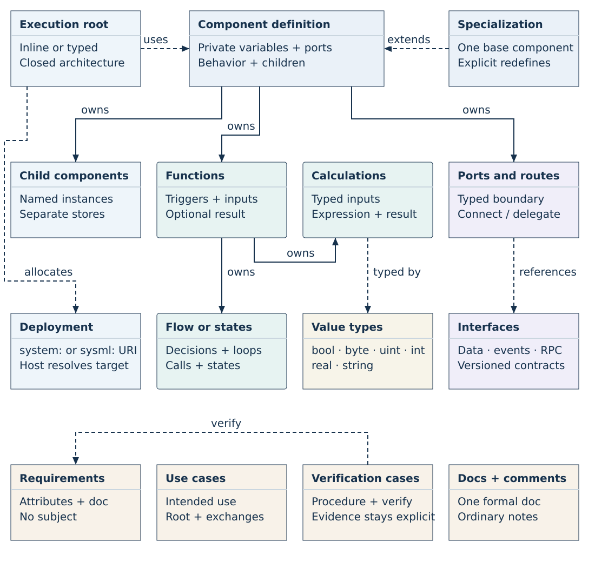

Solid ontology arrows indicate ownership or expansion; dashed arrows indicate references. The cards group related concepts for a quick introduction. The [complete ontology and view guide](#source-84e06ed0ba86) and [canonical notation catalog](#source-2d93a6cc8eab) provide the full inventory.

| Modeling question | SWAML elements | Useful view |
| --- | --- | --- |
| What software exists, and what owns it? | component definitions and occurrences | Browser, gv |
| What crosses a boundary? | interfaces, ports, connectors, delegation, QoS | iv |
| Which outcome and scenario matter? | requirements, cases and routed exchange steps | cv, sv |
| What does the software do? | component-owned functions, statement flow or owned states | fv |
| What runs where, and under which constraints? | external system/part references, timing and concurrency | gv, grv |

<a id="source-8da46ae3c9ac-1-begin-with-the-use-case"></a>

## 1. Begin with the use case

**Buyer goal:** place an order, reserve available stock, receive confirmation and a receipt. This user story motivates the named requirement `ReserveBeforeAccept`. The `Purchase` case references the `Production` root and claims coverage of that requirement.

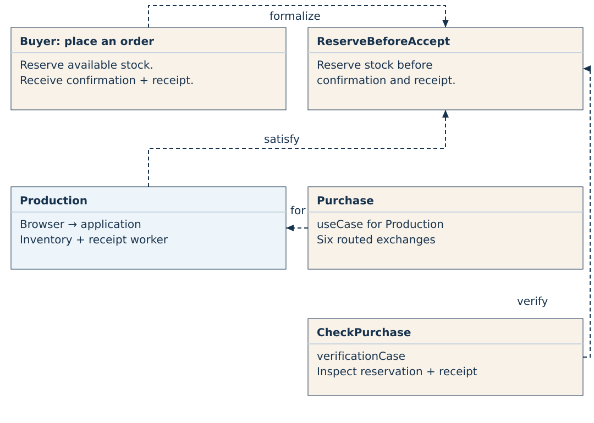

The buyer is explanatory context. `browser : BrowserClient` models the communicating client through an owned port. The `satisfy` relation records intent; supporting evidence is assessed separately.

<a id="source-8da46ae3c9ac-2-describe-the-message-flow"></a>

## 2. Describe the message flow

The successful `Purchase` scenario requests checkout, reserves stock, receives the reservation result, publishes two events and returns the checkout result. Each step names its interface member and route; `after` labels define the intended order.

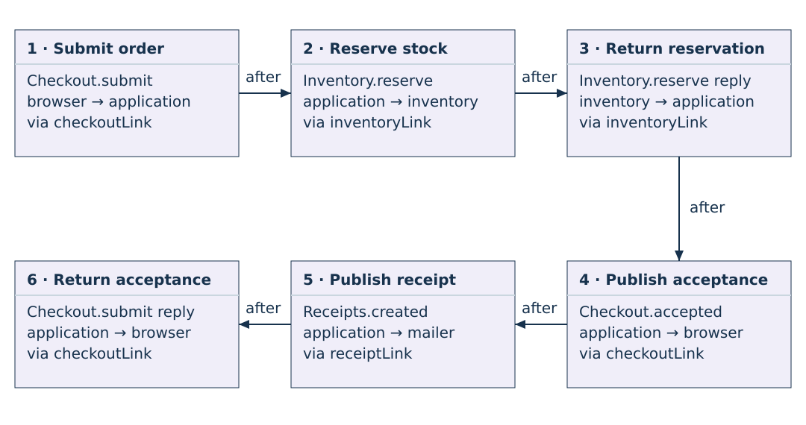

These arrows connect scenario steps. The architectural connectors are `checkoutLink`, `inventoryLink` and `receiptLink`. Replies stay correlated with their requests; receipt and confirmation have their own receiving functions.

<a id="source-8da46ae3c9ac-3-open-the-function-flow"></a>

## 3. Open the function flow

`Production.application.checkout.submit` implements checkout. It requests inventory with a 200 ms timeout and returns `false` on request failure or refused stock. On acceptance, it updates its private counter, publishes acceptance, publishes a receipt and returns `true`.

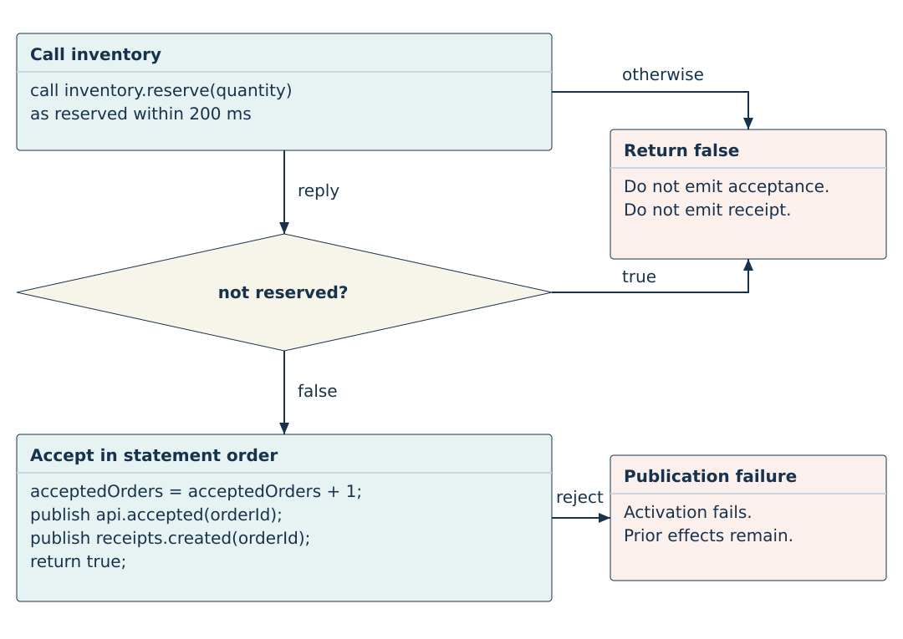

Publication admission can fail after earlier effects have committed. The example has no distributed rollback. A timed-out inventory request also does not cancel stock changes that may already have occurred.

<a id="source-8da46ae3c9ac-4-assign-clear-software-ownership"></a>

## 4. Assign clear software ownership

Four behavior-owning component instances contain six functions. `application` and `inventory` are component boundaries around their respective `checkout` and `stock` components; their boundary ports delegate to those components.

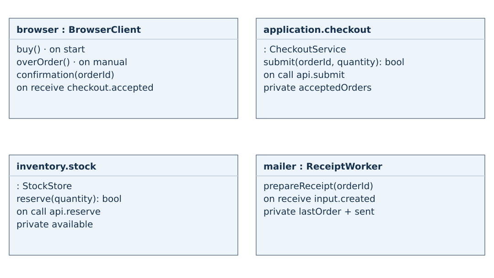

| Scenario concern | Actual behavior owner |
| --- | --- |
| Start the purchase | `Production.browser.buy` |
| Decide acceptance and emit both events | `Production.application.checkout.submit` |
| Check and decrement stock | `Production.inventory.stock.reserve` |
| Record the acceptance event | `Production.browser.confirmation` |
| Process the receipt event | `Production.mailer.prepareReceipt` |
| Exercise an oversized-order rejection | `Production.browser.overOrder` |

The case references exchanges; it does not call these functions. Their declared triggers and routed messages activate them. For example, the browser’s serial `buy` function can delay its `confirmation` handler until the checkout request completes.

<a id="source-8da46ae3c9ac-5-inspect-the-final-structure"></a>

## 5. Inspect the final structure

`WebShop::Production` contains four immediate child components. The application and inventory components each contain one further component, for six descendants in total. Three named connectors and four external deployment references complete the architecture.

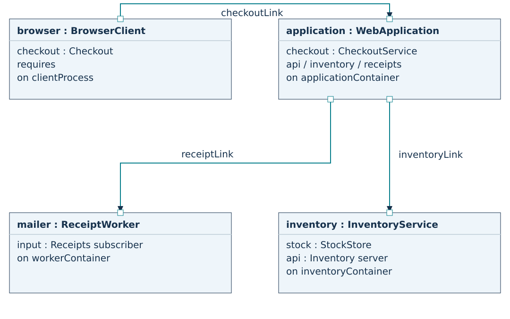

| Connector | Port route | Contract and policy |
| --- | --- | --- |
| `checkoutLink` | `browser.checkout` → `application.api` | `Checkout` service; `RequestQueue` |
| `inventoryLink` | `application.inventory` → `inventory.api` | `Inventory` client–server; `RequestQueue` |
| `receiptLink` | `application.receipts` → `mailer.input` | `Receipts` publish–subscribe; `ReceiptQueue` |

Both policies use at-most-once delivery, FIFO ordering and rejecting overflow; capacities are 16 and 32 respectively. Selecting the same `RequestQueue` values leaves the two connectors’ queues independent. Service events and RPC replies travel back over their existing route.

<a id="source-8da46ae3c9ac-try-the-complete-model"></a>

## Try the complete model

Open the [complete WebShop source](../examples/13-web-application.swaml), [simulation configuration](../examples/simulation/13-web-application.json) and [expected final stores](../examples/simulation/runs.json). The configured run accepts two items from stock 10, rejects an order for 99, records one accepted order and one receipt, and leaves stock at 8. This is bounded reference-simulation evidence; the descriptive case is not automatically a verified execution trace.

The same modeling steps apply to the [Classic, Adaptive and cloud examples](#source-153a44e6a38e). Use the [quick start](#source-62e91d3086c9) for authoring and validation commands. These original flat graphs share one [source inventory](../spec/modeling-overview.json) with the interactive presentation and reproducible SVG/PDF scenes.

<a id="source-8da46ae3c9ac-requirements-and-formal-documentation"></a>

## Requirements and formal documentation

Requirements own typed attributes and one optional `doc /* ... */` specification. Design elements link through `satisfy`; verification cases link through `verify`. Use cases describe intent. Ordinary comments remain independent notes. View kinds use lower camel case, and view blocks combine multiple selections and Boolean filters. See the [guide](#source-1a801412d435) and [complete model](../examples/16-requirements-and-views.swaml).

---

<a id="source-62e91d3086c9"></a>

<a id="source-62e91d3086c9-swaml-in-five-minutes"></a>

# SWAML in five minutes

Model a contract, give each participant a typed port, then connect their occurrences in a root component. Functions own behavior and each component occurrence owns its private values. You can use the same workflow for embedded software, service applications and cloud systems.

<a id="source-62e91d3086c9-1-define-the-exchanged-contract"></a>

## 1. Define the exchanged contract

Start with the information crossing a boundary. A `senderReceiver` interface carries data, `clientServer` carries requests and results, `publishSubscribe` carries events, and `service` combines functions with events. Every port names one versioned interface and a compatible role.

<a id="source-62e91d3086c9-2-give-behavior-an-owner"></a>

## 2. Give behavior an owner

A `component def` owns ports, private variables and functions. The sender's function emits through its own port; the receiver's function names that port member as its trigger. Declare `calc` blocks first inside a function for pure input-to-output expressions.

<a id="source-62e91d3086c9-3-compose-and-connect"></a>

## 3. Compose and connect

A `component def` can combine local behavior with reusable child composition. A top-level `component` is a concrete root. A connector joins complementary ports and selects complete QoS values. Define a shared policy with `qos def` when several routes use the same values. Each route retains its own queues.

Save this complete model as `hello.swaml`:

```swaml
package QuickStart {
    interface senderReceiver Greeting version "1.0.0" {
        data text: string queued;
    }
    component def Speaker {
        port output: Greeting sender;
        function greet() on start {
            send output.text("Hello, SWAML");
        }
    }
    component def Listener {
        port input: Greeting receiver;
        var last: string = "";
        function hear(message: string) on receive input.text {
            last = message;
        }
    }
    qos def LocalQueue {
        delivery atMostOnce; ordering fifo; capacity 4; overflow reject;
    }
    component Demo {
        component speaker: Speaker;
        component listener: Listener;
        connect greeting: speaker.output -> listener.input qos LocalQueue;
    }
    view structure gv of Demo;
    view wiring iv of Demo;
    view behavior fv of Speaker.greet;
}
```

`Speaker` and `Listener` are definitions; `Demo.speaker` and `Demo.listener` are occurrences. `last` belongs to the listener occurrence. The connector permits the exchange; the view declarations select existing model subjects.

<a id="source-62e91d3086c9-4-validate-the-model"></a>

## 4. Validate the model

From a clone of this repository, with Node.js 22+ and npm 10.2.3+ installed:

```sh
npm ci
npm run build
node out/src/cli/main.js --language-version 1.2 hello.swaml
```

The validator checks syntax, contracts, ownership, routing, closure and applicable timing rules. Supply related files together when packages import declarations from other files. A successful validation establishes static acceptance; use the [reference simulator](#source-fedc6631cb48) for bounded execution evidence.

<a id="source-62e91d3086c9-5-review-through-views"></a>

## 5. Review through views

Functions can reuse local behavior with `call`, and calculations stay inside their owning function:

```swaml
package LocalBehavior {
    component Demo {
        var latest: int = 0;
        function doubled(input: int): int {
            calc scale { in value: int; return result: int = value * 2; }
            return scale(input);
        }
        function boot() on start {
            call doubled(21) as answer;
            latest = answer;
        }
    }
}
```

Use `var` for both private component data and mutable block locals. Local void calls use `call helper();`. Routed calls use `call api.member(...) as result within 1 s otherwise { return; };` through an owned port and an explicit connector. Only calculations use expression-call syntax.

The [graphical modeling overview](#source-8da46ae3c9ac) connects a use case to its interaction flow, function logic, function owners and final software structure. Its ontology diagram shows the relationships between the concepts used below.

Use gv for composition and deployment, iv for ports and connections, cv for cases and requirement claims, sv for exchange dependencies, grv for properties, and fv for function flow or states. Browser navigation follows declarations and occurrence paths.

Run the [interactive showcase](../showcase/README.md) with `npm --prefix showcase ci` and `npm --prefix showcase run dev`. It contains a seven-view walkthrough, an interface reference and four domain architectures. Read the full model source alongside its diagram.

| Your architecture | Start with |
| --- | --- |
| AUTOSAR Classic software component | [Climate controller](../examples/11-autosar-classic.swaml): sampled inputs, client/server calibration, periodic acquisition and MCU allocation |
| AUTOSAR Adaptive application | [Adaptive diagnostics](../examples/12-autosar-adaptive.swaml): service functions/events and process allocation |
| Service-based web application | [Web shop](../examples/13-web-application.swaml): browser, backend, inventory and explicit event consumers |
| Cloud service | [Cloud telemetry](../examples/14-cloud-service.swaml): ingestion, explicit broker, analytics and archive consumers |

These examples model logical software architecture. Read their [architecture patterns and platform mappings](#source-153a44e6a38e). Continue with the [user guide](#source-c9e79bd9c348), [UML transition guide](#source-386496547756), or [complete specification](#source-ffe5ff67da37).


<a id="source-62e91d3086c9-requirements-and-formal-documentation"></a>

## Requirements and formal documentation

Requirements own typed attributes and one optional `doc /* ... */` specification. Design elements link through `satisfy`; verification cases link through `verify`. Use cases describe intent. Ordinary comments remain independent notes. View kinds use lower camel case, and view blocks combine multiple selections and Boolean filters. See the [guide](#source-1a801412d435) and [complete model](../examples/16-requirements-and-views.swaml).

---

<a id="source-c9e79bd9c348"></a>

<a id="source-c9e79bd9c348-swaml-12-user-guide"></a>

# SWAML 1.2 user guide

Architects familiar with UML: start with the [concept correspondence and modeling workflow](#source-386496547756).

SWAML describes what software contains, how it communicates, and how functions and state evolve. The model remains independent of C++, Rust, an RTOS, a cloud runtime, or a particular network protocol.

<a id="source-c9e79bd9c348-1-install-and-check-a-model"></a>

## 1. Install and check a model

From the repository root:

```sh
npm ci
npm run build
node out/src/cli/main.js examples/01-hello.swaml
```

A successful result is `Checked 1 model(s): 0 error(s)`. This checks the implemented rules; it does not execute the software or prove schedulability. `npm run check` also runs the repository tests. Open the [implementation matrix](#source-f25fc4312adb) before interpreting a passed check as a stronger assurance claim.

A file begins directly with named packages. Use the 1.2 language core or pin SWAML 1.2 in the editor host; there is no per-file version header. The 1.2 parser rejects historical headers rather than guessing a version. Names are case sensitive. Keywords cannot be identifiers. Use `orderLink`, for example, rather than the reserved word `ordering`.

<a id="source-c9e79bd9c348-2-write-the-contract-first"></a>

## 2. Write the contract first

Choose the communication model by the meaning of the exchange:

| Need | Interface | Roles | Function statement |
| --- | --- | --- | --- |
| A current sensor value | `senderReceiver`, `sampled` data | sender → receiver | `send p.member(value);` |
| Every queued reading | `senderReceiver`, `queued` data | sender → receiver | `send p.member(value);` |
| Request and correlated response | `clientServer` | client → server | `call p.member(...) as result within … otherwise …;` |
| One event to many subscribers | `publishSubscribe` | publisher → subscriber | `publish p.member(...);` |
| RPC plus server notifications | `service` | requires → provides | call and publish |

Each connector uses one nominal interface definition. Equal-looking interfaces are not automatically interchangeable. Create an adapter component when their meaning, payload, or version differs.

This is a complete small model; save it as `example.swaml`:

```swaml
package First {
    interface senderReceiver Reading version "1.0.0" {
        data value: real sampled;
    }
    component def Source {
        port output: Reading sender;
        function sample() on start {
            send output.value(21.5);
            return;
        }
    }
    component def Sink {
        port input: Reading receiver;
        var last: real = 0.0;
        function update(value: real) on receive input.value {
            last = value;
            return;
        }
    }
    component def Pair {
        component source: Source;
        component sink: Sink;
        connect readings: source.output -> sink.input qos {
            delivery atMostOnce; ordering fifo; capacity 1; overflow dropOldest;
        };
    }
    component Demo: Pair;
    view overview gv of Demo;
    view wiring iv of Pair;
    view updateFlow fv of Sink.update;
}
```

`component def Pair` is a reusable type; `component Demo: Pair;` selects one root occurrence for execution. Its omitted profile means service. `Reading` defines the payload. Both ports use it with complementary roles. `sample` sends through its own port, and `update` declares that same port-member contract as its activation source. The connector allows the transfer. The variable `last` belongs to each `Sink` instance, not to every instance of its definition.

<a id="source-c9e79bd9c348-reuse-a-communication-policy"></a>

## Reuse a communication policy

When several connectors have the same QoS, declare a complete policy once at package scope:

```text
qos def LocalLink {
    delivery atMostOnce; ordering fifo; capacity 8; overflow reject;
}
// Inside a component, explicitly select it on each route:
connect frontLink: front.setting -> settings.api qos LocalLink;
connect rearLink: rear.setting -> settings.api qos LocalLink;
```

The complete [service-setting model](../examples/08-service-field.swaml) uses this form. Inline blocks remain valid. A named policy shares values, while every connector keeps its own queues, directions and member identities. Qualified names and direct imports follow normal namespace rules. The validator checks the actual interface and root at every use, so a generic policy cannot bypass sampled buffering, idempotency or realtime bounds. The [1.2 migration guide](#source-1e4615d221cd) explains the AST update.

<a id="source-c9e79bd9c348-3-choose-component-and-component-boundaries"></a>

## 3. Choose component and component boundaries

Use a **component** for a cohesive software boundary: an embedded controller, a service backend, or a subsystem. It may own functions, private data and child components. A component need not be a thread, file, class, or process; deployment is separate.

A component definition owns component instances, ports and connectors. `def` makes this type declaration explicit, following the familiar SysML definition/usage distinction. A root is an occurrence: use `component Demo: Pair;` to instantiate a definition, or `component Demo { component source: Source; … }` to assemble components directly. Statements belong to functions; a root can own functions and private variables. This keeps executable ownership unambiguous.

A function can call a local helper with `call helper(...);`. The helper is an untriggered flow function in the same component. For a value result, write `call helper(...) as result;`. Pure calculations use expression syntax such as `scaled(...)` only inside their owning function. These local calls do not need ports because they do not cross the agreed component boundary.

Never write `otherComponent.function()` or `otherUnit.privateValue`. The syntax and validator reject that access. To reach another component, declare a port, choose an interface, connect it in their common parent, and use `call`, `send` or `publish`.

For a nested component, expose a boundary port and delegate it to one immediate child port. The [service example](../examples/03-service-pubsub.swaml) demonstrates `Backend.api` delegating to `serviceUnit.api`. Delegation preserves the port's role and interface; it does not reverse them or convert data.

<a id="source-c9e79bd9c348-4-describe-function-control-flow"></a>

## 4. Describe function control flow

Functions contain ordered statements: typed local declarations, assignments, assertions, conditionals, bounded loops, local calls, interface exchanges, returns and failures. Read [Values and flow](../examples/05-values-and-flow.swaml) as a worked example.

Functions and interface signatures may omit `: void`; a missing result annotation means exactly void. Calculations are expressions with typed parameters and an explicit non-void result. They cannot read mutable component data, issue requests, or emit events. Pass their inputs explicitly. Records, enums and arrays are values, so sending them does not expose a remote reference to local mutable data. Write `count = count + 1;` for whole-value assignment, `clamp(value)` for a pure local calculation, `[1, 2, 3]` for an array, and `Status.Ready` for an enum value. Use `Contracts::Status.Ready` when a local value named `Status` would otherwise hide that enum.

A `while` includes a maximum iteration count. Exceeding that count at runtime is a failure, not permission to silently stop the loop. This makes the bound useful to a later analysis or code generator.

Use `assert` for a model-level assumption that must hold at that point. A requirement is a named prose obligation. A case can link to requirements using `satisfies`; that trace link is not proof that the requirement is met.

<a id="source-c9e79bd9c348-5-model-a-service-call-and-its-failure"></a>

## 5. Model a service call and its failure

Read [Services and pub/sub](../examples/03-service-pubsub.swaml). The service declares `submit` in its interface; the server component implements it with `on call api.submit`. The client's `call` includes a timeout and an `otherwise` block.

A request binds its result only on success. The failure block has a local `failure: string` value and must return from or fail the current function. This prevents subsequent statements from reading an uninitialized result. A timeout says the caller stopped waiting; it does not prove the server did nothing. Later responses to that timed-out request are ignored.

For application-specific errors, use an enum or result record in the function's declared return type. Transport failures and application results are different concepts. Do not retry a request unless its idempotency and retry budget are established. The core rejects `atLeastOnce` RPC when the function is not declared idempotent; proving that declaration is an implementation obligation.

<a id="source-c9e79bd9c348-6-use-publishsubscribe-without-a-hidden-event-bus"></a>

## 6. Use publish/subscribe without a hidden event bus

An event is a member of a `publishSubscribe` or `service` interface. Only a function can publish it, through one of its own outgoing ports. Subscribers receive it through their own typed ports. The normal handler uses `on receive input.eventName` with the event's parameter types in order.

Fan-out is multiple explicit connectors from a publisher port to subscriber ports. Each subscription has its own queue and QoS. A slow subscriber does not silently change the queue of another subscriber. Multiple publishers may connect to one subscriber; ordering is per connector, not global.

In a combined service, the connector is drawn from `requires` to `provides` for requests. Service events travel back from provider to consumer, and replies return on the originating request's correlation. Both remain members of the same declared interface.

Model a broker as a component with incoming and outgoing interfaces if broker behavior, failure, buffering or deployment matters. A connector alone represents a logical subscription, without selecting MQTT, DDS, Kafka or SOME/IP. Dynamic discovery and unsubscribe functions are reserved for future language versions.

<a id="source-c9e79bd9c348-7-put-states-inside-a-function"></a>

## 7. Put states inside a function

The [stateful function example](../examples/04-stateful-function.swaml) owns `Idle`, `Running`, and `Stopped` inside `Device.lifecycle`. It starts once with its component. No performer or external behavior allocation is required.

A stateful function has no parameters, a void result (usually omitted), and `on start { initial Idle; … }`. The initial reference follows any function-local calculation declarations and precedes all states. There is no extra behavior wrapper. It declares an initial state, states with optional entry/exit blocks, and transitions. Triggers are an incoming port member, a positive delay after entering a state, or completion. A receiving transition makes event parameter names available in its guard and effect; sender–receiver data uses `payload`.

This complete model places the states directly where they execute:

```swaml
package TimerExample {
    component def Device {
        var cycles: int = 0;
        function lifecycle() on start {
            initial Waiting;
            state Waiting {
                entry { cycles = cycles + 1; }
            }
            state Finished final {}
            transition complete: Waiting -> Finished on after 10 ms {}
        }
    }
    component Demo { component device: Device; }
    view lifecycle fv of Demo.device.lifecycle;
}
```

The root contains its component directly. The delay is local to that function; it is not a free event or cross-component channel. The [interface-triggered lifecycle model](../examples/04-stateful-function.swaml) adds commands and status ports.

On a transition: run the source exit block, the transition effect, then the destination entry block. A final state completes the stateful function. A received event with no enabled transition in the current state is consumed and ignored. Add an explicit transition if ignoring it is unacceptable.

Use one stateful function as the receiver for a given member, or one ordinary function. Do not bind the same member to both: that would create ambiguous delivery.

<a id="source-c9e79bd9c348-8-model-realtime-constraints"></a>

## 8. Model realtime constraints

The [controller example](../examples/02-realtime-controller.swaml) uses `on every 10 ms`, execution-time bounds and deadlines. A root with a realtime or mixed profile requires timing contracts for every used function and maximum connector latency. Sampled realtime data also needs `maxAge`.

The validator checks positivity, `wcet <= deadline`, and `deadline <= period` for a periodic function. These are necessary checks, not a scheduling proof. Document the actual RTOS policy, interrupt load, CPU allocation, priorities, clock assumptions, transport timing and measured/analyzed WCET in the implementation project. A production backend must establish them before claiming hard realtime execution.

`serial` is the default component-local execution policy. `reentrant` requires independent activations and must not mutate shared component state, including through helpers. A function waiting for a service response consumes elapsed deadline time even when it consumes no CPU execution time.

<a id="source-c9e79bd9c348-9-separate-deployment-from-architecture"></a>

## 9. Separate deployment from architecture

Write `deploy instance.path on "sysml:Vehicle::ecu";` to refer to an external system or part. A general host identity such as `"system:production::checkout"` is also supported. SWAML checks the component path and reference syntax; the integration host must resolve the destination and validate its suitability.

A typed root may have a deployment-only body: `component Product: Controller realtime { deploy sensor on "sysml:Vehicle::ecu"; }`. Its `sensor` must already exist in `Controller`; the binding cannot add children, functions or connections. An inline root may combine composition, local behavior and deployments. Deploying the root name establishes its own location and the default for its children. More specific descendant bindings override that default; each explicit path may occur only once.

The [component roots example](../examples/09-component-roots.swaml) shows reusable assemblies and concrete bindings. The software model retains its typed communication boundaries wherever components are placed. A SysML reference identifies an integration point; it does not import a SysML model or certify cross-language mapping.

<a id="source-c9e79bd9c348-specialize-a-reusable-component"></a>

## Specialize a reusable component

`component def Tuned specializes Controller { … }` reuses one base definition. Prefix an inherited replacement with `redefines`; an unmarked name collision is invalid. Replacement ports and functions preserve their contracts, while bodies, pure expressions and initial values can vary. Child instances may use the original type or a specialization of it. Instances remain separate stores and connected peers. See the [complete specialization example](../examples/15-component-specialization.swaml) and [ownership decision](#source-ba515b0190e9).

<a id="source-c9e79bd9c348-add-a-pure-calculation"></a>

## Add a pure calculation

Use `calc scaled { in value: real; in gain: real; return result: real = value * gain; }` at the start of a function body, then write `scaled(measured, 0.5)` in an expression. Inputs are copied values and the named output is a single pure result. Functions carry effects and control flow; calculations can appear in that function’s guards, local initializers and other expressions.

The basic types are `bool`, `int`, `uint`, `byte`, `real`, `string` and result-only `void`. Add nominal records, enums and fixed arrays such as `byte[8]` for structured values. uint and byte assignments check their ranges instead of truncating or wrapping.

<a id="source-c9e79bd9c348-10-organize-a-larger-model"></a>

## 10. Organize a larger model

Packages are flat namespaces in 1.2. Write `import Contracts::*;` to use another package's declarations unqualified, or name a declaration `Contracts::Reading`. All relevant files must be loaded together. Two imports exposing the same short name make it ambiguous; use the qualified name.

The editor host should load the whole model workspace. The CLI deliberately loads the files you supply and does not search unrelated directories. Do not put secrets in model payloads, examples or deployment notes.

<a id="source-c9e79bd9c348-11-navigate-through-views"></a>

## 11. Navigate through views

| Surface | Purpose |
| --- | --- |
| Browser | Navigate packages → definitions → instances → ports/functions → states |
| gv — General View | Inspect structure, declarations and their relationships |
| iv — Interconnect View | Inspect connected ports and component delegation |
| cv — Case View | Inspect cases and linked requirements |
| sv — Sequence View | Inspect the partial ordering of interface exchanges in a case |
| grv — Grid View | Inspect sortable model, interface, timing and deployment tables |
| fv — Flow View | Inspect a function's control flow or owned state transitions |

These are specified editor behaviors. The current package supplies the model syntax and language server, not a diagram renderer. View declarations can already be parsed and checked. See [graphical notation](#source-5798f00f85a6) for the drawing and editing contract.

<a id="source-c9e79bd9c348-12-resolve-diagnostics"></a>

## 12. Resolve diagnostics

| Diagnostic | Typical fix |
| --- | --- |
| `SW030` | Connect immediate child ports; expose/delegate a port across each component boundary |
| `SW031` / `SW032` | Use the same interface definition and complementary port roles |
| `SW034` | Connect the port in a closed root component, or mark an intentionally unbound port `optional` |
| `SW050` / `SW051` | Use a local port member and the correct communication verb/direction |
| `SW052` / `SW055` | Match handler parameters/results and give each incoming member one owner |
| `SW057` | Make every failure path return or fail |
| `SW062` | Give competing transitions distinct priorities |

A parser error usually means a reserved identifier, missing delimiter, or malformed block. Resolve syntax errors first; semantic checks are skipped on syntactically incomplete documents to avoid misleading secondary errors.

<a id="source-c9e79bd9c348-service-fields-repeated-consumers-and-checked-traces"></a>

## Service fields, repeated consumers and checked traces

[Service field](../examples/08-service-field.swaml) models one temperature setting with explicit `get`, `setPoint` and `changed` interface members. The service stores the value privately. Its serial setter publishes through its provided port, which fans out to two required ports on separate panel instances. Each panel owns a distinct displayed value and its own receiving function.

The getter is reentrant and reads the private-state snapshot taken when it is dispatched. It can safely overlap the serial setter because it does not mutate storage, directly or through a helper. Snapshot implementation is an execution-backend obligation; parsing this example does not simulate it.

A case reply must follow a unique unanswered matching request through its `after` ancestry. Two outstanding requests on the same route/member cannot be disambiguated by drawing one reply lower on the page. Order the pairs or use separate cases. Requests may remain unanswered in a partial trace. A route-valid case still needs a function-level witness before it counts as verified behavior.

Use the owning package's name as a gv/grv subject for an inventory. iv takes a component definition/root component; fv takes a function, including an occurrence path such as `Cabin.settings.store.update`. cv/sv take a case or root component. A view cannot use another view as its semantic subject.

If a routed call returns void, its required `as` name marks completion but cannot be read as a value. Reserve `failure` for the implicit error-path binding. Write string line breaks with `\n`; raw line breaks, tabs and unsupported escapes inside strings are rejected.

The [operational contract](#source-34105487b7a4) defines execution edge cases, and the [conformance obligations](#source-7edf1a193e2a) distinguish validator acceptance from runtime and analysis evidence.

<a id="source-c9e79bd9c348-find-a-construct-or-run-an-example"></a>

## Find a construct or run an example

Use the [alphabetical keyword reference](#source-a10a03d9b23f) for exact words and context, the [concern guide](#source-62d51cd6e7d4) for architectural questions, or the [complete Markdown book](SWAML-1.2.1-Reference.md) for a single user-facing document. The maintained examples have executable [simulation configurations](../examples/simulation/runs.json); follow the [reference simulation guide](#source-fedc6631cb48) to run them and inspect their traces.

<a id="source-c9e79bd9c348-requirements-and-formal-documentation"></a>

## Requirements and formal documentation

Requirements own typed attributes and one optional `doc /* ... */` specification. Design elements link through `satisfy`; verification cases link through `verify`. Use cases describe intent. Ordinary comments remain independent notes. View kinds use lower camel case, and view blocks combine multiple selections and Boolean filters. See the [guide](#source-1a801412d435) and [complete model](../examples/16-requirements-and-views.swaml).

---

<a id="source-153a44e6a38e"></a>

<a id="source-153a44e6a38e-architecture-patterns"></a>

# Architecture patterns

SWAML 1.2 uses the same architecture model for embedded control, Adaptive applications, service-oriented systems and cloud services: reusable definitions, owned ports, typed contracts, explicit connectors, local behavior and deployment occurrences. Start from the example closest to your system, then replace its contracts and behavior with your own.

These models are executable logical examples. Their platform names describe the intended architecture context. A target binding supplies middleware, operating-system and infrastructure configuration; SWAML does not generate those artifacts. See [execution bindings](#source-34105487b7a4) for the contract and [implementation status](#source-f25fc4312adb) for delivered capabilities.

| Architecture | Complete model | Root | Main interactions |
| --- | --- | --- | --- |
| AUTOSAR Classic climate SW-C | [11-autosar-classic.swaml](../examples/11-autosar-classic.swaml) | `ClassicClimate::Vehicle` | Sampled temperature, client/server calibration, sampled actuator command |
| AUTOSAR Adaptive diagnostic application | [12-autosar-adaptive.swaml](../examples/12-autosar-adaptive.swaml) | `AdaptiveDiagnostics::Vehicle` | Service methods, changed notification, audit publication |
| Service-based web application | [13-web-application.swaml](../examples/13-web-application.swaml) | `WebShop::Production` | Checkout request, inventory reservation, receipt publication |
| Cloud telemetry service | [14-cloud-service.swaml](../examples/14-cloud-service.swaml) | `CloudTelemetry::Production` | Ingestion, explicit broker, independent analytics/archive subscriptions |

Each model declares gv for composition, iv for contracts and wiring, cv for intended requirement coverage, sv for a representative interaction, grv for deployment and fv for a function. Browser navigation follows the same definition and occurrence ownership. The [interactive showcase](../showcase/README.md) presents these four architectures alongside the interface reference.

<a id="source-153a44e6a38e-autosar-classic-a-climate-software-component"></a>

## AUTOSAR Classic: a climate software component

AUTOSAR Classic separates application software, the runtime environment and basic software on a microcontroller. SWAML can describe the application responsibilities and their communication before a target integration supplies the RTE and basic-software configuration. [AUTOSAR Classic overview](https://www.autosar.org/standards/classic-platform/).

The example gives the climate controller three explicit boundary ports. A sensor emits 28 °C every 10 ms; the controller requests a 22 °C setpoint, calculates a bounded fan duty and sends 0.6 to the actuator. A missing calibration response selects duty 0.0 through an explicit timeout branch. The root's components are allocated to the external identity `system:bodyEcu`; a SysML integration can bind an equivalent `sysml:` part identity.

| SWAML subject | Architecture responsibility |
| --- | --- |
| `controller: ClimateController` | SW-C boundary with temperature, calibration and fan ports |
| `controller.control: ClimateLogic` | Internal behavior and private controller values |
| `regulate` function | Runnable-like reaction to received temperature |
| `CabinTemperature`, `FanCommand` | Sender/receiver data contracts |
| `Setpoint` | Client/server calibration query |
| `measured`, `calibrated`, `commanded` | Explicit assembly communication routes |

This is a modeling correspondence. AUTOSAR's Software Component Template defines its own component, port, internal-behavior and runnable metamodel. A SWAML component is useful for grouping owned data and runnable-like functions; it is not an additional AUTOSAR component forced into the implementation. Preserve that grouping in an explicit mapping. [AUTOSAR Software Component Template, R24-11](https://www.autosar.org/fileadmin/standards/R24-11/CP/AUTOSAR_CP_TPS_SoftwareComponentTemplate.pdf).

The `realtime` profile requires timing contracts and connector bounds. In this example each sampled route has capacity 1, `dropOldest`, `maxLatency 1 ms` and `maxAge 20 ms`. The logical simulation checks the declared timeouts and transfers. RTE generation, ECU extract, OS task/event assignment, runnable scheduling, E2E protection and physical WCET evidence remain target integration work. A SWAML sampled receive activates a handler with a copied value; an AUTOSAR integration must choose a compatible read/activation strategy explicitly.

<a id="source-153a44e6a38e-autosar-adaptive-an-ara-application"></a>

## AUTOSAR Adaptive: an ARA application

The Adaptive Platform provides the AUTOSAR Runtime for Adaptive Applications (ARA), with platform services and APIs. Its communication management uses service providers and consumers, including discovery during runtime. [AUTOSAR Adaptive overview](https://www.autosar.org/standards/adaptive-platform/).

The diagnostic application requires the `VehicleHealth` service. It invokes `runCheck`, obtains a correlated bool response, and queries `getSummary` for a `HealthReport`. The provider publishes `changed(report)` on the same service contract and independently publishes `DiagnosticAudit.checked` to an audit subscriber. Each application/service has its own external deployment identity, resolved by the target binding.

| SWAML subject | ARA-oriented interpretation |
| --- | --- |
| `application: DiagnosticApplication` | Consumer application boundary |
| `application.health` with role `requires` | Consumer-side service contract, suitable for a proxy binding |
| `health.api` with role `provides` | Provider-side service contract, suitable for a skeleton binding |
| `getSummary`, `runCheck` | Service methods |
| `changed` | Provider-to-consumer notification |
| `healthLink` | One selected service-instance relationship |

These are application-level correspondences to the proxy/skeleton, method and event concepts in [AUTOSAR Communication Management, R25-11](https://www.autosar.org/fileadmin/standards/R25-11/AP/AUTOSAR_AP_SWS_CommunicationManagement.pdf). A field can be represented explicitly by getter, optional setter and changed-event members; [the setting-service example](../examples/08-service-field.swaml) demonstrates that pattern.

The example records the topology after service selection. Model known provider variants as separate roots or explicit adapters. Dynamic discovery, service-offer/subscription lifecycle, execution and service manifests, SOME/IP or other network bindings, and generated `ara::com` C++ APIs belong in the target binding. The name `Application` carries architecture intent and does not imply a generated executable or manifest.

<a id="source-153a44e6a38e-service-oriented-web-application-checkout-and-inventory"></a>

## Service-oriented web application: checkout and inventory

The web example separates a browser client, application service, inventory service and receipt worker. The browser is a modeled component so that its requests obey the same typed-boundary rules as server-to-server communication.

`Checkout.submit` first requests `Inventory.reserve`. The stock service validates quantity and updates its own private `available` value. Only a successful reservation lets checkout publish acceptance and a receipt. The response is correlated to its request; notifications are separate events on the declared routes. The example rejects an order for 99 items after accepting an order for 2 items from initial stock 10.

| Contract | Choice and reason |
| --- | --- |
| `Checkout` — service | Combines a request/result with provider notifications |
| `Inventory` — clientServer | Reservation uses a request/result without subscription traffic |
| `Receipts` — publishSubscribe | Receipt processing has independent activation and owned data |

HTTP routes, status codes, cookies, authorization, serialization and browser delivery mechanisms are deployment decisions. For example, a target may bind the request to HTTP and the service event to server-sent events while retaining the same modeled contract. Choose an adapter when that target uses different nominal contracts. The sample keeps its stores in memory; persistence and atomic order/reservation guarantees require an explicit storage/transaction design.

<a id="source-153a44e6a38e-cloud-service-ingestion-and-event-distribution"></a>

## Cloud service: ingestion and event distribution

The telemetry example accepts a typed `Sample` from one ordered device stream. Ingestion checks the device identity, sequence and temperature range before publishing accepted data. An explicit broker receives that contract and forwards a `Measurements` contract to two independent subscribers. Analytics owns its aggregate values; archive owns its record count and latest device identity. There is one edge process and four container allocations.

The three event connectors select the same `EventQueue` policy with `atLeastOnce`, FIFO ordering and capacity 32. Each connector still has its own queue. The broker and consumers retain a private sequence high watermark, so repeated delivery of an already processed sequence creates no repeated local effect in this single-stream example. The simulator tests duplicate delivery independently on all three event routes.

The source sends sequences 1 and 2, retries sequence 2, then submits an invalid temperature for sequence 3. Expected results are two accepted samples, two broker forwards, two analytics updates and two archive records. The retry succeeds without another publication; the invalid sample returns false.

An ingestion result of true confirms admission at ingestion; it does not acknowledge downstream processing. If a broker publication fails on one route, other routes may already have accepted the sample. Their effects remain committed, and the failed broker handler is not automatically retried. The adverse test injects a transport failure on the first publication to analytics: ingestion still accepts both samples and archive records both, while analytics processes only the second and the trace reports the broker failure. Recovery requires an explicit acknowledgment/replay protocol.

This policy is intentionally scoped to one monotonically ordered device stream. A multi-device system needs per-device state; an out-of-order stream needs a different deduplication strategy. The sample's high watermarks and effects are in memory. Recovery, durable broker acknowledgements, transactional publication, replay and exactly-once business effects require a separate persistence/failure design. Container declarations identify locations; an infrastructure binding maps explicitly modeled replica occurrences to resources and supplies service addresses, topics, storage and orchestration configuration.

<a id="source-153a44e6a38e-validate-and-run-the-models"></a>

## Validate and run the models

After `npm ci` and `npm run build`, validate all four examples:

```sh
node out/src/cli/main.js examples/11-autosar-classic.swaml examples/12-autosar-adaptive.swaml examples/13-web-application.swaml examples/14-cloud-service.swaml
```

Run each logical deployment with its checked-in options:

```sh
npm run simulate -- ClassicClimate::Vehicle examples/simulation/11-autosar-classic.json examples/11-autosar-classic.swaml
npm run simulate -- AdaptiveDiagnostics::Vehicle examples/simulation/12-autosar-adaptive.json examples/12-autosar-adaptive.swaml
npm run simulate -- WebShop::Production examples/simulation/13-web-application.json examples/13-web-application.swaml
npm run simulate -- CloudTelemetry::Production examples/simulation/14-cloud-service.json examples/14-cloud-service.swaml
```

| Root | Evidence checked by the run catalog |
| --- | --- |
| `ClassicClimate::Vehicle` | Received temperature 28; commanded/applied duty 0.6; calibration 22 |
| `AdaptiveDiagnostics::Vehicle` | One completed check, one notification, one audit entry; observed healthy/code 200 |
| `WebShop::Production` | One accepted order and receipt; remaining stock 8; oversized order rejected |
| `CloudTelemetry::Production` | Two effects per stage; retry accepted; invalid sample rejected; latest temperature 28.5 |

`node scripts/check-simulations.mjs` verifies those final stores and repeatability. [Architecture-pattern regressions](../test/architecture-patterns.test.ts) additionally inspect timeout, transport failure, partial fanout and duplicate-delivery traces. The `case` declarations describe intended exchange dependencies; simulation results supply bounded evidence for function behavior, and are not automatic proofs that every case or target execution is satisfied.

---

<a id="source-62d51cd6e7d4"></a>

<a id="source-62d51cd6e7d4-language-reference-by-concern"></a>

# Language reference by concern

Use this alphabetical map to navigate SWAML 1.2 by architectural question. The [alphabetical keyword reference](#source-a10a03d9b23f) provides the other reading order; the [complete Markdown edition](SWAML-1.2.1-Reference.md) contains both maps, all normative chapters, user guidance, grammar and model examples in one document. Rules are normative where their source chapter says so; a tutorial or illustration never overrides those rules.

<a id="source-62d51cd6e7d4-architecture-selection-and-platform-correspondence"></a>

## Architecture selection and platform correspondence

Start with the [architecture comparison](#source-3ffb1a6eb6e5). SWAML borrows strict interface boundaries from component/service architectures and familiar structural/behavioral concepts from UML/SysML. Its authoring model is deliberately software-specific. A Classic-like control loop uses sampled senderReceiver members, periodic functions and explicit timing. A service architecture uses function/event contracts, correlated requests, timeout handling and static subscriber connections. A gateway explicitly translates between these through its own component ports.

Choose a root component profile (`realtime`, `service` or `mixed`) according to the contracts you intend to supply. The choice does not turn the model into AUTOSAR configuration or prove a scheduling property. Use an adapter component when hardware or middleware behavior matters to the architecture. External devices cannot enter a case through an untyped actor shortcut.

<a id="source-62d51cd6e7d4-behavior-and-state-ownership"></a>

## Behavior and state ownership

See [functions, flow and states](#source-af5c925f5118) and the [operational contract](#source-34105487b7a4). Components own executable functions directly. A calculation evaluates a pure expression from typed inputs; an untriggered flow function is a local helper with an optional result; a triggered function is a root activation. The same component may also compose child components; each child retains its own private store and activation lock.

Choose a statement body for sequential calculation and requests. Choose a state body when the function remains in named states between inputs. States, guards and transitions remain inside that function. There are no independent actions or performers. The function's flow/state body is the subject of fv. Entry/exit cannot read a transition payload; save a needed value in private component data in the effect.

<a id="source-62d51cd6e7d4-cases-requirements-and-evidence"></a>

## Cases, requirements and evidence

See [root components and cases](#source-1f8b7bb89e5f). Requirements are named natural-language obligations. A case describes permitted interface exchanges in a chosen root component and may claim requirement coverage. Case steps reference actual top-level connectors and member paths. `after` gives causality; independent steps remain unordered.

A reply needs one unanswered matching request in its causal ancestry. Route validity is checked statically. A simulation or analysis witness is separate evidence that the function bodies can realize the described case. Neither a `satisfy` keyword nor a green line in a diagram establishes that evidence. cv shows coverage claims; sv shows the causal exchanges.

<a id="source-62d51cd6e7d4-communication-and-interface-boundaries"></a>

## Communication and interface boundaries

See [interfaces and communication](#source-410a83e3a0f0). Choose senderReceiver for data, clientServer for RPC, publishSubscribe for events, or service for RPC plus provider events. Contracts are nominal and versioned. Component ports bind contracts to local functions or delegate them through the hierarchy. Connect owned or immediate-child ports at each composition level. An explicit route may also connect two complementary ports of the same instance.

A sender/publisher can fan out. A subscriber can receive multiple publisher routes, each with its own queue. A receiver/client/requires port has at most one route. Required ports must be connected in a selected closed root component; optional unbound RPC reports Unavailable. Reading another component's fields, invoking its function directly, sending a free event, or adding a topic string outside a contract is invalid.

Queue delivery, order, capacity and overflow are mandatory. Data/event admission can partially succeed across fanout, so atomic broadcast needs an explicit protocol. Requests wait for one correlated result and require a failure branch. Timeout does not cancel server effects. A field-like service property is modeled as getter, setter and changed event, with private storage; see [the setting example](../examples/08-service-field.swaml).

<a id="source-62d51cd6e7d4-conformance-and-formal-accuracy"></a>

## Conformance and formal accuracy

Read the [obligation classification](#source-7edf1a193e2a), [formal rules](#source-cf1f654f62f1) and [implementation matrix](#source-f25fc4312adb). S means grammar support, V static validity, K kernel mapping, E execution and G graphical editing. Their obligations are distinct. The reference implementation supplies parsing, broad static checks and a defined logical simulation binding; independent complete certification is not asserted.

A parsed but invalid model is not executable. A valid model may deliberately fail an assertion, overflow a queue, exceed a loop bound, time out, or violate a timing contract at runtime. Report those observations; do not weaken the language to make every accepted model look successful. Unknown syntax and unsupported requested editions must be rejected. The host pins the parser edition; historical file headers are not 1.2 syntax.

<a id="source-62d51cd6e7d4-graphical-views-and-navigation"></a>

## Graphical views and navigation

See [graphical notation](#source-5798f00f85a6) and the [canonical concept catalog](#source-2d93a6cc8eab), with original SVG/PNG drawings and graphical/textual notation tables. The Model Browser exposes ownership and definition/occurrence identity. gv shows general structure, iv connections, cv cases/coverage, sv exchanges, grv tabular properties, and fv function flow or states. A selected occurrence retains its instance path when its shared declaration is displayed.

A diagram is a projection of the same semantic model as the text. Layout belongs in a sidecar. Port/member paths and connector identities must remain discoverable; a drawing cannot create a hidden channel. Source edits require parse/link/validation and undo.

<a id="source-62d51cd6e7d4-kernel-foundation-and-interchange"></a>

## Kernel foundation and interchange

Read [KerML mapping](#source-237cbcd491f2) and the [normalized model](#source-0db79669e756). They specify identities, ownership, value types, routes, behavior lowering, metadata and reverse traces. The [mapping inventory](../spec/kerml-mapping.json) covers every grammar rule and type alias, including syntax that contributes to an owner's semantics rather than creating its own kernel node.

SWAML is defined over a proposed KerML-based semantic contract. This release does not export a kernel-validated artifact or publish a formal SWAML KerML library. The Langium AST is an authoring representation. A backend must preserve SWAML-specific queues, copying, snapshots, correlation and reaction order through a versioned library; kernel metadata alone is not execution support.

<a id="source-62d51cd6e7d4-names-structure-and-reusable-types"></a>

## Names, structure and reusable types

See [structure, names and types](#source-4efedf58f92b). A package owns top-level declarations; `A::T` selects a package member, while dots follow structural or local-value paths. Imports are direct, not transitive. Short-name ambiguity is an error across declaration kinds. Local functions resolve in their owning component; calculations resolve only in their enclosing function.

`component def` explicitly declares a reusable type. Use `specializes` and compatible `redefines` members when a related type needs controlled variation. Instances create distinct boundaries, stores and activations. A root component is a named occurrence, either inline composition or an instance of a component definition. Both root and nested components may contain components. Only a root carries an execution profile and external deployment binding. Containment is acyclic. A component variable belongs to one occurrence and is initialized before any startup work runs. Reusing a definition never creates shared singleton state.

<a id="source-62d51cd6e7d4-simulation-and-runtime-failures"></a>

## Simulation and runtime failures

Use the [reference execution profile](#source-fedc6631cb48). Every example has a checked run configuration. Supply the entire validated workspace, selected root component and finite horizon. The output records exact sources, options, chronological observations and final stores/states. Exercise adverse conditions with the offer-indexed fault schedule and inspect whether the intended offer occurred.

Simulation fixes one deterministic ordering among core-permitted schedules, uses bounded resources and zero local CPU cost. It can expose behavioral failures, queue effects and elapsed-time violations; it cannot prove all schedules safe or establish hardware schedulability. Keep evidence linked to exact source versions and target assumptions.

<a id="source-62d51cd6e7d4-timing-deployment-and-concurrency"></a>

## Timing, deployment and concurrency

See [timing and deployment](#source-1f8b7bb89e5f) and [dispatch rules](#source-34105487b7a4). WCET is active execution, deadline is elapsed time from release, maxLatency ends at destination readiness, and maxAge measures original message age until dispatch. Periodic deadlines cannot exceed their periods. A state machine's contract applies per reaction, not to its whole lifetime.

Serial activation roots retain their component lock across RPC waits; a callback to that same serial component may have to wait. Reentrant activation roots use read-only dispatch-time snapshots and may not mutate private component state through helpers. Allocation inherits from the nearest explicitly deployed ancestor. An external system/part reference does not supply a scheduler or bypass interface isolation.

<a id="source-62d51cd6e7d4-values-and-calculation"></a>

## Values and calculation

See [value and expression rules](#source-4efedf58f92b). Values are bool, bounded int, finite binary64 real, string, nominal records/enums and fixed arrays. Parameters, locals and messages contain copies. There are no pointers, dynamic collections, implicit remote references or global mutable data.

Use whole-value assignment. Record field and final array-index reads are local value operations; field/index mutation is absent. Calculations cannot read component variables. Numeric widening is scalar; uint/byte assignments are range checked. Division returns real; integer remainder follows the dividend's sign. Arithmetic range, general array bounds and finite loop/microstep behavior are runtime obligations.

<a id="source-62d51cd6e7d4-versioning-and-language-evolution"></a>

## Versioning and language evolution

The source is headerless; its parser/host is explicitly pinned to SWAML 1.2. This specification/package revision is 1.2.1. Interface versions remain independent nominal contract labels. Version 1.2 replaces separate units and operations with component-owned functions, adds calculations and explicit specialization, and uses external deployment references. Follow the [migration guide](#source-1e4615d221cd) and preserve historical release artifacts.

Multiple inheritance, generics, dynamic instance/subscription/discovery lifecycle, unbounded arrays, reference payloads, hierarchical/orthogonal states, unrestricted fork/join and host-language code are outside this closed version. A proposal adding them must define syntax, ownership, typing, operational meaning, graphical projection, mapping, migration and tests before it is accepted. These concerns must not appear as undocumented backend shortcuts.

---

<a id="source-3ffb1a6eb6e5"></a>

<a id="source-3ffb1a6eb6e5-software-architecture-rationale"></a>

# Software architecture rationale

This is an original comparison of modeling choices, not a compatibility claim. AUTOSAR sources below provide a conceptual baseline; target generation requires a separate mapping and evidence.

| Concern | SWAML 1.2 choice | Reason |
| --- | --- | --- |
| Software ownership | Components containing components and owning private values/functions | One concept covers atomic and composite software boundaries. |
| Executable behavior | Functions with statements or directly owned states | Decisions, loops, local calls and stateful reactions retain one behavior owner. |
| Pure values | Calculations with typed inputs and one named output expression | Guards and expressions can reuse calculations without side effects. |
| Architectural reuse | Definitions, instances, single specialization and explicit compatible redefinition | Related designs share declarations while retaining distinct instance state. |
| Communication | Versioned interfaces, owned ports and explicit routes | Every cross-component exchange remains traceable and typed. |
| Placement | External system/part identities | The software model can connect to a system model without duplicating its hardware ontology. |
| Data | bool, byte, uint, int, real, string, records, enums and fixed arrays | Copied values with explicit bounds and nominal contracts. |

<a id="source-3ffb1a6eb6e5-autosar-classic-and-adaptive"></a>

## AUTOSAR Classic and Adaptive

Classic separates application software, runtime integration and basic software. Its software-component template defines sender–receiver and client–server interfaces, ports and runnable activation. SWAML preserves these architectural distinctions through components, contracts and triggered functions. Mapping a function to a runnable still requires an activation, parameter, task and scheduling binding. [Classic overview](https://www.autosar.org/standards/classic-platform/), [Software Component Template R21-11](https://www.autosar.org/fileadmin/standards/R21-11/CP/AUTOSAR_TPS_SoftwareComponentTemplate.pdf).

Adaptive Communication Management distinguishes methods, events and fields. SWAML's service contracts combine function signatures and events; an explicit getter/setter/change-event protocol represents a field. The language does not infer discovery, service-instance identifiers or ara::com configuration from a connector. [Communication Management R21-11](https://www.autosar.org/fileadmin/standards/R21-11/AP/AUTOSAR_SWS_CommunicationManagement.pdf).

The [complete architecture examples](#source-153a44e6a38e) demonstrate a Classic climate component and an Adaptive diagnostic application. Their target bindings must preserve copied values, routes, response correlation, queue behavior, concurrency and timing. Model validation is not ARXML conformance or an RTE implementation.

<a id="source-3ffb1a6eb6e5-uml-and-object-oriented-implementation"></a>

## UML and object-oriented implementation

UML provides components, classes, interfaces, operations, activities, state machines and interactions. SWAML chooses a smaller software architecture vocabulary: components define boundaries; functions define behavior; ports/interfaces define collaboration. A backend may implement a component as a class, process, service or group of objects, provided it preserves those boundaries. SWAML therefore does not require a separate class construct to describe object-oriented implementations. [OMG UML 2.5.1](https://www.omg.org/spec/UML/2.5.1).

Component specialization is deliberately bounded: one base, explicit compatible replacement, fixed instances and no reference-valued payloads. It does not imply UML generalization semantics or dynamic object creation. See the [UML transition guide](#source-386496547756) for correspondences and limits.

<a id="source-3ffb1a6eb6e5-sysml-20-and-kerml"></a>

## SysML 2.0 and KerML

SysML uses definition/usage modeling and includes calculations with inputs and a return. SWAML adopts a similar readable input/output form while restricting a calculation to one pure expression in a component-local context. This is an original subset choice, not a SysML importer or grammar alias. [SysML 2.0 Language, clause 7.19](https://www.omg.org/spec/SysML/2.0/Language/PDF).

An external `sysml:` deployment identity is an integration hook for a part or system described elsewhere. A host must resolve that identity and validate the allocation. Merely carrying a string does not load or validate a SysML model. The software hierarchy and the external system hierarchy keep distinct identities.

SWAML also defines a proposed [KerML mapping contract](#source-237cbcd491f2). The Langium AST and coverage inventory are not a kernel export or conformance result. A real mapper needs a versioned library, kernel validation, source traces and round-trip tests. [KerML 1.0](https://www.omg.org/spec/KerML/1.0).

<a id="source-3ffb1a6eb6e5-analysis-and-runtime-boundaries"></a>

## Analysis and runtime boundaries

Architectural timing languages such as AADL emphasize explicit performance and deployment assumptions. SWAML includes timing contracts, but a deadline or external deployment reference alone supplies no scheduler or timing proof. [SEI introduction to AADL](https://www.sei.cmu.edu/library/the-architecture-analysis-design-language-aadl-an-introduction/).

For service and event-driven designs, SWAML makes queue capacity, overflow, duplicate delivery, partial fanout and timeout uncertainty explicit. A broker is modeled when its behavior matters. Storage, middleware and lifecycle guarantees remain part of a target binding. The [execution contract](#source-34105487b7a4) and [implementation matrix](#source-f25fc4312adb) identify what acceptance and bounded simulation establish.

[ADR 0007](#source-ba515b0190e9) records the 1.2 simplification. Primary-source links support the comparison; no external standard content or proprietary templates are redistributed.

---

<a id="source-af5c925f5118"></a>

<a id="source-af5c925f5118-3-functions-flow-and-states"></a>

# 3. Functions, flow and states

Normative chapter of the [SWAML 1.2 specification](#source-ffe5ff67da37).

<a id="source-af5c925f5118-31-function-identity-and-activation"></a>

## 3.1 Function identity and activation

A function belongs directly to a component definition or an inline root and executes in its owning component instance. It has a name, ordered parameters, optional result annotation, optional trigger, optional timing contract, zero or more function-local calculations, and exactly one executable body form: a statement block or directly owned states. Omitting `: Type` means void; an explicit `: void` has identical meaning. Both leaf and composite components may execute their own functions. Each function executes against its owning component instance, independently of that component's children.

An **activation root** is one dispatched function activation or state reaction and its synchronous local-call stack. It owns the execution lock/snapshot context inherited by helpers. This runtime term is distinct from a **root component**, which selects architecture and may also own local functions.

| Trigger | Activation and permitted signature |
| --- | --- |
| omitted | local `call`; untriggered flow functions may return void or a typed value |
| `on manual` | parameterless void activation activated by a test/administrative harness, carrying no model data |
| `on start` | parameterless void function, once after component initialization and connector readiness |
| `on every D` | parameterless void function released at component start + kD, for positive integer k |
| `on receive p.m` | copied data/event arguments, void result |
| `on call p.m` | copied RPC arguments and exact contract result |

Manual activation is a control of the modeling environment, not a way to inject an external data exchange without a port. A modeled UI command, interrupt payload, device sample, network event or external client MUST use an interface. Timers and initial activation are local lifecycle mechanisms.

Several ordinary functions may exist in one component. An interface signature declares an RPC contract; the component function triggered by that member implements it. A stateful function directly contains its states. Reuse of algorithms is through calculations or local functions, and reuse of architecture is through definitions and instances.

<a id="source-af5c925f5118-32-flow-execution"></a>

## 3.2 Flow execution

An activation holds its copied parameters, locals, a program position, its component reference and any request correlation. Execute statements in source order. Blocks introduce lexical scope and discard block-local variables on leaving the block.

| Statement | Semantics |
| --- | --- |
| `var x: T = e;` | evaluate e, typecheck, create a local mutable value |
| `x = e;` | replace an existing local/parameter/component-variable value; no field or remote assignment |
| `call helper(args);` / `call helper(args) as result;` | execute an untriggered local flow function synchronously; void omits the binding, a value result requires a fresh binding |
| `return;` / `return e;` | complete the current function; return a copied value when required |
| `if (e) { … } else { … }` | evaluate a bool once and execute the selected block; else is optional |
| `while (e) bound n { … }` | evaluate the bool before each iteration; at most n body executions |
| `assert e;` | require a bool true; false fails the current activation |
| `fail "reason";` | terminate the activation with a local failure reason |
| `send` / `publish` / `call port.member(args) as result within D otherwise { … };` | execute chapter 2's typed interface exchanges |

Reaching the end of a void function completes it. A value-returning function MUST return a value or fail on every path. If the loop condition remains true after n iterations, execution fails with a bound violation; the nth iteration is allowed. Local recursion is forbidden for both functions. Functions own calculations. `call name(args)` can only target an untriggered flow function in the same component. A non-void result MUST bind a fresh local with `as name`; void MUST omit that binding. Arguments and results are copied, with declared type and range checks. The result is available only after successful return and cannot shadow an existing live value. The helper borrows its caller’s lock and snapshot; failure unwinds the caller without rollback. Functions are never expression calls. `call port.member(args)` selects a routed exchange with mandatory timeout and failure clauses. This two-segment form cannot bypass a component boundary.

Failure unwinds the current activation and its synchronous local callers. It does not undo earlier variable assignments, published messages, responses, or external effects. For an RPC handler, failure produces a RemoteFailure response through the originating interface. For a periodic/start/manual/receive activation it produces a local diagnostic occurrence, not an implicit broadcast. To notify another component, model a fault event and publish it explicitly on a declared interface in an explicit branch before failing.

Conditionals, bounded loops, expression evaluation and sequential local calls are the full flow language in 1.2. There is no generic fork/join statement, exception hierarchy, arbitrary host-language body or independent action node. Concurrent architectural behavior is expressed by separately activated functions and connected components. A later fork/join extension must define data-race and cancellation semantics before entering the grammar.

<a id="source-af5c925f5118-33-scheduling-and-concurrency"></a>

## 3.3 Scheduling and concurrency

All ordinary functions and state-machine reactions are serial by default. The component has one logical serial dispatch lock. A serial activation holds this lock until completion, including while suspended on a request; the logical lock is not required to consume a physical thread. A local call borrows its caller's lock and does not acquire a second lock.

A callback to the same component while a serial request is pending cannot execute until the serial activation ends. Cycles of requests can therefore time out or deadlock absent timeouts; all requests have finite timeouts. The language does not silently release the lock and allow reentrant state mutation. Authors SHOULD avoid synchronous request cycles.

`concurrency reentrant` permits overlapping activations with separate local frames. Such a function MUST NOT mutate component data directly or through local helpers, and MUST NOT call a function that mutates shared state. It may read the component's state snapshot captured at dispatch, and calculations receive copied parameters. A conforming backend must preserve that snapshot or reject the model if its target cannot realize it. The reference validator follows local helper calls to check this prohibition. Snapshot realizability remains a backend obligation.

Input queues are per connector/member. FIFO constrains order within one queue. Across independent ready queues, the scheduler may choose any ready activation consistent with deadlines and the target profile; no global total order is inferred. Periodic activations released while the serial component is busy remain pending; a target profile MUST bound that activation backlog; exceeding the bound records ActivationOverflow and stops the selected root execution, as defined in chapter 6. Deadlines are measured from release, not eventual dispatch. Merely listing WCET/deadline does not define thread priorities.

The core semantics is therefore a set of allowed execution traces. An execution backend may add a deterministic scheduling policy that narrows this set but must document it. A model requiring determinism across sources must explicitly order exchanges or provide a coordinating function.

<a id="source-af5c925f5118-34-stateful-functions"></a>

## 3.4 Stateful functions

A stateful function MUST have no parameters, result void (explicit or omitted), and `on start`. Its body begins with zero or more calculation declarations, then `initial StateName;`, followed by one or more states and zero or more transitions. There is no `machine` declaration or keyword. The grammar's `StateBody` only groups the owned syntax; it has no separate authored name, definition, allocation or runtime identity. `initial` MUST precede states and transitions after the optional calculations, so the executable body is unambiguously distinguished from statement flow. Calculations remain visible in all state guards, entries, exits and effects. The behavior is mathematically a flat state machine with exactly one initial reference. State and transition names are unique within that function's state body. Hierarchical/orthogonal states, history pseudostates, entry/exit points and state inheritance are absent in 1.2.

Starting the function enters its initial state and executes that state's entry block once. The function remains alive between reactions without holding the serial component lock. Each entry/exit/transition reaction is scheduled as a serial activation unless its timing contract explicitly says reentrant; a stateful function nevertheless MUST have at most one reaction in progress and cannot reenter its own state machine.

A state owns an optional entry block and optional exit block. A `final` state completes the function after its entry finishes and MUST have no outgoing transition. Ordinary completion is not an event emitted to another component. A notification on completion must be published explicitly before completing.

<a id="source-af5c925f5118-35-transition-triggers-and-selection"></a>

## 3.5 Transition triggers and selection

A transition names source and destination states in the same function. It has one trigger and optional bool guard and nonnegative safe integer priority. Missing priority means 0; larger values take precedence.

- `on receive port.member` consumes one incoming data/event for the machine. Event parameter names are available as copied values in the guard and effect. Data has the local name `payload`. These names MUST NOT collide with component variables. RPC functions are not allowed as state transition triggers.
- `on after D` becomes eligible after D elapsed time since completing the source state's entry block. Leaving the source cancels its timer. Reentering starts a fresh timer.
- `on completion` is eligible after the state's entry and any prior reaction have finished, before waiting for a new external message.

For one stimulus, first select transitions from the current state with matching trigger, then evaluate guards, then choose the highest-priority enabled transition. Potentially competing transitions with the same source and identical trigger MUST have distinct priorities even when an author believes their guards are mutually exclusive. A missing guard means true. Unrelated queued stimuli are dispatched one at a time, in the scheduler order permitted by 3.3.

A received message with no enabled transition is consumed and ignored. A timer with no enabled transition expires once and is not retriggered until reentry. Completion transitions are reevaluated after each successful state entry and each machine reaction, including an ignored stimulus. Models MUST NOT contain unconditional completion cycles. Guarded cycles must reach quiescence; a checking executor MUST fail a reaction after 1,024 completion microsteps rather than spin forever. This limit is a semantic protection, not a proof of useful behavior.

<a id="source-af5c925f5118-36-transition-execution"></a>

## 3.6 Transition execution

A selected transition executes atomically with respect to this component's other serial reactions:

1. Consume the matching stimulus, if any, and cancel all timers for the source state's entry generation.
2. Run the source state's exit block.
3. Run the transition effect with the stimulus payload in scope.
4. Update the current-state identity to the destination.
5. Run the destination state's entry block.
6. Complete if final; otherwise evaluate completion transitions or await a stimulus.

Entry and exit blocks do not inherit event parameters; only the guard/effect does. Copy a needed payload to component data in the effect if entry behavior needs it. A self-transition exits and reenters, including entry/exit effects and resetting timers.

`return;` in any state block terminates the owning stateful function immediately and cancels pending timers; remaining transition phases are skipped. `fail` terminates it with failure and also cancels timers. Neither rolls back prior side effects. Other queued messages still belong to the component, but a terminated machine no longer dispatches its members; a target runtime must record these as undeliverable until component restart.

Every state MUST be reachable from the initial state in the transition graph, ignoring guards for this static check. Reachability through satisfiable guards and eventual completion are stronger analysis obligations, not consequences of graph reachability. No state, function or component may use an unbound global event to change another component's behavior.

The [operational contract](#source-34105487b7a4) further defines initialization barriers, snapshots, timer generations, stimulus ties, failure and resource bounds.

---

<a id="source-410a83e3a0f0"></a>

<a id="source-410a83e3a0f0-2-interfaces-and-communication"></a>

# 2. Interfaces and communication

Normative chapter of the [SWAML 1.2 specification](#source-ffe5ff67da37).

Target profiles own security, authorization, integrity, serialization, encryption and transport while preserving the interface boundaries below. [Chapter 6](#source-34105487b7a4) specifies admission, timeout races, lifetime and failure.

<a id="source-410a83e3a0f0-21-contract-identity-and-members"></a>

## 2.1 Contract identity and members

An interface declaration has a kind, package-qualified name, explicit `major.minor.patch` version string, and at least one member. Its identity is its declaration plus that version. Member names are unique across the entire interface; function overloading is absent.

| Kind | Permitted members | Port roles |
| --- | --- | --- |
| `senderReceiver` | `data name: T sampled;` or `queued;` | `sender`, `receiver` |
| `clientServer` | function signatures | `client`, `server` |
| `publishSubscribe` | event signatures | `publisher`, `subscriber` |
| `service` | function and event signatures | `provides`, `requires` |

A function signature declares ordered input parameters, an optional result annotation, and optionally `idempotent`. Omitting `: Type` means void, exactly as an explicit `: void`. An event signature declares zero or more ordered payload parameters and no result. Data is one typed value. A notification without payload uses a zero-parameter event. No event may be declared directly in a package, component or state.

A service field is modeled explicitly as a getter function, optional setter function and changed event. This avoids a second implicit communication mechanism. A setter returns an application result; its implementation owns the decision whether and when to publish the changed event. Property storage never becomes remotely writable data.

Version strings document compatibility intent: a breaking change SHOULD increase major; additive changes SHOULD increase minor; a meaning-preserving correction SHOULD increase patch. However, 1.2 performs **exact nominal matching**, not automatic version negotiation. Use a differently named declaration for another version in the same package and an adapter between versions. Adding an event may require a new receiver and is not automatically compatible with an existing complete implementation.

<a id="source-410a83e3a0f0-22-ports-and-boundary-exposure"></a>

## 2.2 Ports and boundary exposure

A port belongs to one component and references exactly one interface. Its role must be legal for that interface kind. `optional` permits the port to have zero connections in a closed root component; it does not relax type, direction, handler or emission requirements.

A connector joins owned or immediate-child ports: `connect name: child.port -> child.port qos { … };` or `connect name: localPort -> child.port qos { … };`. Its owner is a component definition or inline root; a typed root uses its definition's connectors. Each endpoint has one or two segments and references a port, not a member, function, variable, state or grandchild. The interface declarations MUST be identical. Explicit routes may connect complementary ports of the same component instance. Such exchanges still use the connector queue and handler dispatch; local calls and calculations remain available for synchronous local work.

Legal connector orientations are sender → receiver, client → server, publisher → subscriber, and requires → provides. Service roles also support provider-to-consumer event traffic over the same contract; the arrow denotes the request orientation, not a unidirectional transport restriction.

The following table restates the direction and closure rules. Counts refer to resolved leaf port connections, not interface member count or UML part multiplicity. Optional ports permit zero connections; otherwise the minimum is one. Multiple connections always require distinct explicit connectors.

| Kind | Connector orientation | Permitted traffic | Maximum connections per leaf port |
| --- | --- | --- | --- |
| senderReceiver | sender → receiver | data in the arrow direction | sender: many; receiver: one |
| clientServer | client → server | request forward; correlated result/failure reverse | client: one; server: many |
| publishSubscribe | publisher → subscriber | events in the arrow direction | publisher: many; subscriber: many |
| service | requires → provides | request forward; correlated result/failure and events reverse | requires: one; provides: many |

A role identifies interaction direction, not visibility or optionality. In particular, `requires` is the service consumer role; `optional` independently controls whether its port may remain unbound. Interfaces describe complete contracts: a consumer cannot silently omit handlers for unwanted incoming members. Separate contracts or an explicit adapter are needed when those responsibilities differ.

A component port may be handled locally or have exactly one delegation to an immediate child port: `delegate outer -> child.port;`. Delegation MUST preserve role and nominal interface. It is a forwarding boundary, with no implicit queue, payload conversion, delivery retry or additional source. Child components can delegate again. To cross a hierarchy, expose a port at each boundary; no connector may tunnel to a grandchild.

At root closure, recursively expand instances, resolve each delegation to a leaf component port, and inspect actual connector endpoints. Every nonoptional port, including boundary aliases, MUST resolve to a connected leaf. Receiver ports have exactly one source; client/requires ports have exactly one provider. Sender, publisher, server and provides ports can participate in multiple connectors. Subscriber ports may receive from multiple publishers. A duplicate connector resolving to the same directed leaf pair is an error; it must not create an accidental duplicate subscription. A component may not expose the same child port under two aliases in 1.2.

A locally handled port and a delegated alias cannot acquire conflicting handlers. Delegation forwards a boundary; it does not grant private access to the child.

<a id="source-410a83e3a0f0-23-emission-and-reception-ownership"></a>

## 2.3 Emission and reception ownership

A locally handled component port's outgoing data/event member MUST occur in at least one `send`/`publish` statement inside one of its functions, including a state entry, exit or transition effect. This is a static provenance relationship, not a proof of reachability or a promise that the function always emits.

Each incoming data/event member MUST have exactly one handler owner: an ordinary function triggered by that member, or one stateful function containing one or more receiving transitions for it. A function signature on a server/provides port MUST have exactly one ordinary function with `on call port.member`. Several transitions in one stateful function count as one owner. Two different functions receiving the same member are invalid. To intentionally fan out processing, use a local coordinating handler that invokes helpers, or explicit subscriber components.

An ordinary handler MUST reproduce the member's ordered parameter types. Names may differ. A data handler has one parameter of the data type; an event handler has the event's parameter list. Both return void. An RPC handler MUST also reproduce the signature's result type.

<a id="source-410a83e3a0f0-24-exchange-semantics"></a>

## 2.4 Exchange semantics

`send p.data(value);` emits one typed data value through a sender port. `publish p.event(args);` emits one typed event through a publisher/provides port. Both paths are exactly `localPort.member`. The transfer copies the value; a target implementation may use zero-copy storage only if it preserves isolation and observable value semantics.

For each outgoing permitted connector, the communication system independently offers the message to that connector's destination queue. Emission does not execute a remote handler on the caller's stack. All fanout offers are attempted. Any `reject` fails the emitting activation after those decisions; accepted offers cannot be rolled back. No interconnector offer order is implied. Programs needing atomic broadcast must model a protocol explicitly.

`call p.member(args) as result within duration otherwise { … };` issues one correlated RPC to the single provider selected by its connector. The result name becomes available in the current block only after successful completion. The caller is suspended until a result or failure; this is an awaited request in the model, independent of whether generated code uses a blocking call or a future.

The communication system creates a fresh correlation identity for each request and carries its response back through the same interface/port/connector route. That response is the function's declared result, not an independent event or unmodeled channel. A server return and a service event are distinct occurrences and have no implicit order beyond their function's control flow.

The `otherwise` block executes on timeout, unavailable optional provider, admission rejection, transport failure or server `fail`. Its local `failure: string` is respectively `Timeout`, `Unavailable`, `Rejected`, `Transport`, or `RemoteFailure`. Remote implementation error strings are not automatically disclosed. Every path of the failure block MUST return from or fail the enclosing function. No result is bound on failure. The implicit failure name must not shadow a live value. A void success name labels completion only and cannot be used as data.

The timeout starts at issuance and includes admission, queueing, service execution and return transport. Timeout does not cancel committed server effects. A late response to that correlation is discarded. Automatic application-level retry is absent. A backend using retries to satisfy delivery policy MUST preserve correlation and timeout budgets. Application-specific unsuccessful results remain typed results, not communication failures.

An outgoing optional unbound data/event port accepts an emission with no receivers; an unbound request fails as Unavailable. Incoming optional ports retain their handlers even if no external source is connected.

<a id="source-410a83e3a0f0-25-queue-and-delivery-policy"></a>

## 2.5 Queue and delivery policy

Every connector MUST explicitly select its complete policy, either with an inline `qos { ... }` block or `qos PolicyName`. A reusable policy is declared at package scope as `qos def PolicyName { ... }`. The name follows ordinary package/import/qualified-name and cross-kind ambiguity rules. There are no implicit policies, inheritance, overrides or partial bodies. An unresolved reference is an error.

Every inline or named policy body MUST specify all four base QoS fields, in the grammar's order:

| Field | Meaning |
| --- | --- |
| `delivery bestEffort` | messages may be lost, no retransmission obligation; accepted unique transmissions are not deliberately duplicated |
| `delivery atMostOnce` | delivery may be absent, but a given logical message is presented to a handler no more than once |
| `delivery atLeastOnce` | admitted messages may be retried and duplicated; eventual delivery is required only under a live connection, available receiver and unexpired lifetime/budget |
| `ordering fifo` | per connector and per member, presented messages preserve sender emission order; duplicates may repeat an item before the next item |
| `ordering unordered` | presentation order is unspecified |
| `capacity n` | positive bound on buffered messages per connector, direction and member; executing activations are not in this queue |
| `overflow dropOldest` | remove the oldest buffered message and admit the new one |
| `overflow dropNewest` | discard the incoming message |
| `overflow reject` | refuse admission and signal the emitting activation |

Overflow and expiration govern admission/retention and may intentionally discard messages even when delivery is atLeastOnce. This policy is therefore not a promise of lossless application execution. Reliability is separate from handler success; processing that fails is not silently repeated. AtLeastOnce RPC is permitted only when every function on the interface is declared idempotent. A runtime/implementation MUST substantiate idempotency (including event side effects); the declaration alone is not a proof.

Named policy bodies are checked even when unused. Each use is checked against its actual interface and root: sampled buffering, idempotent RPC and realtime bounds are never waived by a reference. Reuse copies policy values conceptually; it does not share queues or correlations. The connector retains the named declaration identity as provenance. `qos OtherPackage::PolicyName` selects a qualified declaration; short names require local or directly imported visibility and must be unambiguous.

Exactly-once delivery is deliberately not a QoS option. Application-level deduplication and transactional processing can be modeled as functions and state, but depend on storage and failure assumptions outside the connector.

Sampled data retains only the latest pending value for that member. Any connector on an interface containing sampled members MUST use capacity 1 and dropOldest; this single connector policy also applies to other members of that interface. Use separate interfaces if mixed buffering policies are needed. Queued data preserves individual samples subject to explicit capacity/overflow. Receiving a sampled value is an activation with that value; there is no hidden cross-component shared variable or implicit read function.

Subscriptions are active while their endpoint components are alive. Pub/sub does not require a central broker; a logical connector describes the allowed subscription. Broker placement and behavior can be modeled explicitly. Runtime discovery, topic wildcards, content filters, retention persistence and dynamic subscription management are outside 1.2 and MUST NOT be assumed. Use explicit alternate root components or adapter components to document such deployment variants.

<a id="source-410a83e3a0f0-26-timing-of-messages"></a>

## 2.6 Timing of messages

`maxLatency` is a bound from accepted emission to availability for destination dispatch, excluding handler execution. `maxAge` is a maximum age since the producing emission timestamp; expired messages are discarded before dispatch. Clock translation across external deployment targets is an implementation obligation. If a backend cannot establish a sufficiently bounded common time basis, it cannot claim the corresponding bound.

Request and response each have their own directional queue. A service event has its provider-to-consumer event queue. The connector QoS applies to each independently. Capacity is not shared between request, response and event traffic. A timed-out correlation does not keep its response queue alive indefinitely.

`maxLatency` and `maxAge` constrain execution; they supply neither simulated delays nor measured timing evidence. A conforming checking executor MUST report violations.

---

<a id="source-7edf1a193e2a"></a>

<a id="source-7edf1a193e2a-8-conformance-obligations-and-evidence"></a>

# 8. Conformance obligations and evidence

Normative classification of the [SWAML 1.2 specification](#source-ffe5ff67da37). This chapter separates static language validity, runtime behavior and proof claims. It prevents acceptance by one tool from being mistaken for evidence supplied by another.

<a id="source-7edf1a193e2a-81-static-acceptance"></a>

## 8.1 Static acceptance

Static validity is determined from the complete loaded source workspace without executing a model. The grammar plus the following obligations define the static core. The reference core implements these groups, but remains advertised as partial V pending an independent clause-by-clause conformance suite.

| ID | Static obligation | Reference-core evidence |
| --- | --- | --- |
| V01 | Pinned edition, headerless package syntax; portable tokens, escapes and safe literal domains | parser/SW025; lexical and migration tests |
| V02 | Unique package/scoped names; imports exist; references resolve uniquely before kind filtering | SW002/SW004, owner-aware linker; multi-file tests |
| V03 | Finite nominal records/enums/arrays; no void data; complete typed constructions | SW020–SW028; values/flow and audit fixtures |
| V04 | Pure initializer/calculation environments, no cross-component value lookup, compatible operands/arguments/results | SW022–SW024; isolation and type tests |
| V05 | Legal interface members/port roles, exact nominal matching and signature implementations | SW010/SW011/SW031/SW032/SW052 |
| V06 | Acyclic specialization and effective composition, compatible explicit redefinition, immediate-child routes, one delegation per boundary, no duplicate aliases/routes | SW012/SW013/SW014/SW015/SW030/SW033/SW035 |
| V07 | Required-port closure through every alias; single source/provider where required | SW034/SW035; closure fixtures |
| V08 | Every outgoing member has syntactic emission provenance; every incoming member has one handler owner | SW050/SW051/SW055 |
| V09 | Positive safe durations, capacities, array extents and loop bounds; nonnegative safe priorities; complete inline/named QoS including unused declarations; sampled buffering and idempotent RPC declaration | SW020/SW040/SW041/SW043/SW059/SW062 |
| V10 | WCET <= deadline; periodic deadline <= period; realtime/mixed required timing/latency/age metadata | SW042/SW044/SW045 |
| V11 | Local acyclic calls; legal call targets; copied input parameters; no live-name shadowing | linker, SW002/SW056/SW058 |
| V12 | Value returns and request failure paths terminate; void completion is not a value | SW020/SW022/SW023/SW053/SW057 |
| V13 | Reentrant activation roots do not write component data directly or through any reachable helper | SW054; transitive-effect audit tests |
| V14 | Stateful function signature, initial reference, graph reachability, final-state rules, competing priorities and no unconditional completion cycle | SW060–SW064 |
| V15 | Valid instance deployment paths and external destination syntax; no duplicate exact allocation | SW070 |
| V16 | View subject kind, case member/route/direction, earlier predecessor and uniquely correlated reply | SW080–SW083 |

“Every path returns” in V12 is structural definite termination: a sequential block contains return/fail or an if with both branches definitely terminating. A loop is never sufficient by itself, because it may run zero times or hit its bound. A request failure block obeys the same rule. This rule is intentionally conservative and does not require solving guard predicates. A request's success continuation is checked independently from its failure block.

Literal array indices, including unary sign expressions, are checked statically. General expression-derived bounds and arithmetic overflow are execution checks; a validator may additionally reject a proven inevitable failure with an explained analysis diagnostic. Syntactically present but unreachable emission still satisfies provenance; proving that an interface is useful is a stronger claim.

Imported declarations and string-valued semantic paths MUST be revalidated after a dependency change, addition or deletion. Correctness includes negative lookups: a newly added declaration can make an existing short reference ambiguous. A conservative implementation may rebuild all loaded language documents. Source recovery may suspend semantic checks on a syntactically invalid document, but syntax errors and unresolved references remain visible and the document cannot pass validation.

<a id="source-7edf1a193e2a-82-runtime-obligations"></a>

## 8.2 Runtime obligations

| ID | Obligation | Required evidence for E |
| --- | --- | --- |
| E01 | Distinct instance stores, copied payloads and activation frames | isolation traces for reused definitions and transports |
| E02 | Startup barrier, release epochs, serial lock, snapshots and bounded activation resources | scheduler traces including suspended RPCs and reentrant readers |
| E03 | Per-route queues, sampled replacement, overflow, ordering, age and delivery policies | adversarial queue/duplicate/drop tests |
| E04 | Unique correlations, response route, timeout race, failure outcome and late-response suppression | concurrent request/timeout/reply traces |
| E05 | Structured statement order, bounded loops, failure unwinding and numeric/index checks | reference evaluator cases and failure traces |
| E06 | State reaction order, timer generations, priority, completion bound and termination | competing input/timer and self-transition traces |
| E07 | Timing observation and explicit deployment/resource assumptions | target binding plus measured/proved scheduling evidence |

The runtime must detect dynamic out-of-bounds access, non-finite arithmetic, integer overflow, division by zero and loop/microstep-limit violations. V does not have to prove that these failures never occur. A static accepted model can describe a failing execution. Likewise V checks the idempotent declaration where required; a deployment claim that it is true requires implementation evidence.

<a id="source-7edf1a193e2a-83-analysis-claims"></a>

## 8.3 Analysis claims

A **case realization** claim requires at least one function-level witness trace consistent with all case dependencies, route/member identities and model assumptions. A route-valid case is only a candidate until such evidence exists. Invalid correlation is statically rejectable; guard feasibility is not implied by correlation validity.

A **requirement satisfied** claim links named requirements to design elements and verification cases plus test/analysis/review evidence; satisfy and verify relations alone denote intent. A **schedulable** claim identifies the target scheduler, release assumptions, execution costs, transport/queue bounds and proof or measurement envelope. A **deterministic** claim accounts for independent stimulus ordering and reentrant completion. A **deadlock-free** claim accounts for synchronous request dependency cycles and retained serial locks.

These analyses may be conservative, bounded or incomplete, but MUST state assumptions and limitations. Failure to find a witness is not automatically proof that no witness exists. Runtime snapshot realizability is a backend obligation, not something syntax validation can establish.

<a id="source-7edf1a193e2a-84-kernel-editor-and-graphical-acceptance"></a>

## 8.4 Kernel, editor and graphical acceptance

K requires the complete [normalized model](#source-0db79669e756), an implemented versioned semantic library/exporter, kernel validation and round-trip evidence. The production inventory checks coverage of the mapping design; it does not validate generated KerML because no such exporter exists yet.

G requires Browser and all six view projections, instance-aware identity, accessible notation, validated source edits, layout separation and atomic undo/redo. An LSP with generated TextMate tokens is an editor foundation, not G. Full IDE refactoring additionally requires path-aware rename/reference/navigation and persistent identity handling.

A tool's conformance report MUST identify language version, implementation version, levels claimed, rule groups checked, unsupported capabilities and evidence references. It MUST NOT promote S or partial V to K/E/G by implication. [Implementation status](#source-f25fc4312adb) is this repository's report.

<a id="source-7edf1a193e2a-85-scope-and-future-evolution"></a>

## 8.5 Scope and future evolution

Completeness of this specification means every 1.2 construct has syntax, ownership, reference/type rules, static constraints, operational or descriptive meaning, a normalization contract and a conformance category. It does not mean every future software architecture concern is a built-in keyword or that all backends are implemented.

The finite boundary remains explicit: single inheritance with compatible explicit redefinition; no multiple inheritance, generics, reference-valued payloads, dynamic object creation/subscriptions/discovery, unrestricted fork/join, hierarchical/orthogonal state machines or arbitrary host-language code. Model adapters and protocols can express supported interactions; a new construct needs a versioned proposal with the same obligations. Patch clarifications ordinarily preserve valid-model source compatibility. The owner explicitly requested the 1.2.1 relation-spelling correction after 1.2.0 publication: it preserves model meaning but requires migrating case for and satisfaction by to of. ADR 0010 records this exception and the rejected old forms. The current host selects the 1.2 family, and the installed package revision selects its concrete grammar; reproduction must pin both. Other incompatible changes require an explicitly versioned edition and migration notes. The historical 1.1 release intentionally migrates syntax from 1.0 despite using a minor version; it provides no silent legacy aliases.

<a id="source-7edf1a193e2a-requirement-and-presentation-extension"></a>

## Requirement and presentation extension

The rules in [chapter 4](#source-1f8b7bb89e5f) preserve requirements as named obligations with immutable attributes and at most one owned formal doc. Satisfaction references a design identity and requirement identity; verification references a verificationCase identity and requirement identity. Use cases cannot own verification links. Ordinary comments retain source extents and owner identities separately from formal documentation. Cases and links express intent, with no automatic proof status. View include/filter clauses resolve to a stable union of occurrence paths and have no execution steps or store effects. These constructs remain part of the proposed mapping contract; no kernel exporter is implemented.

---

<a id="source-cf1f654f62f1"></a>

<a id="source-cf1f654f62f1-9-formal-core-and-simulation-relation"></a>

# 9. Formal core and simulation relation

Normative chapter of the [SWAML 1.2 specification](#source-ffe5ff67da37). These judgments constrain implementations alongside chapters 1–8. They make explicit the distinction between static validity, allowed executions, and a particular target's choice among them. They do not assert a mechanically proved metatheory.

<a id="source-cf1f654f62f1-91-domains-and-judgments"></a>

## 9.1 Domains and judgments

Let D be the resolved declaration graph; O the finite expanded occurrence tree; Γ a lexical environment mapping names to types; σ an occurrence-indexed store of copied values; ρ an activation's parameter/local store; Q the connector queues; A the live activations; M the machine states and timer generations; R the correlation table; L the component serial locks; B the released lifecycle/timer work; and t an integer nanosecond time. A runtime configuration is:

```text
C = (D, O, σ, Q, A, M, R, L, B, t)
D ⊢ O valid                  closed assembly validity
D; Γ ⊢ e : T                expression typing
D; Γ ⊢ s ⇒ Γ'               statement typing and resulting lexical scope
D; σ; ρ ⊢ e ⇓ v : T         successful pure expression evaluation
D; σ; ρ ⊢ e ⇑ f             expression failure
C —label→ C'                one permitted observable/local step
trace(C) = label₀ label₁ …   finite or infinite execution trace
```

A value is a bool, bounded byte/uint/int, finite real, string, nominal enum literal, finite nominal record of values, or fixed array of values. void has no inhabitants. Record identity includes its qualified declaration identity; arrays include element type and extent. Values never contain references into O, σ, A or Q. An environment binding also carries its declared type; widening an int into a real binding preserves real type even when its mathematical value is integral.

Assignment compatibility includes identity and scalar widening byte ≤ uint ≤ int ≤ real. Integral assignment into uint or byte additionally requires a destination-domain range check, statically for known constants and at runtime for computed values. real never implicitly narrows. Integral arithmetic yields int; division or a real operand yields real. Numeric array literals preserve a common identical type; mixed types yield real when any element is real, otherwise int when any is int, otherwise uint. A literal checked against a declared array type checks each element against that destination domain. Existing array values retain invariant element type and length. A scope extension Γ[x:T] requires x absent from the live environment. Block-local extensions are discarded at block exit; assignments to existing cells remain.

<a id="source-cf1f654f62f1-92-static-rule-schemas"></a>

## 9.2 Static rule schemas

The schemas below apply recursively, together with the name, ownership, route and contract restrictions in chapters 1–4. A failed premise rejects the construct, rather than adding an implicit conversion or exchange.

| Construct | Premises | Conclusion |
| --- | --- | --- |
| Reference x | x:T in Γ | Γ ⊢ x:T |
| Enum T.literal | no first-segment value T in the current expression environment Γ; one unambiguous accessible enum T; literal in its domain | nominal value:T |
| Qualified enum P::T.literal | loaded package P declares enum T and its literal | nominal value:P::T, independent of lexical T |
| Field e.f | e has nominal record T; T declares f:U | e.f:U |
| Index e[i] | e:T[n], i:byte/uint/int | e[i]:T; runtime requires 0 ≤ i < n |
| Record T | one value for every declared field; each value assignable to that field | constructed value:T |
| Array | nonempty values have one nominal type or numeric common type T | value:T[n] |
| Arithmetic | numeric operands, `%` additionally integral operands | `/`:real; `%`:int; other operators:real when either operand is real, otherwise int |
| Boolean/comparison | chapter 1 operand conditions | result:bool |
| f(args) | calculation f owned by enclosing function; signature-compatible copied args; pure acyclic graph | result has f's declared non-void type |
| var x:T=e | e:U, U assignable to T with required range check, fresh x | Γ ⇒ Γ[x:T] |
| x=e | x:T in Γ, e:U, U assignable to T with required range check; activation effect rules permit write | Γ ⇒ Γ |
| call f(args) [as x] | same-component untriggered flow function; compatible copied args; acyclic graph; fresh x required exactly for non-void | Γ ⇒ Γ[x:result] for value return, otherwise Γ ⇒ Γ |
| send/publish p.m | p owned by current component; correct outward member and verb; compatible args | Γ ⇒ Γ |
| call p.m as x | p owned by component; outward RPC; compatible args; positive timeout; fresh x and failure name; failure block cannot fall through | Γ ⇒ Γ[x:result] on success; void x is reserved but uninhabited |
| return e | e assignable to owning function result | current function terminates |
| if / while / assert | condition:bool; loop bound positive safe integer | each nested block checked in a fresh child scope |
| transition | states in same function; legal stimulus; bool guard; effect typed with payload; distinct competing priorities | transition belongs directly to its function |

For root validity, an inline root expands its authored component children, connections and local behavior; a typed root expands exactly its referenced component definition. Both require an acyclic expansion, distinct occurrence stores and port closure. A typed root binding contains only deployments and introduces no topology. An omitted profile normalizes to service. An omitted function/signature result normalizes to void; parameter/data/calculation result types cannot be omitted. These are defined elaborations, not inference from body behavior.

A connector selecting `qos P` requires one unambiguous package-visible QoS policy declaration P. Its effective policy equals P.body; an inline selection uses its own body. The base-field, sampled, idempotency and realtime premises are checked on that effective body for every use. Queue identity is still the connector occurrence, direction and member, independent of policy identity.

Before expansion, compute effective members by following the acyclic single-specialization relation. Every duplicate inherited name requires compatible explicit redefinition. Resolve inherited local references against the effective component context. Expansion then assigns a distinct store and lock to every instance, including a root with local behavior. Type reuse never identifies stores.

Let F(op) be the set of component-variable assignments in op and recursively in every locally invoked helper. For every reentrant activation root, F(op) = ∅. Calculations have no component-variable environment and no function edges. These finite graphs are acyclic, so both checks terminate.

For every normalized connector (p,q), contracts(p) = contracts(q) by declaration identity and roles(p,q) are complementary in the orientation defined in chapter 2. Delegation preserves both identity and role and introduces no queue. Every cross-component effect is an offer to a member projection of such a connector. Thus a successful path lookup into a remote private store is never an execution rule.

The integral domains are `byte = {0,…,255}`, `uint = {0,…,2^53−1}` and `int = {−(2^53−1),…,2^53−1}`. Scalar widening preserves value along byte → uint → int → real. A checked integral assignment into byte or uint either yields an in-range value or raises a range failure; it never wraps. Integral arithmetic produces int unless division or a real operand determines real. A calculation evaluates its one expression in a copied input-only environment and returns its named output value; it creates no component activation or shared store.

<a id="source-cf1f654f62f1-93-local-execution-rules"></a>

## 9.3 Local execution rules

Expressions evaluate operands left to right, except short-circuit `and`/`or`. A checked arithmetic operation either produces a value in its result domain or raises a local Arithmetic failure. Integer arithmetic is mathematically exact before checking the bounded result; implementations MUST NOT let floating-point rounding turn an out-of-range integer into a valid one. Remainder uses truncation toward zero. real arithmetic uses binary64. Equality recursively compares typed values; integral/real numerics compare after scalar promotion.

A local var creates a new local cell initialized by a copied, widened value. An assignment evaluates first, then atomically replaces the target cell. A call pushes a copied parameter frame on the existing activation root, preserving its lock and snapshot. A helper return copies and typechecks its result, pops only that frame, and binds the successful non-void result in the caller’s lexical environment. Returning from the outermost activation frame completes the activation. A failure unwinds all frames of that activation root without rollback. A loop tracks completed body iterations: after n executions, it evaluates the condition once more and fails if still true.

A reentrant dispatch snapshots σ for its component. All component reads by that activation, including helpers after suspension, use that snapshot. A serial dispatch reads the live store and holds its lock through requests. Local statements may interleave with other enabled activation roots at statement boundaries, but no competing serial activation root can acquire the same lock.

<a id="source-cf1f654f62f1-94-communication-transition-schemas"></a>

## 9.4 Communication transition schemas

Let q be a route/direction/member queue, capacity k, m a copied message, and c a fresh correlation. `offer(q,m)` is atomic. Each accepted logical message retains its original timestamp through all attempts.

| Rule | Preconditions | State change and observation |
| --- | --- | --- |
| Admit | retained(q) < k | append/admit m; emit admission |
| Reject | full(q), overflow=reject | q unchanged; report rejection to producer/correlation |
| Drop newest | full(q), overflow=dropNewest | q unchanged; emit drop(m); producer admission succeeds |
| Drop oldest | full(q), overflow=dropOldest | discard oldest retained logical message; admit m; observe both |
| Ready | message has reached destination transport boundary | set ready time; check maxLatency against original emission |
| Expire | t − emitted(m) > maxAge | discard before dispatch; no receiver effect |
| Dispatch | m ready, live handler, lock/limit available; FIFO head when required | remove dispatchable occurrence; copy args into an activation frame; record delivery/release/dispatch |
| Request | outward RPC statement, no other awaited statement in that frame | create Pending c with expiry=t+timeout; offer request; suspend caller |
| Respond | handler returned/failed | offer copied result/RemoteFailure on reverse route referencing c |
| Complete | response ready, R(c)=Pending, t < expiry(c) | R(c)=Succeeded/Failed exactly once; resume caller |
| Timeout | R(c)=Pending, t ≥ expiry(c) | R(c)=Failed(Timeout); resume failure block |
| Late response | R(c) terminal | discard; no caller state change |

Fanout applies offer independently to every selected route before propagating any rejection. Running handlers are not queue entries. A dispatch or response cannot fabricate another member, route or correlation. Lifecycle releases, observations and local failures are not message offers. All queue loss and duplicate dispatch must be visible in a checking trace. Delivery policies constrain allowed traces, not source-language branches.

<a id="source-cf1f654f62f1-95-stateful-function-transition-schemas"></a>

## 9.5 Stateful function transition schemas

M(op) contains (state, generation, ready, live, reacting). One reaction at a time may execute. Initialization runs initial entry before setting ready. For stimulus z in state s, form candidates with matching source and trigger, evaluate their guards in the appropriate copied payload environment, and select the enabled candidate of maximum priority. No candidate means consume/ignore z. Selection is not applied across unrelated stimuli.

For selected transition s→u: invalidate s's timers; execute exit(s); execute effect with z's payload; change state to u and increase generation; execute entry(u); install one timer per distinct outgoing duration. Any return/failure stops these phases immediately. Final entry terminates the machine. Completion selection then repeats until no transition is enabled or the machine terminates, with at most 1,024 taken completion edges per reaction. Entry/exit lack payload bindings. Completion reconsideration also follows an ignored external stimulus.

A timer stores its machine generation. A stale timer has only a discard transition. A valid timer is released at entry-completion time plus duration, and competes with independent work under the target scheduler. A terminated machine never regains liveness inside the same run.

<a id="source-cf1f654f62f1-96-time-traces-and-refinement"></a>

## 9.6 Time, traces and refinement

Logical time never decreases. A target may advance to the next release, transport availability, deadline or timer event when its scheduling policy permits. Time addition MUST remain exact; a simulator encountering an unrepresentable time stops with an explicit resource/clock failure. Deadline elapsed time includes dispatch delay and suspension; WCET active time excludes suspension. A zero-cost logical simulation can check ordering, queues and elapsed waits but cannot certify physical WCET or schedulability.

An implementation binding refines this specification when every trace it produces can be matched by the core relation, with any internal bookkeeping steps hidden, and it satisfies its declared progress/fairness assumptions. A deterministic simulator chooses one such trace. Passing that run does not establish universal safety or liveness across all allowed schedules, nor realize every descriptive case automatically.

The [reference simulation profile](#source-fedc6631cb48) specifies a concrete, bounded choice of these rules. Reproducible inputs include all model source digests, selected root component, profile version, time horizon, harness releases, transport parameters and resource limits. No theorem of type preservation, kernel compatibility or trace equivalence is claimed without a separately checked proof artifact.

<a id="source-cf1f654f62f1-requirement-and-presentation-extension"></a>

## Requirement and presentation extension

The rules in [chapter 4](#source-1f8b7bb89e5f) preserve requirements as named obligations with immutable attributes and at most one owned formal doc. Satisfaction references a design identity and requirement identity; verification references a verificationCase identity and requirement identity. Use cases cannot own verification links. Ordinary comments retain source extents and owner identities separately from formal documentation. Cases and links express intent, with no automatic proof status. View include/filter clauses resolve to a stable union of occurrence paths and have no execution steps or store effects. These constructs remain part of the proposed mapping contract; no kernel exporter is implemented.

---

<a id="source-5798f00f85a6"></a>

<a id="source-5798f00f85a6-swaml-graphical-notation"></a>

# SWAML graphical notation

**Language:** 1.2 · **Notation edition:** 1.2.1 · **Status:** normative

This chapter defines how every SWAML language concern is represented and inspected graphically. The [canonical notation catalog](#source-2d93a6cc8eab) pairs each element or property with original graphical and textual notation, contextual constraints, and downloadable SVG/PNG examples. The [worked view examples](#source-49c5dd8a67d1) show those ideas in complete architectures. The [notation inventory](../spec/notation.json) records coverage of the concrete grammar and reserved vocabulary.

The organization separates a concept catalog from construction and interaction rules, informed by the [SysML specification review](#source-ceece64828e8). The drawings and rules here are original SWAML material. They do not claim SysML graphical conformance or introduce language constructs absent from the SWAML grammar. A shipped renderer, editable workbench and kernel exporter remain separate implementation milestones.

<a id="source-5798f00f85a6-1-scope-authority-and-coverage"></a>

## 1. Scope, authority and coverage

The textual grammar and normative language chapters determine model meaning. A graphical representation MUST preserve that meaning. The catalog supplies canonical depictions of that model; it cannot legalize a missing connector, unsupported state region, free event, cross-component reference or invalid source fragment.

Every grammar production and reserved keyword MUST have an explicit coverage entry in the inventory. Coverage either names a catalog concept or identifies a text-only contribution with a reason. Lexical trivia, precedence productions and grouping rules need no independently editable glyph. Their textual or ownership role must still be accounted for. Every view family also has a canonical projection example.

The classification is precise:

| Classification | Graphical contribution | Examples |
| --- | --- | --- |
| Node | a bounded selectable semantic element | component, function, calculation, state, interface |
| Edge | a relationship with typed endpoints | connector, delegation, deployment, case exchange |
| Compartment | owned content inside a node | parameters, members, entry/exit statements |
| Label | a value or modifier attached to its actual owner | timing, role, optionality, profile, guard, QoS |
| Projection | a view of existing identities and relationships | Browser, gv, iv, cv, sv, grv, fv |
| Text-only coverage | source syntax contributing to an owner without a separate glyph | comments, punctuation, expression precedence and grammar unions |

A label sample drawn inside a card is not a new model node. Catalog IDs, concern headings and drawing templates are documentation identifiers, not additional SWAML keywords. Fragments in the textual-notation column require the stated context; only complete model examples can be parsed alone.

The chapter, catalog rules and inventory MUST agree. A conflicting image, label or rule is a notation defect to fix, not permission for tools to invent a third meaning. Normalization and runtime semantics remain those of the language specification.

<a id="source-5798f00f85a6-2-canonical-drawing-vocabulary"></a>

## 2. Canonical drawing vocabulary

Canonical SVG and PNG assets use dark strokes/text on a white background. Shape, line style and explicit wording carry meaning. Color is optional presentation data in a workbench or worked example and MUST NOT be the only carrier of type, role, direction, optionality or error state.

All SWAML graphical projections MUST use flat two-dimensional geometry. External deployment targets use ordinary labeled rectangles, like the other allocation and architecture frames; cuboids, isometric faces, perspective, extrusion, bevels, gradients and cast shadows MUST NOT be used. Containment and deployment are expressed by enclosure, labels and edges, never by apparent depth. This rule applies to canonical specimens, worked examples and interactive views.

A semantic node has a header and optional horizontally separated compartments. The header shows its kind and name, with typing where applicable. The project labels `«component»`, `«component def»` and similar guillemet labels identify SWAML concepts; they do not import a UML stereotype mechanism into the language.

| Element family | Required form and identification |
| --- | --- |
| Package | namespace frame with package name; a tab may identify its namespace role |
| Component definition | rectangular frame with component marker and `«component def» Name` |
| Component occurrence | corresponding frame with `name : Type` and occurrence context |
| Root component | component frame, root occurrence name, optional type and effective profile |
| Record/enum declaration | contract-style rectangle with kind/name and field/literal compartment |
| Interface | rectangle with kind, name, version and member signatures |
| Function | rounded node or owning frame labeled `«function»`, signature and activation source |
| Calculation | owned calculation compartment with purity indication, complete signature and expression |
| State | rounded rectangle, state name, optional entry and exit compartments |
| Requirement | rectangle with kind/name and text or inspectable synopsis |
| Case | rounded node or case frame with kind/name and selected root context |
| External deployment target | flat rectangle with `«external system»` and the exact reference identity; inspectable host-resolution status |

Definition and occurrence markings MUST be distinguishable without color. The `def` indication is mandatory for reusable component types. A root usage has no `def`; a typed root retains its referenced type. The effective service profile may be shown as `service (default)` when omitted in source, with source spelling available on inspection. Diagrams MUST NOT add a `system` frame or authored `machine` node.

Empty compartments may be omitted. A nonempty collapsed compartment MUST have an omission indicator and a way to inspect its contents. Ordering of fields, parameters, statements and case dependencies follows language rules; visual sorting cannot change ordered semantics. Node size, location, elbow routing, typography and whitespace are layout choices unless a rule below assigns them meaning.

<a id="source-5798f00f85a6-3-names-ownership-types-and-values"></a>

## 3. Names, ownership, types and values

Names on diagrams resolve through the same package, import and local-scope rules as source. A short name may be displayed only when its fully qualified identity is available and the shortening cannot mislead the reader. An instance view retains both its occurrence path and shared declaration identity. A selected component occurrence never denotes all same-type components' storage at once.

Semantic containment depicts real ownership. A view frame or explicitly labeled context frame identifies the projection’s subject; enclosure in that frame does not reparent elements. In particular, a case’s `of Root` context is a reference to the selected root, while the case remains owned by its package. Component frames may contain child component instances, ports, connections, private variables and functions. A function frame contains its local calculation compartments and statement flow or directly owned states. No performer lane or action-allocation edge is introduced. External software-facing devices must be modeled as components with ports.

A typing reference is explicitly labeled `type` and joins an occurrence to its definition. It is descriptive, does not transport data and does not denote inheritance. A separate `specializes` edge denotes a component definition's single base. A replacement member is marked `redefines` and links to the inherited member. Neither relation is a communication route. The `name : Type` header alone is sufficient when an additional typing edge would clutter the view.

Datatype fields show `field : Type`; enum compartments list their declared literals. Primitive names, fixed-array extents and result types are labels, not autonomous architecture nodes. A private variable may show its declared type and pure initializer. A local value belongs to its lexical function/block scope. Record, enum and array construction are expressions displayed as source text or expression subtrees in that owner.

An expression subtree MUST preserve operand order, precedence, short-circuit conditions and nominal typing. Qualified enum text remains distinguishable from a local field read. Graphical editing MUST use the current expression environment for that distinction. No value edge may expose another component's private state or imply reference-valued payloads. Whole-value assignment and copied payloads retain their source-language meaning.

<a id="source-5798f00f85a6-4-interfaces-members-and-ports"></a>

## 4. Interfaces, members and ports

An interface node shows one of the four kinds, its nominal name and exact version. Its member compartment distinguishes data, events and function signatures:

| Kind | Member display | Permitted role pair |
| --- | --- | --- |
| senderReceiver | typed data with sampled/queued mode | sender / receiver |
| clientServer | ordered input parameters, result and optional idempotent label | client / server |
| publishSubscribe | event name and ordered payload parameters | publisher / subscriber |
| service | function signatures and event signatures | requires / provides |

A missing function result annotation has effective type void. The diagram may display void for clarity, but MUST expose whether it was explicit or omitted when editing source. Events have no result. An idempotent badge is an asserted contract property; it is not a verified-effects badge. A field-like service property remains separate getter/setter/event members with private storage, never a remotely writable attribute.

A port is a small square touching the boundary of its owning component. Its label identifies `name : Interface` and role. The exact interface version must be visible in an expanded label (`name : Interface @ version`) or available through the identified contract’s inspectable details. Full role text is canonical; a workbench may abbreviate to `S`, `R`, `C`, `Svr`, `Pub`, `Sub`, `Req`, or `Prov` only with an available legend and full accessible text. Contract kind cannot be inferred from a square alone. In an isolated port specimen, arrows illustrate the role’s direction, rather than declare a connector to an unnamed participant. A dashed reverse arrow illustrates RPC replies; service events use solid reverse message arrows in an exchange projection.

Optionality and connectivity are different properties. An optional port MUST carry `optional`; the boundary square remains white like other ports. No separate optionality glyph is required. A required port MUST NOT be inferred merely from dark fill or a drawn line. An unconnected required port in a closed root is visibly invalid, not visually erased. An optional unbound request retains Unavailable semantics; a blank diagram region is not an implicit service.

Port inspection MUST expose its contract members, role-derived directions, handler owner, emitting functions and resolved delegation chain. The diagram may show a local association from a member to a function as a labeled handler/emitter relationship. That association is not a second architectural connector and cannot point directly to a remote function.

<a id="source-5798f00f85a6-5-architectural-edges-direction-and-communication-policy"></a>

## 5. Architectural edges, direction and communication policy

Every architectural exchange edge MUST terminate at visible port squares or an explicitly elided port endpoint whose full path is inspectable. A line ending at a function box or a component's unlabeled center cannot stand in for a typed communication route. Crossings do not create junctions; each connector keeps its own identity and queue policy.

| Relation | Canonical line and endpoint | Required interpretation and label |
| --- | --- | --- |
| Sender–receiver connection | solid, filled triangular arrowhead at receiver port | sender → receiver; interface and data relation |
| Publish–subscribe connection | solid, filled triangular arrowhead at subscriber port | publisher → subscriber; interface and event relation |
| Client–server connection | solid, filled triangular arrowhead at server port | client → server; RPC request orientation |
| Service connection | solid, filled triangular arrowhead at provides port | requires → provides; reverse events/replies disclosed |
| Delegation | solid line without arrowhead between outer and child port | `delegate`, identical role/contract, no queue |
| Typing reference | dashed, hollow triangular arrowhead at definition | `type`, no exchange or inheritance |
| Specialization | solid, hollow triangular arrowhead at base definition | `specializes`, single inheritance |
| Member redefinition | reference link or inspectable inherited-member identity | `redefines`, compatible replacement |
| Import reference | dashed, open V arrowhead at imported package | `import`, no runtime relationship |
| Deployment | dashed, open V arrowhead at external target | `deploy`, no communication |
| Requirement trace | dashed, open V arrowhead at requirement | `satisfy` / `verify` until separate evidence exists |

A connector's arrow indicates the declaration's orientation, not a promise that the middleware is one-way. Service notifications and RPC responses travel in the reverse role direction on their existing route. Fanout draws distinct named connectors, not an unnamed event bus or a junction that merges queue identity. Receiver/client/requires cardinality and duplicate-route checks remain mandatory.

A package-owned reusable policy uses a flat rectangle labeled `«qos def» Name` and a property compartment. A connector selecting it carries `qos Name`; inspection exposes its qualified declaration identity and complete effective fields. This reference is not a communication edge and cannot share queues.

Expanded connector detail MUST show effective delivery, ordering, capacity and overflow. Optional maxLatency/maxAge appear with time units. A compact connector may show an inspectable QoS label or linked compartment, but cannot silently supply omitted mandatory fields. Sampled/queued, atLeastOnce, timeout and idempotent labels do not collapse into a single reliability icon.

Delegation is a forwarding alias. Its line MUST be visually distinguishable from an inter-child connector and labeled `delegate`; no queue, transform, handler or retry icon is added. Routing through a hierarchy preserves each boundary port. Drawing a shortcut to a grandchild without the corresponding chain is invalid.

<a id="source-5798f00f85a6-6-function-signatures-triggers-and-control-flow"></a>

## 6. Function signatures, triggers and control flow

A function header identifies its owning component, signature, effective result, trigger and optional timing contract. Its trigger may be start, manual, every with duration, receive with local port member, or call with local port member. Triggers are labels on functions, not free signal nodes. Missing trigger means a local helper subject to the normal invocation restrictions.

A calculation is a pure local expression with explicit non-void result. Its signature and expression occupy the owning function’s calculation compartment; a focused card depicts that compartment without introducing a separate architecture element. A local `call` node references an untriggered same-component flow function and shows its result binding when non-void; a calculation-call expression references a calculation in the enclosing function. These depictions MUST NOT allow arbitrary cross-object calls merely because an edge can be drawn.

fv statement nodes are owned by the displayed function/block. Text-only statements may be shown as a labeled rounded node or source compartment. Their text is authoritative, and they do not become independent action definitions. The minimum required forms are:

| Source concern | Required projection |
| --- | --- |
| var / assignment | typed declaration or assignment text in an ordered statement node |
| expression / calculation call | exact expression or inspectable ordered expression subtree |
| if / else | Boolean decision with true/false branches and a merge of control |
| bounded while | condition decision, body/back edge and explicit positive bound |
| assert | condition and failure outcome, distinct from a prose requirement |
| local call | function reference, optional typed result binding and continuation |
| send / publish | verb, local port.member and payload expressions |
| routed call | local port.member, inputs, result/completion binding, finite timeout and failure branch |
| return | completion node with bare or typed-result text |
| fail | failure terminal with its reason; no implicit event |

The first flow marker is a filled circle identifying local activation entry. Ordered flow edges are solid with filled triangular arrowheads; a Boolean decision is a diamond. Return/failure nodes retain explicit terminal labels so neither is mistaken for an interface message. Flow edges sequence local execution and cannot cross an owning component boundary. Decisions MUST show which branch is true/false; an absent else still has a false continuation. Loop depictions MUST show the bound and the bound-violation outcome, even if detailed failure edges are collapsed with an inspectable marker. A back edge is not permission for unbounded execution. Fork/join, parallel regions and arbitrary activity allocations have no notation because they have no SWAML 1.2 syntax.

A request has a success continuation and a terminating otherwise branch. The latter exposes Timeout, Unavailable, Rejected, Transport and RemoteFailure as possible interface outcomes and its local failure binding. The diagram MUST NOT suggest that timeout cancels committed server effects, that the result exists on failure, or that a void completion name is data. A remote request node is still a local function step; the architectural route is inspected through its port reference and iv.

<a id="source-5798f00f85a6-7-directly-owned-state-behavior"></a>

## 7. Directly owned state behavior

The state projection is the fv of one function. It has a function frame, one initial reference marker, state nodes and transitions. There is no independent machine owner, state definition/usage layer, performer or behavior allocation.

A filled initial circle with an outgoing local-control edge selects the declared initial state. It projects the function’s unique initial reference, rather than adding another authored element. It denotes local initialization, not an interface event. Each state shows its name and optional entry/exit compartments. A final state remains a named state node and carries `final` plus a final marker consisting of an outer circle and filled center; it completes its function after entry. The marker cannot replace the state name or hide its entry behavior. Finality MUST remain apparent when a compartment is collapsed.

State transition edges are solid with filled triangular arrowheads at the destination state. Their labels preserve source and destination, trigger, optional guard, priority and effect. The canonical textual content is `trigger [guard] / effect`, with explicit `priority n` when supplied; absent priority has effective zero. The transition's source name or source identity remains inspectable even when the diagram places text on its edge.

Receive triggers name the owned `port.member` and contract payload. Delay triggers show `after duration`; completion is labeled `completion`. Timer and completion edges are local control, not communication channels. A guard is a Boolean condition, not a new state. Priority resolves competing transitions for one stimulus; it does not globally schedule unrelated inputs.

Transition inspection exposes the exit → effect → state update → entry order. Payload bindings are available only to the guard/effect, not entry/exit. A self-transition visibly returns to the same state and still exits/reenters, resetting timers. A return/failure inside any phase terminates the function and cancels timers; a graphic cannot imply later phases still occur.

Unconditional completion cycles remain invalid; guarded cycles retain the bounded completion-reaction rule. No-enabled-transition consumption, stale-timer discard and undeliverable input to a terminated function may appear in trace overlays. These overlays are observations, not new model messages. Hierarchical/orthogonal regions, history, do-activity compartments and state inheritance are absent.

<a id="source-5798f00f85a6-8-timing-profiles-and-deployment"></a>

## 8. Timing, profiles and deployment

Timing is a label/compartment attached to the function; it lists wcet, deadline and concurrency with exact durations. Every, maxLatency, maxAge and request timeout stay attached to their respective trigger, connector or request. Time units are always shown. A profile label belongs to the root component, not every nested component by visual implication.

The display distinguishes declared, defaulted and measured values. No timing declaration means unspecified physical timing, not zero execution cost. Serial/reentrant applies to function activation roots and their helper context; it does not make a component execute or reenter. Reentrant snapshot semantics and state-reaction non-overlap remain inspectable constraints.

A deployment edge joins an existing component instance to an external system/part identity. Direct and inherited allocations MUST be distinguishable in Properties or grv. A typed root's binding adds deployments only; a drawing editor cannot add behavior or topology there. External existence and suitability are host-checked properties, displayed separately from local path validity.

Runtime trace annotations may show elapsed deadlines, queue counts, timers and failures. They MUST identify the run/profile/source and distinguish observations from source contracts. Logical simulation results cannot be restyled as physical timing evidence.

<a id="source-5798f00f85a6-9-cases-requirements-and-sequence-exchanges"></a>

## 9. Cases, requirements and sequence exchanges

A requirement node shows its identity, attributes and formal doc compartment. A useCase names intended use and its root. A verificationCase may own verify links to requirements. A satisfy arrow starts at a design element; a verify arrow starts at a verification case. Both point to the requirement. Verified status requires linked evidence with identity, assumptions and result; the source link alone never earns a verification checkmark.

sv lifelines represent component occurrences at the selected case's composition level. Each endpoint names its port and interface member. Exchange labels retain the case step label, kind, named connector and any predecessor. Requests follow client/server or requires/provides orientation; replies reverse their matched request; provider events follow provides/requires direction.

Sequence request/data/event arrows are solid with filled triangular arrowheads and explicit call/send/publish labels. A reply is dashed with an open V arrowhead in the reverse direction. Lifelines are dashed vertical guides; they are not channels. A request and its reply display one shared correlation reference derived from the uniquely matched causal request. A reply line does not create another interface member or independent return channel. An unanswered request remains visible as an incomplete partial trace, rather than receiving an invented reply.

An sv renderer MUST preserve `after` causality. Vertical location is a layout tie-break and MUST NOT impose order on independent steps. Independent groups must be marked as unordered/concurrent or expose the dependency relation explicitly. A reply with ambiguous or missing request ancestry is invalid even if its position looks plausible.

Case diagrams never introduce free actor messages, topic names, hidden connectors or independent action execution. Their routes and member directions are statically checked; realization by function bodies still needs an execution/analysis witness.

<a id="source-5798f00f85a6-10-views-and-navigation"></a>

## 10. Views and navigation

| Surface | Primary subject | Required content |
| --- | --- | --- |
| Browser — Model Browser | workspace or selected subtree | ownership, definition/occurrence identity, references, diagnostics |
| gv — General View | package or named semantic declaration except another view | declarations, ownership, types, properties and relationships |
| iv — Interconnect View | root/nested component occurrence or component definition | immediate children, boundary ports, connectors and delegation |
| cv — Case View | case or root component | cases, requirements and claimed coverage |
| sv — Sequence View | case or case selection from a root | port/member exchanges and explicit dependencies |
| grv — Grid View | package or named semantic declaration except another view | sortable identity-aware properties, contracts and allocation |
| fv — Flow View | function | statement/control-flow or directly owned states |

These are the complete view families. fv projects both statement flow and function-owned states. Browser is navigation, not a new declaration keyword. A package subject is its own name; nested view subjects retain occurrence context while resolving shared members through definitions.

The Browser follows packages → definitions/root occurrences → child occurrences → ports, variables and functions → calculations, statements or states. Opening a usage keeps its occurrence context. Open declaration selects the shared definition; Up selects the owner; Diagram chooses an applicable view. Selection updates Properties. These are host requirements, not commands already implemented by this repository.

grv minimum columns depend on concern: inventory identity/kind/owner; interface version/member/roles/emitter/handler; connection endpoints/QoS; function signature/trigger/timing; deployment explicit/effective external identity; requirement attributes/doc/satisfaction/verification/evidence status. Sorting and filtering change presentation only. Computed values reveal their source and cannot be edited as independent declarations.

<a id="source-5798f00f85a6-11-canonical-assets-and-reproduction"></a>

## 11. Canonical assets and reproduction

Each catalog entry has a stable ID and an SVG, PNG and scene JSON under `docs/notation/`. The SVG is resolution-independent line art; the PNG provides the same drawing for tools that require raster images. Its pixels MUST depict the same geometry, labels and semantic distinctions. PNG compression or metadata differences are not semantic differences; reproduction checks compare decoded pixels.

The scene is a deterministic drawing source containing basic primitives and text, not another semantic model. Inventory entries identify the concept, classification, context, syntax fragment, normative rules and accessible description. The catalog also provides an alphabetical term index. Existing worked figures remain separately linked to complete validated models and illustrate composed views rather than replace concept coverage.

Run `python3 scripts/build-notation.py` to generate the canonical assets/catalog and `--check` to verify reproducibility. The semantic coverage checker validates exact keyword/production coverage and the declared contexts/links. A passed coverage check establishes documentation completeness, not parser correctness for arbitrary fragments, graphical-editor conformance or execution proof. Every edition also requires visual review of the assets and PDF renditions.

<a id="source-5798f00f85a6-12-editing-accessibility-and-graphical-conformance"></a>

## 12. Editing, accessibility and graphical conformance

Text and diagrams project one semantic model. Layout sidecars may store view/subject identity, geometry, bends, collapsed regions, filters and styling. They MUST NOT duplicate ports, interfaces, routes, triggers or function bodies as independent semantics.

A graphical mutation resolves semantic identities, prepares a source edit, parses/links/validates the result, reports new errors and applies the edit atomically with undo. Incomplete editing states may be displayed only with visible diagnostics. Moving a node changes layout; reparenting changes ownership and must revalidate all affected scopes, routes and behavior.

Deleting a port reveals affected connectors and handlers. Renaming updates typed references and path-valued references together. Generated AST addresses and source offsets are not stable editor identities. A workbench must preserve a separate identity map or equivalent stable reference strategy.

All drawings and grids require keyboard navigation, visible selection, textual alternatives and non-color error indications. SVG examples contain accessible descriptions; PNG examples accompany those same captions. Labels must remain legible under scaling, and lines must not obscure text or make unrelated edges look joined. Hidden details must remain inspectable.

A graphical-conformance claim requires every applicable projection, identity rule, editing invariant and accessibility obligation in this chapter. Producing the canonical static catalog is useful reference material; it is not a claim that the repository already implements an interactive graphical editor.

<a id="source-5798f00f85a6-formal-documentation-and-ordinary-notes"></a>

## Formal documentation and ordinary notes

A formal doc appears once per owner in a labeled doc compartment, or as a doc column in grv. Every ordinary line or block comment is a separate plain rectangular note contained in its owner or connected by a plain dashed line without an arrowhead. Notes have no folded corner, depth or semantic verification status. Collapsing a note preserves its source and ownership. See [requirements and documentation](#source-1a801412d435).

---

<a id="source-49c5dd8a67d1"></a>

<a id="source-49c5dd8a67d1-graphical-notation-examples"></a>

# Graphical notation examples

These rendered figures illustrate the normative [view contract](#source-5798f00f85a6). The same vector scene sources are rendered into the PDF so labels and lines remain sharp; PNG copies support tools that require raster images. Every figure has accessible text and a specific model source; the source model remains authoritative.

For individual language concepts, use the [canonical notation catalog](#source-2d93a6cc8eab), with paired SVG/PNG downloads and textual counterparts. The [notation inventory](../spec/notation.json) covers every grammar production and keyword, distinguishing standalone glyphs from compartments, labels and text-only syntax. The figures below are worked compositions of those rules, not the exhaustive symbol index.

The first seven figures use the [service setting model](../examples/08-service-field.swaml). A provider owns the setting, two client components use its RPC/events, and private storage remains behind component ports. The state figure uses the [lifecycle model](../examples/04-stateful-function.swaml). The [figure manifest](../spec/graphical-examples.json) links each illustration to its model and semantic subject.

<a id="source-49c5dd8a67d1-model-browser-actual-ownership"></a>

## Model Browser: actual ownership

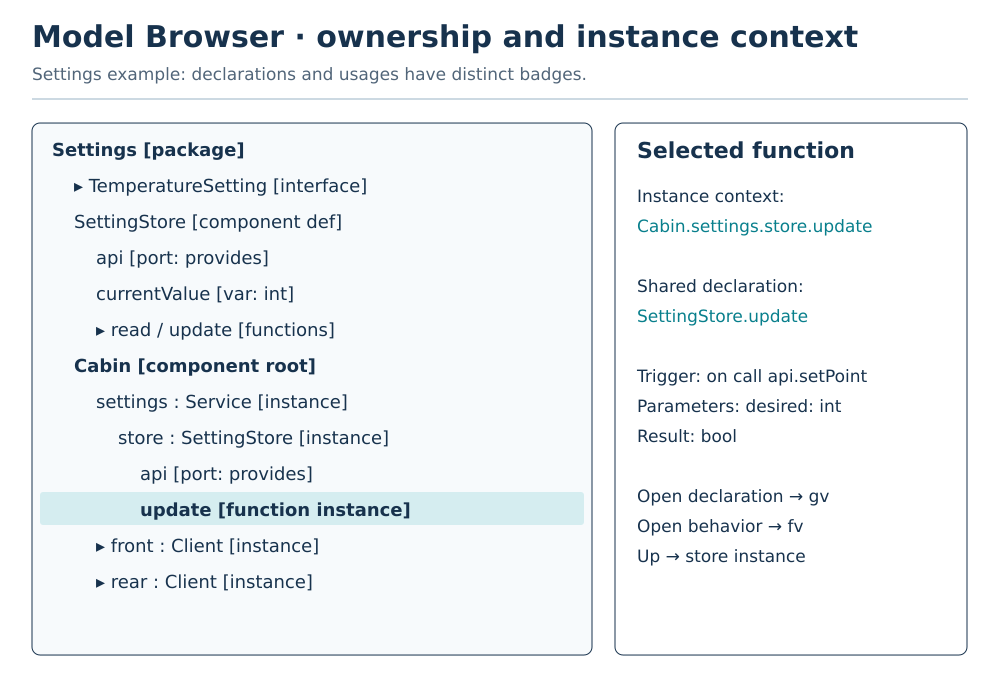

[SVG](figures/browser.svg) · [PNG](figures/browser.png)

The tree distinguishes `SettingStore` as a component definition from `Cabin.settings.store` as an occurrence. Selection of `update` retains its instance context. A declaration command navigates to the shared definition; an fv command opens the function's body. There is no performer or separate action allocation node. Collapsed rows are presentation choices, not omitted semantics.

<a id="source-49c5dd8a67d1-gv-general-structure-and-allocation"></a>

## gv: general structure and allocation

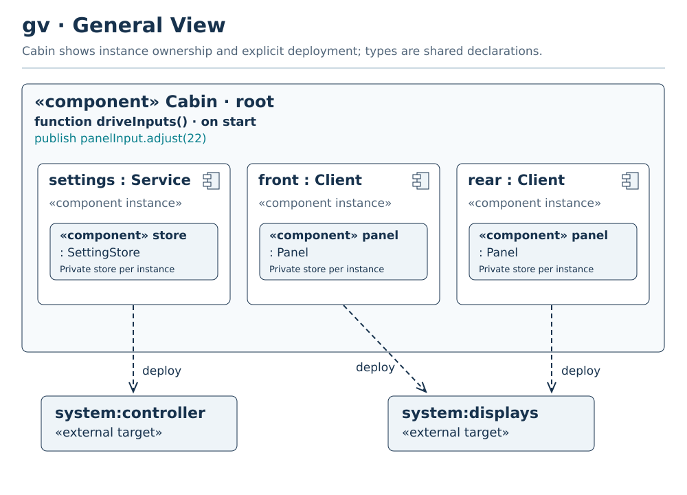

[SVG](figures/gv.svg) · [PNG](figures/gv.png)

`Cabin` is the root component occurrence and its profile is service. `settings`, `front` and `rear` are component occurrences. Each owns a child component instance. Dashed `deploy` edges assign settings to controller and the panels to displays; descendant components inherit those locations. These are allocation edges, not communication lines. The two Panel occurrences have distinct private stores despite sharing one definition.

<a id="source-49c5dd8a67d1-iv-explicit-interconnection-and-delegation"></a>

## iv: explicit interconnection and delegation

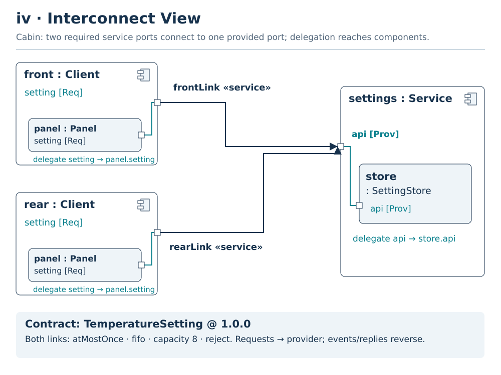

[SVG](figures/iv.svg) · [PNG](figures/iv.png)

Both connectors are oriented from `requires` to `provides`. Each visible boundary port is a square and delegates to a child port with the same contract/role. The shared provided port can serve both clients. The arrows indicate connector orientation; member inspection exposes reverse provider-event and response directions. Every route has its own capacity-8 FIFO queue policy per member/direction. There is no line directly coupling panel data to store data.

<a id="source-49c5dd8a67d1-cv-cases-and-claimed-requirement-coverage"></a>

## cv: cases and claimed requirement coverage

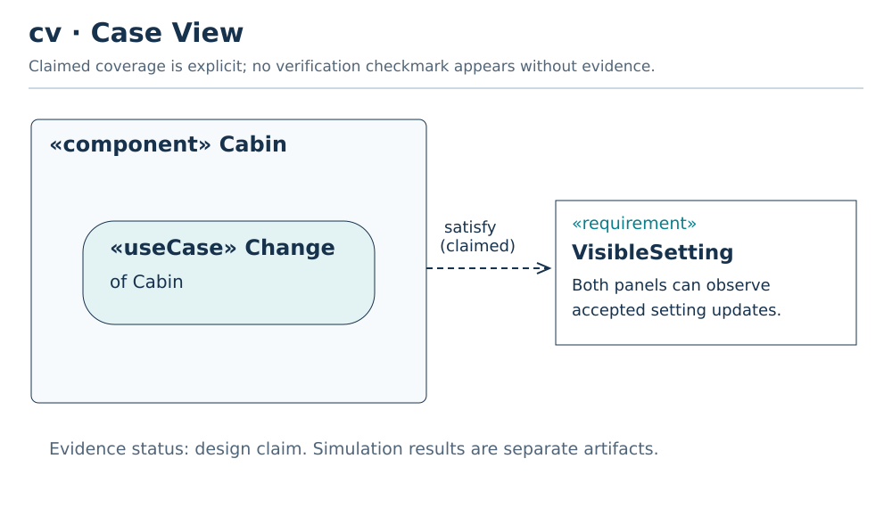

[SVG](figures/cv.svg) · [PNG](figures/cv.png)

The dashed `satisfy` / `verify` link records intended coverage. It does not assert that the case is executable or verified. A future tool may attach actual analysis/test evidence; it must retain evidence identity and assumptions before showing verified status.

<a id="source-49c5dd8a67d1-sv-interface-exchanges-and-partial-order"></a>

## sv: interface exchanges and partial order

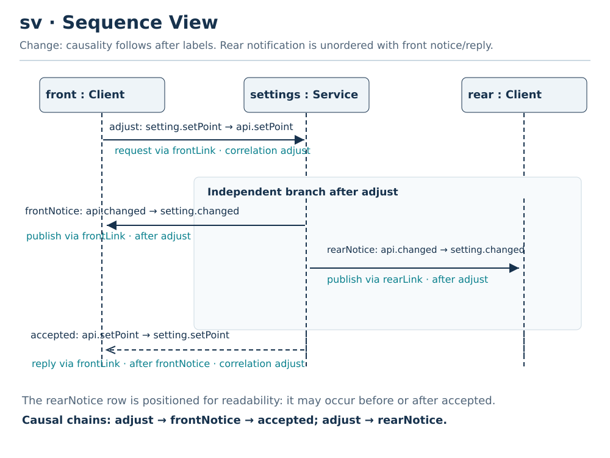

[SVG](figures/sv.svg) · [PNG](figures/sv.png)

Lifelines are component occurrences; every message names its exposed port/member and connector. `adjust` precedes both notifications; `frontNotice` precedes `accepted`. `rearNotice` is unordered relative to `frontNotice` and `accepted`, even though the drawing places its row between them. The pale branch and explicit causal summary prevent vertical placement from inventing a total order. The reply retains the `adjust` correlation. This diagram depicts the case's partial order, not a simulator's chosen trace.

<a id="source-49c5dd8a67d1-grv-inspect-properties-without-changing-semantics"></a>

## grv: inspect properties without changing semantics

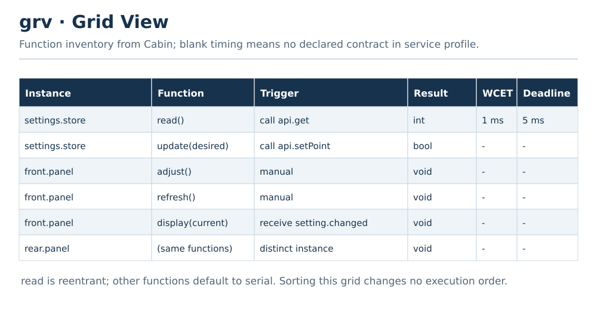

[SVG](figures/grv.svg) · [PNG](figures/grv.png)

The grid shows effective occurrence paths and source-declared contracts. A dash means the service-profile function has no timing declaration; it never means zero physical execution time. `read` is reentrant; other activation roots use the serial default. The rear row summarizes the same three declarations in a different occurrence context. Sorting a grid does not reorder source statements, queues or case dependencies.

<a id="source-49c5dd8a67d1-fv-function-statement-flow"></a>

## fv: function statement flow

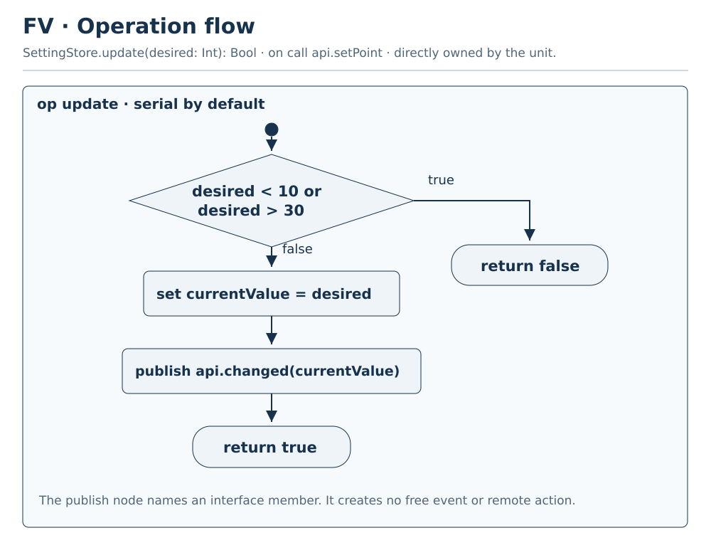

[SVG](figures/fv-flow.svg) · [PNG](figures/fv-flow.png)

The frame belongs directly to `SettingStore.update`. The decision tests the actual source condition. A valid value updates private state, emits `api.changed(currentValue)` through the provider port, then returns true to the correlated request. An invalid value returns false without mutation/publication. A connector is not drawn from this local flow node to another function: the iv and port path describe the architectural exchange.

<a id="source-49c5dd8a67d1-fv-function-owned-states"></a>

## fv: function-owned states

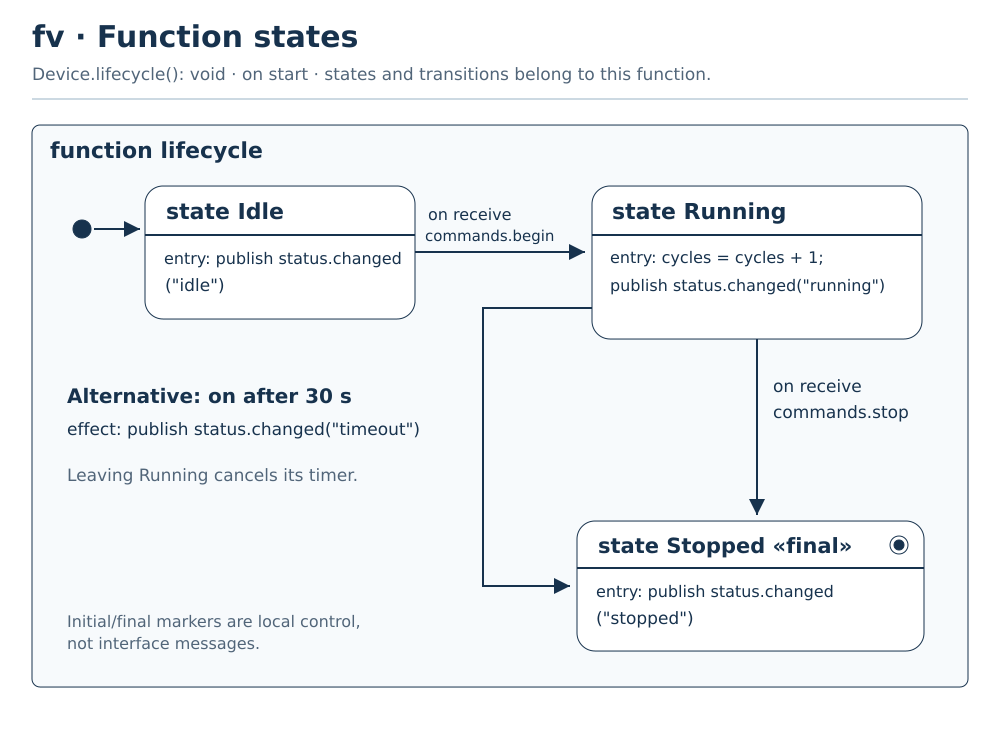

[SVG](figures/fv-state.svg) · [PNG](figures/fv-state.png)

`Idle`, `Running` and `Stopped` belong directly to `Device.lifecycle`. Initial entry publishes idle status. The interface event `commands.begin` enters Running; entry increments cycles and publishes running. Either `commands.stop` or the local 30-second timer enters the final state. The timer edge first publishes timeout in its effect. Final entry publishes stopped and terminates its owning function. Leaving Running cancels the old timer generation. fv projects both state behavior and statement flow from their owning functions.

<a id="source-49c5dd8a67d1-reproduction-and-semantic-checks"></a>

## Reproduction and semantic checks

Run `python3 scripts/build-graphical-examples.py` to regenerate the eight SVG/scene pairs, and use `--check` to detect stale figures. Run `python3 scripts/build-notation.py` to regenerate their PNG copies together with the canonical catalog; its `--check` mode verifies decoded pixels. `node scripts/check-graphical-examples.mjs` resolves every manifest subject against its validated source model and verifies that all view families have an illustration. The semantic test establishes subject/reference validity; it is not a graphical editor conformance certification. Publication QA additionally renders and visually inspects the figures in the PDF.

---

<a id="source-2d93a6cc8eab"></a>

<a id="source-2d93a6cc8eab-canonical-graphical-notation-catalog"></a>

# Canonical graphical notation catalog

SWAML 1.2 · publication 1.2.1. This generated catalog defines the original monochrome notation for each authored concept and meaningful label group. All specimens derive from [the semantic inventory](../spec/notation.json); complete examples supply their validation context.

Each SVG, PNG and vector scene shares the same flat two-dimensional geometry, without perspective, extrusion, gradients or shadows. A graphical specimen is a projection of its textual model; it does not create additional ports, events, state owners or execution semantics. Labels such as QoS values and expression operators appear within their owning element rather than introducing independent nodes.

The following fragments are contextual notation samples, not standalone SWAML files. `def` identifies reusable component types; a root is an instance selected for execution.

<a id="source-2d93a6cc8eab-concept-index"></a>

## Concept index

- [Assertion](#source-2d93a6cc8eab-notation-assert) — Function flow.
- [Assignment](#source-2d93a6cc8eab-notation-assignment) — Function flow.
- [Boundary delegation](#source-2d93a6cc8eab-notation-delegation) — Interfaces and connections.
- [Bounded loop](#source-2d93a6cc8eab-notation-bounded-loop) — Function flow.
- [Browser](#source-2d93a6cc8eab-notation-view-browser) — View projections.
- [Case causal order](#source-2d93a6cc8eab-notation-case-causal-order) — Cases and evidence.
- [Case data exchange](#source-2d93a6cc8eab-notation-case-data-exchange) — Cases and evidence.
- [Case event exchange](#source-2d93a6cc8eab-notation-case-event-exchange) — Cases and evidence.
- [Case request](#source-2d93a6cc8eab-notation-case-request) — Cases and evidence.
- [Case View](#source-2d93a6cc8eab-notation-view-cv) — View projections.
- [Client–server interface](#source-2d93a6cc8eab-notation-client-server-interface) — Interfaces and connections.
- [Completion transition](#source-2d93a6cc8eab-notation-completion-transition) — Function states.
- [Component definition](#source-2d93a6cc8eab-notation-component-definition) — Structure and values.
- [Component specialization](#source-2d93a6cc8eab-notation-component-specialization) — Structure and values.
- [Component usage](#source-2d93a6cc8eab-notation-component-usage) — Structure and values.
- [Concurrency mode](#source-2d93a6cc8eab-notation-concurrency-mode) — Timing and deployment.
- [Conditional branch](#source-2d93a6cc8eab-notation-conditional) — Function flow.
- [Correlated case reply](#source-2d93a6cc8eab-notation-case-reply) — Cases and evidence.
- [Data member](#source-2d93a6cc8eab-notation-data-member) — Interfaces and connections.
- [Data receiver port](#source-2d93a6cc8eab-notation-port-receiver) — Interfaces and connections.
- [Data send](#source-2d93a6cc8eab-notation-send) — Function flow.
- [Data sender port](#source-2d93a6cc8eab-notation-port-sender) — Interfaces and connections.
- [Delivery policy](#source-2d93a6cc8eab-notation-delivery-policy) — Interfaces and connections.
- [Deployment binding](#source-2d93a6cc8eab-notation-deployment) — Timing and deployment.
- [Duration value](#source-2d93a6cc8eab-notation-duration) — Timing and deployment.
- [Enumeration](#source-2d93a6cc8eab-notation-enumeration) — Structure and values.
- [Enumeration value](#source-2d93a6cc8eab-notation-enum-value) — Structure and values.
- [Event member](#source-2d93a6cc8eab-notation-event-member) — Interfaces and connections.
- [Event publication](#source-2d93a6cc8eab-notation-publish) — Function flow.
- [Event publisher port](#source-2d93a6cc8eab-notation-port-publisher) — Interfaces and connections.
- [Event subscriber port](#source-2d93a6cc8eab-notation-port-subscriber) — Interfaces and connections.
- [Executable function](#source-2d93a6cc8eab-notation-function) — Function flow.
- [Expressions and value paths](#source-2d93a6cc8eab-notation-expression) — Structure and values.
- [External deployment target](#source-2d93a6cc8eab-notation-deployment-target) — Timing and deployment.
- [Failure](#source-2d93a6cc8eab-notation-fail) — Function flow.
- [Filtered view selection](#source-2d93a6cc8eab-notation-view-selection) — Cases and evidence.
- [Final state](#source-2d93a6cc8eab-notation-final-state) — Function states.
- [Fixed array type and value](#source-2d93a6cc8eab-notation-array-value) — Structure and values.
- [Flow View](#source-2d93a6cc8eab-notation-view-fv) — View projections.
- [Formal documentation](#source-2d93a6cc8eab-notation-formal-documentation) — Cases and evidence.
- [Function return](#source-2d93a6cc8eab-notation-return) — Function flow.
- [Function timing contract](#source-2d93a6cc8eab-notation-timing-contract) — Timing and deployment.
- [Function with states](#source-2d93a6cc8eab-notation-stateful-function) — Function states.
- [General View](#source-2d93a6cc8eab-notation-view-gv) — View projections.
- [Grid View](#source-2d93a6cc8eab-notation-view-grv) — View projections.
- [Initial state reference](#source-2d93a6cc8eab-notation-initial-state) — Function states.
- [Inline root composition](#source-2d93a6cc8eab-notation-inline-root) — Structure and values.
- [Interconnect View](#source-2d93a6cc8eab-notation-view-iv) — View projections.
- [Interface connector](#source-2d93a6cc8eab-notation-connector) — Interfaces and connections.
- [Interface function signature](#source-2d93a6cc8eab-notation-function-signature) — Interfaces and connections.
- [Local declaration](#source-2d93a6cc8eab-notation-local-declaration) — Function flow.
- [Local function call](#source-2d93a6cc8eab-notation-local-call) — Function flow.
- [Manual activation](#source-2d93a6cc8eab-notation-trigger-manual) — Function flow.
- [Member redefinition](#source-2d93a6cc8eab-notation-member-redefinition) — Structure and values.
- [Message freshness bound](#source-2d93a6cc8eab-notation-freshness-bound) — Interfaces and connections.
- [Named connector policy](#source-2d93a6cc8eab-notation-qos-policy-reference) — Interfaces and connections.
- [Occurrence lifeline](#source-2d93a6cc8eab-notation-sequence-lifeline) — Cases and evidence.
- [Occurrence typing relationship](#source-2d93a6cc8eab-notation-type-relationship) — Structure and values.
- [Optional port](#source-2d93a6cc8eab-notation-optional-port) — Interfaces and connections.
- [Ordinary comment](#source-2d93a6cc8eab-notation-ordinary-comment) — Cases and evidence.
- [Overflow behavior](#source-2d93a6cc8eab-notation-overflow-policy) — Interfaces and connections.
- [Package](#source-2d93a6cc8eab-notation-package) — Structure and values.
- [Package import](#source-2d93a6cc8eab-notation-import) — Structure and values.
- [Parameter or record field](#source-2d93a6cc8eab-notation-parameter) — Structure and values.
- [Periodic activation](#source-2d93a6cc8eab-notation-trigger-periodic) — Function flow.
- [Port receive activation](#source-2d93a6cc8eab-notation-trigger-receive) — Function flow.
- [Primitive types](#source-2d93a6cc8eab-notation-primitive-types) — Structure and values.
- [Private component variable](#source-2d93a6cc8eab-notation-private-variable) — Structure and values.
- [Publish–subscribe interface](#source-2d93a6cc8eab-notation-publish-subscribe-interface) — Interfaces and connections.
- [Pure calculation](#source-2d93a6cc8eab-notation-calculation) — Function flow.
- [Queue capacity](#source-2d93a6cc8eab-notation-capacity-policy) — Interfaces and connections.
- [Queue ordering](#source-2d93a6cc8eab-notation-ordering-policy) — Interfaces and connections.
- [Record construction](#source-2d93a6cc8eab-notation-record-value) — Structure and values.
- [Record datatype](#source-2d93a6cc8eab-notation-datatype) — Structure and values.
- [Requirement](#source-2d93a6cc8eab-notation-requirement) — Cases and evidence.
- [Requirement attribute](#source-2d93a6cc8eab-notation-requirement-attribute) — Cases and evidence.
- [Residence timer transition](#source-2d93a6cc8eab-notation-timer-transition) — Function states.
- [Reusable QoS policy](#source-2d93a6cc8eab-notation-qos-policy-definition) — Interfaces and connections.
- [Root component](#source-2d93a6cc8eab-notation-root-component) — Structure and values.
- [Root execution profile](#source-2d93a6cc8eab-notation-execution-profile) — Timing and deployment.
- [Routed function call](#source-2d93a6cc8eab-notation-routed-call) — Function flow.
- [RPC client port](#source-2d93a6cc8eab-notation-port-client) — Interfaces and connections.
- [RPC handler activation](#source-2d93a6cc8eab-notation-trigger-call) — Function flow.
- [RPC server port](#source-2d93a6cc8eab-notation-port-server) — Interfaces and connections.
- [Satisfaction relation](#source-2d93a6cc8eab-notation-satisfies-link) — Cases and evidence.
- [Sender–receiver interface](#source-2d93a6cc8eab-notation-sender-receiver-interface) — Interfaces and connections.
- [Sequence View](#source-2d93a6cc8eab-notation-view-sv) — View projections.
- [Service consumer port](#source-2d93a6cc8eab-notation-port-requires) — Interfaces and connections.
- [Service interface](#source-2d93a6cc8eab-notation-service-interface) — Interfaces and connections.
- [Service provider port](#source-2d93a6cc8eab-notation-port-provides) — Interfaces and connections.
- [Startup activation](#source-2d93a6cc8eab-notation-trigger-start) — Function flow.
- [State](#source-2d93a6cc8eab-notation-state) — Function states.
- [State entry behavior](#source-2d93a6cc8eab-notation-state-entry) — Function states.
- [State exit behavior](#source-2d93a6cc8eab-notation-state-exit) — Function states.
- [State transition](#source-2d93a6cc8eab-notation-transition) — Function states.
- [Transition guard](#source-2d93a6cc8eab-notation-transition-guard) — Function states.
- [Transition priority](#source-2d93a6cc8eab-notation-transition-priority) — Function states.
- [Transport latency bound](#source-2d93a6cc8eab-notation-latency-bound) — Interfaces and connections.
- [Use case](#source-2d93a6cc8eab-notation-case) — Cases and evidence.
- [Verification case](#source-2d93a6cc8eab-notation-verification-case) — Cases and evidence.
- [Verification relation](#source-2d93a6cc8eab-notation-verification-link) — Cases and evidence.

<a id="source-2d93a6cc8eab-cases-and-evidence"></a>

## Cases and evidence

<a id="source-2d93a6cc8eab-notation-case-causal-order"></a>

## Notation: case-causal-order

**Case causal order**

| Element | Graphical notation | Textual notation |
| --- | --- | --- |
| Case causal order (edge) | 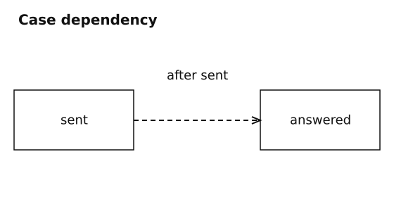 | `after sent label answered` |

Case causal order. Draw an explicitly labeled after dependency between step labels, or show the predecessor in the arrow label.

**Context:** Dependency fragment of Rpc::Poll’s reply step. **Views:** cv, sv.

- Draw an explicitly labeled after dependency between step labels, or show the predecessor in the arrow label.
- Unrelated steps remain unordered; source order and vertical placement are layout choices, not happens-before edges.

[Complete model](../examples/07-client-server.swaml) · `Rpc::Poll`.

[SVG](notation/case-causal-order.svg) · [PNG](notation/case-causal-order.png) · [Vector scene](notation/case-causal-order.scene.json)

<a id="source-2d93a6cc8eab-notation-case-data-exchange"></a>

## Notation: case-data-exchange

**Case data exchange**

| Element | Graphical notation | Textual notation |
| --- | --- | --- |
| Case data exchange (edge) | 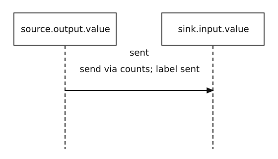 | `send source.output.value -> sink.input.value via counts label sent;` |

Case data exchange. Draw a sequence arrow between occurrence lifelines labeled send, port.member paths, connector and step label.

**Context:** Step in Notation::Observe; source and destination are immediate child port/member paths. **Views:** cv, sv.

- Draw a sequence arrow between occurrence lifelines labeled send, port.member paths, connector and step label.
- The arrow projects an existing sender–receiver route; it creates neither a free event nor a connector by itself.

[Complete model](../examples/notation/catalog.swaml) · `Notation::Observe`.

[SVG](notation/case-data-exchange.svg) · [PNG](notation/case-data-exchange.png) · [Vector scene](notation/case-data-exchange.scene.json)

<a id="source-2d93a6cc8eab-notation-case-event-exchange"></a>

## Notation: case-event-exchange

**Case event exchange**

| Element | Graphical notation | Textual notation |
| --- | --- | --- |
| Case event exchange (edge) | 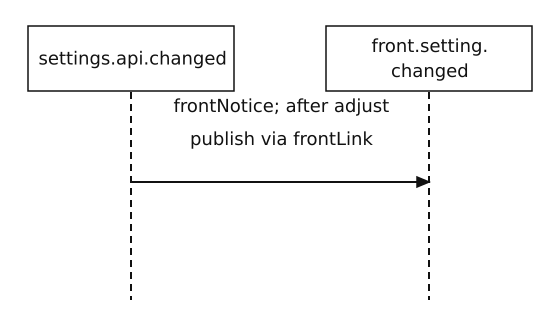 | `publish settings.api.changed -> front.setting.changed via frontLink after adjust label frontNotice;` |

Case event exchange. Draw a publication arrow labeled publish and the exact connector/member, retaining its step identity.

**Context:** Step in Settings::Change, using the reverse event direction of a service route. **Views:** cv, sv.

- Draw a publication arrow labeled publish and the exact connector/member, retaining its step identity.
- For service contracts events travel provider-to-consumer; line orientation follows that role even when opposite the connector’s request orientation.

[Complete model](../examples/08-service-field.swaml) · `Settings::Change`.

[SVG](notation/case-event-exchange.svg) · [PNG](notation/case-event-exchange.png) · [Vector scene](notation/case-event-exchange.scene.json)

<a id="source-2d93a6cc8eab-notation-case-request"></a>

## Notation: case-request

**Case request**

| Element | Graphical notation | Textual notation |
| --- | --- | --- |
| Case request (edge) | 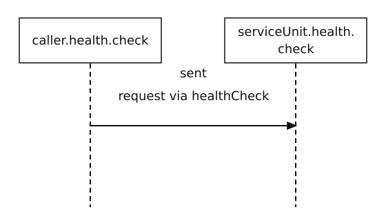 | `call caller.health.check -> serviceUnit.health.check via healthCheck label sent;` |

Case request. Draw a request arrow between occurrence lifelines, labeled the member, connector and step identity.

**Context:** Routed call step in Rpc::Poll. **Views:** cv, sv.

- Draw a request arrow between occurrence lifelines, labeled the member, connector and step identity.
- Its later reply must be uniquely correlated by case ancestry and route/member; vertical spacing does not create that relationship.

[Complete model](../examples/07-client-server.swaml) · `Rpc::Poll`.

[SVG](notation/case-request.svg) · [PNG](notation/case-request.png) · [Vector scene](notation/case-request.scene.json)

<a id="source-2d93a6cc8eab-notation-case-reply"></a>

## Notation: case-reply

**Correlated case reply**

| Element | Graphical notation | Textual notation |
| --- | --- | --- |
| Correlated case reply (edge) | 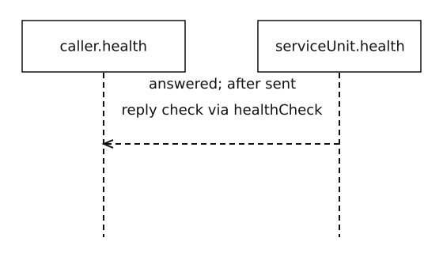 | `reply serviceUnit.health.check -> caller.health.check via healthCheck after sent label answered;` |

Correlated case reply. Draw a dashed reply arrow reversing the matching request route and label its step identity and correlation.

**Context:** Reply step in Rpc::Poll; after sent identifies its causal request ancestor. **Views:** cv, sv.

- Draw a dashed reply arrow reversing the matching request route and label its step identity and correlation.
- A reply cannot be matched by visual proximity alone; preserve the unique causal request ancestor.

[Complete model](../examples/07-client-server.swaml) · `Rpc::Poll`.

[SVG](notation/case-reply.svg) · [PNG](notation/case-reply.png) · [Vector scene](notation/case-reply.scene.json)

<a id="source-2d93a6cc8eab-notation-view-selection"></a>

## Notation: view-selection

**Filtered view selection**

| Element | Graphical notation | Textual notation |
| --- | --- | --- |
| Filtered view selection (projection) | 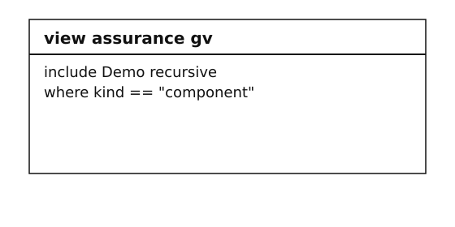 | `include Demo recursive where kind == "component";` |

Show the selected occurrence paths within the named view frame. Combine include clauses as a stable union; filters do not alter model ownership or execution.

**Context:** Owned source element in the Assurance example. **Views:** gv, grv, cv.

- Show the selected occurrence paths within the named view frame.
- Combine include clauses as a stable union; filters do not alter model ownership or execution.

[Complete model](../examples/16-requirements-and-views.swaml) · `Assurance::assurance`.

[SVG](notation/view-selection.svg) · [PNG](notation/view-selection.png) · [Vector scene](notation/view-selection.scene.json)

<a id="source-2d93a6cc8eab-notation-formal-documentation"></a>

## Notation: formal-documentation

**Formal documentation**

| Element | Graphical notation | Textual notation |
| --- | --- | --- |
| Formal documentation (compartment) | 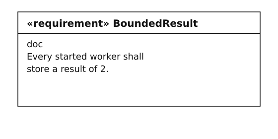 | `doc /* Every started worker shall store a result of 2. */` |

Draw one labeled doc compartment or one doc table cell for the owner. Keep multiline formal text distinct from ordinary comment notes.

**Context:** Owned source element in the Assurance example. **Views:** gv, grv, cv.

- Draw one labeled doc compartment or one doc table cell for the owner.
- Keep multiline formal text distinct from ordinary comment notes.

[Complete model](../examples/16-requirements-and-views.swaml) · `Assurance::BoundedResult`.

[SVG](notation/formal-documentation.svg) · [PNG](notation/formal-documentation.png) · [Vector scene](notation/formal-documentation.scene.json)

<a id="source-2d93a6cc8eab-notation-sequence-lifeline"></a>

## Notation: sequence-lifeline

**Occurrence lifeline**

| Element | Graphical notation | Textual notation |
| --- | --- | --- |
| Occurrence lifeline (node) | 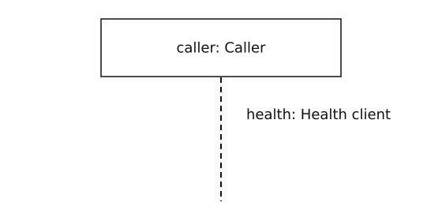 | `component caller: Caller;` |

Occurrence lifeline. Draw a lifeline headed by the occurrence name: Type and a dashed vertical line.

**Context:** Occurrence in Rpc::HealthCheck used as a sequence lifeline. **Views:** cv, sv.

- Draw a lifeline headed by the occurrence name: Type and a dashed vertical line.
- A lifeline identifies an existing component occurrence; an actor/performer glyph MUST NOT replace a modeled communication boundary.

[Complete model](../examples/07-client-server.swaml) · `Rpc::HealthCheck.caller`.

[SVG](notation/sequence-lifeline.svg) · [PNG](notation/sequence-lifeline.png) · [Vector scene](notation/sequence-lifeline.scene.json)

<a id="source-2d93a6cc8eab-notation-ordinary-comment"></a>

## Notation: ordinary-comment

**Ordinary comment**

| Element | Graphical notation | Textual notation |
| --- | --- | --- |
| Ordinary comment (node) | 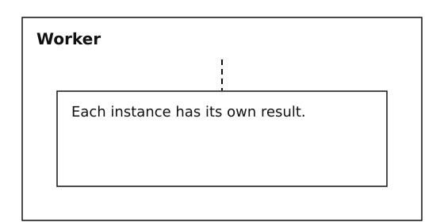 | `// Each instance has its own result.` |

Draw a plain rectangular note inside its owner or connected by a plain dashed line. Each line comment and each block comment remains separate; there is no comment keyword.

**Context:** Owned source element in the Assurance example. **Views:** gv, grv, cv.

- Draw a plain rectangular note inside its owner or connected by a plain dashed line.
- Each line comment and each block comment remains separate; there is no comment keyword.

[Complete model](../examples/16-requirements-and-views.swaml) · `Assurance::Worker`.

[SVG](notation/ordinary-comment.svg) · [PNG](notation/ordinary-comment.png) · [Vector scene](notation/ordinary-comment.scene.json)

<a id="source-2d93a6cc8eab-notation-requirement"></a>

## Notation: requirement

**Requirement**

| Element | Graphical notation | Textual notation |
| --- | --- | --- |
| Requirement (node) | 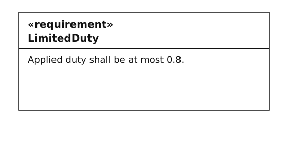 | `requirement LimitedDuty { doc /* Applied duty shall be at most 0.8. */ }` |

A named obligation with typed attributes and one optional formal specification.

**Context:** Requirement declaration in Control. **Views:** gv, cv, grv.

- Draw a flat requirement rectangle with its name, optional attributes and one doc compartment.
- A requirement has no subject; satisfaction and verification are separate relations.

[Complete model](../examples/02-realtime-controller.swaml) · `Control::LimitedDuty`.

[SVG](notation/requirement.svg) · [PNG](notation/requirement.png) · [Vector scene](notation/requirement.scene.json)

<a id="source-2d93a6cc8eab-notation-requirement-attribute"></a>

## Notation: requirement-attribute

**Requirement attribute**

| Element | Graphical notation | Textual notation |
| --- | --- | --- |
| Requirement attribute (compartment) | 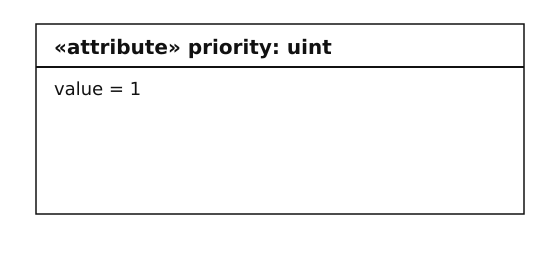 | `attribute priority: uint = 1;` |

Display immutable typed metadata in an attribute compartment or table cell. Names are unique within their requirement; metadata is not runtime state.

**Context:** Owned source element in the Assurance example. **Views:** gv, grv, cv.

- Display immutable typed metadata in an attribute compartment or table cell.
- Names are unique within their requirement; metadata is not runtime state.

[Complete model](../examples/16-requirements-and-views.swaml) · `Assurance::BoundedResult`.

[SVG](notation/requirement-attribute.svg) · [PNG](notation/requirement-attribute.png) · [Vector scene](notation/requirement-attribute.scene.json)

<a id="source-2d93a6cc8eab-notation-satisfies-link"></a>

## Notation: satisfies-link

**Satisfaction relation**

| Element | Graphical notation | Textual notation |
| --- | --- | --- |
| Satisfaction relation (edge) | 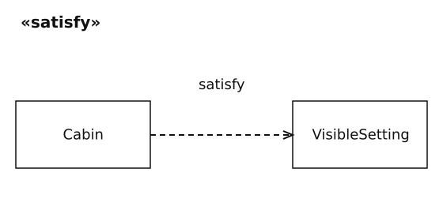 | `satisfy VisibleSetting of Cabin;` |

Design claims satisfaction of a requirement.

**Context:** Package-owned design-to-requirement relation. **Views:** cv, sv.

- Draw a dashed open arrow from the design element to the requirement, labeled satisfy.
- A satisfaction claim does not establish verification evidence.

[Complete model](../examples/08-service-field.swaml) · `Settings`.

[SVG](notation/satisfies-link.svg) · [PNG](notation/satisfies-link.png) · [Vector scene](notation/satisfies-link.scene.json)

<a id="source-2d93a6cc8eab-notation-case"></a>

## Notation: case

**Use case**

| Element | Graphical notation | Textual notation |
| --- | --- | --- |
| Use case (node) | 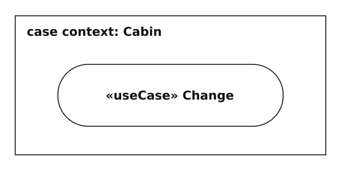 | `useCase Change of Cabin` |

A use case describes intended use and routed exchanges.

**Context:** Scenario header in Settings; steps reference Cabin’s root-level connectors. **Views:** cv, sv.

- Draw a case frame labeled useCase with its name and selected root.
- The of relation references a root; enclosure never changes package ownership.

[Complete model](../examples/08-service-field.swaml) · `Settings::Change`.

[SVG](notation/case.svg) · [PNG](notation/case.png) · [Vector scene](notation/case.scene.json)

<a id="source-2d93a6cc8eab-notation-verification-case"></a>

## Notation: verification-case

**Verification case**

| Element | Graphical notation | Textual notation |
| --- | --- | --- |
| Verification case (node) | 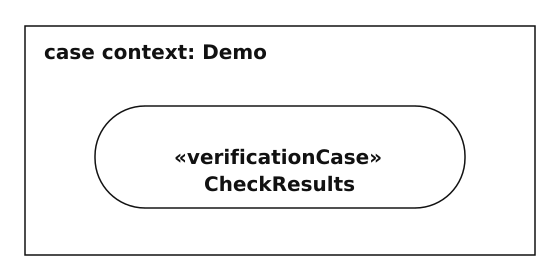 | `verificationCase CheckResults of Demo` |

Draw a case frame labeled verificationCase with its name and root context. Documentation describes the procedure; verify links identify requirements without asserting a passed result.

**Context:** Owned source element in the Assurance example. **Views:** gv, grv, cv.

- Draw a case frame labeled verificationCase with its name and root context.
- Documentation describes the procedure; verify links identify requirements without asserting a passed result.

[Complete model](../examples/16-requirements-and-views.swaml) · `Assurance::CheckResults`.

[SVG](notation/verification-case.svg) · [PNG](notation/verification-case.png) · [Vector scene](notation/verification-case.scene.json)

<a id="source-2d93a6cc8eab-notation-verification-link"></a>

## Notation: verification-link

**Verification relation**

| Element | Graphical notation | Textual notation |
| --- | --- | --- |
| Verification relation (edge) |  | `verify BoundedResult;` |

Draw a dashed open arrow from the verification case to the requirement, labeled verify. A relation expresses verification intent; evidence and outcome are recorded separately.

**Context:** Owned source element in the Assurance example. **Views:** gv, grv, cv.

- Draw a dashed open arrow from the verification case to the requirement, labeled verify.
- A relation expresses verification intent; evidence and outcome are recorded separately.

[Complete model](../examples/16-requirements-and-views.swaml) · `Assurance::CheckResults`.

[SVG](notation/verification-link.svg) · [PNG](notation/verification-link.png) · [Vector scene](notation/verification-link.scene.json)


<a id="source-2d93a6cc8eab-function-flow"></a>

## Function flow

<a id="source-2d93a6cc8eab-notation-assert"></a>

## Notation: assert

**Assertion**

| Element | Graphical notation | Textual notation |
| --- | --- | --- |
| Assertion (node) | 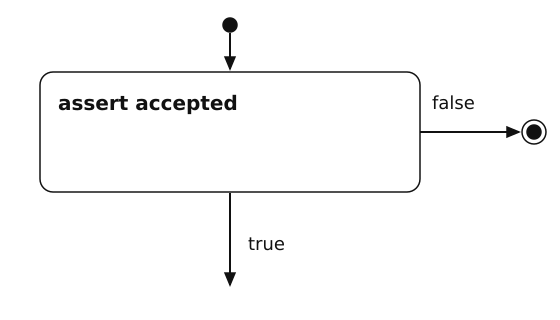 | `assert accepted;` |

Assertion. Draw an owned statement box with the exact statement label and directed control-flow succession.

**Context:** Statement inside the displayed owning function; the fv node is a projection. **Views:** fv.

- Draw an owned statement box with the exact statement label and directed control-flow succession.
- False fails the activation; this step is an execution check, not proof of a requirement.

[Complete model](../examples/08-service-field.swaml) · `Settings::Panel.adjust`.

[SVG](notation/assert.svg) · [PNG](notation/assert.png) · [Vector scene](notation/assert.scene.json)

<a id="source-2d93a6cc8eab-notation-assignment"></a>

## Notation: assignment

**Assignment**

| Element | Graphical notation | Textual notation |
| --- | --- | --- |
| Assignment (node) | 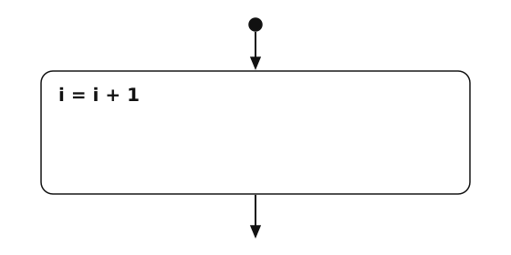 | `i = i + 1;` |

Assignment. Draw an owned statement box with the exact statement label and directed control-flow succession.

**Context:** Statement inside the displayed owning function; the fv node is a projection. **Views:** fv.

- Draw an owned statement box with the exact statement label and directed control-flow succession.
- Replaces an existing permitted whole value; a field path or another component is not an assignment target.

[Complete model](../examples/05-values-and-flow.swaml) · `Values::Producer.prepare`.

[SVG](notation/assignment.svg) · [PNG](notation/assignment.png) · [Vector scene](notation/assignment.scene.json)

<a id="source-2d93a6cc8eab-notation-bounded-loop"></a>

## Notation: bounded-loop

**Bounded loop**

| Element | Graphical notation | Textual notation |
| --- | --- | --- |
| Bounded loop (node) | 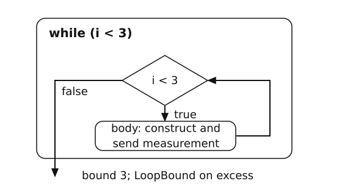 | `while (i < 3) bound 3` |

Bounded loop. Draw a loop frame with explicit while condition and positive bound label, and a return control edge for iteration.

**Context:** Loop header in Values::Producer.prepare; the body is rendered as the loop compartment. **Views:** fv.

- Draw a loop frame with explicit while condition and positive bound label, and a return control edge for iteration.
- The bound is semantic, not decoration; a still-true condition after the limit leads to failure rather than silent completion.

[Complete model](../examples/05-values-and-flow.swaml) · `Values::Producer.prepare`.

[SVG](notation/bounded-loop.svg) · [PNG](notation/bounded-loop.png) · [Vector scene](notation/bounded-loop.scene.json)

<a id="source-2d93a6cc8eab-notation-conditional"></a>

## Notation: conditional

**Conditional branch**

| Element | Graphical notation | Textual notation |
| --- | --- | --- |
| Conditional branch (node) | 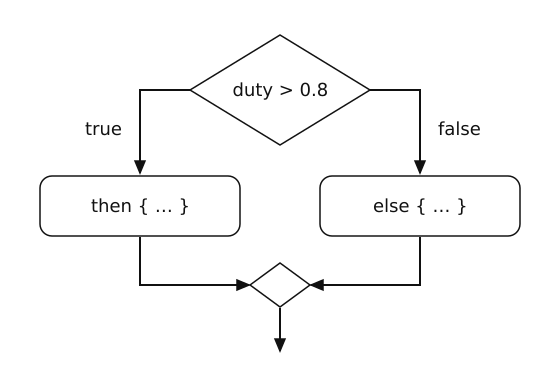 | `if (duty > 0.8) { send output.duty(0.8); } else { send output.duty(duty); }` |

Conditional branch. Draw a decision diamond with the bool condition and distinct true/false control exits, followed by a merge when control continues.

**Context:** If/else statement in Control::Regulator.regulate. **Views:** fv.

- Draw a decision diamond with the bool condition and distinct true/false control exits, followed by a merge when control continues.
- Exactly one branch executes; the diamond is an if-statement projection, not an independent behavior definition.

[Complete model](../examples/02-realtime-controller.swaml) · `Control::Regulator.regulate`.

[SVG](notation/conditional.svg) · [PNG](notation/conditional.png) · [Vector scene](notation/conditional.scene.json)

<a id="source-2d93a6cc8eab-notation-send"></a>

## Notation: send

**Data send**

| Element | Graphical notation | Textual notation |
| --- | --- | --- |
| Data send (node) | 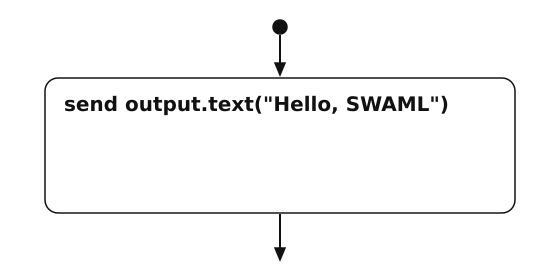 | `send output.text("Hello, SWAML");` |

Data send. Draw an owned statement box with the exact statement label and directed control-flow succession.

**Context:** Statement inside the displayed owning function; the fv node is a projection. **Views:** fv.

- Draw an owned statement box with the exact statement label and directed control-flow succession.
- The text identifies the emitting function’s owned sender port and data member.

[Complete model](../examples/01-hello.swaml) · `Hello::Speaker.greet`.

[SVG](notation/send.svg) · [PNG](notation/send.png) · [Vector scene](notation/send.scene.json)

<a id="source-2d93a6cc8eab-notation-publish"></a>

## Notation: publish

**Event publication**

| Element | Graphical notation | Textual notation |
| --- | --- | --- |
| Event publication (node) | 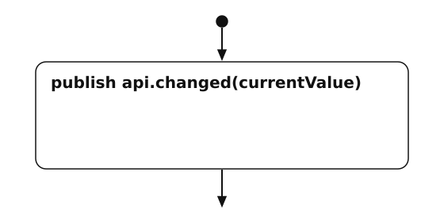 | `publish api.changed(currentValue);` |

Event publication. Draw an owned statement box with the exact statement label and directed control-flow succession.

**Context:** Statement inside the displayed owning function; the fv node is a projection. **Views:** fv.

- Draw an owned statement box with the exact statement label and directed control-flow succession.
- The text identifies the emitting function’s owned publisher/provider port and event member.

[Complete model](../examples/08-service-field.swaml) · `Settings::SettingStore.update`.

[SVG](notation/publish.svg) · [PNG](notation/publish.png) · [Vector scene](notation/publish.scene.json)

<a id="source-2d93a6cc8eab-notation-function"></a>

## Notation: function

**Executable function**

| Element | Graphical notation | Textual notation |
| --- | --- | --- |
| Executable function (node) | 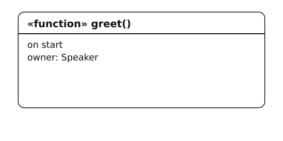 | `function greet() on start` |

Executable function. Draw an function frame or compartment with its name, ordered parameters, result and activation label.

**Context:** Header of Hello::Speaker.greet; its statement body is projected inside the function frame. **Views:** fv.

- Draw an function frame or compartment with its name, ordered parameters, result and activation label.
- Every fv step is an owned statement projection within this frame; it MUST NOT create an independently allocated action or performer.

[Complete model](../examples/01-hello.swaml) · `Hello::Speaker.greet`.

[SVG](notation/function.svg) · [PNG](notation/function.png) · [Vector scene](notation/function.scene.json)

<a id="source-2d93a6cc8eab-notation-fail"></a>

## Notation: fail

**Failure**

| Element | Graphical notation | Textual notation |
| --- | --- | --- |
| Failure (node) | 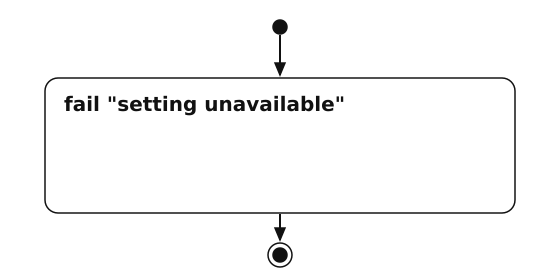 | `fail "setting unavailable";` |

Failure. Draw an owned statement box with the exact statement label and directed control-flow succession.

**Context:** Statement inside the displayed owning function; the fv node is a projection. **Views:** fv.

- Draw an owned statement box with the exact statement label and directed control-flow succession.
- Failure unwinds the activation without rollback; it does not imply an unmodeled broadcast.

[Complete model](../examples/08-service-field.swaml) · `Settings::Panel.adjust`.

[SVG](notation/fail.svg) · [PNG](notation/fail.png) · [Vector scene](notation/fail.scene.json)

<a id="source-2d93a6cc8eab-notation-return"></a>

## Notation: return

**Function return**

| Element | Graphical notation | Textual notation |
| --- | --- | --- |
| Function return (node) | 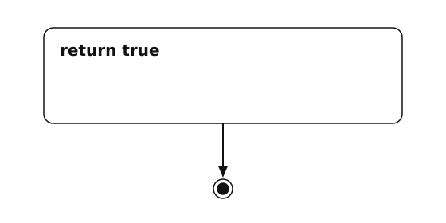 | `return true;` |

Function return. Show a labeled return terminal in the owning function flow; retain the returned expression when present.

**Context:** Return statement in Rpc::Server.checkHealth. **Views:** fv.

- Show a labeled return terminal in the owning function flow; retain the returned expression when present.
- Return from a helper resumes its local caller; return from a state body terminates the owning stateful function.

[Complete model](../examples/07-client-server.swaml) · `Rpc::Server.checkHealth`.

[SVG](notation/return.svg) · [PNG](notation/return.png) · [Vector scene](notation/return.scene.json)

<a id="source-2d93a6cc8eab-notation-local-declaration"></a>

## Notation: local-declaration

**Local declaration**

| Element | Graphical notation | Textual notation |
| --- | --- | --- |
| Local declaration (node) | 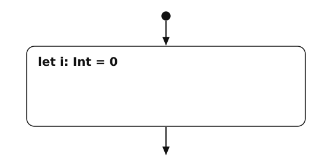 | `var i: int = 0;` |

Local declaration. Draw an owned statement box with the exact statement label and directed control-flow succession.

**Context:** Statement inside the displayed owning function; the fv node is a projection. **Views:** fv.

- Draw an owned statement box with the exact statement label and directed control-flow succession.
- Creates a copied typed local value in the enclosing lexical block.

[Complete model](../examples/05-values-and-flow.swaml) · `Values::Producer.prepare`.

[SVG](notation/local-declaration.svg) · [PNG](notation/local-declaration.png) · [Vector scene](notation/local-declaration.scene.json)

<a id="source-2d93a6cc8eab-notation-local-call"></a>

## Notation: local-call

**Local function call**

| Element | Graphical notation | Textual notation |
| --- | --- | --- |
| Local function call (node) | 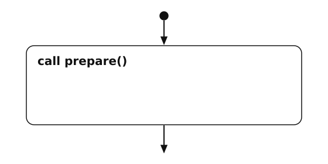 | `call prepare();` |

Local function invocation. Draw an owned statement box with the exact statement label and directed control-flow succession.

**Context:** Statement inside the displayed owning function; the fv node is a projection. **Views:** fv.

- Draw an owned statement box with the exact statement label and directed control-flow succession.
- Calls an untriggered flow function in the same component, borrowing its activation lock/snapshot. Bind a non-void result with as name; omit the binding for void.

[Complete model](../examples/05-values-and-flow.swaml) · `Values::Producer.boot`.

[SVG](notation/local-call.svg) · [PNG](notation/local-call.png) · [Vector scene](notation/local-call.scene.json)

<a id="source-2d93a6cc8eab-notation-trigger-manual"></a>

## Notation: trigger-manual

**Manual activation**

| Element | Graphical notation | Textual notation |
| --- | --- | --- |
| Manual activation (label) | 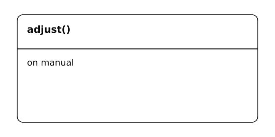 | `function adjust() on manual` |

Manual activation. Attach the activation text to its function header; use no free event symbol or standalone trigger object.

**Context:** Activation annotation on the displayed function. **Views:** fv.

- Attach the activation text to its function header; use no free event symbol or standalone trigger object.
- Harness activation carries no modeled data; external commands still use ports.

[Complete model](../examples/08-service-field.swaml) · `Settings::Panel.adjust`.

[SVG](notation/trigger-manual.svg) · [PNG](notation/trigger-manual.png) · [Vector scene](notation/trigger-manual.scene.json)

<a id="source-2d93a6cc8eab-notation-trigger-periodic"></a>

## Notation: trigger-periodic

**Periodic activation**

| Element | Graphical notation | Textual notation |
| --- | --- | --- |
| Periodic activation (label) | 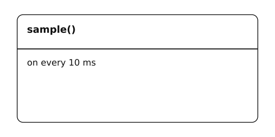 | `on every 10 ms` |

Periodic activation. Attach the activation text to its function header; use no free event symbol or standalone trigger object.

**Context:** Activation annotation on the displayed function. **Views:** fv.

- Attach the activation text to its function header; use no free event symbol or standalone trigger object.
- Release occurs at positive multiples of the declared period.

[Complete model](../examples/02-realtime-controller.swaml) · `Control::Sensor.sample`.

[SVG](notation/trigger-periodic.svg) · [PNG](notation/trigger-periodic.png) · [Vector scene](notation/trigger-periodic.scene.json)

<a id="source-2d93a6cc8eab-notation-trigger-receive"></a>

## Notation: trigger-receive

**Port receive activation**

| Element | Graphical notation | Textual notation |
| --- | --- | --- |
| Port receive activation (label) | 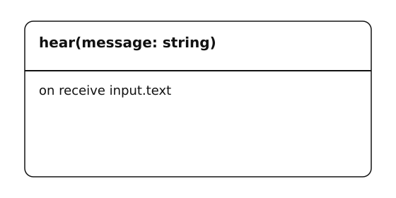 | `on receive input.text` |

Port receive activation. Attach the activation text to its function header; use no free event symbol or standalone trigger object.

**Context:** Activation annotation on the displayed function. **Views:** fv.

- Attach the activation text to its function header; use no free event symbol or standalone trigger object.
- The port/member label identifies the one incoming handler owner.

[Complete model](../examples/01-hello.swaml) · `Hello::Listener.hear`.

[SVG](notation/trigger-receive.svg) · [PNG](notation/trigger-receive.png) · [Vector scene](notation/trigger-receive.scene.json)

<a id="source-2d93a6cc8eab-notation-calculation"></a>

## Notation: calculation

**Pure calculation**

| Element | Graphical notation | Textual notation |
| --- | --- | --- |
| Pure calculation (compartment) | 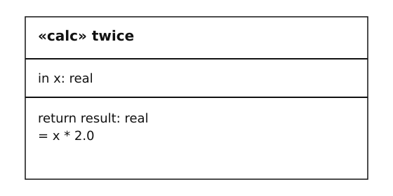 | `calc twice { in x: real; return result: real = x * 2.0; }` |

A calculation maps named inputs to one named, typed output expression without mutable state or communication.

**Context:** Calculation declared at the start of Values::Producer.prepare. **Views:** fv.

- Draw a flat calculation compartment inside its owning function, headed calc and its name.
- List each input with in and its type; show return, the output name/type and expression in a separate row.
- A calculation call is local expression text such as twice(samples[i]); it is not a message or independent executable function.

[Complete model](../examples/05-values-and-flow.swaml) · `Values::Producer.prepare.twice`.

[SVG](notation/calculation.svg) · [PNG](notation/calculation.png) · [Vector scene](notation/calculation.scene.json)

<a id="source-2d93a6cc8eab-notation-routed-call"></a>

## Notation: routed-call

**Routed function call**

| Element | Graphical notation | Textual notation |
| --- | --- | --- |
| Routed function call (node) | 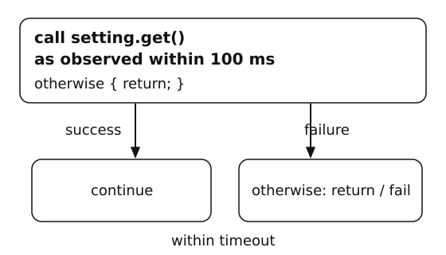 | `call setting.get() as observed within 100 ms otherwise { return; };` |

RPC request and failure continuation. Draw one request step labeled port.member, result binding and timeout, with distinct success and otherwise continuations.

**Context:** Statement in Settings::Panel.refresh; successful completion binds observed. **Views:** fv.

- Draw one request step labeled port.member, result binding and timeout, with distinct success and otherwise continuations.
- The failure continuation remains explicit and terminating; request arrows outside this function must use the corresponding interface route.

[Complete model](../examples/08-service-field.swaml) · `Settings::Panel.refresh`.

[SVG](notation/routed-call.svg) · [PNG](notation/routed-call.png) · [Vector scene](notation/routed-call.scene.json)

<a id="source-2d93a6cc8eab-notation-trigger-call"></a>

## Notation: trigger-call

**RPC handler activation**

| Element | Graphical notation | Textual notation |
| --- | --- | --- |
| RPC handler activation (label) | 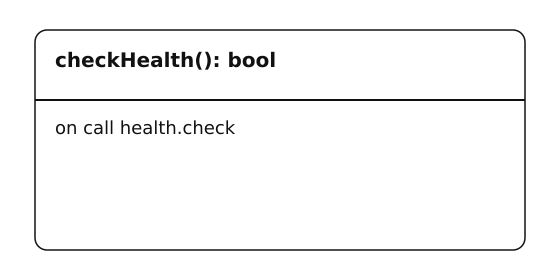 | `on call health.check` |

RPC handler activation. Attach the activation text to its function header; use no free event symbol or standalone trigger object.

**Context:** Activation annotation on the displayed function. **Views:** fv.

- Attach the activation text to its function header; use no free event symbol or standalone trigger object.
- Requests and correlated results remain on the originating interface route.

[Complete model](../examples/07-client-server.swaml) · `Rpc::Server.checkHealth`.

[SVG](notation/trigger-call.svg) · [PNG](notation/trigger-call.png) · [Vector scene](notation/trigger-call.scene.json)

<a id="source-2d93a6cc8eab-notation-trigger-start"></a>

## Notation: trigger-start

**Startup activation**

| Element | Graphical notation | Textual notation |
| --- | --- | --- |
| Startup activation (label) | 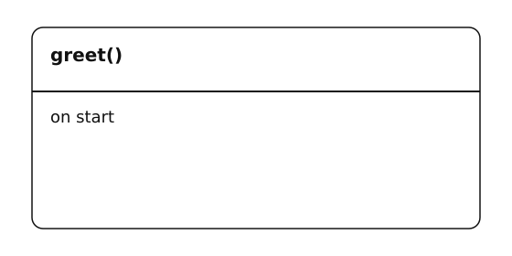 | `function greet() on start` |

Startup activation. Attach the activation text to its function header; use no free event symbol or standalone trigger object.

**Context:** Activation annotation on the displayed function. **Views:** fv.

- Attach the activation text to its function header; use no free event symbol or standalone trigger object.
- Once after component initialization and route readiness.

[Complete model](../examples/01-hello.swaml) · `Hello::Speaker.greet`.

[SVG](notation/trigger-start.svg) · [PNG](notation/trigger-start.png) · [Vector scene](notation/trigger-start.scene.json)


<a id="source-2d93a6cc8eab-function-states"></a>

## Function states

<a id="source-2d93a6cc8eab-notation-completion-transition"></a>

## Notation: completion-transition

**Completion transition**

| Element | Graphical notation | Textual notation |
| --- | --- | --- |
| Completion transition (edge) | 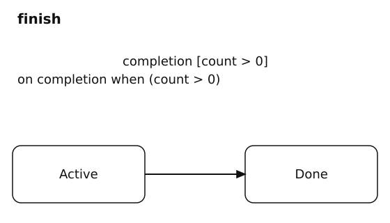 | `transition finish: Active -> Done on completion when (count > 0) {}` |

Completion transition. Label the state edge on completion explicitly, with its guard if present.

**Context:** Completion transition in Notation::Controller.lifecycle. **Views:** fv.

- Label the state edge on completion explicitly, with its guard if present.
- Completion is local to the owning function and MUST NOT be drawn as an emitted global event.

[Complete model](../examples/notation/catalog.swaml) · `Notation::Controller.lifecycle.finish`.

[SVG](notation/completion-transition.svg) · [PNG](notation/completion-transition.png) · [Vector scene](notation/completion-transition.scene.json)

<a id="source-2d93a6cc8eab-notation-final-state"></a>

## Notation: final-state

**Final state**

| Element | Graphical notation | Textual notation |
| --- | --- | --- |
| Final state (node) | 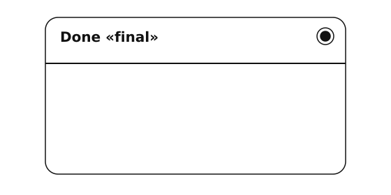 | `state Done final {}` |

Final state. Draw a named final-state symbol with a bullseye marker; preserve the declared name and any entry behavior.

**Context:** Named final state inside Notation::Controller.lifecycle. **Views:** fv.

- Draw a named final-state symbol with a bullseye marker; preserve the declared name and any entry behavior.
- No outgoing transition is permitted; finality occurs after entry finishes, so the marker MUST NOT hide an entry block.

[Complete model](../examples/notation/catalog.swaml) · `Notation::Controller.lifecycle.Done`.

[SVG](notation/final-state.svg) · [PNG](notation/final-state.png) · [Vector scene](notation/final-state.scene.json)

<a id="source-2d93a6cc8eab-notation-stateful-function"></a>

## Notation: stateful-function

**Function with states**

| Element | Graphical notation | Textual notation |
| --- | --- | --- |
| Function with states (node) | 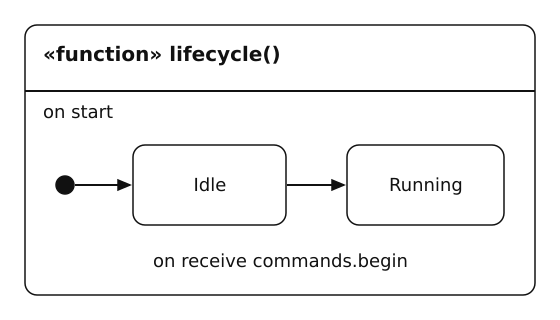 | `function lifecycle() on start` |

Function with states. Draw the state graph inside the owning function frame, keeping the function name and on start label visible.

**Context:** Function header in Lifecycle::Device; its direct body begins with initial. **Views:** fv.

- Draw the state graph inside the owning function frame, keeping the function name and on start label visible.
- There is no machine box, performer, or separate authored state allocation; StateBody contributes only the function’s contents.

[Complete model](../examples/04-stateful-function.swaml) · `Lifecycle::Device.lifecycle`.

[SVG](notation/stateful-function.svg) · [PNG](notation/stateful-function.png) · [Vector scene](notation/stateful-function.scene.json)

<a id="source-2d93a6cc8eab-notation-initial-state"></a>

## Notation: initial-state

**Initial state reference**

| Element | Graphical notation | Textual notation |
| --- | --- | --- |
| Initial state reference (node) | 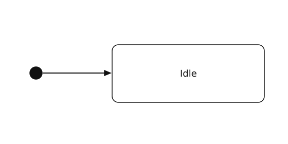 | `initial Idle;` |

Initial state reference. Draw a solid initial pseudonode with one outgoing unlabeled initialization edge to the named initial state.

**Context:** First clause of Lifecycle::Device.lifecycle. **Views:** fv.

- Draw a solid initial pseudonode with one outgoing unlabeled initialization edge to the named initial state.
- This projects the function’s unique initial reference; it is not a transmitted event or a second start function.

[Complete model](../examples/04-stateful-function.swaml) · `Lifecycle::Device.lifecycle`.

[SVG](notation/initial-state.svg) · [PNG](notation/initial-state.png) · [Vector scene](notation/initial-state.scene.json)

<a id="source-2d93a6cc8eab-notation-timer-transition"></a>

## Notation: timer-transition

**Residence timer transition**

| Element | Graphical notation | Textual notation |
| --- | --- | --- |
| Residence timer transition (edge) |  | `transition elapsed: Active -> Done on after 1 s {}` |

Residence timer transition. Label the transition on after with an explicit duration and component.

**Context:** Timer transition in Notation::Controller.lifecycle. **Views:** fv.

- Label the transition on after with an explicit duration and component.
- The duration starts after state entry completes; leaving the state cancels that entry generation’s timers.

[Complete model](../examples/notation/catalog.swaml) · `Notation::Controller.lifecycle.elapsed`.

[SVG](notation/timer-transition.svg) · [PNG](notation/timer-transition.png) · [Vector scene](notation/timer-transition.scene.json)

<a id="source-2d93a6cc8eab-notation-state"></a>

## Notation: state

**State**

| Element | Graphical notation | Textual notation |
| --- | --- | --- |
| State (node) |  | `state Active {}` |

State. Draw a rounded state rectangle bearing the function-local state name, with optional entry/exit compartments.

**Context:** State declaration in Notation::Controller.lifecycle. **Views:** fv.

- Draw a rounded state rectangle bearing the function-local state name, with optional entry/exit compartments.
- State rectangles live inside one owning function; position does not allocate them to components or performers.

[Complete model](../examples/notation/catalog.swaml) · `Notation::Controller.lifecycle.Active`.

[SVG](notation/state.svg) · [PNG](notation/state.png) · [Vector scene](notation/state.scene.json)

<a id="source-2d93a6cc8eab-notation-state-entry"></a>

## Notation: state-entry

**State entry behavior**

| Element | Graphical notation | Textual notation |
| --- | --- | --- |
| State entry behavior (compartment) |  | `entry { count = 0; }` |

State entry behavior. Show entry and its statements in a compartment inside the owning state.

**Context:** Entry block on Notation::Controller.lifecycle.Idle. **Views:** fv.

- Show entry and its statements in a compartment inside the owning state.
- Entry has no incoming payload bindings; its completion starts residence timers.

[Complete model](../examples/notation/catalog.swaml) · `Notation::Controller.lifecycle.Idle`.

[SVG](notation/state-entry.svg) · [PNG](notation/state-entry.png) · [Vector scene](notation/state-entry.scene.json)

<a id="source-2d93a6cc8eab-notation-state-exit"></a>

## Notation: state-exit

**State exit behavior**

| Element | Graphical notation | Textual notation |
| --- | --- | --- |
| State exit behavior (compartment) |  | `exit { assert count >= 0; }` |

State exit behavior. Show exit and its statements in a compartment inside the owning state.

**Context:** Exit block on Notation::Controller.lifecycle.Idle. **Views:** fv.

- Show exit and its statements in a compartment inside the owning state.
- Exit precedes transition effect and state update, and does not inherit the incoming payload environment.

[Complete model](../examples/notation/catalog.swaml) · `Notation::Controller.lifecycle.Idle`.

[SVG](notation/state-exit.svg) · [PNG](notation/state-exit.png) · [Vector scene](notation/state-exit.scene.json)

<a id="source-2d93a6cc8eab-notation-transition"></a>

## Notation: transition

**State transition**

| Element | Graphical notation | Textual notation |
| --- | --- | --- |
| State transition (edge) |  | `transition begin: Idle -> Active on receive signal.pulse when (value > 0) priority 1 { count = value; }` |

State transition. Draw a directed edge between states in the same function; label its identity, stimulus, optional guard/priority and effect.

**Context:** Transition in Notation::Controller.lifecycle. **Views:** fv.

- Draw a directed edge between states in the same function; label its identity, stimulus, optional guard/priority and effect.
- Receive labels MUST include port.member; the transition edge is local control, not the interface connector carrying the message.

[Complete model](../examples/notation/catalog.swaml) · `Notation::Controller.lifecycle.begin`.

[SVG](notation/transition.svg) · [PNG](notation/transition.png) · [Vector scene](notation/transition.scene.json)

<a id="source-2d93a6cc8eab-notation-transition-guard"></a>

## Notation: transition-guard

**Transition guard**

| Element | Graphical notation | Textual notation |
| --- | --- | --- |
| Transition guard (label) |  | `when (value > 0)` |

Transition guard. Show the bool guard in brackets or with its explicit when keyword on the transition label.

**Context:** Guard on Notation::Controller.lifecycle.begin. **Views:** fv.

- Show the bool guard in brackets or with its explicit when keyword on the transition label.
- A false guard disables that transition for the current stimulus; guard text is not a separate executable action.

[Complete model](../examples/notation/catalog.swaml) · `Notation::Controller.lifecycle.begin`.

[SVG](notation/transition-guard.svg) · [PNG](notation/transition-guard.png) · [Vector scene](notation/transition-guard.scene.json)

<a id="source-2d93a6cc8eab-notation-transition-priority"></a>

## Notation: transition-priority

**Transition priority**

| Element | Graphical notation | Textual notation |
| --- | --- | --- |
| Transition priority (label) |  | `priority 1` |

Transition priority. Display priority as an explicit nonnegative integer on a transition label; omitted means zero.

**Context:** Priority on Notation::Controller.lifecycle.begin. **Views:** fv.

- Display priority as an explicit nonnegative integer on a transition label; omitted means zero.
- Larger wins only among enabled transitions for the same state and stimulus; it is not an function scheduler priority.

[Complete model](../examples/notation/catalog.swaml) · `Notation::Controller.lifecycle.begin`.

[SVG](notation/transition-priority.svg) · [PNG](notation/transition-priority.png) · [Vector scene](notation/transition-priority.scene.json)


<a id="source-2d93a6cc8eab-interfaces-and-connections"></a>

## Interfaces and connections

<a id="source-2d93a6cc8eab-notation-delegation"></a>

## Notation: delegation

**Boundary delegation**

| Element | Graphical notation | Textual notation |
| --- | --- | --- |
| Boundary delegation (edge) |  | `delegate api -> store.api;` |

Boundary delegation. Draw a solid unarrowed line labeled delegate from a boundary port to one immediate child port inside its owner.

**Context:** Boundary-to-immediate-child alias inside Settings::Service. **Views:** iv.

- Draw a solid unarrowed line labeled delegate from a boundary port to one immediate child port inside its owner.
- Both endpoints keep identical interface identity and role; this alias creates no queue, service call, adapter or extra message.

[Complete model](../examples/08-service-field.swaml) · `Settings::Service`.

[SVG](notation/delegation.svg) · [PNG](notation/delegation.png) · [Vector scene](notation/delegation.scene.json)

<a id="source-2d93a6cc8eab-notation-client-server-interface"></a>

## Notation: client-server-interface

**Client–server interface**

| Element | Graphical notation | Textual notation |
| --- | --- | --- |
| Client–server interface (node) |  | `interface clientServer Health version "1.0.0"` |

Client–server interface. Draw an interface classifier rectangle with the exact interface kind, nominal name and version in its heading.

**Context:** Interface declaration header; member rows occupy the contract body. **Views:** iv.

- Draw an interface classifier rectangle with the exact interface kind, nominal name and version in its heading.
- Keep member categories visible; a contract box is a reusable type and MUST NOT be mistaken for a runtime broker or component.

[Complete model](../examples/07-client-server.swaml) · `Rpc::Health`.

[SVG](notation/client-server-interface.svg) · [PNG](notation/client-server-interface.png) · [Vector scene](notation/client-server-interface.scene.json)

<a id="source-2d93a6cc8eab-notation-data-member"></a>

## Notation: data-member

**Data member**

| Element | Graphical notation | Textual notation |
| --- | --- | --- |
| Data member (compartment) |  | `data temperature: real sampled;` |

Data member. Show data name: Type and sampled or queued on one interface-compartment row.

**Context:** Member of Control::Samples; queued is the alternative retention mode. **Views:** iv.

- Show data name: Type and sampled or queued on one interface-compartment row.
- Retention mode is explicit text, not color; sampled uses latest-value buffering while queued retains individual values under QoS.

[Complete model](../examples/02-realtime-controller.swaml) · `Control::Samples`.

[SVG](notation/data-member.svg) · [PNG](notation/data-member.png) · [Vector scene](notation/data-member.scene.json)

<a id="source-2d93a6cc8eab-notation-port-receiver"></a>

## Notation: port-receiver

**Data receiver port**

| Element | Graphical notation | Textual notation |
| --- | --- | --- |
| Data receiver port (node) |  | `port input: Greeting receiver;` |

Data receiver port. Draw a small square centered on the owning boundary and label its name: Interface and exact role.

**Context:** Port declaration on the displayed component boundary. **Views:** iv.

- Draw a small square centered on the owning boundary and label its name: Interface and exact role.
- Data flows inward to the owned receiving function. Do not infer direction only from left/right placement; role text remains mandatory.

[Complete model](../examples/01-hello.swaml) · `Hello::Listener.input`.

[SVG](notation/port-receiver.svg) · [PNG](notation/port-receiver.png) · [Vector scene](notation/port-receiver.scene.json)

<a id="source-2d93a6cc8eab-notation-port-sender"></a>

## Notation: port-sender

**Data sender port**

| Element | Graphical notation | Textual notation |
| --- | --- | --- |
| Data sender port (node) |  | `port output: Greeting sender;` |

Data sender port. Draw a small square centered on the owning boundary and label its name: Interface and exact role.

**Context:** Port declaration on the displayed component boundary. **Views:** iv.

- Draw a small square centered on the owning boundary and label its name: Interface and exact role.
- Data flows outward from the owned port. Do not infer direction only from left/right placement; role text remains mandatory.

[Complete model](../examples/01-hello.swaml) · `Hello::Speaker.output`.

[SVG](notation/port-sender.svg) · [PNG](notation/port-sender.png) · [Vector scene](notation/port-sender.scene.json)

<a id="source-2d93a6cc8eab-notation-delivery-policy"></a>

## Notation: delivery-policy

**Delivery policy**

| Element | Graphical notation | Textual notation |
| --- | --- | --- |
| Delivery policy (label) |  | `delivery atLeastOnce;` |

Delivery policy. Attach a QoS property compartment to its connector; write the exact delivery value.

**Context:** QoS property on Rpc::HealthCheck.healthCheck; the signature is idempotent. **Views:** iv.

- Attach a QoS property compartment to its connector; write the exact delivery value.
- atLeastOnce, atMostOnce and bestEffort are textual alternatives, not three different edge shapes; atLeastOnce RPC requires idempotent signatures.

[Complete model](../examples/07-client-server.swaml) · `Rpc::HealthCheck.healthCheck`.

[SVG](notation/delivery-policy.svg) · [PNG](notation/delivery-policy.png) · [Vector scene](notation/delivery-policy.scene.json)

<a id="source-2d93a6cc8eab-notation-event-member"></a>

## Notation: event-member

**Event member**

| Element | Graphical notation | Textual notation |
| --- | --- | --- |
| Event member (compartment) |  | `event changed(value: string);` |

Event member. Show event name(parameters) in its interface compartment; draw no free-floating event definition.

**Context:** Member of Lifecycle::Status. **Views:** iv.

- Show event name(parameters) in its interface compartment; draw no free-floating event definition.
- Every graphical emission or receive label identifies this member through an owned port and function.

[Complete model](../examples/04-stateful-function.swaml) · `Lifecycle::Status`.

[SVG](notation/event-member.svg) · [PNG](notation/event-member.png) · [Vector scene](notation/event-member.scene.json)

<a id="source-2d93a6cc8eab-notation-port-publisher"></a>

## Notation: port-publisher

**Event publisher port**

| Element | Graphical notation | Textual notation |
| --- | --- | --- |
| Event publisher port (node) |  | `port status: Status publisher;` |

Event publisher port. Draw a small square centered on the owning boundary and label its name: Interface and exact role.

**Context:** Port declaration on the displayed component boundary. **Views:** iv.

- Draw a small square centered on the owning boundary and label its name: Interface and exact role.
- Events leave this port through explicit subscription connectors. Do not infer direction only from left/right placement; role text remains mandatory.

[Complete model](../examples/04-stateful-function.swaml) · `Lifecycle::Device.status`.

[SVG](notation/port-publisher.svg) · [PNG](notation/port-publisher.png) · [Vector scene](notation/port-publisher.scene.json)

<a id="source-2d93a6cc8eab-notation-port-subscriber"></a>

## Notation: port-subscriber

**Event subscriber port**

| Element | Graphical notation | Textual notation |
| --- | --- | --- |
| Event subscriber port (node) |  | `port status: Status subscriber;` |

Event subscriber port. Draw a small square centered on the owning boundary and label its name: Interface and exact role.

**Context:** Port declaration on the displayed component boundary. **Views:** iv.

- Draw a small square centered on the owning boundary and label its name: Interface and exact role.
- Events enter the declared handling function through this port. Do not infer direction only from left/right placement; role text remains mandatory.

[Complete model](../examples/04-stateful-function.swaml) · `Lifecycle::Monitor.status`.

[SVG](notation/port-subscriber.svg) · [PNG](notation/port-subscriber.png) · [Vector scene](notation/port-subscriber.scene.json)

<a id="source-2d93a6cc8eab-notation-connector"></a>

## Notation: connector

**Interface connector**

| Element | Graphical notation | Textual notation |
| --- | --- | --- |
| Interface connector (edge) |  | `connect greeting: speaker.output -> listener.input qos { delivery atMostOnce; ordering fifo; capacity 4; overflow reject; };` |

Interface connector. Draw a solid directed connector between port squares, with connector identity and interface name visible.

**Context:** Connection between immediate child ports of Hello::Conversation. **Views:** iv.

- Draw a solid directed connector between port squares, with connector identity and interface name visible.
- The arrow follows declared source-to-target roles; replies/service events reverse that route rather than creating a second hidden channel.

[Complete model](../examples/01-hello.swaml) · `Hello::Conversation.greeting`.

[SVG](notation/connector.svg) · [PNG](notation/connector.png) · [Vector scene](notation/connector.scene.json)

<a id="source-2d93a6cc8eab-notation-function-signature"></a>

## Notation: function-signature

**Interface function signature**

| Element | Graphical notation | Textual notation |
| --- | --- | --- |
| Interface function signature (compartment) |  | `function check(): bool idempotent;` |

Interface function signature. Show function name(parameters): Result and idempotent when declared, inside the interface contract.

**Context:** RPC contract member of Rpc::Health. **Views:** iv.

- Show function name(parameters): Result and idempotent when declared, inside the interface contract.
- The signature is distinct from its component implementation; a contract row has no executable body.

[Complete model](../examples/07-client-server.swaml) · `Rpc::Health`.

[SVG](notation/function-signature.svg) · [PNG](notation/function-signature.png) · [Vector scene](notation/function-signature.scene.json)

<a id="source-2d93a6cc8eab-notation-freshness-bound"></a>

## Notation: freshness-bound

**Message freshness bound**

| Element | Graphical notation | Textual notation |
| --- | --- | --- |
| Message freshness bound (label) |  | `maxAge 20 ms;` |

Message freshness bound. Write maxAge and its explicit component in the connector QoS compartment.

**Context:** QoS freshness bound on Control::Controller.measured. **Views:** iv.

- Write maxAge and its explicit component in the connector QoS compartment.
- Age is measured from original emission, including retries; show expiry as a trace observation only when supported by a run.

[Complete model](../examples/02-realtime-controller.swaml) · `Control::Controller.measured`.

[SVG](notation/freshness-bound.svg) · [PNG](notation/freshness-bound.png) · [Vector scene](notation/freshness-bound.scene.json)

<a id="source-2d93a6cc8eab-notation-qos-policy-reference"></a>

## Notation: qos-policy-reference

**Named connector policy**

| Element | Graphical notation | Textual notation |
| --- | --- | --- |
| Named connector policy (label) |  | `qos LocalLink` |

A connector explicitly selects a package-visible QoS declaration while keeping its own route and queue identity.

**Context:** Explicit policy selection on Settings::Cabin.frontLink. **Views:** iv, grv.

- Attach qos PolicyName to the existing typed connector; the name is a reference, not another communication edge.
- Inspection exposes the qualified policy identity, effective base fields and bounds. Do not merge connector queues or hide invalid policy uses.

[Complete model](../examples/08-service-field.swaml) · `Settings::Cabin.frontLink`.

[SVG](notation/qos-policy-reference.svg) · [PNG](notation/qos-policy-reference.png) · [Vector scene](notation/qos-policy-reference.scene.json)

<a id="source-2d93a6cc8eab-notation-optional-port"></a>

## Notation: optional-port

**Optional port**

| Element | Graphical notation | Textual notation |
| --- | --- | --- |
| Optional port (label) |  | `port notices: Notices publisher optional;` |

Optional port. Use the same square port symbol and append optional to its role label.

**Context:** Reusable component NotationOptions::Emitter; its outgoing member is tied to an function. **Views:** iv.

- Use the same square port symbol and append optional to its role label.
- Optionality only permits an unconnected route; it does not remove contract, provenance or receiving-handler obligations.

[Complete model](../examples/notation/catalog.swaml) · `NotationOptions::Emitter.notices`.

[SVG](notation/optional-port.svg) · [PNG](notation/optional-port.png) · [Vector scene](notation/optional-port.scene.json)

<a id="source-2d93a6cc8eab-notation-overflow-policy"></a>

## Notation: overflow-policy

**Overflow behavior**

| Element | Graphical notation | Textual notation |
| --- | --- | --- |
| Overflow behavior (label) |  | `overflow dropNewest;` |

Overflow behavior. Write overflow plus dropNewest, dropOldest or reject in the connector QoS compartment.

**Context:** QoS property on Notation::Demo.events. **Views:** iv.

- Write overflow plus dropNewest, dropOldest or reject in the connector QoS compartment.
- The label determines retention/rejection semantics; no style variation may silently substitute another policy.

[Complete model](../examples/notation/catalog.swaml) · `Notation::Demo.events`.

[SVG](notation/overflow-policy.svg) · [PNG](notation/overflow-policy.png) · [Vector scene](notation/overflow-policy.scene.json)

<a id="source-2d93a6cc8eab-notation-publish-subscribe-interface"></a>

## Notation: publish-subscribe-interface

**Publish–subscribe interface**

| Element | Graphical notation | Textual notation |
| --- | --- | --- |
| Publish–subscribe interface (node) |  | `interface publishSubscribe Status version "1.0.0"` |

Publish–subscribe interface. Draw an interface classifier rectangle with the exact interface kind, nominal name and version in its heading.

**Context:** Interface declaration header; member rows occupy the contract body. **Views:** iv.

- Draw an interface classifier rectangle with the exact interface kind, nominal name and version in its heading.
- Keep member categories visible; a contract box is a reusable type and MUST NOT be mistaken for a runtime broker or component.

[Complete model](../examples/04-stateful-function.swaml) · `Lifecycle::Status`.

[SVG](notation/publish-subscribe-interface.svg) · [PNG](notation/publish-subscribe-interface.png) · [Vector scene](notation/publish-subscribe-interface.scene.json)

<a id="source-2d93a6cc8eab-notation-capacity-policy"></a>

## Notation: capacity-policy

**Queue capacity**

| Element | Graphical notation | Textual notation |
| --- | --- | --- |
| Queue capacity (label) |  | `capacity 4;` |

Queue capacity. Write the positive capacity value in the connector QoS compartment.

**Context:** QoS property on Hello::Conversation.greeting. **Views:** iv.

- Write the positive capacity value in the connector QoS compartment.
- Capacity counts pending logical messages for the route/direction/member; do not encode capacity as line thickness.

[Complete model](../examples/01-hello.swaml) · `Hello::Conversation.greeting`.

[SVG](notation/capacity-policy.svg) · [PNG](notation/capacity-policy.png) · [Vector scene](notation/capacity-policy.scene.json)

<a id="source-2d93a6cc8eab-notation-ordering-policy"></a>

## Notation: ordering-policy

**Queue ordering**

| Element | Graphical notation | Textual notation |
| --- | --- | --- |
| Queue ordering (label) |  | `ordering unordered;` |

Queue ordering. Write ordering fifo or ordering unordered in the connector QoS compartment.

**Context:** QoS property on Notation::Demo.events. **Views:** iv.

- Write ordering fifo or ordering unordered in the connector QoS compartment.
- Ordering applies per route, direction and member; line position or crossing MUST NOT imply a global order.

[Complete model](../examples/notation/catalog.swaml) · `Notation::Demo.events`.

[SVG](notation/ordering-policy.svg) · [PNG](notation/ordering-policy.png) · [Vector scene](notation/ordering-policy.scene.json)

<a id="source-2d93a6cc8eab-notation-qos-policy-definition"></a>

## Notation: qos-policy-definition

**Reusable QoS policy**

| Element | Graphical notation | Textual notation |
| --- | --- | --- |
| Reusable QoS policy (node) |  | `qos def LocalLink { delivery atMostOnce; ordering fifo; capacity 8; overflow reject; }` |

Named complete connector policy, shown as a flat declaration card. It has no port, behavior, deployment or runtime queue of its own.

**Context:** Package-owned policy in Settings; selected independently by both Cabin connector occurrences. **Views:** gv, grv.

- Draw a flat contract rectangle labeled «qos def» and its name, with all four base fields in a property compartment.
- Expose optional latency/age bounds and declaration identity. Reuse shares values only; queues remain per connector occurrence, direction and member.

[Complete model](../examples/08-service-field.swaml) · `Settings::LocalLink`.

[SVG](notation/qos-policy-definition.svg) · [PNG](notation/qos-policy-definition.png) · [Vector scene](notation/qos-policy-definition.scene.json)

<a id="source-2d93a6cc8eab-notation-port-client"></a>

## Notation: port-client

**RPC client port**

| Element | Graphical notation | Textual notation |
| --- | --- | --- |
| RPC client port (node) |  | `port health: Health client;` |

RPC client port. Draw a small square centered on the owning boundary and label its name: Interface and exact role.

**Context:** Port declaration on the displayed component boundary. **Views:** iv.

- Draw a small square centered on the owning boundary and label its name: Interface and exact role.
- Requests leave and correlated results return through this same port. Do not infer direction only from left/right placement; role text remains mandatory.

[Complete model](../examples/07-client-server.swaml) · `Rpc::Client.health`.

[SVG](notation/port-client.svg) · [PNG](notation/port-client.png) · [Vector scene](notation/port-client.scene.json)

<a id="source-2d93a6cc8eab-notation-port-server"></a>

## Notation: port-server

**RPC server port**

| Element | Graphical notation | Textual notation |
| --- | --- | --- |
| RPC server port (node) |  | `port health: Health server;` |

RPC server port. Draw a small square centered on the owning boundary and label its name: Interface and exact role.

**Context:** Port declaration on the displayed component boundary. **Views:** iv.

- Draw a small square centered on the owning boundary and label its name: Interface and exact role.
- Requests enter and correlated results leave through this same port. Do not infer direction only from left/right placement; role text remains mandatory.

[Complete model](../examples/07-client-server.swaml) · `Rpc::Server.health`.

[SVG](notation/port-server.svg) · [PNG](notation/port-server.png) · [Vector scene](notation/port-server.scene.json)

<a id="source-2d93a6cc8eab-notation-sender-receiver-interface"></a>

## Notation: sender-receiver-interface

**Sender–receiver interface**

| Element | Graphical notation | Textual notation |
| --- | --- | --- |
| Sender–receiver interface (node) |  | `interface senderReceiver Greeting version "1.0.0"` |

Sender–receiver interface. Draw an interface classifier rectangle with the exact interface kind, nominal name and version in its heading.

**Context:** Interface declaration header; member rows occupy the contract body. **Views:** iv.

- Draw an interface classifier rectangle with the exact interface kind, nominal name and version in its heading.
- Keep member categories visible; a contract box is a reusable type and MUST NOT be mistaken for a runtime broker or component.

[Complete model](../examples/01-hello.swaml) · `Hello::Greeting`.

[SVG](notation/sender-receiver-interface.svg) · [PNG](notation/sender-receiver-interface.png) · [Vector scene](notation/sender-receiver-interface.scene.json)

<a id="source-2d93a6cc8eab-notation-port-requires"></a>

## Notation: port-requires

**Service consumer port**

| Element | Graphical notation | Textual notation |
| --- | --- | --- |
| Service consumer port (node) |  | `port setting: TemperatureSetting requires;` |

Service consumer port. Draw a small square centered on the owning boundary and label its name: Interface and exact role.

**Context:** Port declaration on the displayed component boundary. **Views:** iv.

- Draw a small square centered on the owning boundary and label its name: Interface and exact role.
- RPC requests leave; results and provider events enter. Do not infer direction only from left/right placement; role text remains mandatory.

[Complete model](../examples/08-service-field.swaml) · `Settings::Panel.setting`.

[SVG](notation/port-requires.svg) · [PNG](notation/port-requires.png) · [Vector scene](notation/port-requires.scene.json)

<a id="source-2d93a6cc8eab-notation-service-interface"></a>

## Notation: service-interface

**Service interface**

| Element | Graphical notation | Textual notation |
| --- | --- | --- |
| Service interface (node) |  | `interface service TemperatureSetting version "1.0.0"` |

Service interface. Draw an interface classifier rectangle with the exact interface kind, nominal name and version in its heading.

**Context:** Interface declaration header; member rows occupy the contract body. **Views:** iv.

- Draw an interface classifier rectangle with the exact interface kind, nominal name and version in its heading.
- Keep member categories visible; a contract box is a reusable type and MUST NOT be mistaken for a runtime broker or component.

[Complete model](../examples/08-service-field.swaml) · `Settings::TemperatureSetting`.

[SVG](notation/service-interface.svg) · [PNG](notation/service-interface.png) · [Vector scene](notation/service-interface.scene.json)

<a id="source-2d93a6cc8eab-notation-port-provides"></a>

## Notation: port-provides

**Service provider port**

| Element | Graphical notation | Textual notation |
| --- | --- | --- |
| Service provider port (node) |  | `port api: TemperatureSetting provides;` |

Service provider port. Draw a small square centered on the owning boundary and label its name: Interface and exact role.

**Context:** Port declaration on the displayed component boundary. **Views:** iv.

- Draw a small square centered on the owning boundary and label its name: Interface and exact role.
- RPC requests enter; results and provider events leave. Do not infer direction only from left/right placement; role text remains mandatory.

[Complete model](../examples/08-service-field.swaml) · `Settings::SettingStore.api`.

[SVG](notation/port-provides.svg) · [PNG](notation/port-provides.png) · [Vector scene](notation/port-provides.scene.json)

<a id="source-2d93a6cc8eab-notation-latency-bound"></a>

## Notation: latency-bound

**Transport latency bound**

| Element | Graphical notation | Textual notation |
| --- | --- | --- |
| Transport latency bound (label) |  | `maxLatency 1 ms;` |

Transport latency bound. Write maxLatency and an explicitly component-bearing duration beside the corresponding connector.

**Context:** QoS bound on Control::Controller.measured. **Views:** iv.

- Write maxLatency and an explicitly component-bearing duration beside the corresponding connector.
- This bound ends at transport readiness; it MUST NOT be labeled as total execution or dispatch deadline.

[Complete model](../examples/02-realtime-controller.swaml) · `Control::Controller.measured`.

[SVG](notation/latency-bound.svg) · [PNG](notation/latency-bound.png) · [Vector scene](notation/latency-bound.scene.json)


<a id="source-2d93a6cc8eab-structure-and-values"></a>

## Structure and values

<a id="source-2d93a6cc8eab-notation-component-definition"></a>

## Notation: component-definition

**Component definition**

| Element | Graphical notation | Textual notation |
| --- | --- | --- |
| Component definition (node) |  | `component def Conversation` |

Component definition. Draw a sharp-corner classifier rectangle with the component double-tab marker and explicit «component def» heading above its type name.

**Context:** Reusable component type header inside package Hello. **Views:** gv, grv.

- Draw a sharp-corner classifier rectangle with the component double-tab marker and explicit «component def» heading above its type name.
- Separate the name from ports, child instances, private data and functions; definitions do not allocate singleton state.

[Complete model](../examples/01-hello.swaml) · `Hello::Conversation`.

[SVG](notation/component-definition.svg) · [PNG](notation/component-definition.png) · [Vector scene](notation/component-definition.scene.json)

<a id="source-2d93a6cc8eab-notation-component-specialization"></a>

## Notation: component-specialization

**Component specialization**

| Element | Graphical notation | Textual notation |
| --- | --- | --- |
| Component specialization (edge) |  | `component def FastWorker specializes Worker` |

Single inheritance reuses the base component’s effective members while each instance keeps independent state.

**Context:** Reusable definition ComponentReuse::FastWorker specializes Worker. **Views:** gv, grv.

- Draw a solid generalization line from the derived definition to the base, ending in an unfilled triangle at the base and labeled specializes.
- The link connects definitions, not running instances. It does not create an extra component instance or shared private store.
- Inherited members may be replaced only through compatible explicit redefines declarations.

[Complete model](../examples/15-component-specialization.swaml) · `ComponentReuse::FastWorker`.

[SVG](notation/component-specialization.svg) · [PNG](notation/component-specialization.png) · [Vector scene](notation/component-specialization.scene.json)

<a id="source-2d93a6cc8eab-notation-component-usage"></a>

## Notation: component-usage

**Component usage**

| Element | Graphical notation | Textual notation |
| --- | --- | --- |
| Component usage (node) |  | `component conversation: Conversation;` |

Component usage. Draw a structural rectangle with the component double-tab marker, labeled conversation: Conversation with «component» visible; preserve occurrence and type names.

**Context:** Contained component occurrence in root Hello::Demo. **Views:** gv, grv.

- Draw a structural rectangle with the component double-tab marker, labeled conversation: Conversation with «component» visible; preserve occurrence and type names.
- Each occurrence has its own path context; two rectangles typed by the same definition MUST NOT merge private storage.

[Complete model](../examples/01-hello.swaml) · `Hello::Demo`.

[SVG](notation/component-usage.svg) · [PNG](notation/component-usage.png) · [Vector scene](notation/component-usage.scene.json)

<a id="source-2d93a6cc8eab-notation-enumeration"></a>

## Notation: enumeration

**Enumeration**

| Element | Graphical notation | Textual notation |
| --- | --- | --- |
| Enumeration (node) |  | `enum Health { Good, Failed }` |

Enumeration. Draw a classifier rectangle headed «enum», with one literal per row in a literals compartment.

**Context:** Nominal enum declaration inside Values. **Views:** gv, grv.

- Draw a classifier rectangle headed «enum», with one literal per row in a literals compartment.
- The literal order is display order, not an implied integer encoding or state-transition order.

[Complete model](../examples/05-values-and-flow.swaml) · `Values::Health`.

[SVG](notation/enumeration.svg) · [PNG](notation/enumeration.png) · [Vector scene](notation/enumeration.scene.json)

<a id="source-2d93a6cc8eab-notation-enum-value"></a>

## Notation: enum-value

**Enumeration value**

| Element | Graphical notation | Textual notation |
| --- | --- | --- |
| Enumeration value (label) |  | `Health.Good` |

Enumeration value. Render the exact nominal value text Type.Literal, or Package::Type.Literal when qualification is needed.

**Context:** Expression inside Values::Producer.prepare. **Views:** gv, grv.

- Render the exact nominal value text Type.Literal, or Package::Type.Literal when qualification is needed.
- An accessible local first segment denotes a value-field read instead; the graphic MUST preserve the resolved identity rather than guessing from the dot.

[Complete model](../examples/05-values-and-flow.swaml) · `Values::Producer.prepare`.

[SVG](notation/enum-value.svg) · [PNG](notation/enum-value.png) · [Vector scene](notation/enum-value.scene.json)

<a id="source-2d93a6cc8eab-notation-expression"></a>

## Notation: expression

**Expressions and value paths**

| Element | Graphical notation | Textual notation |
| --- | --- | --- |
| Expressions and value paths (label) |  | `assert not false and (1 + 2 * 3 >= 7) or true;` |

Expressions and value paths. Keep literals, operators, parentheses and value paths as expression text in the owning label or compartment.

**Context:** Expression inside Notation::Sink.check. **Views:** gv, grv.

- Keep literals, operators, parentheses and value paths as expression text in the owning label or compartment.
- Expression layout MUST preserve precedence and short-circuit order; it does not add flow nodes for operators unless the fv is explicitly an explanatory expansion.

[Complete model](../examples/notation/catalog.swaml) · `Notation::Sink.check`.

[SVG](notation/expression.svg) · [PNG](notation/expression.png) · [Vector scene](notation/expression.scene.json)

<a id="source-2d93a6cc8eab-notation-array-value"></a>

## Notation: array-value

**Fixed array type and value**

| Element | Graphical notation | Textual notation |
| --- | --- | --- |
| Fixed array type and value (label) |  | `var samples: real[3] = [1.0, 2.0, 3.0];` |

Fixed array type and value. Display fixed extent in the type label T[n] and ordered elements in brackets within the owning expression.

**Context:** Local declaration in Values::Producer.prepare. **Views:** gv, grv.

- Display fixed extent in the type label T[n] and ordered elements in brackets within the owning expression.
- Array elements are copied values; no array icon may imply reference-valued payloads or dynamic multiplicity.

[Complete model](../examples/05-values-and-flow.swaml) · `Values::Producer.prepare`.

[SVG](notation/array-value.svg) · [PNG](notation/array-value.png) · [Vector scene](notation/array-value.scene.json)

<a id="source-2d93a6cc8eab-notation-inline-root"></a>

## Notation: inline-root

**Inline root composition**

| Element | Graphical notation | Textual notation |
| --- | --- | --- |
| Inline root composition (node) |  | `component Minimal { component counter: Counter; }` |

An inline top-level component directly owns its architecture and local behavior.

**Context:** Top-level inline component occurrence in Roots. **Views:** gv, grv.

- Draw a root component frame with its owned members: child components, private data, functions and typed routes.
- The root is a closed instance: owned ports participate only in explicit connections or delegation, with no implicit external peer.

[Complete model](../examples/09-component-roots.swaml) · `Roots::Minimal`.

[SVG](notation/inline-root.svg) · [PNG](notation/inline-root.png) · [Vector scene](notation/inline-root.scene.json)

<a id="source-2d93a6cc8eab-notation-member-redefinition"></a>

## Notation: member-redefinition

**Member redefinition**

| Element | Graphical notation | Textual notation |
| --- | --- | --- |
| Member redefinition (label) |  | `redefines function work() { ticks = ticks + 2; }` |

An explicit redefinition replaces an inherited member in the derived component’s effective feature set.

**Context:** Replacement function owned by ComponentReuse::FastWorker. **Views:** gv, grv, fv.

- Prefix the owned member label with redefines and preserve its member kind, name and compatible contract.
- Port, variable, child, function, connector and delegation replacements use their ordinary glyphs with this explicit label.
- Display one effective member for the derived instance; an override does not allocate another behavior or store.

[Complete model](../examples/15-component-specialization.swaml) · `ComponentReuse::FastWorker.work`.

[SVG](notation/member-redefinition.svg) · [PNG](notation/member-redefinition.png) · [Vector scene](notation/member-redefinition.scene.json)

<a id="source-2d93a6cc8eab-notation-type-relationship"></a>

## Notation: type-relationship

**Occurrence typing relationship**

| Element | Graphical notation | Textual notation |
| --- | --- | --- |
| Occurrence typing relationship (edge) |  | `component conversation: Conversation;` |

Occurrence typing relationship. A dashed type arrow points from the occurrence to its reusable definition.

**Context:** Occurrence typing in Hello::Demo; the same type identity is normally shown by the name: Type label. **Views:** gv, grv.

- When typing is shown as a separate relationship, draw a dashed line with a hollow triangular arrowhead pointing from the occurrence to its definition and label it type.
- This is a typing dependency, never inheritance, delegation or a communication route; the name: Type label remains authoritative.

[Complete model](../examples/01-hello.swaml) · `Hello::Demo.conversation`.

[SVG](notation/type-relationship.svg) · [PNG](notation/type-relationship.png) · [Vector scene](notation/type-relationship.scene.json)

<a id="source-2d93a6cc8eab-notation-package"></a>

## Notation: package

**Package**

| Element | Graphical notation | Textual notation |
| --- | --- | --- |
| Package (node) |  | `package Hello` |

Package. Draw a tabbed rectangular namespace frame; the tab contains the package name.

**Context:** Package header; declarations occupy its body. **Views:** gv, grv.

- Draw a tabbed rectangular namespace frame; the tab contains the package name.
- Nested compartments show owned declarations, not runtime instances created by package membership.

[Complete model](../examples/01-hello.swaml) · `Hello`.

[SVG](notation/package.svg) · [PNG](notation/package.png) · [Vector scene](notation/package.scene.json)

<a id="source-2d93a6cc8eab-notation-import"></a>

## Notation: import

**Package import**

| Element | Graphical notation | Textual notation |
| --- | --- | --- |
| Package import (edge) |  | `import Shared::*;` |

Package import. Draw a dashed open-arrow dependency from the importing package to the imported package, labeled import Shared::*.

**Context:** Inside package Notation; the target package is loaded in the same workspace. **Views:** gv, grv.

- Draw a dashed open-arrow dependency from the importing package to the imported package, labeled import Shared::*.
- This is namespace visibility only; it MUST NOT resemble or create an interface communication route.

[Complete model](../examples/notation/catalog.swaml) · `Notation`.

[SVG](notation/import.svg) · [PNG](notation/import.png) · [Vector scene](notation/import.scene.json)

<a id="source-2d93a6cc8eab-notation-parameter"></a>

## Notation: parameter

**Parameter or record field**

| Element | Graphical notation | Textual notation |
| --- | --- | --- |
| Parameter or record field (compartment) |  | `hear(message: string)` |

Parameter or record field. Show ordered parameters as name: Type within the function signature; show record fields as name: Type rows in their datatype.

**Context:** Function signature fragment inside Hello::Listener. **Views:** gv, grv.

- Show ordered parameters as name: Type within the function signature; show record fields as name: Type rows in their datatype.
- Parameter order is semantic; a graphical editor MUST retain it when reordering unrelated compartments.

[Complete model](../examples/01-hello.swaml) · `Hello::Listener.hear`.

[SVG](notation/parameter.svg) · [PNG](notation/parameter.png) · [Vector scene](notation/parameter.scene.json)

<a id="source-2d93a6cc8eab-notation-primitive-types"></a>

## Notation: primitive-types

**Primitive types**

| Element | Graphical notation | Textual notation |
| --- | --- | --- |
| Primitive types (label) |  | `function acknowledge(): void;` |

Basic data types label values and signatures; fixed arrays, nominal records and enums build on them.

**Context:** void is shown as an interface result; other primitive types label fields/parameters/results. **Views:** gv, grv.

- Display bool, byte, uint, int, real, string or void as textual type labels in the owning compartment.
- byte is 0–255 and uint is a nonnegative safe integer. Integral narrowing checks the destination domain; real does not implicitly narrow.
- void labels function results only; an omitted function result means void.

[Complete model](../examples/notation/catalog.swaml) · `Notation::Completion`.

[SVG](notation/primitive-types.svg) · [PNG](notation/primitive-types.png) · [Vector scene](notation/primitive-types.scene.json)

<a id="source-2d93a6cc8eab-notation-private-variable"></a>

## Notation: private-variable

**Private component variable**

| Element | Graphical notation | Textual notation |
| --- | --- | --- |
| Private component variable (compartment) |  | `var last: string = "";` |

Private component variable. Show a var name: Type = initializer row inside its component boundary.

**Context:** Private values compartment of Hello::Listener. **Views:** gv, grv.

- Show a var name: Type = initializer row inside its component boundary.
- Do not draw shared-storage connectors to this row; another component cannot read or write it directly.

[Complete model](../examples/01-hello.swaml) · `Hello::Listener.last`.

[SVG](notation/private-variable.svg) · [PNG](notation/private-variable.png) · [Vector scene](notation/private-variable.scene.json)

<a id="source-2d93a6cc8eab-notation-record-value"></a>

## Notation: record-value

**Record construction**

| Element | Graphical notation | Textual notation |
| --- | --- | --- |
| Record construction (label) |  | `record Measurement { value = twice(samples[i]); health = Health.Good; }` |

Record construction. Display record construction as expression text attached to its owning statement/field, with the nominal type visible.

**Context:** Initializer fragment inside Values::Producer.prepare; samples and i are local values. **Views:** gv, grv.

- Display record construction as expression text attached to its owning statement/field, with the nominal type visible.
- All declared fields are present exactly once; a record value MUST NOT be drawn as a mutable component occurrence.

[Complete model](../examples/05-values-and-flow.swaml) · `Values::Producer.prepare`.

[SVG](notation/record-value.svg) · [PNG](notation/record-value.png) · [Vector scene](notation/record-value.scene.json)

<a id="source-2d93a6cc8eab-notation-datatype"></a>

## Notation: datatype

**Record datatype**

| Element | Graphical notation | Textual notation |
| --- | --- | --- |
| Record datatype (node) |  | `datatype Measurement { value: real; health: Health; }` |

Record datatype. Draw a classifier rectangle headed «datatype» and the nominal type name, followed by a field compartment.

**Context:** Nominal datatype declaration inside Values. **Views:** gv, grv.

- Draw a classifier rectangle headed «datatype» and the nominal type name, followed by a field compartment.
- Fields retain declared names/types; identical-looking declarations remain distinct nominal types.

[Complete model](../examples/05-values-and-flow.swaml) · `Values::Measurement`.

[SVG](notation/datatype.svg) · [PNG](notation/datatype.png) · [Vector scene](notation/datatype.scene.json)

<a id="source-2d93a6cc8eab-notation-root-component"></a>

## Notation: root-component

**Root component**

| Element | Graphical notation | Textual notation |
| --- | --- | --- |
| Root component (node) |  | `component Demo: Pair;` |

Root component. Draw a containing component frame labeled «root component» and the selected occurrence name/type.

**Context:** Top-level named occurrence; its type is Roots::Pair. **Views:** gv, grv.

- Draw a containing component frame labeled «root component» and the selected occurrence name/type.
- Root selection is explicit; the frame is composition context and MUST NOT be drawn as an executable function or another authored system element.

[Complete model](../examples/09-component-roots.swaml) · `Roots::Demo`.

[SVG](notation/root-component.svg) · [PNG](notation/root-component.png) · [Vector scene](notation/root-component.scene.json)


<a id="source-2d93a6cc8eab-timing-and-deployment"></a>

## Timing and deployment

<a id="source-2d93a6cc8eab-notation-concurrency-mode"></a>

## Notation: concurrency-mode

**Concurrency mode**

| Element | Graphical notation | Textual notation |
| --- | --- | --- |
| Concurrency mode (label) |  | `concurrency reentrant;` |

Concurrency mode. Write serial or reentrant in the function timing compartment; no color or parallel-lane icon substitutes for it.

**Context:** Timing property on Settings::SettingStore.read. **Views:** gv, grv.

- Write serial or reentrant in the function timing compartment; no color or parallel-lane icon substitutes for it.
- Reentrant activations read dispatch snapshots and cannot mutate component data; helper calls inherit the activation’s lock/snapshot context.

[Complete model](../examples/08-service-field.swaml) · `Settings::SettingStore.read`.

[SVG](notation/concurrency-mode.svg) · [PNG](notation/concurrency-mode.png) · [Vector scene](notation/concurrency-mode.scene.json)

<a id="source-2d93a6cc8eab-notation-deployment"></a>

## Notation: deployment

**Deployment binding**

| Element | Graphical notation | Textual notation |
| --- | --- | --- |
| Deployment binding (edge) |  | `deploy left on "sysml:Vehicle::leftComputer";` |

A deployment binds a component instance or root to an external system reference.

**Context:** Deployment of one component instance in ComponentReuse::Demo. **Views:** gv, grv.

- Draw a dashed open-arrow allocation link labeled deploy from the component instance to a flat external-system reference.
- Show the complete URI-like reference; deployment does not imply that a SysML or infrastructure model was loaded.
- Deployment inherits down the component tree unless a descendant supplies a more specific binding.

[Complete model](../examples/15-component-specialization.swaml) · `ComponentReuse::Demo`.

[SVG](notation/deployment.svg) · [PNG](notation/deployment.png) · [Vector scene](notation/deployment.scene.json)

<a id="source-2d93a6cc8eab-notation-duration"></a>

## Notation: duration

**Duration value**

| Element | Graphical notation | Textual notation |
| --- | --- | --- |
| Duration value (label) |  | `wcet 1 us;` |

Duration value. Render an integer and its explicit time unit together in timing, period, timeout or state-timer labels.

**Context:** Duration value in Roots::Counter.initialize; ns/us/ms/s are explicit alternatives. **Views:** gv, grv.

- Render an integer and its explicit time unit together in timing, period, timeout or state-timer labels.
- ns, us, ms and s are label components, not separate symbols; never imply a component from diagram scale.

[Complete model](../examples/09-component-roots.swaml) · `Roots::Counter.initialize`.

[SVG](notation/duration.svg) · [PNG](notation/duration.png) · [Vector scene](notation/duration.scene.json)

<a id="source-2d93a6cc8eab-notation-deployment-target"></a>

## Notation: deployment-target

**External deployment target**

| Element | Graphical notation | Textual notation |
| --- | --- | --- |
| External deployment target (node) |  | `deploy left on "sysml:Vehicle::leftComputer";` |

An external reference identifies the deployment system without introducing a hardware or execution-node definition into SWAML.

**Context:** An external system reference in ComponentReuse::Demo. **Views:** gv, grv.

- Draw a flat rectangle headed external system and show the exact reference as text.
- A sysml: reference may identify a separately modeled SysML part; SWAML does not resolve or validate that external model.
- This endpoint is placement metadata and never grants access to another component’s state.

[Complete model](../examples/15-component-specialization.swaml) · `ComponentReuse::Demo`.

[SVG](notation/deployment-target.svg) · [PNG](notation/deployment-target.png) · [Vector scene](notation/deployment-target.scene.json)

<a id="source-2d93a6cc8eab-notation-timing-contract"></a>

## Notation: timing-contract

**Function timing contract**

| Element | Graphical notation | Textual notation |
| --- | --- | --- |
| Function timing contract (label) |  | `timing { wcet 1 ms; deadline 3 ms; concurrency serial; }` |

Function timing contract. Attach a timing compartment to the function, listing wcet, deadline and concurrency explicitly.

**Context:** Contract on Control::Sensor.sample. **Views:** gv, grv.

- Attach a timing compartment to the function, listing wcet, deadline and concurrency explicitly.
- WCET counts active execution, deadline counts elapsed release-to-completion; the graphic alone supplies no schedulability proof.

[Complete model](../examples/02-realtime-controller.swaml) · `Control::Sensor.sample`.

[SVG](notation/timing-contract.svg) · [PNG](notation/timing-contract.png) · [Vector scene](notation/timing-contract.scene.json)

<a id="source-2d93a6cc8eab-notation-execution-profile"></a>

## Notation: execution-profile

**Root execution profile**

| Element | Graphical notation | Textual notation |
| --- | --- | --- |
| Root execution profile (label) |  | `component Product mixed` |

Root execution profile. Write the selected service, realtime or mixed profile in the root-component header or property compartment.

**Context:** Root header in Gateway; realtime and service are alternative profiles. **Views:** gv, grv.

- Write the selected service, realtime or mixed profile in the root-component header or property compartment.
- An omitted profile means service; suppressing a realtime/mixed label MUST NOT weaken the actual model’s timing obligations.

[Complete model](../examples/06-mixed-gateway.swaml) · `Gateway::Product`.

[SVG](notation/execution-profile.svg) · [PNG](notation/execution-profile.png) · [Vector scene](notation/execution-profile.scene.json)


<a id="source-2d93a6cc8eab-view-projections"></a>

## View projections

<a id="source-2d93a6cc8eab-notation-view-browser"></a>

## Notation: view-browser

**Browser**

| Element | Graphical notation | Textual notation |
| --- | --- | --- |
| Browser (projection) |  | `package Roots` |

Browser. Draw a containment/navigation tree of existing packages, definitions, occurrences and owned members.

**Context:** Package header used as Browser navigation context, not a separate Browser declaration. **Views:** Browser.

- Draw a containment/navigation tree of existing packages, definitions, occurrences and owned members.
- Browser has no authored view keyword; navigation expansion does not create semantic containment or allocate behavior.

[Complete model](../examples/09-component-roots.swaml) · `Roots`.

[SVG](notation/view-browser.svg) · [PNG](notation/view-browser.png) · [Vector scene](notation/view-browser.scene.json)

<a id="source-2d93a6cc8eab-notation-view-cv"></a>

## Notation: view-cv

**Case View**

| Element | Graphical notation | Textual notation |
| --- | --- | --- |
| Case View (projection) |  | `view cases cv of Shop;` |

Case View. Draw a framed projection titled cv with the semantic subject identity visible; use the canonical element symbols within it.

**Context:** View projection context; syntax refers to an existing semantic subject. **Views:** cv.

- Draw a framed projection titled cv with the semantic subject identity visible; use the canonical element symbols within it.
- The view adds presentation only. It MUST NOT introduce new routes, functions, performers or execution semantics.

[Complete model](../examples/03-service-pubsub.swaml) · `Commerce::cases`.

[SVG](notation/view-cv.svg) · [PNG](notation/view-cv.png) · [Vector scene](notation/view-cv.scene.json)

<a id="source-2d93a6cc8eab-notation-view-fv"></a>

## Notation: view-fv

**Flow View**

| Element | Graphical notation | Textual notation |
| --- | --- | --- |
| Flow View (projection) |  | `view lifecycle fv of Device.lifecycle;` |

Flow View. Draw a framed projection titled fv with the semantic subject identity visible; use the canonical element symbols within it.

**Context:** View projection context; syntax refers to an existing semantic subject. **Views:** fv.

- Draw a framed projection titled fv with the semantic subject identity visible; use the canonical element symbols within it.
- fv supports both statement flow and function-owned states. Keep the owning function frame and never reintroduce separate action/state views or a machine element.

[Complete model](../examples/04-stateful-function.swaml) · `Lifecycle::lifecycle`.

[SVG](notation/view-fv.svg) · [PNG](notation/view-fv.png) · [Vector scene](notation/view-fv.scene.json)

<a id="source-2d93a6cc8eab-notation-view-gv"></a>

## Notation: view-gv

**General View**

| Element | Graphical notation | Textual notation |
| --- | --- | --- |
| General View (projection) |  | `view overview gv of Demo;` |

General View. Draw a framed projection titled gv with the semantic subject identity visible; use the canonical element symbols within it.

**Context:** View projection context; syntax refers to an existing semantic subject. **Views:** gv.

- Draw a framed projection titled gv with the semantic subject identity visible; use the canonical element symbols within it.
- The view adds presentation only. It MUST NOT introduce new routes, functions, performers or execution semantics.

[Complete model](../examples/01-hello.swaml) · `Hello::overview`.

[SVG](notation/view-gv.svg) · [PNG](notation/view-gv.png) · [Vector scene](notation/view-gv.scene.json)

<a id="source-2d93a6cc8eab-notation-view-grv"></a>

## Notation: view-grv

**Grid View**

| Element | Graphical notation | Textual notation |
| --- | --- | --- |
| Grid View (projection) |  | `view inventory grv of Demo;` |

Grid View. Draw a framed projection titled grv with the semantic subject identity visible; use the canonical element symbols within it.

**Context:** View projection context; syntax refers to an existing semantic subject. **Views:** grv.

- Draw a framed projection titled grv with the semantic subject identity visible; use the canonical element symbols within it.
- The view adds presentation only. It MUST NOT introduce new routes, functions, performers or execution semantics.

[Complete model](../examples/01-hello.swaml) · `Hello::inventory`.

[SVG](notation/view-grv.svg) · [PNG](notation/view-grv.png) · [Vector scene](notation/view-grv.scene.json)

<a id="source-2d93a6cc8eab-notation-view-iv"></a>

## Notation: view-iv

**Interconnect View**

| Element | Graphical notation | Textual notation |
| --- | --- | --- |
| Interconnect View (projection) |  | `view wiring iv of Conversation;` |

Interconnect View. Draw a framed projection titled iv with the semantic subject identity visible; use the canonical element symbols within it.

**Context:** View projection context; syntax refers to an existing semantic subject. **Views:** iv.

- Draw a framed projection titled iv with the semantic subject identity visible; use the canonical element symbols within it.
- The view adds presentation only. It MUST NOT introduce new routes, functions, performers or execution semantics.

[Complete model](../examples/01-hello.swaml) · `Hello::wiring`.

[SVG](notation/view-iv.svg) · [PNG](notation/view-iv.png) · [Vector scene](notation/view-iv.scene.json)

<a id="source-2d93a6cc8eab-notation-view-sv"></a>

## Notation: view-sv

**Sequence View**

| Element | Graphical notation | Textual notation |
| --- | --- | --- |
| Sequence View (projection) |  | `view interaction sv of Poll;` |

Sequence View. Draw a framed projection titled sv with the semantic subject identity visible; use the canonical element symbols within it.

**Context:** View projection context; syntax refers to an existing semantic subject. **Views:** sv.

- Draw a framed projection titled sv with the semantic subject identity visible; use the canonical element symbols within it.
- The view adds presentation only. It MUST NOT introduce new routes, functions, performers or execution semantics.

[Complete model](../examples/07-client-server.swaml) · `Rpc::interaction`.

[SVG](notation/view-sv.svg) · [PNG](notation/view-sv.png) · [Vector scene](notation/view-sv.scene.json)

<a id="source-2d93a6cc8eab-coverage-and-interpretation"></a>

## Coverage and interpretation

The inventory explicitly assigns every current grammar production and keyword to a graphical concept or a justified text-only role. This is a notation coverage claim, not an assertion that an editor or layout engine is implemented. Run `node scripts/check-notation.mjs` for semantic coverage and context checks, and `python3 scripts/build-notation.py --check` for reproducible artifacts.

<a id="source-2d93a6cc8eab-keyword-coverage"></a>

## Keyword coverage

| Term | Representation | Concept and rationale |
| --- | --- | --- |
| `after` | glyph | [Residence timer transition](#source-2d93a6cc8eab-notation-timer-transition), [Case causal order](#source-2d93a6cc8eab-notation-case-causal-order). Residence timer transition; Case causal order. |
| `and` | label | [Expressions and value paths](#source-2d93a6cc8eab-notation-expression). Expressions and value paths. |
| `as` | glyph | [Routed function call](#source-2d93a6cc8eab-notation-routed-call). Routed function call. |
| `assert` | glyph | [Assertion](#source-2d93a6cc8eab-notation-assert). Assertion. |
| `atLeastOnce` | label | [Delivery policy](#source-2d93a6cc8eab-notation-delivery-policy). Delivery policy. |
| `atMostOnce` | label | [Delivery policy](#source-2d93a6cc8eab-notation-delivery-policy). Delivery policy. |
| `attribute` | label | [Requirement attribute](#source-2d93a6cc8eab-notation-requirement-attribute). Requirement attribute. |
| `bestEffort` | label | [Delivery policy](#source-2d93a6cc8eab-notation-delivery-policy). Delivery policy. |
| `bool` | label | [Primitive types](#source-2d93a6cc8eab-notation-primitive-types). Primitive types. |
| `bound` | glyph | [Bounded loop](#source-2d93a6cc8eab-notation-bounded-loop). Bounded loop. |
| `byte` | label | [Primitive types](#source-2d93a6cc8eab-notation-primitive-types). Primitive types. |
| `calc` | label | [Pure calculation](#source-2d93a6cc8eab-notation-calculation). Pure calculation. |
| `call` | glyph | [RPC handler activation](#source-2d93a6cc8eab-notation-trigger-call), [Local function call](#source-2d93a6cc8eab-notation-local-call), [Routed function call](#source-2d93a6cc8eab-notation-routed-call), [Case request](#source-2d93a6cc8eab-notation-case-request). RPC handler activation; Local function call; Routed function call; Case request. |
| `capacity` | label | [Queue capacity](#source-2d93a6cc8eab-notation-capacity-policy). Queue capacity. |
| `client` | glyph | [RPC client port](#source-2d93a6cc8eab-notation-port-client). RPC client port. |
| `clientServer` | glyph | [Client–server interface](#source-2d93a6cc8eab-notation-client-server-interface). Client–server interface. |
| `completion` | glyph | [Completion transition](#source-2d93a6cc8eab-notation-completion-transition). Completion transition. |
| `component` | glyph | [Component definition](#source-2d93a6cc8eab-notation-component-definition), [Component usage](#source-2d93a6cc8eab-notation-component-usage), [Occurrence typing relationship](#source-2d93a6cc8eab-notation-type-relationship), [Root component](#source-2d93a6cc8eab-notation-root-component), [Inline root composition](#source-2d93a6cc8eab-notation-inline-root). Component definition; Component usage; Occurrence typing relationship; Root component; Inline root composition. |
| `concurrency` | label | [Concurrency mode](#source-2d93a6cc8eab-notation-concurrency-mode). Concurrency mode. |
| `connect` | glyph | [Interface connector](#source-2d93a6cc8eab-notation-connector). Interface connector. |
| `cv` | glyph | [Case View](#source-2d93a6cc8eab-notation-view-cv). Case View. |
| `data` | label | [Data member](#source-2d93a6cc8eab-notation-data-member). Data member. |
| `datatype` | glyph | [Record datatype](#source-2d93a6cc8eab-notation-datatype). Record datatype. |
| `deadline` | label | [Function timing contract](#source-2d93a6cc8eab-notation-timing-contract). Function timing contract. |
| `def` | glyph | [Component definition](#source-2d93a6cc8eab-notation-component-definition), [Reusable QoS policy](#source-2d93a6cc8eab-notation-qos-policy-definition). Component definition; Reusable QoS policy. |
| `delegate` | glyph | [Boundary delegation](#source-2d93a6cc8eab-notation-delegation). Boundary delegation. |
| `delivery` | label | [Delivery policy](#source-2d93a6cc8eab-notation-delivery-policy). Delivery policy. |
| `deploy` | glyph | [Deployment binding](#source-2d93a6cc8eab-notation-deployment). Deployment binding. |
| `doc` | label | [Formal documentation](#source-2d93a6cc8eab-notation-formal-documentation). Formal documentation. |
| `dropNewest` | label | [Overflow behavior](#source-2d93a6cc8eab-notation-overflow-policy). Overflow behavior. |
| `dropOldest` | label | [Overflow behavior](#source-2d93a6cc8eab-notation-overflow-policy). Overflow behavior. |
| `else` | glyph | [Conditional branch](#source-2d93a6cc8eab-notation-conditional). Conditional branch. |
| `entry` | label | [State entry behavior](#source-2d93a6cc8eab-notation-state-entry). State entry behavior. |
| `enum` | glyph | [Enumeration](#source-2d93a6cc8eab-notation-enumeration). Enumeration. |
| `event` | label | [Event member](#source-2d93a6cc8eab-notation-event-member). Event member. |
| `every` | label | [Periodic activation](#source-2d93a6cc8eab-notation-trigger-periodic). Periodic activation. |
| `exit` | label | [State exit behavior](#source-2d93a6cc8eab-notation-state-exit). State exit behavior. |
| `fail` | glyph | [Failure](#source-2d93a6cc8eab-notation-fail). Failure. |
| `false` | label | [Expressions and value paths](#source-2d93a6cc8eab-notation-expression). Expressions and value paths. |
| `fifo` | label | [Queue ordering](#source-2d93a6cc8eab-notation-ordering-policy). Queue ordering. |
| `final` | glyph | [Final state](#source-2d93a6cc8eab-notation-final-state). Final state. |
| `function` | glyph | [Interface function signature](#source-2d93a6cc8eab-notation-function-signature), [Executable function](#source-2d93a6cc8eab-notation-function), [Function with states](#source-2d93a6cc8eab-notation-stateful-function). Interface function signature; Executable function; Function with states. |
| `fv` | glyph | [Flow View](#source-2d93a6cc8eab-notation-view-fv). Flow View. |
| `grv` | glyph | [Grid View](#source-2d93a6cc8eab-notation-view-grv). Grid View. |
| `gv` | glyph | [General View](#source-2d93a6cc8eab-notation-view-gv). General View. |
| `idempotent` | label | [Interface function signature](#source-2d93a6cc8eab-notation-function-signature). Interface function signature. |
| `if` | glyph | [Conditional branch](#source-2d93a6cc8eab-notation-conditional). Conditional branch. |
| `import` | glyph | [Package import](#source-2d93a6cc8eab-notation-import). Package import. |
| `in` | label | [Pure calculation](#source-2d93a6cc8eab-notation-calculation). Pure calculation. |
| `include` | glyph | [Filtered view selection](#source-2d93a6cc8eab-notation-view-selection). Filtered view selection. |
| `initial` | glyph | [Function with states](#source-2d93a6cc8eab-notation-stateful-function), [Initial state reference](#source-2d93a6cc8eab-notation-initial-state). Function with states; Initial state reference. |
| `int` | label | [Primitive types](#source-2d93a6cc8eab-notation-primitive-types). Primitive types. |
| `interface` | glyph | [Sender–receiver interface](#source-2d93a6cc8eab-notation-sender-receiver-interface), [Client–server interface](#source-2d93a6cc8eab-notation-client-server-interface), [Publish–subscribe interface](#source-2d93a6cc8eab-notation-publish-subscribe-interface), [Service interface](#source-2d93a6cc8eab-notation-service-interface). Sender–receiver interface; Client–server interface; Publish–subscribe interface; Service interface. |
| `iv` | glyph | [Interconnect View](#source-2d93a6cc8eab-notation-view-iv). Interconnect View. |
| `label` | glyph | [Case data exchange](#source-2d93a6cc8eab-notation-case-data-exchange), [Case event exchange](#source-2d93a6cc8eab-notation-case-event-exchange), [Case request](#source-2d93a6cc8eab-notation-case-request), [Correlated case reply](#source-2d93a6cc8eab-notation-case-reply), [Case causal order](#source-2d93a6cc8eab-notation-case-causal-order). Case data exchange; Case event exchange; Case request; Correlated case reply; Case causal order. |
| `manual` | label | [Manual activation](#source-2d93a6cc8eab-notation-trigger-manual). Manual activation. |
| `maxAge` | label | [Message freshness bound](#source-2d93a6cc8eab-notation-freshness-bound). Message freshness bound. |
| `maxLatency` | label | [Transport latency bound](#source-2d93a6cc8eab-notation-latency-bound). Transport latency bound. |
| `mixed` | label | [Root execution profile](#source-2d93a6cc8eab-notation-execution-profile). Root execution profile. |
| `ms` | label | [Duration value](#source-2d93a6cc8eab-notation-duration). Duration value. |
| `not` | label | [Expressions and value paths](#source-2d93a6cc8eab-notation-expression). Expressions and value paths. |
| `ns` | label | [Duration value](#source-2d93a6cc8eab-notation-duration). Duration value. |
| `of` | glyph | [General View](#source-2d93a6cc8eab-notation-view-gv), [Interconnect View](#source-2d93a6cc8eab-notation-view-iv), [Case View](#source-2d93a6cc8eab-notation-view-cv), [Sequence View](#source-2d93a6cc8eab-notation-view-sv), [Grid View](#source-2d93a6cc8eab-notation-view-grv), [Flow View](#source-2d93a6cc8eab-notation-view-fv), [Satisfaction relation](#source-2d93a6cc8eab-notation-satisfies-link), [Use case](#source-2d93a6cc8eab-notation-case), [Verification case](#source-2d93a6cc8eab-notation-verification-case). Case root context, satisfaction design source or compact view subject; references preserve semantic ownership and link direction. |
| `on` | glyph | [Startup activation](#source-2d93a6cc8eab-notation-trigger-start), [Manual activation](#source-2d93a6cc8eab-notation-trigger-manual), [Periodic activation](#source-2d93a6cc8eab-notation-trigger-periodic), [Port receive activation](#source-2d93a6cc8eab-notation-trigger-receive), [RPC handler activation](#source-2d93a6cc8eab-notation-trigger-call), [State transition](#source-2d93a6cc8eab-notation-transition), [Deployment binding](#source-2d93a6cc8eab-notation-deployment). Startup activation; Manual activation; Periodic activation; Port receive activation; RPC handler activation; State transition; Deployment binding. |
| `optional` | label | [Optional port](#source-2d93a6cc8eab-notation-optional-port). Optional port. |
| `or` | label | [Expressions and value paths](#source-2d93a6cc8eab-notation-expression). Expressions and value paths. |
| `ordering` | label | [Queue ordering](#source-2d93a6cc8eab-notation-ordering-policy). Queue ordering. |
| `otherwise` | glyph | [Routed function call](#source-2d93a6cc8eab-notation-routed-call). Routed function call. |
| `overflow` | label | [Overflow behavior](#source-2d93a6cc8eab-notation-overflow-policy). Overflow behavior. |
| `package` | glyph | [Package](#source-2d93a6cc8eab-notation-package). Package. |
| `port` | glyph | [Data sender port](#source-2d93a6cc8eab-notation-port-sender), [Data receiver port](#source-2d93a6cc8eab-notation-port-receiver), [RPC client port](#source-2d93a6cc8eab-notation-port-client), [RPC server port](#source-2d93a6cc8eab-notation-port-server), [Event publisher port](#source-2d93a6cc8eab-notation-port-publisher), [Event subscriber port](#source-2d93a6cc8eab-notation-port-subscriber), [Service provider port](#source-2d93a6cc8eab-notation-port-provides), [Service consumer port](#source-2d93a6cc8eab-notation-port-requires). Data sender port; Data receiver port; RPC client port; RPC server port; Event publisher port; Event subscriber port; Service provider port; Service consumer port. |
| `priority` | label | [Transition priority](#source-2d93a6cc8eab-notation-transition-priority). Transition priority. |
| `provides` | glyph | [Service provider port](#source-2d93a6cc8eab-notation-port-provides). Service provider port. |
| `publish` | glyph | [Event publication](#source-2d93a6cc8eab-notation-publish), [Case event exchange](#source-2d93a6cc8eab-notation-case-event-exchange). Event publication; Case event exchange. |
| `publisher` | glyph | [Event publisher port](#source-2d93a6cc8eab-notation-port-publisher). Event publisher port. |
| `publishSubscribe` | glyph | [Publish–subscribe interface](#source-2d93a6cc8eab-notation-publish-subscribe-interface). Publish–subscribe interface. |
| `qos` | glyph | [Delivery policy](#source-2d93a6cc8eab-notation-delivery-policy), [Reusable QoS policy](#source-2d93a6cc8eab-notation-qos-policy-definition), [Named connector policy](#source-2d93a6cc8eab-notation-qos-policy-reference). Delivery policy; Reusable QoS policy; Named connector policy. |
| `queued` | label | [Data member](#source-2d93a6cc8eab-notation-data-member). Data member. |
| `real` | label | [Primitive types](#source-2d93a6cc8eab-notation-primitive-types). Primitive types. |
| `realtime` | label | [Root execution profile](#source-2d93a6cc8eab-notation-execution-profile). Root execution profile. |
| `receive` | glyph | [Port receive activation](#source-2d93a6cc8eab-notation-trigger-receive), [State transition](#source-2d93a6cc8eab-notation-transition). Port receive activation; State transition. |
| `receiver` | glyph | [Data receiver port](#source-2d93a6cc8eab-notation-port-receiver). Data receiver port. |
| `record` | label | [Record construction](#source-2d93a6cc8eab-notation-record-value). Record construction. |
| `recursive` | glyph | [Filtered view selection](#source-2d93a6cc8eab-notation-view-selection). Filtered view selection. |
| `redefines` | label | [Member redefinition](#source-2d93a6cc8eab-notation-member-redefinition). Member redefinition. |
| `reentrant` | label | [Concurrency mode](#source-2d93a6cc8eab-notation-concurrency-mode). Concurrency mode. |
| `reject` | label | [Overflow behavior](#source-2d93a6cc8eab-notation-overflow-policy). Overflow behavior. |
| `reply` | glyph | [Correlated case reply](#source-2d93a6cc8eab-notation-case-reply). Correlated case reply. |
| `requirement` | glyph | [Requirement](#source-2d93a6cc8eab-notation-requirement). Requirement. |
| `requires` | glyph | [Service consumer port](#source-2d93a6cc8eab-notation-port-requires). Service consumer port. |
| `return` | glyph | [Pure calculation](#source-2d93a6cc8eab-notation-calculation), [Function return](#source-2d93a6cc8eab-notation-return). Pure calculation; Function return. |
| `s` | label | [Duration value](#source-2d93a6cc8eab-notation-duration). Duration value. |
| `sampled` | label | [Data member](#source-2d93a6cc8eab-notation-data-member). Data member. |
| `satisfy` | glyph | [Satisfaction relation](#source-2d93a6cc8eab-notation-satisfies-link). Satisfaction relation. |
| `send` | glyph | [Data send](#source-2d93a6cc8eab-notation-send), [Case data exchange](#source-2d93a6cc8eab-notation-case-data-exchange). Data send; Case data exchange. |
| `sender` | glyph | [Data sender port](#source-2d93a6cc8eab-notation-port-sender). Data sender port. |
| `senderReceiver` | glyph | [Sender–receiver interface](#source-2d93a6cc8eab-notation-sender-receiver-interface). Sender–receiver interface. |
| `serial` | label | [Concurrency mode](#source-2d93a6cc8eab-notation-concurrency-mode). Concurrency mode. |
| `server` | glyph | [RPC server port](#source-2d93a6cc8eab-notation-port-server). RPC server port. |
| `service` | glyph | [Service interface](#source-2d93a6cc8eab-notation-service-interface), [Root execution profile](#source-2d93a6cc8eab-notation-execution-profile). Service interface; Root execution profile. |
| `specializes` | glyph | [Component specialization](#source-2d93a6cc8eab-notation-component-specialization). Component specialization. |
| `start` | label | [Startup activation](#source-2d93a6cc8eab-notation-trigger-start). Startup activation. |
| `state` | glyph | [State](#source-2d93a6cc8eab-notation-state), [Final state](#source-2d93a6cc8eab-notation-final-state). State; Final state. |
| `string` | label | [Primitive types](#source-2d93a6cc8eab-notation-primitive-types). Primitive types. |
| `subscriber` | glyph | [Event subscriber port](#source-2d93a6cc8eab-notation-port-subscriber). Event subscriber port. |
| `sv` | glyph | [Sequence View](#source-2d93a6cc8eab-notation-view-sv). Sequence View. |
| `timing` | label | [Function timing contract](#source-2d93a6cc8eab-notation-timing-contract). Function timing contract. |
| `transition` | glyph | [State transition](#source-2d93a6cc8eab-notation-transition). State transition. |
| `true` | label | [Expressions and value paths](#source-2d93a6cc8eab-notation-expression). Expressions and value paths. |
| `uint` | label | [Primitive types](#source-2d93a6cc8eab-notation-primitive-types). Primitive types. |
| `unordered` | label | [Queue ordering](#source-2d93a6cc8eab-notation-ordering-policy). Queue ordering. |
| `us` | label | [Duration value](#source-2d93a6cc8eab-notation-duration). Duration value. |
| `useCase` | glyph | [Use case](#source-2d93a6cc8eab-notation-case). Use case. |
| `var` | glyph | [Private component variable](#source-2d93a6cc8eab-notation-private-variable), [Local declaration](#source-2d93a6cc8eab-notation-local-declaration). Private component variable; Local declaration. |
| `verificationCase` | glyph | [Verification case](#source-2d93a6cc8eab-notation-verification-case). Verification case. |
| `verify` | glyph | [Verification relation](#source-2d93a6cc8eab-notation-verification-link). Verification relation. |
| `version` | glyph | [Sender–receiver interface](#source-2d93a6cc8eab-notation-sender-receiver-interface), [Client–server interface](#source-2d93a6cc8eab-notation-client-server-interface), [Publish–subscribe interface](#source-2d93a6cc8eab-notation-publish-subscribe-interface), [Service interface](#source-2d93a6cc8eab-notation-service-interface). Sender–receiver interface; Client–server interface; Publish–subscribe interface; Service interface. |
| `via` | glyph | [Case data exchange](#source-2d93a6cc8eab-notation-case-data-exchange), [Case event exchange](#source-2d93a6cc8eab-notation-case-event-exchange), [Case request](#source-2d93a6cc8eab-notation-case-request), [Correlated case reply](#source-2d93a6cc8eab-notation-case-reply). Case data exchange; Case event exchange; Case request; Correlated case reply. |
| `view` | glyph | [General View](#source-2d93a6cc8eab-notation-view-gv), [Interconnect View](#source-2d93a6cc8eab-notation-view-iv), [Case View](#source-2d93a6cc8eab-notation-view-cv), [Sequence View](#source-2d93a6cc8eab-notation-view-sv), [Grid View](#source-2d93a6cc8eab-notation-view-grv), [Flow View](#source-2d93a6cc8eab-notation-view-fv). General View; Interconnect View; Case View; Sequence View; Grid View; Flow View. |
| `void` | label | [Primitive types](#source-2d93a6cc8eab-notation-primitive-types). Primitive types. |
| `wcet` | label | [Function timing contract](#source-2d93a6cc8eab-notation-timing-contract). Function timing contract. |
| `when` | label | [Transition guard](#source-2d93a6cc8eab-notation-transition-guard). Transition guard. |
| `where` | glyph | [Filtered view selection](#source-2d93a6cc8eab-notation-view-selection). Filtered view selection. |
| `while` | glyph | [Bounded loop](#source-2d93a6cc8eab-notation-bounded-loop). Bounded loop. |
| `within` | glyph | [Routed function call](#source-2d93a6cc8eab-notation-routed-call). Routed function call. |

<a id="source-2d93a6cc8eab-grammar-production-coverage"></a>

## Grammar production coverage

| Term | Representation | Concept and rationale |
| --- | --- | --- |
| `AdditiveExpression` | text-only | Precedence grouping only; arithmetic text belongs to the expression label. |
| `AndExpression` | text-only | Precedence grouping only; operator text belongs to the expression label. |
| `Argument` | label | [Parameter or record field](#source-2d93a6cc8eab-notation-parameter). Parameter or record field. |
| `ArrayLiteral` | label | [Fixed array type and value](#source-2d93a6cc8eab-notation-array-value). Fixed array type and value. |
| `Assert` | glyph | [Assertion](#source-2d93a6cc8eab-notation-assert). Assertion. |
| `Assign` | glyph | [Assignment](#source-2d93a6cc8eab-notation-assignment). Assignment. |
| `Attribute` | label | [Requirement attribute](#source-2d93a6cc8eab-notation-requirement-attribute). Requirement attribute. |
| `Block` | glyph | [Executable function](#source-2d93a6cc8eab-notation-function), [State entry behavior](#source-2d93a6cc8eab-notation-state-entry), [State exit behavior](#source-2d93a6cc8eab-notation-state-exit). Executable function; State entry behavior; State exit behavior. |
| `Calculation` | label | [Pure calculation](#source-2d93a6cc8eab-notation-calculation). Pure calculation. |
| `CalculationCall` | label | [Pure calculation](#source-2d93a6cc8eab-notation-calculation). Pure calculation. |
| `Component` | glyph | [Component definition](#source-2d93a6cc8eab-notation-component-definition), [Component specialization](#source-2d93a6cc8eab-notation-component-specialization). Component definition; Component specialization. |
| `ComponentMember` | label | [Member redefinition](#source-2d93a6cc8eab-notation-member-redefinition). Member redefinition. |
| `Connect` | glyph | [Interface connector](#source-2d93a6cc8eab-notation-connector). Interface connector. |
| `DataMember` | label | [Data member](#source-2d93a6cc8eab-notation-data-member). Data member. |
| `DataType` | glyph | [Record datatype](#source-2d93a6cc8eab-notation-datatype). Record datatype. |
| `Delegate` | glyph | [Boundary delegation](#source-2d93a6cc8eab-notation-delegation). Boundary delegation. |
| `Deployment` | glyph | [External deployment target](#source-2d93a6cc8eab-notation-deployment-target), [Deployment binding](#source-2d93a6cc8eab-notation-deployment). External deployment target; Deployment binding. |
| `DOC_COMMENT` | label | [Formal documentation](#source-2d93a6cc8eab-notation-formal-documentation). Formal documentation. |
| `Documentation` | label | [Formal documentation](#source-2d93a6cc8eab-notation-formal-documentation). Formal documentation. |
| `Duration` | glyph | [Transport latency bound](#source-2d93a6cc8eab-notation-latency-bound), [Message freshness bound](#source-2d93a6cc8eab-notation-freshness-bound), [Residence timer transition](#source-2d93a6cc8eab-notation-timer-transition), [Duration value](#source-2d93a6cc8eab-notation-duration). Transport latency bound; Message freshness bound; Residence timer transition; Duration value. |
| `Element` | text-only | Grammar union selecting a top-level element; each concrete alternative has its own notation. |
| `EnumType` | glyph | [Enumeration](#source-2d93a6cc8eab-notation-enumeration). Enumeration. |
| `EqualityExpression` | text-only | Precedence grouping only; equality text belongs to the expression label. |
| `EventMember` | label | [Event member](#source-2d93a6cc8eab-notation-event-member). Event member. |
| `Expression` | label | [Expressions and value paths](#source-2d93a6cc8eab-notation-expression). Expressions and value paths. |
| `Fail` | glyph | [Failure](#source-2d93a6cc8eab-notation-fail). Failure. |
| `FieldValue` | label | [Record construction](#source-2d93a6cc8eab-notation-record-value). Record construction. |
| `FunctionDef` | glyph | [Executable function](#source-2d93a6cc8eab-notation-function), [Function with states](#source-2d93a6cc8eab-notation-stateful-function). Executable function; Function with states. |
| `FunctionFlow` | glyph | [Executable function](#source-2d93a6cc8eab-notation-function). Executable function. |
| `ID` | text-only | Identifier token supplies names on shapes and labels; no independent glyph. |
| `If` | glyph | [Conditional branch](#source-2d93a6cc8eab-notation-conditional). Conditional branch. |
| `Import` | glyph | [Package import](#source-2d93a6cc8eab-notation-import). Package import. |
| `Instance` | glyph | [Component usage](#source-2d93a6cc8eab-notation-component-usage), [Occurrence typing relationship](#source-2d93a6cc8eab-notation-type-relationship), [Occurrence lifeline](#source-2d93a6cc8eab-notation-sequence-lifeline). Component usage; Occurrence typing relationship; Occurrence lifeline. |
| `INT` | text-only | Integer literal token is rendered as exact expression/property text; no independent glyph. |
| `Interface` | glyph | [Sender–receiver interface](#source-2d93a6cc8eab-notation-sender-receiver-interface), [Client–server interface](#source-2d93a6cc8eab-notation-client-server-interface), [Publish–subscribe interface](#source-2d93a6cc8eab-notation-publish-subscribe-interface), [Service interface](#source-2d93a6cc8eab-notation-service-interface). Sender–receiver interface; Client–server interface; Publish–subscribe interface; Service interface. |
| `InterfaceMember` | label | [Data member](#source-2d93a6cc8eab-notation-data-member), [Event member](#source-2d93a6cc8eab-notation-event-member), [Interface function signature](#source-2d93a6cc8eab-notation-function-signature). Data member; Event member; Interface function signature. |
| `Literal` | label | [Expressions and value paths](#source-2d93a6cc8eab-notation-expression). Expressions and value paths. |
| `LocalCall` | glyph | [Local function call](#source-2d93a6cc8eab-notation-local-call). Local function call. |
| `LocalVariable` | glyph | [Local declaration](#source-2d93a6cc8eab-notation-local-declaration). Local declaration. |
| `MemberPath` | glyph | [Routed function call](#source-2d93a6cc8eab-notation-routed-call). Routed function call. |
| `ML_COMMENT` | glyph | [Ordinary comment](#source-2d93a6cc8eab-notation-ordinary-comment). Ordinary comment. |
| `Model` | text-only | A source/workspace container, shown by Browser/package context; it has no additional authored glyph. |
| `MultiplicativeExpression` | text-only | Precedence grouping only; arithmetic text belongs to the expression label. |
| `NUMBER` | text-only | real literal token is rendered as exact expression text; no independent glyph. |
| `Numeric` | text-only | Number conversion/lexical grouping; render the resulting value text in its owning label. |
| `OrExpression` | text-only | Precedence grouping only; operator text belongs to the expression label. |
| `Package` | glyph | [Package](#source-2d93a6cc8eab-notation-package), [Browser](#source-2d93a6cc8eab-notation-view-browser). Package; Browser. |
| `Parameter` | label | [Parameter or record field](#source-2d93a6cc8eab-notation-parameter). Parameter or record field. |
| `Path` | text-only | Containment/member path text identifies diagram subjects or endpoints, not an independent shape. |
| `Port` | glyph | [Data sender port](#source-2d93a6cc8eab-notation-port-sender), [Data receiver port](#source-2d93a6cc8eab-notation-port-receiver), [RPC client port](#source-2d93a6cc8eab-notation-port-client), [RPC server port](#source-2d93a6cc8eab-notation-port-server), [Event publisher port](#source-2d93a6cc8eab-notation-port-publisher), [Event subscriber port](#source-2d93a6cc8eab-notation-port-subscriber), [Service provider port](#source-2d93a6cc8eab-notation-port-provides), [Service consumer port](#source-2d93a6cc8eab-notation-port-requires), [Optional port](#source-2d93a6cc8eab-notation-optional-port). Data sender port; Data receiver port; RPC client port; RPC server port; Event publisher port; Event subscriber port; Service provider port; Service consumer port; Optional port. |
| `PrimaryExpression` | text-only | Grammar grouping of concrete expression forms; no separate authored semantic element. |
| `Qos` | label | [Delivery policy](#source-2d93a6cc8eab-notation-delivery-policy), [Queue ordering](#source-2d93a6cc8eab-notation-ordering-policy), [Queue capacity](#source-2d93a6cc8eab-notation-capacity-policy), [Overflow behavior](#source-2d93a6cc8eab-notation-overflow-policy), [Transport latency bound](#source-2d93a6cc8eab-notation-latency-bound), [Message freshness bound](#source-2d93a6cc8eab-notation-freshness-bound), [Named connector policy](#source-2d93a6cc8eab-notation-qos-policy-reference). Delivery policy; Queue ordering; Queue capacity; Overflow behavior; Transport latency bound; Message freshness bound; Named connector policy. |
| `QosBody` | glyph | [Delivery policy](#source-2d93a6cc8eab-notation-delivery-policy), [Queue ordering](#source-2d93a6cc8eab-notation-ordering-policy), [Queue capacity](#source-2d93a6cc8eab-notation-capacity-policy), [Overflow behavior](#source-2d93a6cc8eab-notation-overflow-policy), [Transport latency bound](#source-2d93a6cc8eab-notation-latency-bound), [Message freshness bound](#source-2d93a6cc8eab-notation-freshness-bound), [Reusable QoS policy](#source-2d93a6cc8eab-notation-qos-policy-definition). Delivery policy; Queue ordering; Queue capacity; Overflow behavior; Transport latency bound; Message freshness bound; Reusable QoS policy. |
| `QosPolicy` | glyph | [Reusable QoS policy](#source-2d93a6cc8eab-notation-qos-policy-definition). Reusable QoS policy. |
| `QualifiedName` | text-only | Package-qualified declaration identity is text in the owning label. |
| `RecordLiteral` | label | [Record construction](#source-2d93a6cc8eab-notation-record-value). Record construction. |
| `ReferenceExpression` | label | [Enumeration value](#source-2d93a6cc8eab-notation-enum-value), [Expressions and value paths](#source-2d93a6cc8eab-notation-expression). Enumeration value; Expressions and value paths. |
| `RelationalExpression` | text-only | Precedence grouping only; comparison text belongs to the expression label. |
| `RemoteCall` | glyph | [Routed function call](#source-2d93a6cc8eab-notation-routed-call). Routed function call. |
| `Requirement` | glyph | [Requirement](#source-2d93a6cc8eab-notation-requirement). Requirement. |
| `Return` | glyph | [Function return](#source-2d93a6cc8eab-notation-return). Function return. |
| `RootComponent` | glyph | [Occurrence typing relationship](#source-2d93a6cc8eab-notation-type-relationship), [Root component](#source-2d93a6cc8eab-notation-root-component), [Inline root composition](#source-2d93a6cc8eab-notation-inline-root), [Root execution profile](#source-2d93a6cc8eab-notation-execution-profile). Occurrence typing relationship; Root component; Inline root composition; Root execution profile. |
| `RootMember` | glyph | [Root component](#source-2d93a6cc8eab-notation-root-component), [Inline root composition](#source-2d93a6cc8eab-notation-inline-root). Root component; Inline root composition. |
| `Satisfaction` | glyph | [Satisfaction relation](#source-2d93a6cc8eab-notation-satisfies-link). Satisfaction relation. |
| `Scenario` | glyph | [Use case](#source-2d93a6cc8eab-notation-case), [Verification case](#source-2d93a6cc8eab-notation-verification-case). Use case; Verification case. |
| `ScenarioStep` | glyph | [Case data exchange](#source-2d93a6cc8eab-notation-case-data-exchange), [Case event exchange](#source-2d93a6cc8eab-notation-case-event-exchange), [Case request](#source-2d93a6cc8eab-notation-case-request), [Correlated case reply](#source-2d93a6cc8eab-notation-case-reply), [Case causal order](#source-2d93a6cc8eab-notation-case-causal-order). Case data exchange; Case event exchange; Case request; Correlated case reply; Case causal order. |
| `Send` | glyph | [Data send](#source-2d93a6cc8eab-notation-send), [Event publication](#source-2d93a6cc8eab-notation-publish). Data send; Event publication. |
| `Signature` | label | [Interface function signature](#source-2d93a6cc8eab-notation-function-signature). Interface function signature. |
| `SL_COMMENT` | glyph | [Ordinary comment](#source-2d93a6cc8eab-notation-ordinary-comment). Ordinary comment. |
| `State` | glyph | [State](#source-2d93a6cc8eab-notation-state), [Final state](#source-2d93a6cc8eab-notation-final-state), [State entry behavior](#source-2d93a6cc8eab-notation-state-entry), [State exit behavior](#source-2d93a6cc8eab-notation-state-exit). State; Final state; State entry behavior; State exit behavior. |
| `StateBody` | glyph | [Function with states](#source-2d93a6cc8eab-notation-stateful-function), [Initial state reference](#source-2d93a6cc8eab-notation-initial-state). Function with states; Initial state reference. |
| `Statement` | glyph | [Executable function](#source-2d93a6cc8eab-notation-function). Executable function. |
| `STRING` | text-only | string literal token supplies values/requirement text; preserve escaping in source notation. |
| `Timing` | label | [Function timing contract](#source-2d93a6cc8eab-notation-timing-contract), [Concurrency mode](#source-2d93a6cc8eab-notation-concurrency-mode). Function timing contract; Concurrency mode. |
| `Transition` | glyph | [State transition](#source-2d93a6cc8eab-notation-transition), [Transition guard](#source-2d93a6cc8eab-notation-transition-guard), [Transition priority](#source-2d93a6cc8eab-notation-transition-priority), [Completion transition](#source-2d93a6cc8eab-notation-completion-transition), [Residence timer transition](#source-2d93a6cc8eab-notation-timer-transition). State transition; Transition guard; Transition priority; Completion transition; Residence timer transition. |
| `Trigger` | label | [Startup activation](#source-2d93a6cc8eab-notation-trigger-start), [Manual activation](#source-2d93a6cc8eab-notation-trigger-manual), [Periodic activation](#source-2d93a6cc8eab-notation-trigger-periodic), [Port receive activation](#source-2d93a6cc8eab-notation-trigger-receive), [RPC handler activation](#source-2d93a6cc8eab-notation-trigger-call). Startup activation; Manual activation; Periodic activation; Port receive activation; RPC handler activation. |
| `TypeRef` | label | [Primitive types](#source-2d93a6cc8eab-notation-primitive-types), [Fixed array type and value](#source-2d93a6cc8eab-notation-array-value). Primitive types; Fixed array type and value. |
| `UnaryExpression` | label | [Expressions and value paths](#source-2d93a6cc8eab-notation-expression). Expressions and value paths. |
| `ValuePath` | label | [Enumeration value](#source-2d93a6cc8eab-notation-enum-value). Enumeration value. |
| `ValueType` | glyph | [Record datatype](#source-2d93a6cc8eab-notation-datatype), [Enumeration](#source-2d93a6cc8eab-notation-enumeration). Record datatype; Enumeration. |
| `Variable` | label | [Private component variable](#source-2d93a6cc8eab-notation-private-variable). Private component variable. |
| `Verification` | glyph | [Verification relation](#source-2d93a6cc8eab-notation-verification-link). Verification relation. |
| `View` | glyph | [General View](#source-2d93a6cc8eab-notation-view-gv), [Interconnect View](#source-2d93a6cc8eab-notation-view-iv), [Case View](#source-2d93a6cc8eab-notation-view-cv), [Sequence View](#source-2d93a6cc8eab-notation-view-sv), [Grid View](#source-2d93a6cc8eab-notation-view-grv), [Flow View](#source-2d93a6cc8eab-notation-view-fv). General View; Interconnect View; Case View; Sequence View; Grid View; Flow View. |
| `ViewSelection` | glyph | [Filtered view selection](#source-2d93a6cc8eab-notation-view-selection). Filtered view selection. |
| `While` | glyph | [Bounded loop](#source-2d93a6cc8eab-notation-bounded-loop). Bounded loop. |
| `WS` | text-only | Whitespace affects textual layout only; no semantic graphical representation. |

---

<a id="source-ceece64828e8"></a>

<a id="source-ceece64828e8-sysml-style-specification-review"></a>

# SysML-style specification review

The review used the official **OMG SysML 2.0, Part 1: Language Specification**, document formal/2026-03-02, March 2026. Section 7 presents representative element/graphical/textual notation tables; section 8.2.3 defines graphical notation in more detail. These serve complementary reading purposes. [Official language PDF](https://www.omg.org/spec/SysML/2.0/Language/PDF).

| Reviewed clause | Presentation concern | SWAML treatment |
| --- | --- | --- |
| 8.2.3.5 | Namespaces and packages | namespace frame and explicit import reference |
| 8.2.3.6 | Definition and usage | mandatory def distinction and occurrence typing |
| 8.2.3.12–14 | Ports, connections, interfaces | boundary squares, nominal contracts, explicit routes |
| 8.2.3.17 | Actions | owned function flow only |
| 8.2.3.18 | States | flat states directly owned by a function |
| 8.2.3.21 | Requirements | prose obligations and claimed coverage |
| 8.2.3.26 | Views and viewpoints | existing SWAML view families |

Visual inspection included printed pages 20, 199, 210 and 232. It confirmed the separation of representative tables from graphical productions and the use of explicit headers and compartments. This is a review of organization, not evidence of language compatibility.

SWAML's [normative notation](#source-5798f00f85a6) and [canonical catalog](#source-2d93a6cc8eab) are original designs. Their coverage includes every grammar production and keyword, while distinguishing glyphs, compartments, labels and text-only syntax. Each concept has reproducible SVG/PNG examples and contextual constraints. No OMG figure or text is copied into those assets. SWAML does not add performers, free actions/events, hierarchical states or other unsupported constructs to resemble another language's diagrams.

---

<a id="source-237cbcd491f2"></a>

<a id="source-237cbcd491f2-5-kerml-semantic-mapping"></a>

# 5. KerML semantic mapping

Normative SWAML mapping contract, with implementation status stated explicitly. Part of the [SWAML 1.2 specification](#source-ffe5ff67da37).

<a id="source-237cbcd491f2-51-foundation-and-boundary"></a>

## 5.1 Foundation and boundary

SWAML defines software-specific specializations and constraints over a normalized KerML model. Its concrete syntax is independent: a `.swaml` file is not automatically valid `.kerml` text. The Langium AST is an authoring representation, not itself the KerML abstract syntax.

The selected foundation is [OMG KerML 1.0](https://www.omg.org/spec/KerML/1.0). KerML supplies structural classifiers/features, behavior classifiers/steps, connectors, successions and expressions. The relevant normative kernel concepts are in clauses 7.3–7.4 and their abstract-syntax/semantic counterparts. SWAML's mapping below is this project's proposed specialization contract, not an OMG-approved extension. [KerML specification](https://www.omg.org/spec/KerML/1.0/PDF).

The [mapping inventory](../spec/kerml-mapping.json) is a machine-readable design contract. This release does not implement or validate a KerML exporter, does not bundle a kernel semantic library, and does not claim K conformance. Implementers must test the normalized representation against the selected KerML metamodel and library before making that claim.

<a id="source-237cbcd491f2-52-semantic-specializations"></a>

## 5.2 Semantic specializations

| SWAML element | Proposed KerML base/representation | SWAML restriction or additional meaning |
| --- | --- | --- |
| Package | Package | flat authoring namespace |
| Component definition | Structure | composition, encapsulated state and local executable features; optional single specialization |
| Specialization / redefinition | Specialization / Redefinition | explicit source reuse with SWAML compatibility checks and provenance |
| Root component | composite Feature typed by a referenced or synthetic Structure | selected named occurrence, closed topology and effective execution profile; typed binding cannot extend topology |
| Component instance | composite Feature typed by its Structure | exactly-one multiplicity and acyclic composition |
| Value datatype / enum | DataType | finite value semantics; enum domain restriction |
| Interface contract | Classifier | nominal version, legal members and communication mode |
| Port | Feature typed by contract Classifier | direction/role projection and boundary ownership |
| Function signature | Behavior plus typed parameter Features | no implementation; copied request/result contract |
| Function implementation | Behavior and an owning-component executable Step typed by it | direct ownership, activation, serialization and timing |
| Calculation | Function | parameter-only environment and no side effects |
| QoS policy definition | named MetadataFeature with typed policy fields | reusable values and reference provenance; never shared queue state |
| Connector | Connector between port Features | permitted interface exchange and QoS obligations |
| Delegation | Connector plus identity-preserving forwarding constraint | same role and contract; no extra queue |
| Ordered flow | contained Steps and Successions | structured branches/loops, bounded execution |
| Message emission | Step typed by a SWAML-library communication Behavior | source activation, route and correlation metadata |
| State / transition | contained behavior steps, state predicate and succession relations | SWAML state-selection and reaction semantics |
| Requirement / case / view | immutable attributes, formal docs, directed satisfy/verify memberships and selected occurrence identities | SWAML-specific interpretation |

The table establishes a mapping target, not a claim that names such as “SWAML state” already exist as native KerML metaclasses. A full exporter needs a versioned SWAML semantic library for the additional predicates, activation and communication constraints. [Chapter 7](#source-0db79669e756) completes the information model, reference edges and lowering rules for every syntax family; the inventory covers every current grammar rule/type name.

<a id="source-237cbcd491f2-53-normalization-algorithm"></a>

## 5.3 Normalization algorithm

A mapper MUST perform the following in dependency order:

1. Validate the complete workspace and resolve every textual reference. Allocate stable IDs for package declarations and each named semantic element. Retain file URI and source range as provenance, not as identity.
2. Create value types and interface classifiers. Materialize every data/event/function parameter and result as a typed feature with copied-value semantics. Preserve interface version and member order.
3. Create component structures and owned instance features, plus synthetic structures for inline root composition and behavior, with membership and typing links. Each root is a named occurrence of its referenced or synthetic structure; a typed root has no extra wrapper child. Preserve source profile omission in provenance and effective service in semantics. Keep definition identity separate from every instance-path identity. A reused definition must not merge the states of its occurrences.
4. Create each port feature in its owning structure. Apply role-specific direction to each member projection: RPC inputs/results have opposite directions; service events run provider-to-consumer. Do not assign a single simplistic “out” bit to an entire bidirectional service contract.
5. Create function behaviors within their component's ownership. Add a synthetic owned executable step typed by that behavior and a component-instance context binding. This lowering artifact gives execution a structural context; it is not a user-visible performer or a second editable allocation model.
6. Lower statement blocks to structured steps with explicit sequencing. A branch has a Boolean selection predicate and branch result control; a bounded loop has condition, body, count and failure edge. Lower expressions as typed expressions/calculations. A mapper must preserve source order and short-circuit evaluation.
7. Lower each stateful function to one state identity feature per activation, nested state-entry/exit/effect behaviors, trigger predicates, priority selection and succession relationships. Preserve finality, timer start/cancel and the run-to-completion relation. A bare succession graph without these constraints is not an equivalent mapping.
8. Lower communication statements to message occurrences linked to the emitting activation, sending port, interface member, connector/delegation route and destination port. Requests additionally carry correlation, timeout and response/error continuation. An event cannot become an unowned signal merely because a kernel target permits it.
9. Materialize queues, policy constraints, timing/deployment annotations and case happens-before relations in the SWAML semantic library vocabulary. Keep queue identity per connector/direction/member.
10. Produce a reverse mapping from every generated element to its authoring element, including synthetic lowering elements. Validate kernel typing/membership constraints and SWAML constraints separately. Report failures at the source element, not only at generated IDs.

<a id="source-237cbcd491f2-54-required-extension-predicates"></a>

## 5.4 Required extension predicates

The semantic library MUST define, or a mapper MUST carry as explicit constrained metadata, at least:

- `ownsExecutable(component, function)` and instance-local `contextOf(activation)`;
- `contractOf(port)`, `roleOf(port)`, `memberOf(contract, member)`;
- `route(sourcePort, destinationPort, connectorPath)`;
- `emits(activation, port, member, copiedPayload)` and `handles(function, port, member)`;
- `correlates(request, response)`, `expiresAt(request)` and `lateResponseDiscarded(response)`;
- `queueOf(connector, direction, member)`, capacity, overflow, ordering and delivery policy;
- `currentState(activation)`, `enabled(transition, stimulus)`, priority and final-state completion;
- `wcet(function)`, `deadline(function)`, `period(function)` and instance allocation;
- `happensBefore(caseStepA, caseStepB)`, `satisfy(designElement, requirement)` and `verify(verificationCase, requirement)`.

These predicates are part of SWAML meaning even if an exchange format stores them as metadata. A consumer lacking their interpretation MUST report a partial import and MUST NOT execute a “best guess.” A generic KerML consumer can preserve structural content while lacking SWAML runtime semantics.

<a id="source-237cbcd491f2-55-interchange-and-round-trip-obligations"></a>

## 5.5 Interchange and round-trip obligations

A future exporter SHOULD use the standard KerML interchange representation supported by its chosen backend, with a declared SWAML semantic library version. No new unregistered MIME type, XMI metamodel URI, or fake OMG namespace is assigned by this document. SWAML library identifiers must use a project-controlled namespace when published.

Round-trip tests MUST compare semantic identities, typing, owned instances, routes, triggers, guards, flow ordering, queue policies, timing and trace dependencies. byte-for-byte textual equality is not required. Comments, formatting and diagram layouts are separate preservation requirements for an authoring tool.

Dropping a guard, converting a queued event to a sampled value, merging per-subscriber queues, or omitting a request's response path is a semantic loss and must be reported as an error for K conformance. The mapping must not infer a performer allocation that changes the function's direct owning component.

---

<a id="source-0db79669e756"></a>

<a id="source-0db79669e756-7-normalized-semantic-model"></a>

# 7. Normalized semantic model

Normative SWAML contract extending [chapter 5](#source-237cbcd491f2). This chapter defines the complete information a mapper must preserve. It specifies SWAML normalization, not a new OMG metamodel or an implemented serializer.

<a id="source-0db79669e756-71-identity-ownership-and-source-trace"></a>

## 7.1 Identity, ownership and source trace

Normalization consumes a resolved workspace and emits a finite declaration graph plus instance expansions for selected root components. Each semantic node has an immutable identity within that normalized artifact, a semantic kind, at most one owning node, ordered owned children where order matters, typed reference edges, and source provenance. Except for model roots, every semantic node has exactly one owner. Reference edges never imply containment.

The deterministic textual identity of a declaration is its package plus owned-name path, for example `Settings::SettingStore.update`. Anonymous syntax nodes use the owning declaration ID plus a structural slot path such as `/body/statements/2/condition`; these IDs are stable for an unchanged syntax tree, not across arbitrary edits. Synthetic elements append a reserved role segment such as `/@execution` or `/@failure`. No source identifier contains `/` or `@`, so generated roles cannot collide with source names.

An occurrence identity consists of the root component declaration ID and the child-instance path. A port occurrence adds the owned port name. A function occurrence additionally refers to its shared function declaration and component occurrence. Runtime activations add a run ID and unique activation ordinal. A mapper MUST NOT collapse occurrence paths merely because they share a definition. Persistent editor UUIDs are a separate identity map with explicit rename/move history; source locations and in-memory AST addresses are never persistent IDs.

A reverse trace relation maps every generated element to one or more authoring node identities and their URI/ranges. Synthetic nodes retain their source owner and generation role. No generated constraint may be untraceable. An import can have an import-declaration source location while referencing a package located in another document.

<a id="source-0db79669e756-72-declaration-graph-and-links"></a>

## 7.2 Declaration graph and links

| Normalized family | Required information and constraints |
| --- | --- |
| Workspace/package | language version, packages, direct import edges, unique declaration namespaces |
| Record/enum | nominal identity, ordered fields or ordered unique literal names, finite domain/containment |
| Type use | primitive or nominal target, optional array extent; never encode a type solely by a display label |
| Interface | kind, version, ordered data/event/RPC members, signatures, data mode and idempotency claims |
| Structure definition | component kind, owned ports, contained instance features, private variables, owned executable declarations as applicable |
| Instance feature | component kind, exactly one definition target, composite ownership, multiplicity one |
| Port feature | interface target, role, optionality and derived member directions |
| QoS policy | package-owned declaration identity, complete ordered body, source provenance; no runtime queues |
| Connection/delegation | owner, endpoint feature references, explicit path provenance, interface identity, queue policy for a connection; no queue for delegation |
| Variable/local/parameter | declared type, ownership/scope, initializer where present, mutable copied-value semantics |
| Executable | signature, trigger, concurrency/timing, function-local calculations and one statement or state body, context bound to the owning component |
| Root component/binding | named occurrence with inline composition or component-definition reference, external destination identities, explicit/effective deployment and effective service/realtime/mixed profile |
| Requirement/case/view | immutable attributes and doc, satisfy/verify edges, case kind and step graph, view kind and ordered selected occurrence paths |

All textual references MUST resolve before normalization. A `TypeRef` is a use, not a new nominal declaration. Array extents are carried as shape constraints and do not create element aliasing. Empty records have one value. void results create no output-value feature. Parameters preserve order, independent of parameter names at a handler implementation.

A typed root expands its component definition, and an inline root expands its authored children; no extra wrapper occurrence is inserted. Its normalized profile records service even when the source omits that default, while provenance preserves the omission. A typed binding body contributes only deployments, never topology. Every component child expands its definition's child features recursively. Expansion preserves each connector's owner path, so two uses of the same component produce distinct connector occurrences and queues. Effective deployment is computed by the nearest explicitly deployed ancestor, including the occurrence itself. An absent ancestor yields an explicit Unallocated value, not an invented external system.

Specialization normalizes to an explicit base-definition reference and an ordered effective member set. Each inherited member retains declaration provenance; each replacement additionally references the inherited member it redefines. Expansion instantiates the effective set separately for every component instance, including root-owned functions and variables. Local references in inherited bodies resolve in that effective instance context. A mapper MUST preserve redefinition compatibility checks and MUST NOT merge stores merely because they share an inherited declaration.

External deployment destinations retain their exact source identity string and an optional host-provided resolved external identity. Normalization must distinguish unresolved external references from local path errors; it cannot fabricate an imported SysML part.

<a id="source-0db79669e756-73-contract-projection-and-route-normalization"></a>

## 7.3 Contract projection and route normalization

For every port occurrence and interface member, derive a member projection with contract/member identity and role-specific directions:

| Role | Data/event projection | RPC request | RPC result/failure |
| --- | --- | --- | --- |
| sender / receiver | out / in data | absent | absent |
| publisher / subscriber | out / in event | absent | absent |
| client / server | absent | out / in | in / out |
| requires / provides | in / out event | out / in | in / out |

Contract signatures remain shared; these projections belong to specific port occurrences. One bit on a service port cannot replace this table. After following delegation to its resolved locally handled port, every receiving projection references exactly one handling function in that component context. Each outgoing data/event projection references the nonempty set of syntactic emission sites in its resolved context. Those links do not assert reachability.

Resolve a connection by following each boundary port's unique delegation chain to a locally owned handling/emitting component port. Preserve the ordered original boundary chain as provenance. The normalized route is `(connectorOccurrence, sourceLeafPort, destinationLeafPort, interface)`. Delegation aliases do not add storage, queues, dispatch, retries or observable messages. Distinct connectors resolving to the same directed leaf pair are invalid. Optionality is checked at every port along a boundary chain; one optional declaration cannot erase a required declaration.

A connector policy normalizes to its complete effective body, whether selected inline or by a named `QosPolicy`. For a named selection, preserve the declaration reference and both declaration/use source locations; for an inline selection, preserve its body/use provenance. `Qos` is the authoring selection and `QosBody` is its field grouping, not a runtime object. Policies cannot contain policy references or overrides. Multiple uses of one declaration still produce independent connector occurrences.

A queue key is `(connectorOccurrence, direction, memberIdentity)` with direction relative to the connector's declared orientation. RPC responses and requests use opposite directions. Service events use the response direction but their distinct event member identities prevent queue sharing with results. Correlation state is separate from queue storage.

<a id="source-0db79669e756-74-executable-normalization"></a>

## 7.4 Executable normalization

Every function has a behavior declaration and one synthetic executable feature owned by its component structure. The feature is typed by that behavior and binds an activation to a component occurrence. It MUST NOT create a user-visible performer, an independently editable implementation allocation, or permission to call it across a component boundary.

A statement body normalizes to an entry, ordered steps, exit/failure terminals and lexical scopes. Every step records its source construct and ordered operands. The following lowerings are required:

| Source construct | Normalized meaning |
| --- | --- |
| var / assignment | evaluate expression, then create/replace copied local or private value |
| send / publish | operand evaluation followed by per-route message offers, emission provenance and success/rejection continuation |
| routed call | issuance/correlation creation, suspended frame, timeout, typed success binding or terminating failure branch |
| local call | synchronous same-component call edge, copied arguments and results, fresh non-void result binding, borrowed activation context/snapshot and caller continuation |
| return / fail | terminate the current frame; unwind callers on failure; correlated result/failure for RPC activations |
| if | evaluate bool once, mutually exclusive selected branch and merge of control only |
| while | repeated condition, body, iteration counter and bound-failure edge; no implicit unbounded loop |
| assert | bool evaluation and failure edge when false |
| calc | function-owned typed inputs, named output and expression tree with parameter-only environment and explicit acyclic calculation call edges |

Expressions carry inferred type and evaluation order. Binary short-circuit nodes conditionally skip their right operand. A record value maps fields to declared identities, not input order; an array preserves value order and fixed extent; enum values retain enum and literal identity. Numeric failures and invalid index edges are part of the expression contract. A mapper MUST NOT silently substitute mathematical unbounded integers for SWAML bounded int execution.

The directly owned state body is syntax grouping, not an independent behavior declaration. It contributes to its function's normalization: state identities, initial reference, entry/exit/effect step groups, trigger matchers, pure guards, priorities, finality, current-state feature, timer-generation features and the chapter 6 dispatch/reaction rules. A transition is not merely an unconstrained edge: its priority selection, source-state condition, payload environment and ordered exit/effect/update/entry phases are required semantics.

<a id="source-0db79669e756-75-kernel-representation-and-swaml-library-responsibilities"></a>

## 7.5 Kernel representation and SWAML library responsibilities

The `kernel` field of the [mapping inventory](../spec/kerml-mapping.json) lists proposed KerML bases; the `semantic` field names the SWAML meaning to preserve. Empty kernel lists mean a lexical/grouping node contributes to its owner's representation, not that its meaning may be discarded. The inventory covers every authored grammar rule and type alias; punctuation and reserved keywords are covered by their productions.

Kernel ownership, membership, typing, parameter, feature-value and reference relationships MUST be instantiated according to the selected KerML backend. The inventory is not a recipe to instantiate abstract metaclasses blindly. A backend must choose suitable concrete subclasses for abstract bases such as Expression and validate all resulting relationships. Source grouping rules do not generate duplicate nodes for the same AST element.

The SWAML library supplies typed semantics for activation/context, copied values, versioned port contracts, queue offers, request correlation, failure outcomes, bounded flow and machine reactions. A communication lowering uses a Step typed by the library's send/publish/request behavior, with typed features for its ports, member and payload. It MUST NOT serialize a made-up kernel class called `SWAML-library-message-interaction`. The kernel Step is the base; the library behavior is the additional meaning.

Requirements, timing, QoS, deployment, case and view annotations use project-owned metadata definitions with typed fields and explicit references. Cases additionally carry a scenario behavior/step graph and happens-before edges; they do not become an independently executing program. A view's selections use semantic identities and occurrence contexts; geometry/layout stays in a separate sidecar.

A K-conforming artifact MUST include or resolvably identify its exact SWAML library version and declare which constraints are checked. Carrying uninterpreted metadata is preservation, not proof that a generic kernel tool understands or executes it. The project has not yet selected/published a library namespace or implemented this backend; these obligations define its acceptance criteria.

<a id="source-0db79669e756-76-case-and-view-normalization"></a>

## 7.6 Case and view normalization

Normalize each case label to a distinct step identity, resolve its route/member and orientation, and translate `after` to an explicit happens-before edge. The transitive closure determines causal ancestry. A reply links to its unique unanswered request ancestor with reversed endpoints and the same connector/member. A request is already answered for candidate selection only if its reply is also a causal ancestor; an independent branch cannot settle the choice. Ambiguous candidates and multiple replies to one request are invalid. Source position contributes display order only. An unanswered request is allowed in a partial trace; no synthetic reply is inserted.

A case realization claim records a witness execution and assumptions, including payload values absent from the diagram, dispatch choices and function paths. Mere route validity does not supply that witness. A graphical renderer can display an unverified case but must not show it as proven.

Normalize views to `(kind, selectedOccurrences[])`, retaining the authored selection/filter clauses for round trips. Compact of syntax contributes one selection. Resolve include subjects in the owning package, expand recursive descendants, then evaluate typed Boolean predicates and deduplicate occurrence paths in first-selection order. gv/grv may select any named semantic element or package except a view; iv selects components; cv/sv select cases or roots; fv selects executable functions. Paths traverse effective component members, owned named behavior elements and interface members exposed through ports. A package/declaration name collision is ambiguous.

<a id="source-0db79669e756-77-equivalence-and-completeness"></a>

## 7.7 Equivalence and completeness

Two normalized artifacts are equivalent when an identity-respecting graph correspondence preserves ownership, types, value shapes, interface versions, instance contexts, routes, evaluation order, triggers, state selection, policies, deployments, case dependencies/correlations and ordered view selections. Requirement attributes, formal docs and satisfy/verify identities must be preserved. Whitespace, ordinary comments, source offsets and diagram geometry are excluded from execution equivalence but remain required authoring data. Failure reasons remain observable diagnostic values.

A round trip may rename anonymous lowering IDs while retaining their owner/role trace. It may not remove guarded branches, reorder effects, merge queues, weaken timing contracts, convert copied payloads into remote references, or drop SWAML metadata because a receiver lacks support. Unsupported meaning requires an explicit partial-import result. This information-preservation contract is complete for the closed 1.2 syntax; implementing and validating a KerML backend is a separate milestone.

<a id="source-0db79669e756-requirement-and-presentation-extension"></a>

## Requirement and presentation extension

The rules in [chapter 4](#source-1f8b7bb89e5f) preserve requirements as named obligations with immutable attributes and at most one owned formal doc. Satisfaction references a design identity and requirement identity; verification references a verificationCase identity and requirement identity. Use cases cannot own verification links. Ordinary comments retain source extents and owner identities separately from formal documentation. Cases and links express intent, with no automatic proof status. View include/filter clauses resolve to a stable union of occurrence paths and have no execution steps or store effects. These constructs remain part of the proposed mapping contract; no kernel exporter is implemented.

---

<a id="source-34105487b7a4"></a>

<a id="source-34105487b7a4-6-operational-contract-and-target-bindings"></a>

# 6. Operational contract and target bindings

Normative chapter of the [SWAML 1.2 specification](#source-ffe5ff67da37). This chapter makes the allowed traces precise; it does not prescribe an implementation thread model. The [reference simulation binding](#source-fedc6631cb48) makes a deterministic logical-time choice within this contract; production backends require their own binding and evidence.

<a id="source-34105487b7a4-61-configuration-and-observable-occurrences"></a>

## 6.1 Configuration and observable occurrences

A running configuration consists of: the selected root component instance tree; private variable stores per component instance; live activation frames and their local call stacks; one serial lock per component; the state and timer generation of each live stateful function; message queues keyed by connector occurrence, direction and member; pending request correlations; released lifecycle activations; and a monotonic logical time.

Each message has a logical identity, original emission time, producing activation identity, typed copied payload, source/destination port occurrences, interface member, connector occurrence and delegation route. A retry keeps the logical identity and original timestamp. A transport attempt has a separate identity. An RPC response additionally references its request correlation. Occurrence identities MUST be unique within a run and cannot be declaration IDs reused for every emission.

The minimum observable trace alphabet is initialization, release, dispatch, statement completion, emission, admission, drop, delivery, request completion, timeout, state entry/exit, activation completion/failure, and contract violation. Each record includes logical time, occurrence identity and relevant source identities. A backend may omit detailed statement traces during normal execution, but MUST provide sufficient checking instrumentation to diagnose violated obligations. Trace records and diagnostics are observations, not implicit interface messages.

A step of execution is either a local statement/expression step, communication admission/delivery, dispatch, reaction microstep, or time advancement. Independent components may step in either order. No text-file order between components creates a happens-before edge. Elapsed physical execution time must be represented when checking deadlines; treating each statement as zero-time cannot establish production timing compliance.

<a id="source-34105487b7a4-62-initialization-and-release"></a>

## 6.2 Initialization and release

Initialization has a barrier with the following phases:

1. Expand the acyclic instance tree, establish effective deployments, create private stores from pure initializers, resolve all routes and install all queues/handlers.
2. Install each stateful function's initial state identity and arm its initialization reaction. It is not yet ready to consume a stimulus. Register all ordinary startup activations.
3. Establish one run epoch `t0`. Release every startup/initialization activation at `t0`; activate periodic releases at `t0 + k * period`, with k starting at 1. All ports may now admit traffic.

The scheduler may interleave startup activations across components and within a component subject to its lock. Messages arriving before a machine finishes initial entry remain in their connector queue; they are not discarded merely because initial entry is pending. Timers start when entry finishes, not when the initialization reaction was released. A startup function may request a service whose component's startup activation has not run: handlers and initialized data already exist. If an application needs an additional readiness protocol, it MUST model that protocol through an interface.

Each startup activation is released exactly once per root run. The core defines no automatic component restart. A deployment implementation restarting a failed component starts a new run epoch for the affected binding and MUST report its reset, queue-retention and correlation policy; it cannot imply uninterrupted E conformance for a reset it has not modeled.

Periodic releases are independent of earlier completions. Serial dispatch does not merge or silently skip them. Manual activations are parameterless local harness releases. Input-triggered work remains in the input queue until dispatch is possible; it is not copied into an unbounded second activation queue. Admission of an RPC response resumes its suspended frame without acquiring another component lock.

<a id="source-34105487b7a4-63-dispatch-backlog-and-snapshots"></a>

## 6.3 Dispatch, backlog and snapshots

A serial activation root acquires its component's lock at dispatch and releases it on completion/failure. Local calls execute on the activation root's stack and inherit its concurrency mode and snapshot, regardless of a helper's own timing declaration. A reentrant activation root may overlap other activation roots, but neither it nor any reachable helper may assign component data. Assigning its own parameters/locals is allowed.

A reentrant activation root captures an atomic value snapshot of all component variables at dispatch, before its first expression. All reads by that activation and its helpers use that snapshot throughout suspension and resumption. An assignment by a serial activation is atomic at the whole-value level; snapshots observe some consistent store between assignments. A machine's next reaction captures a fresh snapshot if it is reentrant. Reentrant does not allow overlapping reactions of the same machine.

Between independent ready queues and lifecycle releases, the scheduler chooses any enabled activation root. For a FIFO queue, dispatch preserves queue order; completion order of reentrant handlers need not match dispatch order. A target backend MUST specify fairness and scheduling policy, and MUST NOT introduce starvation while claiming eventual at-least-once delivery under continuously enabled receivers.

An executable target binding MUST bound pending start/manual/periodic activations separately from connector queues. On exceeding that bound it MUST record `ActivationOverflow` and stop the affected root execution; silently dropping or coalescing releases is not an implementation of this core. A simulator may expose an explicitly unbounded mathematical backlog, but cannot use it as evidence for a bounded production deployment. The binding also bounds simultaneous reentrant activation roots; when full, subsequent work remains pending rather than exceeding the limit.

WCET includes local helpers and active reaction microsteps; request wait consumes deadline budget but no active CPU budget. The activation root's deadline is measured from release. For input reactions release occurs when the message is ready in its destination queue. A timer reaction is released at its due time even if dispatch is later. Local helpers have no independent release; a backend checks their declared execution bounds over the invocation and also includes them in the activation root's bounds.

<a id="source-34105487b7a4-64-queue-offers-and-fanout"></a>

## 6.4 Queue offers and fanout

`send` and `publish` evaluate all arguments once and snapshot the matching active connector set. They offer a distinct per-connector logical message to **every** connector in that set, even if an earlier offer rejects. Offers are independent and have no specified interconnector order. The statement finishes after all local admission decisions. If any offer rejects, the activation fails with an admission failure; successful offers remain committed. Loss through dropOldest/dropNewest is not rejection and does not fail the sender. Atomic broadcast requires a modeled protocol.

For a given queue, offer and dispatch are atomic decisions. Capacity counts retained messages waiting for dispatch, including ones whose transport availability is pending; it excludes running handlers. Removing an old message or discarding a new one MUST be observable to a checking executor. An optional port with no connectors produces no offers and succeeds for data/events.

| Condition | Data/event emission | RPC request | RPC response |
| --- | --- | --- | --- |
| No live endpoint | optional unbound succeeds; failed bound route reports transport failure | `Unavailable` if unbound; otherwise `Transport` when detected | requester gets `Transport` if detectable, otherwise timeout |
| Full queue with reject | producer activation fails after all fanout offers | caller executes `otherwise` with `Rejected` | requester gets `Rejected` if the binding can report it; otherwise timeout; server's completed effects remain |
| dropOldest/dropNewest | dropped occurrence is observable; statement can succeed | dropped request waits until timeout unless transport reports failure | dropped response leaves request waiting until timeout |
| Age expired | discard before dispatch | no service dispatch; caller eventually times out unless already failed | discard; no successful completion |
| Receiver handler fails | receiver records local failure; sender is not retrospectively failed | correlated `RemoteFailure` | not a second handler; resume request failure path |

Control failures such as admission rejection use the same request route/correlation. They are transport outcomes of that interface exchange, not arbitrary model event channels. A binding unable to signal a failure cannot fabricate a successful result.

An admitted message becomes ready no later than emission plus maxLatency when such a bound is claimed. Deadline miss is a violation even if the message is later delivered; it is not itself a new delivery policy. `maxAge` eligibility is inclusive: age <= maxAge may dispatch; age > maxAge is expired. Discarded/expired messages have no eventual-delivery obligation. Without maxAge, asynchronous messages have no core expiry before connection teardown; a backend must maintain its delivery obligation or explicitly report loss of availability. Retry policy, finite memory and resource exhaustion behavior belong in the target binding, not undocumented defaults.

<a id="source-34105487b7a4-65-rpc-completion-and-races"></a>

## 6.5 RPC completion and races

A request correlation has states Pending, Succeeded or Failed. Creation precedes the first request offer. Its expiry is issuance time plus timeout. At most one terminal completion may win. A response can succeed only if it is observed at the requester at a time **strictly earlier** than expiry and the correlation is Pending. At expiry timeout wins ties. Terminal state is immutable; later responses and duplicate replies are discarded and observable.

AtLeastOnce may dispatch multiple handler activations with the same logical request/correlation. Idempotency must cover storage writes and published side effects; returning the same value alone is insufficient. The first eligible response completes the caller. Retrying must never create a new caller-visible correlation or extend its timeout. A binding may deduplicate repeated requests while preserving required behavior.

The mandatory `as name` on a void RPC labels successful completion without introducing an inhabitable value. It reserves that name in the enclosing lexical scope but it MUST NOT be read or assigned as data. A void handler uses bare `return;`. The failure block has an implicit copied `failure: string`; an existing live value with that name is a static error. Failure blocks cannot fall through to the successful continuation.

A timeout does not retract messages already sent or cancel a server frame. Pending requests cannot be used as detached futures; each statement awaits its own outcome. Synchronous dependency cycles remain expressible but may time out. A static validator is not required to prove their absence; an execution/timing claim must account for them.

<a id="source-34105487b7a4-66-state-reaction-ordering"></a>

## 6.6 State reaction ordering

A machine has one initialization reaction and then a sequence of reactions. Each reaction includes all immediately enabled completion transitions until quiescent/final/failure. Completion selection precedes dispatch of the next external stimulus. If no completion guard holds, the machine becomes quiescent. A write by another function does not itself awaken completion transitions; they are reconsidered after the next machine reaction, including one that consumed an unhandled message or expired a timer with no enabled transition.

On completing a state's entry, create one timer stimulus per distinct `after` duration on its outgoing transitions, tagged with the current state-entry generation. All transitions with that duration compete using guard/priority. Distinct durations produce distinct stimuli. Leaving a state cancels every timer from that generation. A queued timer from an obsolete generation is discarded. Reentering, including a self-transition, creates a new generation. Entry code time is outside the residence timer; the timer measures time since entry completion.

A due timer and a ready input are independent stimuli. Their selection order is unspecified unless the target scheduler constrains it. Transition priority selects among transitions for the **same** stimulus; it is not a task/queue priority. A consumed stimulus is not retained merely because all guards were false. Entry/exit blocks have no event payload scope. Exit and effect run before state identity changes; destination entry follows that change.

The completion microstep counter is zero at the start of a reaction and increases once per taken completion transition. Taking a 1,025th completion transition fails the reaction before executing that transition. External dispatch does not occur between those microsteps. Guards are pure expressions and cannot send, mutate, or consume another message. A guard evaluation failure fails the owning activation.

Final entry completion, bare return or failure terminates the machine, cancels all its timers and disables its dispatch. Future messages to its members become undeliverable occurrences; they are not rerouted to another function. Other functions in the same component may remain alive. No implicit exit behavior runs on return/failure unless it has already been reached in the specified transition phases.

<a id="source-34105487b7a4-67-execution-binding-contract"></a>

## 6.7 Execution binding contract

Every backend claiming E MUST identify its backend version, supported SWAML version, selected root component, model digest and target configuration. It MUST supply explicit values or a justified symbolic abstraction for:

- effective deployment of every component; clock basis, precision and cross-target clock-error bounds;
- scheduler, fairness, serial locking, snapshot implementation and reentrant limits;
- lifecycle backlog limits and overflow observation;
- transport, serialization, copying/isolation, queue storage and retry/deduplication policy;
- deadline/latency/age measurement points and what happens after a reported violation;
- external adapter behavior and assumptions, startup readiness, shutdown/reset and queue retention;
- resource failure handling, correlation uniqueness, observability and evidence artifacts.

Timing/resource failure policies may stop execution after recording a violation. Continuing is permitted only with the violation visible, and cannot count as a satisfying execution for the violated contract. An execution trace is conforming when all observed steps obey core transitions; satisfying a particular model additionally requires its declared assertions and contracts to hold. A runtime that correctly reports a failed assertion is not thereby a broken interpreter.

Security and target-specific bus/OS policies can strengthen this contract, but cannot add hidden model exchanges. AUTOSAR Classic task/RTE mappings, Adaptive service bindings and broker configurations must preserve the same identities, member directions and copied-value boundaries.

For each mapped function the binding MUST identify its activation source and preserve component-wide serial exclusion or the declared reentrant snapshot semantics. For each mapped interface member it MUST identify the data conversion and transport route, including response correlation where applicable. A platform read/write API, shared-memory optimization or callback must preserve the observable copied-value and queue semantics of the modeled exchange.

For AUTOSAR Classic, the binding MUST state how modeled activations map to runnable events and tasks, and how sampled or queued members map to RTE communication. For Adaptive, it MUST state how the fixed modeled endpoints map to service instances and how discovery, unavailability and application startup affect pending exchanges. For web and cloud targets, it MUST state how requests, notifications, broker acknowledgments, durable state and restarts relate to modeled completion and failure. A transport acknowledgment is not automatically a successful application response, and a connector queue is not automatically durable storage.

Primitive values retain the domains in chapter 1. A binding to fixed-width platform integers, bounded strings, schema fields or wire encodings MUST define conversion limits and observable failure for unsupported values, or provide evidence that the model stays within the supported subset. It MUST NOT silently truncate, wrap, reinterpret or share mutable payloads. Target-specific restrictions and evidence belong with the mapping; accepting a core model does not certify a platform implementation.

---

<a id="source-fedc6631cb48"></a>

<a id="source-fedc6631cb48-reference-simulation-profile-12"></a>

# Reference simulation profile 1.2

This document specifies the **swaml-reference/1.2** execution binding. This profile executes unified components, inherited effective members, executable functions and pure calculations; each connector retains its independent effective policy and queues. The portable TypeScript [interpreter](../src/simulation/simulator.ts) and [value evaluator](../src/simulation/values.ts) execute valid SWAML 1.2 root components. The profile implements logical behavior with explicit resource bounds. It does not model instruction duration, operating-system scheduling, hardware or network deployment.

<a id="source-fedc6631cb48-run-a-model"></a>

## Run a model

Build with `npm ci` and `npm run build`. Then run:

```sh
npm run simulate -- Commerce::Shop examples/simulation/03-service-pubsub.json examples/03-service-pubsub.swaml
npm run simulate -- Lifecycle::Product examples/simulation/04-stateful-function.json examples/04-stateful-function.swaml
node scripts/check-simulations.mjs
```

The command takes a qualified root component name, a JSON options file and all workspace model files. It validates the entire input before executing. JSON output contains the trace, final stores, machine states, effective deployments, exact source text and per-source SHA-256 digests. Redirect stdout to a file when collecting evidence. The direct `node out/src/cli/simulate.js ...` command emits only JSON to stdout on a valid invocation; `npm run` additionally prints its script banner.

The selected root may compose components inline or instantiate a component definition. A typed root's deployment body does not extend its topology. Instance paths, stores, manual release paths and deployment keys remain relative to the selected root without a root-name prefix. Root-owned functions use their local name, such as `initialize`, without a root prefix. Store/deployment output includes every expanded component, with the root represented by the empty-string path. Source deployment may explicitly name the root to establish its default location. The output names the selected architecture `root`, and identifies the binding as `swaml-reference/1.2`.

Exit status is 0 when no failure was observed, 1 for invalid models, a failed activation, a contract violation or a resource limit, and 2 for an invocation/configuration error. A bounded horizon with no observed failure is not proof of eventual success. Descriptive `case` declarations are not a second executable script and are not automatically proven by this command.

The [run catalog](../examples/simulation/runs.json) names the published roots, options and expected final values. The [hello trace](../examples/simulation/hello-trace.json) is a complete reproducible observation artifact, including its exact model source. CI reruns every catalog entry, compares final values, checks repeatability and detects a stale published trace.

<a id="source-fedc6631cb48-binding-parameters"></a>

## Binding parameters

All times and counts are safe integers. Times are nanoseconds. Unknown options and invalid numeric bounds are rejected.

| JSON property | Default / domain | Meaning |
| --- | --- | --- |
| `untilNs` | required; ≥ 0 | Process events at times ≤ this horizon. Start epoch is zero. |
| `maxSteps` | 100000; ≥ 1 | Fuel for expansion, events, statements, expressions and transition work. Stops explicitly on exhaustion; it is a resource count, not elapsed CPU time. |
| `maxPending` | 1024; ≥ 1 | Global bound on pending lifecycle/manual/periodic/timer work, excluding active frames and connector queues. |
| `maxReentrant` | 64; ≥ 1 | Maximum simultaneous reentrant activation roots per component. Serial activation roots have their separate one-lock rule. |
| `latencyNs` | 0; ≥ 0 | Constant one-way transport delay for accepted request, response, data and event offers. |
| `manual` | empty list | Parameterless harness releases: `{ "atNs": 0, "function": "web.frontend.checkout" }`. Path is relative to selected root component. Only `on manual` functions may be selected. |
| `faults` | empty list | Fault schedule keyed by the one-based `offer` ordinal shown in the trace. Each offer has at most one entry. |

Example options:

```json
{
  "untilNs": 3000000000,
  "latencyNs": 1000,
  "maxSteps": 100000,
  "maxPending": 1024,
  "maxReentrant": 64,
  "manual": [{ "atNs": 0, "function": "web.frontend.checkout" }],
  "faults": [{ "offer": 1, "kind": "drop" }]
}
```

Manual releases at the same time retain their list order. A release carries no model payload. Use modeled adapter functions and their typed ports to represent external commands or data. The simulator never allows a harness to call a remote handler directly.

<a id="source-fedc6631cb48-deterministic-scheduling-and-time"></a>

## Deterministic scheduling and time

The event ordering key is `(timeNs, phase, insertionOrdinal)`. At one timestamp, phase 0 processes request expiries; phase 1 processes lifecycle/timer releases and transport readiness; phase 2 advances execution; phase 3 checks deadlines/latency. Thus timeout wins an exactly simultaneous response, while an activation completing exactly at its deadline satisfies the bound. Each event is followed by a dispatch pass: pending lifecycle work in release order, then connector queues in first-offer order. Enabled work may acquire a lock during that pass; newly released work does not preempt an already held serial lock.

Execution advances between completed statements, local function steps, loop iterations and state transitions. Pure expressions and individual assignments are atomic. Root activations interleave through the stable event ordinal. FIFO delivery is maintained per connector/direction/member. `unordered` permits this FIFO choice too; the simulator does not randomize it. Independent queues have a deterministic tie-break for reproducibility, not a source-language happens-before relation.

All local CPU costs are abstracted to zero. Transport delay, timeout, period, timer residence, suspension and queue delay advance logical time. Deadline observation begins at lifecycle/timer release or input readiness, including a message awaiting a busy component. Helpers receive their own elapsed deadline watchdog at invocation. A detected deadline or latency violation stops this run and remains in the trace. Zero-cost execution cannot establish a physical WCET bound; external deployment destinations retain their identities and do not become simulated processors.

Serial activation roots retain their lock while awaiting RPC. Reentrant activation roots read a deep dispatch-time snapshot; their helpers share that snapshot and mode. Reentrant activation roots may coexist with the serial activation root, subject to the reentrant limit. A machine allows one reaction at a time. Input stays in its connector queue until the relevant dispatch limit/lock permits execution. Pending lifecycle capacity is checked before adding another release; overflow stops with `ActivationOverflow`.

The finite-fuel policy also bounds non-progressing or Zeno model executions. No fairness or liveness result beyond the observed finite trace is claimed. There is no randomness, wall-clock dependency or automatic restart.

<a id="source-fedc6631cb48-transport-and-fault-interpretation"></a>

## Transport and fault interpretation

Each connector occurrence, direction and member owns a separate queue. Delegation resolves boundary aliases to locally handled component ports without adding queues. Capacity includes messages waiting for transport readiness; dispatched handlers are excluded. A send/publish attempts every matching route before reporting rejection. Offers that succeeded remain committed.

| Fault `kind` | Meaning |
| --- | --- |
| `drop` | For bestEffort/atMostOnce, discard the admitted message observably. For atLeastOnce, lose the first attempt, retain the logical identity/timestamp and retry once after an additional `max(1, delayNs)`; the retry succeeds unless overflow, age or availability terminates its obligation. |
| `duplicate` | Only legal on atLeastOnce. Dispatch two attempts of the same logical message/correlation. The retained logical queue entry reserves capacity until both attempts have been dispatched, with both preceding the next FIFO message. Response duplicates are observed and ignored after terminal completion. |
| `transport` | Detect a failed route immediately at emission. Report `Transport` to the relevant producer/correlation. This is an interface transport outcome, not a free event. |

An entry may set `delayNs` to override the normal delay for that offer. Default transport is reliable with one attempt for every admitted offer; this is a permitted trace of each delivery policy. The finite injected loss/retry model exercises failure rules but does not simulate arbitrary networks or prove eventual delivery. An entry targeting an offer beyond the chosen horizon remains unused; inspect `emission.offer` to verify that the intended fault was exercised.

Queue reject fails a data/event producer after fanout. RPC admission rejection enters `otherwise` with `Rejected`. Drop policies do not fail the producer. Age is measured from original emission, inclusive at the declared maximum, with expiry on the next nanosecond. A timed-out request does not cancel server effects. Remote handler failure returns `RemoteFailure`; late/duplicate replies cannot resume a caller again. An optional unbound RPC reports `Unavailable`; an unbound optional data/event send succeeds without offers.

<a id="source-fedc6631cb48-values-flow-and-state-coverage"></a>

## Values, flow and state coverage

Every expression and statement in the grammar is interpreted: primitives, enums, nominal records, fixed arrays, field/index reads, calculations, local functions, copied parameters, lexical scopes, assignment, branches, bounded loops, assertions, returns, explicit failure, send, publish and awaited request. int arithmetic uses exact intermediate integer operations before range checks. real uses binary64. Scalar byte/uint/int/real widening preserves values. Checked assignment into uint or byte rejects values outside the destination domain. Payloads, parameters and results are copied values.

State initialization, entry/exit, event payloads, guards, priority, timer generations, self transitions, completion reactions and finality are interpreted. Entry/exit lack event payload scope. Stale timers and inputs to a terminated machine are observable discards. A return or failure terminates the machine without completing later transition phases. A guarded completion cycle fails before taking edge 1,025.

These rules have regression tests for both success and failure, including callback blocking, snapshots across suspension, fanout partial rejection, freshness boundaries, retry identity, duplicate RPC, exact-time timeout races, arithmetic/bounds failures, timer cancellation, backlog limits and queued-input deadlines. They exercise observable semantics rather than only mirroring parser implementation.

<a id="source-fedc6631cb48-evidence-and-limitations"></a>

## Evidence and limitations

`status` reports why scheduling stopped: `quiescent` (no scheduled events), `horizon` (future events remain), `violation` (root contract/resource failure), or `limit` (fuel exhausted). `outcome` is `failed` when a failure/violation occurred and `no-failure-observed` otherwise. A failed ordinary activation need not stop unrelated components, so a quiescent run may still have a failed outcome. `timeNs` is the last processed event time, including inert expiry/deadline bookkeeping; it is not necessarily the horizon or last visible effect.

Trace records have monotonically increasing `ordinal`, nondecreasing `timeNs`, `kind`, and `subject`. Activation (`a`), correlation (`r`) and logical message (`m`) IDs are unique within a run; pair them with the evidence artifact's run identity when combining runs. Emissions carry producing activation, leaf endpoints, member, route, offer number and copied payload; source text preserves the boundary delegation provenance. Deliveries carry attempts and correlation where relevant. Statement records include source lines. Final stores and machine states remain available after limits and violations.

The CLI supplies SHA-256 per source; the portable library returns exact sources and leaves hashing/storage to its host. Keep those sources, digests, selected root, complete options, profile version and output together. Absolute source URIs may identify the local workspace; the published hello artifact uses stable repository-relative file URIs.

The implementation provides **reference simulation evidence with an explicit logical-time abstraction**. It is not a blanket E certification, model checker, production runtime, KerML exporter, AUTOSAR generator or graphical editor. Physical WCET/schedulability, distributed clock error, real serialization, middleware outages and independent conformance assessment still require separate evidence. A host can call the portable API after building and validating the entire referenced workspace.

---

<a id="source-4efedf58f92b"></a>

<a id="source-4efedf58f92b-1-structure-names-and-types"></a>

# 1. Structure, names and types

Normative chapter of the [SWAML 1.2 specification](#source-ffe5ff67da37).

<a id="source-4efedf58f92b-11-lexical-model"></a>

## 1.1 Lexical model

Source files MUST use UTF-8 and the `.swaml` extension. Whitespace and ordinary `//` line comments and `/* … */` block comments are insignificant to execution outside strings. `doc /* … */` is a formal owned specification, retained in the semantic model. Block comments do not nest. Identifiers match `[_a-zA-Z][a-zA-Z0-9_]*` and are case sensitive. Every quoted word in the grammar and the lexical doc marker are reserved. All keywords use lower camel case, including primitive types and view kinds. This version has no escaped identifiers.

Strings use double quotes and backslash escapes. A conforming implementation MUST support `\"`, `\\`, `\n`, `\r`, and `\t`; other escape sequences are invalid in conforming source. Raw control characters U+0000–U+001F, including line breaks and tabs, MUST NOT occur inside strings; use the permitted escapes. The lexer enforces this portable subset.

Unsigned decimal integers and decimal real literals are supported; a minus sign is a unary operator. Decimal real literals require digits on both sides of the point. Hexadecimal, exponent and suffix forms are absent. Duration literals consist of a positive integer followed by `ns`, `us`, `ms` or `s`. A duration MUST normalize to an exact integer nanosecond count no larger than 2^53−1. Time has no implicit unit.

The document contains zero or more packages, with no language header. The parser and its host MUST select SWAML 1.2 explicitly before loading the workspace; the CLI in this edition supports exactly 1.2. A host MUST NOT silently select whichever language version is newest. Historical `swaml "1.0";` headers are rejected by this grammar. An empty model is valid as an editing/library artifact, but contains no root component to execute.

<a id="source-4efedf58f92b-12-namespaces-and-resolution"></a>

## 1.2 Namespaces and resolution

Packages are top-level and non-nested in 1.2. A package name MUST be unique in the loaded model workspace. A package is declared in one file, although one file may contain several packages. Named elements in the same namespace MUST be unique; overload resolution is not supported.

`A::Type` identifies a package declaration. `import A::*;` exposes A's top-level declarations by short name in the importing package. Imports are not transitive. A short reference MUST resolve to exactly one declaration across the local package and its direct imports. Ambiguity is an error even when one candidate is local. Fully qualified references do not require an import.

Periods express containment/feature paths, not package qualification. A structural instance path follows actual child instances. A behavior communication path has exactly two identifiers: `localPort.member`. Directly following another component's data or function is forbidden. Pure record field paths follow only values already in the function's local environment.

Local function references resolve only in the owning component. Calculation references resolve only among calculations declared by the enclosing function, including its state guards and action blocks. State names resolve only inside the owning function's state body. Deployment destinations are external system identities; they do not participate in source-name lookup. No lookup fallback may expose a similarly named declaration from another component.

<a id="source-4efedf58f92b-13-definitions-instances-and-specialization"></a>

## 1.3 Definitions, instances and specialization

`component def C` declares a reusable software type. `component c: C;` declares an instance of that type, with multiplicity exactly one. Repeated instances require separate declarations. A component may own child component instances, ports, connectors, delegation, private variables, executable functions. Functions own calculations. A component with no children uses exactly the same ownership and execution rules as a composite component. `def` distinguishes a reusable definition from a concrete top-level instance.

A package may declare a **root component instance**: `component Demo { … }` supplies inline composition and local behavior; `component Demo: Assembly;` instantiates a reusable definition. A typed root may have a deployment-only body, for example `component Demo: Assembly realtime { deploy controller on "sysml:Vehicle::ecu"; }`. Its architecture and behavior come entirely from the definition; that binding body MUST NOT extend or redefine them. Inline roots may own the same structural and behavioral members as a definition, plus deployment bindings. All roots are closed execution contexts: every required port, including a root-owned port, is checked for closure.

A root has optional `service`, `realtime` or `mixed` profile following its name or type. Omission means `service`. A root is a named instance, never a definition, and cannot be used as a child's type. Definitions create no runtime participants until instantiated.

`component def Specialized specializes Base { … }` declares single inheritance from a visible component definition. The specialization graph MUST be acyclic. Effective members consist of inherited members plus newly declared members, with explicit compatible replacements. Reusing an inherited name without `redefines` is an error; `redefines` without a matching inherited member is an error. For example, `redefines function initialize() on start { … }` replaces that inherited function. Redefinition replaces the whole member rather than merging bodies or private values. Inherited behavior resolves local member names in the effective specialized component.

Redefinition MUST retain the member category and its exposed contract. A port keeps its interface identity, role and optionality; a variable keeps its exact value type; a child instance keeps its declared component type or specializes that type; a function keeps its parameter names/types, result, statement/state body category, trigger kind/endpoint/period and concurrency contract, and does not increase a declared WCET or deadline. Connectors and delegations keep their endpoint paths. A replacement may change an initializer, compatible function body (including its local calculations) or connector policy, subject to every ordinary validity rule. Specialization supplies bounded source reuse; it does not introduce dynamic creation, reference-valued objects or class dispatch.

The effective containment graph MUST be acyclic, including inherited child instances. Every instance receives distinct private storage, local locks, function activations and child instances. Two instances of the same definition require typed ports and explicit routes to communicate; sharing a definition never shares private state.

Library definitions may leave required ports unconnected until instantiated. A closed root MUST connect every nonoptional port after resolving delegation. A component port can be handled by that component's local functions or delegated to a child, but cannot simultaneously acquire two behavior owners. An optional port cannot weaken a required alias elsewhere on its route.

Component state is private to its instance. A variable has a declared type and a pure initializer independent of mutable variables and communication. Function/calculation parameters and local variables MUST NOT shadow component variables or other live values in their scope. Blocks create lexical scopes. Parameters are copied input values; assignment changes the local copy only.

<a id="source-4efedf58f92b-14-value-types"></a>

## 1.4 Value types

| Type | Domain / semantics |
| --- | --- |
| `bool` | `true` or `false` |
| `int` | exact signed integers between −(2^53−1) and 2^53−1 |
| `uint` | exact integers from 0 through 2^53−1 |
| `byte` | exact integers from 0 through 255 |
| `real` | finite IEEE 754 binary64 values, with nearest-even arithmetic |
| `string` | finite Unicode text; no implicit encoding or transport size guarantee |
| `void` | no result value; the default when a function/signature omits `: Type`, never a variable, parameter, field, array or calculation result |
| `datatype` | a finite record with named typed fields |
| `enum` | a nominal set of one or more unique literals |
| `T[n]` | a fixed array of exactly n values, n a positive safe integer |

Datatypes and enums are nominal: two declarations with identical members are distinct types. Recursive records, including recursion through arrays, MUST be rejected. There are no pointers, references, nullable values, dynamic collections, aliases or generics in 1.2. `byte` is an unsigned eight-bit value domain. Other fixed-width encodings and bounded strings are target-binding choices; they are not inferred from these primitives.

`record T { field = expression; … }` MUST assign every field of T exactly once and no others. `T.Literal` MUST name a declared enum literal; a package-qualified form is `Package::T.Literal`. `[e1, e2, …]` constructs a nonempty fixed array; its elements MUST have one nominal type or a numeric common type. Identical numeric element types are retained; mixed numeric types yield real if any is real, otherwise int if any is int, otherwise uint. A literal assigned to a declared array type checks each element against that element type, so `[0, 255]` can initialize `byte[2]`. Existing array values have invariant element type and extent. Arrays of differing lengths are incompatible.

Enum and local-value paths resolve deterministically. If the first segment of an unqualified dotted path is a live lexical/private value accessible in the current expression environment, the whole path is a local value read; a missing field is an error and MUST NOT fall back to an enum. Otherwise a two-segment `T.Literal` path resolves T among declarations in the current package and direct imports, checking ambiguity across all declaration kinds before requiring an enum. `Package::T.Literal` explicitly selects a loaded package enum without using the local-value environment. A wrong declaration kind, unknown literal, ambiguous name or array index applied to an enum is invalid. Calculations expose only parameters to that environment, and variable initializers expose no mutable values. A component variable therefore does not shadow an enum where that variable is inaccessible. No variant permits cross-component private-value lookup.

Record fields may be read by `value.field.subfield`. `arrayValue[index]` reads one array element, with an integral index. Only one final index suffix is available in 1.2; a local variable can hold an intermediate array value. Bounds are zero inclusive to length exclusive. Out-of-bounds access fails the current function at runtime and MUST NOT produce an undefined value. Whole-value assignment is supported; mutating a record field or array element in place is not part of 1.2.

Assignment, argument passing and return preserve nominal types and exact array lengths. Scalar numeric widening follows `byte → uint → int → real`. Assigning an integral value to `uint` or `byte` performs a range check: a known out-of-range constant is a static error, and a computed out-of-range value fails execution. real values do not implicitly narrow to integral types. Arrays do not implicitly widen or narrow. Enum/integer conversion is absent.

Numeric overflow, non-finite results, division by zero and invalid indexing fail execution. The parser/validator rejects out-of-range literal integers, but proving arithmetic ranges requires execution or additional analysis.

<a id="source-4efedf58f92b-15-expression-rules"></a>

## 1.5 Expression rules

From lowest to highest precedence: `or`, `and`, `== !=`, `< <= > >=`, `+ -`, `* / %`, unary `not -`, primary expressions. Binary operators associate left. Parentheses override precedence. `and` and `or` short-circuit left-to-right. Other operands and call arguments are evaluated left-to-right.

Boolean operators require bool operands. Ordered comparison and arithmetic require numeric operands. Equality compares equal nominal value types recursively (records by declared fields, arrays by ordered values), or two numerics after promotion. string equality is exact code-point equality with no normalization; no ordering or concatenation operator is defined. `%` is integer remainder with the sign of the dividend and requires integral operands. `/` always returns real. Other arithmetic returns real if either input is real and int otherwise.

A calculation is declared only at the beginning of a function body, before its statement sequence or initial-state declaration. It is not a component member and cannot be independently inherited or redefined. Redefining the function replaces its whole calculation scope. A calculation has the syntax `calc twice { in x: real; return result: real = x * 2.0; }`. It declares zero or more ordered typed inputs and exactly one named non-void output defined by a pure expression. Its environment consists only of parameters, literals, record/enum/array construction and other calculations in the same function. It MUST NOT capture component variables, enclosing function parameters, block locals or state payloads, call functions, or communicate. Needed values must be passed as explicit arguments. Local call graphs MUST be acyclic in 1.2. `name(arguments)` evaluates the expression once with copied arguments and returns its value. The output name labels the result; it is not a mutable local or an input to its own expression. `twice(3.0)` supplies ordered copied inputs and yields the output value. Calculations can be used in local variable initializers, conditions, state guards/actions and other expressions of their enclosing function. Component variable initializers cannot call calculations. To reuse work across functions, define a local value-returning function and use a call statement. A calculation has no statement block, trigger, state or communication effect.

<a id="source-4efedf58f92b-16-requirements-for-tools"></a>

## 1.6 Requirements for tools

A reference that cannot be resolved, has the wrong target kind, or is ambiguous is an error. Tools MUST distinguish declaration paths, instance paths and local value paths even when their spelling is similar. A tool supporting rename MUST update declaration references and structural/member paths together, preserving the identity of each referenced occurrence.

---

<a id="source-1f8b7bb89e5f"></a>

<a id="source-1f8b7bb89e5f-4-root-components-timing-cases-and-conformance"></a>

# 4. Root components, timing, cases and conformance

Normative chapter of the [SWAML 1.2 specification](#source-ffe5ff67da37).

<a id="source-1f8b7bb89e5f-41-root-components-and-profiles"></a>

## 4.1 Root components and profiles

A root component is the closed occurrence selected for validation, deployment and execution. It uses the same component concept as reusable architecture: an inline `component Demo { … }` owns component children and connectors, while `component Demo: Assembly;` obtains them from a component definition. Several named roots in one package may instantiate the same definition independently or describe alternative assemblies. Root selection is explicit in the simulator/host by package-qualified name, and is not inferred from file order.

A typed root's optional body is a deployment binding only: deployments may reference existing instances; structural members and behavior MUST NOT be added there. An inline root may contain child components and its own private data, functions and ports. All paths in cases, deployment and simulation are relative to the selected root; the root name is not an extra child segment.

Instantiation recursively creates children and local variable storage, resolves delegation and connectors, checks closure, and then enables startup/periodic activation. No component may publish during a partially connected startup phase.

The root profile is `service`, `realtime` or `mixed`; omission means `service`. A root profile selects timing obligations independently of interface kinds: a `service` root may use any interface kind, and a `realtime` root may use a `service` interface. Only the service profile defaults; QoS, interface versions, timeouts and realtime obligations remain explicit:

| Obligation | service | realtime | mixed |
| --- | --- | --- | --- |
| Explicit connector QoS | required | required | required |
| Function WCET/deadline/concurrency | optional | required for all used functions | required for all used functions |
| Connector maxLatency | optional | required | required |
| Sampled data maxAge | optional | required | required |
| Interface isolation and handler checks | required | required | required |
| Production scheduling evidence | target dependent | required for hard realtime claims | required for realtime claims |

The mixed profile is intentionally conservative: all used functions and connectors carry timing contracts. It does not infer that a cloud-facing function has no timing requirement. A future subassembly profile can relax this with explicit partitioning; no such implicit relaxation exists in 1.2.

A timing contract declares positive `wcet`, positive `deadline`, and `concurrency serial|reentrant`. WCET MUST be no larger than deadline. For periodic functions, deadline MUST be no larger than the period. A stateful function's timing contract applies separately to each run-to-completion reaction, including entry/exit/effect and any completion microsteps, not to the lifetime of the machine.

WCET is active CPU execution time for the activation including synchronous local helpers. Deadline is elapsed time from activation release to completion, including waiting and interference. Connector maxLatency excludes destination dispatch wait. For a chain of functions, the end-to-end bound must account for release delay, queue delay, interference, transport, WCET and response delay; simply summing WCET is insufficient.

A conforming validator checks arithmetic consistency. A conforming target backend must additionally prove or measure its declared timing assumptions with an appropriate execution model. The core specifies no rate-monotonic/EDF policy, task mapping, interrupt priorities, memory size, hardware access mechanism or clock synchronization algorithm. Such a backend MUST supply a named external deployment profile, and MUST NOT claim timing conformance without evidence for those obligations.

<a id="source-1f8b7bb89e5f-42-deployment"></a>

## 4.2 Deployment

`deploy instance.path on "sysml:Vehicle::ecu";` associates an existing component instance with an external system or part identity. `system:production::checkout` is another valid reference form. The quoted destination MUST be nonempty and use a URI-like scheme followed by a nonempty identity. The scheme and identity are preserved exactly for a host or target binding to resolve. SWAML does not declare a second hardware/system ontology or load external models through this statement.

A deployment references an instance, not a reusable definition. The root name may be used as its own deployment target, for example `deploy Demo on "system:production";`, to place root-owned behavior and establish its subtree default. If an immediate child has the same name as the root, using that ambiguous name as a deployment target is invalid (SW070). The same explicit instance path may occur in only one deployment. A component deployment applies to that instance and its descendants by default; a more specific descendant deployment overrides the inherited destination. Without a deployment on an instance or ancestor, its effective destination is Unallocated. A valid logical model may be unallocated; a target must supply and validate the placement needed for execution.

For `sysml:` references, the target integration must resolve the identified SysML part/system, preserve its external identity and establish allocation semantics. The string alone is not a SysML import, a validated cross-model link or evidence of SysML/KerML conformance. SWAML's parser checks its local path and reference form; the host checks external existence, kind, availability and execution suitability.

Deployment leaves interfaces, connector identity, handler ownership and private-data visibility unchanged. Serialization, addresses, credentials, task schedules and physical channels belong to the target binding. Every exported mapping must retain the SWAML instance identity and external destination.

<a id="source-1f8b7bb89e5f-architecture-and-target-scope"></a>

### Architecture and target scope

The same component and interface constructs describe embedded, service-oriented, web and cloud architectures. Choose each component boundary around a coherent responsibility with private state, functions and optional child components. External deployment references connect this software model to system architecture without embedding a hardware metamodel.

| Architecture | Core model | Target binding supplies |
| --- | --- | --- |
| AUTOSAR Classic | components for atomic software-component behavior; components for compositions; sender–receiver and client–server contracts; periodic or input-triggered functions; MCU placement | software-component and port mapping, runnable/event mapping, RTE access semantics, task scheduling, ECU data representation and communication configuration |
| AUTOSAR Adaptive | application components; required/provided service contracts with methods and events; process placement | application and execution manifests, service-instance identities, discovery and availability policy, `ara::com` binding and transport configuration |
| Web / SOA | clients and services with explicit request, reply and notification routes; private service state; process/container placement | API and serialization mapping, endpoints, authentication, lifecycle, persistence and failure handling |
| Cloud services | independently placed services; explicit broker/storage adapters where they participate in the model; connector queues and retry contracts | broker and storage guarantees, infrastructure placement, resource limits, restart policy and replica routing |

These mappings are target obligations, not additional core syntax. A function is a behavior owner; mapping it to an AUTOSAR runnable or a web request handler requires an explicit activation and concurrency mapping. An external deployment reference alone does not establish that mapping. An interface's nominal version identifies its SWAML contract; it does not imply wire compatibility with a platform interface.

The 1.2 instance tree and connector topology are fixed for a selected root. Multiple replicas are separate authored occurrences with separate private stores. Discovery, replacement or scaling in a target system MUST preserve the modeled endpoint identities, routes and state isolation; changes to the modeled topology require a new root configuration. A deployment binding cannot introduce a new peer, a shared store or an unmodeled exchange.

The [architecture patterns](#source-153a44e6a38e) provide complete examples and explain the additional platform decisions for each mapping. The execution obligations are defined in [chapter 6](#source-34105487b7a4-67-execution-binding-contract).

<a id="source-1f8b7bb89e5f-43-requirements-and-cases"></a>

## 4.3 Requirements and cases

`requirement Name { doc /* obligation */ attribute id: string = "REQ-001"; }` declares a named obligation with optional formal documentation and immutable typed attributes. Requirements have no subject. Attribute names are unique; values use the ordinary nominal type rules and cannot read private state, functions or other attributes. `priority` is also accepted as an attribute name.

`satisfy Requirement of Design.path;` is a package-owned relation from a resolvable design element to a requirement. Sources may be software declarations or occurrences in the same package, but not requirements, cases, views or the package itself. Requirement references use the ordinary import/qualification rules. Duplicate source/requirement pairs are invalid.

`useCase Name of Root { ... }` describes intended use. `verificationCase Name of Root { verify Requirement; ... }` describes verification intent. Only verification cases own verify relations, before their exchanges; duplicate targets are invalid. Both kinds may own one doc and zero or more exchanges. Neither satisfaction nor verification links establish fulfilled status or execute a test. Evidence belongs to a versioned external simulation, test, analysis or review result.

A case step has a kind (`send`, `publish`, `call`, `reply`), two endpoint-member paths, a named connector at the selected root composition level, an optional earlier-step predecessor and a unique label. Case endpoints must be visible ports of the root itself or its immediate child components. A typed root resolves those children and connectors through its definition. Internal interactions at a deeper level require a separate root component assembled at that abstraction level. This limitation keeps case paths subject to the same hierarchy rule as structural connectors.

Both endpoints MUST identify the same member of the connector's interface. Sender–receiver steps use data, publish steps use events, and request/reply steps use function signatures. A request follows client → server or requires → provides orientation; a reply reverses the matching request. A service publish goes from provides → requires; ordinary pub/sub follows publisher → subscriber.

`after label` imposes a happens-before dependency on an earlier declared step. No predecessor means no ordering is imposed relative to other steps. Source order is only a stable display tie-break, not an implicit total order. Thus unrelated notifications can remain concurrent in sv. A reply MUST have exactly one unanswered matching request among its transitive `after` ancestors, with reversed endpoints and the same connector/member. Zero or multiple candidates is an error (SW083); each request has at most one reply. A request may remain unanswered in a partial trace. A prior reply closes a candidate only when that reply is itself an ancestor of the current step. A reply on an independent causal branch cannot resolve ambiguity merely by appearing earlier in the file. Source order never chooses between ambiguous correlations. Realization by function bodies is a separate analysis claim requiring a witness; route-valid cases remain unverified until that evidence exists.

Cases describe representative traces, not exhaustive behavior. They do not execute a second program, introduce independent event definitions, or loosen function guards. A complete behavioral verification must check traces against function semantics and environmental assumptions.

<a id="source-1f8b7bb89e5f-relation-vocabulary"></a>

### Relation vocabulary

Subject-assignment relations consistently use `of`: a case of a root, a satisfaction claim of a design element, or a compact view of a subject. The relation does not change containment: cases, views and satisfaction relations remain package-owned, and satisfaction still points from design to requirement. Case `for` and satisfaction `by` are rejected in 1.2.1; see the [migration guide](#source-1e4615d221cd).

| Syntax | Meaning |
| --- | --- |
| `useCase C of Root` / `verificationCase C of Root` | Root context for routed case exchanges. |
| `satisfy R of Design.path;` | Design.path claims satisfaction of requirement R. |
| `view V iv of Subject;` / `include Subject;` | Select existing subjects for a projection. |
| `on` | Activation stimulus or external deployment location. |
| `as` | Local/routed call result or completion binding. |
| `:` / `=` | Type/header separator / value initialization or assignment. |
| `via` / `after` / `->` | Existing route / causal predecessor or timer / directed edge. |

`for` is unavailable for relations; any future use is limited to a separately specified loop construct. Current loops use bounded `while`; 1.2.1 introduces no for-loop syntax.

<a id="source-1f8b7bb89e5f-44-view-declarations"></a>

## 4.4 View declarations

A view declaration names a lower camel case view kind and one or more subjects in its own package. `view Name iv of Subject;` selects one subject. `view Name gv { include Subject; include Other recursive where kind == "function" and name != "debug"; }` selects a stable union. Each include resolves its subject before optional recursive expansion and filtering. Paths identify occurrences even when definitions are reused. Repeated paths are deduplicated in first-selection order. Empty results are valid; blocks require at least one include. Unknown or ambiguous paths are invalid. Filters use name, kind and path as strings; string/Boolean literals; ==, !=, and, or, not and parentheses. The whole predicate must be Boolean. Traversal is independent of filtering. Evaluation is pure presentation and cannot read stores or call behavior. gv and grv may reference any resolvable named semantic declaration or the owning package, except another view; iv requires a root component, a component definition or a nested component occurrence; cv references a case or root component, sv references a case or root component (for case selection), and fv references a function. A view of an instance resolves through its definition while retaining the occurrence path and identity.

View declarations carry no executable behavior. Layout, color and collapsed regions are presentation data. Authored include/filter clauses have the deterministic selection semantics above; they do not alter the selected model. The full [graphical contract](#source-5798f00f85a6) defines representation and source-edit invariants.

<a id="source-1f8b7bb89e5f-documentation-and-comments"></a>

### Documentation and comments

`doc /* multiline text */` is the owning declaration’s formal specification. At most one is permitted. The grammar defines owner positions: first in a body, before a leaf semicolon, before a transition, or before a QoS policy body. Text is preserved literally, including line breaks and backslashes; blocks are non-nested and end at the first */ delimiter. Ordinary comments remain separate hidden lexical tokens: each // line and each /* */ block is one comment. Neither annotation affects execution. The lexical doc token includes its prefix and block; doc is included in the reserved-word inventory.

A comment belongs to the narrowest named declaration containing its source extent. A trailing comment on the same line as a completed declaration belongs to that declaration. File-level comments belong to the model. A formal doc belongs only to its grammar owner. Graphical tools draw each comment as a plain note inside the owner or connected with a plain dashed line. Formal doc is a labeled compartment or a table column; it must not be duplicated as a second owned specification. Hiding annotations never removes their source or ownership.

<a id="source-1f8b7bb89e5f-45-static-validity-rule-groups"></a>

## 4.5 Static validity rule groups

The following groups collectively define semantic validity. Diagnostic numbers identify the present implementation's related checks, not a license to omit unimplemented clauses.

| Group | Required checks | Diagnostic family |
| --- | --- | --- |
| Reuse | acyclic single specialization; explicit compatible redefinition | SW014–SW015 |
| Names | pinned language edition, uniqueness, imports, reference target kind, ambiguity, lexical scopes | SW002–SW004, parser/linker |
| Contracts | interface kind/member compatibility, role compatibility, exact interface identity | SW010–SW013, SW031–SW032 |
| Values | nominal typing, arity, field completeness, enum membership, array shape, literal ranges, purity, no recursive value containment | SW020–SW028 |
| Architecture | acyclic specialization/composition, compatible explicit redefinition, local/immediate-child boundaries, one delegation, no duplicate links/aliases, closure/cardinality | SW030–SW035 |
| Time/QoS | positive/bounded values, explicit policy, sampled buffering, WCET/deadline/period, realtime completeness | SW040–SW045 |
| Behavior | local-only calls/data, outgoing provenance, signatures, unique handlers, return coverage, terminating error paths, bounded loops, no recursion | SW050–SW059 |
| States | legal stateful signature, final-state rules, priority, reachability, completion-cycle restrictions | SW060–SW064 |
| Allocation | existing instances, valid external destination identities, no duplicate exact deployments | SW070 |
| Requirements | immutable attribute typing, valid design sources, verification-case-only verify links, unique relations | SW090–SW091 |
| Presentation/cases | subject kind, connector/member paths, happens-before and uniquely correlated replies | SW080–SW083 |

<a id="source-1f8b7bb89e5f-46-conformance-levels"></a>

## 4.6 Conformance levels

**Syntax conformance (S):** the complete concrete grammar, pinned host/parser version, tokenization and AST construction. Recovery during editing must retain syntax diagnostics; an incomplete AST is not a valid model.

**Static conformance (V):** S plus every static validity rule in this specification, classified explicitly in [chapter 8](#source-7edf1a193e2a). A partial validator MUST enumerate checks that it lacks. It must not hide unresolved links or a validator crash as success.

**KerML mapping conformance (K):** V plus chapter 5's normalized elements and preserved SWAML semantic constraints, with a tested mapping against KerML 1.0 and its selected libraries. Export must retain a reverse trace map and stable identity. K does not automatically imply SWAML execution.

**Execution conformance (E):** V plus the operational, correlation, queue, timing-observation, failure and concurrency semantics. Target binding assumptions must be explicit. A simulator may abstract physical time while still reporting which timing obligations it does not check.

**Graphical conformance (G):** S and the graphical specification's projection and edit rules. G may present invalid models with diagnostics, but must not invent valid connectivity from layout. fv projects a function's statement flow or owned states.

A tool claiming `SWAML 1.2 S, partial V` accurately describes this repository's current core. It must not advertise K, E or G until those implementations and checks exist. A language host must require an explicit supported edition, and incompatible changes require documented migration. Version 1.1 is an intentional syntax revision; it is not backward-compatible with 1.0 despite the minor version number. Migration tooling must not change the meaning of models silently.

---

<a id="source-1e4615d221cd"></a>

<a id="source-1e4615d221cd-migrating-to-swaml-12"></a>

# Migrating to SWAML 1.2

The 1.2 language uses **components → functions → statements or states**, with **calculations** for pure expressions. This is a deliberate syntax change from 1.1 and earlier unpublished 1.2 drafts. Historical publications remain unchanged. [ADR 0007](#source-ba515b0190e9) records the ownership, reuse and integration decisions.

<a id="source-1e4615d221cd-migrate-120-to-121"></a>

## Migrate 1.2.0 to 1.2.1

Version 1.2.1 intentionally corrects subject-assignment syntax at the owner's request. Replace case `for` and satisfaction `by` with `of`. Compact views already use `of`. These contextual edits preserve root selection, satisfaction direction, case traces and execution behavior. Do not replace ordinary prose, string contents, `on` triggers/deployment destinations or `as` result bindings.

| 1.2.0 fragment | 1.2.1 fragment |
| --- | --- |
| `useCase Start for App {}` | `useCase Start of App {}` |
| `verificationCase Check for App { verify Ready; }` | `verificationCase Check of App { verify Ready; }` |
| `satisfy Ready by App;` | `satisfy Ready of App;` |

The current parser rejects the old relation spellings. Hosts select the 1.2 family; the installed package revision determines this concrete grammar. Pin the package/release as well as the family when reproducing an older model. `for` has no relation meaning in 1.2.1; bounded `while (...) bound n` remains the supported loop syntax. See [ADR 0010](#source-3df772169cbd).

<a id="source-1e4615d221cd-convert-the-model"></a>

## Convert the model

| Earlier source | Current 1.2 source | Meaning |
| --- | --- | --- |
| `unit def Worker` | `component def Worker` | One software boundary may own both behavior and children. |
| `unit worker: Worker;` | `component worker: Worker;` | Each instance retains distinct private state. |
| `operation handle(...)` | `function handle(...)` | Apply to executable bodies and interface signatures. |
| `function twice(x: real): real = x * 2.0;` | `calc twice { in x: real; return result: real = x * 2.0; }` | Move each calculation into its owning function. Calls remain `twice(x)`. |
| `node ecu mcu; deploy controller on ecu;` | `deploy controller on "sysml:Vehicle::ecu";` | Resolve the external system/part identity in the host binding. |
| Manual input key `operation` | Manual input key `function` | Use reference simulation profile `swaml-reference/1.2`. |
| Component-owned `calc` | Declare it first inside each owning function | Calculations are function-local, including states and guards. Reuse across functions through a value-returning function. |
| `invoke helper();` | `call helper();` | A local void call. Use `as result` for a non-void return. |
| `request api.read() as value within …` | `call api.read() as value within …` | Keep the explicit route, timeout and failure branch. Case RPC steps also use `call`. |
| `let value: int = 0;` | `var value: int = 0;` | The enclosing block determines local storage. |

These are contextual fragments. Preserve each function's body, trigger, route, timeout and timing when renaming it. Convert old pure functions before renaming operations so effectful and pure behavior remain distinct. Obsolete spellings are rejected; the parser does not silently reinterpret them.

Components that previously only grouped child units can remain as meaningful boundaries. Both composite and leaf components can now own private state and functions. Functions own calculations. A parent function communicates with a child through a connector between an owned port and an immediate child port; private child access remains invalid. Remove a wrapper only after deliberately updating its paths, ports, delegation, cases, views and deployment references.

<a id="source-1e4615d221cd-reuse-a-component-type"></a>

## Reuse a component type

`component def Tuned specializes Controller { … }` inherits one base. Prefix compatible inherited-member replacements with `redefines`; adding a distinct new member needs no prefix. Inherited-name collisions without the prefix are errors. Specialization and effective containment are acyclic, and every instance has its own inherited values and function state. The [specialization example](../examples/15-component-specialization.swaml) demonstrates the complete source form.

A typed root remains an instance with a deployment-only binding body. Use a specialized definition when changing reusable behavior or topology, then instantiate it. An inline root can own its own functions and variables as well as children. Deploying the root name establishes the default destination for its entire subtree.

<a id="source-1e4615d221cd-keep-data-and-communication-explicit"></a>

## Keep data and communication explicit

bool, int, real, string, result-only void, records, enums and fixed arrays remain. uint adds nonnegative safe integers; byte adds values 0 through 255. Integral assignments into these narrower domains are checked. Scalar numeric widening preserves values; payloads remain copied values.

Named complete policies reduce repetition without merging queues:

```text
qos def LocalLink {
    delivery atMostOnce; ordering fifo; capacity 8; overflow reject;
}
connect frontLink: front.setting -> settings.api qos LocalLink;
connect rearLink: rear.setting -> settings.api qos LocalLink;
```

Every policy is complete, and every effective connector use is validated for its interface and timing obligations. Selecting the same policy never shares queues, correlations or private state. See the complete [policy model](../examples/10-reusable-qos.swaml).

<a id="source-1e4615d221cd-update-hosts-and-check-fixtures"></a>

## Update hosts and check fixtures

Pin the parser to language **1.2** before loading headerless source. The CLI uses its compiled 1.2 pin and rejects unsupported requested editions:

```sh
npm ci
npm run build
node out/src/cli/main.js --language-version 1.2 examples/15-component-specialization.swaml
```

Regenerate the AST. Executable functions use `FunctionDef`; pure calculations use `Calculation` and `CalculationCall`. The old Unit, UnitMember, Definition and Node rules are removed. ComponentMember includes structural members and executable functions. FunctionDef owns its calculations; FunctionFlow lowers to Block, with an absent flow meaning an empty body. LocalVariable replaces Let, LocalCall replaces Invoke, and RemoteCall replaces Request. Resolve effective inherited members before building diagrams, instance stores or path services. Deployment holds an external `system` string, and the host owns its resolution.

Update simulation input keys and collected evidence to `swaml-reference/1.2`; rerun fixtures rather than relabeling historical traces. Keep named-policy elaboration through the effective-policy helper. All diagrams remain flat and project the same checked semantic subjects. Historical 1.0 syntax first needs the [1.1 migration](MIGRATION_1_1.md), followed by the changes above.

<a id="source-1e4615d221cd-final-12-authoring-vocabulary"></a>

## Final 1.2 authoring vocabulary

Change uppercase primitive/view keywords to lower camel case: `int`, `string`, `void`, `iv`, `fv` and their peers. Replace generic case declarations with `useCase` or `verificationCase`. Replace string-only requirements with bodies containing `doc /* ... */` and optional typed attributes. Replace case satisfies clauses with package-level `satisfy Requirement of Design.path;`; add `verify Requirement;` only to a verificationCase. A use case is not a satisfaction source. View blocks can now combine include clauses and filters. See [the requirements guide](#source-1a801412d435).

---

<a id="source-ba515b0190e9"></a>

<a id="source-ba515b0190e9-adr-0007--components-functions-and-calculations"></a>

# ADR 0007 — Components, functions and calculations

Status: accepted for SWAML 1.2.0. Date: 2026-10-16.

The candidate-era migration rationale below records the decision at adoption; 1.2.0 was subsequently published. [ADR 0010](#source-3df772169cbd) records the later 1.2.1 relation-syntax correction and its explicit migration.

The repository owner requested a smaller software vocabulary: components nest components; functions own executable behavior; calculations express pure values; deployment refers to a system model outside SWAML. This decision supersedes the component/unit split and operation terminology in ADR 0001 and the corresponding restrictions in ADR 0004. Historical editions retain their original syntax and semantics.

<a id="source-ba515b0190e9-ownership"></a>

## Ownership

A component is the software boundary for private state, typed ports and functions. It may also contain child components, connectors and delegation. Leaf and composite components use the same rules. Each instance has independent state and activation locks; containment does not permit direct access to a child's private values or functions. Local calls stay inside the owning component, while every cross-component exchange follows a typed port/interface/member route.

An executable `function` owns statements or directly owned states. Interface `function` signatures remain separate contracts whose handlers bind explicitly. As refined by [ADR 0008](#source-9b006ba52eb1), calculations belong only to functions. A `calc` declares typed `in` inputs and one named non-void `return` expression. Calculations use copied inputs and other local calculations; they cannot read mutable state, communicate or call executable functions. The separation makes guards and value expressions effect-free without requiring an architectural participant for every calculation.

The input/result presentation draws on the calculation concepts in [SysML 2.0, clause 7.19](https://www.omg.org/spec/SysML/2.0/Language/PDF). SWAML's calculation is a deliberately bounded, original language rule; the similar vocabulary does not establish SysML syntax compatibility or kernel conformance.

<a id="source-ba515b0190e9-reuse"></a>

## Reuse

`component def` defines a reusable type, and `component name: Type;` creates one concrete instance. `specializes Base` permits one base definition. `redefines` explicitly replaces an inherited member with a compatible member of the same category. Specialization and effective containment must remain acyclic. Local references in inherited behavior resolve against the effective specialized component, while every instance receives distinct storage.

Compatibility preserves ports, private value types, function signatures, triggers, concurrency and body category. Function timing cannot be weakened. A redefined child may use its original type or a specialization. Connectors and delegations retain endpoint paths. Unmarked inherited-name collisions are errors. This is controlled architectural reuse; a separate class construct, dynamic creation/destruction, reference payloads and multiple inheritance are outside the contract.

<a id="source-ba515b0190e9-deployment-and-types"></a>

## Deployment and types

`deploy controller on "sysml:Vehicle::ecu";` links a component instance to an external system/part identity. General `system:` identities are also supported. SWAML validates the local path and reference form; a host resolves the external model and establishes platform suitability. The core does not define hardware nodes or claim an implemented SysML importer/exporter.

The value vocabulary is bool, int, uint, byte, real, string, result-only void, nominal records/enums and fixed arrays. byte and uint have checked bounded integral domains. Numeric conversion must preserve values or report a range failure; it must not wrap or truncate silently.

<a id="source-ba515b0190e9-migration-and-evidence"></a>

## Migration and evidence

This change intentionally breaks earlier 1.2 candidate and 1.1 source syntax. Update source, model fixtures, public guides, diagrams, keyword/mapping inventories and the reference simulation profile together. The selected language edition remains 1.2 because this is an unpublished candidate revision, not a silent change to a published edition. Profile `swaml-reference/1.2` records the new execution representation and function-based harness inputs. The [migration guide](#source-1e4615d221cd) supplies the conversion steps.

Acceptance requires parser and semantic negative cases, inherited behavior and independent-store traces, calculation purity, numeric bounds, external deployment checks, reproducible figures and current documentation fixtures. Source reuse, a bounded simulator run and an external identity string make no claim of production schedulability, universal verification or cross-language conformance.

---

<a id="source-9b006ba52eb1"></a>

<a id="source-9b006ba52eb1-adr-0008--function-local-calculations-and-one-call-syntax"></a>

# ADR 0008 — Function-local calculations and one call syntax

Status: accepted for SWAML 1.2.0.

The owner requested calculations only inside functions and approved further reductions in authoring vocabulary. This refines [ADR 0007](#source-ba515b0190e9).

Components own private data, ports, children and executable functions. Each function declares its calculations first, followed by flow or states. A calculation resolves only in its enclosing function, including state guards and action blocks. Its expression sees only explicit copied inputs, constants and sibling calculations. It cannot capture mutable data or call executable behavior. Redefining a function replaces the complete body and calculation scope; calculations have no independent specialization or redefinition.

Local flow functions may return values. `call helper(args) as result;` binds a copied, typechecked value to a fresh caller local. void local calls omit the binding. The helper shares the caller's activation lock and snapshot, and a failure unwinds the local call stack without undoing earlier effects. Triggered and stateful functions cannot be called locally. Inherited calls select the effective function on the concrete component instance; calculation references remain lexical to the selected function.

`call port.member(args) as result within D otherwise { … };` preserves explicit typed RPC routes, correlation, timeout and failure handling. Case RPC steps also use `call`. Local and routed calls share one keyword while retaining distinct AST nodes and execution rules. Executable functions cannot appear in expressions.

`var` declares both private component storage and mutable block locals. Ownership determines lifetime and visibility. Live-value shadowing remains forbidden. The retired `invoke`, `request` and `let` spellings require migration and receive no compatibility fallback.

The reference parser, validator and simulator must cover result copying/ranges, lexical calculation isolation, inherited dispatch, state guards, malformed inputs and unchanged routing/failure behavior. This change adds no dynamic object construction, implicit cross-component access, production scheduling proof or external-language conformance.

---

<a id="source-1a801412d435"></a>

<a id="source-1a801412d435-requirements-documentation-and-views"></a>

# Requirements, documentation and views

Capture an obligation as a requirement. Add only the attributes you need, write its formal specification in `doc`, and connect the design and verification intent explicitly.

```swaml
package Example {
    requirement Ready {
        doc /* The application shall initialize its result to 2. */
        attribute id: string = "REQ-001";
        attribute priority: uint = 1;
    }
    component App {
        doc /* Initialize application state. */
        // This value belongs to App.
        var result: int = 0;
        function initialize() on start {
            result = 2;
            assert result == 2;
        }
    }
    satisfy Ready of App;
    useCase Start of App {
        doc /* A user starts the application. */
    }
    verificationCase CheckStartup of App {
        doc /* Run startup and inspect the final result: it must equal 2. */
        verify Ready;
    }
    view coverage gv {
        include Ready;
        include App;
        include Start;
        include CheckStartup;
    }
    view behavior fv {
        include App recursive where kind == "function" and name == "initialize";
    }
}
```

| Concept | What it records | How it is displayed |
| --- | --- | --- |
| requirement | An obligation with typed attributes and optional formal text | Flat rectangle with attributes and doc compartments; one row in a requirements table |
| doc | One formal specification owned by a declaration | A labeled doc compartment or a doc table column |
| ordinary comment | One line or block of informal source explanation | A plain rectangular note inside its owner, or joined to it by a plain dashed line |
| satisfy | A design element claims to fulfill a requirement | Dashed arrow from the design element to the requirement, labeled satisfy |
| useCase | Intended use in a selected root context | Case frame labeled useCase, with optional routed exchanges |
| verificationCase | A verification procedure or scenario | Case frame labeled verificationCase; verify arrows point to requirements |

`doc /* ... */` preserves multiline text literally; string escape sequences are not interpreted. Write it first inside a declaration body. For a leaf such as a port, put it before the semicolon: `port input: Values receiver doc /* Receives the sensor sample. */;`. A declaration can have one doc and any number of ordinary comments. Each `//` line and each `/* ... */` block is separate. Blocks are not nested. A word `doc` inside an ordinary comment or string stays ordinary text.

Attributes are immutable metadata, not variables. They use the same value types as the software model, including records, enums and fixed arrays. Their expressions cannot read private data, call functions or capture other attributes. Requirements have no mandatory subject, identifier attribute, priority or verification method. `priority` is allowed as an attribute name even though it is also a transition keyword.

Use `satisfy` for the design and `verify` for verification intent. A use case cannot verify a requirement. A verification case may describe a manual inspection in its doc, a route-valid sequence of exchanges, or both. These declarations do not run a test or prove the requirement. Record actual simulation, test, analysis or review results separately with the model and tool version that produced them.

A compact view remains valid: `view wiring iv of App;`. A view block combines `include` entries. Each entry selects its subject, optionally its descendants with `recursive`, and optionally filters those candidates with `where`. Predicates use `name`, `kind` or `path`, string/Boolean literals, equality/inequality and Boolean combinations. Filters do not prune traversal: excluding a parent by name does not hide matching descendants. Repeated selections are deduplicated by occurrence path, in first-selection order. An empty result is valid; an empty block is not.

Common kinds are `component`, `function`, `requirement`, `useCase`, `verificationCase`, `port`, `interface`, `variable`, `calculation` and `state`. Names and paths are exact and case-sensitive. All selections resolve in the view's package. Each selected element must fit the view kind. A view never selects another view.

See the [complete example](../examples/16-requirements-and-views.swaml), [normative rules](#source-1f8b7bb89e5f), [graphical catalog](#source-2d93a6cc8eab) and [interactive showcase](https://voidaliot.github.io/swaml/#traceability).

---

<a id="source-f700391cc2a8"></a>

<a id="source-f700391cc2a8-adr-0009--requirements-documentation-and-selected-views"></a>

# ADR 0009 — Requirements, documentation and selected views

Status: accepted for SWAML 1.2.0. Date: 2026-10-16.

The relation spellings in this historical decision are superseded in 1.2.1 by [ADR 0010](#source-3df772169cbd): current satisfaction and case contexts use `of`.

The language owner requested simple requirements without a subject, one formal documentation block per owner, ordinary lexical comments, two case kinds and composable view selections. This decision replaces the earlier string-only requirement, generic case and case-to-requirement satisfies clause.

`requirement` owns immutable typed `attribute` values and optional `doc /* ... */` text. It has no subject, behavior or private runtime store. `satisfy Requirement by Design.path;` records a design claim. `verificationCase` owns `verify Requirement;` links; `useCase` describes intended use. Neither relation establishes evidence by itself. Both case kinds share the existing routed, partially ordered exchange semantics.

Formal documentation is raw multiline text, attached to its declaration, with at most one block per owner. Ordinary line and block comments remain separate lexical annotations. They have no declared identity or executable effect. The source projection retains every comment and its owner; graphical notes and formal documentation compartments remain distinct.

The lexer consumes `doc` and its block as one DOC_COMMENT token. This makes multiline documentation unambiguous with hidden ordinary comments and preserves text exactly. The keyword inventory explicitly includes this lexical keyword. Unterminated blocks are syntax errors. The grammar identifies every permitted owner and position; body-bearing declarations put documentation first, leaf declarations put it before the terminating semicolon, and transitions use a prefix.

All reserved words use lower camel case. Primitive type words are `bool`, `byte`, `uint`, `int`, `real`, `string`, `void`; view kinds are `gv`, `iv`, `cv`, `sv`, `grv`, `fv`. Identifiers remain case-sensitive and may use capitals. Browser is a navigation surface, not a source keyword.

View blocks contain one or more `include` selections. Optional `recursive` expansion preserves occurrence paths; optional `where` predicates combine typed `name`, `kind` and `path` comparisons with `and`, `or`, `not` and parentheses. Selections form a stable union. Filters select model elements; they cannot execute model behavior or introduce communication routes.

The conceptual comparison is with the [official SysML 2.0 language](https://www.omg.org/spec/SysML/2.0). SWAML deliberately defines its own smaller syntax and semantics. This release does not add SysML interchange or kernel validation.

---

<a id="source-3df772169cbd"></a>

<a id="source-3df772169cbd-adr-0010--consistent-subject-relations"></a>

# ADR 0010 — Consistent subject relations

Status: accepted for SWAML 1.2.1. Date: 2026-10-18.

The owner requested that subject-assignment relations use `of`, and that `for` be limited to loop vocabulary. The 1.2.0 grammar used case `for`, satisfaction `by` and compact-view `of` for analogous references. This patch corrects those spellings without changing their semantic targets, ownership or execution.

<a id="source-3df772169cbd-decision"></a>

## Decision

Use `useCase Name of Root { ... }`, `verificationCase Name of Root { ... }`, `satisfy Requirement of Design.path;` and `view Name iv of Subject;`. View blocks continue to use `include` to select multiple subjects. A case's root context is a reference; the package still owns the case. Satisfaction still points from the design element to the requirement. Imports, qualified targets, duplicate checks and occurrence identity are unchanged.

The remaining relation vocabulary denotes different concepts: `on` selects an activation stimulus or deployment location; `as` binds a call result or completion; `:` denotes typing/header structure; `=` initializes or assigns values; arrows denote direction; `via` selects a route; `after` denotes a causal predecessor or timer. These constructs do not receive a general-purpose `of` alias.

The only current loop is bounded `while (...) bound n`. There is no `for` loop production in 1.2.1. The word `for` has no relation meaning; any future language use must be a separately specified loop construct. Removing `for` and `by` from current keyword coverage reflects the actual grammar, not an implementation of new loop syntax.

<a id="source-3df772169cbd-migration-and-version-selection"></a>

## Migration and version selection

This is an explicit owner-requested exception to ordinary patch source compatibility after the 1.2.0 publication. The model meaning is preserved, but the parser rejects old case `for` and satisfaction `by` forms. Migration is contextual: change those delimiters to `of`, while preserving strings, ordinary prose, triggers, deployment locations and result bindings.

Hosts currently select the 1.2 language family. The package/release revision determines its concrete parser, so reproducible consumers must pin both. Use the archived 1.2.0 release to reproduce its earlier grammar. Published 1.2.0 Markdown, PDF, manifest, checksum, tag and release assets remain preserved. New artifacts have 1.2.1 filenames.

<a id="source-3df772169cbd-audit-and-evidence"></a>

## Audit and evidence

The audit covers grammar keywords, semantic reference roles, keyword and notation inventories, current examples, source-backed showcase projections and maintained guides. It also corrects outdated descriptions of requirements, root-owned case endpoints, view selection unions and the published release status. Regressions cover positive `of` references, imported/qualified roots and requirements, alias duplicate satisfaction, rejected old spellings and malformed input. Existing simulations check that execution traces and stores remain unchanged.

---

<a id="source-84e06ed0ba86"></a>

<a id="source-84e06ed0ba86-swaml-ontology-and-flat-views"></a>

# SWAML ontology and flat views

SWAML 1.2 models software with **components, functions and calculations**. A component may contain other components and own private data and executable functions. Functions expose statement flow or states; calculations produce pure values from explicit inputs. Start with the [graphical overview](#source-8da46ae3c9ac), then use this inventory alongside the [normative specification](#source-ffe5ff67da37).

<a id="source-84e06ed0ba86-ownership-and-reuse"></a>

## Ownership and reuse

```text
Component instance
├─ Child component instances, recursively
├─ Ports, connectors and boundary delegation
├─ Private values
└─ Functions
   ├─ Statement flow OR states and transitions
   └─ Calculations
      └─ Typed inputs → pure expression → named output
```

A package organizes names; it is not an extra software layer. `component def` declares a reusable type. `component child: Type;` creates an instance with separate state. A top-level component selects the root architecture. Definitions may specialize one base, with compatible inherited replacements marked `redefines`. Specialization is reuse of declarations, not shared runtime storage.

| Concept | Owns or contains | Meaning |
| --- | --- | --- |
| Package | Imports and declarations | Namespace for definitions, contracts and views. |
| Component definition | Children, ports, private data, functions and connections | Reusable software boundary, optionally specializing one base. |
| Component instance | Effective members and separate private state | One use of a definition with a distinct path. Leaf and composite instances follow the same rules. |
| Root component | Inline members or one definition instance; deployment bindings | Closed architecture selected for execution. Omitted profile means service. |
| Function | Inputs/result, trigger, timing, local calculations and statements or states | Executable component-owned behavior. Omitted result means void. |
| Calculation | Typed inputs and one named non-void output expression | Pure function-local computation; cannot read mutable values or communicate. |
| State / transition | Entry/exit blocks / guard, trigger, priority and effect | Control owned directly by one function. |
| Private variable | Type and pure initializer | Mutable copied-value storage inside one component instance. |
| Value type | Primitive domain, record fields, enum literals or fixed array extent | bool, byte, uint, int, real, string, result-only void and structured values. |
| Interface | Typed data, events or function signatures | Nominal versioned communication contract. Signatures and implementations have distinct owners. |
| Port | Contract, role and optionality | An owned boundary endpoint. |
| Connector | Typed endpoints and complete policy selection | Route between owned or immediate-child ports; its queues are independent. |
| Delegation | Outer and immediate-child port references | Boundary alias with the same contract and role; introduces no queue or handler. |
| QoS policy | Complete delivery, ordering, capacity, overflow and optional bounds | Reusable values selected explicitly on each connector. |
| Deployment | Instance path and external identity | Link to a host-resolved system or SysML part, with nearest-ancestor inheritance. |
| Requirement / case | Obligation text / exchange dependencies and coverage links | Intended outcomes and representative traces; verification requires evidence. |
| View | Kind and subject | Projection of existing model identities. |

The same component may implement an external contract and contain collaborating children. Local behavior cannot bypass those children's interfaces. An inherited function resolves local names against its specialized component's effective members, while another instance keeps its own state. The [specialization example](../examples/15-component-specialization.swaml) demonstrates this distinction.

<a id="source-84e06ed0ba86-communication-contracts"></a>

## Communication contracts

| Interface kind | Members | Role pair | Direction |
| --- | --- | --- | --- |
| senderReceiver | Sampled/queued data | sender / receiver | Data travels sender → receiver. |
| publishSubscribe | Events with typed payloads | publisher / subscriber | Events travel publisher → subscriber. |
| clientServer | Function signatures | client / server | Request client → server; correlated result/failure returns. |
| service | Function signatures and events | requires / provides | Request requires → provides; result/failure and provider events return. |

`Settings::Panel` is a definition. `Settings::Cabin.front.panel` and `Settings::Cabin.rear.panel` are two instances with distinct `displayed` values and function activations. `Cabin.frontLink` and `Cabin.rearLink` may select the same LocalLink policy while retaining separate queues. The [service setting model](../examples/08-service-field.swaml) supplies these exact identities.

<a id="source-84e06ed0ba86-how-the-views-look"></a>

## How the views look

Browser is the navigation surface. gv, iv, cv, sv, grv and fv are declared views. Every drawing uses flat geometry, explicit labels and stable source identities. Color supports grouping; it never carries the only semantic distinction.

| Surface | Subject | Flat appearance and purpose |
| --- | --- | --- |
| Browser | Workspace or selected subtree | Indented ownership tree with distinct definitions, inherited members and instance paths. |
| gv — General | Package or named semantic element | Component frames with child, data and function compartments, with calculations nested inside functions; labeled type, specialization and deployment references. |
| iv — Interconnect | Root, component definition or component instance | Owner/child cards, square ports, named typed connectors and boundary delegation. Locally handled ports remain visible. |
| cv — Case | Case or root | Design and verification case cards connect to requirements through `satisfy` / `verify` links. |
| sv — Sequence | Case or root case selection | Participant headers, lifelines and typed messages with explicit dependencies and correlated replies. Vertical layout adds no ordering. |
| grv — Grid | Package or named semantic element | Filterable rows for identities, owners, contracts, functions, policies, external destinations and evidence. |
| fv — Flow | Function | Owned statement flow with decisions, bounded loops and calls, or directly owned states with guarded/timed transitions. |

External deployment targets are labeled reference cards, not software children. A `sysml:` string remains an unresolved external reference until the integration host supplies validation. The [graphical notation](#source-5798f00f85a6), [canonical catalog](#source-2d93a6cc8eab) and [worked examples](#source-49c5dd8a67d1) define the detailed symbols.

<a id="source-84e06ed0ba86-start-small"></a>

## Start small

Begin with an inline root and the components that represent useful private-state boundaries. Add reusable definitions and specialization when they help express a real family of architectures. Keep a calculation local when it only transforms values. Add a typed port and route whenever work crosses a component boundary.

Use gv/iv for responsibility and communication, cv/sv for intended interactions, grv for contract review and fv for function detail. The showcase supports inspection and layout; arbitrary graphical source editing, production timing proof and cross-language export require the additional implementations listed in [implementation status](#source-f25fc4312adb).

<a id="source-84e06ed0ba86-requirements-and-formal-documentation"></a>

## Requirements and formal documentation

Requirements own typed attributes and one optional `doc /* ... */` specification. Design elements link through `satisfy`; verification cases link through `verify`. Use cases describe intent. Ordinary comments remain independent notes. View kinds use lower camel case, and view blocks combine multiple selections and Boolean filters. See the [guide](#source-1a801412d435) and [complete model](../examples/16-requirements-and-views.swaml).

---

<a id="source-386496547756"></a>

<a id="source-386496547756-swaml-for-uml-architects"></a>

# SWAML for UML architects

SWAML 1.2 supports familiar structural and behavioral modeling with explicit software boundaries. Start with components and their contracts, compose named parts, then inspect interaction and behavior. The reference for UML terminology is [OMG UML 2.5.1](https://www.omg.org/spec/UML/2.5.1). The correspondences below are modeling guidance, not a UML import format or conformance claim.

<a id="source-386496547756-translate-the-modeling-concepts"></a>

## Translate the modeling concepts

| Familiar UML concept | SWAML representation | Boundary to keep in mind |
| --- | --- | --- |
| Package | `package` and explicit imports | Package declarations form namespaces; imports are not transitive. |
| Component type | `component def` | Owns child composition, ports, private values and functions; functions own calculations. |
| Part / typed occurrence | `component name: Type;` | Each expanded component occurrence owns separate private state. |
| Generalization / redefinition | `specializes` and `redefines` | Single component specialization with explicit compatible member replacement. |
| Interface | Versioned interface with member signatures | Exact nominal identity; structural similarity does not establish compatibility. |
| Provided / required interface | Service ports with `provides` / `requires` | Other interface kinds use sender/receiver, client/server or publisher/subscriber. |
| Assembly connector | Named `connect` between child ports | Select a complete QoS policy; the arrow identifies the contract orientation. |
| Delegation connector | `delegate outer -> child.port` | Same role and contract; no conversion, additional queue or independent behavior. |
| Operation implementation | Component function bound with `on call port.member` | Signature declaration and implementation have distinct owners. |
| Signal reception | Interface event and `on receive port.member` | Events are contract members; there are no free signals or hidden event buses. |
| Activity | Function statement body, shown in fv | Structured conditionals and bounded loops; no fork/join tokens or activity allocation. |
| State machine | States directly inside a function, shown in fv | Flat states, entry/exit, guarded transitions; no orthogonal or hierarchical regions. |
| Interaction / sequence diagram | `case` exchanges shown in sv | Explicit dependency order and routes; a case is not automatically executed as a test. |
| Use case | Case View (cv) is the nearest navigation surface | A SWAML case specifies exchanges for one root; actors, include and extend are absent. |
| Datatype / enumeration | `datatype` / `enum` | Copied nominal values; neither classes nor references to remote objects. |
| Deployment | External system/part references in `deploy` bindings | Allocation metadata does not prove physical schedulability. |

The diagram labels `«component def»`, `«component»` and `«interface»` name SWAML concepts. They do not declare UML stereotypes. Rectangular compartments, typed names, square boundary ports, explicit connectors, sequence lifelines, decisions and states provide a familiar reading vocabulary. All drawings are flat. The [notation chapter](#source-5798f00f85a6) defines the exact vocabulary.

<a id="source-386496547756-choose-the-interface-by-interaction"></a>

## Choose the interface by interaction

| Architectural need | Kind and roles | Example |
| --- | --- | --- |
| Retain individual accepted values | senderReceiver: sender → receiver; queued member | [Greeting](../examples/01-hello.swaml) |
| Retain the latest pending measurement | senderReceiver: sender → receiver; sampled member | [Controller](../examples/02-realtime-controller.swaml) |
| Call a function and await a result | clientServer: client → server | [Health check](../examples/07-client-server.swaml) |
| Publish typed events to explicit subscribers | publishSubscribe: publisher → subscriber | [Audit publication](../examples/03-service-pubsub.swaml) |
| Expose functions and notifications together | service: requires → provides | [Temperature setting](../examples/08-service-field.swaml) |

The [interactive interface reference](../showcase/README.md) displays all five patterns from these exact sources. A source/target arrow is not a statement that all traffic is one-way: RPC replies return on the correlated route, and service events travel from provides to requires. Sampled data is a queued value transfer with capacity one and dropOldest, not shared-memory access. The full direction and cardinality rules are in [chapter 2](#source-410a83e3a0f0).

Separate contracts when parts need different membership, policies or lifecycles. An interface containing sampled and queued members applies the same capacity-one policy to both. A consumer of a service must implement all of its incoming events; there is no implicit partial implementation. Use an adapter component to translate between contracts and versions.

<a id="source-386496547756-build-the-model-incrementally"></a>

## Build the model incrementally

1. Declare value types and interface signatures. Contract-only packages are valid reusable libraries.
2. Define component boundaries and implement their handlers and emitters. Every incoming member needs one handler owner; an empty implementation stub is not evidence of behavior.
3. Compose components into reusable component definitions. Expose boundaries through same-role delegation. A library definition can leave ports awaiting its eventual context.
4. Instantiate an inline or typed root. Closure is checked for each concrete root, including expanded library parts. Every nonoptional port must be connected; optionality does not waive handlers or provenance.
5. Select a named complete QoS policy for each connector. Choose delivery and overflow deliberately; reliability does not establish handler success or exactly-once effects.
6. Add cases and views to explain the architecture. Add deployment and timing when the target question requires them; distinguish declared bounds from execution evidence.

Begin with [the complete greeting model](../examples/01-hello.swaml), then compare [reusable policy syntax](../examples/10-reusable-qos.swaml). Headerless files require a host explicitly pinned to 1.2. The [user guide](#source-c9e79bd9c348) contains validation commands.

<a id="source-386496547756-read-the-seven-surfaces"></a>

## Read the seven surfaces

| Surface | Architectural question | UML reading aid |
| --- | --- | --- |
| Browser | What is declared, owned or instantiated? | Model explorer; definition and occurrence paths are separate. |
| gv | Which parts compose this architecture? | Structural overview and containment. |
| iv | Which contracts connect the parts? | Ports, assembly and delegation. |
| cv | Which cases claim requirement coverage? | Scenario navigation; narrower than use-case modeling. |
| sv | Which exchanges depend on which others? | Lifelines and typed messages; visual height alone adds no order. |
| grv | What are the exact properties and bindings? | Model table and property inspection. |
| fv | How does this function execute? | Structured flow or a flat state machine owned by the function. |

<a id="source-386496547756-deliberate-12-limits"></a>

## Deliberate 1.2 limits

SWAML 1.2 supports single component specialization and compatible explicit member redefinition. It has no separate class construct, association classes, arbitrary multiplicities, dynamic creation, generics or cross-component attribute access. A part declaration denotes one occurrence; multiple instances are explicit declarations. These omissions keep ownership, closure and queue identity checkable. Do not emulate missing constructs by drawing untyped association lines or treating the same definition as shared state.

The 1.2 core uses components for both composition and local behavior, functions for executable flow/states, and calculations for pure expressions. Complete-value `qos def` reuse, default service profiles and omitted void results reduce repetition. Additional aliases such as class, signal or machine would need semantics and migration rules; they are not introduced merely for familiar spelling. The [implementation matrix](#source-f25fc4312adb) separates implemented validation and simulation from future graphical authoring, KerML mapping and production execution.

---

<a id="source-a10a03d9b23f"></a>

<a id="source-a10a03d9b23f-alphabetical-keyword-reference"></a>

# Alphabetical keyword reference

This user-facing reference covers every reserved word in the SWAML 1.2 grammar. Entries are sorted alphabetically, ignoring case for sorting only; source keywords remain case-sensitive. Example fragments illustrate a use and are not standalone models. Read the linked normative concern for full constraints. Punctuation and operator precedence follow the final section.

[`after`](#source-a10a03d9b23f-keyword-after) · [`and`](#source-a10a03d9b23f-keyword-and) · [`as`](#source-a10a03d9b23f-keyword-as) · [`assert`](#source-a10a03d9b23f-keyword-assert) · [`atLeastOnce`](#source-a10a03d9b23f-keyword-atleastonce) · [`atMostOnce`](#source-a10a03d9b23f-keyword-atmostonce) · [`attribute`](#source-a10a03d9b23f-keyword-attribute) · [`bestEffort`](#source-a10a03d9b23f-keyword-besteffort) · [`bool`](#source-a10a03d9b23f-keyword-bool) · [`bound`](#source-a10a03d9b23f-keyword-bound) · [`byte`](#source-a10a03d9b23f-keyword-byte) · [`calc`](#source-a10a03d9b23f-keyword-calc) · [`call`](#source-a10a03d9b23f-keyword-call) · [`capacity`](#source-a10a03d9b23f-keyword-capacity) · [`client`](#source-a10a03d9b23f-keyword-client) · [`clientServer`](#source-a10a03d9b23f-keyword-clientserver) · [`completion`](#source-a10a03d9b23f-keyword-completion) · [`component`](#source-a10a03d9b23f-keyword-component) · [`concurrency`](#source-a10a03d9b23f-keyword-concurrency) · [`connect`](#source-a10a03d9b23f-keyword-connect) · [`cv`](#source-a10a03d9b23f-keyword-cv) · [`data`](#source-a10a03d9b23f-keyword-data) · [`datatype`](#source-a10a03d9b23f-keyword-datatype) · [`deadline`](#source-a10a03d9b23f-keyword-deadline) · [`def`](#source-a10a03d9b23f-keyword-def) · [`delegate`](#source-a10a03d9b23f-keyword-delegate) · [`delivery`](#source-a10a03d9b23f-keyword-delivery) · [`deploy`](#source-a10a03d9b23f-keyword-deploy) · [`doc`](#source-a10a03d9b23f-keyword-doc) · [`dropNewest`](#source-a10a03d9b23f-keyword-dropnewest) · [`dropOldest`](#source-a10a03d9b23f-keyword-dropoldest) · [`else`](#source-a10a03d9b23f-keyword-else) · [`entry`](#source-a10a03d9b23f-keyword-entry) · [`enum`](#source-a10a03d9b23f-keyword-enum) · [`event`](#source-a10a03d9b23f-keyword-event) · [`every`](#source-a10a03d9b23f-keyword-every) · [`exit`](#source-a10a03d9b23f-keyword-exit) · [`fail`](#source-a10a03d9b23f-keyword-fail) · [`false`](#source-a10a03d9b23f-keyword-false) · [`fifo`](#source-a10a03d9b23f-keyword-fifo) · [`final`](#source-a10a03d9b23f-keyword-final) · [`function`](#source-a10a03d9b23f-keyword-function) · [`fv`](#source-a10a03d9b23f-keyword-fv) · [`grv`](#source-a10a03d9b23f-keyword-grv) · [`gv`](#source-a10a03d9b23f-keyword-gv) · [`idempotent`](#source-a10a03d9b23f-keyword-idempotent) · [`if`](#source-a10a03d9b23f-keyword-if) · [`import`](#source-a10a03d9b23f-keyword-import) · [`in`](#source-a10a03d9b23f-keyword-in) · [`include`](#source-a10a03d9b23f-keyword-include) · [`initial`](#source-a10a03d9b23f-keyword-initial) · [`int`](#source-a10a03d9b23f-keyword-int) · [`interface`](#source-a10a03d9b23f-keyword-interface) · [`iv`](#source-a10a03d9b23f-keyword-iv) · [`label`](#source-a10a03d9b23f-keyword-label) · [`manual`](#source-a10a03d9b23f-keyword-manual) · [`maxAge`](#source-a10a03d9b23f-keyword-maxage) · [`maxLatency`](#source-a10a03d9b23f-keyword-maxlatency) · [`mixed`](#source-a10a03d9b23f-keyword-mixed) · [`ms`](#source-a10a03d9b23f-keyword-ms) · [`not`](#source-a10a03d9b23f-keyword-not) · [`ns`](#source-a10a03d9b23f-keyword-ns) · [`of`](#source-a10a03d9b23f-keyword-of) · [`on`](#source-a10a03d9b23f-keyword-on) · [`optional`](#source-a10a03d9b23f-keyword-optional) · [`or`](#source-a10a03d9b23f-keyword-or) · [`ordering`](#source-a10a03d9b23f-keyword-ordering) · [`otherwise`](#source-a10a03d9b23f-keyword-otherwise) · [`overflow`](#source-a10a03d9b23f-keyword-overflow) · [`package`](#source-a10a03d9b23f-keyword-package) · [`port`](#source-a10a03d9b23f-keyword-port) · [`priority`](#source-a10a03d9b23f-keyword-priority) · [`provides`](#source-a10a03d9b23f-keyword-provides) · [`publish`](#source-a10a03d9b23f-keyword-publish) · [`publisher`](#source-a10a03d9b23f-keyword-publisher) · [`publishSubscribe`](#source-a10a03d9b23f-keyword-publishsubscribe) · [`qos`](#source-a10a03d9b23f-keyword-qos) · [`queued`](#source-a10a03d9b23f-keyword-queued) · [`real`](#source-a10a03d9b23f-keyword-real) · [`realtime`](#source-a10a03d9b23f-keyword-realtime) · [`receive`](#source-a10a03d9b23f-keyword-receive) · [`receiver`](#source-a10a03d9b23f-keyword-receiver) · [`record`](#source-a10a03d9b23f-keyword-record) · [`recursive`](#source-a10a03d9b23f-keyword-recursive) · [`redefines`](#source-a10a03d9b23f-keyword-redefines) · [`reentrant`](#source-a10a03d9b23f-keyword-reentrant) · [`reject`](#source-a10a03d9b23f-keyword-reject) · [`reply`](#source-a10a03d9b23f-keyword-reply) · [`requirement`](#source-a10a03d9b23f-keyword-requirement) · [`requires`](#source-a10a03d9b23f-keyword-requires) · [`return`](#source-a10a03d9b23f-keyword-return) · [`s`](#source-a10a03d9b23f-keyword-s) · [`sampled`](#source-a10a03d9b23f-keyword-sampled) · [`satisfy`](#source-a10a03d9b23f-keyword-satisfy) · [`send`](#source-a10a03d9b23f-keyword-send) · [`sender`](#source-a10a03d9b23f-keyword-sender) · [`senderReceiver`](#source-a10a03d9b23f-keyword-senderreceiver) · [`serial`](#source-a10a03d9b23f-keyword-serial) · [`server`](#source-a10a03d9b23f-keyword-server) · [`service`](#source-a10a03d9b23f-keyword-service) · [`specializes`](#source-a10a03d9b23f-keyword-specializes) · [`start`](#source-a10a03d9b23f-keyword-start) · [`state`](#source-a10a03d9b23f-keyword-state) · [`string`](#source-a10a03d9b23f-keyword-string) · [`subscriber`](#source-a10a03d9b23f-keyword-subscriber) · [`sv`](#source-a10a03d9b23f-keyword-sv) · [`timing`](#source-a10a03d9b23f-keyword-timing) · [`transition`](#source-a10a03d9b23f-keyword-transition) · [`true`](#source-a10a03d9b23f-keyword-true) · [`uint`](#source-a10a03d9b23f-keyword-uint) · [`unordered`](#source-a10a03d9b23f-keyword-unordered) · [`us`](#source-a10a03d9b23f-keyword-us) · [`useCase`](#source-a10a03d9b23f-keyword-usecase) · [`var`](#source-a10a03d9b23f-keyword-var) · [`verificationCase`](#source-a10a03d9b23f-keyword-verificationcase) · [`verify`](#source-a10a03d9b23f-keyword-verify) · [`version`](#source-a10a03d9b23f-keyword-version) · [`via`](#source-a10a03d9b23f-keyword-via) · [`view`](#source-a10a03d9b23f-keyword-view) · [`void`](#source-a10a03d9b23f-keyword-void) · [`wcet`](#source-a10a03d9b23f-keyword-wcet) · [`when`](#source-a10a03d9b23f-keyword-when) · [`where`](#source-a10a03d9b23f-keyword-where) · [`while`](#source-a10a03d9b23f-keyword-while) · [`within`](#source-a10a03d9b23f-keyword-within)

<a id="source-a10a03d9b23f-keyword-after"></a>

## Keyword: after

**Concern:** [Behavior and states](#source-af5c925f5118). **Grammar:** `Transition`, `ScenarioStep`.

In a transition, creates a timer measured from source-state entry completion; leaving the state cancels its generation. In a case step, names one earlier causal predecessor, not a delay or source-order convention.

**Example fragment:** `on after 10 ms / via link after sent label received;`

**Graphical notation:** [Residence timer transition](#source-2d93a6cc8eab-notation-timer-transition), [Case causal order](#source-2d93a6cc8eab-notation-case-causal-order). Residence timer transition; Case causal order.

<a id="source-a10a03d9b23f-keyword-and"></a>

## Keyword: and

**Concern:** [Values and calculation](#source-4efedf58f92b). **Grammar:** `AndExpression`.

Short-circuit Boolean conjunction. Both operands must be bool; the right operand is evaluated only when the left is true.

**Example fragment:** `ready and enabled`

**Graphical notation:** [Expressions and value paths](#source-2d93a6cc8eab-notation-expression). Expressions and value paths.

<a id="source-a10a03d9b23f-keyword-as"></a>

## Keyword: as

**Concern:** [Communication](#source-410a83e3a0f0). **Grammar:** `RemoteCall`, `LocalCall`.

Names a fresh local-call result or awaited RPC result. Local void calls omit it; routed void calls reserve a completion name without a readable value.

**Example fragment:** `call api.read() as value within 1 s otherwise { return; };`

**Graphical notation:** [Routed function call](#source-2d93a6cc8eab-notation-routed-call). Routed function call.

<a id="source-a10a03d9b23f-keyword-assert"></a>

## Keyword: assert

**Concern:** [Behavior and states](#source-af5c925f5118). **Grammar:** `Assert`.

Evaluates a bool; false fails the activation without rollback. A failed RPC handler returns RemoteFailure through its correlation. Assertions are executable checks, not static proofs.

**Example fragment:** `assert measured <= 100;`

**Graphical notation:** [Assertion](#source-2d93a6cc8eab-notation-assert). Assertion.

<a id="source-a10a03d9b23f-keyword-atleastonce"></a>

## Keyword: atLeastOnce

**Concern:** [Communication](#source-410a83e3a0f0). **Grammar:** `QosBody`.

Permits retries and duplicate delivery subject to liveness, overflow and freshness. RPC members on such a connector must declare idempotent behavior. It never implies exactly-once effects.

**Example fragment:** `delivery atLeastOnce;`

**Graphical notation:** [Delivery policy](#source-2d93a6cc8eab-notation-delivery-policy). Delivery policy.

<a id="source-a10a03d9b23f-keyword-atmostonce"></a>

## Keyword: atMostOnce

**Concern:** [Communication](#source-410a83e3a0f0). **Grammar:** `QosBody`.

Allows loss but no duplicate delivery for a logical message. A lost request or response can still lead to timeout. This policy does not guarantee admission or successful execution.

**Example fragment:** `delivery atMostOnce;`

**Graphical notation:** [Delivery policy](#source-2d93a6cc8eab-notation-delivery-policy). Delivery policy.

<a id="source-a10a03d9b23f-keyword-attribute"></a>

## Keyword: attribute

**Concern:** [Cases and evidence](#source-1f8b7bb89e5f). **Grammar:** `Attribute`.

Immutable typed requirement metadata.

**Example fragment:** `attribute priority: uint = 1;`

**Graphical notation:** [Requirement attribute](#source-2d93a6cc8eab-notation-requirement-attribute). Requirement attribute.

<a id="source-a10a03d9b23f-keyword-besteffort"></a>

## Keyword: bestEffort

**Concern:** [Communication](#source-410a83e3a0f0). **Grammar:** `QosBody`.

Permits loss without an eventual-delivery guarantee and without duplicate delivery. Queue capacity, overflow and declared timing bounds still apply.

**Example fragment:** `delivery bestEffort;`

**Graphical notation:** [Delivery policy](#source-2d93a6cc8eab-notation-delivery-policy). Delivery policy.

<a id="source-a10a03d9b23f-keyword-bool"></a>

## Keyword: bool

**Concern:** [Values and calculation](#source-4efedf58f92b). **Grammar:** `TypeRef`.

Primitive two-valued Boolean type. Conditions and logical operators require bool; numbers and strings are not truthy substitutes.

**Example fragment:** `var ready: bool = true;`

**Graphical notation:** [Primitive types](#source-2d93a6cc8eab-notation-primitive-types). Primitive types.

<a id="source-a10a03d9b23f-keyword-bound"></a>

## Keyword: bound

**Concern:** [Behavior and states](#source-af5c925f5118). **Grammar:** `While`.

Sets the positive safe-integer maximum number of loop-body executions. After that many iterations the condition is reevaluated; a still-true condition fails execution.

**Example fragment:** `while (i < 3) bound 3 { i = i + 1; }`

**Graphical notation:** [Bounded loop](#source-2d93a6cc8eab-notation-bounded-loop). Bounded loop.

<a id="source-a10a03d9b23f-keyword-byte"></a>

## Keyword: byte

**Concern:** [Values and calculation](#source-4efedf58f92b). **Grammar:** `TypeRef`.

Exact unsigned eight-bit values from 0 through 255. Integral assignment checks the destination range statically for known constants and at runtime for computed values.

**Example fragment:** `var payload: byte[2] = [0, 255];`

**Graphical notation:** [Primitive types](#source-2d93a6cc8eab-notation-primitive-types). Primitive types.

<a id="source-a10a03d9b23f-keyword-calc"></a>

## Keyword: calc

**Concern:** [Values and calculation](#source-4efedf58f92b). **Grammar:** `Calculation`.

Declares a pure calculation at the start of a function body. Its typed inputs and named result expression are visible only within that owning function, including its states and guards.

**Example fragment:** `calc twice { in x: int; return result: int = x * 2; }`

**Graphical notation:** [Pure calculation](#source-2d93a6cc8eab-notation-calculation). Pure calculation.

<a id="source-a10a03d9b23f-keyword-call"></a>

## Keyword: call

**Concern:** [Behavior and states](#source-af5c925f5118). **Grammar:** `Trigger`, `RemoteCall`, `LocalCall`, `ScenarioStep`.

Calls an untriggered local function, awaits a routed port.member function, marks an incoming RPC trigger, or describes a case RPC step. Local non-void calls require as name; routed calls require a result/completion name, timeout and terminating failure path.

**Example fragment:** `call normalize(input) as value; / call api.read() as reply within 1 s otherwise { return; };`

**Graphical notation:** [RPC handler activation](#source-2d93a6cc8eab-notation-trigger-call), [Local function call](#source-2d93a6cc8eab-notation-local-call), [Routed function call](#source-2d93a6cc8eab-notation-routed-call), [Case request](#source-2d93a6cc8eab-notation-case-request). RPC handler activation; Local function call; Routed function call; Case request.

<a id="source-a10a03d9b23f-keyword-capacity"></a>

## Keyword: capacity

**Concern:** [Communication](#source-410a83e3a0f0). **Grammar:** `QosBody`.

Positive safe-integer retained-message limit per connector occurrence, direction and member. Transport-pending messages count; running handlers do not. Sampled data requires capacity 1.

**Example fragment:** `capacity 8;`

**Graphical notation:** [Queue capacity](#source-2d93a6cc8eab-notation-capacity-policy). Queue capacity.

<a id="source-a10a03d9b23f-keyword-client"></a>

## Keyword: client

**Concern:** [Communication](#source-410a83e3a0f0). **Grammar:** `Port`.

Port role for the requesting side of a clientServer interface. A closed client port has at most one route; replies return through the same route and correlation.

**Example fragment:** `port api: Health client;`

**Graphical notation:** [RPC client port](#source-2d93a6cc8eab-notation-port-client). RPC client port.

<a id="source-a10a03d9b23f-keyword-clientserver"></a>

## Keyword: clientServer

**Concern:** [Communication](#source-410a83e3a0f0). **Grammar:** `Interface`.

Interface kind containing function signatures only. A client issues request; a server implements on call handlers. Events belong in service or publishSubscribe contracts.

**Example fragment:** `interface clientServer Health version "1.0.0" { function check(): bool; }`

**Graphical notation:** [Client–server interface](#source-2d93a6cc8eab-notation-client-server-interface). Client–server interface.

<a id="source-a10a03d9b23f-keyword-completion"></a>

## Keyword: completion

**Concern:** [Behavior and states](#source-af5c925f5118). **Grammar:** `Transition`.

Local state stimulus reconsidered after entry and each reaction until quiescent. It is not an interface event. Unconditional cycles are invalid; guarded cycles have a 1,024-edge runtime limit.

**Example fragment:** `transition next: A -> B on completion {}`

**Graphical notation:** [Completion transition](#source-2d93a6cc8eab-notation-completion-transition). Completion transition.

<a id="source-a10a03d9b23f-keyword-component"></a>

## Keyword: component

**Concern:** [Structure and names](#source-4efedf58f92b). **Grammar:** `Component`, `Instance`, `RootComponent`.

Defines a reusable software boundary with def, or a concrete instance. Components own child components, ports, private data and executable functions. Functions own calculations. Each instance receives distinct state and activation locks.

**Example fragment:** `component def Controller { } / component controller: Controller;`

**Graphical notation:** [Component definition](#source-2d93a6cc8eab-notation-component-definition), [Component usage](#source-2d93a6cc8eab-notation-component-usage), [Occurrence typing relationship](#source-2d93a6cc8eab-notation-type-relationship), [Root component](#source-2d93a6cc8eab-notation-root-component), [Inline root composition](#source-2d93a6cc8eab-notation-inline-root). Component definition; Component usage; Occurrence typing relationship; Root component; Inline root composition.

<a id="source-a10a03d9b23f-keyword-concurrency"></a>

## Keyword: concurrency

**Concern:** [Timing and deployment](#source-1f8b7bb89e5f). **Grammar:** `Timing`.

Selects serial or reentrant function activation policy in a timing contract. Helpers inherit the activation mode. Stateful functions never overlap their own reactions.

**Example fragment:** `concurrency serial;`

**Graphical notation:** [Concurrency mode](#source-2d93a6cc8eab-notation-concurrency-mode). Concurrency mode.

<a id="source-a10a03d9b23f-keyword-connect"></a>

## Keyword: connect

**Concern:** [Communication](#source-410a83e3a0f0). **Grammar:** `Connect`.

Creates an explicit connector between owned or immediate-child ports. Contracts must be identical and roles complementary. Every connector supplies a complete QoS selection.

**Example fragment:** `connect samples: sensor.output -> controller.input qos { ... };`

**Graphical notation:** [Interface connector](#source-2d93a6cc8eab-notation-connector). Interface connector.

<a id="source-a10a03d9b23f-keyword-cv"></a>

## Keyword: cv

**Concern:** [Graphical views](#source-5798f00f85a6). **Grammar:** `View`.

Case View kind: displays cases, requirements and claimed coverage for a case or root component. Verified coverage requires separate linked evidence.

**Example fragment:** `view coverage cv of Shop;`

**Graphical notation:** [Case View](#source-2d93a6cc8eab-notation-view-cv). Case View.

<a id="source-a10a03d9b23f-keyword-data"></a>

## Keyword: data

**Concern:** [Communication](#source-410a83e3a0f0). **Grammar:** `DataMember`.

Declares one senderReceiver member with a value type and sampled or queued mode. Outgoing use is send; incoming handling is on receive with one typed argument.

**Example fragment:** `data sample: real sampled;`

**Graphical notation:** [Data member](#source-2d93a6cc8eab-notation-data-member). Data member.

<a id="source-a10a03d9b23f-keyword-datatype"></a>

## Keyword: datatype

**Concern:** [Values and calculation](#source-4efedf58f92b). **Grammar:** `DataType`.

Declares a nominal finite record. Field names are unique, every literal supplies all fields once, and recursive value containment is invalid. Empty records have one value.

**Example fragment:** `datatype Point { x: real; y: real; }`

**Graphical notation:** [Record datatype](#source-2d93a6cc8eab-notation-datatype). Record datatype.

<a id="source-a10a03d9b23f-keyword-deadline"></a>

## Keyword: deadline

**Concern:** [Timing and deployment](#source-1f8b7bb89e5f). **Grammar:** `Timing`.

Positive elapsed-time bound from activation release to completion, including queueing and request suspension. For stateful functions it applies per reaction. WCET must not exceed it.

**Example fragment:** `deadline 5 ms;`

**Graphical notation:** [Function timing contract](#source-2d93a6cc8eab-notation-timing-contract). Function timing contract.

<a id="source-a10a03d9b23f-keyword-def"></a>

## Keyword: def

**Concern:** [Structure and names](#source-4efedf58f92b). **Grammar:** `Component`, `QosPolicy`.

Declares a reusable component type or complete package-owned QoS policy. Component definitions may specialize one base; definitions create no runtime singleton.

**Example fragment:** `component def Controller { } / qos def LocalLink { ... }`

**Graphical notation:** [Component definition](#source-2d93a6cc8eab-notation-component-definition), [Reusable QoS policy](#source-2d93a6cc8eab-notation-qos-policy-definition). Component definition; Reusable QoS policy.

<a id="source-a10a03d9b23f-keyword-delegate"></a>

## Keyword: delegate

**Concern:** [Communication](#source-410a83e3a0f0). **Grammar:** `Delegate`.

Aliases a component boundary port to one immediate child port of the same role and interface. A port has at most one delegation and cannot also have local behavior owners. Delegation adds neither conversion nor a queue.

**Example fragment:** `delegate api -> worker.api;`

**Graphical notation:** [Boundary delegation](#source-2d93a6cc8eab-notation-delegation). Boundary delegation.

<a id="source-a10a03d9b23f-keyword-delivery"></a>

## Keyword: delivery

**Concern:** [Communication](#source-410a83e3a0f0). **Grammar:** `QosBody`.

Chooses bestEffort, atMostOnce or atLeastOnce for all member queues of a connector. Delivery is separate from FIFO ordering, admission and application success.

**Example fragment:** `delivery atMostOnce;`

**Graphical notation:** [Delivery policy](#source-2d93a6cc8eab-notation-delivery-policy). Delivery policy.

<a id="source-a10a03d9b23f-keyword-deploy"></a>

## Keyword: deploy

**Concern:** [Timing and deployment](#source-1f8b7bb89e5f). **Grammar:** `Deployment`.

Associates a component instance path, or the root name itself, with an external system/part identity string. Descendants inherit the nearest binding. The host resolves the external destination.

**Example fragment:** `deploy controller on "sysml:Vehicle::ecu";`

**Graphical notation:** [Deployment binding](#source-2d93a6cc8eab-notation-deployment). Deployment binding.

<a id="source-a10a03d9b23f-keyword-doc"></a>

## Keyword: doc

**Concern:** [Cases and evidence](#source-1f8b7bb89e5f). **Grammar:** `Documentation`, `DOC_COMMENT`.

One owned formal multiline specification.

**Example fragment:** `doc /* Formal text. */`

**Graphical notation:** [Formal documentation](#source-2d93a6cc8eab-notation-formal-documentation). Formal documentation.

<a id="source-a10a03d9b23f-keyword-dropnewest"></a>

## Keyword: dropNewest

**Concern:** [Communication](#source-410a83e3a0f0). **Grammar:** `QosBody`.

On a full queue, discards the offered message observably. Admission does not fail the producer; an RPC can later time out. Existing retained messages stay.

**Example fragment:** `overflow dropNewest;`

**Graphical notation:** [Overflow behavior](#source-2d93a6cc8eab-notation-overflow-policy). Overflow behavior.

<a id="source-a10a03d9b23f-keyword-dropoldest"></a>

## Keyword: dropOldest

**Concern:** [Communication](#source-410a83e3a0f0). **Grammar:** `QosBody`.

On a full queue, discards the oldest retained message and admits the new one. Required with capacity 1 for sampled data. It does not undo effects of already dispatched handlers.

**Example fragment:** `overflow dropOldest;`

**Graphical notation:** [Overflow behavior](#source-2d93a6cc8eab-notation-overflow-policy). Overflow behavior.

<a id="source-a10a03d9b23f-keyword-else"></a>

## Keyword: else

**Concern:** [Behavior and states](#source-af5c925f5118). **Grammar:** `If`.

Optional alternative block of an if statement. Only the chosen branch executes; branch-local declarations do not escape that branch.

**Example fragment:** `if (ready) { return; } else { fail "not ready"; }`

**Graphical notation:** [Conditional branch](#source-2d93a6cc8eab-notation-conditional). Conditional branch.

<a id="source-a10a03d9b23f-keyword-entry"></a>

## Keyword: entry

**Concern:** [Behavior and states](#source-af5c925f5118). **Grammar:** `State`.

State-entry block executed after that state becomes current. It has no incoming payload scope. Residence timers begin after entry finishes; return/fail terminates the owning function.

**Example fragment:** `state Idle { entry { count = 0; } }`

**Graphical notation:** [State entry behavior](#source-2d93a6cc8eab-notation-state-entry). State entry behavior.

<a id="source-a10a03d9b23f-keyword-enum"></a>

## Keyword: enum

**Concern:** [Values and calculation](#source-4efedf58f92b). **Grammar:** `EnumType`.

Declares a nominal set of one or more unique literals. Values use Type.Literal or Package::Type.Literal. A live value first segment in the current expression environment takes precedence over an unqualified enum name, with no fallback after a failed field lookup; qualify to select the enum explicitly.

**Example fragment:** `enum Status { Ready, Failed } / Status.Ready / Contracts::Status.Ready`

**Graphical notation:** [Enumeration](#source-2d93a6cc8eab-notation-enumeration). Enumeration.

<a id="source-a10a03d9b23f-keyword-event"></a>

## Keyword: event

**Concern:** [Communication](#source-410a83e3a0f0). **Grammar:** `EventMember`.

Declares a typed asynchronous member in publishSubscribe or service. It must be emitted by a function through a port and owned by one receiving function; free global events are absent.

**Example fragment:** `event changed(value: real);`

**Graphical notation:** [Event member](#source-2d93a6cc8eab-notation-event-member). Event member.

<a id="source-a10a03d9b23f-keyword-every"></a>

## Keyword: every

**Concern:** [Behavior and states](#source-af5c925f5118). **Grammar:** `Trigger`.

Periodic parameterless void activation at epoch plus k periods, k starting at 1. Releases do not merge when earlier activations are busy; pending work is bounded by the binding.

**Example fragment:** `function sample(): void on every 10 ms { ... }`

**Graphical notation:** [Periodic activation](#source-2d93a6cc8eab-notation-trigger-periodic). Periodic activation.

<a id="source-a10a03d9b23f-keyword-exit"></a>

## Keyword: exit

**Concern:** [Behavior and states](#source-af5c925f5118). **Grammar:** `State`.

State-exit block runs after timer cancellation and before the transition effect. It lacks payload scope. Return/failure skips remaining transition phases.

**Example fragment:** `state Running { exit { active = false; } }`

**Graphical notation:** [State exit behavior](#source-2d93a6cc8eab-notation-state-exit). State exit behavior.

<a id="source-a10a03d9b23f-keyword-fail"></a>

## Keyword: fail

**Concern:** [Behavior and states](#source-af5c925f5118). **Grammar:** `Fail`.

Raises a local failure with a string literal reason, unwinds synchronous callers, and preserves committed effects. An RPC caller receives the correlated RemoteFailure outcome.

**Example fragment:** `fail "invalid operating mode";`

**Graphical notation:** [Failure](#source-2d93a6cc8eab-notation-fail). Failure.

<a id="source-a10a03d9b23f-keyword-false"></a>

## Keyword: false

**Concern:** [Values and calculation](#source-4efedf58f92b). **Grammar:** `Literal`.

The false bool literal. Distinct from numeric zero, empty strings or absent values; no implicit coercion exists.

**Example fragment:** `var ready: bool = false;`

**Graphical notation:** [Expressions and value paths](#source-2d93a6cc8eab-notation-expression). Expressions and value paths.

<a id="source-a10a03d9b23f-keyword-fifo"></a>

## Keyword: fifo

**Concern:** [Communication](#source-410a83e3a0f0). **Grammar:** `QosBody`.

Dispatches retained messages in queue order for one connector/direction/member. Independent queues and handler completion order are not globally ordered.

**Example fragment:** `ordering fifo;`

**Graphical notation:** [Queue ordering](#source-2d93a6cc8eab-notation-ordering-policy). Queue ordering.

<a id="source-a10a03d9b23f-keyword-final"></a>

## Keyword: final

**Concern:** [Behavior and states](#source-af5c925f5118). **Grammar:** `State`.

Marks a state that completes its owning function after entry. It has no outgoing transition. Future input to that function is undeliverable, not rerouted.

**Example fragment:** `state Stopped final {}`

**Graphical notation:** [Final state](#source-2d93a6cc8eab-notation-final-state). Final state.

<a id="source-a10a03d9b23f-keyword-function"></a>

## Keyword: function

**Concern:** [Behavior and states](#source-af5c925f5118). **Grammar:** `Signature`, `FunctionDef`.

Declares an executable component-owned behavior or an interface contract signature. A body contains optional local calculations followed by statements or directly owned states. An omitted result means void; triggers select activation.

**Example fragment:** `function startUp() on start { return; }`

**Graphical notation:** [Interface function signature](#source-2d93a6cc8eab-notation-function-signature), [Executable function](#source-2d93a6cc8eab-notation-function), [Function with states](#source-2d93a6cc8eab-notation-stateful-function). Interface function signature; Executable function; Function with states.

<a id="source-a10a03d9b23f-keyword-fv"></a>

## Keyword: fv

**Concern:** [Graphical views](#source-5798f00f85a6). **Grammar:** `View`.

Flow View of a function. Projects either its statement body or its owned states/transitions in the same view family.

**Example fragment:** `view control fv of Controller.regulate;`

**Graphical notation:** [Flow View](#source-2d93a6cc8eab-notation-view-fv). Flow View.

<a id="source-a10a03d9b23f-keyword-grv"></a>

## Keyword: grv

**Concern:** [Graphical views](#source-5798f00f85a6). **Grammar:** `View`.

Grid View of a package or named semantic declaration other than a view. Presents inventory, contracts, timing, allocation or trace tables; sorting does not change model meaning.

**Example fragment:** `view inventory grv of Architecture;`

**Graphical notation:** [Grid View](#source-2d93a6cc8eab-notation-view-grv). Grid View.

<a id="source-a10a03d9b23f-keyword-gv"></a>

## Keyword: gv

**Concern:** [Graphical views](#source-5798f00f85a6). **Grammar:** `View`.

General View of a package or resolvable named semantic declaration other than a view. Shows ownership, types, attributes and relations, retaining definition/occurrence distinction.

**Example fragment:** `view overview gv of Product;`

**Graphical notation:** [General View](#source-2d93a6cc8eab-notation-view-gv). General View.

<a id="source-a10a03d9b23f-keyword-idempotent"></a>

## Keyword: idempotent

**Concern:** [Communication](#source-410a83e3a0f0). **Grammar:** `Signature`.

Contract assertion required for RPC under atLeastOnce delivery. Repeated requests must have idempotent effects including published side effects. The keyword alone is not a proof.

**Example fragment:** `function read(): int idempotent;`

**Graphical notation:** [Interface function signature](#source-2d93a6cc8eab-notation-function-signature). Interface function signature.

<a id="source-a10a03d9b23f-keyword-if"></a>

## Keyword: if

**Concern:** [Behavior and states](#source-af5c925f5118). **Grammar:** `If`.

Evaluates one bool and executes the selected lexical block. It supplies no concurrency or implicit variable merging. Value-returning functions must cover both paths or fail.

**Example fragment:** `if (value > limit) { return false; } else { return true; }`

**Graphical notation:** [Conditional branch](#source-2d93a6cc8eab-notation-conditional). Conditional branch.

<a id="source-a10a03d9b23f-keyword-import"></a>

## Keyword: import

**Concern:** [Structure and names](#source-4efedf58f92b). **Grammar:** `Import`.

Imports top-level names from one package using namespace::*; imports are not transitive. A short name must be unique across local and directly imported declarations.

**Example fragment:** `import Common::*;`

**Graphical notation:** [Package import](#source-2d93a6cc8eab-notation-import). Package import.

<a id="source-a10a03d9b23f-keyword-in"></a>

## Keyword: in

**Concern:** [Values and calculation](#source-4efedf58f92b). **Grammar:** `Calculation`.

Declares one ordered typed input of a calculation. Arguments are copied values and must match the declared input types.

**Example fragment:** `in measured: real;`

**Graphical notation:** [Pure calculation](#source-2d93a6cc8eab-notation-calculation). Pure calculation.

<a id="source-a10a03d9b23f-keyword-include"></a>

## Keyword: include

**Concern:** [Graphical views](#source-5798f00f85a6). **Grammar:** `ViewSelection`.

Adds a subject selection to a view.

**Example fragment:** `include Demo;`

**Graphical notation:** [Filtered view selection](#source-2d93a6cc8eab-notation-view-selection). Filtered view selection.

<a id="source-a10a03d9b23f-keyword-initial"></a>

## Keyword: initial

**Concern:** [Behavior and states](#source-af5c925f5118). **Grammar:** `StateBody`.

Introduces the state body after optional function-local calculation declarations. References exactly one state owned by that function and distinguishes state behavior from a statement block without a wrapper keyword. Initialization enters it once per run epoch before input consumption.

**Example fragment:** `initial Idle;`

**Graphical notation:** [Function with states](#source-2d93a6cc8eab-notation-stateful-function), [Initial state reference](#source-2d93a6cc8eab-notation-initial-state). Function with states; Initial state reference.

<a id="source-a10a03d9b23f-keyword-int"></a>

## Keyword: int

**Concern:** [Values and calculation](#source-4efedf58f92b). **Grammar:** `TypeRef`.

Exact signed safe integers from −(2^53−1) through 2^53−1. Integral arithmetic produces int, with exact intermediate checks; division returns real.

**Example fragment:** `var delta: int = -2;`

**Graphical notation:** [Primitive types](#source-2d93a6cc8eab-notation-primitive-types). Primitive types.

<a id="source-a10a03d9b23f-keyword-interface"></a>

## Keyword: interface

**Concern:** [Communication](#source-410a83e3a0f0). **Grammar:** `Interface`.

Declares a nominal, versioned contract of one of four kinds. Port endpoints must reference the same declaration; matching names or version strings alone are insufficient.

**Example fragment:** `interface service Orders version "1.0.0" { ... }`

**Graphical notation:** [Sender–receiver interface](#source-2d93a6cc8eab-notation-sender-receiver-interface), [Client–server interface](#source-2d93a6cc8eab-notation-client-server-interface), [Publish–subscribe interface](#source-2d93a6cc8eab-notation-publish-subscribe-interface), [Service interface](#source-2d93a6cc8eab-notation-service-interface). Sender–receiver interface; Client–server interface; Publish–subscribe interface; Service interface.

<a id="source-a10a03d9b23f-keyword-iv"></a>

## Keyword: iv

**Concern:** [Graphical views](#source-5798f00f85a6). **Grammar:** `View`.

Interconnect View of a root component, component definition or component instance. Shows owned and immediate-child ports, connectors and delegation with exact interface paths.

**Example fragment:** `view wiring iv of Product;`

**Graphical notation:** [Interconnect View](#source-2d93a6cc8eab-notation-view-iv). Interconnect View.

<a id="source-a10a03d9b23f-keyword-label"></a>

## Keyword: label

**Concern:** [Cases and evidence](#source-1f8b7bb89e5f). **Grammar:** `ScenarioStep`.

Assigns a unique name to a scenario step. Later after clauses use that label as a causal predecessor; source position alone imposes no ordering.

**Example fragment:** `via orderLink label submitted;`

**Graphical notation:** [Case data exchange](#source-2d93a6cc8eab-notation-case-data-exchange), [Case event exchange](#source-2d93a6cc8eab-notation-case-event-exchange), [Case request](#source-2d93a6cc8eab-notation-case-request), [Correlated case reply](#source-2d93a6cc8eab-notation-case-reply), [Case causal order](#source-2d93a6cc8eab-notation-case-causal-order). Case data exchange; Case event exchange; Case request; Correlated case reply; Case causal order.

<a id="source-a10a03d9b23f-keyword-manual"></a>

## Keyword: manual

**Concern:** [Behavior and states](#source-af5c925f5118). **Grammar:** `Trigger`.

Parameterless void function trigger released by a harness. It is control of execution, not a route for injecting external model payloads or bypassing interfaces.

**Example fragment:** `function refresh(): void on manual { ... }`

**Graphical notation:** [Manual activation](#source-2d93a6cc8eab-notation-trigger-manual). Manual activation.

<a id="source-a10a03d9b23f-keyword-maxage"></a>

## Keyword: maxAge

**Concern:** [Communication](#source-410a83e3a0f0). **Grammar:** `QosBody`.

Maximum message age measured from original emission through retries. Eligibility is inclusive; greater age discards before dispatch. Required for sampled data in realtime/mixed roots.

**Example fragment:** `maxAge 20 ms;`

**Graphical notation:** [Message freshness bound](#source-2d93a6cc8eab-notation-freshness-bound). Message freshness bound.

<a id="source-a10a03d9b23f-keyword-maxlatency"></a>

## Keyword: maxLatency

**Concern:** [Communication](#source-410a83e3a0f0). **Grammar:** `QosBody`.

Positive bound from admitted emission to destination readiness, excluding dispatch wait. Exceeding it is an observable contract violation. Required on realtime/mixed connectors.

**Example fragment:** `maxLatency 1 ms;`

**Graphical notation:** [Transport latency bound](#source-2d93a6cc8eab-notation-latency-bound). Transport latency bound.

<a id="source-a10a03d9b23f-keyword-mixed"></a>

## Keyword: mixed

**Concern:** [Timing and deployment](#source-1f8b7bb89e5f). **Grammar:** `RootComponent`.

Root component profile covering embedded/service combinations. All used functions carry timing and all connectors latency; sampled data also carries age. It does not silently exempt cloud-facing paths.

**Example fragment:** `component Product mixed { ... }`

**Graphical notation:** [Root execution profile](#source-2d93a6cc8eab-notation-execution-profile). Root execution profile.

<a id="source-a10a03d9b23f-keyword-ms"></a>

## Keyword: ms

**Concern:** [Timing and deployment](#source-1f8b7bb89e5f). **Grammar:** `Duration`.

Millisecond duration unit; one ms equals 1,000,000 ns. Duration magnitude must be a positive integer and normalize exactly within the safe range.

**Example fragment:** `within 25 ms`

**Graphical notation:** [Duration value](#source-2d93a6cc8eab-notation-duration). Duration value.

<a id="source-a10a03d9b23f-keyword-not"></a>

## Keyword: not

**Concern:** [Values and calculation](#source-4efedf58f92b). **Grammar:** `UnaryExpression`.

Unary bool negation with precedence above multiplication. No numeric or string coercion is allowed.

**Example fragment:** `not ready`

**Graphical notation:** [Expressions and value paths](#source-2d93a6cc8eab-notation-expression). Expressions and value paths.

<a id="source-a10a03d9b23f-keyword-ns"></a>

## Keyword: ns

**Concern:** [Timing and deployment](#source-1f8b7bb89e5f). **Grammar:** `Duration`.

Nanosecond duration unit and the reference simulation clock's integral base. All specified durations are positive, with safe exact conversion.

**Example fragment:** `after 1 ns`

**Graphical notation:** [Duration value](#source-2d93a6cc8eab-notation-duration). Duration value.

<a id="source-a10a03d9b23f-keyword-of"></a>

## Keyword: of

**Concern:** [Graphical views](#source-5798f00f85a6). **Grammar:** `Satisfaction`, `Scenario`, `View`.

Selects the root context of a useCase/verificationCase, the design source of a satisfy claim, or the subject of a compact view. These are references, not changes of containment. Satisfaction remains directed from design to requirement.

**Example fragment:** `view flow fv of Product.controller.worker.run;`

**Graphical notation:** [General View](#source-2d93a6cc8eab-notation-view-gv), [Interconnect View](#source-2d93a6cc8eab-notation-view-iv), [Case View](#source-2d93a6cc8eab-notation-view-cv), [Sequence View](#source-2d93a6cc8eab-notation-view-sv), [Grid View](#source-2d93a6cc8eab-notation-view-grv), [Flow View](#source-2d93a6cc8eab-notation-view-fv), [Satisfaction relation](#source-2d93a6cc8eab-notation-satisfies-link), [Use case](#source-2d93a6cc8eab-notation-case), [Verification case](#source-2d93a6cc8eab-notation-verification-case). Case root context, satisfaction design source or compact view subject; references preserve semantic ownership and link direction.

<a id="source-a10a03d9b23f-keyword-on"></a>

## Keyword: on

**Concern:** [Behavior and states](#source-af5c925f5118). **Grammar:** `Deployment`, `Trigger`, `Transition`.

Introduces a function activation trigger, state transition trigger, or deployment destination. Deployment destinations are quoted external identities; behavior triggers retain their local semantics.

**Example fragment:** `function tick() on every 10 ms { return; } / deploy app on "system:production";`

**Graphical notation:** [Startup activation](#source-2d93a6cc8eab-notation-trigger-start), [Manual activation](#source-2d93a6cc8eab-notation-trigger-manual), [Periodic activation](#source-2d93a6cc8eab-notation-trigger-periodic), [Port receive activation](#source-2d93a6cc8eab-notation-trigger-receive), [RPC handler activation](#source-2d93a6cc8eab-notation-trigger-call), [State transition](#source-2d93a6cc8eab-notation-transition), [Deployment binding](#source-2d93a6cc8eab-notation-deployment). Startup activation; Manual activation; Periodic activation; Port receive activation; RPC handler activation; State transition; Deployment binding.

<a id="source-a10a03d9b23f-keyword-optional"></a>

## Keyword: optional

**Concern:** [Communication](#source-410a83e3a0f0). **Grammar:** `Port`.

Allows a port to remain unconnected in a closed root component. It does not change contract, role or handler rules. Unbound data/event sends succeed; unbound RPC reports Unavailable.

**Example fragment:** `port diagnostics: Notices publisher optional;`

**Graphical notation:** [Optional port](#source-2d93a6cc8eab-notation-optional-port). Optional port.

<a id="source-a10a03d9b23f-keyword-or"></a>

## Keyword: or

**Concern:** [Values and calculation](#source-4efedf58f92b). **Grammar:** `OrExpression`.

Short-circuit Boolean disjunction. The right bool operand is evaluated only when the left is false.

**Example fragment:** `ready or retryAllowed`

**Graphical notation:** [Expressions and value paths](#source-2d93a6cc8eab-notation-expression). Expressions and value paths.

<a id="source-a10a03d9b23f-keyword-ordering"></a>

## Keyword: ordering

**Concern:** [Communication](#source-410a83e3a0f0). **Grammar:** `QosBody`.

Selects fifo or unordered independently of delivery reliability. Ordering applies per connector occurrence, direction and member, not across an entire interface or root.

**Example fragment:** `ordering fifo;`

**Graphical notation:** [Queue ordering](#source-2d93a6cc8eab-notation-ordering-policy). Queue ordering.

<a id="source-a10a03d9b23f-keyword-otherwise"></a>

## Keyword: otherwise

**Concern:** [Communication](#source-410a83e3a0f0). **Grammar:** `RemoteCall`.

Mandatory request failure block with implicit copied failure:string. It must return or fail on every path and cannot fall through to successful result use.

**Example fragment:** `within 1 s otherwise { lastError = failure; return; };`

**Graphical notation:** [Routed function call](#source-2d93a6cc8eab-notation-routed-call). Routed function call.

<a id="source-a10a03d9b23f-keyword-overflow"></a>

## Keyword: overflow

**Concern:** [Communication](#source-410a83e3a0f0). **Grammar:** `QosBody`.

Required admission policy when a member queue is full: dropOldest, dropNewest or reject. Policies apply independently to every route in fanout.

**Example fragment:** `overflow reject;`

**Graphical notation:** [Overflow behavior](#source-2d93a6cc8eab-notation-overflow-policy). Overflow behavior.

<a id="source-a10a03d9b23f-keyword-package"></a>

## Keyword: package

**Concern:** [Structure and names](#source-4efedf58f92b). **Grammar:** `Package`.

Top-level, non-nested namespace for declarations and direct imports. A package is declared once in the loaded workspace; multiple packages may share a file.

**Example fragment:** `package Control { ... }`

**Graphical notation:** [Package](#source-2d93a6cc8eab-notation-package). Package.

<a id="source-a10a03d9b23f-keyword-port"></a>

## Keyword: port

**Concern:** [Communication](#source-410a83e3a0f0). **Grammar:** `Port`.

Owned communication boundary typed by one interface with a compatible role and optionality. A port may bind local functions to members or delegate to a child while retaining one resolved handler owner.

**Example fragment:** `port api: Orders requires;`

**Graphical notation:** [Data sender port](#source-2d93a6cc8eab-notation-port-sender), [Data receiver port](#source-2d93a6cc8eab-notation-port-receiver), [RPC client port](#source-2d93a6cc8eab-notation-port-client), [RPC server port](#source-2d93a6cc8eab-notation-port-server), [Event publisher port](#source-2d93a6cc8eab-notation-port-publisher), [Event subscriber port](#source-2d93a6cc8eab-notation-port-subscriber), [Service provider port](#source-2d93a6cc8eab-notation-port-provides), [Service consumer port](#source-2d93a6cc8eab-notation-port-requires). Data sender port; Data receiver port; RPC client port; RPC server port; Event publisher port; Event subscriber port; Service provider port; Service consumer port.

<a id="source-a10a03d9b23f-keyword-priority"></a>

## Keyword: priority

**Concern:** [Behavior and states](#source-af5c925f5118). **Grammar:** `Transition`, `Attribute`.

Nonnegative safe-integer tie-break among matching transitions for the same state and stimulus; larger wins, default 0. It is not a function scheduling priority.

**Example fragment:** `on receive commands.begin priority 2 {}`

**Graphical notation:** [Transition priority](#source-2d93a6cc8eab-notation-transition-priority). Transition priority.

<a id="source-a10a03d9b23f-keyword-provides"></a>

## Keyword: provides

**Concern:** [Communication](#source-410a83e3a0f0). **Grammar:** `Port`.

Provider role of a service interface. Handles incoming RPC, returns correlated results/failures and publishes its declared events in reverse connector direction.

**Example fragment:** `port api: Orders provides;`

**Graphical notation:** [Service provider port](#source-2d93a6cc8eab-notation-port-provides). Service provider port.

<a id="source-a10a03d9b23f-keyword-publish"></a>

## Keyword: publish

**Concern:** [Communication](#source-410a83e3a0f0). **Grammar:** `Send`, `ScenarioStep`.

Emits an outgoing event through a publisher/provides port. In a case, describes a routed event step. Arguments are evaluated once and copied per route; no free event syntax exists.

**Example fragment:** `publish api.changed(current);`

**Graphical notation:** [Event publication](#source-2d93a6cc8eab-notation-publish), [Case event exchange](#source-2d93a6cc8eab-notation-case-event-exchange). Event publication; Case event exchange.

<a id="source-a10a03d9b23f-keyword-publisher"></a>

## Keyword: publisher

**Concern:** [Communication](#source-410a83e3a0f0). **Grammar:** `Port`.

Outgoing role for a publishSubscribe contract. One port may fan out through several connectors; every outgoing member is tied to an emitting function.

**Example fragment:** `port events: Notices publisher;`

**Graphical notation:** [Event publisher port](#source-2d93a6cc8eab-notation-port-publisher). Event publisher port.

<a id="source-a10a03d9b23f-keyword-publishsubscribe"></a>

## Keyword: publishSubscribe

**Concern:** [Communication](#source-410a83e3a0f0). **Grammar:** `Interface`.

Event-only contract kind with publisher/subscriber ports. Subscriptions are explicit static connectors. Runtime subscribe/unsubscribe and wildcard topics are outside 1.2.

**Example fragment:** `interface publishSubscribe Notices version "1.0.0" { event changed(); }`

**Graphical notation:** [Publish–subscribe interface](#source-2d93a6cc8eab-notation-publish-subscribe-interface). Publish–subscribe interface.

<a id="source-a10a03d9b23f-keyword-qos"></a>

## Keyword: qos

**Concern:** [Communication](#source-410a83e3a0f0). **Grammar:** `QosPolicy`, `Qos`.

Introduces a complete inline connector policy, an explicit named-policy reference, or a package-owned qos def declaration. A named policy reuses values without sharing connector queues. Every body declares delivery, ordering, capacity and overflow, then optional latency and age.

**Example fragment:** `qos def LocalLink { delivery atMostOnce; ordering fifo; capacity 8; overflow reject; } / qos LocalLink`

**Graphical notation:** [Delivery policy](#source-2d93a6cc8eab-notation-delivery-policy), [Reusable QoS policy](#source-2d93a6cc8eab-notation-qos-policy-definition), [Named connector policy](#source-2d93a6cc8eab-notation-qos-policy-reference). Delivery policy; Reusable QoS policy; Named connector policy.

<a id="source-a10a03d9b23f-keyword-queued"></a>

## Keyword: queued

**Concern:** [Communication](#source-410a83e3a0f0). **Grammar:** `DataMember`.

SenderReceiver data mode representing a sequence of retained values under queue policy. It does not imply losslessness or unbounded history.

**Example fragment:** `data text: string queued;`

**Graphical notation:** [Data member](#source-2d93a6cc8eab-notation-data-member). Data member.

<a id="source-a10a03d9b23f-keyword-real"></a>

## Keyword: real

**Concern:** [Values and calculation](#source-4efedf58f92b). **Grammar:** `TypeRef`.

Finite IEEE 754 binary64 values. Scalar byte, uint and int may widen to real; real does not implicitly narrow to an integral type.

**Example fragment:** `var gain: real = 0.5;`

**Graphical notation:** [Primitive types](#source-2d93a6cc8eab-notation-primitive-types). Primitive types.

<a id="source-a10a03d9b23f-keyword-realtime"></a>

## Keyword: realtime

**Concern:** [Timing and deployment](#source-1f8b7bb89e5f). **Grammar:** `RootComponent`.

Root component profile requiring function timing, connector latency and sampled freshness contracts. Those declarations require target evidence before any hard realtime claim.

**Example fragment:** `component Heating realtime { ... }`

**Graphical notation:** [Root execution profile](#source-2d93a6cc8eab-notation-execution-profile). Root execution profile.

<a id="source-a10a03d9b23f-keyword-receive"></a>

## Keyword: receive

**Concern:** [Behavior and states](#source-af5c925f5118). **Grammar:** `Trigger`, `Transition`.

Consumes an incoming data/event member through a receiver/subscriber/requires port. An ordinary function receives copied parameters; a transition exposes event parameters or data payload in guard/effect.

**Example fragment:** `on receive commands.begin`

**Graphical notation:** [Port receive activation](#source-2d93a6cc8eab-notation-trigger-receive), [State transition](#source-2d93a6cc8eab-notation-transition). Port receive activation; State transition.

<a id="source-a10a03d9b23f-keyword-receiver"></a>

## Keyword: receiver

**Concern:** [Communication](#source-410a83e3a0f0). **Grammar:** `Port`.

Incoming senderReceiver role. Every data member has one handler owner; at most one route feeds a closed receiver port. Multiple sources require an explicit merge/adaptor component.

**Example fragment:** `port input: Samples receiver;`

**Graphical notation:** [Data receiver port](#source-2d93a6cc8eab-notation-port-receiver). Data receiver port.

<a id="source-a10a03d9b23f-keyword-record"></a>

## Keyword: record

**Concern:** [Values and calculation](#source-4efedf58f92b). **Grammar:** `RecordLiteral`.

Constructs a nominal datatype value by assigning each declared field exactly once. Field order in the literal does not change record equality; fields remain copied values.

**Example fragment:** `record Point { x = 1.0; y = 2.0; }`

**Graphical notation:** [Record construction](#source-2d93a6cc8eab-notation-record-value). Record construction.

<a id="source-a10a03d9b23f-keyword-recursive"></a>

## Keyword: recursive

**Concern:** [Graphical views](#source-5798f00f85a6). **Grammar:** `ViewSelection`.

Includes descendants before filtering.

**Example fragment:** `include Demo recursive;`

**Graphical notation:** [Filtered view selection](#source-2d93a6cc8eab-notation-view-selection). Filtered view selection.

<a id="source-a10a03d9b23f-keyword-redefines"></a>

## Keyword: redefines

**Concern:** [Structure and names](#source-4efedf58f92b). **Grammar:** `Instance`, `Port`, `Variable`, `Connect`, `Delegate`, `FunctionDef`.

Explicitly replaces an inherited member while preserving its category and compatible contract. Unmarked inherited-name collisions and missing inherited targets are errors.

**Example fragment:** `redefines function startUp() on start { return; }`

**Graphical notation:** [Member redefinition](#source-2d93a6cc8eab-notation-member-redefinition). Member redefinition.

<a id="source-a10a03d9b23f-keyword-reentrant"></a>

## Keyword: reentrant

**Concern:** [Timing and deployment](#source-1f8b7bb89e5f). **Grammar:** `Timing`.

Allows overlapping function activations with independent dispatch-time component snapshots. Direct or helper writes to component state are statically invalid. Local variables remain mutable; one state reaction cannot overlap itself.

**Example fragment:** `concurrency reentrant;`

**Graphical notation:** [Concurrency mode](#source-2d93a6cc8eab-notation-concurrency-mode). Concurrency mode.

<a id="source-a10a03d9b23f-keyword-reject"></a>

## Keyword: reject

**Concern:** [Communication](#source-410a83e3a0f0). **Grammar:** `QosBody`.

On full queue, rejects the offer. Data/event producers fail after all fanout offers; requests take otherwise with Rejected. Previously accepted offers and effects are preserved.

**Example fragment:** `overflow reject;`

**Graphical notation:** [Overflow behavior](#source-2d93a6cc8eab-notation-overflow-policy). Overflow behavior.

<a id="source-a10a03d9b23f-keyword-reply"></a>

## Keyword: reply

**Concern:** [Cases and evidence](#source-1f8b7bb89e5f). **Grammar:** `ScenarioStep`.

Describes a response step in a case, reversing an existing connector/member request. It must have one unanswered causal request ancestor. Executable handlers reply by returning, not by a reply statement.

**Example fragment:** `reply backend.api.get -> client.api.get via link after asked label answered;`

**Graphical notation:** [Correlated case reply](#source-2d93a6cc8eab-notation-case-reply). Correlated case reply.

<a id="source-a10a03d9b23f-keyword-requirement"></a>

## Keyword: requirement

**Concern:** [Cases and evidence](#source-1f8b7bb89e5f). **Grammar:** `Requirement`.

Declares a named obligation with immutable typed attributes and at most one optional formal doc. satisfy links design to the requirement; only verificationCase owns verify links. These relations do not establish a passed result.

**Example fragment:** `requirement Safe { doc /* Duty shall remain within the allowed range. */ }`

**Graphical notation:** [Requirement](#source-2d93a6cc8eab-notation-requirement). Requirement.

<a id="source-a10a03d9b23f-keyword-requires"></a>

## Keyword: requires

**Concern:** [Communication](#source-410a83e3a0f0). **Grammar:** `Port`.

Consumer role of a service interface. Issues RPC and handles reverse-direction provider events. It has at most one route in a closed root component.

**Example fragment:** `port orders: Orders requires;`

**Graphical notation:** [Service consumer port](#source-2d93a6cc8eab-notation-port-requires). Service consumer port.

<a id="source-a10a03d9b23f-keyword-return"></a>

## Keyword: return

**Concern:** [Behavior and states](#source-af5c925f5118). **Grammar:** `Calculation`, `Return`.

Completes a function activation or local call with its required result; bare return completes void. In a calc declaration it introduces the one named typed output and pure expression.

**Example fragment:** `return true; / return result: real = value * gain;`

**Graphical notation:** [Pure calculation](#source-2d93a6cc8eab-notation-calculation), [Function return](#source-2d93a6cc8eab-notation-return). Pure calculation; Function return.

<a id="source-a10a03d9b23f-keyword-s"></a>

## Keyword: s

**Concern:** [Timing and deployment](#source-1f8b7bb89e5f). **Grammar:** `Duration`.

Second duration unit; one s equals 1,000,000,000 ns. A duration must still fit the exact safe nanosecond range.

**Example fragment:** `within 2 s`

**Graphical notation:** [Duration value](#source-2d93a6cc8eab-notation-duration). Duration value.

<a id="source-a10a03d9b23f-keyword-sampled"></a>

## Keyword: sampled

**Concern:** [Communication](#source-410a83e3a0f0). **Grammar:** `DataMember`.

SenderReceiver data mode retaining the latest pending sample: capacity 1 and dropOldest are mandatory. Dispatch removes the sample; the core does not define a remote shared-variable read.

**Example fragment:** `data temperature: real sampled;`

**Graphical notation:** [Data member](#source-2d93a6cc8eab-notation-data-member). Data member.

<a id="source-a10a03d9b23f-keyword-satisfy"></a>

## Keyword: satisfy

**Concern:** [Cases and evidence](#source-1f8b7bb89e5f). **Grammar:** `Satisfaction`.

Design-to-requirement satisfaction claim.

**Example fragment:** `satisfy Reliable of Demo;`

**Graphical notation:** [Satisfaction relation](#source-2d93a6cc8eab-notation-satisfies-link). Satisfaction relation.

<a id="source-a10a03d9b23f-keyword-send"></a>

## Keyword: send

**Concern:** [Communication](#source-410a83e3a0f0). **Grammar:** `Send`, `ScenarioStep`.

Emits an outgoing senderReceiver data member through a sender port with exactly one value. In a case it describes a data exchange. It cannot publish events or bypass another component's interface.

**Example fragment:** `send output.temperature(23.5);`

**Graphical notation:** [Data send](#source-2d93a6cc8eab-notation-send), [Case data exchange](#source-2d93a6cc8eab-notation-case-data-exchange). Data send; Case data exchange.

<a id="source-a10a03d9b23f-keyword-sender"></a>

## Keyword: sender

**Concern:** [Communication](#source-410a83e3a0f0). **Grammar:** `Port`.

Outgoing senderReceiver role. May fan out through multiple explicit connectors; each member has at least one syntactically associated emitting function.

**Example fragment:** `port output: Samples sender;`

**Graphical notation:** [Data sender port](#source-2d93a6cc8eab-notation-port-sender). Data sender port.

<a id="source-a10a03d9b23f-keyword-senderreceiver"></a>

## Keyword: senderReceiver

**Concern:** [Communication](#source-410a83e3a0f0). **Grammar:** `Interface`.

Data-only contract kind with sampled/queued members and sender/receiver roles. No RPC functions or event members may be declared inside it.

**Example fragment:** `interface senderReceiver Samples version "1.0.0" { data value: real sampled; }`

**Graphical notation:** [Sender–receiver interface](#source-2d93a6cc8eab-notation-sender-receiver-interface). Sender–receiver interface.

<a id="source-a10a03d9b23f-keyword-serial"></a>

## Keyword: serial

**Concern:** [Timing and deployment](#source-1f8b7bb89e5f). **Grammar:** `Timing`.

Default activation mode: acquire the component's one serial lock until completion/failure, including RPC waits. Local invokes share the activation lock. Independent component activations may still interleave.

**Example fragment:** `concurrency serial;`

**Graphical notation:** [Concurrency mode](#source-2d93a6cc8eab-notation-concurrency-mode). Concurrency mode.

<a id="source-a10a03d9b23f-keyword-server"></a>

## Keyword: server

**Concern:** [Communication](#source-410a83e3a0f0). **Grammar:** `Port`.

Provider role for clientServer contracts. Each function signature has exactly one on call handler; results/failures follow the request correlation.

**Example fragment:** `port health: Health server;`

**Graphical notation:** [RPC server port](#source-2d93a6cc8eab-notation-port-server). RPC server port.

<a id="source-a10a03d9b23f-keyword-service"></a>

## Keyword: service

**Concern:** [Communication](#source-410a83e3a0f0). **Grammar:** `Interface`, `RootComponent`.

As an interface kind, combines RPC functions and events with requires/provides roles. As a root component profile, makes timing contracts optional while retaining interfaces, explicit QoS and static validity; it is the default when no profile is written.

**Example fragment:** `interface service Orders version "1.0.0" { ... } / component Shop service { ... }`

**Graphical notation:** [Service interface](#source-2d93a6cc8eab-notation-service-interface), [Root execution profile](#source-2d93a6cc8eab-notation-execution-profile). Service interface; Root execution profile.

<a id="source-a10a03d9b23f-keyword-specializes"></a>

## Keyword: specializes

**Concern:** [Structure and names](#source-4efedf58f92b). **Grammar:** `Component`.

Names one visible base component definition. Effective inherited members are reused; specialization and effective containment must be acyclic.

**Example fragment:** `component def Tuned specializes Controller { }`

**Graphical notation:** [Component specialization](#source-2d93a6cc8eab-notation-component-specialization). Component specialization.

<a id="source-a10a03d9b23f-keyword-start"></a>

## Keyword: start

**Concern:** [Behavior and states](#source-af5c925f5118). **Grammar:** `Trigger`.

Once-per-run startup trigger for a parameterless void function. Stateful functions require it. All stores/routes/handlers exist before startup work runs; readiness protocols still need explicit ports.

**Example fragment:** `function boot(): void on start { ... }`

**Graphical notation:** [Startup activation](#source-2d93a6cc8eab-notation-trigger-start). Startup activation.

<a id="source-a10a03d9b23f-keyword-state"></a>

## Keyword: state

**Concern:** [Behavior and states](#source-af5c925f5118). **Grammar:** `State`.

Declares a named state directly inside a function after its initial reference. Optional entry/exit blocks contain ordinary function statements. State names are function-local; no separate state allocation or performer exists.

**Example fragment:** `state Idle { entry { active = false; } }`

**Graphical notation:** [State](#source-2d93a6cc8eab-notation-state), [Final state](#source-2d93a6cc8eab-notation-final-state). State; Final state.

<a id="source-a10a03d9b23f-keyword-string"></a>

## Keyword: string

**Concern:** [Values and calculation](#source-4efedf58f92b). **Grammar:** `TypeRef`.

Finite Unicode text with exact equality and no normalization. Strings support portable escapes; implicit concatenation, ordering and bounded transport size are absent.

**Example fragment:** `var lastError: string = "";`

**Graphical notation:** [Primitive types](#source-2d93a6cc8eab-notation-primitive-types). Primitive types.

<a id="source-a10a03d9b23f-keyword-subscriber"></a>

## Keyword: subscriber

**Concern:** [Communication](#source-410a83e3a0f0). **Grammar:** `Port`.

Incoming publishSubscribe role. Multiple publishers may feed one subscriber port through distinct queues. Each event has one handler owner; cross-source ordering is unspecified.

**Example fragment:** `port input: Notices subscriber;`

**Graphical notation:** [Event subscriber port](#source-2d93a6cc8eab-notation-port-subscriber). Event subscriber port.

<a id="source-a10a03d9b23f-keyword-sv"></a>

## Keyword: sv

**Concern:** [Graphical views](#source-5798f00f85a6). **Grammar:** `View`.

Sequence View of a case or a root component's selected case. Lifelines are occurrences; arrows show port/member/connector and request correlation. Independent steps must remain visibly unordered.

**Example fragment:** `view checkout sv of Checkout;`

**Graphical notation:** [Sequence View](#source-2d93a6cc8eab-notation-view-sv). Sequence View.

<a id="source-a10a03d9b23f-keyword-timing"></a>

## Keyword: timing

**Concern:** [Timing and deployment](#source-1f8b7bb89e5f). **Grammar:** `Timing`.

Function contract containing wcet, deadline and concurrency in that order. Required on used functions in realtime/mixed roots; stateful function timing applies per reaction.

**Example fragment:** `timing { wcet 1 ms; deadline 5 ms; concurrency serial; }`

**Graphical notation:** [Function timing contract](#source-2d93a6cc8eab-notation-timing-contract). Function timing contract.

<a id="source-a10a03d9b23f-keyword-transition"></a>

## Keyword: transition

**Concern:** [Behavior and states](#source-af5c925f5118). **Grammar:** `Transition`.

Named state edge owned by one function, with source/target, stimulus, optional guard/priority and effect. Execution orders exit, effect, state update, entry, then completion processing.

**Example fragment:** `transition beginRun: Idle -> Running on receive commands.begin {}`

**Graphical notation:** [State transition](#source-2d93a6cc8eab-notation-transition). State transition.

<a id="source-a10a03d9b23f-keyword-true"></a>

## Keyword: true

**Concern:** [Values and calculation](#source-4efedf58f92b). **Grammar:** `Literal`.

The true bool literal, with no implicit equivalence to numeric one or other nonempty values.

**Example fragment:** `assert true;`

**Graphical notation:** [Expressions and value paths](#source-2d93a6cc8eab-notation-expression). Expressions and value paths.

<a id="source-a10a03d9b23f-keyword-uint"></a>

## Keyword: uint

**Concern:** [Values and calculation](#source-4efedf58f92b). **Grammar:** `TypeRef`.

Exact nonnegative integers from 0 through 2^53−1. Scalar widening is supported; assigning an integral expression to uint checks its range instead of wrapping.

**Example fragment:** `var count: uint = 0;`

**Graphical notation:** [Primitive types](#source-2d93a6cc8eab-notation-primitive-types). Primitive types.

<a id="source-a10a03d9b23f-keyword-unordered"></a>

## Keyword: unordered

**Concern:** [Communication](#source-410a83e3a0f0). **Grammar:** `QosBody`.

No source-language dispatch ordering guarantee beyond other causal rules. A deterministic backend may still choose FIFO; this choice must not be mistaken for a model guarantee.

**Example fragment:** `ordering unordered;`

**Graphical notation:** [Queue ordering](#source-2d93a6cc8eab-notation-ordering-policy). Queue ordering.

<a id="source-a10a03d9b23f-keyword-us"></a>

## Keyword: us

**Concern:** [Timing and deployment](#source-1f8b7bb89e5f). **Grammar:** `Duration`.

Microsecond duration unit; one us equals 1,000 ns. The source spelling is ASCII us, not the micro sign.

**Example fragment:** `wcet 100 us;`

**Graphical notation:** [Duration value](#source-2d93a6cc8eab-notation-duration). Duration value.

<a id="source-a10a03d9b23f-keyword-usecase"></a>

## Keyword: useCase

**Concern:** [Cases and evidence](#source-1f8b7bb89e5f). **Grammar:** `Scenario`.

Intended use with optional routed exchanges.

**Example fragment:** `useCase Start of Demo {}`

**Graphical notation:** [Use case](#source-2d93a6cc8eab-notation-case). Use case.

<a id="source-a10a03d9b23f-keyword-var"></a>

## Keyword: var

**Concern:** [Values and calculation](#source-4efedf58f92b). **Grammar:** `Variable`, `LocalVariable`.

Declares mutable private component data or a block-local copied value. Ownership determines scope; local declarations cannot shadow live values.

**Example fragment:** `var count: int = 0;`

**Graphical notation:** [Private component variable](#source-2d93a6cc8eab-notation-private-variable), [Local declaration](#source-2d93a6cc8eab-notation-local-declaration). Private component variable; Local declaration.

<a id="source-a10a03d9b23f-keyword-verificationcase"></a>

## Keyword: verificationCase

**Concern:** [Cases and evidence](#source-1f8b7bb89e5f). **Grammar:** `Scenario`.

Verification intent with explicit verify links.

**Example fragment:** `verificationCase Check of Demo { verify Reliable; }`

**Graphical notation:** [Verification case](#source-2d93a6cc8eab-notation-verification-case). Verification case.

<a id="source-a10a03d9b23f-keyword-verify"></a>

## Keyword: verify

**Concern:** [Cases and evidence](#source-1f8b7bb89e5f). **Grammar:** `Verification`.

Links a verification case to a requirement.

**Example fragment:** `verify Reliable;`

**Graphical notation:** [Verification relation](#source-2d93a6cc8eab-notation-verification-link). Verification relation.

<a id="source-a10a03d9b23f-keyword-version"></a>

## Keyword: version

**Concern:** [Communication](#source-410a83e3a0f0). **Grammar:** `Interface`.

Required interface semantic-version string major.minor.patch. Compatibility is nominal declaration identity, not automatic version-range matching or structural subtyping.

**Example fragment:** `interface clientServer API version "1.0.0" { ... }`

**Graphical notation:** [Sender–receiver interface](#source-2d93a6cc8eab-notation-sender-receiver-interface), [Client–server interface](#source-2d93a6cc8eab-notation-client-server-interface), [Publish–subscribe interface](#source-2d93a6cc8eab-notation-publish-subscribe-interface), [Service interface](#source-2d93a6cc8eab-notation-service-interface). Sender–receiver interface; Client–server interface; Publish–subscribe interface; Service interface.

<a id="source-a10a03d9b23f-keyword-via"></a>

## Keyword: via

**Concern:** [Cases and evidence](#source-1f8b7bb89e5f). **Grammar:** `ScenarioStep`.

Names the root-level connector used by a case exchange. Endpoint-member paths must resolve on root-owned or immediate-child component ports with a legal orientation.

**Example fragment:** `via orderLink label submitted;`

**Graphical notation:** [Case data exchange](#source-2d93a6cc8eab-notation-case-data-exchange), [Case event exchange](#source-2d93a6cc8eab-notation-case-event-exchange), [Case request](#source-2d93a6cc8eab-notation-case-request), [Correlated case reply](#source-2d93a6cc8eab-notation-case-reply). Case data exchange; Case event exchange; Case request; Correlated case reply.

<a id="source-a10a03d9b23f-keyword-view"></a>

## Keyword: view

**Concern:** [Graphical views](#source-5798f00f85a6). **Grammar:** `View`.

Declares a named gv/iv/cv/sv/grv/fv projection. Compact of syntax selects one subject; a block combines include selections, optional recursive traversal and pure where filters into a stable union of occurrence paths. It carries no executable behavior or diagram geometry.

**Example fragment:** `view wiring iv of Product;`

**Graphical notation:** [General View](#source-2d93a6cc8eab-notation-view-gv), [Interconnect View](#source-2d93a6cc8eab-notation-view-iv), [Case View](#source-2d93a6cc8eab-notation-view-cv), [Sequence View](#source-2d93a6cc8eab-notation-view-sv), [Grid View](#source-2d93a6cc8eab-notation-view-grv), [Flow View](#source-2d93a6cc8eab-notation-view-fv). General View; Interconnect View; Case View; Sequence View; Grid View; Flow View.

<a id="source-a10a03d9b23f-keyword-void"></a>

## Keyword: void

**Concern:** [Values and calculation](#source-4efedf58f92b). **Grammar:** `TypeRef`.

No result value. It is the default function/signature result and cannot type data, input parameters, fields, arrays or calculation outputs.

**Example fragment:** `function reset() { return; }`

**Graphical notation:** [Primitive types](#source-2d93a6cc8eab-notation-primitive-types). Primitive types.

<a id="source-a10a03d9b23f-keyword-wcet"></a>

## Keyword: wcet

**Concern:** [Timing and deployment](#source-1f8b7bb89e5f). **Grammar:** `Timing`.

Positive active-execution-time bound including local helpers and state reaction microsteps, excluding request wait. Must not exceed deadline; physical evidence belongs to a target binding.

**Example fragment:** `wcet 1 ms;`

**Graphical notation:** [Function timing contract](#source-2d93a6cc8eab-notation-timing-contract). Function timing contract.

<a id="source-a10a03d9b23f-keyword-when"></a>

## Keyword: when

**Concern:** [Behavior and states](#source-af5c925f5118). **Grammar:** `Transition`.

Optional pure bool transition guard evaluated against the component snapshot/live environment and stimulus payload as applicable. False consumes/ignores the stimulus when no other transition matches.

**Example fragment:** `on receive commands.begin when (enabled) {}`

**Graphical notation:** [Transition guard](#source-2d93a6cc8eab-notation-transition-guard). Transition guard.

<a id="source-a10a03d9b23f-keyword-where"></a>

## Keyword: where

**Concern:** [Graphical views](#source-5798f00f85a6). **Grammar:** `ViewSelection`.

Filters selected candidates with a Boolean predicate.

**Example fragment:** `include Demo recursive where kind == "function";`

**Graphical notation:** [Filtered view selection](#source-2d93a6cc8eab-notation-view-selection). Filtered view selection.

<a id="source-a10a03d9b23f-keyword-while"></a>

## Keyword: while

**Concern:** [Behavior and states](#source-af5c925f5118). **Grammar:** `While`.

Pretest bool loop with mandatory positive bound. Each iteration has a lexical body scope. A still-true condition after the bound fails instead of silently exiting.

**Example fragment:** `while (i < 3) bound 3 { i = i + 1; }`

**Graphical notation:** [Bounded loop](#source-2d93a6cc8eab-notation-bounded-loop). Bounded loop.

<a id="source-a10a03d9b23f-keyword-within"></a>

## Keyword: within

**Concern:** [Communication](#source-410a83e3a0f0). **Grammar:** `RemoteCall`.

Required positive RPC timeout measured from issuance. Only a response observed strictly before expiry can win; equal-time expiry wins and late server effects are not canceled.

**Example fragment:** `within 100 ms otherwise { return; };`

**Graphical notation:** [Routed function call](#source-2d93a6cc8eab-notation-routed-call). Routed function call.

<a id="source-a10a03d9b23f-punctuation-and-operator-reference"></a>

## Punctuation and operator reference

| Token | Meaning |
| --- | --- |
| `;` | Declaration/statement terminator where the production requires it. |
| `{ }` | Owned declarations, block scope, record assignments, QoS or timing block according to context. |
| `( )` | Arguments, parameters, conditions or precedence grouping. |
| `[ ]` | Fixed type extent, array literal or one final index read. |
| `:` | Name/type separator, function result or connector/transition header separator. |
| `,` | List separator; no implicit trailing comma. |
| `::` | Package qualification; imports append `::*`. |
| `.` | Structural/member path, local record field, enum literal separator or real-literal decimal point. |
| `->` | Connector, delegation, state transition or case exchange direction. |
| `=` | Initialization, assignment, calculation result expression or record field assignment; never equality. |
| `== !=` | Typed recursive equality/inequality; numeric scalar promotion permitted. |
| `< <= > >=` | Numeric ordering; no string ordering. |
| `+ - * / %` | Checked numeric arithmetic; slash always real, remainder integral only; minus also unary. |
| `//` / `/* */` | Line / non-nested block comments outside strings. |

Precedence, lowest first: or; and; equality; ordered comparison; addition/subtraction; multiplication/division/remainder; unary not/minus; primary. Binary operators associate left. Only and/or short-circuit. Identifiers, strings, numerics and durations have the exact lexical rules in [chapter 1](#source-4efedf58f92b); the [complete grammar](../src/language/swaml.langium) is authoritative for concrete syntax.

---

<a id="source-f25fc4312adb"></a>

<a id="source-f25fc4312adb-implementation-status--121"></a>

# Implementation status — 1.2.1

The normative specification defines the bounded 1.2.1 language. The repository implements the Langium parser, CLI, language-server foundation and broad static checking. It also implements a bounded logical-time reference simulator; it does not implement a production runtime, KerML exporter or graphical editor. See the [1.2 migration](#source-1e4615d221cd), [historical 1.1 migration](MIGRATION_1_1.md), historical [1.0 evidence](RELEASE_1_0.md) and historical [0.1 audit](SPECIFICATION_AUDIT.md) and [conformance obligations](#source-7edf1a193e2a).

<a id="source-f25fc4312adb-implemented-and-tested"></a>

## Implemented and tested

| Capability | Evidence |
| --- | --- |
| Headerless 1.2 grammar, portable string escapes, generated AST/TextMate syntax | generator, all examples, lexical regressions |
| Unified components, local behavior in composite/root components, explicit definitions/instances, deployment-only typed bindings | component-model parser and simulation regressions |
| Single specialization and compatible explicit redefinition, with distinct inherited stores | reuse, cycle, contract and isolation regressions |
| Executable functions with direct states or statements; typed calc inputs and named pure output | parser, purity, shadowing and simulation regressions |
| Function-local calculation scope, value-returning local functions, unified call and var syntax | lexical isolation, state actions/guards, inherited results, copying/ranges, failures and malformed-input regressions |
| uint and byte domains with checked integral conversion | static constant-range and runtime range regressions |
| Imports, qualified names, ambiguity across declaration kinds and owner-scoped references | multi-document and namespace tests |
| Interface member/role/signature checks; no cross-component function/data bypass | contract and isolation tests |
| Composition, delegation, required boundary/leaf closure, route uniqueness and cardinality | topology tests |
| Emitting-function provenance and unique handler ownership | SW050/SW055 tests |
| Value typing, records/enums/arrays, expressions, calculations, void completion restrictions | values/flow and audit tests |
| Local calls, acyclic call/containment graphs, transitive reentrant write analysis | call-cycle and helper-effect tests |
| Named complete QoS policies and inline selections; imported/qualified resolution, effective-use validation and queue independence | 1.2 policy regressions |
| Explicit QoS, sampled buffering and idempotency declaration checks | QoS tests |
| Positive safe bounds, WCET/deadline/period consistency and realtime completeness | timing and numeric tests |
| Stateful signature, transition priorities, graph reachability, finality and unconditional-cycle checks | state tests |
| External system deployment identities, case direction/dependencies and unique causal reply correlation | allocation/case regressions |
| All six view subject categories, package and occurrence contexts | view regressions |
| Conservative workspace relink/revalidation after change/addition/deletion | editor update tests including newly ambiguous names |
| LSP initialize/diagnostics/shutdown and CLI exit behavior | integration tests |
| Reference execution | all statements/expressions, startup/periodic/manual activation, machines, queue policies, RPC, snapshots, fault injection and bounded trace evidence |
| Classic, Adaptive, web and cloud architecture examples | four complete models and configured simulations; six timeout, transport, duplicate-delivery and partial-fanout regressions |
| Graphical ontology and end-to-end modeling walkthrough | shared diagram inventory, reproducible flat SVG/vector scenes, parsed subject and source-excerpt checks, interactive stage navigation |
| Production-to-spec/normalized mapping inventory | automatic coverage for every current grammar rule/type name |

`npm run check` rebuilds, runs tests, validates every example, checks documentation links and executable snippets, and detects missing/duplicate grammar mappings. Mapping coverage is a documentation consistency check, not a KerML validation result.

The [canonical graphical catalog](#source-2d93a6cc8eab) and its SVG/PNG exports define the visual language, with inventory coverage and semantic example checks. The current notation is entirely flat and reproducibly exported. `scripts/check-showcase.mjs` checks five interface patterns and four domain architectures against parsed definitions, occurrences, ports, routes and deployment allocations. The [quick start](#source-62e91d3086c9), [architecture patterns](#source-153a44e6a38e) and [UML transition guide](#source-386496547756) provide authoring guidance. The [React Flow showcase](../showcase/README.md) implements selection, navigation and layout interactions over curated checked-in models. It is an interactive presentation, not arbitrary graphical source editing; it makes no G conformance claim.

<a id="source-f25fc4312adb-limits-of-static-acceptance"></a>

## Limits of static acceptance

The reference core checks the static groups listed in chapter 8; it remains labeled **S, partial V** until an independent conformance suite audits every normative clause and boundary case. It is not a model checker. Acceptance does not establish useful emissions, guard feasibility, case realization, idempotency of implemented effects, termination without runtime failure, schedulability, absence of request cycles, or snapshot support on a particular target.

General arithmetic ranges and computed array bounds are runtime checks. Guarded completion cycles are protected by a specified runtime limit. Activation backlog is bounded by a required execution binding. These are specified execution/analysis obligations, not unimplemented syntax disguised as successful static proof.

string-valued paths now receive conservative dependency invalidation. Path-aware rename, navigation, reference search and persisted editor IDs still need dedicated IDE providers. The all-document rebuild is correct for the loaded workspace but may be expensive on large projects.

<a id="source-f25fc4312adb-specified-not-implemented"></a>

## Specified, not implemented

| Capability | Remaining implementation |
| --- | --- |
| KerML K backend | versioned SWAML library, normalized mapper, kernel validation, reverse traces and round-trip tests |
| Production E backend | physical CPU/scheduling, real middleware/serialization, platform clock/resource evidence and independent assessment; logical reference simulation is implemented |
| Timing/behavioral analysis | target scheduling model, case witnesses, idempotency and safety/liveness evidence |
| Browser and graphical G workbench | projections, layout sidecars, Properties, validated source edits and undo |
| Complete IDE refactoring | path-aware rename/find references/navigation and stable identity map |
| Platform exports | target bindings and serialization such as AUTOSAR ARXML |
| External system integration | resolve and validate deployment destinations, including SysML part identities; core checks local paths and reference syntax only |

No blanket K, E or G certification is claimed. The [reference simulation profile](#source-fedc6631cb48) documents its executable scope and time abstraction. These implementation milestones have complete language-side contracts; they are not necessary to claim that the 1.2 specification has defined its syntax and meaning.

<a id="source-f25fc4312adb-intentionally-outside-12"></a>

## Intentionally outside 1.2

Multiple inheritance, generics, dynamic object creation, unbounded arrays, reference-valued payloads, hierarchical/orthogonal state regions, fork/join syntax, host-language code blocks, dynamic service discovery, runtime subscribe/unsubscribe, topic wildcards, exactly-once delivery, full requirements algebra and geometry require a versioned language proposal. They cannot be introduced as undocumented backend behavior.

<a id="source-f25fc4312adb-requirements-and-selected-views-in-121"></a>

## Requirements and selected views in 1.2.1

Implemented: typed requirement attributes; one raw formal documentation block per grammar owner; lexical-comment projection with owner/source extents; separate useCase and verificationCase; satisfy/verify target and duplicate checks; lower camel case primitive/view keywords; occurrence-preserving multi-subject views and typed Boolean predicates. The exported documentationText, modelComments, viewCandidates and selectView helpers are portable. Requirement links are claims; verification cases are not an automatic test runner. The showcase includes source-checked diagram/table projections.

<a id="source-f25fc4312adb-relation-syntax-in-121"></a>

## Relation syntax in 1.2.1

Cases and satisfaction claims use `of`, matching compact view subjects. Parsing rejects the former case `for` and satisfaction `by` spellings; qualified/imported targets and unchanged link orientation have regression coverage. The current loop construct remains bounded `while`. The host selects the 1.2 family supplied by this package revision; use the archived 1.2.0 release for its earlier syntax.

---

<a id="source-5ec3282569db"></a>

<a id="source-5ec3282569db-language-tooling-and-integration"></a>

# Language tooling and integration

<a id="source-5ec3282569db-package-contract"></a>

## Package contract

The package supplies a reusable language core, command-line tools and a language-server adapter. It is marked `private` to prevent accidental npm publication. Consumers can build it locally and use the documented APIs with an explicitly selected language version.

This edition parses headerless **SWAML 1.2** only. A host must pin its language-core dependency and identify 1.2 in project/workspace settings before source loading; these settings belong to the host, not to an undocumented model grammar. The repository CLI is itself pinned to 1.2. Unsupported requested editions must be rejected explicitly; a host must never silently upgrade models to the latest parser. Read the [migration guide](#source-1e4615d221cd) before consuming the named-policy AST and host-pin update.

The source of concrete syntax is [swaml.langium](../src/language/swaml.langium). Langium generates AST types, grammar metadata, reflection and TextMate syntax. Generated files and `out/` are ignored; rebuild them after checkout.

The implementation follows Langium's grammar → generated AST → references → validation workflow. [Langium grammar reference](https://langium.org/docs/reference/grammar-language/), [reference-resolution guide](https://langium.org/docs/learn/workflow/resolve_cross_references/).

<a id="source-5ec3282569db-reproducible-commands"></a>

## Reproducible commands

```sh
npm ci
npm run build
npm test
npm run validate:examples
npm run check
node out/src/cli/main.js examples/01-hello.swaml
node out/src/server/main.js --stdio
```

Node 22 and 24 are the CI targets; Node 22+ is required. Dependencies are pinned in `package-lock.json`. `npm run build` regenerates the grammar before compiling. Never hand-edit generated files.

The package exports `createSwamlServices` from `out/src/language/swaml-module.js`, and AST declarations from `out/src/language/generated/ast.js`. Example usage after a build:

```ts
import { EmptyFileSystem } from 'langium';
import { parseHelper } from 'langium/test';
import { createSwamlServices } from './out/src/language/swaml-module.js';

const { Swaml } = createSwamlServices(EmptyFileSystem);
const parse = parseHelper(Swaml);
const document = await parse(source, { validation: true });
console.log(document.diagnostics);
```

For multiple files, create all documents first and build them together so that imported declarations are available. CLI arguments are the complete loaded workspace. Definitions in unloaded files cannot resolve.

<a id="source-5ec3282569db-services-and-source-ownership"></a>

## Services and source ownership

| File | Responsibility |
| --- | --- |
| [swaml-module.ts](../src/language/swaml-module.ts) | Dependency injection and registration |
| [swaml-document-builder.ts](../src/language/swaml-document-builder.ts) | Conservative workspace revalidation for paths and negative lookups |
| [swaml-scope.ts](../src/language/swaml-scope.ts) | Local-owner scopes, imported/qualified declarations, ambiguity |
| [semantic.ts](../src/language/semantic.ts) | Instance/port/member paths, type identities, time conversion |
| [swaml-validator.ts](../src/language/swaml-validator.ts) | Model invariants and typed behavior validation |
| [CLI](../src/cli/main.ts) | File loading, diagnostics, exit status |
| [LSP server](../src/server/main.ts) | Standard language-server transport and startup |

Cross-references use Langium references for declarations, base component types, calculations, local functions and states. Composite endpoint/value/view paths are strings with explicit SWAML resolution; deployment target identities are external strings. This keeps encapsulation checks explicit, but **generic rename/find-references/navigation does not cover those strings**. A host must supply path-aware providers before advertising full refactoring.

The current scope provider scans loaded documents for clarity. Every changed/added/deleted document conservatively relinks and revalidates all loaded SWAML models, including string paths and previously absent declarations. This favors correct editor diagnostics over incremental performance. Large-model dependency indexing and cancellation-aware expensive checks remain optimization work. The validator skips semantic checks after parser/lexer errors; built-in diagnostics still report malformed input.

<a id="source-5ec3282569db-language-server-integration"></a>

## Language-server integration

The server implements the Language Server Protocol over a standard transport. Start it with `node out/src/server/main.js --stdio`; reserve stdout for protocol messages and send diagnostic logging to stderr. Clients supply document URIs, text versions, changes and the complete loaded workspace. They consume diagnostics with source ranges and stable diagnostic codes.

Language hosts must select the supported SWAML edition before loading a document, preserve source ranges, and rebuild affected documents after changes. A formatter or graphical host must apply semantic changes to source and validate the result. File associations, transport startup and presentation are host responsibilities.

<a id="source-5ec3282569db-browser-hosts"></a>

## Browser hosts

The language core has no Node filesystem dependency. Browser applications can create services with an in-memory filesystem and supply document text directly. The Node CLI and language-server adapter own their filesystem access. A worker-based browser host needs its own transport adapter; test document loading, dependency bundling and import resolution in that environment.

<a id="source-5ec3282569db-graphical-architecture"></a>

## Graphical architecture

Implement a semantic projection layer between Langium and diagrams. It should produce stable node/edge IDs, instance-aware paths, source ranges, declaration references, roles, signatures, diagnostics and presentation kinds. View renderers consume that projection, never parse source text independently.

All edits go through a source-edit service. Layout-only edits update a presentation sidecar. Semantic edits update `.swaml`, then parse/link/validate. Reject silent creation of unmodeled exchanges. [Graphical contract](#source-5798f00f85a6).

<a id="source-5ec3282569db-kernel-backend-boundary"></a>

## Kernel backend boundary

Build a separate normalized model from the linked/validated authoring AST, then lower through a versioned SWAML semantic library onto KerML. Keep kernel IDs and authoring IDs traceable. The [mapping chapter](#source-237cbcd491f2) defines obligations; the JSON inventory is design metadata, not serialized KerML.

<a id="source-5ec3282569db-validation-and-release-gates"></a>

## Validation and release gates

Before a host consumes a new language-core version, run `npm ci && npm run check`, inspect the spec/grammar changes and update versioned fixtures. A grammar change, even if additive, can reserve an identifier previously used in source. Release notes must explain migration.

Tests cover valid fixtures, illegal interface access, scoping, type errors, QoS, state/timing rules and the LSP transport lifecycle. Broader conformance claims require the additional tests in [implementation status](#source-f25fc4312adb).

<a id="source-5ec3282569db-simulation-api-for-a-separate-host"></a>

## Simulation API for a separate host

After linking and validating every referenced document, call `simulate(models, "Package::Root", options)` from the package's `./simulation` export. It has no Node filesystem dependency. The host supplies a finite horizon and may supply manual releases, transport fault schedule and resource limits. The [profile contract](#source-fedc6631cb48) defines the exact scheduler, observability and limits. The CLI adapter adds file loading and SHA-256 source digests.

Present `outcome` and `status` together: a run can quiesce after a failed activation, and a bounded horizon is not a proof of liveness. Hosts can connect trace source lines and occurrence paths to fv/iv/grv selections. They must preserve the simulation contract and validate every semantic edit.

<a id="source-5ec3282569db-component-model-integration"></a>

## Component-model integration

Use the generated `FunctionDef` AST for executable `function` bodies and `Calculation`/`CalculationCall` for pure `calc` expressions. Build semantic projections from effective inherited members, retaining declaration and instance identity. `specializes` and `redefines` are validated source relationships; a generic AST reference is insufficient for context-sensitive inherited paths. Deployment destinations are external identity strings; hosts own resolution and platform validation. The portable language core must not acquire a filesystem or SysML download dependency to resolve them.

---

# Complete concrete grammar

The exact normative Langium grammar follows. Generated AST and syntax files are build outputs, not independent definitions.

```langium
grammar Swaml

entry Model: packages+=Package*;
Package: 'package' name=ID '{' documentation=Documentation? (imports+=Import | elements+=Element | satisfactions+=Satisfaction)* '}';
Import: 'import' namespace=QualifiedName '::' '*' ';';
Element: DataType | EnumType | Interface | Component | RootComponent | Requirement | Scenario | View | QosPolicy;
DataType: 'datatype' name=ID '{' documentation=Documentation? fields+=Parameter* '}';
EnumType: 'enum' name=ID '{' documentation=Documentation? literals+=ID (',' literals+=ID)* '}';
Parameter: name=ID ':' type=TypeRef documentation=Documentation? ';';
TypeRef: (primitive=('bool'|'byte'|'uint'|'int'|'real'|'string'|'void') | type=[ValueType:QualifiedName]) ('[' size=INT ']')?;
type ValueType = DataType | EnumType;
Interface: 'interface' kind=('senderReceiver'|'clientServer'|'publishSubscribe'|'service') name=ID 'version' version=STRING '{' documentation=Documentation? members+=InterfaceMember* '}';
InterfaceMember: DataMember | EventMember | Signature;
DataMember: 'data' name=ID ':' type=TypeRef mode=('sampled'|'queued') documentation=Documentation? ';';
EventMember: 'event' name=ID '(' (parameters+=Argument (',' parameters+=Argument)*)? ')' documentation=Documentation? ';';
Signature: 'function' name=ID '(' (parameters+=Argument (',' parameters+=Argument)*)? ')' (':' result=TypeRef)? (idempotent?='idempotent')? documentation=Documentation? ';';
Argument: name=ID ':' type=TypeRef;
Component: 'component' 'def' name=ID ('specializes' specializes=[Component:QualifiedName])? '{' documentation=Documentation? members+=ComponentMember* '}';
ComponentMember: Port | Instance | Connect | Delegate | Variable | FunctionDef;
Instance: (redefines?='redefines')? kind='component' name=ID ':' definition=[Component:QualifiedName] documentation=Documentation? ';';
Port: (redefines?='redefines')? 'port' name=ID ':' interface=[Interface:QualifiedName] role=('sender'|'receiver'|'client'|'server'|'publisher'|'subscriber'|'provides'|'requires') (optional?='optional')? documentation=Documentation? ';';
Variable: (redefines?='redefines')? 'var' name=ID ':' type=TypeRef '=' value=Expression documentation=Documentation? ';';
RootComponent: 'component' name=ID (':' definition=[Component:QualifiedName] (profile=('realtime'|'service'|'mixed'))? (';' | '{' documentation=Documentation? members+=RootMember* '}') | (profile=('realtime'|'service'|'mixed'))? '{' documentation=Documentation? members+=RootMember* '}');
RootMember: ComponentMember | Deployment;
Deployment: 'deploy' target=Path 'on' system=STRING documentation=Documentation? ';';
Connect: (redefines?='redefines')? 'connect' name=ID ':' source=Path '->' target=Path qos=Qos? documentation=Documentation? ';';
Delegate: (redefines?='redefines')? 'delegate' outer=[Port:ID] '->' target=Path documentation=Documentation? ';';
QosPolicy: 'qos' 'def' name=ID documentation=Documentation? body=QosBody;
Qos: 'qos' (body=QosBody | policy=[QosPolicy:QualifiedName]);
QosBody: '{' 'delivery' delivery=('bestEffort'|'atMostOnce'|'atLeastOnce') ';' 'ordering' ordering=('fifo'|'unordered') ';' 'capacity' capacity=INT ';' 'overflow' overflow=('dropOldest'|'dropNewest'|'reject') ';' ('maxLatency' maxLatency=Duration ';')? ('maxAge' maxAge=Duration ';')? '}';
FunctionDef: (redefines?='redefines')? 'function' name=ID '(' (parameters+=Argument (',' parameters+=Argument)*)? ')' (':' result=TypeRef)? trigger=Trigger? timing=Timing? '{' documentation=Documentation? calculations+=Calculation* (body=FunctionFlow | stateBody=StateBody)? '}';
FunctionFlow infers Block: statements+=Statement+;
Trigger: 'on' (kind=('start'|'manual') | kind='every' period=Duration | kind=('receive'|'call') endpoint=Path);
Timing: 'timing' '{' 'wcet' wcet=Duration ';' 'deadline' deadline=Duration ';' 'concurrency' concurrency=('serial'|'reentrant') ';' '}';
Calculation: 'calc' name=ID '{' documentation=Documentation? ('in' parameters+=Parameter)* 'return' outputName=ID ':' result=TypeRef '=' value=Expression ';' '}';
Block: '{' statements+=Statement* '}';
Statement: LocalVariable | Assign | Send | RemoteCall | LocalCall | Return | If | While | Fail | Assert;
LocalVariable: 'var' name=ID ':' type=TypeRef '=' value=Expression ';';
Assign: target=ID '=' value=Expression ';';
Send: kind=('send'|'publish') endpoint=Path '(' (args+=Expression (',' args+=Expression)*)? ')' ';';
RemoteCall: 'call' endpoint=MemberPath '(' (args+=Expression (',' args+=Expression)*)? ')' 'as' name=ID 'within' timeout=Duration 'otherwise' failure=Block ';';
LocalCall: 'call' function=[FunctionDef:ID] '(' (args+=Expression (',' args+=Expression)*)? ')' ('as' name=ID)? ';';
Return: 'return' value=Expression? ';';
If: 'if' '(' condition=Expression ')' then=Block ('else' otherwise=Block)?;
While: 'while' '(' condition=Expression ')' 'bound' bound=INT body=Block;
Fail: 'fail' reason=STRING ';';
Assert: 'assert' condition=Expression ';';
StateBody: 'initial' initial=[State:ID] ';' states+=State+ transitions+=Transition*;
State: 'state' name=ID (final?='final')? '{' documentation=Documentation? ('entry' entry=Block)? ('exit' exit=Block)? '}';
Transition: documentation=Documentation? 'transition' name=ID ':' from=[State:ID] '->' to=[State:ID] 'on' (kind='completion' | kind='after' delay=Duration | kind='receive' endpoint=Path) ('when' '(' guard=Expression ')')? ('priority' priority=INT)? effect=Block;
Requirement: 'requirement' name=ID '{' documentation=Documentation? attributes+=Attribute* '}';
Attribute: 'attribute' name=(ID|'priority') ':' type=TypeRef '=' value=Expression documentation=Documentation? ';';
Documentation: text=DOC_COMMENT;
Satisfaction: 'satisfy' requirement=[Requirement:QualifiedName] 'of' source=Path ';';
Verification: 'verify' requirement=[Requirement:QualifiedName] ';';
Scenario: kind=('useCase'|'verificationCase') name=ID 'of' root=[RootComponent:QualifiedName] '{' documentation=Documentation? verifications+=Verification* steps+=ScenarioStep* '}';
ScenarioStep: kind=('send'|'publish'|'call'|'reply') source=Path '->' target=Path 'via' connector=ID ('after' predecessor=ID)? 'label' name=ID ';';
View: 'view' name=ID kind=('gv'|'iv'|'cv'|'sv'|'grv'|'fv') ('of' subject=Path documentation=Documentation? ';' | '{' documentation=Documentation? selections+=ViewSelection+ '}');
ViewSelection: 'include' subject=Path (recursive?='recursive')? ('where' filter=Expression)? ';';
Duration: value=INT unit=('ns'|'us'|'ms'|'s');
MemberPath returns string: ID '.' ID;
Path returns string: ID ('.' ID)*;
QualifiedName returns string: ID ('::' ID)*;
ValuePath returns string: QualifiedName ('.' ID)*;
type Expression = BinaryExpression | UnaryExpression | Literal | CalculationCall | ReferenceExpression | RecordLiteral | ArrayLiteral;
Expression returns Expression: OrExpression;
OrExpression returns Expression: AndExpression ({infer BinaryExpression.left=current} operator='or' right=AndExpression)*;
AndExpression returns Expression: EqualityExpression ({infer BinaryExpression.left=current} operator='and' right=EqualityExpression)*;
EqualityExpression returns Expression: RelationalExpression ({infer BinaryExpression.left=current} operator=('=='|'!=') right=RelationalExpression)*;
RelationalExpression returns Expression: AdditiveExpression ({infer BinaryExpression.left=current} operator=('<'|'<='|'>'|'>=') right=AdditiveExpression)*;
AdditiveExpression returns Expression: MultiplicativeExpression ({infer BinaryExpression.left=current} operator=('+'|'-') right=MultiplicativeExpression)*;
MultiplicativeExpression returns Expression: UnaryExpression ({infer BinaryExpression.left=current} operator=('*'|'/'|'%') right=UnaryExpression)*;
UnaryExpression returns Expression: {infer UnaryExpression} operator=('not'|'-') operand=UnaryExpression | PrimaryExpression;
PrimaryExpression returns Expression: Literal | CalculationCall | ReferenceExpression | RecordLiteral | ArrayLiteral | '(' Expression ')';
Literal: {infer Literal} (number=Numeric | text=STRING | boolean=('true'|'false'));
CalculationCall: calculation=[Calculation:ID] '(' (args+=Expression (',' args+=Expression)*)? ')';
ReferenceExpression: path=ValuePath ('[' index=Expression ']')?;
RecordLiteral: 'record' type=[DataType:QualifiedName] '{' fields+=FieldValue* '}';
FieldValue: name=ID '=' value=Expression ';';
ArrayLiteral: '[' (values+=Expression (',' values+=Expression)*)? ']';
Numeric returns number: NUMBER | INT;
hidden terminal WS: /\s+/;
terminal DOC_COMMENT: /doc\s*\/\*[\s\S]*?\*\//;
terminal ID: /[_a-zA-Z][\w]*/;
terminal NUMBER returns number: /[0-9]+\.[0-9]+/;
terminal INT returns number: /[0-9]+/;
terminal STRING: /"([^"\\\x00-\x1F]|\\["\\nrt])*"/;
hidden terminal ML_COMMENT: /\/\*[\s\S]*?\*\//;
hidden terminal SL_COMMENT: /\/\/[^\n\r]*/;
```

# Model examples

## 01-hello

- Root component: `Hello::Demo`. [Simulation options](../examples/simulation/01-hello.json).

```swaml
package Hello {
    interface senderReceiver Greeting version "1.0.0" {
        data text: string queued;
    }
    component def Speaker {
        port output: Greeting sender;
        function greet() on start {
            send output.text("Hello, SWAML");
            return;
        }
    }
    component def Listener {
        port input: Greeting receiver;
        var last: string = "";
        function hear(message: string) on receive input.text {
            last = message;
            return;
        }
    }
    component def Conversation {
        component speaker: Speaker;
        component listener: Listener;
        connect greeting: speaker.output -> listener.input qos {
            delivery atMostOnce; ordering fifo; capacity 4; overflow reject;
        };
    }
    component Demo { component conversation: Conversation; }
    view overview gv of Demo;
    view wiring iv of Conversation;
    view greetingFlow fv of Speaker.greet;
    view inventory grv of Demo;
}
```

## 02-realtime-controller

- Root component: `Control::Heating`. [Simulation options](../examples/simulation/02-realtime-controller.json).

```swaml
package Control {
    interface senderReceiver Samples version "1.0.0" { data temperature: real sampled; }
    interface senderReceiver Commands version "1.0.0" { data duty: real sampled; }
    component def Sensor {
        port output: Samples sender;
        function sample() on every 10 ms timing { wcet 1 ms; deadline 3 ms; concurrency serial; } {
            send output.temperature(23.5);
            return;
        }
    }
    component def Regulator {
        port input: Samples receiver;
        port output: Commands sender;
        function regulate(temperature: real) on receive input.temperature timing { wcet 1 ms; deadline 3 ms; concurrency serial; } {
            calc clamp { in x: real; return result: real = x / 100.0; }
            var duty: real = clamp(temperature);
            if (duty > 0.8) { send output.duty(0.8); }
            else { send output.duty(duty); }
            return;
        }
    }
    component def Actuator {
        port input: Commands receiver;
        var applied: real = 0.0;
        function apply(duty: real) on receive input.duty timing { wcet 1 ms; deadline 2 ms; concurrency serial; } {
            applied = duty;
            assert applied <= 0.8;
            return;
        }
    }
    component def Controller {
        component sensor: Sensor;
        component regulator: Regulator;
        component actuator: Actuator;
        connect measured: sensor.output -> regulator.input qos {
            delivery atMostOnce; ordering fifo; capacity 1; overflow dropOldest; maxLatency 1 ms; maxAge 20 ms;
        };
        connect commanded: regulator.output -> actuator.input qos {
            delivery atMostOnce; ordering fifo; capacity 1; overflow dropOldest; maxLatency 1 ms; maxAge 20 ms;
        };
    }
    component Heating realtime {
        component controller: Controller;
        deploy controller on "system:ecu";
    }
    requirement LimitedDuty { doc /* Applied duty shall be at most 0.8. */ }
    view overview gv of Heating;
    view wiring iv of Controller;
    view regulating fv of Regulator.regulate;
    view deployment grv of Heating;
}
```

## 03-service-pubsub

- Root component: `Commerce::Shop`. [Simulation options](../examples/simulation/03-service-pubsub.json).

```swaml
package Commerce {
    interface service Orders version "1.0.0" {
        // Submitting publishes effects, so this contract does not claim idempotency.
        function submit(orderId: string): bool;
        event accepted(orderId: string);
    }
    interface publishSubscribe Audit version "1.0.0" { event recorded(orderId: string); }
    component def OrderService {
        port api: Orders provides;
        port audit: Audit publisher;
        function submit(orderId: string): bool on call api.submit {
            publish api.accepted(orderId);
            publish audit.recorded(orderId);
            return true;
        }
    }
    component def Frontend {
        port orders: Orders requires;
        var lastAccepted: string = "";
        function checkout() on manual {
            call orders.submit("order-42") as accepted within 2 s otherwise { fail "checkout unavailable"; };
            assert accepted;
            return;
        }
        function confirmation(orderId: string) on receive orders.accepted { lastAccepted = orderId; return; }
    }
    component def AuditStore {
        port input: Audit subscriber;
        var last: string = "";
        function storeRecord(orderId: string) on receive input.recorded { last = orderId; return; }
    }
    component def Backend {
        port api: Orders provides;
        port audit: Audit publisher;
        component serviceUnit: OrderService;
        delegate api -> serviceUnit.api;
        delegate audit -> serviceUnit.audit;
    }
    component def Web {
        port orders: Orders requires;
        component frontend: Frontend;
        delegate orders -> frontend.orders;
    }
    component def Archive {
        port input: Audit subscriber;
        component store: AuditStore;
        delegate input -> store.input;
    }
    component Shop {
        component web: Web;
        component backend: Backend;
        component archive: Archive;
        connect orderLink: web.orders -> backend.api qos { delivery atMostOnce; ordering fifo; capacity 32; overflow reject; };
        connect auditing: backend.audit -> archive.input qos { delivery atLeastOnce; ordering fifo; capacity 128; overflow dropOldest; };
        deploy web on "system:edge";
        deploy backend on "system:application";
        deploy archive on "system:storage";
    }
    requirement AcceptedOrder { doc /* Accepted orders shall be published to audit subscribers. */ }
    satisfy AcceptedOrder of Shop; useCase Checkout of Shop {
        call web.orders.submit -> backend.api.submit via orderLink label submitOrder;
        publish backend.api.accepted -> web.orders.accepted via orderLink after submitOrder label notification;
        publish backend.audit.recorded -> archive.input.recorded via auditing after submitOrder label auditRecord;
        reply backend.api.submit -> web.orders.submit via orderLink after notification label response;
    }
    view overview gv of Shop;
    view wiring iv of Shop;
    view cases cv of Shop;
    view checkout sv of Checkout;
    view services grv of Shop;
    view submitFlow fv of OrderService.submit;
}
```

## 04-stateful-function

- Root component: `Lifecycle::Product`. [Simulation options](../examples/simulation/04-stateful-function.json).

```swaml
package Lifecycle {
    interface publishSubscribe Commands version "1.0.0" { event begin(); event stop(); }
    interface publishSubscribe Status version "1.0.0" { event changed(value: string); }
    component def Operator {
        port commands: Commands publisher;
        function startDevice() on manual { publish commands.begin(); return; }
        function stopDevice() on manual { publish commands.stop(); return; }
    }
    component def Device {
        port commands: Commands subscriber;
        port status: Status publisher;
        var cycles: int = 0;
        function lifecycle() on start {
            initial Idle;
            state Idle { entry { publish status.changed("idle"); } }
            state Running { entry { cycles = cycles + 1; publish status.changed("running"); } }
            state Stopped final { entry { publish status.changed("stopped"); } }
            transition beginRun: Idle -> Running on receive commands.begin {}
            transition stopRun: Running -> Stopped on receive commands.stop {}
            transition expire: Running -> Stopped on after 30 s { publish status.changed("timeout"); }
        }
    }
    component def Monitor {
        port status: Status subscriber;
        var current: string = "unknown";
        function observe(value: string) on receive status.changed { current = value; return; }
    }
    component def Assembly {
        component operatorUnit: Operator;
        component device: Device;
        component monitor: Monitor;
        connect commands: operatorUnit.commands -> device.commands qos { delivery atMostOnce; ordering fifo; capacity 8; overflow reject; };
        connect status: device.status -> monitor.status qos { delivery atMostOnce; ordering fifo; capacity 8; overflow dropOldest; };
    }
    component Product { component assembly: Assembly; }
    view lifecycle fv of Device.lifecycle;
    view wiring iv of Assembly;
}
```

## 05-values-and-flow

- Root component: `Values::Demo`. [Simulation options](../examples/simulation/05-values-and-flow.json).

```swaml
package Values {
    enum Health { Good, Failed }
    datatype Measurement { value: real; health: Health; }
    interface senderReceiver Measurements version "1.0.0" { data sample: Measurement queued; }
    component def Producer {
        port output: Measurements sender;
        function prepare() {
            calc twice { in x: real; return result: real = x * 2.0; }

            var samples: real[3] = [1.0, 2.0, 3.0];
            var i: int = 0;
            while (i < 3) bound 3 {
                var measurement: Measurement = record Measurement {
                    value = twice(samples[i]);
                    health = Health.Good;
                };
                send output.sample(measurement);
                i = i + 1;
            }
            return;
        }
        function boot() on start { call prepare(); return; }
    }
    component def Consumer {
        port input: Measurements receiver;
        var latest: real = 0.0;
        function update(measurement: Measurement) on receive input.sample {
            if (measurement.health == Health.Good) { latest = measurement.value; }
            return;
        }
    }
    component def Pipeline {
        component producer: Producer;
        component consumer: Consumer;
        connect samples: producer.output -> consumer.input qos { delivery atMostOnce; ordering fifo; capacity 3; overflow reject; };
    }
    component Demo { component pipeline: Pipeline; }
    view preparation fv of Producer.prepare;
}
```

## 06-mixed-gateway

- Root component: `Gateway::Product`. [Simulation options](../examples/simulation/06-mixed-gateway.json).

```swaml
package Gateway {
    interface senderReceiver Samples version "1.0.0" { data value: real sampled; }
    interface service Telemetry version "1.0.0" {
        function read(): real idempotent;
        event observed(value: real);
    }
    component def Sensor {
        port output: Samples sender;
        function sample() on every 10 ms timing { wcet 1 ms; deadline 2 ms; concurrency serial; } {
            send output.value(21.0); return;
        }
    }
    component def Adapter {
        port input: Samples receiver;
        port api: Telemetry provides;
        var latest: real = 0.0;
        function receiveSample(value: real) on receive input.value timing { wcet 1 ms; deadline 3 ms; concurrency serial; } {
            latest = value;
            publish api.observed(value);
            return;
        }
        function readLatest(): real on call api.read timing { wcet 1 ms; deadline 3 ms; concurrency serial; } { return latest; }
    }
    component def Dashboard {
        port telemetry: Telemetry requires;
        var displayed: real = 0.0;
        function refresh() on manual timing { wcet 1 ms; deadline 30 ms; concurrency serial; } {
            call telemetry.read() as measured within 25 ms otherwise { return; };
            displayed = measured; return;
        }
        function update(value: real) on receive telemetry.observed timing { wcet 1 ms; deadline 5 ms; concurrency serial; } {
            displayed = value; return;
        }
    }
    component def Acquisition {
        port output: Samples sender;
        component sensor: Sensor;
        delegate output -> sensor.output;
    }
    component def Bridge {
        port input: Samples receiver;
        port api: Telemetry provides;
        component adapter: Adapter;
        delegate input -> adapter.input;
        delegate api -> adapter.api;
    }
    component def Display {
        port telemetry: Telemetry requires;
        component dashboard: Dashboard;
        delegate telemetry -> dashboard.telemetry;
    }
    component Product mixed {
        component acquisition: Acquisition;
        component bridge: Bridge;
        component display: Display;
        connect sensing: acquisition.output -> bridge.input qos {
            delivery atMostOnce; ordering fifo; capacity 1; overflow dropOldest; maxLatency 1 ms; maxAge 20 ms;
        };
        connect observing: display.telemetry -> bridge.api qos {
            delivery atMostOnce; ordering fifo; capacity 8; overflow reject; maxLatency 2 ms;
        };
        deploy acquisition on "system:controller";
        deploy bridge on "system:edge";
        deploy display on "system:edge";
    }
    view overview gv of Product;
    view connections iv of Product;
    view conversion fv of Adapter.receiveSample;
    view allocation grv of Product;
}
```

## 07-client-server

- Root component: `Rpc::HealthCheck`. [Simulation options](../examples/simulation/07-client-server.json).

```swaml
package Rpc {
    interface clientServer Health version "1.0.0" {
        function check(): bool idempotent;
    }
    component def Server {
        port health: Health server;
        function checkHealth(): bool on call health.check { return true; }
    }
    component def Client {
        port health: Health client;
        var healthy: bool = false;
        function poll() on every 1 s {
            call health.check() as statusValue within 100 ms otherwise { healthy = false; return; };
            healthy = statusValue;
            return;
        }
    }
    component def Service {
        port health: Health server;
        component serverUnit: Server;
        delegate health -> serverUnit.health;
    }
    component def Caller {
        port health: Health client;
        component clientUnit: Client;
        delegate health -> clientUnit.health;
    }
    component HealthCheck {
        component caller: Caller;
        component serviceUnit: Service;
        connect healthCheck: caller.health -> serviceUnit.health qos {
            delivery atLeastOnce; ordering fifo; capacity 4; overflow reject;
        };
    }
    useCase Poll of HealthCheck {
        call caller.health.check -> serviceUnit.health.check via healthCheck label sent;
        reply serviceUnit.health.check -> caller.health.check via healthCheck after sent label answered;
    }
    view interaction sv of Poll;
    view requestFlow fv of Client.poll;
}
```

## 08-service-field

- Root component: `Settings::Cabin`. [Simulation options](../examples/simulation/08-service-field.json).

```swaml
package Settings {
    // Reuse policy values while each connector retains independent queues.
    qos def LocalLink {
        delivery atMostOnce; ordering fifo; capacity 8; overflow reject;
    }
    // A remotely visible property is an explicit getter, setter and event contract.
    interface service TemperatureSetting version "1.0.0" {
        function get(): int idempotent;
        function setPoint(desired: int): bool;
        event changed(current: int);
    }
    component def SettingStore {
        port api: TemperatureSetting provides;
        var currentValue: int = 20;
        // Each reentrant query sees its dispatch-time snapshot.
        function read(): int on call api.get timing {
            wcet 1 ms; deadline 5 ms; concurrency reentrant;
        } { return currentValue; }
        function update(desired: int): bool on call api.setPoint {
            if (desired < 10 or desired > 30) { return false; }
            currentValue = desired;
            publish api.changed(currentValue);
            return true;
        }
    }
    component def Panel {
        port setting: TemperatureSetting requires;
        var displayed: int = 20;
        function adjust() on manual {
            call setting.setPoint(22) as accepted within 100 ms otherwise { fail "setting unavailable"; };
            assert accepted;
        }
        function refresh() on manual {
            call setting.get() as observed within 100 ms otherwise { return; };
            displayed = observed;
        }
        function display(current: int) on receive setting.changed { displayed = current; }
    }
    component def Service {
        port api: TemperatureSetting provides;
        component store: SettingStore;
        delegate api -> store.api;
    }
    component def Client {
        port setting: TemperatureSetting requires;
        component panel: Panel;
        delegate setting -> panel.setting;
    }
    component Cabin {
        component settings: Service;
        component front: Client;
        component rear: Client;
        connect frontLink: front.setting -> settings.api qos LocalLink;
        connect rearLink: rear.setting -> settings.api qos LocalLink;
        deploy settings on "system:controller";
        deploy front on "system:displays";
        deploy rear on "system:displays";
    }
    requirement VisibleSetting { doc /* Both panels can observe accepted temperature setting updates. */ }
    satisfy VisibleSetting of Cabin; useCase Change of Cabin {
        call front.setting.setPoint -> settings.api.setPoint via frontLink label adjust;
        publish settings.api.changed -> front.setting.changed via frontLink after adjust label frontNotice;
        publish settings.api.changed -> rear.setting.changed via rearLink after adjust label rearNotice;
        reply settings.api.setPoint -> front.setting.setPoint via frontLink after frontNotice label accepted;
    }
    view catalog grv of Settings;
    view overview gv of Cabin;
    view wiring iv of Cabin;
    view coverage cv of Cabin;
    view exchanges sv of Change;
    view updateFlow fv of Cabin.settings.store.update;
}
```

## 09-component-roots

- Root component: `Roots::Demo`. [Simulation options](../examples/simulation/09-component-roots.json).
- Root component: `Roots::Embedded`. [Simulation options](../examples/simulation/09-component-roots.json).
- Root component: `Roots::Minimal`. [Simulation options](../examples/simulation/09-component-roots.json).

```swaml
package Roots {
    component def Counter {
        var count: int = 0;
        function initialize() on start
            timing { wcet 1 us; deadline 1 ms; concurrency serial; }
        {
            count = count + 1;
        }
    }

    // A reusable type defines topology. A typed root creates a concrete occurrence.
    component def Pair {
        component left: Counter;
        component right: Counter;
    }
    component Demo: Pair;
    component Embedded: Pair realtime {
        deploy left on "system:cpu";
        deploy right on "system:cpu";
    }

    // An inline root may contain a component directly, without a wrapper definition.
    component Minimal { component counter: Counter; }

    view reusable gv of Pair;
    view deployed iv of Embedded;
    view initializeFlow fv of Minimal.counter.initialize;
    view inventory grv of Demo;
}
```

## 10-reusable-qos

- Root component: `ReusablePolicies::Demo`. [Simulation options](../examples/simulation/10-reusable-qos.json).

```swaml
package ReusablePolicies {
    // Policy reuse shares values, while each connector keeps independent queues.
    qos def LocalEvents {
        delivery atMostOnce;
        ordering fifo;
        capacity 2;
        overflow reject;
    }
    interface publishSubscribe Updates version "1.0.0" {
        event changed(value: int);
    }
    component def Producer {
        port output: Updates publisher;
        function announce() on start { publish output.changed(7); }
    }
    component def Consumer {
        port input: Updates subscriber;
        var latest: int = 0;
        function observe(value: int) on receive input.changed { latest = value; }
    }
    component def Pair {
        component producer: Producer;
        component first: Consumer;
        component second: Consumer;
        connect firstUpdate: producer.output -> first.input qos LocalEvents;
        connect secondUpdate: producer.output -> second.input qos LocalEvents;
    }
    component Demo: Pair;
    view overview gv of Demo;
    view wiring iv of Demo;
    view policy grv of LocalEvents;
}
```

## 11-autosar-classic

- Root component: `ClassicClimate::Vehicle`. [Simulation options](../examples/simulation/11-autosar-classic.json).

```swaml
package ClassicClimate {
    // Logical Classic SW-C architecture; platform-specific RTE/OS bindings are separate.
    interface senderReceiver CabinTemperature version "1.0.0" {
        data measured: real sampled;
    }
    interface senderReceiver FanCommand version "1.0.0" {
        data duty: real sampled;
    }
    interface clientServer Setpoint version "1.0.0" {
        function read(): real idempotent;
    }
    qos def LatestSample {
        delivery atMostOnce; ordering fifo; capacity 1; overflow dropOldest;
        maxLatency 1 ms; maxAge 20 ms;
    }
    qos def CalibrationCall {
        delivery atMostOnce; ordering fifo; capacity 4; overflow reject;
        maxLatency 1 ms;
    }
    component def TemperatureSensor {
        port output: CabinTemperature sender;
        function sample() on every 10 ms timing {
            wcet 1 ms; deadline 2 ms; concurrency serial;
        } { send output.measured(28.0); }
    }
    component def ClimateLogic {
        port temperature: CabinTemperature receiver;
        port fan: FanCommand sender;
        port calibration: Setpoint client;
        var lastTemperature: real = 0.0;
        var commandedDuty: real = 0.0;
        function regulate(value: real) on receive temperature.measured timing { wcet 1 ms; deadline 8 ms; concurrency serial; } {
            calc proportional { in error: real; return result: real = error / 10.0; }
            lastTemperature = value;
            call calibration.read() as target within 5 ms otherwise {
                commandedDuty = 0.0;
                send fan.duty(commandedDuty);
                return;
            };
            var calculated: real = proportional(value - target);
            if (calculated < 0.0) { commandedDuty = 0.0; }
            else {
                if (calculated > 1.0) { commandedDuty = 1.0; }
                else { commandedDuty = calculated; }
            }
            send fan.duty(commandedDuty);
        }
    }
    component def SetpointCalibration {
        port api: Setpoint server;
        var desiredTemperature: real = 22.0;
        function readSetpoint(): real on call api.read timing {
            wcet 1 ms; deadline 2 ms; concurrency reentrant;
        } { return desiredTemperature; }
    }
    component def FanActuator {
        port input: FanCommand receiver;
        var appliedDuty: real = 0.0;
        function apply(value: real) on receive input.duty timing {
            wcet 1 ms; deadline 2 ms; concurrency serial;
        } {
            assert value >= 0.0 and value <= 1.0;
            appliedDuty = value;
        }
    }
    component def ClimateController {
        port temperature: CabinTemperature receiver;
        port fan: FanCommand sender;
        port calibration: Setpoint client;
        component control: ClimateLogic;
        delegate temperature -> control.temperature;
        delegate fan -> control.fan;
        delegate calibration -> control.calibration;
    }
    component Vehicle realtime {
        component sensor: TemperatureSensor;
        component controller: ClimateController;
        component calibration: SetpointCalibration;
        component actuator: FanActuator;
        connect measured: sensor.output -> controller.temperature qos LatestSample;
        connect calibrated: controller.calibration -> calibration.api qos CalibrationCall;
        connect commanded: controller.fan -> actuator.input qos LatestSample;
        deploy sensor on "system:bodyEcu";
        deploy controller on "system:bodyEcu";
        deploy calibration on "system:bodyEcu";
        deploy actuator on "system:bodyEcu";
    }
    requirement BoundedFan { doc /* The climate SW-C commands a duty in [0, 1] using the current setpoint. */ }
    satisfy BoundedFan of Vehicle; useCase RegulateCabin of Vehicle {
        send sensor.output.measured -> controller.temperature.measured via measured label measurement;
        call controller.calibration.read -> calibration.api.read via calibrated after measurement label readTarget;
        reply calibration.api.read -> controller.calibration.read via calibrated after readTarget label target;
        send controller.fan.duty -> actuator.input.duty via commanded after target label command;
    }
    view overview gv of Vehicle;
    view contracts iv of Vehicle;
    view requirements cv of Vehicle;
    view regulation sv of RegulateCabin;
    view allocation grv of Vehicle;
    view controlFlow fv of Vehicle.controller.control.regulate;
}
```

## 12-autosar-adaptive

- Root component: `AdaptiveDiagnostics::Vehicle`. [Simulation options](../examples/simulation/12-autosar-adaptive.json).

```swaml
package AdaptiveDiagnostics {
    // A resolved ara::com-style service topology with explicit methods and notification.
    datatype HealthReport { code: int; healthy: bool; }
    interface service VehicleHealth version "1.0.0" {
        function getSummary(): HealthReport idempotent;
        function runCheck(): bool;
        event changed(report: HealthReport);
    }
    interface publishSubscribe DiagnosticAudit version "1.0.0" {
        event checked(code: int);
    }
    qos def ServiceCall {
        delivery atMostOnce; ordering fifo; capacity 8; overflow reject;
    }
    qos def AuditDelivery {
        delivery atMostOnce; ordering fifo; capacity 16; overflow reject;
    }
    component def HealthMonitor {
        port api: VehicleHealth provides;
        port audit: DiagnosticAudit publisher;
        var report: HealthReport = record HealthReport { code = 0; healthy = false; };
        var completedChecks: int = 0;
        function summary(): HealthReport on call api.getSummary {
            return report;
        }
        function check(): bool on call api.runCheck {
            report = record HealthReport { code = 200; healthy = true; };
            completedChecks = completedChecks + 1;
            publish api.changed(report);
            publish audit.checked(report.code);
            return true;
        }
    }
    component def DiagnosticClient {
        port health: VehicleHealth requires;
        var observedHealthy: bool = false;
        var lastCode: int = 0;
        var notifications: int = 0;
        function inspect() on start {
            call health.runCheck() as accepted within 100 ms otherwise {
                fail "health check unavailable";
            };
            assert accepted;
            call health.getSummary() as current within 100 ms otherwise {
                fail "health summary unavailable";
            };
            observedHealthy = current.healthy;
            lastCode = current.code;
        }
        function changed(report: HealthReport) on receive health.changed {
            observedHealthy = report.healthy;
            lastCode = report.code;
            notifications = notifications + 1;
        }
    }
    component def DiagnosticLog {
        port input: DiagnosticAudit subscriber;
        var lastCode: int = 0;
        var entries: int = 0;
        function append(code: int) on receive input.checked {
            lastCode = code;
            entries = entries + 1;
        }
    }
    component def DiagnosticApplication {
        port health: VehicleHealth requires;
        component diagnostic: DiagnosticClient;
        delegate health -> diagnostic.health;
    }
    component def HealthService {
        port api: VehicleHealth provides;
        port audit: DiagnosticAudit publisher;
        component monitor: HealthMonitor;
        delegate api -> monitor.api;
        delegate audit -> monitor.audit;
    }
    component Vehicle {
        component application: DiagnosticApplication;
        component health: HealthService;
        component audit: DiagnosticLog;
        connect healthLink: application.health -> health.api qos ServiceCall;
        connect auditLink: health.audit -> audit.input qos AuditDelivery;
        deploy application on "system:applicationProcess";
        deploy health on "system:healthProcess";
        deploy audit on "system:auditProcess";
    }
    requirement ObservableHealth { doc /* A completed health check exposes its result to the application and audit log. */ }
    satisfy ObservableHealth of Vehicle; useCase InspectVehicle of Vehicle {
        call application.health.runCheck -> health.api.runCheck via healthLink label inspect;
        publish health.api.changed -> application.health.changed via healthLink after inspect label changed;
        publish health.audit.checked -> audit.input.checked via auditLink after changed label audited;
        reply health.api.runCheck -> application.health.runCheck via healthLink after audited label complete;
        call application.health.getSummary -> health.api.getSummary via healthLink after complete label readSummary;
        reply health.api.getSummary -> application.health.getSummary via healthLink after readSummary label summary;
    }
    view overview gv of Vehicle;
    view contracts iv of Vehicle;
    view requirements cv of Vehicle;
    view inspection sv of InspectVehicle;
    view allocation grv of Vehicle;
    view inspectionFlow fv of Vehicle.application.diagnostic.inspect;
}
```

## 13-web-application

- Root component: `WebShop::Production`. [Simulation options](../examples/simulation/13-web-application.json).

```swaml
package WebShop {
    interface service Checkout version "1.0.0" {
        function submit(orderId: string, quantity: int): bool;
        event accepted(orderId: string);
    }
    interface clientServer Inventory version "1.0.0" {
        function reserve(quantity: int): bool;
    }
    interface publishSubscribe Receipts version "1.0.0" {
        event created(orderId: string);
    }
    qos def RequestQueue {
        delivery atMostOnce; ordering fifo; capacity 16; overflow reject;
    }
    qos def ReceiptQueue {
        delivery atMostOnce; ordering fifo; capacity 32; overflow reject;
    }
    component def BrowserClient {
        port checkout: Checkout requires;
        var lastOrder: string = "";
        var accepted: bool = false;
        var rejectedOversize: bool = false;
        function buy() on start {
            call checkout.submit("order-1042", 2) as result within 1 s otherwise {
                fail "checkout unavailable";
            };
            accepted = result;
        }
        function overOrder() on manual {
            call checkout.submit("order-1043", 99) as result within 1 s otherwise {
                fail "checkout unavailable";
            };
            rejectedOversize = not result;
            assert rejectedOversize;
        }
        function confirmation(orderId: string) on receive checkout.accepted {
            lastOrder = orderId;
        }
    }
    component def CheckoutService {
        port api: Checkout provides;
        port inventory: Inventory client;
        port receipts: Receipts publisher;
        var acceptedOrders: int = 0;
        function submit(orderId: string, quantity: int): bool on call api.submit {
            call inventory.reserve(quantity) as reserved within 200 ms otherwise {
                return false;
            };
            if (not reserved) { return false; }
            acceptedOrders = acceptedOrders + 1;
            publish api.accepted(orderId);
            publish receipts.created(orderId);
            return true;
        }
    }
    component def StockStore {
        port api: Inventory server;
        var available: int = 10;
        function reserve(quantity: int): bool on call api.reserve {
            if (quantity <= 0 or quantity > available) { return false; }
            available = available - quantity;
            return true;
        }
    }
    component def ReceiptWorker {
        port input: Receipts subscriber;
        var lastOrder: string = "";
        var sent: int = 0;
        function prepareReceipt(orderId: string) on receive input.created {
            lastOrder = orderId;
            sent = sent + 1;
        }
    }
    component def WebApplication {
        port api: Checkout provides;
        port inventory: Inventory client;
        port receipts: Receipts publisher;
        component checkout: CheckoutService;
        delegate api -> checkout.api;
        delegate inventory -> checkout.inventory;
        delegate receipts -> checkout.receipts;
    }
    component def InventoryService {
        port api: Inventory server;
        component stock: StockStore;
        delegate api -> stock.api;
    }
    component Production {
        component browser: BrowserClient;
        component application: WebApplication;
        component inventory: InventoryService;
        component mailer: ReceiptWorker;
        connect checkoutLink: browser.checkout -> application.api qos RequestQueue;
        connect inventoryLink: application.inventory -> inventory.api qos RequestQueue;
        connect receiptLink: application.receipts -> mailer.input qos ReceiptQueue;
        deploy browser on "system:clientProcess";
        deploy application on "system:applicationContainer";
        deploy inventory on "system:inventoryContainer";
        deploy mailer on "system:workerContainer";
    }
    requirement ReserveBeforeAccept { doc /* An accepted order reserves stock before its confirmation and receipt are published. */ }
    satisfy ReserveBeforeAccept of Production; useCase Purchase of Production {
        call browser.checkout.submit -> application.api.submit via checkoutLink label checkout;
        call application.inventory.reserve -> inventory.api.reserve via inventoryLink after checkout label reserve;
        reply inventory.api.reserve -> application.inventory.reserve via inventoryLink after reserve label stock;
        publish application.api.accepted -> browser.checkout.accepted via checkoutLink after stock label confirmation;
        publish application.receipts.created -> mailer.input.created via receiptLink after confirmation label receipt;
        reply application.api.submit -> browser.checkout.submit via checkoutLink after receipt label result;
    }
    view overview gv of Production;
    view contracts iv of Production;
    view requirements cv of Production;
    view purchase sv of Purchase;
    view allocation grv of Production;
    view checkoutFlow fv of Production.application.checkout.submit;
    verificationCase CheckPurchase of Production {
        doc /* Run the purchase simulation; inspect reserved stock, confirmation and receipt. */
        verify ReserveBeforeAccept;
    }
}
```

## 14-cloud-service

- Root component: `CloudTelemetry::Production`. [Simulation options](../examples/simulation/14-cloud-service.json).

```swaml
package CloudTelemetry {
    datatype Sample { deviceId: string; sequence: int; temperature: real; }
    interface service TelemetryIngest version "1.0.0" {
        function submit(sample: Sample): bool;
    }
    interface publishSubscribe AcceptedSamples version "1.0.0" {
        event accepted(sample: Sample);
    }
    interface publishSubscribe Measurements version "1.0.0" {
        event recorded(sample: Sample);
    }
    qos def IngressQueue {
        delivery atMostOnce; ordering fifo; capacity 8; overflow reject;
    }
    qos def EventQueue {
        delivery atLeastOnce; ordering fifo; capacity 32; overflow reject;
    }
    component def DeviceClient {
        port ingest: TelemetryIngest requires;
        var uploaded: int = 0;
        var retryAccepted: bool = false;
        var invalidRejected: bool = false;
        function upload() on start {
            call ingest.submit(record Sample { deviceId = "sensor-01"; sequence = 1; temperature = 27.0; })
                as first within 1 s otherwise { fail "ingestion unavailable"; };
            assert first;
            uploaded = uploaded + 1;
            call ingest.submit(record Sample { deviceId = "sensor-01"; sequence = 2; temperature = 28.5; })
                as second within 1 s otherwise { fail "ingestion unavailable"; };
            assert second;
            uploaded = uploaded + 1;
        }
        function retry() on manual {
            call ingest.submit(record Sample { deviceId = "sensor-01"; sequence = 2; temperature = 28.5; })
                as result within 1 s otherwise { fail "retry unavailable"; };
            retryAccepted = result;
            assert retryAccepted;
        }
        function sendInvalid() on manual {
            call ingest.submit(record Sample { deviceId = "sensor-01"; sequence = 3; temperature = 200.0; })
                as result within 1 s otherwise { fail "ingestion unavailable"; };
            invalidRejected = not result;
            assert invalidRejected;
        }
    }
    component def IngestionGateway {
        port api: TelemetryIngest provides;
        port accepted: AcceptedSamples publisher;
        var lastSequence: int = 0;
        var acceptedCount: int = 0;
        function ingest(sample: Sample): bool on call api.submit {
            if (sample.deviceId != "sensor-01" or sample.sequence <= 0 or
                sample.temperature < -50.0 or sample.temperature > 100.0) { return false; }
            // This example admits one ordered device stream, with an in-memory high watermark.
            if (sample.sequence <= lastSequence) { return true; }
            publish accepted.accepted(sample);
            lastSequence = sample.sequence;
            acceptedCount = acceptedCount + 1;
            return true;
        }
    }
    component def MessageBroker {
        port input: AcceptedSamples subscriber;
        port output: Measurements publisher;
        var lastSequence: int = 0;
        var forwarded: int = 0;
        function route(sample: Sample) on receive input.accepted {
            if (sample.sequence <= lastSequence) { return; }
            publish output.recorded(sample);
            lastSequence = sample.sequence;
            forwarded = forwarded + 1;
        }
    }
    component def AnalyticsWorker {
        port input: Measurements subscriber;
        var lastSequence: int = 0;
        var processed: int = 0;
        var latestTemperature: real = 0.0;
        function aggregate(sample: Sample) on receive input.recorded {
            if (sample.sequence <= lastSequence) { return; }
            lastSequence = sample.sequence;
            processed = processed + 1;
            latestTemperature = sample.temperature;
        }
    }
    component def ArchiveWriter {
        port input: Measurements subscriber;
        var lastSequence: int = 0;
        var records: int = 0;
        var lastDevice: string = "";
        function append(sample: Sample) on receive input.recorded {
            if (sample.sequence <= lastSequence) { return; }
            lastSequence = sample.sequence;
            records = records + 1;
            lastDevice = sample.deviceId;
        }
    }
    component def IngestionService {
        port api: TelemetryIngest provides;
        port accepted: AcceptedSamples publisher;
        component gateway: IngestionGateway;
        delegate api -> gateway.api;
        delegate accepted -> gateway.accepted;
    }
    component Production {
        component device: DeviceClient;
        component ingestion: IngestionService;
        component broker: MessageBroker;
        component analytics: AnalyticsWorker;
        component archive: ArchiveWriter;
        connect ingestionLink: device.ingest -> ingestion.api qos IngressQueue;
        connect brokerLink: ingestion.accepted -> broker.input qos EventQueue;
        connect analyticsLink: broker.output -> analytics.input qos EventQueue;
        connect archiveLink: broker.output -> archive.input qos EventQueue;
        deploy device on "system:edgeProcess";
        deploy ingestion on "system:apiContainer";
        deploy broker on "system:brokerContainer";
        deploy analytics on "system:analyticsContainer";
        deploy archive on "system:archiveContainer";
    }
    requirement ValidatedTelemetry { doc /* Accepted samples from the ordered device stream reach analytics and archive without duplicate local processing. */ }
    satisfy ValidatedTelemetry of Production; useCase IngestSample of Production {
        call device.ingest.submit -> ingestion.api.submit via ingestionLink label upload;
        publish ingestion.accepted.accepted -> broker.input.accepted via brokerLink after upload label admitted;
        publish broker.output.recorded -> analytics.input.recorded via analyticsLink after admitted label analytics;
        publish broker.output.recorded -> archive.input.recorded via archiveLink after admitted label archived;
        reply ingestion.api.submit -> device.ingest.submit via ingestionLink after admitted label acknowledged;
    }
    view overview gv of Production;
    view contracts iv of Production;
    view requirements cv of Production;
    view ingestion sv of IngestSample;
    view allocation grv of Production;
    view validationFlow fv of Production.ingestion.gateway.ingest;
}
```

## 15-component-specialization

- Root component: `ComponentReuse::Demo`. [Simulation options](../examples/simulation/15-component-specialization.json).

```swaml
package ComponentReuse {
    component def Worker {
        var ticks: uint = 0;
        function boot() on start { call work(); }
        function work() { ticks = ticks + 1; }
    }
    component def FastWorker specializes Worker {
        redefines function work() { ticks = ticks + 2; }
    }

    component def Device {
        var count: uint = 0;
        var sample: byte = 0;
        component worker: Worker;
        function encode(value: uint): byte {
            calc offset { in inputValue: uint; return octet: byte = inputValue + 1; }
            return offset(value);
        }
        function step() { count = count + 1; call encode(count) as encoded; sample = encoded; }
        function boot() on start { call step(); }
        function advance() on manual { call step(); }
    }
    component def SpecializedDevice specializes Device {
        redefines var sample: byte = 10;
        redefines component worker: FastWorker;
        redefines function encode(value: uint): byte {
            calc offset { in inputValue: uint; return octet: byte = inputValue + 10; }
            return offset(value);
        }
        redefines function step() { count = count + 2; call encode(count) as encoded; sample = encoded; }
    }

    component Demo {
        var running: bool = false;
        function initialize() on start { running = true; }
        component base: Device;
        component left: SpecializedDevice;
        component right: SpecializedDevice;
        deploy Demo on "system:ReferenceHost";
        deploy left on "sysml:Vehicle::leftComputer";
        deploy right on "sysml:Vehicle::rightComputer";
    }
    view overview gv of Demo;
    view inventory grv of Demo;
    view inheritedStartup fv of Demo.left.boot;
    view specializedBehavior fv of Demo.left.step;
}
```

## 16-requirements-and-views

- Root component: `Assurance::Demo`. [Simulation options](../examples/simulation/16-requirements-and-views.json).

```swaml
package Assurance {
    doc /* A compact architecture with explicit requirements and verification intent. */
    requirement BoundedResult {
        doc /* Every started worker shall store a result of 2. */
        attribute id: string = "REQ-001";
        attribute priority: uint = 1;
        attribute expected: int = 2;
    }
    component def Worker {
        doc /* Keep the result private to each worker instance. */
        // Each instance has its own result.
        var result: int = 0;
        function startWork() on start {
            doc /* Calculate twice the input and store the copied result. */
            calc twice {
                in input: int;
                return output: int = input * 2;
            }
            result = twice(1);
            assert result == 2;
        }
    }
    component Demo {
        doc /* Start two independent workers. */
        component first: Worker;
        component second: Worker;
    }
    satisfy BoundedResult of Demo.first;
    satisfy BoundedResult of Demo.second;
    useCase StartWorkers of Demo {
        doc /* A user starts the application and both workers initialize. */
    }
    verificationCase CheckResults of Demo {
        doc /* Run the reference simulation and inspect both final result values.
        Expected: first.result = 2 and second.result = 2. */
        verify BoundedResult;
    }
    view assurance gv {
        doc /* Requirements, design and verification intent in one projection. */
        include BoundedResult;
        include Demo recursive where kind == "component";
        include StartWorkers;
        include CheckResults;
    }
    view functions fv {
        include Demo recursive where kind == "function" and
            (name == "startWork" or path == "Demo.second.startWork");
    }
    view requirements grv {
        include Assurance recursive where kind == "requirement";
    }
}
```

## catalog

This validated fixture supplies a complete authoring example; it is not an additional configured reference simulation scenario.

```swaml
// Additional valid contexts for the canonical notation catalog.
package Shared {
    enum Mode { Idle, Running }
}
package Notation {
    import Shared::*;
    interface publishSubscribe Signals version "1.0.0" { event pulse(value: int); }
    interface senderReceiver Counts version "1.0.0" { data value: int queued; }
    interface clientServer Completion version "1.0.0" { function acknowledge(): void; }
    component def Source {
        port signal: Signals publisher;
        port output: Counts sender;
        function emit() on start {
            publish signal.pulse(1);
            send output.value(1);
        }
    }
    component def Controller {
        port signal: Signals subscriber;
        var count: int = 0;
        var mode: Mode = Shared::Mode.Idle;
        function lifecycle() on start {
            initial Idle;
            state Idle {
                entry { count = 0; }
                exit { assert count >= 0; }
            }
            state Active {}
            state Done final {}
            transition begin: Idle -> Active on receive signal.pulse when (value > 0) priority 1 { count = value; }
            transition skip: Idle -> Done on receive signal.pulse priority 0 {}
            transition finish: Active -> Done on completion when (count > 0) {}
            transition elapsed: Active -> Done on after 1 s {}
        }
    }
    component def Sink {
        port input: Counts receiver;
        var latest: int = 0;
        function accept(value: int) on receive input.value { latest = value; }
        function check() on manual {
            assert not false and (1 + 2 * 3 >= 7) or true;
            assert (5 % 2 == 1) and (4 - 2 != 0) and (8 / 2 <= 4.0);
        }
    }
    component Demo {
        component source: Source;
        component controller: Controller;
        component sink: Sink;
        connect events: source.signal -> controller.signal qos {
            delivery bestEffort; ordering unordered; capacity 2; overflow dropNewest;
            maxLatency 10 us; maxAge 1 ms;
        };
        connect counts: source.output -> sink.input qos {
            delivery atMostOnce; ordering fifo; capacity 4; overflow reject;
        };
    }
    requirement CountObserved { doc /* A sent count can reach the receiving function. */ }
    satisfy CountObserved of Demo; useCase Observe of Demo {
        send source.output.value -> sink.input.value via counts label sent;
        publish source.signal.pulse -> controller.signal.pulse via events after sent label notified;
    }
    view inventory grv of Notation;
    view overview gv of Demo;
    view interconnect iv of Demo;
    view cases cv of Demo;
    view sequence sv of Observe;
    view lifecycle fv of Controller.lifecycle;
}
package NotationOptions {
    interface publishSubscribe Notices version "1.0.0" { event changed(); }
    component def Emitter {
        port notices: Notices publisher optional;
        function emit() on manual { publish notices.changed(); }
    }
}
```
