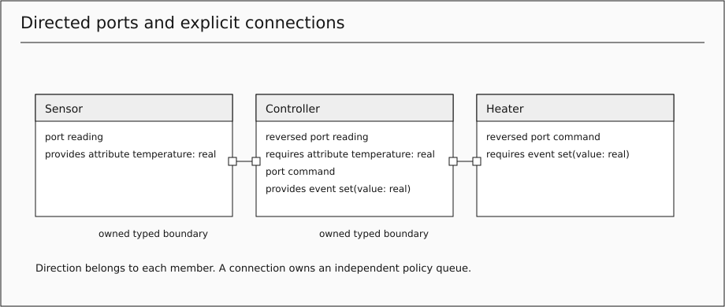
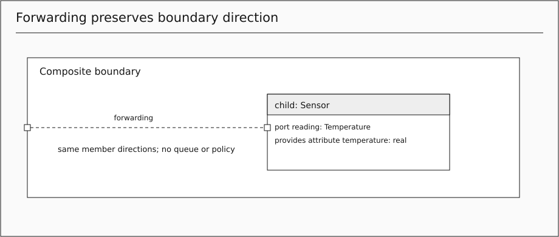
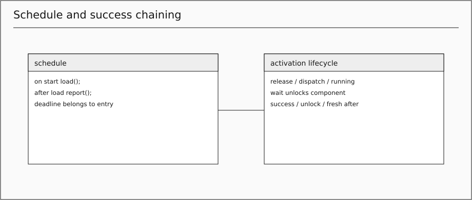
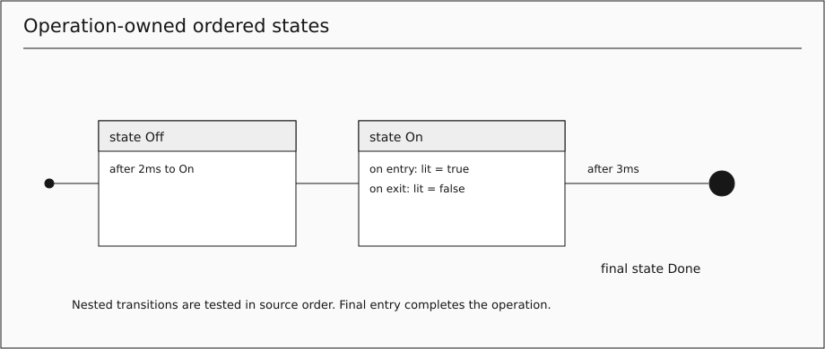
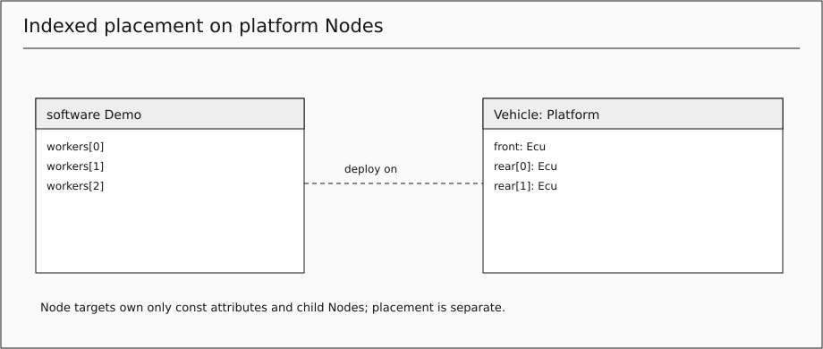
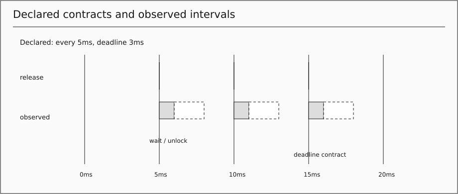

# swa.ml 2.0 — Complete language reference

Maintained reference for the 2.0 language. Headerless parser 2.0; profile swaml-reference/2.0. Generated from maintained 2.0 chapters. Published PDFs and frozen release references are unchanged. No compatibility parser or migration guide is included.

## Contents

- [LANGUAGE_SPECIFICATION](#chapter-1)
- [QUICK_START](#chapter-2)
- [USER_GUIDE](#chapter-3)
- [AI_GUIDE](#chapter-4)
- [spec/01-structure-and-types](#chapter-5)
- [spec/02-communication](#chapter-6)
- [spec/03-behavior](#chapter-7)
- [spec/04-systems-and-conformance](#chapter-8)
- [spec/05-kerml-mapping](#chapter-9)
- [spec/06-execution-contract](#chapter-10)
- [spec/07-normalized-model](#chapter-11)
- [spec/08-conformance-obligations](#chapter-12)
- [spec/09-formal-semantics](#chapter-13)
- [GRAPHICAL_NOTATION](#chapter-14)
- [GRAPHICAL_CATALOG](#chapter-15)
- [GRAPHICAL_EXAMPLES](#chapter-16)
- [SIMULATION](#chapter-17)
- [ARCHITECTURE_PATTERNS](#chapter-18)
- [REQUIREMENTS_AND_DOCUMENTATION](#chapter-19)
- [ONTOLOGY_AND_VIEWS](#chapter-20)
- [KEYWORD_REFERENCE](#chapter-21)
- [IMPLEMENTATION_STATUS](#chapter-22)
- [REVIEW_2_0](#chapter-23)
- [RELEASE_2_0_0](#chapter-24)
- [TOOLING](#chapter-25)
- [decisions/0016-swaml-2-0](#chapter-26)
- [decisions/0017-readable-names-and-use-cases](#chapter-27)
- [decisions/0018-cases-belong-to-their-subject](#chapter-28)
- [decisions/0019-package-context](#chapter-29)

<a id="chapter-1"></a>

# swa.ml 2.0 language specification

**Edition:** 2.0 · **Parser:** 2.0 · **Reference profile:** swaml-reference/2.0 · **Status:** release edition, 22 October 2026.

swa.ml is the Software Architecture Modeling Language: a textual language for explicit software structure, communication and executable behavior. [ADR 0016](decisions/0016-swaml-2-0.md) accepts the clean restart. The language has one component concept and one operation concept. It does not accept 1.x source. Published books and PDFs retain their original bytes.

## 1. Normative set

The [concrete grammar](../src/language/swaml.langium) defines tokens and parse structure. These chapters define validity and meaning:

1. [Structure and types](spec/01-structure-and-types.md)
2. [Ports and communication](spec/02-communication.md)
3. [Operations, schedules and states](spec/03-behavior.md)
4. [Deployment, cases, views and conformance](spec/04-systems-and-conformance.md)
5. [Proposed KerML mapping](spec/05-kerml-mapping.md)
6. [Execution contract](spec/06-execution-contract.md)
7. [Normalized model](spec/07-normalized-model.md)
8. [Conformance obligations](spec/08-conformance-obligations.md)
9. [Formal semantics](spec/09-formal-semantics.md)

[Graphical notation](GRAPHICAL_NOTATION.md), its [catalog](GRAPHICAL_CATALOG.md) and the [mapping inventory](../spec/kerml-mapping.json) complete the contract. [Usage](USER_GUIDE.md), [quick start](QUICK_START.md), [AI authoring](AI_GUIDE.md) and [examples](../examples) are informative. [Implementation status](IMPLEMENTATION_STATUS.md) distinguishes implemented checks from contracts and future evidence.

## 2. Precedence and scope

MUST and MUST NOT state requirements; SHOULD requires a documented reason for deviation; MAY grants permission. Grammar acceptance is insufficient when prose constraints fail. Unknown syntax and unsupported editions MUST be rejected. The host selects parser 2.0 and pins its package revision; files are headerless. Formatting never changes validity.

The language is closed. No generic UML/SysML constructs, host code, dynamic topology, generics, overloading, multiple inheritance, recursion or global mutable values are implicit. Platform Nodes model placement identities rather than hardware execution. A simulator run does not prove schedulability, absence of races, universal verification, KerML conformance or graphical editability.

## 3. Invariants

- **I1 Boundary:** every exchange between different component occurrences crosses owned typed port members and an explicit connection/forwarding route.
- **I2 Ownership:** components own private attributes, children and operations. Operations own nested operations and flow or states. Nested operations never capture enclosing locals/parameters.
- **I3 Provenance:** every provided event/attribute has an emitting operation; every required event/attribute and provided operation has exactly one input owner. Forwarded boundaries have no local handler/emitter.
- **I4 Values:** payloads, arguments, results, out values and array iterations are copied. Definition identity never merges occurrence stores. Records/enums retain nominal identity.
- **I5 Policy:** each connection occurrence has a complete effective pinned policy and independent queues. Forwarding has neither. Attributes keep latest values regardless of event/request capacity.
- **I6 Presentation:** views select existing semantic identities; drawings do not create behavior or routes. Layout stays separate; declared timing and observed evidence remain distinguishable.

Local calls, startup, periodic releases, waits, state timers and same-owner after dependencies are local lifecycle/computation. Operator and test inputs use ordinary source components, emitting operations, ports and routes; no destination injection or simulator function-release API exists.

## 4. Inventory

| Family | Ownership and meaning |
| --- | --- |
| Package, import | Flat multi-segment namespace and explicit visibility |
| datatype, enum, arrays | Finite nominal records/enums and copied fixed arrays |
| Component definition/usage | Reusable structure or distinct occurrence; usage body is anonymous specialization |
| Attribute/local/parameter | Occurrence state, lexical local, copied in or success-only out |
| Port definition/usage/member | Directed typed boundary; optional and reversed prefixes |
| Connection/forwarding | Policy-bearing opposite directions or queue-free boundary alias |
| Operation definition/declaration/usage | Reusable signature/body or owned executable, nested without captures |
| Schedule/entry | Trigger binding, dispatch arguments, deadline and concurrency |
| State/transition | Ordered nested receive/timer reactions; final completion |
| Deployment/placement | Software occurrences placed on platform Node occurrences |
| Requirement/case/view | Immutable intent; package-owned use cases and tests with an optional top-level subject occurrence, package associate/satisfy/verify links; stable selection union |

Definitions have qualified declaration identity. Occurrences have root plus indexed child paths. Activations add unique run identity. All transformations preserve these distinctions and source provenance.


---

<a id="chapter-2"></a>

# Quick start: swa.ml 2.0

Read a model in this order: components, attributes, ports, operations, schedule, connections. A def defines a reusable type/body; a usage creates a distinct occurrence. Every value has an explicit type. Every cross-component message has an owned port and explicit route.

```swaml
package HelloGuide {
  port def Greeting { provides event message(text: string); }
  component def Speaker {
    port output: Greeting;
    operation greet() { publish output.message("Hello, swa.ml"); }
    schedule { on start greet(); }
  }
  component def Listener {
    reversed port input: Greeting;
    attribute last: string = "";
    operation accept(text: string) { last = text; }
    schedule { on receive input.message(text) accept(text); }
  }
  component Demo {
    component speaker: Speaker;
    component listener: Listener;
    connect (speaker.output, listener.input);
  }
}
```

Install dependencies with npm ci, build with npm run build, then validate the saved file using node out/src/cli/main.js --json hello.swaml. To execute, create options.json with {"untilNs": 1000000} and run node out/src/cli/simulate.js HelloGuide::Demo options.json hello.swaml. Listener.last becomes Hello, swa.ml through a real routed event. Bare connect uses the pinned Default policy.

Continue with the [usage guide](USER_GUIDE.md), [complete examples](../examples), [AI guide](AI_GUIDE.md) and [support matrix](IMPLEMENTATION_STATUS.md). Version 2.0 accepts only the new syntax; published 1.x references remain historical artifacts.


---

<a id="chapter-3"></a>

# swa.ml 2.0 usage guide

Start with a component, give each persistent value a typed attribute, and write named operations for behavior. Add a schedule to say when those operations run. Add directed ports and explicit connections when behavior crosses component boundaries.

This guide targets the 2.0 parser only. Install Node.js 22+ and npm 10.2.3+, then run npm ci and npm run build in this repository. Validate with node out/src/cli/main.js --language-version 2.0 model.swaml. Files are headerless; the host and package revision select the edition.

## A first model

```swaml
package Counter {
  component Demo {
    /** A small autonomous counter. */
    attribute count: int = 0;
    operation increment() {
      count = count + 1;
    }
    schedule {
      on every 10ms increment();
    }
  }
}
```

Demo is the execution root. count belongs to its occurrence for the run; a var inside increment would belong to that activation/block. The schedule releases at 10ms, 20ms and so on, with a default 10ms deadline. Operations without a schedule entry are local helpers. Unscheduled behavior is not automatically executed.

Create options.json containing {"untilNs": 25000000}, then run:

```sh
node out/src/cli/simulate.js Counter::Demo options.json model.swaml
```

The final Demo.count is 2. The JSON records sources, logical trace, limits and final stores. It is bounded reference evidence with zero physical CPU cost. It does not prove production timing.

## Reuse structure without sharing state

```swaml
package ReuseGuide {
  component def Counter {
    attribute count: int = 0;
    operation increment() { count = count + 1; }
    schedule { on start increment(); }
  }
  component Demo {
    component left: Counter {
      redefines attribute count: int = 10;
    }
    component right: Counter;
    component bank: Counter[3];
  }
}
```

left starts with its own count at 10, then reaches 11. right and every bank index reach 1 independently. A usage body adds members or explicitly redefines an inherited whole member. Single specializes inheritance follows the same rule. Definition identity is shared; occurrence state is separate. Use bank[0] in connector/deployment/view paths. Port arrays and connector loops are absent.

## Choose the value's lifetime

Use const attribute for a fixed per-occurrence configuration value, attribute for mutable component state, var for lexical activation data and typed parameters/results for copied calls. Requirements own immutable attributes. Never read another component's private state by a dotted path.

Primitive types are bool, byte, uint, int, real and string; arrays have fixed extents. Define nominal records with datatype and enums with enum. Construct records with every field, as in record Reading { value = 2.5; unit = "C"; }. Access an enum with Mode.active, or a qualified package name if a local value shadows Mode. Check [the values example](../examples/05-values-and-flow.swaml) for a complete model. Numeric overflow, division by zero and dynamic invalid indexes fail at runtime; narrowing real to int uses the checked Math conversions.

## Compute with operations

```swaml
package OperationGuide {
  operation def Clamp(v: real, lo: real, hi: real) returns real {
    if (v < lo) { return lo; }
    if (v > hi) { return hi; }
    return v;
  }
  component Demo {
    attribute result: real = 0.0;
    operation clamp: Clamp;
    operation calculate() {
      operation double(v: real) returns real { return v * 2.0; }
      result = clamp(double(4.0), 0.0, 5.0);
    }
    schedule { on start calculate(); }
  }
}
```

A declaration has parentheses and optional returns; a usage has a type and inherits its signature. Its optional body replaces the whole definition body. Nested operations come first and never capture the outer operation's parameters/locals. Pass values explicitly. Component operations may read/write their own attributes. Package definitions can use only parameters/nested operations. Calls are expressions; void calls are statements; a value result cannot be discarded. Out arguments name mutable compatible cells and copy back only after success. Recursion and overloading are absent.

Import Swaml::Math explicitly for abs/min/max/floor/round/trunc/length/concat. View, QoS, CallFailure and Platform libraries are also loaded and explicitly imported when using their short names. Do not invent host built-ins or assume an arbitrary library exists.

## Connect components

[The hello model](../examples/01-hello.swaml) is the smallest complete routed example. A port definition declares provides event message(value: string). Sender owns a port of that type and emits with publish. Receiver uses reversed port, making that member requires, and binds it once in on receive. The root connects the two child ports.

Use provides/requires on each member, rather than assigning a role to the whole port. send updates a provided attribute; publish emits a provided event; p.operation(args) calls a required operation. Port definitions may differ if their members match structurally by name and compatible type. Records/enums remain nominal. A boundary-to-child same-direction connection forwards the boundary without queue/latency; it cannot have a policy or local handler.

A bare connect uses Swaml::Qos::Default: atMostOnce, fifo, capacity 16, reject, request timeout 1s. Select a named complete policy with connect link: Reliable (a.p, b.p). Reliable requests need an idempotent provided operation. Attributes retain the latest pending value regardless of event/request buffering. Nonoptional ports of every concrete root must resolve to a connection. optional only waives that port's closure requirement.

## Serve and request a value

See [the service example](../examples/07-client-server.swaml). The provider binds its provided operation through on call api.get(k) get(k). The consumer calls its own required member and usually chooses an explicit fallback:

```text
last = try(api.get(1), -1.0);
```

Timeout comes from the route policy. A bare failing call fails the activation; try catches runtime expression failures and evaluates fallback lazily. Static errors, interruption, deadlines and resource violations cannot be caught. Committed effects remain committed. The reason is trace evidence and is not an implicit model variable. A suspending call must be the whole initializer, assignment value or statement, optionally wrapped in try; avoid api.get(1) + 2.

## Schedule and suspend deliberately

on start runs once; on every D runs periodically; on receive binds an incoming event/attribute; on call serves a provided operation; after op runs after successful whole same-owner completion. One operation may have several entries, but the same trigger/operation pair cannot appear twice in one block. After dependencies are acyclic and release fresh parameterless void activations, with no forwarded arguments or result. [The chaining example](../examples/25-function-completion.swaml) shows this distinction.

wait, requests and receive statements release the component's serial lock. Another activation can change attributes before resumption. Recheck conditions after resuming before writing state. A concurrent entry cannot write state, even through a helper or out argument, and always reads its dispatch snapshot. Entry deadlines include suspension/backlog; an every entry defaults to its period. WCET belongs to target binding/evidence.

while tests first; until tests after its body. An optional n times limit evaluates once and exits normally. Counted for and copied-array for in have lexical loop scopes. [The loop model](../examples/18-control-loops.swaml) covers every form. Unbounded loops are permitted but a finite run has a step budget/deadline.

## Receive, interrupt and model state

[Receive statements](../examples/21-receive-and-try.swaml) wait for one of several explicitly bound inputs or a timeout, keeping early input queued. An [interruptible region](../examples/19-interruptible-function.swaml) is armed only during its body/callees and transfers within the same activation, preserving committed effects. Inactive region input is discarded observably; heed SW2012.

For a state machine, write initial and state directly in an operation. Put transitions inside each source state, in the order they should be tested. Use on entry/on exit, on receive with optional when, after D to Target, and final state. A stateful operation has no parameters/result and exactly one on start schedule entry. [The state example](../examples/04-stateful-function.swaml) completes at its final state; idle reactions do not release after dependents.

## Describe deployment, intent and views

Use a separate deployment declaration over software and platform roots. Targets are component occurrences specializing Swaml::Platform::Node. Const attributes may retain external ref identities; task/core scheduling stays in target adapters. [The deployment example](../examples/22-platform-deployment.swaml) shows family placement with an indexed override.

Requirements, satisfy and test/verify record intent. [The traceability example](../examples/16-requirements-and-views.swaml) includes a test of its root, satisfy and verify links and views. A case does not inject events or prove a witness.

A package is a closed context. Declare the system and its surroundings as top-level component occurrences and join their ports with package connections, connect (customer.panel, atm.panel);. Write use case Name of subject { … } or test Name of subject { … } in the package; the subject is a top-level occurrence of the same package, the system under consideration. Without of, a case records intent only. External systems and test stubs are interface-only components, component def Customer { port panel: Panel; }, which need no implementation; associate customer to 'Withdraw cash'; records that one takes part. satisfy Requirement by design; claims a component definition or occurrence path of the package, and verify Requirement by Test; links a test. [The use case example](../examples/28-use-cases.swaml) shows top-level occurrences, package connections, use cases, a test, associations and quoted names. Names containing spaces, letters outside ASCII or reserved words are written in single quotes, for example use case 'Withdraw cash' or attribute 'state': int = 0;.

Import Swaml::Views and type views by General, Interconnect, Case, Sequence, Grid, Flow or Timing. Compact of selects a subject; include/recursive/where builds a stable union. Filter kinds are component and operation for the structural/executable families. Browser navigates ownership; Flow combines statements/states; Timing separates declared schedule/deadline information from identified observed traces. Presentation layout belongs in sidecars, not language source.

## Validate and repair

```sh
node out/src/cli/main.js --json model.swaml
node out/src/cli/main.js --format model.swaml
node out/src/cli/main.js --check-format model.swaml
npm run check
```

Load every application dependency together. Fix syntax/names first, then ownership/routes, types/effects and schedules. JSON diagnostics expose stable codes/ranges and identity metadata. Always revalidate after a repair; formatting is not a semantic repair. Read [AI authoring](AI_GUIDE.md), the [keyword reference](KEYWORD_REFERENCE.md) and the [support matrix](IMPLEMENTATION_STATUS.md) for precise boundaries.


---

<a id="chapter-4"></a>

# AI authoring with swa.ml 2.0

Treat swa.ml as typed source that must be validated, rather than prose to approximate. Start with [the usage guide](USER_GUIDE.md), inspect a relevant [complete example](../examples), and read the affected normative chapter. Pin parser 2.0 and the exact package revision. Use the portable repository skills [swaml-author](../skills/swaml-author/SKILL.md) and [swaml-validate](../skills/swaml-validate/SKILL.md); they are versioned with the language and may be installed in the user's agent skill directory. They do not authorize publication or external messages.

## Build a model from intent

Identify execution roots and reusable component definitions. Assign each persistent value to one component attribute, configuration to const attribute and scratch data to var. Identify every exchange before writing behavior: give its two sides owned port members with provides/requires, then an explicit connect route. Decide which inputs are queued events and which are latest attributes. Bind each input exactly once.

Write operations with explicit parameter/result types. Use return for values, expressions for calls and statements for void calls. Nested operations take explicit inputs; they do not capture enclosing locals. A package operation def is parameter-only reusable behavior. Use a usage to reuse its signature/body. No class/function/calc/interface, role suffixes, call/as syntax, profile or old transition syntax is accepted.

Put activation in one schedule. Use on start/every/receive/call or after same-owner operation. Select complete policy definitions where Default is unsuitable. Keep remote calls as whole initializer/assignment/statement forms, optionally in try. Recheck live attributes after suspension; use concurrent only when the transitive operation graph cannot write. Copy-back of out parameters occurs only on success.

Multiplicity is literal and paths are indexed explicitly. Deployment targets are platform Node occurrences. Requirements and cases express intent; they are not proof or input drivers. A package is a closed context: declare top-level component occurrences, join their ports with package connections, connect (customer.panel, atm.panel);, and write use case Name of subject { … } or test Name of subject { … } as package members, where the subject is a top-level occurrence of the same package. Write external systems and test stubs as interface-only components (ports only) and record their part with associate customer to Name;. Claims are package links: satisfy Requirement by design; and verify Requirement by Test;. Quote names that contain spaces, letters outside ASCII or reserved words, such as 'Withdraw cash'. View definitions select existing identities, with geometry separate.

## Validate–fix loop

```sh
npm run build
node out/src/cli/main.js --json model.swaml dependency.swaml
node out/src/cli/main.js --format model.swaml
node out/src/cli/main.js --json model.swaml dependency.swaml
```

Inspect errorCount and diagnostic code/range/message/data. Resolve parser/name errors before reasoning from a recovered AST. Fix the smallest relevant declaration, keeping private scopes and explicit routes intact. A suggested edit is advice to revalidate, never permission to apply a stale edit. Validate the complete source workspace after changes, including negative lookups made ambiguous by newly loaded files. Never invent a library, untyped value, implicit port, hidden event or direct destination injection to silence diagnostics.

Run a bounded simulation only after validation. Choose the run target: a package runs its top-level occurrences with their package connections, Package::component runs one top-level occurrence with its ports open. Record source bytes/hashes, target, profile, options, deployments and trace; trace sources name the statements that caused each observation. Inspect final occurrence stores and relevant failure/timeout/discard/interrupt observations. A caught failure is still evidence of that runtime failure; no-failure-observed is a finite-run statement. Show declared timing separately from observed intervals and never label zero-cost logical steps as measured WCET.

## Common diagnostics

| Group | Repair direction |
| --- | --- |
| SW2001 | Load/import the correct package, disambiguate a name, remove shadowing |
| SW2002 | Correct explicit types, record shape, fallback/result or array bounds |
| SW2003 | Add explicit redefines only for a real compatible inherited member; break cycles |
| SW2004/2005 | Repair member direction/type/route/closure, emission provenance or exclusive input owner |
| SW2006 | Correct nested scope, return/out use, effects or whole-expression suspension |
| SW2007/2008 | Repair schedule identity/signature/after graph or ordered state ownership |
| SW2009/2010 | Resolve occurrence/Node paths, case subjects, associate/satisfy/verify targets in the same package, or view subject |
| SW2011/2012 | Recheck live state after resumption; account for inactive interrupt input |
| SW2013 | Supply complete typed policy values and safe positive durations |

Keep diagnostics/evidence honest. Consult [implementation status](IMPLEMENTATION_STATUS.md) before claiming full V/E/G/K support. Publishing a page or release is a separate user-authorized action; this project requires a design preview before publication.


---

<a id="chapter-5"></a>

# 1. Structure, names and types

Normative chapter of [swa.ml 2.0](LANGUAGE_SPECIFICATION.md).

## 1.1 Names and documentation

Files contain packages without a version header. Package names may contain several :: segments; packages do not nest. import P; exposes P's top-level declarations and requires that package in the loaded workspace. Qualified references are unambiguous; ambiguous short imports are errors independent of load order. Names are unique in their scope; a package's elements and named package connections share one namespace. No overloads or implicit imports exist. The contextual words associate, by, case, kind, name, path, reversed, test, times, to and use and the duration units ns, us, ms and s remain legal names outside their syntactic positions. Other literal words in the grammar are reserved.

A package is a closed context. It owns definitions, top-level component occurrences, package connections between those occurrences, use cases, tests and the associate, satisfy and verify links that record intent about them. Definitions, requirements and other declarations may be imported; occurrences are never connected, made a case subject or associated across packages.

A name is written as a basic name, an ASCII letter or underscore followed by ASCII letters, digits or underscores, or as a quoted name between single quotes, such as 'Withdraw cash', 'Bestellübersicht' or 'state'. Inside quotes, \' writes a quote and \\ a backslash; other escapes, line breaks and control characters are invalid. The name is the quoted content: 'Pump' and Pump are the same name, and a quoted reserved word is an ordinary name. A quoted name is not empty, contains no '.', ':', '[' or ']', which delimit paths, and separates words by single spaces without leading or trailing space (SW2001). Tools write a basic name whenever one is legal and quote otherwise. Qualified names and paths combine spellings, as in Shop::'Order Service'.port; a string literal holding a path, such as a view filter value, contains the unquoted names.

Strings use double quotes and the portable escapes for quote, backslash, newline, carriage return and tab. Ordinary // and /* */ comments are lexical annotations. Each declaration owns at most one formal /** */ doc, first inside its body or immediately before the semicolon of a leaf. Documentation and comments do not execute.

## 1.2 Components and occurrences

component def declares a reusable type. component name: Type; creates a usage; a package-owned usage is a top-level occurrence and an execution root. An untyped package usage may own inline topology. Child usages require definitions. Closure is checked per package over all top-level occurrences and package connections (section 2.3). Definitions may be reusable open libraries; an unused definition is not an execution root.

A component whose effective members, including specialization, have ports but no operations, schedule entries or parts is interface-only. It needs no implementation: the emission and input-owner rules of section 2.1 do not apply to it. In a run it does nothing on its own; actors (external systems) and test stubs are written as interface-only components.

A usage body is an anonymous specialization with explicit whole-member replacement and added members, including typed roots. Single specializes inheritance is acyclic. An inherited member with the same name requires redefines; a nonexistent inherited target is an error. Replacement preserves category, types, operation signature and body category. Child component definitions may specialize the replaced type. Port replacement preserves directed compatibility and optionality. Attributes preserve constness and type. No partial operation-body merge, super dispatch or implicit shadowing exists.

A literal positive multiplicity [n] on a child creates n separate occurrences. Paths index every array usage with a literal in range, as in wheels[2].svc. Connector loops and port arrays do not exist. Composition is finite and acyclic. Definition identity does not identify an occurrence or a store.

## 1.3 State and lexical values

attribute declares component-owned mutable state; const attribute fixes its value per occurrence. Both are explicitly typed and may be redefined with a different compatible initializer in a usage. Initializers are pure and cannot read mutable state. Requirements own immutable typed attributes regardless of the const spelling.

var declares an activation/block local. in is the default parameter direction and is immutable; out parameters are mutable with success-only copy-back. Live names cannot shadow another live local, parameter or attribute. A nested operation sees its own parameters, its nested operations and the owning component's attributes, never enclosing parameters or locals. Local data access never traverses child components or ports.

## 1.4 Value domains

bool, byte (0–255), uint (0–9007199254740991), int (−9007199254740991 through 9007199254740991), finite real and string are primitive domains. void has no values and is only an operation result. Records and enums are nominal by qualified declaration identity. A datatype declares every field explicitly; a record construction supplies each once, with no extra fields. Enum literals use Type.literal; a live value named Type takes precedence, so a qualified enum reference avoids ambiguity.

Fixed arrays have positive safe extents, copied elements and invariant element type/extent. Array literals are checked elementwise against their destination type. Index expressions are integral; literal out-of-range indexes fail statically and dynamic bounds fail at runtime. In-place field/index assignment and reference values are absent.

Scalar widening is byte to uint to int to real. Known integral literals may initialize smaller integral domains if in range. General computed integral assignments are range-checked by the backend where permitted by the type rule; real never implicitly narrows. Integral arithmetic yields int; slash or a real operand yields real. Integer operations are exact within the safe domain and overflow fails. Division/remainder by zero and non-finite reals fail. Equality is recursive and type-compatible; ordering is numeric. Only and/or short-circuit. The grammar defines precedence.

## 1.5 Reuse and library boundaries

Package operation definitions use only parameters and nested operations. Their usages inherit the signature; an optional body replaces the whole body. Calls in an inherited component body resolve by name in the concrete occurrence's effective members, with signature preservation checked on redefinition. Call graphs are acyclic. No other component's operation or calculation is a fallback name resolution target.

The versioned source libraries are Swaml::Math, Swaml::Calls, Swaml::Qos, Swaml::Views and Swaml::Platform. They are always loaded but imported explicitly. Math provides abs, min, max, checked floor/round/trunc conversion to int, Unicode scalar length and concat. floor/round/trunc/length are explicitly identified host intrinsics in the reference library; round ties toward positive infinity. Their backend semantics and range failures remain required.


---

<a id="chapter-6"></a>

# 2. Ports and communication

Normative chapter of [swa.ml 2.0](LANGUAGE_SPECIFICATION.md).

## 2.1 Directed port members

A port def owns named provides/requires attribute, event and operation members. An attribute carries one typed value, an event has copied in parameters, and an operation has in/out parameters and an optional returns result. Only operation members may be idempotent. Interfaces, interface kinds, versions, roles and separate signals do not exist.

A component uses port p: Definition; or an inline port body. reversed flips every member direction. optional is a prefix that waives that port's closure requirement; it does not waive required ports elsewhere on a forwarding chain. A provided attribute/event is emitted by this side; a provided operation is implemented by this side. Requires means the opposite.

Every provided attribute/event MUST have syntactic operation emission provenance. Every required attribute/event and provided operation MUST have exactly one owner: a schedule entry, one stateful operation's transition set, one receive statement or one interrupt region. Multiple alternative transitions in that one stateful operation are one owner. A forwarded boundary is never also locally handled or emitted. An interface-only component (section 1.2) is exempt from these provenance and owner rules.

All input stimuli, including operator/test drivers, are ordinary typed emissions from validated source operations through routes. Hidden harness releases and destination injection are forbidden. An unconnected optional request fails unavailable. An optional unconnected event/attribute emission has no recipient and remains observable.

## 2.2 Structural compatibility

Connection compares names independently of declaration order or port-definition identity. Every requires member on either side has a provides member of the same name and kind on the peer. Extra provides are permitted. For attribute/event delivery the provided payload is assignable to the required payload. For operation in parameters the required type is assignable to the provided type; out parameters reverse this variance. The provided result is assignable to the required result. Directions and parameter arity agree. Records and enums are nominal; numeric widening is permitted. Every missing/mismatched member produces an individual diagnostic.

Forwarding compares a boundary and immediate child's port in the same direction. The child supplies every boundary member with preserved direction and compatible payload/signature. Child requirements cannot be lost at the boundary. This aliases identities rather than generating messages.

## 2.3 Connectors and closure

connect (a, b); joins owned ports or ports of immediate children. A child with multiplicity requires a literal index. Name and policy are optional: connect link: Reliable (a, b);. Endpoints are unordered.

A connect may also be a package member. Each end of a package connection is occurrence.port, where occurrence is a top-level component occurrence declared in the same package; a nested path, a definition or an imported occurrence is an error (SW2004). A package connection is always a connection, never forwarding, and follows the same compatibility, duplicate, policy and idempotence rules. It cannot redefine.

Boundary-to-child endpoints derive forwarding when same-direction compatibility holds. Forwarding has no queue or policy; a policy is an error. Each boundary and child port is forwarded at most once. Other endpoints derive a connection using opposite-direction compatibility. Invalid endpoints report the applicable compatibility failures. Self connections and duplicate endpoint pairs, including duplicates after forwarding resolution, are errors.

Closure is checked per package. Every nonoptional port of every occurrence of the package's top-level occurrences MUST resolve through any forwarding aliases to a connection: inside its component as before or, for a port of a top-level occurrence, through package connections. Closure inside a component is unchanged. A required attribute or operation has exactly one peer after forwarding. Event-only required ports permit multiple peers. A connector owns its queue identities per expanded occurrence, direction and member; sharing a named policy never shares queues. Distinct connections remain independent under fanout. Partial fanout effects committed before a failed offer remain committed.

## 2.4 Versioned policies and queues

A named qos def is typed by Swaml::Qos::Policy and supplies complete valid delivery, ordering, capacity, overflow and requestTimeout fields, plus optional maxLatency/maxAge. Values use the typed Delivery, Ordering and Overflow enums. Inline policies and per-use overrides do not exist. Each effective use is checked, including inherited connections and idempotency obligations.

Default is atMostOnce, fifo, capacity 16, reject, requestTimeout 1s, without latency/age bounds. Latest is atMostOnce/fifo/1/dropOldest/1s. Reliable is atLeastOnce/fifo/16/reject/1s. BestEffort is bestEffort/unordered/16/dropNewest/1s. These are pinned library values, always inspectable. atLeastOnce requests require an idempotent provided operation declaration; the declaration alone does not prove actual idempotence.

Policy buffering applies to events and requests. Attribute members keep only the latest pending value independently of capacity and overflow. fifo preserves order within its queue. Unordered allows other orders, although the deterministic reference interpreter chooses insertion order. Overflow rejects the offer with a runtime failure or discards the selected oldest/newest message observably. Age discards are observable; latency assumptions are contract obligations. A backend identifies delivery and failure assumptions explicitly.

## 2.5 Requests, replies and failure

A required operation is called as p.member(args). Its timeout comes from the route policy. Each request has a unique correlation and its response returns on the same member/route in reverse. Successful result and out values are copied back together; failure copies neither. Timeout, unavailable, rejected, transport and remoteFailure are failure reasons recorded as Swaml::Calls::CallFailure values or local runtime kinds in evidence. The model cannot inspect the reason.

A request suspends and releases the caller's serial lock. Timeout and reply at the same timestamp resolve as timeout; terminal correlations never reopen. Late replies are suppressed observably. Interruption cancels the local request continuation and correlation; the server continues and its committed effects remain. The interrupted terminal is not a catchable failure. try catches expression failures and supplies a compatible lazy fallback; bare calls propagate failure to the activation.


---

<a id="chapter-7"></a>

# 3. Operations, schedules and states

Normative chapter of [swa.ml 2.0](LANGUAGE_SPECIFICATION.md).

## 3.1 Operations and effects

An operation declaration always has parentheses and an optional returns T result; omission means void. operation def is package-owned reusable behavior. An operation usage has a type after a colon, no parentheses/result, and optionally replaces the whole inherited body. Names are unique and call graphs acyclic. Nested operations precede executable statements/states and never capture enclosing locals/parameters. A body owns flow or states directly; the body grouping has no executable identity.

Calls are expressions. A void call is a statement; a non-void result cannot be silently discarded. Calls with out arguments are statements; each out argument is a mutable compatible local, out parameter or component attribute. In/out values are copied and out copy-back occurs only after successful whole return. A caller cannot invoke a different component by a structural path; it must use its own required port operation. Stateful operations are activated by their schedule rather than called locally.

Effects are inferred transitively through the acyclic call graph: pure, reads state, writes state, communicates, suspends. The implementation MUST also retain a writes flag when a higher effect dominates, so communicating/suspending callees cannot conceal a write. Passing an attribute as out is a write. Attribute initializers are pure. State guards may only be pure or read state. Concurrent schedule entries cannot write state through any reachable callee or out argument.

Suspending calls may be the whole var initializer, assignment right side or expression statement, optionally wrapped in try; they cannot be embedded in arithmetic, call arguments, return values or predicates. Other expressions can have nonsuspending effects. Arguments evaluate left to right; only and/or short-circuit. Declarations and source order do not select overloads or change resolution.

## 3.2 Failure

Runtime failures unwind the current expression/frame/activation without rolling back committed effects. try(e, fallback) catches all runtime expression failures from valid source, including arithmetic, ranges, indexes, assert/fail in called operations and remote failures. Fallback is assignable to the expression type and evaluated only on failure. Nested try is valid. Void try(e) explicitly ignores failure; a void fallback can run recovery behavior.

Static errors are never caught. Interrupts and deadline/activation/resource violations bypass try. The failure reason is recorded in evidence and unavailable as an implicit binding. Void has no value; completion is not a sentinel value. Non-void flow must structurally return or fail on every path; a positive-extent copied for-in body or an until body with a proven positive/no limit can establish this, while a dynamic possibly-zero limit cannot; bounded/unbounded loops that can execute zero times are insufficient to establish a return.

## 3.3 Statements and scopes

var declares a typed local; assignment replaces a copied mutable cell. if requires bool. while tests first; until executes at least once unless its explicit limit is zero, and stops when its bool condition becomes true. Optional n times takes a uint-compatible expression evaluated once at entry; reaching the limit exits normally. for uses an initializer-local scope, bool condition, body and assignment update. for (x: T in values) iterates one copied fixed-array snapshot with a fresh element/body scope each time. Locals do not leak from blocks. There is no break, continue, do, bound or forEach syntax.

wait D suspends for a positive duration. on receive p.m(bindings) { ... } or receive ... or after D { ... } waits for one input or optional timeout. Each payload is explicitly bound, each member has that statement as exclusive owner, and input received before the statement waits stays in the connector queue. Without timeout the wait is unbounded, subject to an entry deadline and host limits. Selecting a branch consumes one message once.

interruptible { body } on receive p.m(bindings) { handler } arms an unnamed region only while the protected body, including its called frames, is running or suspended. Input while inactive is discarded and traced; the validator warns. Input while armed transfers within the same activation, cancels protected continuation/local request, preserves outer locals/deadline and committed effects, and then executes the handler. Protected block locals do not escape. Nested regions unwind to the selected owning region. A server handling a cancelled request is not cancelled. Regions are prohibited in stateful operations; concurrent regions are permitted only when transitively non-writing and consume input once in activation order in the reference backend.

send p.attribute(v) updates a provided attribute; publish p.event(args) emits a provided event. Return completes a frame, fail fails it, assert requires a bool and fails when false. Private state writes, emissions and successful local call effects remain committed when a later statement fails.

## 3.4 Suspension and locks

Every component occurrence has one serial lock. Serial dispatch evaluates/copies schedule arguments under this lock. wait, requests, receive and idle state-machine waits release it. Resumption reacquires it and reads live attributes. Other activations may run and modify state while a serial activation is suspended. Activation locals remain its own copies. Concurrent entries overlap and read the dispatch snapshot throughout, including after resumption, and never write state.

A stale-read warning identifies a pre-suspension state read that may affect a later write. Recheck live state after resuming. This warning is conservative and is not a race-freedom proof. A successful static check does not establish scheduling, termination or deadlock freedom.

## 3.5 Schedule

A component owns at most one schedule block. Effective entries inherit and are replaced by repeating their (trigger, operation) identity. Duplicate identities in one authored block are errors. Trigger identity includes a receive/call member, an every period, or an after predecessor. One operation can have several entries.

| Trigger | Release and signature |
| --- | --- |
| on start | Once after the initialization barrier |
| on every D | At root epoch + kD, k at least 1; deadline defaults to D |
| on receive p.m(bindings) | One activation per received required event/attribute |
| on call p.m(bindings) | Serve a provided operation; typed result/out values form the reply |
| after predecessor | Fresh activation after successful whole same-owner predecessor completion and unlock |

Entry arguments evaluate and copy at dispatch. Non-call entries bind void flow with no out parameters; after targets are parameterless void flow. Predecessors are scheduled same-owner operation names, never paths/qualified names/port members; the effective after graph is acyclic. Failure releases nothing. A fresh activation has its own release/deadline/locals/snapshot/backlog accounting; results and parameters are not forwarded. Stateful success means reaching final, not becoming idle after a reaction.

An explicit deadline is positive. An every entry's deadline cannot exceed its period. Deadline omission elsewhere is permitted; a host may impose additional documented validation requirements. concurrent is entry-local and requires a non-writing, non-stateful operation. Source WCET, timing blocks and root profiles do not exist; target bindings own execution-cost evidence.

## 3.6 States

A stateful operation is parameterless void and has exactly one on start entry. initial names one owned state. States own at most one on entry and one on exit block plus ordered receive/timer transitions. A receive transition binds payload, optionally tests a pure/read-state bool guard, and names its target with to. after D is relative to the state update, before entry actions begin. Entry actions finish before a transition can run; if entry suspends past a timer expiry, the earliest elapsed timer is selected on resumption before queued input. Timers with equal expiry use declaration order. Evaluate competing enabled transitions in declaration order and take the first. There are no transition names, priorities or completion transitions.

A reaction runs exit, transition effect, state update and entry in that order. Timers are invalidated by state exit and stale firings are observable discards. Unhandled input does not reset the current state timer. Every state is graph-reachable from initial; a final state has no outgoing transitions or exit action. Reaching final runs entry and completes the whole operation once. Hierarchical/orthogonal states and physical preemption are outside the language.


---

<a id="chapter-8"></a>

# 4. Deployment, cases, views and conformance

Normative chapter of [swa.ml 2.0](LANGUAGE_SPECIFICATION.md).

## 4.1 Deployment

Swaml::Platform supplies Node, Platform, Partition and Process component definitions. Node specialization owns only const attributes and child Nodes, with no operations, ports, connectors or schedule. Optional ref: string retains an external model identity for the host; it is not required for swa.ml validity and is never silently resolved as a software path. Buses, hardware timing, core/task allocation and operating-system scheduling are target-translation concerns.

A package deployment Name of Root on PlatformRoot owns placements. deploy on nodePath places the software root; deploy childPath on nodePath places that occurrence and descendants. A more specific path overrides an ancestor; an indexed path overrides a multiplicity family path. Exact paths are unique within one deployment. Every software path and literal index resolves in that root; every target resolves to a Node occurrence of that platform root. Only components are deployed. A top-level occurrence has at most one deployment in the workspace (SW2009 on each later one, at its root reference), and a package or component run applies it to that occurrence's tree; absence remains unallocated.

## 4.2 Requirements, cases and package links

A requirement owns immutable typed attributes and at most one doc. Requirements may be imported. Every relation that records intent about requirements and cases is a package member, never a component member, and none of them proves fulfillment.

A case is written use case Name of subject { … } or test Name of subject { … }. Cases are package members only; components never own cases. The of clause is optional and names a top-level component occurrence declared in the same package: the subject, the system under consideration. A case of a part is written in a package where that component is a top-level occurrence. A case without of, or without statements, records intent only. The case body currently owns only optional documentation; the executable case statements decided by ADR 0019, which act through the ports of associated interface-only components, are not yet part of the grammar.

associate Occurrence to Case; records that a top-level component occurrence of the same package takes part in a use case or test of the same package. The occurrence is not the case's subject and each pair is associated at most once. Associated occurrences are the actors of the case; they communicate with the subject only through ports and package connections.

satisfy Requirement by design; claims that a component satisfies a requirement. design is a component definition or a top-level component occurrence declared in this package, optionally followed by nested parts such as Workbench.editor or cells[1]; a literal index is within the multiplicity. The claim is written in the package that declares the head of the design path; the requirement may be imported. Each requirement and design pair is claimed at most once.

verify Requirement by Test; claims that a test of this package verifies a requirement. A use case never verifies. The relation is many-to-many; each requirement and test pair is written at most once; the requirement may be imported.

The 2.0 and ADR 0018 case forms are removed rather than deprecated: verification case, cases inside components, actor roles, include and extend between cases, verify inside cases, declarative steps with from, to, via and after, satisfy inside components and satisfy … of. They are ordinary syntax errors.

## 4.3 Views

Swaml::Views provides General, Interconnect, Case, Sequence, Grid, Flow and Timing. A view is typed by a definition, uses compact of subject or one or more include clauses, and owns optional documentation. Include may expand recursive descendants and apply a restricted Boolean where filter over name, kind and path, string comparisons, and/or/not. Filters never call operations or execute behavior. Selection is a union of occurrence identities in first-selection order; duplicates are removed stably.

General and Grid select named semantic elements except views. Interconnect selects components. Case selects packages, cases and components; Sequence selects cases, components and packages. A selected package contributes its cases. Case draws each selected case inside the boundary of its subject occurrence, its associated occurrences outside it, and the satisfy and verify intent links of the package. Flow/Timing select operations. Paths preserve definition/occurrence identity and explicit multiplicity indexes. Browser is navigation rather than an eighth view kind. General Box in box and Tree layouts retain exactly the same selected identities and topology; layout/collapse/geometry stay in presentation sidecars.

Flow covers statements, nested operation calls, loops, receive, interruption and function-owned states. Timing has declared and observed modes. Declared shows schedule release grid, causes, deadlines, static wait intervals and permitted concurrent overlap. Observed adds an identified trace, serial lock gaps, message latency, activation phases, terminal markers and open intervals; WCET/budget bars identify their target-binding/evidence source. A missing trace never produces fabricated observation. Views introduce no execution semantics.

## 4.4 Validation groups

| Code | Static group |
| --- | --- |
| SW2000 | Syntax and recovery diagnostics in machine-readable CLI output |
| SW2001 | Names, quoted-name spelling, imports, uniqueness and forbidden live-name shadowing |
| SW2002 | Value types, nominal shapes, domains, arguments/results and indexes |
| SW2003 | Definition/usage, specialization, containment and whole-member redefinition |
| SW2004 | Port shape, structural compatibility, endpoints, package connection ends, aliases, per-package closure/cardinality |
| SW2005 | Single input owner and emission provenance; interface-only components are exempt |
| SW2006 | Calls, nested scope, effects, returns, out arguments and suspension placement |
| SW2007 | Schedule identity, signatures, deadlines and after graph |
| SW2008 | Stateful signatures, scheduling, ordered states and reachability/finality |
| SW2009 | Node content, deployment paths, indexes and specificity |
| SW2010 | Requirement/case/view references, case subjects, associate, satisfy and verify links |
| SW2011 | Conservative stale-read warning |
| SW2012 | Inactive interrupt-input discard warning |
| SW2013 | Complete typed policies and representable positive durations |
| SW2014 | Canonical formatting differs, only in explicit formatting-check mode |
| SW2015 | Retired in 2.1 together with the 2.0 case spellings; not reported |

Every diagnostic includes a source range and stable code. Machine-readable diagnostics retain declaration identity and occurrence context when resolved. A suggested edit is supplied only for a safe unambiguous correction; tools must revalidate the resulting complete workspace before applying it. Parser recovery may suspend semantic checks on invalid syntax, but the document remains invalid and must not crash the service.

## 4.5 Evidence boundaries

S is syntax, V is static validity, E is reference execution behavior, A is an explicitly scoped analysis, K is validated kernel export and G is validated graphical source editing. Implementations report supported groups and evidence rather than promoting one level to another. [Chapter 8](spec/08-conformance-obligations.md) defines the obligations and [status](IMPLEMENTATION_STATUS.md) reports actual support. The reference simulator uses logical zero-cost execution and bounded resources; target deployment timing requires separate evidence.


---

<a id="chapter-9"></a>

# 5. Proposed KerML semantic mapping

Normative mapping contract of [swa.ml 2.0](LANGUAGE_SPECIFICATION.md), conditional on a backend claiming K conformance. No exporter or validated KerML semantic library is supplied by the current reference implementation. Langium AST generation and exhaustive inventory coverage do not establish KerML conformance.

## 5.1 Representation

Packages map to Package/namespace membership and imports. Datatypes/enums preserve nominal identity; arrays preserve copied shape. Components map to software Structure definitions and owned typed features. A usage creates an occurrence, including each multiplicity index; no shared private state is introduced. Specialization/redefinition retains the effective member set and base/replacement provenance.

A result-bearing operation maps to a Function; a void operation maps to a Behavior. This mapping does not make a result-bearing swa.ml operation pure. Effects remain explicit swa.ml constraints. Operation usages retain their shared signature and effective body. Nested operations are owned executables without lexical captures; states contribute to their owning operation rather than becoming an independent executable.

Ports map to owned typed features with per-member directional projections. Reversal flips each projection. Structural compatibility is retained as per-member typing constraints, not replaced by nominal port identity. Connections map to Connector instances with source occurrence/member route and independent policy queues. Forwarding maps to queue-free boundary aliases with preserved chains, not an extra message hop. Messages, transfer values, correlation and terminal failures require swa.ml semantics over suitable KerML Step/transfer structures.

## 5.2 Required semantic library

A K-conforming backend MUST implement a pinned swa.ml semantic library specializing the selected KerML 1.0 library. It defines Component, Operation, Port, Connector, Message, Queue, Activation, Schedule, state-machine reactions, copied values, failure and interruption. It MUST preserve suspension/unlock/relock, snapshots, deadlines, queue identity, success-only out copy-back, after success releases, state transition ordering and cancellation/late-reply behavior. Merely attaching uninterpreted metadata is preservation rather than proof that a kernel tool understands the execution semantics.

No arbitrary metaclass name is invented as a kernel class. Abstract bases require concrete backend choices validated by that kernel. Unsupported meaning yields an explicit partial-export result. The [inventory](../spec/kerml-mapping.json) covers every grammar production/type as element, grouping, reference, value, lowering or lexical, with its normative home. Groupings/lexical nodes contribute to owners and must not create duplicate semantic elements.

## 5.3 Traceability and claims

Every lowered node/constraint retains source declaration identity, URI/range, occurrence context and a generation role. Inherited declarations and replacements retain both provenances. Requirements, satisfaction, verification, deployment, cases with their subject occurrence, associations, package connections and views retain typed metadata/references, without proof claims. Names keep their decoded spelling; quoted swa.ml names map to KerML unrestricted names. Timing observations reference their run and binding; layout stays separate.

A conforming backend identifies the exact source/package/library revisions, selected KerML implementation, checked constraints and evidence. Round trips preserve the [normalized model](spec/07-normalized-model.md) and cannot erase effects, merge occurrences/queues, reorder state transitions, invent routes, weaken contracts or convert copied values into references.


---

<a id="chapter-10"></a>

# 6. Reference execution contract

Normative contract of [swa.ml 2.0](LANGUAGE_SPECIFICATION.md), profile **swaml-reference/2.0**. A run records parser/package identity, source bytes, run target, applied deployments, options, limits, fault assumptions and an ordinal logical trace. Host adapters load files and hash sources; the language core performs neither filesystem access nor hashing.

## 6.1 Lifecycle and time

A run target is a package or one top-level component occurrence of a package. A package run executes every top-level occurrence of the package except platform roots (occurrences that specialize Swaml::Platform::Node), with their internal connections and the package connections between their ports. A component run executes that one top-level occurrence: its package connections are absent and its top-level ports are open, so an emission through an open port has no route and a request through it fails as unavailable. A top-level occurrence has at most one deployment, and a run applies it to that occurrence's tree.

Expand the finite occurrence tree of every executed top-level occurrence and initialize separate private stores before releasing startup work. An uncaught initializer runtime failure ends initialization, records the occurrence, attribute, source range and reason, retains partial stores and source evidence, and releases no startup work. A caught initializer failure may recover and remains observable. Distinct targets are independent execution choices; the occurrences of one package run share its initialization barrier, clock and trace. The reference epoch is 0ns. Every D releases at kD for k at least 1. Schedule arguments evaluate and copy at dispatch, under the serial lock or the concurrent dispatch snapshot. Entry deadline is measured from release, including backlog, request transport, wait and receive. Periodic deadline defaults to period.

Time uses nonnegative safe integer nanoseconds. Durations are positive and must remain representable after conversion/addition. Reference CPU steps cost zero physical time; a step budget prevents runaway computation. Ordering is deterministic by timestamp, phase and insertion ordinal. Deadline/request timeout wins a tie with reply or ordinary work. Receive timeout wins a tie with delivery in the reference selection. A run explicitly records its horizon; live/waiting activations and future events yield horizon status with open intervals rather than invented completion.

## 6.2 Lock and snapshot

One serial activation runs at a time per component occurrence. Nonsuspending local calls borrow its context and lock. wait, requests, receive and idle state waits release the lock. On readiness, serial work reacquires it before continuing and uses live attributes; locals remain copied cells. Concurrent entries may overlap, read one dispatch snapshot throughout and cannot write state even through callees or out arguments. Target backends must state how they realize the same snapshot semantics.

After a successful whole operation completes and unlocks, each effective after entry releases one fresh activation. No release occurs on failure, idle state reaction or intermediate local return. Each dependent has fresh deadline, locals and snapshot/backlog accounting. Correlated service reply transport and local completion dependencies are distinct observations. Duplicate dependencies are statically invalid and the graph is acyclic.

## 6.3 Values, flow and failure

Evaluation is left to right with and/or short-circuit. Payloads, records, arrays, parameters/results and out copy-back are copied, with nominal identities and domain checks. for in uses one copied collection. A loop limit evaluates once, is checked in the uint domain, and exits normally at the count; termination beyond declared limits is not statically proved. Integer overflow, non-finite reals, zero division, invalid indexes and failed assert/fail are runtime failures.

A local failure unwinds frames to the nearest try or fails the activation. Try fallback is lazy and type-compatible; prior state writes/emissions remain committed. Out values copy back only on successful return. Interrupt transfers and deadline/resource/activation violations are outside try. Resource failure is explicit evidence; no silently dropped activation is reported as successful execution.

## 6.4 Communication

Resolve boundary aliases before routing; forwarding adds neither queue nor latency. Each connection occurrence/direction/member owns a queue. Bare connections use the pinned Default. Check outgoing arguments against the emitting/requesting port member before routing, even when the peer accepts a wider domain. Request out cells initialize in the provider domain; successful replies convert at caller copy-back. Attribute queues replace the pending value; event/request queues obey capacity, delivery, ordering, overflow and optional age/latency assumptions. A reference run chooses insertion order for unordered queues. Fanout proceeds in route order and may partially commit before rejection.

A required request creates a unique pending correlation and suspends the caller. Result/out values and failure return through the same route in reverse. Timeout uses requestTimeout. First terminal transition is immutable; timeout wins equal-time delivery; late replies are traced and suppressed. AtLeastOnce may redeliver and requires an idempotent declaration. The reference fault model records offer-indexed drop, duplicate, transport and additional latency; retries/redelivery assumptions must be inspectable. Each duplicate copy independently obeys queue capacity and overflow; attribute copies preserve the single latest pending value. Accepted input comes only from validated source emissions; no destination injection exists.

## 6.5 Input ownership and interruption

An event is consumed by its one owner. Input for a receive statement remains queued before that statement waits. Inputs for inactive interrupt regions are discarded and observed. An armed region includes suspended local callees; matching input cancels protected frames/continuation and any pending local request, but not a remote server. Transfer stays in the same activation/deadline, preserves outer locals and committed effects, and runs the handler. Terminal interrupted correlations suppress late replies. No physical scheduling/preemption guarantee is implied.

A state machine waits without the component lock. Each reaction selects the first enabled nested transition for the input/timer, runs exit/effect/state-update/entry, and releases the lock again when idle. The timer epoch is the state update before entry actions, including time spent suspended in entry. Entry completes before timer selection; elapsed timers precede queued input, with earliest expiry first and equal-expiry transitions in source order. Deadline ties still win. State entry owns timer generations; stale timers cannot fire after exit. Unhandled input does not restart a timer. Final entry completes the whole operation once; it can release after dependents.

## 6.6 Evidence and resources

Trace ordinals distinguish equal-time observations. Record initialize, release, dispatch, ready, unlock, wait/requestWait/receiveWait, messages/offers/delivery, writes, states, interruption, completion/failure, caught failures, timeout, overflow/discards, late replies and violations. Retain activation/correlation/route identities where applicable. Each observation caused by a statement or schedule entry records its statement identity as source: writes, emissions, offers, deliveries, requests, replies, timeouts, asserts, failures and suspensions name the statement, and releases and dispatches the schedule entry. Messages and correlations keep the identity of the emitting or requesting statement. Final stores are occurrence-indexed and timing projections leave live intervals open. No-failure-observed means only that finite run under its recorded assumptions. Step, backlog and concurrent limits are finite, explicit options. Production timing, real transport guarantees and universal verification remain separate claims.


---

<a id="chapter-11"></a>

# 7. Normalized model contract

Normative information-preservation contract of [swa.ml 2.0](LANGUAGE_SPECIFICATION.md). It defines what any exporter/target adapter must retain; it does not claim a kernel exporter exists.

## 7.1 Identity and provenance

A declaration identity is package plus owned-name path. An occurrence identity is the top-level occurrence plus indexed containment path; an operation occurrence additionally identifies its effective declaration. Activations/correlations/messages add unique run identities. Anonymous syntax/lowering nodes use an owner plus structural slot/generation role, not an invented user declaration. A statement identity is the identity of its owning operation or case, a slash and the statement path from that executable's body: statement indexes in each statement list and slot names with list indexes for nested blocks, branches, states, actions and transitions, as in Banking::ATM.serve/2/then/0. A schedule entry is identified by its component and its index, as in Banking::ATM/schedule/0. Statement identities follow source structure and are trace provenance, not persistent editor identities. Source ranges are provenance rather than persistent identities. Every semantic node except a root has one owner; reference edges never imply containment.

Each normalized node/constraint retains source declaration URI/range and any inherited/replacement provenance. A persistent editor identity map is separate, preserving renames/moves atomically with source references and sidecars. Same-type multiplicity occurrences never share stores, queues or activation identity.

## 7.2 Families

| Family | Required content |
| --- | --- |
| Workspace/package | Edition, package revision, sources, imports, unique declaration namespaces |
| Record/enum/type use | Nominal identity, fields/literals, primitive domain, fixed array shape |
| Component definition/usage | Base, effective members, explicit replacements, anonymous usage specialization, multiplicity |
| Attribute/local/parameter | Owner/scope, explicit type, const/in/out, initializer, copied-cell lifetime |
| Operation | Signature, effective whole body, nested ownership without captures, inferred effect flags/class |
| Port/member | Definition or inline members, direction, reversal, optionality, payload/signature, idempotency |
| Connection/forwarding | Endpoint occurrence references, alias provenance, structural member checks, effective policy |
| Policy | Pinned complete values and declaration/use provenance; no shared runtime queue |
| Schedule/entry | Trigger identity, effective target, dispatch arguments/bindings, period/deadline, concurrent |
| State/transition | Initial/final, entry/exit/effects, receive bindings/guard or timer, ordered selection |
| Deployment | Software/platform roots, Node paths, family/index placements, effective specificity |
| Requirement/case/view | Immutable attributes/docs, package intent links (associate, satisfy, verify), case kind and subject occurrence, ordered selection union |

Expansion creates every literal multiplicity occurrence independently and keeps the definition reference. Inheritance produces an ordered effective set; replacement points to its inherited declaration. Late-bound local calls use that occurrence's effective operation name with the preserved signature. An operation usage retains the definition signature and either inherited or replacement body; no partial merge is inferred.

## 7.3 Routes and queues

Each port occurrence has per-member projections with effective provides/requires direction. Resolve forwarding to leaf port identities, retaining the full boundary chain without queue/storage/hop. Every resolved input projection references its unique owner and every provided attribute/event its emission sites. Outgoing operation projection is a request rather than an emission declaration.

A normalized connection records the two leaf ports, per-member directed routes and complete policy. Queue identity is connection occurrence, source/destination direction and member; requests/replies retain correlation separately. Attribute pending values use latest replacement, not event overflow rules. Extra provides remain contract members without fabricated peer requirements. Structural checks preserve each failed/matched member and nominal payload identity.

## 7.4 Executable lowering

Statements retain ordered operands, scopes, effects and success/failure continuations. Calls are expression nodes with a resolved local/port target, copied in/out/result types and effect flags. Try is a failure-catching node with a lazy fallback, never a rollback boundary. Wait/request/receive creates a suspended continuation plus unlock/readiness/relock; concurrent reads keep the captured dispatch snapshot. Loop limits evaluate once; for in owns one copied collection. Interrupt regions retain armed extent, input ownership, same-activation unwind, request cancellation and inactive/late-input observations.

A schedule entry lowers to a release mechanism and dispatch-time argument evaluation. After edges retain same-owner predecessor operation and completed activation identities, success-only release after unlock, fresh deadline/context and no implicit data forwarding/join. Stateful reactions retain source-order transitions, guards, timer generations and exit/effect/update/entry phases. State bodies do not gain separate executable identities. Final entry completes the operation once.

## 7.5 Presentation and equivalence

Views normalize to library definition plus ordered selected occurrences, retaining original include/filter clauses. General layouts preserve the same graph. Timing observations retain exact source/run/root/activation/correlation identities and open intervals; declared contracts remain independently identifiable. Geometry, collapse, routing bends and camera stay in sidecars.

Equivalence requires an identity-respecting correspondence preserving ownership, types/shapes, effective members, routes/policies, evaluation/effect order, schedule releases, suspension, failures, cancellation, states, deployment, intent links and selected occurrence order. Whitespace/ordinary comments are outside execution equivalence but remain required for authoring round trips. Exporters cannot drop unsupported semantics silently or claim that carrying metadata supplies execution/kernel evidence.


---

<a id="chapter-12"></a>

# 8. Conformance obligations and evidence

Normative chapter of [swa.ml 2.0](LANGUAGE_SPECIFICATION.md). Acceptance levels are separate; implementations report the tested subset and limitations in their support matrix.

## 8.1 Static obligations

| ID | Required validation | Diagnostic group |
| --- | --- | --- |
| V01 | Headerless pinned edition, portable tokens, malformed recovery and literal domains | syntax, SW2000/2002 |
| V02 | Legal basic/quoted name spelling, unique names, explicit imports, unambiguous qualified/short references, no live-name shadowing | SW2001 |
| V03 | Finite nominal records/enums/fixed arrays, complete typed values, no void data, index ranges | SW2002 |
| V04 | Component-only definitions/usages, finite containment, acyclic single base, explicit compatible whole replacement, typed root additions, positive multiplicity | SW2003 |
| V05 | Directed port shape, reversal, nominal payloads and structural variance with per-member diagnostics | SW2004 |
| V06 | Immediate-child indexed routes, derived forwarding/connection, policy-free unique aliases, no duplicate resolved routes, package connections between top-level occurrences of one package, per-package closure/cardinality | SW2004 |
| V07 | Every required event/attribute and provided operation has one input owner; provided event/attribute emission provenance; interface-only components are exempt | SW2005 |
| V08 | Operation signatures, no nested captures, typed calls/out/result, acyclic graph, return paths, pure initializers | SW2002/2006 |
| V09 | Transitive effect inference, read-only guards, non-writing concurrent entries, suspension only in allowed whole expressions | SW2006 |
| V10 | One schedule, unique effective identities, matching trigger/binding signatures, same-owner acyclic after, fresh void targets and period/deadline rules | SW2007 |
| V11 | Stateful parameterless void signature, exactly one start entry, reachable states, ordered transitions and final restrictions | SW2008 |
| V12 | Typed complete policies, effective-use idempotency, positive safe time/capacity domains | SW2013 |
| V13 | Node-only target content, root/occurrence/index placement resolution, unique exact paths and at most one deployment per top-level occurrence | SW2009 |
| V14 | Immutable requirements, case subjects in the same package, legal associate/satisfy/verify links, seven library view kinds/subjects and stable selection union | SW2010 |
| V15 | Stale-read and inactive interrupt-input warnings without a race-freedom claim | SW2011/2012 |

Validation MUST rebuild semantic string paths as well as indexed references after workspace changes/additions/deletions. Negative lookups matter: a newly loaded declaration may make a previously resolved short name ambiguous. Malformed source remains editable and invalid; recovery cannot silently accept a different program. Definite-return analysis may be conservative rather than solving arbitrary conditions. Dynamic numeric/index/termination failures remain runtime obligations.

## 8.2 Runtime obligations

| ID | Required observable evidence |
| --- | --- |
| E01 | Distinct occurrence/multiplicity stores, copied values, activation-local scopes and successful out copy-back |
| E02 | Initialization barrier, dispatch arguments, serial lock release/reacquisition and concurrent dispatch snapshots |
| E03 | Separate occurrence/direction/member queues, Default policy, latest attributes, overflow/order/age/delivery behavior |
| E04 | Unique routed correlations, result/out reply, failure propagation, timeout tie and terminal late-reply suppression |
| E05 | Ordered expression/flow execution, loop limits, copied iteration, checked arithmetic/indexes, lazy try without rollback |
| E06 | Ordered state reactions, live guards, timer generations, inactive input and final whole completion |
| E07 | Entry release/deadline accounting, finite step/backlog/concurrent resources and explicit violations outside try |
| E08 | Armed interrupt extent across callees/suspensions, same-activation unwind, terminal cancellation and no server rollback |
| E09 | One fresh after activation per successful whole completion after unlock, failure suppression and new context/deadline |
| E10 | Run/source/target/profile/option provenance, package and isolated component targets, trace ordinals with statement sources, occurrence stores and open observed timing intervals |

A deterministic reference run may choose one permitted order/delivery outcome. Its tests do not establish all possible traces or real transport reliability. A target implementation identifies additional scheduling/transport assumptions and evidence. Idempotency annotations are checked declarations, not proofs of side-effect behavior.

## 8.3 Analysis, kernel and graphical claims

Case realization needs a witness execution with payloads/assumptions. Requirement fulfillment needs identified test/analysis/review evidence beyond satisfy/verify links. Schedulability needs target scheduler, cost and transport assumptions plus measurement/proof. Race/deadlock freedom requires analysis of suspension/interleaving and requests. A finite search without failure is not universal proof.

K requires the complete normalized model, a pinned semantic library/exporter, kernel validation and round trips. Inventory coverage is not K. G requires Browser plus seven source views, occurrence-aware identity, notation, source-validated edits, sidecar layout and atomic native undo/redo. LSP syntax/formatting alone is not G. Semantic paths need path-aware rename/reference/navigation; generic name references are insufficient.

Conformance reports identify edition, exact implementation revision, groups checked, unsupported capabilities, run limits and evidence links. [Implementation status](IMPLEMENTATION_STATUS.md) is the reference report; it must change when behavior or evidence changes.


---

<a id="chapter-13"></a>

# 9. Formal semantics

Normative schemas of [swa.ml 2.0](LANGUAGE_SPECIFICATION.md). These constrain implementations without claiming a mechanically proved metatheory.

## 9.1 Domains

Let D be the resolved declaration/effective-member graph, O the finite indexed occurrence tree, Γ a typed lexical environment, σ occurrence stores, ρ activation locals, Q per-connection/direction/member buffers, A activations, M state/timer generations, R correlations, L serial locks, B pending releases and t integer nanoseconds.

```text
C = (D, O, σ, Q, A, M, R, L, B, t)
D ⊢ O valid
D; Γ ⊢ e : T ! ε
D; Γ ⊢ s ⇒ Γ'
C —observation→ C'
```

Values are bounded primitive scalars, nominal enums/records and fixed copied arrays; void has no inhabitant. Effect ε retains read/write/communication/suspension flags, with pure as empty. Transitive union over an acyclic call graph computes effects. The maximum class is a presentation of these flags rather than permission to erase a write beneath suspension.

## 9.2 Typing schemas

| Construct | Premises and result |
| --- | --- |
| x / x.field / x[i] | x in Γ; nominal record field or integral array index; result declared type; dynamic index must be in extent |
| Enum.literal | No live first-segment value shadows the enum; unambiguous accessible nominal enum and literal |
| operation(args) | Resolved same-owner/nested or imported pure definition; copied typed in arguments; mutable compatible out targets; result declared type; effect is union of arguments and callee |
| p.member(args) | p is owned, member requires operation; arguments satisfy signature; effect communicates and suspends |
| try(e, f) | e:T and f:U assignable to T; lazy f; effect union; no fallback only when T is void |
| var x:T=e | Compatible value, fresh live name; Γ extends with mutable x; suspension allowed only when e is whole call/try |
| x=e | Mutable local/out/attribute, compatible type; attribute write adds write effect; same whole-expression suspension rule |
| return e | e assignable to owning operation result; expression does not suspend; success copy-back |
| if/while/until/assert | bool condition; optional loop limit uint-compatible and evaluated once |
| for | Fresh initializer scope; bool condition; mutable typed update; fresh body scope each iteration |
| for in | Collection T[n], explicit compatible element type; copied collection; fresh element/body scope |
| wait/receive | Suspended continuation; owned input with explicit payload binding for receive; no implicit failure/payload name |
| interruptible | Non-stateful operation, exclusive required input; protected and handler scopes share only outer locals |
| state guard | bool, effects pure or reads state; transitions selected in authored order |
| concurrent entry | Callee transitive effect has no write and body is not stateful |
| attribute initializer | Explicit destination type; empty state environment; pure effect |

Scalar type assignability uses widening, with checked integral value conversion in assignments/parameter initialization. Port compatibility is structural by member name with contravariant operation inputs and covariant output/result payloads. Nominal records/enums do not become structurally equivalent. Array values preserve invariant element type/extent; literals are checked elementwise.

## 9.3 Transition schemas

| Rule | Configuration change and observation |
| --- | --- |
| initialize | Expand O, create separate σ[o], initialize all before startup release |
| release | Add fresh activation to B with release time/cause/deadline; bounded admission or explicit violation |
| dispatch | Acquire L[o] for serial work; copy entry arguments under lock; concurrent work captures σ[o] snapshot |
| local step | Evaluate in ρ plus live serial σ or captured concurrent snapshot; update copied cells and emit source-provenanced observations |
| suspend | Save continuation/ρ; remove serial lock; register wait timer, receive alternatives or pending request |
| ready | Mark continuation ready; serial continuation must reacquire lock before reading current σ |
| offer | Resolve alias chain, select connection/member queue, copy payload, apply latest attribute replacement or policy overflow/delivery |
| request | Create unique pending R[r] with expiry t + requestTimeout; offer request; suspend caller |
| reply | Before expiry and while pending, set immutable succeeded/failed terminal, copy success result/out, ready caller |
| timeout | At expiry, pending becomes failed; ready failure continuation; tie beats reply |
| try success/failure | Return e value on success; on RuntimeFault evaluate fallback lazily with existing σ/Q effects retained |
| interrupt | Match active region; disarm/unwind protected continuation, cancel pending correlation as interrupted, retain activation/deadline/outer ρ and committed effects |
| state reaction | Select first enabled transition, exit/effect/update/entry, invalidate old timer generation; idle releases lock |
| complete | Finish activation and unlock; correlated reply is offered separately; successful whole completion releases after targets fresh |
| violation | Deadline, activation overflow, step/concurrent resource or clock failure stops the reference run and bypasses try |

At terminal correlation, later replies cannot change R. Inactive interrupt input is discarded observably. Receive statements preserve queued early input. A state's unhandled input leaves its entry time/timer generation intact. Set entry time at the state update, before entry actions. Select an already elapsed timer after entry completes before queued input; earliest expiry then declaration order determines competing timers. Deadline/timeout measurements include suspension and backlog; zero-cost interpreter steps do not supply physical cost evidence.

## 9.4 Projection and adequacy

A conforming reference trace records enough identity and order to reconstruct observable writes, messages, state changes, waits and terminals under its chosen assumptions, including the statement identity that caused each one. The initial configuration of a package target expands every top-level software occurrence and adds the package connection queues; a component target expands one top-level occurrence and adds none. A view is a pure identity selection function over D/O; Timing additionally projects a separately identified trace. No view transition changes C. A bounded run ending at a horizon retains live/open intervals. Source hashing belongs to hosts. Kernel/target refinement must preserve these observations or explicitly report unsupported semantics; syntax acceptance alone is insufficient.


---

<a id="chapter-14"></a>

# swa.ml 2.0 graphical notation

Original monochrome swa.ml notation uses thin rules, explicit labels and owned compartments. It does not claim OMG notation conformance. [The canonical catalog](GRAPHICAL_CATALOG.md) pairs every concept with context, source subject, drawing and constraints. [Worked diagrams](GRAPHICAL_EXAMPLES.md) retain source-backed model subjects. spec/notation.json covers every grammar/type family and every keyword, including a text-only rationale for lexical spelling.

Components show definition versus occurrence identity and indexed multiplicity. Private attributes stay in their component; operations show parameters/returns and nested ownership without closure captures. Schedule compartments show triggers, deadlines and concurrency separately from signatures. Do not draw performers or action allocations.

Port boundary squares expose direction per member: provides/requires attribute, event or operation. The square is a neutral container that may mix all three member kinds. Attribute/event arrows point outward for provides and inward for requires; a compact double arrow summarizes both directions only when both exist. A ball marks each provided operation and an open socket each required operation. Expanded labels preserve member names, kinds and signatures; these glyphs never assign a single kind or role to the whole port. Reversal flips every member arrow and swaps each operation ball/socket. Connection lines join opposite-compatible members and identify their effective policy; forwarding connects boundary to immediate child with the same member directions and is visibly labeled as a queue-free alias. Do not restore interface kinds, versions or whole-port roles.

Flow shows expressions/calls, decisions, loop forms, lazy try fallback, receive/wait suspension and armed interrupt transfer. States are inside an operation; transitions are nested/ordered and labeled by input/guard or after timer and target. State bodies have no separate executable identity. Final completion is distinguishable from idle reactions.

Platform Nodes own const attributes and child Nodes. Deployment edges refer to the separate placement declaration and preserve indexed occurrence identity. Requirement links are labeled «satisfy» and «verify» and show intent rather than proof. A Case view draws each case as an ellipse inside the boundary of its subject occurrence, labeled with the occurrence and its type, and each associated occurrence as a stick figure outside the boundary, labeled name: Type and joined to its cases by solid association lines. A case without a subject has no boundary. Sequence shows the subject, its parts and the associated occurrences as lifelines on real routes.

Browser remains navigation. General, Interconnect, Case, Sequence, Grid, Flow and Timing are imported view definitions. General Box in box/Tree preserve the same selected identities/topology. Timing declared mode shows schedules/deadlines/static waits; observed mode adds an identified run, lock gaps, message latency, terminals and open intervals. Missing evidence never becomes measured WCET. Geometry, collapse and routes stay in sidecars.

Regenerate with python scripts/build-notation.py and python scripts/build-graphical-examples.py, then run both with --check. SVG, PNG and scene JSON share the same original geometry. New artifacts live under versioned 2.0 directories; historical publication assets remain untouched.


---

<a id="chapter-15"></a>

# swa.ml 2.0 canonical graphical catalog

Generated from spec/notation.json. Original monochrome notation; no OMG notation-conformance claim. Every drawing preserves source ownership and identity.

## Packages and imports

swa.ml 2.0; Hello::Demo.


**Source:** [Hello::Demo](../examples/01-hello.swaml). **Grammar:** Model, Package, Import, QualifiedName.

Preserve owned source and distinct definition/occurrence identities. Drawing is a projection; it does not add execution semantics. A canonical source-backed projection; geometry is separate from semantics.

## Typed copied values

swa.ml 2.0; Values::Demo.


**Source:** [Values::Demo](../examples/05-values-and-flow.swaml). **Grammar:** DataType, Field, EnumType, TypeRef, ValueType, RecordLiteral, FieldValue, ArrayLiteral.

Preserve owned source and distinct definition/occurrence identities. Drawing is a projection; it does not add execution semantics. A canonical source-backed projection; geometry is separate from semantics.

## Component definitions and usages

swa.ml 2.0; Reuse::Demo.


**Source:** [Reuse::Demo](../examples/15-component-specialization.swaml). **Grammar:** ComponentDef, ComponentUsage, ComponentMember, Element.

Preserve owned source and distinct definition/occurrence identities. Drawing is a projection; it does not add execution semantics. A canonical source-backed projection; geometry is separate from semantics.

## Indexed occurrence identity

swa.ml 2.0; Multiplicity::Demo.


**Source:** [Multiplicity::Demo](../examples/23-multiplicity.swaml). **Grammar:** .

Preserve owned source and distinct definition/occurrence identities. Drawing is a projection; it does not add execution semantics. A canonical source-backed projection; geometry is separate from semantics.

## Attributes and lexical locals

swa.ml 2.0; Values::Demo.


**Source:** [Values::Demo](../examples/05-values-and-flow.swaml). **Grammar:** Attribute, LocalVariable, Argument.

Preserve owned source and distinct definition/occurrence identities. Drawing is a projection; it does not add execution semantics. A canonical source-backed projection; geometry is separate from semantics.

## Mixed directed port members

swa.ml 2.0; Mixed::Boundary.


**Source:** [Mixed::Boundary](../examples/27-mixed-port.swaml). **Grammar:** PortDef, PortUsage, PortMember, MemberPath, Send.

One square boundary can contain attribute, event and operation members together. Arrowheads show data/event direction; an outward arrow means provides and inward means requires. A ball marks a provided operation; an open socket marks a required operation. These are member glyphs, not port types. A compact double arrow summarizes opposite data/event directions only; expanded labels retain each member name and type. Reversed flips every direction, arrow and operation glyph; geometry never adds members or routes. A canonical source-backed projection; geometry is separate from semantics.

## Policy-bearing connection

swa.ml 2.0; Policies::Demo.


**Source:** [Policies::Demo](../examples/10-reusable-qos.swaml). **Grammar:** Connect, QosPolicy, PolicySetting.

Preserve owned source and distinct definition/occurrence identities. Drawing is a projection; it does not add execution semantics. A canonical source-backed projection; geometry is separate from semantics.

## Queue-free boundary forwarding

swa.ml 2.0; Boundary::Demo.


**Source:** [Boundary::Demo](../examples/26-boundary-forwarding.swaml). **Grammar:** .

Preserve owned source and distinct definition/occurrence identities. Boundary alias adds no queue, policy or message. A canonical source-backed projection; geometry is separate from semantics.

## Operations and nested ownership

swa.ml 2.0; OperationUsage::Demo.


**Source:** [OperationUsage::Demo](../examples/24-operation-usage.swaml). **Grammar:** Operation, OperationUsage, Executable, OperationBody.

Preserve owned source and distinct definition/occurrence identities. Drawing is a projection; it does not add execution semantics. A canonical source-backed projection; geometry is separate from semantics.

## Expression calls and copied out values

swa.ml 2.0; ClientServer::Client.


**Source:** [ClientServer::Client](../examples/07-client-server.swaml). **Grammar:** CallExpression, ExpressionStatement, Return.

Preserve owned source and distinct definition/occurrence identities. Drawing is a projection; it does not add execution semantics. A canonical source-backed projection; geometry is separate from semantics.

## Runtime failure and lazy fallback

swa.ml 2.0; ClientServer::Client.


**Source:** [ClientServer::Client](../examples/07-client-server.swaml). **Grammar:** TryExpression, Fail, Assert.

Preserve owned source and distinct definition/occurrence identities. Drawing is a projection; it does not add execution semantics. A canonical source-backed projection; geometry is separate from semantics.

## Statements and decisions

swa.ml 2.0; Values::Demo.


**Source:** [Values::Demo](../examples/05-values-and-flow.swaml). **Grammar:** Block, Statement, Assign, If.

Preserve owned source and distinct definition/occurrence identities. Drawing is a projection; it does not add execution semantics. A canonical source-backed projection; geometry is separate from semantics.

## Loops and copied iteration

swa.ml 2.0; Loops::Demo.


**Source:** [Loops::Demo](../examples/18-control-loops.swaml). **Grammar:** While, Until, For, ForUpdate, ForEach.

Preserve owned source and distinct definition/occurrence identities. Drawing is a projection; it does not add execution semantics. A canonical source-backed projection; geometry is separate from semantics.

## Schedule entry and successful chaining

swa.ml 2.0; Chaining::Demo.


**Source:** [Chaining::Demo](../examples/25-function-completion.swaml). **Grammar:** Schedule, ScheduleEntry.

Preserve owned source and distinct definition/occurrence identities. Drawing is a projection; it does not add execution semantics. A canonical source-backed projection; geometry is separate from semantics.

## Suspending wait and receive

swa.ml 2.0; Receiving::Receiver.


**Source:** [Receiving::Receiver](../examples/21-receive-and-try.swaml). **Grammar:** Wait, Receive, ReceiveBranch.

Preserve owned source and distinct definition/occurrence identities. Drawing is a projection; it does not add execution semantics. A canonical source-backed projection; geometry is separate from semantics.

## Armed interrupt and cancellation

swa.ml 2.0; Interrupts::Receiver.


**Source:** [Interrupts::Receiver](../examples/19-interruptible-function.swaml). **Grammar:** Interruptible.

Preserve owned source and distinct definition/occurrence identities. Drawing is a projection; it does not add execution semantics. A canonical source-backed projection; geometry is separate from semantics.

## Ordered state transitions

swa.ml 2.0; States::Demo.lamp.


**Source:** [States::Demo.lamp](../examples/04-stateful-function.swaml). **Grammar:** State, StateAction, Transition.

Preserve owned source and distinct definition/occurrence identities. Drawing is a projection; it does not add execution semantics. A canonical source-backed projection; geometry is separate from semantics.

## Platform Nodes and placement

swa.ml 2.0; Placement::Demo.


**Source:** [Placement::Demo](../examples/22-platform-deployment.swaml). **Grammar:** Deployment, Placement.

Preserve owned source and distinct definition/occurrence identities. Drawing is a projection; it does not add execution semantics. A canonical source-backed projection; geometry is separate from semantics.

## Requirements and package intent links

swa.ml 2.0; Traceability::Delivery.


**Source:** [Traceability::Delivery](../examples/16-requirements-and-views.swaml). **Grammar:** Requirement, Satisfaction, Verification.

Preserve owned source and distinct definition/occurrence identities. Drawing is a projection; it does not add execution semantics. A canonical source-backed projection; geometry is separate from semantics.

## Use cases, tests and associations

swa.ml 2.0; Cash Machine::Withdraw cash.


**Source:** [Cash Machine::Withdraw cash](../examples/28-use-cases.swaml). **Grammar:** Scenario, CaseKind, Association.

Preserve owned source and distinct definition/occurrence identities. Drawing is a projection; it does not add execution semantics. A canonical source-backed projection; geometry is separate from semantics.

## Seven library view definitions

swa.ml 2.0; Traceability::Demo.


**Source:** [Traceability::Demo](../examples/16-requirements-and-views.swaml). **Grammar:** ViewDef, View, ViewSelection, FilterExpression, FilterOr, FilterAnd, FilterPrimary, FilterBinary, FilterNot, FilterComparison.

Preserve owned source and distinct definition/occurrence identities. Drawing is a projection; it does not add execution semantics. A canonical source-backed projection; geometry is separate from semantics.

## Declared and observed timing

swa.ml 2.0; Timing::Demo.sample.


**Source:** [Timing::Demo.sample](../examples/17-function-timing.swaml). **Grammar:** .

Preserve owned source and distinct definition/occurrence identities. Drawing is a projection; it does not add execution semantics. A canonical source-backed projection; geometry is separate from semantics.

## Owned documentation and lexical notes

swa.ml 2.0; Traceability::Delivery.


**Source:** [Traceability::Delivery](../examples/16-requirements-and-views.swaml). **Grammar:** Documentation, DOC_COMMENT.

Preserve owned source and distinct definition/occurrence identities. Drawing is a projection; it does not add execution semantics. A canonical source-backed projection; geometry is separate from semantics.

## Typed expressions and operators

swa.ml 2.0; Values::Demo.


**Source:** [Values::Demo](../examples/05-values-and-flow.swaml). **Grammar:** Expression, OrExpression, AndExpression, EqualityExpression, RelationalExpression, AdditiveExpression, MultiplicativeExpression, UnaryExpression, PrimaryExpression, BinaryExpression, ReferenceExpression, ValuePath, Literal, Numeric.

Preserve owned source and distinct definition/occurrence identities. Drawing is a projection; it does not add execution semantics. A canonical source-backed projection; geometry is separate from semantics.

## Lexical and path spelling

swa.ml 2.0; Hello::Demo.


**Source:** [Hello::Demo](../examples/01-hello.swaml). **Grammar:** Duration, Name, Path, WS, ID, UNRESTRICTED_NAME, NUMBER, INT, STRING, ML_COMMENT, SL_COMMENT.

Text-only spelling; show as a source caption without invented semantic nodes. Drawing is a projection; it does not add execution semantics. Lexical spelling has no independent graphical identity.


---

<a id="chapter-16"></a>

# swa.ml 2.0 worked diagrams

Generated from original scene geometry; source subjects remain authoritative.

## Directed ports and explicit connections



Source: [Control::Demo](../examples/02-realtime-controller.swaml).

## Forwarding preserves boundary direction



Source: [Boundary::Demo](../examples/26-boundary-forwarding.swaml).

## Schedule and success chaining



Source: [Chaining::Demo](../examples/25-function-completion.swaml).

## Operation-owned ordered states



Source: [States::Demo.lamp](../examples/04-stateful-function.swaml).

## Indexed placement on platform Nodes



Source: [Placement::Demo](../examples/22-platform-deployment.swaml).

## Declared contracts and observed intervals



Source: [Timing::Demo.sample](../examples/17-function-timing.swaml).


---

<a id="chapter-17"></a>

# swa.ml 2.0 reference simulation

The portable interpreter selects **swaml-reference/2.0** and requires linked, validated source. All activation comes from ordinary source schedules/ports/routes, including authored test drivers. [Execution semantics](spec/06-execution-contract.md) is normative; this guide covers the reference host.

```sh
npm ci
npm run build
node out/src/cli/main.js --json examples/01-hello.swaml
node out/src/cli/main.js simulate --until-ns 10000000 examples/28-use-cases.swaml
node out/src/cli/main.js simulate --target Hello::Demo --options examples/simulation/01-hello.json examples/01-hello.swaml
node out/src/cli/simulate.js Hello::Demo examples/simulation/01-hello.json examples/01-hello.swaml
node scripts/check-simulations.mjs
```

A run target is a package or one top-level component occurrence (ADR 0019). A package target such as 'Cash Machine' runs every top-level software occurrence of the package with its internal connections, the package connections between top-level ports and each occurrence's deployment. Platform roots, top-level occurrences that specialize Swaml::Platform::Node, only describe deployment targets and do not run. A component target such as Hello::Demo runs that top-level occurrence alone: its package connections are absent and its top-level ports are open, so emissions find no route and requests fail as unavailable. swaml simulate takes --target Package or --target Package::component and defaults to the package when the supplied sources declare exactly one; it needs either --options file.json or --until-ns N. The positional swaml-simulate host takes the same targets. The core exports runTargets and runTarget for hosts that list or resolve targets.

Options include required untilNs and optional maxSteps (100000), maxPending (1024), maxConcurrent (64), latencyNs (0) and explicit offer-indexed faults. Unknown options are rejected. A top-level occurrence has at most one deployment (SW2009), and every run applies it to that occurrence's tree; there is no deployment selection option. faults contains an offer number, kind drop/duplicate/transport and optional delayNs. Faults operate on real routed source emissions/requests, never destination injection. The deterministic backend chooses insertion order for unordered queues and records its delivery assumptions.

Serial wait/request/receive suspensions release the component lock; resumption reads live state. Concurrent activations retain a dispatch snapshot and cannot write. Default connection policy is atMostOnce/fifo/16/reject/requestTimeout 1s. Attribute queues keep latest values independently. try catches runtime expression failures with lazy fallback and retained effects; deadlines/resources/interrupts bypass it. Requests retain route correlation, timeout wins ties and late replies are suppressed. After edges release fresh work after successful whole completion/unlock.

The JSON result records profile, target (kind package or component and its identity), options, logical trace ordinals/identities, sources, final occurrence stores, state machines and placements. Store and deployment keys are occurrence paths that begin with the top-level occurrence name, such as atm or Demo.receiver. Route identities are occurrence-relative: Demo.@connect0 inside a component, and the connection name or @packageN for the Nth package connection. CLI adds SHA-256 source digests. Status is quiescent, horizon, violation or limit. Failure observations remain evidence even when a caller catches them. Horizon retains live/open intervals. An event left pending without possible progress may be quiescent; that is not proof of useful behavior.

## Statement sources

Trace events carry source, the statementIdentity of the statement or schedule entry that caused them: write, publish, send, offer, deliver, request, reply, timeout, lateReply, assert, failure, caught, arm, wait, receiveWait and requestWait name a statement; release and dispatch name the schedule entry. Offers and deliveries name the emitting send or publish, or the requesting call; replies, timeouts and late replies name the requesting call. Offers record the leaf ports as sourcePort and targetPort, deliveries as targetPort. An assert event records passed; a failed assert also produces a failure.

A statement identity is the identity of its executable, a slash and a statement path, for example Hello::Sender.emit/0 or Banking::ATM.serve/2/then/0. The executable identity is the declaring operation, or a case, with decoded names; an operation usage that inherits its body names the definition. The path walks the abstract syntax from the executable's body: a statement contributes its index in the enclosing statement list and every other step its slot name, followed by an index for list slots: then, otherwise, body, branches/N, timeoutBody, handler, initializer, update, states/N, actions/N, transitions/N and effect. A schedule entry is the component identity followed by /schedule/N. resolveStatement maps an identity back to its node, trying the longest declared owner first because a quoted name may contain a slash. Identities follow source structure: reordering statements changes them, and the activation and subject fields identify the occurrence that ran the statement.

The examples' expected final stores and placements are checked independently, and deterministic reruns check reproducibility. Tests cover package and isolated component runs, adversarial requests, interruptions, failure effects and resource limits. Physical CPU/WCET, production transport/retry protocols, target scheduling and universal analysis remain outside this logical interpreter. Exporting a trace does not establish those claims.

Outcome failure-observed includes caught expression failures as well as failed activations; status separately records whether execution reached quiescence, a horizon or a resource/contract stop. The CLI returns 1 when a failure was observed, including a successfully handled fallback, so automation must inspect the trace and final stores when exercising expected failure scenarios.


---

<a id="chapter-18"></a>

# Architecture patterns

swa.ml 2.0.

Start each pattern from owned component state and explicit typed boundary members. Components may be leaves or composites and both may own operations. A composite forwards a port to an immediate child with same-direction connect; peer connections use opposite-compatible directions and own queues.

A pipeline sends latest attributes when freshness matters and publishes events when every occurrence matters. [The controller model](../examples/02-realtime-controller.swaml) samples temperature, computes power and publishes an actuator command. Each receiver owns its input once; no private data is read through a sibling path.

A service uses required/provided operation members, on call schedule bindings and a policy request timeout. try supplies a lazy fallback. Suspension unlocks the caller; recheck live state before committing a decision. [Service model](../examples/07-client-server.swaml).

Publish/subscribe fanout uses event-only required ports and several explicit connections. Each connection occurrence has an independent policy queue; partial fanout may commit before a failed offer. Adding an attribute or operation requirement changes cardinality to exactly one peer.

Reusable components use single specializes inheritance and explicit compatible whole-member redefines. Usage bodies configure per-occurrence const/attribute values without sharing stores. [Reuse](../examples/15-component-specialization.swaml) and [multiplicity](../examples/23-multiplicity.swaml).

Classic, Adaptive, web and cloud example filenames illustrate these software patterns. They do not claim generated RTE/task, middleware, broker, infrastructure or production timing bindings. [Deployment](../examples/22-platform-deployment.swaml) places software on platform Node occurrences; target translation is separate.


---

<a id="chapter-19"></a>

# Requirements, documentation and intent

swa.ml 2.0.

A requirement owns immutable typed attributes and at most one formal doc. Use /** ... */ first in a body or immediately before the semicolon of a leaf declaration. Ordinary // and /* ... */ comments remain separate lexical annotations. Formal documentation is owned source, not an executable statement or proof.

satisfy Requirement by design; links intent from a component definition or occurrence path declared in the same package. verify Requirement by Test; links a test of the package; a use case never verifies. Use cases describe an intended interaction without asserting verification. A use case or test is a package member; of names its subject, a top-level occurrence of the same package, and associate Occurrence to Case; names the other occurrences that take part. A case without of records intent only.

Subjects, associations and design paths must resolve in the package. Cases do not create channels or inject events. A case needs an identified witness execution before realization can be claimed. A requirement needs associated test/analysis/review evidence before fulfillment can be claimed.

[The complete traceability model](../examples/16-requirements-and-views.swaml) contains a documented requirement, satisfaction, a test with its verify link and selected views. General/Grid can inspect intent relations; Case/Sequence present cases. All preserve occurrence identity and retain unproven status where evidence is absent.


---

<a id="chapter-20"></a>

# Ontology and views

swa.ml 2.0.

The semantic families are package, nominal values/types, component definition/usage, attribute/local/parameter, port/member, operation definition/declaration/usage, schedule/entry, connection/forwarding, state/transition, deployment, requirement, case and view. A nested operation has no closure capture; an operation body has no independent executable identity. An indexed occurrence is distinct from its shared definition.

Browser navigates ownership. Seven imported library definitions provide source views: General, Interconnect, Case, Sequence, Grid, Flow and Timing. General and Grid can select named model identities; Interconnect selects components; Case/Sequence select roots/cases; Flow/Timing select operations. General Box in box and Tree retain the same selected graph. Flow contains statements, loops, receive/interrupt regions and states.

Compact of selects one subject. Include/recursive/where selects a stable union with Boolean name/kind/path predicates. Structural/executable kinds are component and operation. Filters do not call behavior. Timing declared mode shows schedules/deadlines/static waits; observed mode requires a run identity and preserves open intervals. Geometry/routing/camera live in sidecars. See [normative view rules](spec/04-systems-and-conformance.md) and [traceability example](../examples/16-requirements-and-views.swaml).


---

<a id="chapter-21"></a>

# swa.ml 2.0 keyword reference

Generated from spec/keywords.json and the normative grammar. Examples here are grammar fragments; complete runnable models are in the usage guide and examples. 15 contextual words remain legal names outside their positions. Call appears only in the on call trigger.

[after](#keyword-after) · [and](#keyword-and) · [assert](#keyword-assert) · [associate](#keyword-associate) · [attribute](#keyword-attribute) · [bool](#keyword-bool) · [by](#keyword-by) · [byte](#keyword-byte) · [call](#keyword-call) · [case](#keyword-case) · [component](#keyword-component) · [concurrent](#keyword-concurrent) · [connect](#keyword-connect) · [const](#keyword-const) · [datatype](#keyword-datatype) · [deadline](#keyword-deadline) · [def](#keyword-def) · [deploy](#keyword-deploy) · [deployment](#keyword-deployment) · [else](#keyword-else) · [entry](#keyword-entry) · [enum](#keyword-enum) · [event](#keyword-event) · [every](#keyword-every) · [exit](#keyword-exit) · [fail](#keyword-fail) · [false](#keyword-false) · [final](#keyword-final) · [for](#keyword-for) · [idempotent](#keyword-idempotent) · [if](#keyword-if) · [import](#keyword-import) · [in](#keyword-in) · [include](#keyword-include) · [initial](#keyword-initial) · [int](#keyword-int) · [interruptible](#keyword-interruptible) · [kind](#keyword-kind) · [ms](#keyword-ms) · [name](#keyword-name) · [not](#keyword-not) · [ns](#keyword-ns) · [of](#keyword-of) · [on](#keyword-on) · [operation](#keyword-operation) · [optional](#keyword-optional) · [or](#keyword-or) · [out](#keyword-out) · [package](#keyword-package) · [path](#keyword-path) · [port](#keyword-port) · [provides](#keyword-provides) · [publish](#keyword-publish) · [qos](#keyword-qos) · [real](#keyword-real) · [receive](#keyword-receive) · [record](#keyword-record) · [recursive](#keyword-recursive) · [redefines](#keyword-redefines) · [requirement](#keyword-requirement) · [requires](#keyword-requires) · [return](#keyword-return) · [returns](#keyword-returns) · [reversed](#keyword-reversed) · [s](#keyword-s) · [satisfy](#keyword-satisfy) · [schedule](#keyword-schedule) · [send](#keyword-send) · [specializes](#keyword-specializes) · [start](#keyword-start) · [state](#keyword-state) · [string](#keyword-string) · [test](#keyword-test) · [times](#keyword-times) · [to](#keyword-to) · [true](#keyword-true) · [try](#keyword-try) · [uint](#keyword-uint) · [until](#keyword-until) · [us](#keyword-us) · [use](#keyword-use) · [var](#keyword-var) · [verify](#keyword-verify) · [view](#keyword-view) · [void](#keyword-void) · [wait](#keyword-wait) · [when](#keyword-when) · [where](#keyword-where) · [while](#keyword-while)

## Keyword: after

Introduces a state timer, receive timeout or success schedule dependency.

**Context:** Ordered state transitions. **Grammar:** ScheduleEntry, Receive, Transition. **Name use:** reserved.

[Normative rule](spec/03-behavior.md) · [Graphical catalog](GRAPHICAL_CATALOG.md).

## Keyword: and

Used in typed expressions and operators; see its grammar contexts and normative constraints.

**Context:** Typed expressions and operators. **Grammar:** FilterAnd, AndExpression. **Name use:** reserved.

[Normative rule](spec/01-structure-and-types.md) · [Graphical catalog](GRAPHICAL_CATALOG.md).

## Keyword: assert

Used in runtime failure and lazy fallback; see its grammar contexts and normative constraints.

**Context:** Runtime failure and lazy fallback. **Grammar:** Assert. **Name use:** reserved.

[Normative rule](spec/03-behavior.md) · [Graphical catalog](GRAPHICAL_CATALOG.md).

## Keyword: associate

Records that a top-level occurrence of the package takes part in a use case or test other than as its subject.

**Context:** Use cases, tests and associations. **Grammar:** Association, Name. **Name use:** contextual.

[Normative rule](spec/04-systems-and-conformance.md) · [Graphical catalog](GRAPHICAL_CATALOG.md).

## Keyword: attribute

Declares typed occurrence state or an immutable requirement value.

**Context:** Attributes and lexical locals. **Grammar:** Attribute, PortMember. **Name use:** reserved.

[Normative rule](spec/01-structure-and-types.md) · [Graphical catalog](GRAPHICAL_CATALOG.md).

## Keyword: bool

Used in typed copied values; see its grammar contexts and normative constraints.

**Context:** Typed copied values. **Grammar:** TypeRef. **Name use:** reserved.

[Normative rule](spec/01-structure-and-types.md) · [Graphical catalog](GRAPHICAL_CATALOG.md).

## Keyword: by

Names the design that a satisfy claim refers to, or the test that a verify claim refers to.

**Context:** Requirements and package intent links. **Grammar:** Satisfaction, Verification, Name. **Name use:** contextual.

[Normative rule](spec/04-systems-and-conformance.md) · [Graphical catalog](GRAPHICAL_CATALOG.md).

## Keyword: byte

Used in typed copied values; see its grammar contexts and normative constraints.

**Context:** Typed copied values. **Grammar:** TypeRef. **Name use:** reserved.

[Normative rule](spec/01-structure-and-types.md) · [Graphical catalog](GRAPHICAL_CATALOG.md).

## Keyword: call

Used only as the on call schedule trigger.

**Context:** Schedule entry and successful chaining. **Grammar:** ScheduleEntry. **Name use:** reserved.

[Normative rule](spec/03-behavior.md) · [Graphical catalog](GRAPHICAL_CATALOG.md).

## Keyword: case

Completes the use case keyword pair use case.

**Context:** Use cases, tests and associations. **Grammar:** CaseKind, Name. **Name use:** contextual.

[Normative rule](spec/04-systems-and-conformance.md) · [Graphical catalog](GRAPHICAL_CATALOG.md).

## Keyword: component

Declares a reusable definition or a distinct owned occurrence.

**Context:** Component definitions and usages. **Grammar:** ComponentDef, ComponentUsage. **Name use:** reserved.

[Normative rule](spec/01-structure-and-types.md) · [Graphical catalog](GRAPHICAL_CATALOG.md).

## Keyword: concurrent

Permits overlapping non-writing snapshot activations.

**Context:** Schedule entry and successful chaining. **Grammar:** ScheduleEntry. **Name use:** reserved.

[Normative rule](spec/03-behavior.md) · [Graphical catalog](GRAPHICAL_CATALOG.md).

## Keyword: connect

Joins compatible ports; boundary-to-child derives forwarding.

**Context:** Policy-bearing connection. **Grammar:** Connect. **Name use:** reserved.

[Normative rule](spec/02-communication.md) · [Graphical catalog](GRAPHICAL_CATALOG.md).

## Keyword: const

Makes an attribute immutable for its occurrence.

**Context:** Attributes and lexical locals. **Grammar:** Attribute. **Name use:** reserved.

[Normative rule](spec/01-structure-and-types.md) · [Graphical catalog](GRAPHICAL_CATALOG.md).

## Keyword: datatype

Used in typed copied values; see its grammar contexts and normative constraints.

**Context:** Typed copied values. **Grammar:** DataType. **Name use:** reserved.

[Normative rule](spec/01-structure-and-types.md) · [Graphical catalog](GRAPHICAL_CATALOG.md).

## Keyword: deadline

Used in schedule entry and successful chaining; see its grammar contexts and normative constraints.

**Context:** Schedule entry and successful chaining. **Grammar:** ScheduleEntry. **Name use:** reserved.

[Normative rule](spec/03-behavior.md) · [Graphical catalog](GRAPHICAL_CATALOG.md).

## Keyword: def

Used in component definitions and usages; see its grammar contexts and normative constraints.

**Context:** Component definitions and usages. **Grammar:** ComponentDef, PortDef, QosPolicy, Operation, ViewDef. **Name use:** reserved.

[Normative rule](spec/01-structure-and-types.md) · [Graphical catalog](GRAPHICAL_CATALOG.md).

## Keyword: deploy

Used in platform nodes and placement; see its grammar contexts and normative constraints.

**Context:** Platform Nodes and placement. **Grammar:** Placement. **Name use:** reserved.

[Normative rule](spec/04-systems-and-conformance.md) · [Graphical catalog](GRAPHICAL_CATALOG.md).

## Keyword: deployment

Places software root occurrences on platform Node occurrences.

**Context:** Platform Nodes and placement. **Grammar:** Deployment. **Name use:** reserved.

[Normative rule](spec/04-systems-and-conformance.md) · [Graphical catalog](GRAPHICAL_CATALOG.md).

## Keyword: else

Used in statements and decisions; see its grammar contexts and normative constraints.

**Context:** Statements and decisions. **Grammar:** If. **Name use:** reserved.

[Normative rule](spec/03-behavior.md) · [Graphical catalog](GRAPHICAL_CATALOG.md).

## Keyword: entry

Used in ordered state transitions; see its grammar contexts and normative constraints.

**Context:** Ordered state transitions. **Grammar:** StateAction. **Name use:** reserved.

[Normative rule](spec/03-behavior.md) · [Graphical catalog](GRAPHICAL_CATALOG.md).

## Keyword: enum

Used in typed copied values; see its grammar contexts and normative constraints.

**Context:** Typed copied values. **Grammar:** EnumType. **Name use:** reserved.

[Normative rule](spec/01-structure-and-types.md) · [Graphical catalog](GRAPHICAL_CATALOG.md).

## Keyword: event

Used in directed port members; see its grammar contexts and normative constraints.

**Context:** Directed port members. **Grammar:** PortMember. **Name use:** reserved.

[Normative rule](spec/02-communication.md) · [Graphical catalog](GRAPHICAL_CATALOG.md).

## Keyword: every

Used in schedule entry and successful chaining; see its grammar contexts and normative constraints.

**Context:** Schedule entry and successful chaining. **Grammar:** ScheduleEntry. **Name use:** reserved.

[Normative rule](spec/03-behavior.md) · [Graphical catalog](GRAPHICAL_CATALOG.md).

## Keyword: exit

Used in ordered state transitions; see its grammar contexts and normative constraints.

**Context:** Ordered state transitions. **Grammar:** StateAction. **Name use:** reserved.

[Normative rule](spec/03-behavior.md) · [Graphical catalog](GRAPHICAL_CATALOG.md).

## Keyword: fail

Used in runtime failure and lazy fallback; see its grammar contexts and normative constraints.

**Context:** Runtime failure and lazy fallback. **Grammar:** Fail. **Name use:** reserved.

[Normative rule](spec/03-behavior.md) · [Graphical catalog](GRAPHICAL_CATALOG.md).

## Keyword: false

Used in typed expressions and operators; see its grammar contexts and normative constraints.

**Context:** Typed expressions and operators. **Grammar:** Literal. **Name use:** reserved.

[Normative rule](spec/01-structure-and-types.md) · [Graphical catalog](GRAPHICAL_CATALOG.md).

## Keyword: final

Used in ordered state transitions; see its grammar contexts and normative constraints.

**Context:** Ordered state transitions. **Grammar:** State. **Name use:** reserved.

[Normative rule](spec/03-behavior.md) · [Graphical catalog](GRAPHICAL_CATALOG.md).

## Keyword: for

Used in loops and copied iteration; see its grammar contexts and normative constraints.

**Context:** Loops and copied iteration. **Grammar:** For, ForEach. **Name use:** reserved.

[Normative rule](spec/03-behavior.md) · [Graphical catalog](GRAPHICAL_CATALOG.md).

## Keyword: idempotent

Used in directed port members; see its grammar contexts and normative constraints.

**Context:** Directed port members. **Grammar:** PortMember. **Name use:** reserved.

[Normative rule](spec/02-communication.md) · [Graphical catalog](GRAPHICAL_CATALOG.md).

## Keyword: if

Used in statements and decisions; see its grammar contexts and normative constraints.

**Context:** Statements and decisions. **Grammar:** If. **Name use:** reserved.

[Normative rule](spec/03-behavior.md) · [Graphical catalog](GRAPHICAL_CATALOG.md).

## Keyword: import

Used in packages and imports; see its grammar contexts and normative constraints.

**Context:** Packages and imports. **Grammar:** Import. **Name use:** reserved.

[Normative rule](spec/01-structure-and-types.md) · [Graphical catalog](GRAPHICAL_CATALOG.md).

## Keyword: in

Used in attributes and lexical locals; see its grammar contexts and normative constraints.

**Context:** Attributes and lexical locals. **Grammar:** Argument, ForEach. **Name use:** reserved.

[Normative rule](spec/01-structure-and-types.md) · [Graphical catalog](GRAPHICAL_CATALOG.md).

## Keyword: include

Adds a subject selection to a view.

**Context:** Seven library view definitions. **Grammar:** ViewSelection. **Name use:** reserved.

[Normative rule](spec/04-systems-and-conformance.md) · [Graphical catalog](GRAPHICAL_CATALOG.md).

## Keyword: initial

Used in ordered state transitions; see its grammar contexts and normative constraints.

**Context:** Ordered state transitions. **Grammar:** OperationBody. **Name use:** reserved.

[Normative rule](spec/03-behavior.md) · [Graphical catalog](GRAPHICAL_CATALOG.md).

## Keyword: int

Used in typed copied values; see its grammar contexts and normative constraints.

**Context:** Typed copied values. **Grammar:** TypeRef. **Name use:** reserved.

[Normative rule](spec/01-structure-and-types.md) · [Graphical catalog](GRAPHICAL_CATALOG.md).

## Keyword: interruptible

Used in armed interrupt and cancellation; see its grammar contexts and normative constraints.

**Context:** Armed interrupt and cancellation. **Grammar:** Interruptible. **Name use:** reserved.

[Normative rule](spec/03-behavior.md) · [Graphical catalog](GRAPHICAL_CATALOG.md).

## Keyword: kind

Used in seven library view definitions; see its grammar contexts and normative constraints.

**Context:** Seven library view definitions. **Grammar:** FilterComparison, Name. **Name use:** contextual.

[Normative rule](spec/04-systems-and-conformance.md) · [Graphical catalog](GRAPHICAL_CATALOG.md).

## Keyword: ms

Used in lexical and path spelling; see its grammar contexts and normative constraints.

**Context:** Lexical and path spelling. **Grammar:** Duration, Name. **Name use:** contextual.

[Normative rule](spec/01-structure-and-types.md) · [Graphical catalog](GRAPHICAL_CATALOG.md).

## Keyword: name

Used in seven library view definitions; see its grammar contexts and normative constraints.

**Context:** Seven library view definitions. **Grammar:** FilterComparison, Name. **Name use:** contextual.

[Normative rule](spec/04-systems-and-conformance.md) · [Graphical catalog](GRAPHICAL_CATALOG.md).

## Keyword: not

Used in typed expressions and operators; see its grammar contexts and normative constraints.

**Context:** Typed expressions and operators. **Grammar:** FilterPrimary, UnaryExpression. **Name use:** reserved.

[Normative rule](spec/01-structure-and-types.md) · [Graphical catalog](GRAPHICAL_CATALOG.md).

## Keyword: ns

Used in lexical and path spelling; see its grammar contexts and normative constraints.

**Context:** Lexical and path spelling. **Grammar:** Duration, Name. **Name use:** contextual.

[Normative rule](spec/01-structure-and-types.md) · [Graphical catalog](GRAPHICAL_CATALOG.md).

## Keyword: of

Used in use cases, tests and associations; see its grammar contexts and normative constraints.

**Context:** Use cases, tests and associations. **Grammar:** Deployment, Scenario, View. **Name use:** reserved.

[Normative rule](spec/04-systems-and-conformance.md) · [Graphical catalog](GRAPHICAL_CATALOG.md).

## Keyword: on

Used in ordered state transitions; see its grammar contexts and normative constraints.

**Context:** Ordered state transitions. **Grammar:** ScheduleEntry, Receive, Interruptible, StateAction, Transition, Deployment, Placement. **Name use:** reserved.

[Normative rule](spec/03-behavior.md) · [Graphical catalog](GRAPHICAL_CATALOG.md).

## Keyword: operation

Declares executable behavior; def supplies a reusable signature/body.

**Context:** Operations and nested ownership. **Grammar:** PortMember, Operation, OperationUsage. **Name use:** reserved.

[Normative rule](spec/03-behavior.md) · [Graphical catalog](GRAPHICAL_CATALOG.md).

## Keyword: optional

Used in directed port members; see its grammar contexts and normative constraints.

**Context:** Directed port members. **Grammar:** PortUsage. **Name use:** reserved.

[Normative rule](spec/02-communication.md) · [Graphical catalog](GRAPHICAL_CATALOG.md).

## Keyword: or

Used in suspending wait and receive; see its grammar contexts and normative constraints.

**Context:** Suspending wait and receive. **Grammar:** Receive, FilterOr, OrExpression. **Name use:** reserved.

[Normative rule](spec/03-behavior.md) · [Graphical catalog](GRAPHICAL_CATALOG.md).

## Keyword: out

Used in attributes and lexical locals; see its grammar contexts and normative constraints.

**Context:** Attributes and lexical locals. **Grammar:** Argument. **Name use:** reserved.

[Normative rule](spec/01-structure-and-types.md) · [Graphical catalog](GRAPHICAL_CATALOG.md).

## Keyword: package

Used in packages and imports; see its grammar contexts and normative constraints.

**Context:** Packages and imports. **Grammar:** Package. **Name use:** reserved.

[Normative rule](spec/01-structure-and-types.md) · [Graphical catalog](GRAPHICAL_CATALOG.md).

## Keyword: path

Used in seven library view definitions; see its grammar contexts and normative constraints.

**Context:** Seven library view definitions. **Grammar:** FilterComparison, Name. **Name use:** contextual.

[Normative rule](spec/04-systems-and-conformance.md) · [Graphical catalog](GRAPHICAL_CATALOG.md).

## Keyword: port

Used in directed port members; see its grammar contexts and normative constraints.

**Context:** Directed port members. **Grammar:** PortDef, PortUsage. **Name use:** reserved.

[Normative rule](spec/02-communication.md) · [Graphical catalog](GRAPHICAL_CATALOG.md).

## Keyword: provides

Offers an attribute/event or implements an operation member.

**Context:** Directed port members. **Grammar:** PortMember. **Name use:** reserved.

[Normative rule](spec/02-communication.md) · [Graphical catalog](GRAPHICAL_CATALOG.md).

## Keyword: publish

Used in directed port members; see its grammar contexts and normative constraints.

**Context:** Directed port members. **Grammar:** Send. **Name use:** reserved.

[Normative rule](spec/02-communication.md) · [Graphical catalog](GRAPHICAL_CATALOG.md).

## Keyword: qos

Used in policy-bearing connection; see its grammar contexts and normative constraints.

**Context:** Policy-bearing connection. **Grammar:** QosPolicy. **Name use:** reserved.

[Normative rule](spec/02-communication.md) · [Graphical catalog](GRAPHICAL_CATALOG.md).

## Keyword: real

Used in typed copied values; see its grammar contexts and normative constraints.

**Context:** Typed copied values. **Grammar:** TypeRef. **Name use:** reserved.

[Normative rule](spec/01-structure-and-types.md) · [Graphical catalog](GRAPHICAL_CATALOG.md).

## Keyword: receive

Used in suspending wait and receive; see its grammar contexts and normative constraints.

**Context:** Suspending wait and receive. **Grammar:** ScheduleEntry, ReceiveBranch, Interruptible, Transition. **Name use:** reserved.

[Normative rule](spec/03-behavior.md) · [Graphical catalog](GRAPHICAL_CATALOG.md).

## Keyword: record

Used in typed copied values; see its grammar contexts and normative constraints.

**Context:** Typed copied values. **Grammar:** RecordLiteral. **Name use:** reserved.

[Normative rule](spec/01-structure-and-types.md) · [Graphical catalog](GRAPHICAL_CATALOG.md).

## Keyword: recursive

Used in seven library view definitions; see its grammar contexts and normative constraints.

**Context:** Seven library view definitions. **Grammar:** ViewSelection. **Name use:** reserved.

[Normative rule](spec/04-systems-and-conformance.md) · [Graphical catalog](GRAPHICAL_CATALOG.md).

## Keyword: redefines

Used in component definitions and usages; see its grammar contexts and normative constraints.

**Context:** Component definitions and usages. **Grammar:** ComponentUsage, Attribute, PortUsage, Connect, Operation, OperationUsage. **Name use:** reserved.

[Normative rule](spec/01-structure-and-types.md) · [Graphical catalog](GRAPHICAL_CATALOG.md).

## Keyword: requirement

Used in requirements and package intent links; see its grammar contexts and normative constraints.

**Context:** Requirements and package intent links. **Grammar:** Requirement. **Name use:** reserved.

[Normative rule](spec/04-systems-and-conformance.md) · [Graphical catalog](GRAPHICAL_CATALOG.md).

## Keyword: requires

Receives an attribute/event or requests an operation member.

**Context:** Directed port members. **Grammar:** PortMember. **Name use:** reserved.

[Normative rule](spec/02-communication.md) · [Graphical catalog](GRAPHICAL_CATALOG.md).

## Keyword: return

Used in expression calls and copied out values; see its grammar contexts and normative constraints.

**Context:** Expression calls and copied out values. **Grammar:** Return. **Name use:** reserved.

[Normative rule](spec/03-behavior.md) · [Graphical catalog](GRAPHICAL_CATALOG.md).

## Keyword: returns

Declares the result type; omitted result is void.

**Context:** Operations and nested ownership. **Grammar:** PortMember, Operation. **Name use:** reserved.

[Normative rule](spec/03-behavior.md) · [Graphical catalog](GRAPHICAL_CATALOG.md).

## Keyword: reversed

Flips each direction of a port usage.

**Context:** Directed port members. **Grammar:** PortUsage, Name. **Name use:** contextual.

[Normative rule](spec/02-communication.md) · [Graphical catalog](GRAPHICAL_CATALOG.md).

## Keyword: s

Used in lexical and path spelling; see its grammar contexts and normative constraints.

**Context:** Lexical and path spelling. **Grammar:** Duration, Name. **Name use:** contextual.

[Normative rule](spec/01-structure-and-types.md) · [Graphical catalog](GRAPHICAL_CATALOG.md).

## Keyword: satisfy

Records the intent that a component definition or occurrence path declared in the package satisfies a requirement.

**Context:** Requirements and package intent links. **Grammar:** Satisfaction. **Name use:** reserved.

[Normative rule](spec/04-systems-and-conformance.md) · [Graphical catalog](GRAPHICAL_CATALOG.md).

## Keyword: schedule

Owns trigger-to-operation bindings.

**Context:** Schedule entry and successful chaining. **Grammar:** Schedule. **Name use:** reserved.

[Normative rule](spec/03-behavior.md) · [Graphical catalog](GRAPHICAL_CATALOG.md).

## Keyword: send

Used in directed port members; see its grammar contexts and normative constraints.

**Context:** Directed port members. **Grammar:** Send. **Name use:** reserved.

[Normative rule](spec/02-communication.md) · [Graphical catalog](GRAPHICAL_CATALOG.md).

## Keyword: specializes

Used in component definitions and usages; see its grammar contexts and normative constraints.

**Context:** Component definitions and usages. **Grammar:** ComponentDef. **Name use:** reserved.

[Normative rule](spec/01-structure-and-types.md) · [Graphical catalog](GRAPHICAL_CATALOG.md).

## Keyword: start

Used in schedule entry and successful chaining; see its grammar contexts and normative constraints.

**Context:** Schedule entry and successful chaining. **Grammar:** ScheduleEntry. **Name use:** reserved.

[Normative rule](spec/03-behavior.md) · [Graphical catalog](GRAPHICAL_CATALOG.md).

## Keyword: state

Used in ordered state transitions; see its grammar contexts and normative constraints.

**Context:** Ordered state transitions. **Grammar:** State. **Name use:** reserved.

[Normative rule](spec/03-behavior.md) · [Graphical catalog](GRAPHICAL_CATALOG.md).

## Keyword: string

Used in typed copied values; see its grammar contexts and normative constraints.

**Context:** Typed copied values. **Grammar:** TypeRef. **Name use:** reserved.

[Normative rule](spec/01-structure-and-types.md) · [Graphical catalog](GRAPHICAL_CATALOG.md).

## Keyword: test

Declares a test: a package member that may name a top-level subject occurrence with of and is the target of verify links.

**Context:** Use cases, tests and associations. **Grammar:** CaseKind, Name. **Name use:** contextual.

[Normative rule](spec/04-systems-and-conformance.md) · [Graphical catalog](GRAPHICAL_CATALOG.md).

## Keyword: times

Introduces a once-evaluated uint loop limit.

**Context:** Loops and copied iteration. **Grammar:** While, Until, Name. **Name use:** contextual.

[Normative rule](spec/03-behavior.md) · [Graphical catalog](GRAPHICAL_CATALOG.md).

## Keyword: to

Introduces a state transition target or the case of an associate link.

**Context:** Ordered state transitions. **Grammar:** Transition, Association, Name. **Name use:** contextual.

[Normative rule](spec/03-behavior.md) · [Graphical catalog](GRAPHICAL_CATALOG.md).

## Keyword: true

Used in typed expressions and operators; see its grammar contexts and normative constraints.

**Context:** Typed expressions and operators. **Grammar:** Literal. **Name use:** reserved.

[Normative rule](spec/01-structure-and-types.md) · [Graphical catalog](GRAPHICAL_CATALOG.md).

## Keyword: try

Catches runtime expression failures with a lazy compatible fallback.

**Context:** Runtime failure and lazy fallback. **Grammar:** TryExpression. **Name use:** reserved.

[Normative rule](spec/03-behavior.md) · [Graphical catalog](GRAPHICAL_CATALOG.md).

## Keyword: uint

Used in typed copied values; see its grammar contexts and normative constraints.

**Context:** Typed copied values. **Grammar:** TypeRef. **Name use:** reserved.

[Normative rule](spec/01-structure-and-types.md) · [Graphical catalog](GRAPHICAL_CATALOG.md).

## Keyword: until

Runs body then tests the stopping condition.

**Context:** Loops and copied iteration. **Grammar:** Until. **Name use:** reserved.

[Normative rule](spec/03-behavior.md) · [Graphical catalog](GRAPHICAL_CATALOG.md).

## Keyword: us

Used in lexical and path spelling; see its grammar contexts and normative constraints.

**Context:** Lexical and path spelling. **Grammar:** Duration, Name. **Name use:** contextual.

[Normative rule](spec/01-structure-and-types.md) · [Graphical catalog](GRAPHICAL_CATALOG.md).

## Keyword: use

Starts the use case keyword pair use case: a package member that names a top-level occurrence of its package as subject with of.

**Context:** Use cases, tests and associations. **Grammar:** CaseKind, Name. **Name use:** contextual.

[Normative rule](spec/04-systems-and-conformance.md) · [Graphical catalog](GRAPHICAL_CATALOG.md).

## Keyword: var

Used in attributes and lexical locals; see its grammar contexts and normative constraints.

**Context:** Attributes and lexical locals. **Grammar:** LocalVariable. **Name use:** reserved.

[Normative rule](spec/01-structure-and-types.md) · [Graphical catalog](GRAPHICAL_CATALOG.md).

## Keyword: verify

Records the intent that a test of the package verifies a requirement; many-to-many.

**Context:** Requirements and package intent links. **Grammar:** Verification. **Name use:** reserved.

[Normative rule](spec/04-systems-and-conformance.md) · [Graphical catalog](GRAPHICAL_CATALOG.md).

## Keyword: view

Used in seven library view definitions; see its grammar contexts and normative constraints.

**Context:** Seven library view definitions. **Grammar:** ViewDef, View. **Name use:** reserved.

[Normative rule](spec/04-systems-and-conformance.md) · [Graphical catalog](GRAPHICAL_CATALOG.md).

## Keyword: void

Used in typed copied values; see its grammar contexts and normative constraints.

**Context:** Typed copied values. **Grammar:** TypeRef. **Name use:** reserved.

[Normative rule](spec/01-structure-and-types.md) · [Graphical catalog](GRAPHICAL_CATALOG.md).

## Keyword: wait

Suspends for a duration and releases the serial lock.

**Context:** Suspending wait and receive. **Grammar:** Wait. **Name use:** reserved.

[Normative rule](spec/03-behavior.md) · [Graphical catalog](GRAPHICAL_CATALOG.md).

## Keyword: when

Used in ordered state transitions; see its grammar contexts and normative constraints.

**Context:** Ordered state transitions. **Grammar:** Transition. **Name use:** reserved.

[Normative rule](spec/03-behavior.md) · [Graphical catalog](GRAPHICAL_CATALOG.md).

## Keyword: where

Used in seven library view definitions; see its grammar contexts and normative constraints.

**Context:** Seven library view definitions. **Grammar:** ViewSelection. **Name use:** reserved.

[Normative rule](spec/04-systems-and-conformance.md) · [Graphical catalog](GRAPHICAL_CATALOG.md).

## Keyword: while

Used in loops and copied iteration; see its grammar contexts and normative constraints.

**Context:** Loops and copied iteration. **Grammar:** While. **Name use:** reserved.

[Normative rule](spec/03-behavior.md) · [Graphical catalog](GRAPHICAL_CATALOG.md).

## Symbols and precedence

Colon means typed by; returns names results. Dot is containment/member access; :: qualifies packages. Brackets express fixed extents, multiplicity or indexing. Parentheses group conditions/arguments and connector endpoints. There are no source arrows. Operators in ascending precedence are or, and, equality, numeric comparison, addition/subtraction, multiplication/division/remainder and unary not/minus. Only and/or short-circuit. Formal docs use /** */; ordinary comments remain lexical.


---

<a id="chapter-22"></a>

# swa.ml 2.0 implementation status

**Standard:** 2.0 · **Implementation package:** 2.0.0 · **Parser:** 2.0 only · **Reference profile:** swaml-reference/2.0 · **Publication:** versioned reference edition.

The 2.0 core replaces the 1.x grammar, AST, resolver, validator and interpreter. It does not accept historical source. Published 1.x books, PDFs, manifests/checksums and historical figure files remain unchanged. [ADR 0016](decisions/0016-swaml-2-0.md) defines the restart; [conformance obligations](spec/08-conformance-obligations.md) separate syntax, validation, execution, analysis, kernel and graphical claims.

## Reference implementation

| Capability | Implemented evidence and boundary |
| --- | --- |
| Syntax and recovery | Normative Langium grammar, generated AST/TextMate, quoted names with naming hints for spaces, reserved words, double quotes, non-ASCII letters and misplaced docs, malformed input and retired-syntax rejection tests |
| Components and values | Single specialization, whole redefinition, usage bodies, typed roots, indexed multiplicity, private copied stores, nominal records/enums/arrays and checked domains |
| Operations | Definitions/usages, explicit returns, nested no-capture scope, expression calls, in/out, success-only copy-back, definite out assignment and acyclic calls |
| Effects and failures | Transitive write/read/communication/suspension flags, pure initializers, read-only guards, non-writing concurrency, lazy try and allowed suspension placement |
| Ports and routes | Per-member direction/reversal, structural compatibility with variance and individual diagnostics, connection/forwarding, package connections between top-level occurrences, per-package closure, resolved cardinality and ownership/emission provenance with the interface-only exemption |
| Policies | Versioned complete typed QoS definitions, Default/Latest/Reliable/BestEffort, per-use idempotency; occurrence/direction/member queues and latest attributes |
| Schedule and runtime | Start/every/receive/call/after entries, inherited entry replacement, dispatch copying, deadlines, lock release/reacquisition, live serial reads and concurrent snapshots |
| Flow and state | Loops and copied iteration, wait/receive, interruption across callees, ordered nested transitions, final completion and queued startup input |
| Correlation and adverse behavior | Routed results/out values, failures, timeout ties, terminal cancellation, late-reply suppression, policy overflow, age at eligibility and explicit resource limits |
| Deployment | Separate software/platform roots, Node-only contents/targets, indexed/family placements and most-specific selection |
| Requirements/cases/views | Immutable intent; package-owned use case/test with an optional subject that is a top-level occurrence of the same package; intent-only case bodies (executable case statements are not implemented yet); package associate, satisfy … by and verify … by links with SW2010 rules; seven library definitions, package/member subjects and stable occurrence unions |
| AI authoring | Usage and AI guides, portable author/validate skills, --json diagnostics with code/range/URI/declaration/occurrence metadata and selected safe repair edits |
| Authoring services | Canonical token-preserving full-document formatting; semantic index, definition/references and versioned multi-file rename over indexed paths, port members, nested operations, schedules, states, placements, package connection ends, case subjects, associate, satisfy and verify links and view subjects/eligible filters; rename writes quoted names where required and unquoted names inside string paths; portable name spelling helpers for hosts |
| Host behavior | CLI exit/JSON/edition checks, LSP 2.0 negotiation, complete dependency enforcement, standard-library validation and workspace negative-lookup invalidation |
| Diagrams and page | Exhaustive notation/mapping inventories; original 2.0 SVG/PNG/scenes and source-subject checks; generated source/trace site data, seven interactive views, light/dark/system themes and responsive preview |

The unit suite exercises observable positive/negative language behavior, malformed recovery, final stores/traces and validated authoring edits. The example gate validates every current model, checks explicit expected stores and deterministic reruns. These are reference implementation tests, not an independent formal certification of all possible executions.

## Deliberate implementation limits

The reference validator expands at most 10000 component occurrences per top-level occurrence and reports SW2013 above that host limit; closure is not checked for a top-level occurrence that exceeds it. This is a reference resource boundary, not a new mathematical language multiplicity restriction. The reference simulator runs a package target (all top-level software occurrences with their package connections and deployments) or one top-level component alone with its ports open, and records statement identities as trace sources; case execution is not implemented yet. Stale-read analysis is conservative and may warn after a safe recheck. Definite-return/out assignment is conservative. Formatter range/on-type operations are not implemented. A rename that introduces an error, changes any indexed reference binding, or cannot preserve selected view identities is refused; persistent editor sidecar identity/native undo belongs to the editor integration.

Math abs/min/max/concat are ordinary source; floor/round/trunc/length are explicitly documented host intrinsics with checked semantics. The interpreter uses zero physical CPU cost and one deterministic permitted order, with finite resources and recorded fault assumptions. It does not implement a production scheduler, real network reliability protocol or universal analysis.

No validated KerML exporter or executable KerML semantic library exists; chapter 5 and the mapping inventory remain a proposed contract. No XMI adapter, generic UML/SysML importer or graphical conformance certification is claimed. The adjacent editor has its own pin, source-edit, desktop/browser and package gates; its completion must be reported separately from a passing core suite.

The 2.0 standard, originally published under the legacy v2.0.0 tag, includes the production website and a separately versioned PDF under the [publication gate](PDF_PUBLICATION.md). Draft mockups are excluded. See the [review resolution](REVIEW_2_0.md) and [release notes](RELEASE_2_0_0.md); archived editions are never rebuilt from current sources.


---

<a id="chapter-23"></a>

# swa.ml 2.0 review resolution

The 22 October 2026 source review of revision 46044b5 identified the following defects. Each row records implemented corrections and evidence; pending rows are not acceptance claims. The reference interpreter remains bounded evidence under its recorded assumptions.

| Finding | Resolution and regression evidence |
| --- | --- |
| F01 Package operation out writes bypass concurrency validation | Fixed: resolve package callees and preserve the caller's out-target write effect; imported/transitive negative cases and serial/local positive cases in review-validation.test.ts |
| F02 Package calls capture component helpers | Fixed: Lexical package calls and reused bodies cannot capture occurrence helpers; inheritance still dispatches effective component members. Regression evidence in review-runtime.test.ts |
| F03 Rename changes reference binding | Fixed: Trial rename compares every indexed binding by stable AST identity and translated token ranges, rejecting capture even when validation passes. Regression evidence in review-authoring.test.ts |
| F04 Request out variance crashes | Fixed: Request out cells use the provider type before successful caller copy-back. Regression evidence in review-runtime.test.ts |
| F05 Port payloads bypass numeric domains | Fixed: Outgoing attribute/event/request values check the own port domain before offers, including wider peers. Regression evidence in review-runtime.test.ts |
| F06 Negative computed loop limits succeed | Fixed: Computed limits check uint once; negative counts fail and can be caught. Regression evidence in review-runtime.test.ts |
| F07 Initializer failure escapes evidence | Fixed: Initializer faults yield source-attributed failure evidence before startup; CLI returns JSON and exit 1. Regression evidence in review-runtime.test.ts |
| F08 QoS capacity accepts duration | Fixed: capacity is a positive integer count; duration/boolean/string/fraction/zero rejection in review-validation.test.ts |
| F09 Enum token indexing is ambiguous | Fixed: Enum heads use the first path segment with concrete token ranges, including qualified names and comments. Regression evidence in review-authoring.test.ts |
| F10 Inherited case via references are missing | Fixed: Case navigation shares effective occurrence/alias route resolution with validation, including inherited repeated occurrences. Regression evidence in review-authoring.test.ts |
| F11 Projection drops package containment | Fixed: Projection records package ownership without inventing namespace-prefix containment. Regression evidence in review-authoring.test.ts |
| F12 Ownerless redefines is accepted | Fixed: replacement requires a containing component's inherited member; package/nested negative and valid replacement tests |
| F13 Duplicate delivery exceeds queue capacity | Fixed: Every duplicate copy observes capacity/reject/dropNewest/dropOldest; committed copies remain observable. Regression evidence in review-runtime.test.ts |
| F14 Linking diagnostics have missing/wrong code | Fixed: shared DocumentValidator assigns SW2001 to linking and SW2000 to syntax; CLI and malformed-recovery regression checks |


All fourteen findings have implemented corrections and regression coverage. The validation, runtime and authoring groups passed npm run check with 185, 197 and 202 tests respectively, including example, simulation, documentation and inventory gates. Production site model data reflects corrected ownership. Final publication is gated separately on the versioned PDF, visual inspection and cross-platform checks. These results do not establish universal verification, production scheduling or kernel conformance.

Timers begin at state entry before entry actions, including suspension. Elapsed timers precede queued input after entry; equal expiry uses source order, deadline ties win, and final entry completes once. Tests cover each ordering and successful after dependencies.


---

<a id="chapter-24"></a>

# swa.ml 2.0.0 release

22 October 2026. Parser 2.0, package 2.0.0, reference profile swaml-reference/2.0.

The clean 2.0 language replaces the 1.x grammar and runtime with components, private attributes, reusable operations, mixed directed port members, explicit routes, schedules and operation-owned states. It accepts only 2.0 source. Published 1.x editions retain their original artifacts.

All fourteen findings from the source review have corrections and regression coverage in [the resolution record](REVIEW_2_0.md). The language gate passes 202 tests plus example, simulation, source/diagram inventory and documentation checks. These checks are bounded implementation evidence, not universal verification.

State timer epochs begin at state entry before entry actions. Time spent suspended in entry counts toward the delay. Entry finishes before a transition runs; an elapsed timer precedes queued input, equal-expiry timers follow declaration order, and deadlines win ties. Final entry completes once and releases successful after dependencies.

The port symbol is one square boundary with member-level glyphs: arrows for attribute/event direction and ball/socket for provided/required operations. Mixed members retain their individual names, types and directions.

The release includes the [reference book](SWAML-2.0.0-Reference.md), [PDF](../output/pdf/SWAML-2.0.0-Specification.pdf), [source manifest](../output/pdf/SWAML-2.0.0-Specification.manifest.json) and [checksum](../output/pdf/SWAML-2.0.0-Specification.sha256). The manifest identifies the source base commit, package revision and exact canonical source bundle, fonts and dependency versions. Embedded sources use repository LF text bytes; the final publication commit also contains the generated PDF itself.

The production website publishes the validated model views, current release downloads and mixed-port notation. Draft mockups are excluded. A bounded run does not establish production scheduling, real transport reliability, universal correctness or KerML export conformance; [implementation limits](IMPLEMENTATION_STATUS.md) remain explicit.


---

<a id="chapter-25"></a>

# Tool integration

swa.ml 2.0.

The language core is portable TypeScript over Langium 4.4.0 and the normative grammar. Node CLI/server adapters own file access and source hashing. Build with npm run build; validate with node out/src/cli/main.js --json and explicitly load all application dependencies. The host selects parser 2.0; unsupported edition flags are errors.

JSON diagnostics expose stable SW2xxx codes, range, URI and identity metadata. --format applies canonical token-preserving whitespace; --check-format checks it without writing. The LSP exposes full-document formatting. Source repairs must be validated against the complete workspace before application.

The simulator requires validated models and records swaml-reference/2.0, sources, options, trace, final stores and deployment. Source digests are added by the CLI. Its finite logical run does not supply production timing or universal verification.

The adjacent editor repository has separate acceptance, diagram, refactoring and packaging gates. Paths with multiplicity, port members, schedules, nested operations, deployments, cases and views need semantic path-aware navigation/rename; generic Langium references alone are insufficient. Preserve occurrence identity and validated source transactions, with geometry in sidecars. See [implementation status](IMPLEMENTATION_STATUS.md) for the current evidence boundary.


---

<a id="chapter-26"></a>

# ADR 0016: swa.ml 2.0 restart

Status: accepted for implementation, 2026-10-21.

The accepted design is [the 2.0 proposal](SWAML_2_0_TRANSITION.md), sections 1–11 and 13–15. This is a clean restart: no compatibility parser, aliases, conversion tool or new migration guide. Published 1.x books, PDFs and their provenance remain immutable.

swa.ml has one structural kind, component, and one executable kind, operation. Attributes belong to occurrences; locals belong to activations. Nested operations never capture enclosing locals. Operation definitions supply reusable signatures and bodies. Usage bodies replace whole operations or explicitly redefine component members. Inherited calls resolve against effective occurrence members.

Ports own directed attribute, event and operation members. Compatibility is structural by name, with nominal records/enums. Reversal flips every direction. Connect derives connection or forwarding from boundary ownership and direction. Only connections own queues and policies; omission selects the pinned Default. Attributes retain the latest value independently of buffering.

One effective schedule binds triggers to operations. Suspension releases the serial lock. Serial resumptions read live attributes; concurrent activations retain their dispatch snapshot and cannot write state through any callee. After dependencies create new activations only after successful whole completion and unlock. Out parameters copy back only on success. Try catches expression failures, preserving committed effects; it cannot catch interruption or contract/resource violations.

State transitions are nested, ordered and unnamed. Stateful operations have exactly one on start entry. Receive statements exclusively own their members. Interrupt regions are armed only during their protected body, including suspended callees; inactive input is discarded with trace evidence. Concurrent operations may receive/interrupt if their transitive effects do not write state. Each input is consumed once, in activation order in the reference interpreter.

Deployment is separate and targets platform Node occurrences. Multiplicity expands separate stores. Views use General, Interconnect, Case, Sequence, Grid, Flow and Timing library definitions. Browser remains the editor navigation surface. Timing separates declared contracts from identified observations. Geometry stays in sidecars.

Libraries are versioned source. Any Math host intrinsics must be explicitly identified and implemented by a backend. KerML remains a proposed mapping until an exporter, semantic library and kernel validation exist.

Stable diagnostics: SW2001 names/imports; SW2002 types/values; SW2003 structure/redefinition; SW2004 ports/routes; SW2005 ownership/provenance; SW2006 operations/effects; SW2007 schedules; SW2008 states; SW2009 deployment; SW2010 cases/views; SW2011 stale reads; SW2012 inactive interrupt input; SW2013 policies/durations. Diagnostics retain ranges and identity; attach edits only when unambiguous.

Supersedes ADRs 0007, 0008, 0011, 0014 and 0015 for 2.0. Amends ADR 0010 with from/to and returns; ADR 0012 with library views and declared/observed timing; ADR 0013 with source operations and schedules. Their published-edition decisions remain historical evidence. ADRs 0001, 0002, 0006 and 0009 retain the boundary, evidence, queue, requirement and identity constraints.

Acceptance requires positive/negative language tests, malformed recovery, runtime traces/stores, synchronized inventories/diagrams, executable guides and an honest support matrix. Preview the site before publication. A release additionally requires the PDF and visual publication gate.

The proposal’s deployment illustration spelling component def Ecu: Node is resolved consistently with its unchanged single-inheritance rule: definitions use specializes Node; colon types usages. No alias is accepted. The reference host reports an explicit 10000-expanded-occurrence validation resource limit, without changing the language’s finite multiplicity domain.


---

<a id="chapter-27"></a>

# ADR 0017: Readable names and structured use cases

Status: accepted for implementation, 2026-10-25. Normative additions for the next minor standard edition; recorded under Unreleased until that edition is prepared. The case root, subject and actor clauses and the deprecated 2.0 case spellings were superseded by [ADR 0018](decisions/0018-cases-belong-to-their-subject.md); all case clauses are superseded by [ADR 0019](decisions/0019-package-context.md). Quoted names remain in force.

## Context

A usability review of the language and its editor found three problems. Names were limited to ASCII identifiers, so a use case could not be called "Withdraw cash", common words such as name, kind, state or event could not name fields, and letters outside ASCII were rejected with raw parser messages. Cases were message scenarios only: a case root contained every participant, so a Case view could not separate the system under consideration from its actors and had no include or extend relations. The owner asked for cases to be written use case and verification case.

## Decision

Names are basic ASCII names or quoted names in single quotes, following the KerML unrestricted-name form. The quoted content is the name, so 'Pump' and Pump are equal and a quoted reserved word is an ordinary name. Quoted names exclude '.', ':', '[' and ']', which delimit swa.ml paths, control characters and untidy spaces. This keeps every semantic path, occurrence identity and sidecar key an unambiguous string. Tools write the basic spelling whenever it is legal. name, kind and path become contextual words because they are only syntax inside view filters.

Cases are written use case and verification case. The 2.0 spellings useCase and verificationCase remain valid and report the SW2015 warning with a safe replacement, so every 2.0 model keeps its meaning. The new words use, case, verification, subject, actor and extend are contextual, so no existing name becomes reserved.

A case may name a subject occurrence inside its root and actor occurrences outside the subject. Actors remain ordinary components: exchanges with them still use ports and routes, so invariant I1 is unchanged and no hidden actor is introduced. When a subject is declared, steps stay within the subject and its actors. Use cases of one root may include or extend each other in an acyclic graph. Subject, actor, include and extend are intent, like satisfy and verify; they merge no steps and execute nothing.

The parser explains spaces in names, double-quoted names, reserved words used as names, letters outside ASCII and misplaced documentation comments. Identical diagnostics produced for a definition and the usages that inherit it are reported once.

## Consequences

The grammar, normative chapters 1, 4, 5, 7 and 8, inventories, canonical notation and guides change together. The Case notation draws use case ellipses inside a subject boundary, stick-figure actors outside it with association lines, and labeled «include», «extend», «satisfy» and «verify» arrows. Rename writes quoted names where needed and unquoted names inside string paths. Hosts can reuse the portable name helpers exported as names.

The parser, profile and edition identifiers remain 2.0 until the edition is prepared under the version policy. A model using the new syntax needs this implementation or a later one. Leading /** */ documentation before a declaration remains invalid; only its diagnostic improves.


---

<a id="chapter-28"></a>

# ADR 0018: Cases belong to their subject

Status: superseded by [ADR 0019](decisions/0019-package-context.md) on 2026-11-01 before the 2.1 edition was prepared. Accepted for implementation on 2026-10-26; it superseded the case root, subject and actor clauses of ADR 0017.

## Context

A usability review of the editor found that the case root was the hardest concept in the language. use case Name of Root { subject part; actor other; } asked authors for a root that was neither the subject nor the place the case was written, and a use case could not be recorded before a concrete system existed. Authors read use case A of B as "B is the subject" and expected a use case to be placed where they were modeling, with a subject and actors.

## Decision

A case belongs to the component that owns it, and that component is its subject. Cases are component members, written use case Name { … } or verification case Name { … } in a component definition or usage body, and are inherited by usages and specializations like other members. A case declared in a package has no subject: it records intent with documentation, actors, include, extend and verify links, and owns no steps.

Actors are typed roles, actor customer: Customer;. They are not occurrences of the model, because a component definition does not know its surroundings. A step either crosses the subject boundary, between an actor's port and a port of the subject itself, or stays inside the subject along one of its real connections. A boundary step needs structurally compatible ports and names no connector. Actor names differ from the subject's member names so step paths are unambiguous. A concrete root binds each role to the occurrence connected to the subject port that the role's steps use; tools report an absent or ambiguous binding instead of guessing.

include and extend relate use cases of the same subject, including inherited ones, or package use cases of one package. Inside a component, satisfy Requirement; claims that component. A package satisfy keeps of designPath for claims about one occurrence. Deployments and views keep of: a deployment pairs two independent roots and a view selects from anywhere, so ownership would not remove the reference.

The of root form, the subject clause and the 2.0 spellings useCase and verificationCase are removed rather than deprecated. SW2015 is retired.

## Consequences

This is an incompatible change. The version policy calls for a new major number, but the owner approved it for the 2.1 edition on 2026-10-26 because swa.ml has no external adopters yet. Published 2.0.0 artifacts and their frozen sources remain unchanged. A 2.0 model moves a case into its root component, replaces subject part; with an owning part or a step through the subject's ports, and turns actor paths into typed roles.

Case views draw the owning component as the boundary and actor roles outside it. Sequence views show the subject, its parts and the actor roles as lifelines. Hosts that overlay a case on a concrete root resolve roles through connections and mark unresolved roles unavailable. Cases remain intent: they execute nothing and prove nothing.


---

<a id="chapter-29"></a>

# ADR 0019: Package context, executable cases and package links

Status: accepted for implementation, 2026-11-01. Normative change for the 2.1 standard edition; recorded under Unreleased until that edition is prepared. Supersedes [ADR 0018](decisions/0018-cases-belong-to-their-subject.md) and the case clauses of [ADR 0016](decisions/0016-swaml-2-0.md) and [ADR 0017](decisions/0017-readable-names-and-use-cases.md); quoted names from ADR 0017 stay.

Implementation is incremental. The package context, interface-only components, package-owned intent-only cases and the package links are implemented with this decision. Run targets and trace identity are implemented by the run targets change. Executable use cases and tests are implemented by a follow-up change; its parts are marked below.

## Context

ADR 0018 placed cases inside the component they describe and modeled actors as typed roles. Actors therefore were not occurrences of the model, a concrete root had to bind each role through connections, and a case could not be executed: its declarative steps described exchanges that no occurrence performed. Requirements, cases and their links were spread over components and packages. The owner asked for a model in which the system, its surroundings and the scenarios that exercise them live side by side and can be run.

## Decision

swa.ml has no external adopters, so 2.1 may break 2.0 and ADR 0018 syntax. No deprecations, aliases or compatibility parsing are added. Removed forms are ordinary parse or validation errors.

### Package context

A package is a closed context. connect is allowed as a package member between ports of the package's own top-level component occurrences, with the existing forms connect (a.p, b.q);, connect name (a.p, b.q); and connect name: Policy (a.p, b.q);. Definitions may be imported; occurrences may not be connected across packages. Each end of a package connection is occurrence.port, where occurrence is a top-level component occurrence declared in the same package (SW2004). A package connection is always a connection, never forwarding, and follows the existing compatibility, duplicate, policy and idempotence rules. Named package connections share the package namespace with its elements.

Closure moves from per root to per package for top-level ports: every required (non-optional) port of a top-level occurrence needs a peer through package connections, and the existing rules (exactly one peer for required attributes and operations, duplicates after forwarding, compatibility and variance) apply across the whole package. Closure inside a component stays as before. Diagnostics name the package: Unconnected required port atm.link in package Banking.

A run target is a whole package, with all its top-level occurrences and package connections, or one top-level component alone, with its package connections absent and its ports open. A package run applies at most one deployment per top-level occurrence. *Implemented by the run targets change:* a top-level occurrence has at most one deployment (SW2009) and every run applies it to that occurrence's tree. Platform roots, top-level occurrences that specialize Swaml::Platform::Node, describe deployment targets and are not executed or offered as targets. Results record target with kind package or component and its identity, the package name or Package::component. Trace events carry source, the identity of the statement or schedule entry that caused them: Executable/statement path, such as Banking::ATM.serve/2/then/0, or Component/schedule/N; the format is specified in the reference simulation guide and the normalized model chapter.

### Interface-only components

A component, as its effective definition including specialization or as a bodied usage, that has ports but no operations, no schedule entries and no parts is interface-only. It needs no implementation: the emitter and input-owner rules (SW2005) do not apply to it. In a run it does nothing on its own; only a case script can act through its ports. Actors (external systems) and test stubs are written as interface-only components. A component without ports is not interface-only; it has no port members to check either way.

### Use cases and tests

use case X of y { … } and test X of y { … } are package members only; components no longer own cases. test replaces verification case. y names a top-level component occurrence of the same package: the subject. of is optional. A case without of, or without statements, records intent only. A use case of a sub-component is written in a package where that component is a top-level occurrence. The case body owns optional documentation. Case kinds are useCase and test in the abstract syntax.

*Implemented by the follow-up executable cases change:* after the documentation, a case body owns the existing statement language: var, assignment to locals, send p.m(v);, publish p.e(args);, calls through ports, on receive … { } or receive … { } or after D { }, on call actor.port.op(a) { return v; }, wait D;, if, while, for, for … in, assert, fail "reason"; and return. Cases own no nested operations, states or schedules. Statements require of. Endpoints in case scripts are occurrence.port.member. Statements act as associated interface-only components, through their ports. A use case may act only through ports of associated interface-only components (black box). A test may do the same and may additionally call operations of the subject and of parts inside it and read their attributes, such as atm.fee(20, 10), atm.dispensedToday or atm.dispenser.count; it cannot assign them. on call answers a request addressed to an actor port, a provided operation of the actor's port; inside it return v; is the reply, exactly like a served operation. A top-level return ends the case. Each case with statements runs in its own fresh deterministic run of its package; the script starts after the initialization barrier and the run stops when the script completes or fails, or at the horizon or limit. Results are pass (script completed, no failed assert or fail, no failure observed in the run), fail (with location and trace), inconclusive (horizon or limit first) and no checks (intent-only case). swaml test runs them. A use case runs the same way as an executable example.

### Links live in the package

associate Z to X; names a top-level component occurrence Z of the same package that is not the subject of X, and a use case or test X of the same package; duplicates are errors. satisfy R by X; names a component definition or a component occurrence path declared in this package, top-level or nested such as Workbench.editor or cells[1]; the claim is written in the package that declares the head of the path, the path resolves through effective members and a literal index stays within the multiplicity; R may be imported. verify R by T; names a test T of this package, never a use case; the relation is many-to-many and R may be imported. Duplicate satisfy or verify pairs are errors. All link diagnostics use SW2010 with the range of the offending reference.

### Removed

Declarative steps (publish a from … to … via … after …, with send, request and reply), actor roles, include and extend between cases, verify inside cases, cases inside components, satisfy R; inside components, satisfy R of path and the verification case keyword.

### Names and keywords

The new words test, associate and by are contextual and remain usable as names, like use and case. The duration units ns, us, ms and s become contextual too: a duration is always an integer immediately followed by its unit, and no other production accepts an integer followed by a name, so the grammar stays unambiguous. Words that no production uses any more stop being keywords: verification, actor, extend, request, reply, via and from. include stays for views, to for transitions and associations, after for timers, timeouts and schedule dependencies, and of for deployments, views and case subjects.

### Views

Case subjects include packages, cases and components; Sequence subjects include cases, components and packages; a selected package contributes its cases. *Implemented by the follow-up executable cases change:* Flow and Timing subjects include use cases and tests, and Sequence subjects include operations.

### Versions

The edition is standard 2.1 in spec/standard.json, parser family 2.1 and execution profile swaml-reference/2.1, with implementation npm package 3.0.0 because the exported API changes incompatibly. *Prepared by the edition change; identifiers stay 2.0 until then.*

## Implementation choices

Until run targets existed the simulator could run only one root, so the S1 change temporarily removed example 28's reference run, and Customer kept its behavior (an emitting start operation and a receiving operation) because no case script can act through an interface-only actor yet; Customer becomes an interface-only actor with the executable cases change. The run targets change restores the run as a package run of 'Cash Machine' with its expected stores.

The run targets change resolves Package or Package::component through runTarget, with runTargets listing every package with software roots followed by each software root alone; a name that selects both a package and a component is ambiguous. The deployment selection option is removed rather than kept for one deployment per root, since there is nothing left to choose. Package connection route identities are the connection name or @packageN. The pre-existing offer and deliver fields source and target that held port paths become sourcePort and targetPort, because source now means the statement identity on every event. Asserts are observed as assert events with their outcome so that case results can cite them. Replies, timeouts and late replies name the requesting call rather than the serving return, which keeps one source for a correlation. Statement identities follow source structure, so reordering statements changes them; a quoted name may contain a slash, so resolveStatement tries the longest declared owner first. A top-level port that is open or over-connected is reported on its top-level occurrence, at the occurrence name, with the port declaration as related information.

The abstract syntax keeps Scenario for cases, with subject as a reference to a component usage. Package owns connections, associations, satisfactions and verifications beside its elements. The references of of, associate and verify resolve in the owning package first and fall back to imports only so that validation can explain a cross-package reference instead of reporting an unresolved name. semantic exports packageOccurrences, packageEndpoint, interfaceOnly, designComponent and caseSubject; connectionRoutes accepts a whole package and resolves package connections through forwarding aliases. Projections add subject, associate, satisfy and verify edges and package connection edges.

## Consequences

This is an incompatible change, approved by the owner for the 2.1 edition because swa.ml has no external adopters. Published 2.0.0 artifacts and their frozen sources remain unchanged. A 2.0 or ADR 0018 model declares its system and surroundings as top-level occurrences joined by package connections, moves its cases into the package with of naming the subject, replaces actor roles by associated interface-only occurrences, drops include, extend and steps, and rewrites satisfy and verify as package links.

Case views draw the subject occurrence as the boundary and associated occurrences outside it. Sequence views show the subject, its parts and the associated occurrences as lifelines. Until executable cases are implemented, cases remain intent: they execute nothing and prove nothing; afterwards a passing case is bounded evidence of one deterministic run, not proof.


---

## Complete concrete grammar

```text
grammar Swaml

entry Model: packages+=Package*;
Package: 'package' name=QualifiedName '{' documentation=Documentation? (imports+=Import | elements+=Element | connections+=Connect | associations+=Association | satisfactions+=Satisfaction | verifications+=Verification)* '}';
Import: 'import' namespace=QualifiedName ';';
Element: DataType | EnumType | ComponentDef | ComponentUsage | PortDef | Operation | QosPolicy | ViewDef | Requirement | Scenario | View | Deployment;
DataType: 'datatype' name=Name '{' documentation=Documentation? fields+=Field* '}';
Field: name=Name ':' type=TypeRef documentation=Documentation? ';';
EnumType: 'enum' name=Name '{' documentation=Documentation? literals+=Name (',' literals+=Name)* '}';
TypeRef: (primitive=('bool'|'byte'|'uint'|'int'|'real'|'string'|'void') | type=[ValueType:QualifiedName]) ('[' size=INT ']')?;
type ValueType = DataType | EnumType;
Argument: (direction=('in'|'out'))? name=Name ':' type=TypeRef;
ComponentDef: 'component' 'def' name=Name ('specializes' specializes=[ComponentDef:QualifiedName])? '{' documentation=Documentation? members+=ComponentMember* '}';
ComponentUsage: (redefines?='redefines')? 'component' name=Name (':' definition=[ComponentDef:QualifiedName] ('[' size=INT ']')?)? (';' | '{' documentation=Documentation? members+=ComponentMember* '}');
ComponentMember: ComponentUsage | PortUsage | Attribute | Operation | OperationUsage | Connect | Schedule;
Attribute: (redefines?='redefines')? (constant?='const')? 'attribute' name=Name ':' type=TypeRef '=' value=Expression documentation=Documentation? ';';
PortDef: 'port' 'def' name=Name '{' documentation=Documentation? members+=PortMember* '}';
PortUsage: (redefines?='redefines')? (optional?='optional')? (reversed?='reversed')? 'port' name=Name (':' definition=[PortDef:QualifiedName] documentation=Documentation? ';' | '{' documentation=Documentation? members+=PortMember* '}');
PortMember: direction=('provides'|'requires') (idempotent?='idempotent')? kind=('attribute'|'event'|'operation') name=Name (':' type=TypeRef | '(' (parameters+=Argument (',' parameters+=Argument)*)? ')' ('returns' result=TypeRef)?) documentation=Documentation? ';';
Connect: (redefines?='redefines')? 'connect' (name=Name)? (':' policy=[QosPolicy:QualifiedName])? '(' source=Path ',' target=Path ')' documentation=Documentation? ';';
QosPolicy: 'qos' 'def' name=Name (':' base=QualifiedName)? '{' documentation=Documentation? settings+=PolicySetting* '}';
PolicySetting: name=Name '=' (value=Expression | duration=Duration) ';';
Operation: (redefines?='redefines')? 'operation' (definition?='def')? name=Name '(' (parameters+=Argument (',' parameters+=Argument)*)? ')' ('returns' result=TypeRef)? body=OperationBody;
OperationUsage: (redefines?='redefines')? 'operation' name=Name ':' definition=[Operation:QualifiedName] (documentation=Documentation? ';' | body=OperationBody);
Executable: Operation | OperationUsage;
OperationBody: '{' documentation=Documentation? operations+=Executable* ('initial' initial=Name ';' states+=State+ | statements+=Statement*) '}';
Schedule: 'schedule' '{' entries+=ScheduleEntry* '}';
ScheduleEntry: ('on' (kind='start' | kind='every' period=Duration | kind=('receive'|'call') endpoint=MemberPath '(' (bindings+=Name (',' bindings+=Name)*)? ')') | kind='after' predecessor=Name) operation=Name '(' (args+=Expression (',' args+=Expression)*)? ')' ('deadline' deadline=Duration)? (concurrent?='concurrent')? ';';
Block: '{' statements+=Statement* '}';
Statement: LocalVariable | Assign | Send | ExpressionStatement | Return | If | While | Until | For | ForEach | Wait | Receive | Interruptible | Fail | Assert;
LocalVariable: 'var' name=Name ':' type=TypeRef '=' value=Expression ';';
Assign: target=Name '=' value=Expression ';';
ExpressionStatement: expression=Expression ';';
Send: kind=('send'|'publish') endpoint=MemberPath '(' (args+=Expression (',' args+=Expression)*)? ')' ';';
Return: 'return' value=Expression? ';';
If: 'if' '(' condition=Expression ')' then=Block ('else' otherwise=Block)?;
While: 'while' '(' condition=Expression (',' limit=Expression 'times')? ')' body=Block;
Until: 'until' '(' condition=Expression (',' limit=Expression 'times')? ')' body=Block;
For: 'for' '(' initializer=LocalVariable condition=Expression ';' update=ForUpdate ')' body=Block;
ForUpdate infers Assign: target=Name '=' value=Expression;
ForEach: 'for' '(' variable=Argument 'in' collection=Expression ')' body=Block;
Wait: 'wait' duration=Duration ';';
Receive: 'on' branches+=ReceiveBranch ('or' branches+=ReceiveBranch)* ('or' 'after' timeout=Duration timeoutBody=Block)?;
ReceiveBranch: 'receive' endpoint=MemberPath '(' (bindings+=Name (',' bindings+=Name)*)? ')' body=Block;
Interruptible: 'interruptible' body=Block 'on' 'receive' endpoint=MemberPath '(' (bindings+=Name (',' bindings+=Name)*)? ')' handler=Block;
Fail: 'fail' reason=STRING ';';
Assert: 'assert' condition=Expression ';';
State: (final?='final')? 'state' name=Name '{' documentation=Documentation? (actions+=StateAction | transitions+=Transition)* '}';
StateAction: 'on' kind=('entry'|'exit') body=Block;
Transition: ('on' 'receive' endpoint=MemberPath '(' (bindings+=Name (',' bindings+=Name)*)? ')' ('when' '(' guard=Expression ')')? | 'after' delay=Duration) 'to' target=Name effect=Block;
Deployment: 'deployment' name=Name 'of' root=[ComponentUsage:QualifiedName] 'on' platform=[ComponentUsage:QualifiedName] '{' documentation=Documentation? placements+=Placement* '}';
Placement: 'deploy' target=Path? 'on' node=Path ';';
Requirement: 'requirement' name=Name '{' documentation=Documentation? attributes+=Attribute* '}';
Documentation: text=DOC_COMMENT;
Satisfaction: 'satisfy' requirement=[Requirement:QualifiedName] 'by' design=Path ';';
Verification: 'verify' requirement=[Requirement:QualifiedName] 'by' test=[Scenario:Name] ';';
Association: 'associate' occurrence=[ComponentUsage:Name] 'to' target=[Scenario:Name] ';';
Scenario: kind=CaseKind name=Name ('of' subject=[ComponentUsage:Name])? '{' documentation=Documentation? '}';
CaseKind returns string: 'use' 'case' | 'test';
ViewDef: 'view' 'def' name=Name documentation=Documentation? ';';
View: 'view' name=Name ':' definition=[ViewDef:QualifiedName] ('of' subject=Path documentation=Documentation? ';' | '{' documentation=Documentation? selections+=ViewSelection+ '}');
ViewSelection: 'include' subject=Path (recursive?='recursive')? ('where' filter=FilterExpression)? ';';
type FilterExpression = FilterBinary | FilterNot | FilterComparison;
FilterExpression returns FilterExpression: FilterOr;
FilterOr returns FilterExpression: FilterAnd ({infer FilterBinary.left=current} operator='or' right=FilterAnd)*;
FilterAnd returns FilterExpression: FilterPrimary ({infer FilterBinary.left=current} operator='and' right=FilterPrimary)*;
FilterPrimary returns FilterExpression: {infer FilterNot} 'not' operand=FilterPrimary | FilterComparison | '(' FilterExpression ')';
FilterComparison: field=('name'|'kind'|'path') operator=('=='|'!=') value=STRING;
Duration: value=INT unit=('ns'|'us'|'ms'|'s');
Name returns string: ID | UNRESTRICTED_NAME | 'reversed' | 'to' | 'times' | 'name' | 'kind' | 'path' | 'use' | 'case' | 'test' | 'associate' | 'by' | 'ns' | 'us' | 'ms' | 's';
MemberPath returns string: Name '.' Name;
Path returns string: QualifiedName ('[' INT ']')? ('.' Name ('[' INT ']')?)*;
QualifiedName returns string: Name ('::' Name)*;
ValuePath returns string: QualifiedName ('.' Name)*;
type Expression = BinaryExpression | UnaryExpression | Literal | CallExpression | TryExpression | ReferenceExpression | RecordLiteral | ArrayLiteral;
Expression returns Expression: OrExpression;
OrExpression returns Expression: AndExpression ({infer BinaryExpression.left=current} operator='or' right=AndExpression)*;
AndExpression returns Expression: EqualityExpression ({infer BinaryExpression.left=current} operator='and' right=EqualityExpression)*;
EqualityExpression returns Expression: RelationalExpression ({infer BinaryExpression.left=current} operator=('=='|'!=') right=RelationalExpression)*;
RelationalExpression returns Expression: AdditiveExpression ({infer BinaryExpression.left=current} operator=('<'|'<='|'>'|'>=') right=AdditiveExpression)*;
AdditiveExpression returns Expression: MultiplicativeExpression ({infer BinaryExpression.left=current} operator=('+'|'-') right=MultiplicativeExpression)*;
MultiplicativeExpression returns Expression: UnaryExpression ({infer BinaryExpression.left=current} operator=('*'|'/'|'%') right=UnaryExpression)*;
UnaryExpression returns Expression: {infer UnaryExpression} operator=('not'|'-') operand=UnaryExpression | PrimaryExpression;
PrimaryExpression returns Expression: Literal | TryExpression | CallExpression | ReferenceExpression | RecordLiteral | ArrayLiteral | '(' Expression ')';
TryExpression: 'try' '(' expression=Expression (',' fallback=Expression)? ')';
CallExpression: target=ValuePath '(' (args+=Expression (',' args+=Expression)*)? ')';
ReferenceExpression: path=ValuePath ('[' index=Expression ']')?;
Literal: {infer Literal} (number=Numeric | text=STRING | boolean=('true'|'false'));
RecordLiteral: 'record' type=[DataType:QualifiedName] '{' fields+=FieldValue* '}';
FieldValue: name=Name '=' value=Expression ';';
ArrayLiteral: '[' (values+=Expression (',' values+=Expression)*)? ']';
Numeric returns number: NUMBER | INT;
hidden terminal WS: /\s+/;
terminal DOC_COMMENT: /\/\*\*(?:\/|[\s\S]*?\*\/)/;
terminal ID: /[_a-zA-Z][\w]*/;
terminal UNRESTRICTED_NAME: /'([^'\\\x00-\x1F\x7F]|\\['\\])*'/;
terminal NUMBER returns number: /[0-9]+\.[0-9]+/;
terminal INT returns number: /[0-9]+/;
terminal STRING: /"([^"\\\x00-\x1F]|\\["\\nrt])*"/;
hidden terminal ML_COMMENT: /\/\*(?!\*)[\s\S]*?\*\//;
hidden terminal SL_COMMENT: /\/\/[^\n\r]*/;
```

## Worked model sources

### 01-hello.swaml

```swaml
package Hello {
  port def Messages {
    provides event message(value: string);
  }
  component def Sender {
    port output: Messages;
    operation emit() {
      publish output.message("Hello, SWAML");
    }
    schedule {
      on start emit();
    }
  }
  component def Receiver {
    reversed port input: Messages;
    attribute last: string = "";
    operation accept(value: string) {
      last = value;
    }
    schedule {
      on receive input.message(value) accept(value);
    }
  }
  component Demo {
    component sender: Sender;
    component receiver: Receiver;
    connect (sender.output, receiver.input);
  }
}
```

### 02-realtime-controller.swaml

```swaml
package Control {
  import Swaml::Views;
  port def Temperature {
    provides attribute temperature: real;
  }
  port def Commands {
    provides event set(value: real);
  }
  component def Sensor {
    port reading: Temperature;
    operation sample() {
      wait 1ms;
      send reading.temperature(18.5);
    }
    schedule {
      on every 10ms sample();
    }
  }
  component def Controller {
    reversed port reading: Temperature;
    port command: Commands;
    attribute target: real = 21.0;
    operation regulate(measured: real) {
      var power: real = (target - measured) * 0.1;
      publish command.set(power);
    }
    schedule {
      on receive reading.temperature(t) regulate(t) deadline 5ms;
    }
  }
  component def Heater {
    reversed port command: Commands;
    attribute power: real = 0.0;
    operation apply(value: real) {
      power = value;
    }
    schedule {
      on receive command.set(value) apply(value);
    }
  }
  component Demo {
    component sensor: Sensor;
    component controller: Controller;
    component heater: Heater;
    connect samples (sensor.reading, controller.reading);
    connect commands (controller.command, heater.command);
  }
  requirement Responsive {
    attribute limitMs: uint = 5;
  }
  test ControlLoop of Demo {
    /** A sample reaches the controller, which commands the heater within its deadline. */
  }
  satisfy Responsive by Demo.controller;
  verify Responsive by ControlLoop;
  view overview: General of Demo;
  view intent: Case of ControlLoop;
  view sequence: Sequence of ControlLoop;
  view inventory: Grid of Demo;
  view architecture: Interconnect of Demo;
  view logic: Flow of Demo.controller.regulate;
  view timing: Timing of Demo.sensor.sample;
}
```

### 03-service-pubsub.swaml

```swaml
package Commerce {
  import Swaml::Qos;
  port def Catalog {
    provides idempotent operation get(key: int) returns real;
    provides event changed(key: int);
  }
  component def Store {
    port api: Catalog;
    attribute value: real = 4.5;
    operation get(key: int) returns real {
      wait 1ms;
      return value;
    }
    operation announce() {
      publish api.changed(1);
    }
    schedule {
      on call api.get(k) get(k);
      on start announce();
    }
  }
  component def Client {
    reversed port api: Catalog;
    attribute last: real = 0.0;
    attribute changedKey: int = 0;
    operation read() {
      last = try(api.get(1), - 1.0);
    }
    operation changed(key: int) {
      changedKey = key;
    }
    schedule {
      on start read();
      on receive api.changed(k) changed(k);
    }
  }
  component Demo {
    component store: Store;
    component client: Client;
    connect catalog: Reliable (store.api, client.api);
  }
}
```

### 04-stateful-function.swaml

```swaml
package States {
  import Swaml::Views;
  component Demo {
    attribute lit: bool = false;
    operation lamp() {
      initial Off;
      state Off {
        after 2ms to On {
        }
      }
      state On {
        on entry {
          lit = true;
        } on exit {
          lit = false;
        }
        after 3ms to Done {
        }
      }
      final state Done {
      }
    }
    schedule {
      on start lamp();
    }
  }
  view states: Flow of Demo.lamp;
}
```

### 05-values-and-flow.swaml

```swaml
package Values {
  import Swaml::Math;
  datatype Reading {
    value: real;
    unit: string;
  }
  enum Mode {
    idle, active
  }
  component Demo {
    attribute sum: int = 0;
    attribute mode: Mode = Mode.idle;
    attribute reading: Reading = record Reading {
      value = 4.5;
      unit = "C";
    };
    operation add(a: int, b: int) returns int {
      return a + b;
    }
    operation boot() {
      var values: int[3] =[1, 2, 3];
      for (value: int in values) {
        sum = add(sum, value);
      }
      mode = Mode.active;
    }
    schedule {
      on start boot();
    }
  }
}
```

### 06-mixed-gateway.swaml

```swaml
package Gateway {
  port def Messages {
    provides event message(value: int);
  }
  component def Sender {
    port output: Messages;
    operation emit() {
      publish output.message(9);
    }
    schedule {
      on start emit();
    }
  }
  component def Receiver {
    reversed port input: Messages;
    attribute last: int = 0;
    operation accept(value: int) {
      last = value;
    }
    schedule {
      on receive input.message(value) accept(value);
    }
  }
  component Demo {
    component sender: Sender;
    component receiver: Receiver;
    connect (sender.output, receiver.input);
  }
}
```

### 07-client-server.swaml

```swaml
package ClientServer {
  import Swaml::Qos;
  port def Catalog {
    provides idempotent operation get(key: int) returns real;
    provides event changed(key: int);
  }
  component def Store {
    port api: Catalog;
    attribute value: real = 4.5;
    operation get(key: int) returns real {
      wait 1ms;
      return value;
    }
    operation announce() {
      publish api.changed(1);
    }
    schedule {
      on call api.get(k) get(k);
      on start announce();
    }
  }
  component def Client {
    reversed port api: Catalog;
    attribute last: real = 0.0;
    attribute changedKey: int = 0;
    operation read() {
      last = try(api.get(1), - 1.0);
    }
    operation changed(key: int) {
      changedKey = key;
    }
    schedule {
      on start read();
      on receive api.changed(k) changed(k);
    }
  }
  component Demo {
    component store: Store;
    component client: Client;
    connect catalog: Reliable (store.api, client.api);
  }
}
```

### 08-service-field.swaml

```swaml
package Settings {
  import Swaml::Qos;
  port def Catalog {
    provides idempotent operation get(key: int) returns real;
    provides event changed(key: int);
  }
  component def Store {
    port api: Catalog;
    attribute value: real = 4.5;
    operation get(key: int) returns real {
      wait 1ms;
      return value;
    }
    operation announce() {
      publish api.changed(1);
    }
    schedule {
      on call api.get(k) get(k);
      on start announce();
    }
  }
  component def Client {
    reversed port api: Catalog;
    attribute last: real = 0.0;
    attribute changedKey: int = 0;
    operation read() {
      last = try(api.get(1), - 1.0);
    }
    operation changed(key: int) {
      changedKey = key;
    }
    schedule {
      on start read();
      on receive api.changed(k) changed(k);
    }
  }
  component Demo {
    component store: Store;
    component client: Client;
    connect catalog: Reliable (store.api, client.api);
  }
}
```

### 09-component-roots.swaml

```swaml
package Roots {
  component def Counter {
    attribute count: int = 0;
    operation increment() {
      count = count + 1;
    }
    operation boot() {
      increment();
    }
    schedule {
      on start boot();
    }
  }
  component def Fast specializes Counter {
    redefines operation increment() {
      count = count + 2;
    }
  }
  component Demo {
    component left: Counter {
      redefines attribute count: int = 10;
    }
    component right: Fast;
  }
}
```

### 10-reusable-qos.swaml

```swaml
package Policies {
  import Swaml::Qos;
  qos def Small: Policy {
    delivery = Delivery.atMostOnce;
    ordering = Ordering.fifo;
    capacity = 2;
    overflow = Overflow.reject;
    requestTimeout = 50ms;
  }
  port def Messages {
    provides event message(value: int);
  }
  component def Sender {
    port output: Messages;
    operation emit() {
      publish output.message(7);
    }
    schedule {
      on start emit();
    }
  }
  component def Receiver {
    reversed port input: Messages;
    attribute last: int = 0;
    operation accept(value: int) {
      last = value;
    }
    schedule {
      on receive input.message(value) accept(value);
    }
  }
  component Demo {
    component sender: Sender;
    component receiver: Receiver;
    connect delivery: Small (sender.output, receiver.input);
  }
}
```

### 11-autosar-classic.swaml

```swaml
package Classic {
  import Swaml::Views;
  port def Temperature {
    provides attribute temperature: real;
  }
  port def Commands {
    provides event set(value: real);
  }
  component def Sensor {
    port reading: Temperature;
    operation sample() {
      send reading.temperature(18.5);
    }
    schedule {
      on every 10ms sample();
    }
  }
  component def Controller {
    reversed port reading: Temperature;
    port command: Commands;
    attribute target: real = 21.0;
    operation regulate(measured: real) {
      var power: real = (target - measured) * 0.1;
      publish command.set(power);
    }
    schedule {
      on receive reading.temperature(t) regulate(t) deadline 5ms;
    }
  }
  component def Heater {
    reversed port command: Commands;
    attribute power: real = 0.0;
    operation apply(value: real) {
      power = value;
    }
    schedule {
      on receive command.set(value) apply(value);
    }
  }
  component Demo {
    component sensor: Sensor;
    component controller: Controller;
    component heater: Heater;
    connect samples (sensor.reading, controller.reading);
    connect commands (controller.command, heater.command);
  }
  view architecture: Interconnect of Demo;
  view logic: Flow of Demo.controller.regulate;
  view timing: Timing of Demo.sensor.sample;
}
```

### 12-autosar-adaptive.swaml

```swaml
package Adaptive {
  import Swaml::Qos;
  port def Catalog {
    provides idempotent operation get(key: int) returns real;
    provides event changed(key: int);
  }
  component def Store {
    port api: Catalog;
    attribute value: real = 4.5;
    operation get(key: int) returns real {
      wait 1ms;
      return value;
    }
    operation announce() {
      publish api.changed(1);
    }
    schedule {
      on call api.get(k) get(k);
      on start announce();
    }
  }
  component def Client {
    reversed port api: Catalog;
    attribute last: real = 0.0;
    attribute changedKey: int = 0;
    operation read() {
      last = try(api.get(1), - 1.0);
    }
    operation changed(key: int) {
      changedKey = key;
    }
    schedule {
      on start read();
      on receive api.changed(k) changed(k);
    }
  }
  component Demo {
    component store: Store;
    component client: Client;
    connect catalog: Reliable (store.api, client.api);
  }
}
```

### 13-web-application.swaml

```swaml
package Web {
  import Swaml::Qos;
  port def Catalog {
    provides idempotent operation get(key: int) returns real;
    provides event changed(key: int);
  }
  component def Store {
    port api: Catalog;
    attribute value: real = 4.5;
    operation get(key: int) returns real {
      wait 1ms;
      return value;
    }
    operation announce() {
      publish api.changed(1);
    }
    schedule {
      on call api.get(k) get(k);
      on start announce();
    }
  }
  component def Client {
    reversed port api: Catalog;
    attribute last: real = 0.0;
    attribute changedKey: int = 0;
    operation read() {
      last = try(api.get(1), - 1.0);
    }
    operation changed(key: int) {
      changedKey = key;
    }
    schedule {
      on start read();
      on receive api.changed(k) changed(k);
    }
  }
  component Demo {
    component store: Store;
    component client: Client;
    connect catalog: Reliable (store.api, client.api);
  }
}
```

### 14-cloud-service.swaml

```swaml
package Cloud {
  import Swaml::Qos;
  port def Catalog {
    provides idempotent operation get(key: int) returns real;
    provides event changed(key: int);
  }
  component def Store {
    port api: Catalog;
    attribute value: real = 4.5;
    operation get(key: int) returns real {
      wait 1ms;
      return value;
    }
    operation announce() {
      publish api.changed(1);
    }
    schedule {
      on call api.get(k) get(k);
      on start announce();
    }
  }
  component def Client {
    reversed port api: Catalog;
    attribute last: real = 0.0;
    attribute changedKey: int = 0;
    operation read() {
      last = try(api.get(1), - 1.0);
    }
    operation changed(key: int) {
      changedKey = key;
    }
    schedule {
      on start read();
      on receive api.changed(k) changed(k);
    }
  }
  component Demo {
    component store: Store;
    component client: Client;
    connect catalog: Reliable (store.api, client.api);
  }
}
```

### 15-component-specialization.swaml

```swaml
package Reuse {
  component def Counter {
    attribute count: int = 0;
    operation increment() {
      count = count + 1;
    }
    operation boot() {
      increment();
    }
    schedule {
      on start boot();
    }
  }
  component def Fast specializes Counter {
    redefines operation increment() {
      count = count + 2;
    }
  }
  component Demo {
    component left: Counter {
      redefines attribute count: int = 10;
    }
    component right: Fast;
  }
}
```

### 16-requirements-and-views.swaml

```swaml
package Traceability {
  import Swaml::Views;
  port def Messages {
    provides event message(value: string);
  }
  component def Sender {
    port output: Messages;
    operation emit() {
      publish output.message("Hello, SWAML");
    }
    schedule {
      on start emit();
    }
  }
  component def Receiver {
    reversed port input: Messages;
    attribute last: string = "";
    operation accept(value: string) {
      last = value;
    }
    schedule {
      on receive input.message(value) accept(value);
    }
  }
  requirement Delivery {
    /** One named routed message reaches the receiver. */
    attribute description: string = "Deliver startup message";
  }
  component Demo {
    component sender: Sender;
    component receiver: Receiver;
    connect (sender.output, receiver.input);
  }
  test Startup of Demo {
    /** The startup greeting reaches the receiver. */
  }
  satisfy Delivery by Demo.receiver;
  verify Delivery by Startup;
  view overview: General of Demo;
  view delivery: Sequence of Startup;
}
```

### 17-function-timing.swaml

```swaml
package Timing {
  import Swaml::Views;
  component Demo {
    attribute count: int = 0;
    operation sample() {
      wait 1ms;
      count = count + 1;
    }
    schedule {
      on every 5ms sample() deadline 3ms;
    }
  }
  view observed: Timing of Demo.sample;
}
```

### 18-control-loops.swaml

```swaml
package Loops {
  component Demo {
    attribute count: int = 0;
    operation boot() {
      while (count < 2, 3 times) {
        count = count + 1;
      }
      until (count == 4, 5 times) {
        count = count + 1;
      }
      for (var i: int = 0; i < 2; i = i + 1) {
        count = count + i;
      }
      for (x: int in[1, 2]) {
        count = count + x;
      }
    }
    schedule {
      on start boot();
    }
  }
}
```

### 19-interruptible-function.swaml

```swaml
package Interrupts {
  port def Messages {
    provides event message(value: int);
  }
  component def Sender {
    port output: Messages;
    operation emit() {
      wait 2ms;
      publish output.message(5);
    }
    schedule {
      on start emit();
    }
  }
  component def Receiver {
    reversed port input: Messages;
    attribute last: int = 0;
    operation work() {
      interruptible {
        wait 8ms;
        last = 99;
      } on receive input.message(value) {
        last = value;
      }
    }
    schedule {
      on start work();
    }
  }
  component Demo {
    component sender: Sender;
    component receiver: Receiver;
    connect (sender.output, receiver.input);
  }
}
```

### 20-classes-and-operations.swaml

```swaml
package Operations {
  operation def Clamp(v: real, lo: real, hi: real) returns real {
    if (v < lo) {
      return lo;
    }
    if (v > hi) {
      return hi;
    }
    return v;
  }
  component Demo {
    attribute result: real = 0.0;
    operation clamp: Clamp;
    operation low: Clamp {
      return lo;
    }
    operation boot() {
      operation double(v: real) returns real {
        return v * 2.0;
      }
      result = clamp(double(4.0), 0.0, 5.0);
    }
    schedule {
      on start boot();
    }
  }
}
```

### 21-receive-and-try.swaml

```swaml
package Receiving {
  port def Messages {
    provides event message(value: int);
  }
  component def Sender {
    port output: Messages;
    operation emit() {
      publish output.message(8);
    }
    schedule {
      on start emit();
    }
  }
  component def Receiver {
    reversed port input: Messages;
    attribute last: int = 0;
    operation work() {
      wait 2ms;
      on receive input.message(value) {
        last = value;
      } or after 1ms {
        last = - 1;
      }
    }
    schedule {
      on start work();
    }
  }
  component Demo {
    component sender: Sender;
    component receiver: Receiver;
    connect (sender.output, receiver.input);
  }
}
```

### 22-platform-deployment.swaml

```swaml
package Placement {
  import Swaml::Platform;
  component def Worker {
    attribute count: int = 0;
    operation boot() {
      count = count + 1;
    }
    schedule {
      on start boot();
    }
  }
  component Demo {
    component workers: Worker[3];
  }
  component def Ecu specializes Node {
    const attribute cores: uint = 2;
    const attribute ref: string = "sysml:Vehicle::ecu";
    component os: Partition;
  }
  component Vehicle: Platform {
    component front: Ecu;
    component rear: Ecu[2];
  }
  deployment OnVehicle of Demo on Vehicle {
    deploy on front;
    deploy workers on rear[0];
    deploy workers[2] on rear[1];
  }
}
```

### 23-multiplicity.swaml

```swaml
package Multiplicity {
  component def Counter {
    attribute count: int = 0;
    operation increment() {
      count = count + 1;
    }
    operation boot() {
      increment();
    }
    schedule {
      on start boot();
    }
  }
  component def Fast specializes Counter {
    redefines operation increment() {
      count = count + 2;
    }
  }
  component Demo {
    component counters: Counter[3];
  }
}
```

### 24-operation-usage.swaml

```swaml
package OperationUsage {
  operation def Clamp(v: real, lo: real, hi: real) returns real {
    if (v < lo) {
      return lo;
    }
    if (v > hi) {
      return hi;
    }
    return v;
  }
  component Demo {
    attribute result: real = 0.0;
    operation clamp: Clamp;
    operation low: Clamp {
      return lo;
    }
    operation boot() {
      operation double(v: real) returns real {
        return v * 2.0;
      }
      result = clamp(double(4.0), 0.0, 5.0);
    }
    schedule {
      on start boot();
    }
  }
}
```

### 25-function-completion.swaml

```swaml
package Chaining {
  component Demo {
    attribute count: int = 0;
    operation load() {
      wait 1ms;
      count = 1;
    }
    operation report() {
      count = count + 1;
    }
    schedule {
      on start load();
      after load report();
    }
  }
}
```

### 26-boundary-forwarding.swaml

```swaml
package Boundary {
  port def Temperature {
    provides attribute temperature: real;
  }
  component def Sensor {
    port reading: Temperature;
    operation sample() {
      send reading.temperature(18.5);
    }
    schedule {
      on start sample();
    }
  }
  component def Composite {
    port boundary: Temperature;
    component child: Sensor;
    connect (boundary, child.reading);
  }
  component def Display {
    reversed port reading: Temperature;
    attribute last: real = 0.0;
    operation display(value: real) {
      last = value;
    }
    schedule {
      on receive reading.temperature(value) display(value);
    }
  }
  component Demo {
    component source: Composite;
    component display: Display;
    connect (source.boundary, display.reading);
  }
}
```

### 27-mixed-port.swaml

```swaml
package Mixed {
  /** One boundary may combine data, event and operation members. */
  port def Boundary {
    provides attribute value: real;
    requires event reset();
    provides operation read() returns real;
    requires operation acknowledge();
  }
}
```

### 28-use-cases.swaml

```swaml
package 'Cash Machine' {
  import Swaml::Views;
  port def Panel {
    provides event cardInserted(cardId: string);
    provides event cashRequested(amount: uint);
    requires event cashDispensed(amount: uint);
  }
  port def Authorization {
    requires operation authorize(cardId: string, amount: uint) returns bool;
  }
  component def Customer {
    /** Actor: a bank customer at the machine. */
    port panel: Panel;
    attribute received: uint = 0;
    operation arrive() {
      publish panel.cardInserted("4711");
      publish panel.cashRequested(100);
    }
    operation take(amount: uint) {
      received = amount;
    }
    schedule {
      on start arrive();
      on receive panel.cashDispensed(amount) take(amount);
    }
  }
  component def 'ATM Controller' {
    /** The system under consideration: the subject of the machine's use cases. */
    reversed port panel: Panel;
    port bank: Authorization;
    attribute card: string = "";
    operation remember(cardId: string) {
      card = cardId;
    }
    operation withdraw(amount: uint) {
      var approved: bool = bank.authorize(card, amount);
      if (approved) {
        publish panel.cashDispensed(amount);
      }
    }
    schedule {
      on receive panel.cardInserted(cardId) remember(cardId);
      on receive panel.cashRequested(amount) withdraw(amount);
    }
  }
  component def Bank {
    /** Actor: the card issuer's authorization service. */
    reversed port link: Authorization;
    operation authorize(cardId: string, amount: uint) returns bool {
      return amount <= 500;
    }
    schedule {
      on call link.authorize(cardId, amount) authorize(cardId, amount);
    }
  }
  requirement 'Cash limit' {
    /** A single withdrawal never exceeds the limit. */
    attribute limit: uint = 500;
  }
  component customer: Customer;
  component atm: 'ATM Controller';
  component bank: Bank;
  connect (customer.panel, atm.panel);
  connect (atm.bank, bank.link);
  use case 'Withdraw cash' of atm {
    /** The customer inserts a card, asks for cash and receives it. */
  }
  use case Authenticate of atm {
    /** The machine reads the card before any transaction. */
  }
  use case 'Print receipt' of atm {
    /** A receipt may follow a withdrawal. */
  }
  test 'Limit honoured' of atm {
    /** A request above the limit is refused by the bank. */
  }
  use case 'Open a branch' {
    /** A use case without of states intent before its subject is chosen. */
  }
  associate customer to 'Withdraw cash';
  associate bank to 'Withdraw cash';
  associate customer to Authenticate;
  associate customer to 'Print receipt';
  associate customer to 'Limit honoured';
  associate bank to 'Limit honoured';
  satisfy 'Cash limit' by Bank;
  verify 'Cash limit' by 'Limit honoured';
  view 'use cases': Case of 'Cash Machine';
  view withdrawal: Sequence of 'Withdraw cash';
}
```

