# swa.ml 3.0 — Complete language reference

Complete reference of swa.ml 3.0, unreleased until its publication tag exists. Its chapters are the maintained specification chapters and guides; the release notes and the migration guide describe the changes from 2.2. Headerless parser 3.0; profile swaml-reference/3.0. Published PDFs and frozen release references, including the 2.0 reference under history/2.0.0, are unchanged. No compatibility parser is included: 2.2 state machines are rewritten by swaml migrate.

## Contents

- [LANGUAGE_SPECIFICATION](#chapter-1)
- [QUICK_START](#chapter-2)
- [USER_GUIDE](#chapter-3)
- [AI_GUIDE](#chapter-4)
- [spec/01-structure-and-types](#chapter-5)
- [spec/02-communication](#chapter-6)
- [spec/03-behavior](#chapter-7)
- [spec/04-systems-and-conformance](#chapter-8)
- [spec/05-kerml-mapping](#chapter-9)
- [spec/06-execution-contract](#chapter-10)
- [spec/07-normalized-model](#chapter-11)
- [spec/08-conformance-obligations](#chapter-12)
- [spec/09-formal-semantics](#chapter-13)
- [GRAPHICAL_NOTATION](#chapter-14)
- [GRAPHICAL_CATALOG](#chapter-15)
- [GRAPHICAL_EXAMPLES](#chapter-16)
- [SIMULATION](#chapter-17)
- [ARCHITECTURE_PATTERNS](#chapter-18)
- [REQUIREMENTS_AND_DOCUMENTATION](#chapter-19)
- [ONTOLOGY_AND_VIEWS](#chapter-20)
- [KEYWORD_REFERENCE](#chapter-21)
- [IMPLEMENTATION_STATUS](#chapter-22)
- [REVIEW_2_0](#chapter-23)
- [RELEASE_2_0_0](#chapter-24)
- [RELEASE_2_1](#chapter-25)
- [RELEASE_2_2](#chapter-26)
- [RELEASE_3_0](#chapter-27)
- [MIGRATION_3_0](#chapter-28)
- [TOOLING](#chapter-29)
- [decisions/0016-swaml-2-0](#chapter-30)
- [decisions/0017-readable-names-and-use-cases](#chapter-31)
- [decisions/0018-cases-belong-to-their-subject](#chapter-32)
- [decisions/0019-package-context](#chapter-33)
- [decisions/0020-associated-test-access](#chapter-34)
- [decisions/0021-case-subject-calls](#chapter-35)
- [decisions/0022-values-places-and-expressions](#chapter-36)
- [decisions/0024-communication-and-package-links](#chapter-37)
- [decisions/0025-real-time-placement-and-binding](#chapter-38)
- [decisions/0026-states-in-the-flow](#chapter-39)

<a id="chapter-1"></a>

# swa.ml 3.0 language specification

**Edition:** 3.0 · **Parser:** 3.0 · **Reference profile:** swaml-reference/3.0 · **Status:** release edition, 19 November 2026. swa.ml 3.0 is a breaking edition: states are steps of an operation's flow (chapter 3.6), which replace the state machines of 2.2, and `when`, `initial` and `final` are no longer words of the language; [`swaml migrate`](TOOLING.md#migrating-22-state-machines) rewrites 2.2 machines. 3.0 also adds places and selector reads, the conditional expression, contextual words and association lists, the library packages Swaml::Numeric, Swaml::Text and Swaml::Time, computed durations, sampled reads and member policies, release guards and Swaml::Os deployment ([3.0 release notes](RELEASE_3_0.md)). The published 2.2 edition (10 November 2026), its [reference](SWAML-2.2-Reference.md) and the published 2.1 edition and their artifacts are unchanged. [2.2 release notes](RELEASE_2_2.md) describe syntax-preserving associated-component test access and normal primary-subject calls from both case kinds. [Release notes](RELEASE_2_1.md) describe the changes and the migration from 2.0; the published 2.0 edition remains under its legacy v2.0.0 tag.

swa.ml is the Software Architecture Modeling Language: a textual language for explicit software structure, communication and executable behavior. [ADR 0016](decisions/0016-swaml-2-0.md) accepts the clean restart; [ADR 0019](decisions/0019-package-context.md) adds the package context and executable cases of 2.1. The language has one component concept and one operation concept. It does not accept 1.x source. Published books and PDFs retain their original bytes.

## 1. Normative set

The [concrete grammar](../src/language/swaml.langium) defines tokens and parse structure. These chapters define validity and meaning:

1. [Structure and types](spec/01-structure-and-types.md)
2. [Ports and communication](spec/02-communication.md)
3. [Operations, schedules and states](spec/03-behavior.md)
4. [Deployment, cases, views and conformance](spec/04-systems-and-conformance.md)
5. [Proposed KerML mapping](spec/05-kerml-mapping.md)
6. [Execution contract](spec/06-execution-contract.md)
7. [Normalized model](spec/07-normalized-model.md)
8. [Conformance obligations](spec/08-conformance-obligations.md)
9. [Formal semantics](spec/09-formal-semantics.md)

[Graphical notation](GRAPHICAL_NOTATION.md), its [catalog](GRAPHICAL_CATALOG.md) and the [mapping inventory](../spec/kerml-mapping.json) complete the contract. [Usage](USER_GUIDE.md), [quick start](QUICK_START.md), [AI authoring](AI_GUIDE.md) and [examples](../examples) are informative. [Implementation status](IMPLEMENTATION_STATUS.md) distinguishes implemented checks from contracts and future evidence.

## 2. Precedence and scope

MUST and MUST NOT state requirements; SHOULD requires a documented reason for deviation; MAY grants permission. Grammar acceptance is insufficient when prose constraints fail. Unknown syntax and unsupported editions MUST be rejected. The host selects parser 3.0 and pins its package revision; files are headerless. Formatting never changes validity.

The language is closed. No generic UML/SysML constructs, host code, dynamic topology, generics, overloading, multiple inheritance, recursion or global mutable values are implicit. Platform Nodes model placement identities rather than hardware execution. A simulator run does not prove schedulability, absence of races, universal verification, KerML conformance or graphical editability.

## 3. Invariants

- **I1 Boundary:** every exchange between different component occurrences crosses owned typed port members and an explicit connection/forwarding route.
- **I2 Ownership:** components own private attributes, children and operations. Operations own nested operations and flow or states. Nested operations never capture enclosing locals/parameters.
- **I3 Provenance:** every provided event/attribute has an emitting operation; every required event/attribute and provided operation has exactly one input owner. Forwarded boundaries have no local handler/emitter.
- **I4 Values:** payloads, arguments, results, out values and array iterations are copied. Definition identity never merges occurrence stores. Records/enums retain nominal identity.
- **I5 Policy:** each connection occurrence has a complete effective pinned policy and independent queues. Forwarding has neither. Attributes keep latest values regardless of event/request capacity.
- **I6 Presentation:** views select existing semantic identities; drawings do not create behavior or routes. Layout stays separate; declared timing and observed evidence remain distinguishable.

Local calls, startup, periodic releases, waits, state timers and same-owner after dependencies are local lifecycle/computation. Operator and test inputs use ordinary source components, emitting operations, ports and routes; no destination injection or simulator function-release API exists.

## 4. Inventory

| Family | Ownership and meaning |
| --- | --- |
| Package, import | Flat multi-segment namespace and explicit visibility |
| datatype, enum, arrays | Finite nominal records/enums and copied fixed arrays |
| Component definition/usage | Reusable structure or distinct occurrence; usage body is anonymous specialization |
| Attribute/local/parameter | Occurrence state, lexical local, copied in or success-only out |
| Port definition/usage/member | Directed typed boundary; optional and reversed prefixes |
| Connection/forwarding | Policy-bearing opposite directions or queue-free boundary alias |
| Operation definition/declaration/usage | Reusable signature/body or owned executable, nested without captures |
| Schedule/entry | Trigger binding, dispatch arguments, deadline and concurrency |
| States | States as steps of the flow: entry once, looks in written order, event lines, `exit;` and `to S;`, parents (chapters 3.6, 6.5) |
| Deployment/placement | Software occurrences placed on platform Node occurrences |
| Requirement/case/view | Immutable intent; package-owned use cases and tests with an optional top-level subject occurrence, package associate/satisfy/verify links; stable selection union |

Definitions have qualified declaration identity. Occurrences have root plus indexed child paths. Activations add unique run identity. All transformations preserve these distinctions and source provenance.


---

<a id="chapter-2"></a>

# Quick start: swa.ml 3.0

Read a model in this order: components, attributes, ports, operations, schedule, connections. A def defines a reusable type/body; a usage creates a distinct occurrence. Every value has an explicit type. Every cross-component message has an owned port and explicit route.

```swaml
package HelloGuide {
  port def Greeting { provides event message(text: string); }
  component def Speaker {
    port output: Greeting;
    operation greet() { publish output.message("Hello, swa.ml"); }
    schedule { on start greet(); }
  }
  component def Listener {
    reversed port input: Greeting;
    attribute last: string = "";
    operation accept(text: string) { last = text; }
    schedule { on receive input.message(text) accept(text); }
  }
  component Demo {
    component speaker: Speaker;
    component listener: Listener;
    connect (speaker.output, listener.input);
  }
}
```

Install dependencies with npm ci, build with npm run build, then validate the saved file using node out/src/cli/main.js --json hello.swaml. To execute, create options.json with {"untilNs": 1000000} and run node out/src/cli/simulate.js HelloGuide::Demo options.json hello.swaml. Listener.last becomes Hello, swa.ml through a real routed event. Bare connect uses the pinned Default policy.

Behaviour that waits for something is written with states, which are steps of an operation's flow. The courtesy lamp waits in `dark` until the door opens, then shines until the door closes or 30 s have passed, and the loop goes back to `dark`:

```swaml
package CourtesyLamp {
  port def Door {
    provides event opened();
    provides event closed();
  }
  component def Lamp {
    reversed port door: Door;
    attribute lit: bool = false;
    operation control() {
      while (true) {
        state dark {
          on receive door.opened() exit;
        }
        state shining {
          on entry {
            lit = true;
          }
          on exit {
            lit = false;
          }
          on receive door.closed() exit;
          after 30s exit;
        }
      }
    }
    schedule {
      on start control();
    }
  }
  component def Car {
    /** Interface-only actor: the door switch. */
    port toLamp: Door;
  }
  component lamp: Lamp;
  component car: Car;
  connect (car.toLamp, lamp.door);
  associate car to 'Lit while the door is open';
  test 'Lit while the door is open' of lamp {
    publish car.toLamp.opened();
    wait 1ms;
    assert lamp.lit;
    publish car.toLamp.closed();
    wait 1ms;
    assert not lamp.lit;
  }
}
```

A state runs `on entry` once and then looks at its lines each time something happens to it; `exit;` goes on with what is written next, and `on exit` runs on the way out. A message the waiting state does not name, such as `closed` while `dark`, is dropped. Run the test with node out/src/cli/main.js test lamp.swaml; the [usage guide](USER_GUIDE.md#model-behaviour-over-time-with-states) explains states, parents and periodic machines.

Continue with the [usage guide](USER_GUIDE.md), [complete examples](../examples), [AI guide](AI_GUIDE.md) and [support matrix](IMPLEMENTATION_STATUS.md). swa.ml 3.0 replaces the state machines of 2.2 by states in the flow; [swaml migrate](TOOLING.md#migrating-22-state-machines) rewrites a 2.2 source. See the [3.0 release notes](RELEASE_3_0.md). Published references, including 2.2 and 2.1, remain unchanged; the [2.1 release notes](RELEASE_2_1.md) describe the migration from 2.0.


---

<a id="chapter-3"></a>

# swa.ml 3.0 usage guide

Start with a component, give each persistent value a typed attribute, and write named operations for behavior. Add a schedule to say when those operations run. Add directed ports and explicit connections when behavior crosses component boundaries.

This guide describes swa.ml 3.0. For repository validation use Node.js 26.12.0 from .node-version and npm 10.2.3+, then run npm ci and npm run build. Validate with node out/src/cli/main.js model.swaml; --language-version 3.0 names the edition explicitly. Files are headerless; the host and exact package revision select the edition. The published 2.2 and 2.1 references remain frozen; a 2.2 source with a state machine is rewritten with [swaml migrate](TOOLING.md#migrating-22-state-machines).

## A first model

```swaml
package Counter {
  component Demo {
    /** A small autonomous counter. */
    attribute count: int = 0;
    operation increment() {
      count = count + 1;
    }
    schedule {
      on every 10ms increment();
    }
  }
}
```

Demo is the execution root. count belongs to its occurrence for the run; a var inside increment would belong to that activation/block. The schedule releases at 10ms, 20ms and so on, with a default 10ms deadline. Operations without a schedule entry are local helpers. Unscheduled behavior is not automatically executed.

Create options.json containing {"untilNs": 25000000}, then run:

```sh
node out/src/cli/simulate.js Counter::Demo options.json model.swaml
```

The final Demo.count is 2. The JSON records sources, logical trace, limits and final stores. It is bounded reference evidence with zero physical CPU cost. It does not prove production timing.

## Reuse structure without sharing state

```swaml
package ReuseGuide {
  component def Counter {
    attribute count: int = 0;
    operation increment() { count = count + 1; }
    schedule { on start increment(); }
  }
  component Demo {
    component left: Counter {
      redefines attribute count: int = 10;
    }
    component right: Counter;
    component bank: Counter[3];
  }
}
```

left starts with its own count at 10, then reaches 11. right and every bank index reach 1 independently. A usage body adds members or explicitly redefines an inherited whole member. Single specializes inheritance follows the same rule. Definition identity is shared; occurrence state is separate. Use bank[0] in connector/deployment/view paths. Port arrays and connector loops are absent.

## Choose the value's lifetime

Use const attribute for a fixed per-occurrence configuration value, attribute for mutable component state, var for lexical activation data and typed parameters/results for copied calls. Requirements own immutable attributes. Never read another component's private state by a dotted path.

Primitive types are bool, byte, uint, int, real and string; arrays have fixed extents. Define nominal records with datatype and enums with enum. Construct records with every field, as in record Reading { value = 2.5; unit = "C"; }. Access an enum with Mode.active, or a qualified package name if a local value shadows Mode. Check [the values example](../examples/05-values-and-flow.swaml) for a complete model. Numeric overflow, division by zero and dynamic invalid indexes fail at runtime; narrowing real to int uses the checked Math conversions.

## Compute with operations

```swaml
package OperationGuide {
  operation def Clamp(v: real, lo: real, hi: real) returns real {
    if (v < lo) { return lo; }
    if (v > hi) { return hi; }
    return v;
  }
  component Demo {
    attribute result: real = 0.0;
    operation clamp: Clamp;
    operation calculate() {
      operation double(v: real) returns real { return v * 2.0; }
      result = clamp(double(4.0), 0.0, 5.0);
    }
    schedule { on start calculate(); }
  }
}
```

A declaration has parentheses and optional returns; a usage has a type and inherits its signature. Its optional body replaces the whole definition body. Nested operations come first and never capture the outer operation's parameters/locals. Pass values explicitly. Component operations may read/write their own attributes. Package definitions can use only parameters/nested operations. Calls are expressions; void calls are statements; a value result cannot be discarded. Out arguments name mutable compatible cells and copy back only after success. Recursion and overloading are absent.

Import Swaml::Math explicitly for abs/min/max/floor/round/trunc/length/concat. From 3.0, import Swaml::Numeric for minInt/maxInt/clampInt/clamp and the correctly rounded sqrt, Swaml::Text for intText/realText/boolText (realText(v, decimals) rounds ties away from zero and fails with Bounds above 15 decimals or from 1e21) and Swaml::Time for now(), the logical time in nanoseconds, which reads state and is not allowed in attribute initializers ([square root](../examples/38-square-root.swaml), [logical clock](../examples/39-logical-clock.swaml) and [number text](../examples/40-number-text.swaml) examples). View, QoS, CallFailure and Platform libraries are also loaded and explicitly imported when using their short names. Do not invent host built-ins or assume an arbitrary library exists.

## Connect components

[The hello model](../examples/01-hello.swaml) is the smallest complete routed example. A port definition declares provides event message(value: string). Sender owns a port of that type and emits with publish. Receiver uses reversed port, making that member requires, and binds it once in on receive. The root connects the two child ports.

Use provides/requires on each member, rather than assigning a role to the whole port. send updates a provided attribute; publish emits a provided event; p.operation(args) calls a required operation. Port definitions may differ if their members match structurally by name and compatible type. Records/enums remain nominal. A boundary-to-child same-direction connection forwards the boundary without queue/latency; it cannot have a policy or local handler.

A bare connect uses Swaml::Qos::Default: atMostOnce, fifo, capacity 16, reject, request timeout 1s. Select a named complete policy with connect link: Reliable (a.p, b.p). Reliable requests need an idempotent provided operation. Attributes retain the latest pending value regardless of event/request buffering. Nonoptional ports of every concrete root must resolve to a connection. optional only waives that port's closure requirement.

## Serve and request a value

See [the service example](../examples/07-client-server.swaml). The provider binds its provided operation through on call api.get(k) get(k). The consumer calls its own required member and usually chooses an explicit fallback:

```text
last = try(api.get(1), -1.0);
```

Timeout comes from the route policy. A bare failing call fails the activation; try catches runtime expression failures and evaluates fallback lazily. Static errors, interruption, deadlines and resource violations cannot be caught. Committed effects remain committed. The reason is trace evidence and is not an implicit model variable. A suspending call must be the whole initializer, assignment value or statement, optionally wrapped in try; avoid api.get(1) + 2.

## Schedule and suspend deliberately

on start runs once; on every D runs periodically; on receive binds an incoming event/attribute; on call serves a provided operation; after op runs after successful whole same-owner completion. One operation may have several entries, but the same trigger/operation pair cannot appear twice in one block. After dependencies are acyclic and release fresh parameterless void activations, with no forwarded arguments or result. [The chaining example](../examples/25-function-completion.swaml) shows this distinction.

wait, requests and receive statements release the component's serial lock. Another activation can change attributes before resumption. Recheck conditions after resuming before writing state. A concurrent entry cannot write state, even through a helper or out argument, and always reads its dispatch snapshot. Entry deadlines include suspension/backlog; an every entry defaults to its period. WCET belongs to target binding/evidence.

From 3.0 a duration literal such as 250ms is a uint value in nanoseconds, so durations can be computed. Write them in parentheses: wait (delayMs * 1ms);, or after (ackTimeoutMs * 1ms) { … }, a state timer after (pulseMs * 1ms) to locked; (evaluated when the state's on entry finishes) and on every (periodMs * 1ms) poll() deadline (periodMs * 1ms / 2);. A period or deadline uses only literals, const attributes, arithmetic with exact integral division, comparisons and the conditional, and is evaluated for each occurrence, so a usage that redefines periodMs gets its own period. Multiply by a unit: after (pulseMs) would count nanoseconds (warning SW2016). A computed delay that is not positive fails with DurationRange, which try catches ([computed backoff](../examples/41-computed-backoff.swaml), [lock pulse](../examples/42-lock-pulse.swaml) and [derived period](../examples/43-derived-period.swaml) examples).

while tests first; until tests after its body. An optional n times limit evaluates once and exits normally. Counted for and copied-array for in have lexical loop scopes. [The loop model](../examples/18-control-loops.swaml) covers every form. Unbounded loops are permitted but a finite run has a step budget/deadline.

## Receive and interrupt

[Receive statements](../examples/21-receive-and-try.swaml) wait for one of several explicitly bound inputs or a timeout, keeping early input queued. An [interruptible region](../examples/19-interruptible-function.swaml) is armed only during its body/callees and transfers within the same activation, preserving committed effects. Inactive region input is discarded observably; heed SW2012.

## Model behaviour over time with states

A state is a step of an operation's flow, like a call or an `if`. The flow reaches `state s { … }`, runs its `on entry` once and stays there, waiting. Each time something happens to the state (it is reached, a message it names arrives, its timer runs out, a value its statements read is written by another activation or updated by a delivery, or, in a periodic machine, a release comes), it **looks** at what is inside its braces again, top to bottom: the line of what happened runs (`on receive p.m(x) { … }` for that message, `after D { … }` once D has passed since the state was reached), and every other statement runs. `if` checks now and never waits. The look stops at the first `exit;`, which leaves the state and goes on with what is written next, or `to s;`, which goes to state `s`; `on exit` runs on the way out. Only these two may drop their braces: `after 30ms exit;` means `after 30ms { exit; }`.

A message that a waiting state does not name is dropped. When something must be remembered until a state can act on it, keep it in a variable. An operation with states is parameterless and void and has exactly one schedule entry: `on start` (a waiting machine, which waits between looks) or `on every P` (a periodic machine). It is never called.

**A state is a step.** The seat heater waits in `idle` and keeps the requested boost in a local; the decision after `idle` chooses whether `boosting` comes before `heating`, and the loop goes back to `idle`.

```swaml
package SeatHeater {
  port def Panel {
    provides event pressed(boost: bool);
    provides event off();
  }
  component def Heater {
    reversed port panel: Panel;
    attribute level: uint = 0;
    operation control() {
      while (true) {
        var boost: bool = false;
        state idle {
          on receive panel.pressed(b) {
            boost = b;
            exit;
          }
        }
        if (boost) {
          state boosting {
            on entry {
              level = 3;
            }
            after 30ms exit;
          }
        }
        state heating {
          on entry {
            level = 1;
          }
          on receive panel.off() exit;
        }
        level = 0;
      }
    }
    schedule {
      on start control();
    }
  }
  component def Seat {
    /** Interface-only actor: the button panel. */
    port toHeater: Panel;
  }
  component heater: Heater;
  component seat: Seat;
  connect (seat.toHeater, heater.panel);
  associate seat to 'Boost, then heat', 'Off is dropped while boosting';
  test 'Boost, then heat' of heater {
    publish seat.toHeater.pressed(true);
    wait 1ms;
    assert heater.level == 3;
    wait 30ms;
    assert heater.level == 1;
    publish seat.toHeater.off();
    wait 1ms;
    assert heater.level == 0;
  }
  test 'Off is dropped while boosting' of heater {
    publish seat.toHeater.pressed(true);
    wait 10ms;
    publish seat.toHeater.off();
    wait 25ms;
    assert heater.level == 1;
  }
}
```

An `off` pressed while `boosting` is dropped, because `boosting` does not name it; the heater still goes on to `heating`, as the second test shows. A `pressed` while `heating` is dropped the same way.

**A parent.** A state whose braces end with inner states is a parent: what is written on it applies in every state inside. The washer's release line and its 100 ms timer leave `washing` from `spraying` and from `wiping` alike, and its `on exit` switches the pump off however `washing` is left. The parent's timer counts from the parent's arrival and keeps running while the inner states change; `wiping` jumps back to `spraying` with `to spraying;`.

```swaml
package Washer {
  port def Stalk {
    provides event pull();
    provides event release();
  }
  component def WasherControl {
    reversed port stalk: Stalk;
    attribute pump: bool = false;
    attribute wipes: uint = 0;
    operation control() {
      while (true) {
        state idle {
          on receive stalk.pull() exit;
        }
        state washing {
          on exit {
            pump = false;
          }
          on receive stalk.release() exit;
          after 100ms exit;
          state spraying {
            on entry {
              pump = true;
            }
            after 20ms exit;
          }
          state wiping {
            on entry {
              pump = false;
              wipes = wipes + 1;
            }
            after 10ms to spraying;
          }
        }
      }
    }
    schedule {
      on start control();
    }
  }
  component def Steering {
    /** Interface-only actor: the washer stalk. */
    port toWasher: Stalk;
  }
  component washer: WasherControl;
  component steering: Steering;
  connect (steering.toWasher, washer.stalk);
  associate steering to 'Release stops spraying and wiping', 'The parent timer ends a long wash';
  test 'Release stops spraying and wiping' of washer {
    publish steering.toWasher.pull();
    wait 25ms;
    assert not washer.pump and washer.wipes == 1;
    wait 10ms;
    assert washer.pump;
    publish steering.toWasher.release();
    wait 1ms;
    assert not washer.pump and washer.wipes == 1;
  }
  test 'The parent timer ends a long wash' of washer {
    publish steering.toWasher.pull();
    wait 95ms;
    assert washer.pump and washer.wipes == 3;
    wait 10ms;
    assert not washer.pump and washer.wipes == 3;
  }
}
```

**A condition that is checked again.** A condition written in a state's braces is checked at every look, and a state looks again when a value its statements read is written by another activation or, for a sampled port member (an attribute member with an initial value), updated by a delivery. `idle` and `heat` below therefore look at every delivered temperature without a receive line, with a hysteresis between 2 and 8 degrees.

```swaml
package Defroster {
  port def Glass {
    provides attribute celsius: int = 20;
  }
  component def Defrost {
    reversed port glass: Glass;
    attribute heating: bool = false;
    operation control() {
      while (true) {
        state idle {
          if (glass.celsius < 2) exit;
        }
        state heat {
          on entry {
            heating = true;
          }
          on exit {
            heating = false;
          }
          if (glass.celsius > 8) exit;
        }
      }
    }
    schedule {
      on start control();
    }
  }
  component def Sensor {
    /** Interface-only actor: the glass temperature sensor. */
    port toDefrost: Glass;
  }
  component defrost: Defrost;
  component sensor: Sensor;
  connect (sensor.toDefrost, defrost.glass);
  associate sensor to 'Heats between the thresholds';
  test 'Heats between the thresholds' of defrost {
    send sensor.toDefrost.celsius(0);
    wait 1ms;
    assert defrost.heating;
    send sensor.toDefrost.celsius(5);
    wait 1ms;
    assert defrost.heating;
    send sensor.toDefrost.celsius(10);
    wait 1ms;
    assert not defrost.heating;
    send sensor.toDefrost.celsius(5);
    wait 1ms;
    assert not defrost.heating;
  }
}
```

When a line of a state writes a value that a statement above the line has already read in the same look, the state looks again at once ([cooling fan](../examples/56-cooling-fan.swaml)). Count events in a line's block, not in plain statements of a state: those run at every look. A condition that waits for time to pass is written `after D`, never `if (now() …)`: time passing wakes nothing (SW2006).

**A periodic machine.** Released `on every P`, an operation with states keeps its place, locals and timers between releases; each release makes one look at the current state, with the values as they are at that release. A timer counts from its state's arrival, across releases, and is looked at at the first release at or after its moment. A newly reached state looks at once, in the same release; a state reached a second time in one release waits for the next. When the flow reaches its end, the next release starts it again from the top. The key scanner counts a press held for 30 ms:

```swaml
package LongPress {
  port def Key {
    provides attribute down: bool = false;
  }
  component def Scanner {
    reversed port key: Key;
    attribute longPresses: uint = 0;
    operation scan() {
      while (true) {
        state released {
          if (key.down) exit;
        }
        state pressing {
          if (not key.down) to released;
          after 30ms exit;
        }
        longPresses = longPresses + 1;
        state holding {
          if (not key.down) exit;
        }
      }
    }
    schedule {
      on every 10ms scan();
    }
  }
  component def Panel {
    /** Interface-only actor: the key. */
    port toScanner: Key;
  }
  component scanner: Scanner;
  component panel: Panel;
  connect (panel.toScanner, scanner.key);
  associate panel to 'A long press counts once', 'A short press does not count';
  test 'A long press counts once' of scanner {
    wait 5ms;
    send panel.toScanner.down(true);
    wait 30ms;
    assert scanner.longPresses == 0;
    wait 10ms;
    assert scanner.longPresses == 1;
    wait 50ms;
    send panel.toScanner.down(false);
    wait 20ms;
    assert scanner.longPresses == 1;
  }
  test 'A short press does not count' of scanner {
    wait 5ms;
    send panel.toScanner.down(true);
    wait 20ms;
    send panel.toScanner.down(false);
    wait 50ms;
    assert scanner.longPresses == 0;
  }
}
```

A press that begins and ends between two releases is never seen. The [interior light](../examples/54-interior-light.swaml), [window auto-up](../examples/55-window-auto-up.swaml), [cooling fan](../examples/56-cooling-fan.swaml) and [turn signal flasher](../examples/57-turn-signal-flasher.swaml) examples show these forms in full; [the state example](../examples/04-stateful-function.swaml) completes when its flow reaches its end. The end of a waiting machine's flow completes it once and releases its `after` dependents; a waiting state does not. A 2.2 state machine (`initial`, `final`, ordered transitions with `when`) is a syntax error in 3.0 whose message names `swaml migrate`, which rewrites it ([tooling](TOOLING.md#migrating-22-state-machines)).

## Describe deployment, intent and views

Use a separate deployment declaration over software and platform roots. Targets are component occurrences specializing Swaml::Platform::Node. Const attributes may retain external ref identities; task/core scheduling stays in target adapters. [The deployment example](../examples/22-platform-deployment.swaml) shows family placement with an indexed override.

Requirements, satisfy and test/verify record intent. [The traceability example](../examples/16-requirements-and-views.swaml) includes a test of its root, satisfy and verify links and views. A case does not inject events at a destination; a case script acts through actor ports and its pass is evidence of one run, not proof.

A package is a closed context. Declare the system and its surroundings as top-level component occurrences and join their ports with package connections, connect (customer.panel, atm.panel);. Write use case Name of subject { … } or test Name of subject { … } in the package; the subject is its focal top-level occurrence. A case without statements records intent only and may omit of; a script requires of. Script-driven actors and stubs are interface-only components, component def Customer { port panel: Panel; }, which need no implementation; associate customer to 'Withdraw cash'; records participation. satisfy Requirement by design; claims a component definition or occurrence path of the package, and verify Requirement by Test; links a test. [The use case example](../examples/28-use-cases.swaml) shows these package links and quoted names.

A case body may continue after its documentation with statements acting through its associated interface-only actors: publish customer.panel.cashRequested(100); and on receive customer.panel.cashDispensed(amount) { assert amount == 100; } or after 2s { fail "no cash"; }. A script can answer a stub request with on call bank.link.authorize(amount) { return false; }. Both use cases and tests may call operations of their primary subject, such as var amount: int = atm.withdraw(20);. The operation runs in the subject's own context and may communicate, receive and wait; the case resumes when it returns. A test may additionally inspect private attributes and call eligible helpers on explicitly associated same-package roots and single parts. Use cases cannot inspect private state or directly call those extra owners. Association does not create components or permit impersonating an active collaborator's ports.

Subject calls are sequential. An event emitted by the subject can stay queued for a later actor receive, as in the [subject-call example](../examples/31-case-subject-calls.swaml). If the subject instead waits for a reply from an actor, a later reply branch in the same blocked case cannot run. Give that actor independent behavior, or start the subject with an actor event before handling its reply. An operation with states is never called by a case; it runs from its own schedule entry. Suspended calls use a whole initializer, assignment or statement; immediate calls may still appear in expressions.

swaml test runs every case in its own fresh whole-package run and reports pass, fail, inconclusive or no checks; [the executable cases example](../examples/29-executable-cases.swaml) adds an isolation package with a bank stub, and [the associated-component example](../examples/30-associated-integration.swaml) checks several implemented peers. Names containing spaces, letters outside ASCII or reserved words are written in single quotes, for example use case 'Withdraw cash' or attribute 'record': int = 0;. From 3.0, view, state, in and out are contextual words, so attribute state: SessionState = SessionState.offline; needs no quotes ([the contextual words example](../examples/36-contextual-words.swaml)). One associate statement may list several occurrences and cases, associate truck, van to 'Monitor live position', 'Command a vehicle';, and associates each listed occurrence with each listed case ([the association list example](../examples/37-association-lists.swaml)); a value chosen by a condition is written x = if (c) a else b; ([the conditional example](../examples/35-conditional-expression.swaml)).

Import Swaml::Views and type views by General, Interconnect, Case, Sequence, Grid, Flow or Timing. Compact of selects a subject; include/recursive/where builds a stable union. Filter kinds are component and operation for the structural/executable families. Browser navigates ownership; Flow combines statements/states; Timing separates declared schedule/deadline information from identified observed traces. Presentation layout belongs in sidecars, not language source.

## Validate and repair

```sh
node out/src/cli/main.js --json model.swaml
node out/src/cli/main.js --format model.swaml
node out/src/cli/main.js --check-format model.swaml
npm run check
```

Load every application dependency together. Fix syntax/names first, then ownership/routes, types/effects and schedules. JSON diagnostics expose stable codes/ranges and identity metadata. Always revalidate after a repair; formatting is not a semantic repair. Read [AI authoring](AI_GUIDE.md), the [keyword reference](KEYWORD_REFERENCE.md) and the [support matrix](IMPLEMENTATION_STATUS.md) for precise boundaries.

## Test explicitly associated components

A test may inspect its primary subject and the software components explicitly referenced by its `associate` links, including their single parts and, from 3.0, a member of a part family named by a literal index such as `backend.twins[0].link`. The components remain owned by the structural model. For example:

```swaml
package AssociatedTests {
  component def Counter { attribute count: int = 0; operation bump() { count = count + 1; } }
  component def Assembly { component worker: Counter; }
  component primary: Counter;
  component companion: Assembly;
  test Integration of primary {
    companion.worker.bump();
    assert primary.count == 0 and companion.worker.count == 1;
  }
  associate companion to Integration;
}
```

Without the association, access to `companion` is rejected. A use case gains no private state or direct peer/part access from that association. Normal calls on the exact primary subject work in both case kinds; helper calls on the extra test owners must neither communicate nor suspend, although they may change the target through its own operation. Direct attribute assignment stays forbidden. Communicate through the subject's own operation or associated interface-only actor ports and real connections; association does not let a script take over an active component's ports.

Every case still initializes and runs its whole package, and each run gets fresh stores. Associations do not select a subset, disable unrelated startup work, create an atomic snapshot or own components. Only executed, non-multiple software roots are accessible; nested singleton parts work, while intermediate component indexes remain unsupported. See the [ten-component routed integration](../examples/30-associated-integration.swaml) and [2.2 release notes](RELEASE_2_2.md).


---

<a id="chapter-4"></a>

# AI authoring with swa.ml 3.0

Treat swa.ml as typed source that must be validated, rather than prose to approximate. Start with [the usage guide](USER_GUIDE.md), inspect a relevant [complete example](../examples), and read the affected normative chapter. Pin parser 3.0 and the exact package revision. Use the portable repository skills [swaml-author](../skills/swaml-author/SKILL.md) and [swaml-validate](../skills/swaml-validate/SKILL.md); they are versioned with the language and may be installed in the user's agent skill directory. They do not authorize publication or external messages.

## Build a model from intent

Identify execution roots and reusable component definitions. Assign each persistent value to one component attribute, configuration to const attribute and scratch data to var. Identify every exchange before writing behavior: give its two sides owned port members with provides/requires, then an explicit connect route. Decide which inputs are queued events and which are latest attributes. Bind each input exactly once.

Write operations with explicit parameter/result types. Use return for values, expressions for calls and statements for void calls. Nested operations take explicit inputs; they do not capture enclosing locals. A package operation def is parameter-only reusable behavior. Use a usage to reuse its signature/body. No class/function/calc/interface, role suffixes, call/as syntax, profile or 2.2 state-machine syntax is accepted.

Put activation in one schedule. Use on start/every/receive/call or after same-owner operation. Select complete policy definitions where Default is unsuitable. Keep remote calls as whole initializer/assignment/statement forms, optionally in try. Recheck live attributes after suspension; use concurrent only when the transitive operation graph cannot write. Copy-back of out parameters occurs only on success.

Write behaviour that waits as states in the flow ([usage guide](USER_GUIDE.md#model-behaviour-over-time-with-states), [chapter 3.6](spec/03-behavior.md#36-states)): `state s { … }` holds `on entry`, `on exit`, event lines `on receive p.m(x) { … }` and `after D { … }`, statements and, last, inner states; it is left by `exit;` (go on with what is written next) or `to s;`, the only bodies written without braces. Translate a lifecycle sketch directly: the first state is the first `state` in the flow; a choice between next states is an `if` in the flow or `if (g) to s;` in the state; several outcomes of one message are an `if`/`else if` chain in its line; the end is the end of the flow; behaviour shared by several states is written once on a parent; a request that must survive a state that cannot act on it is a variable written by a parent's line, because a waiting state drops what it does not name; a condition that waits for time is `after D`, never a `now()` test in a state's `if`. `if` never waits. Plain statements in a state run at every look, so count events in a line's block. A periodic behaviour is an operation with states released `on every P`, with no extra keyword. An operation with states is parameterless and void, has exactly one `on start` or `on every` entry and is never called. Do not write `initial`, `final`, `when` or `defer`; they are not 3.0 syntax. Convert an existing 2.2 file with `swaml migrate` ([tooling](TOOLING.md#migrating-22-state-machines)) rather than by hand, and review the dry run before `--write`.

Multiplicity is literal and paths are indexed explicitly. Deployment targets are platform Node occurrences. Requirements express intent. A case without statements records intent; a case with statements drives its primary subject through normal operation calls or associated interface-only actor ports and runs with swaml test, as bounded evidence rather than proof. A package is a closed context: declare top-level component occurrences, join their ports with package connections, connect (customer.panel, atm.panel);, and write use case Name of subject { … } or test Name of subject { … } as package members, where the subject is a top-level occurrence of the same package. Write script-driven external systems and stubs as interface-only components (ports only) and associate them with associate customer to Name;. Script endpoints use occurrence.port.member, and on call bank.link.authorize(amount) { return true; } answers a stub request. Private reads and direct helper calls on parts/peers remain test-only; a normal primary-subject call works in either case kind. Claims are package links: satisfy Requirement by design; and verify Requirement by Test;. Quote names that contain spaces, letters outside ASCII or reserved words, such as 'Withdraw cash'; from 3.0, view, state, in and out are contextual and need no quotes. One associate statement may list occurrences and cases, associate truck, van to 'A', 'B';, which associates every pair; never repeat a pair. Select a value with the whole-expression conditional x = if (c) a else b;, parenthesized as an operand, never as a statement. View definitions select existing identities, with geometry separate.

## Validate–fix loop

```sh
npm run build
node out/src/cli/main.js --json model.swaml dependency.swaml
node out/src/cli/main.js --format model.swaml
node out/src/cli/main.js --json model.swaml dependency.swaml
```

Inspect errorCount and diagnostic code/range/message/data. Resolve parser/name errors before reasoning from a recovered AST. Fix the smallest relevant declaration, keeping private scopes and explicit routes intact. A suggested edit is advice to revalidate, never permission to apply a stale edit. Validate the complete source workspace after changes, including negative lookups made ambiguous by newly loaded files. Never invent a library, untyped value, implicit port, hidden event or direct destination injection to silence diagnostics.

Run a bounded simulation only after validation. Choose the run target: a package runs its top-level occurrences with their package connections, Package::component runs one top-level occurrence with its ports open. Record source bytes/hashes, target, profile, options, deployments and trace; trace sources name the statements that caused each observation. Inspect final occurrence stores and relevant failure/timeout/discard/interrupt observations. A caught failure is still evidence of that runtime failure; no-failure-observed is a finite-run statement. Show declared timing separately from observed intervals and never label zero-cost logical steps as measured WCET.

## Common diagnostics

| Group | Repair direction |
| --- | --- |
| SW2000 | Fix the first syntax error; a 2.2 state machine is rewritten with swaml migrate |
| SW2001 | Load/import the correct package, disambiguate a name, remove shadowing |
| SW2002 | Correct explicit types, record shape, fallback/result or array bounds |
| SW2003 | Add explicit redefines only for a real compatible inherited member; break cycles |
| SW2004/2005 | Repair member direction/type/route/closure, emission provenance or exclusive input owner |
| SW2006 | Correct nested scope, return/out use, effects or whole-expression suspension |
| SW2007/2008 | Repair schedule identity/signature/after graph, or the operation with states (one start/every entry, no parameters, never called) and where `exit;`/`to s;` stand |
| SW2009/2010 | Resolve occurrence/Node paths, case subjects, associate/satisfy/verify targets in the same package, view subject, or a script actor that must be associated and interface-only |
| SW2011/2012 | Recheck live state after resumption; account for inactive interrupt input |
| SW2013 | Supply complete typed policy values and safe positive durations |

Keep diagnostics/evidence honest. Consult [implementation status](IMPLEMENTATION_STATUS.md) before claiming full V/E/G/K support. Publishing a page or release is a separate user-authorized action; this project requires a design preview before publication.

For tests, resolve each inspection root to the subject or an explicit same-package `associate` occurrence. Follow only existing single parts and, from 3.0, members of part families named by a literal index such as `backend.twins[0].link` (WP1-S06); preserve effective inherited members and exact occurrence identity. Both case kinds may call operations of the exact primary subject normally, including its own port communication and waits; use cases gain no private reads, part calls or peer calls. Calls on extra test owners remain immediate noncommunicating helpers. Unassociated peers, same-prefix names, platform roots, unindexed multiplicity families and non-literal component indexes do not gain access. Association never owns an occurrence or narrows the whole-package run. Actor interaction keeps its associated interface-only port rules. See [ADR 0020](decisions/0020-associated-test-access.md) and [ADR 0021](decisions/0021-case-subject-calls.md).


---

<a id="chapter-5"></a>

# 1. Structure, names and types

Normative chapter of [swa.ml 3.0](LANGUAGE_SPECIFICATION.md).

## 1.1 Names and documentation

Files contain packages without a version header. Package names may contain several :: segments; packages do not nest. import P; exposes P's top-level declarations and requires that package in the loaded workspace. Qualified references are unambiguous; ambiguous short imports are errors independent of load order. Names are unique in their scope; a package's elements and named package connections share one namespace. No overloads or implicit imports exist. The contextual words associate, by, case, in, kind, name, out, path, reversed, state, test, times, to, use and view and the duration units ns, us, ms and s remain legal names outside their syntactic positions. Other literal words in the grammar are reserved.

A package is a closed context. It owns definitions, top-level component occurrences, package connections between those occurrences, use cases, tests and the associate, satisfy and verify links that record intent about them. Definitions, requirements and other declarations may be imported; occurrences are never connected, made a case subject or associated across packages.

A name is written as a basic name, an ASCII letter or underscore followed by ASCII letters, digits or underscores, or as a quoted name between single quotes, such as 'Withdraw cash', 'Bestellübersicht' or 'operation'. Inside quotes, `\'` writes a quote and `\\` a backslash; other escapes, line breaks and control characters are invalid. The name is the quoted content: 'Pump' and Pump are the same name, and a quoted reserved word is an ordinary name. A quoted name is not empty, contains no '.', ':', '[' or ']', which delimit paths, and separates words by single spaces without leading or trailing space (SW2001). Tools write a basic name whenever one is legal and quote otherwise. Qualified names and paths combine spellings, as in Shop::'Order Service'.port; a string literal holding a path, such as a view filter value, contains the unquoted names.

| ID | Rule |
| --- | --- |
| WP2-S01 | **Contextual words.** From 3.0, `view`, `state`, `in` and `out` are contextual: they keep their keyword roles (views, states, parameter directions, `for … in`) and are legal names in every name position: attribute, local, parameter, operation, state, component, port, port member and endpoint, view, enum literal, field, package segment, and both positions of `for (x: T in values)`. `when`, `initial` and `final`, reserved in 2.2, are no words of 3.0 and are basic names in every position (`RETIRED_IN_3_0`); `defer` is a basic name in every edition (WP5-S01). |
| WP2-M01 | **Edition-aware spelling.** Name services (`formatName`, `formatQualifiedName` and `formatPath` in `src/language/names.ts`) take the workspace edition. For a 3.0 workspace they write a contextual word, and `when`, `initial` and `final`, as a basic name; for a 2.2 or earlier workspace they keep quoting `view`, `state`, `in`, `out`, `when`, `initial` and `final`, which are reserved there. A quoted spelling such as 'state' remains valid and denotes the same name. |
| WP5-S01 | *Rejected.* `defer` is not a word of the language; it is a basic name in every position, as in 2.2. Input that must be kept while a state cannot act on it is remembered in a variable (chapter 3.6). |

The words keep their keyword roles next to their name uses:

```swaml
package Uplink {
  enum Mode {
    offline, online
  }
  port def Link {
    provides event coverage(in: bool);
  }
  operation def count(in values: bool[3], out out: uint) {
    out = 0;
    for (in: bool in values) {
      out = out + (if (in) 1 else 0);
    }
  }
  component def Session {
    reversed port in: Link;
    attribute state: Mode = Mode.offline;
    attribute view: bool[3] = [false, false, false];
    operation track(covered: bool) {
      state = if (covered) Mode.online else Mode.offline;
      view[0] = covered;
    }
    schedule {
      on receive in.coverage(in) track(in);
    }
  }
}
```

Strings use double quotes and the portable escapes for quote, backslash, newline, carriage return and tab. Ordinary `//` and `/* */` comments are lexical annotations. Each declaration owns at most one formal `/** */` doc, first inside its body or immediately before the semicolon of a leaf. Documentation and comments do not execute.

## 1.2 Components and occurrences

component def declares a reusable type. component name: Type; creates a usage; a package-owned usage is a top-level occurrence and an execution root. An untyped package usage may own inline topology. Child usages require definitions. Closure is checked per package over all top-level occurrences and package connections (section 2.3). Definitions may be reusable open libraries; an unused definition is not an execution root.

A component whose effective members, including specialization, have ports but no operations, schedule entries or parts is interface-only. It needs no implementation: the emission and input-owner rules of section 2.1 do not apply to it. In a run it does nothing on its own; only a case script acts through its ports. Actors (external systems) and test stubs are written as interface-only components.

A usage body is an anonymous specialization with explicit whole-member replacement and added members, including typed roots. Single specializes inheritance is acyclic. An inherited member with the same name requires redefines; a nonexistent inherited target is an error. Replacement preserves category, types, operation signature and body category. Child component definitions may specialize the replaced type. Port replacement preserves directed compatibility and optionality. Attributes preserve constness and type. No partial operation-body merge, super dispatch or implicit shadowing exists.

A literal positive multiplicity [n] on a child creates n separate occurrences. Paths index every array usage with a literal in range, as in wheels[2].svc; a test's inspection path indexes part families the same way (section 3.7, WP1-S06). Connector loops and port arrays do not exist. Composition is finite and acyclic. Definition identity does not identify an occurrence or a store.

## 1.3 State and lexical values

attribute declares component-owned mutable state; const attribute fixes its value per occurrence. Both are explicitly typed and may be redefined with a different compatible initializer in a usage. Initializers are pure and cannot read mutable state. Requirements own immutable typed attributes regardless of the const spelling.

var declares an activation/block local. in is the default parameter direction and is immutable; out parameters are mutable with success-only copy-back. Live names cannot shadow another live local, parameter or attribute. A nested operation sees its own parameters, its nested operations and the owning component's attributes, never enclosing parameters or locals. Local data access never traverses child components or ports, except a sampled read `p.m` of an owned port (chapter 2.6, WP6-S01).

| ID | Rule |
| --- | --- |
| WP1-S01 | Places (section 3.3) are rooted in locals, `out` parameters and non-const attributes only; a place never selects a child component or a port. |

## 1.4 Value domains

bool, byte (0–255), uint (0–9007199254740991), int (−9007199254740991 through 9007199254740991), finite real and string are primitive domains. void has no values and is only an operation result. Records and enums are nominal by qualified declaration identity. A datatype declares every field explicitly; a record construction supplies each once, with no extra fields. Enum literals use Type.literal; a live value named Type takes precedence, so a qualified enum reference avoids ambiguity.

Fixed arrays have positive safe extents, copied elements and invariant element type/extent. Array literals are checked elementwise against their destination type. Index expressions are integral; literal out-of-range indexes fail statically and dynamic bounds fail at runtime.

| ID | Rule |
| --- | --- |
| WP1-S02 | **Selectors.** After a first `[index]`, a value reference or assignment target continues with any sequence of `.field` and `[index]` selectors. `.f` selects a field of a record type and `[i]` indexes a fixed array with an integral index; the result type is the field or element type. Index expressions evaluate left to right. A read takes its root first, then applies each selector in turn (WP1-R04); a place reads its root after its right side (WP1-R01). A read yields a copy. Reference values remain absent. |
| WP1-S03 | **Static index range.** A literal index outside the extent of the indexed array type is a static error, at every selector position. |

Both are SW2002 (WP1-D04). A place such as `statuses[index].confirmed` is assigned in place (section 3.3); a read such as `recent[i].vehicleId` copies one field of one element:

```swaml
package Values {
  datatype DtcStatus {
    confirmed: bool;
    occurrences: uint;
  }
  datatype Alert {
    vehicleId: string;
    open: bool;
  }
  component def Memory {
    attribute statuses: DtcStatus[2] = [record DtcStatus { confirmed = false; occurrences = 0; }, record DtcStatus { confirmed = false; occurrences = 0; }];
    attribute recent: Alert[2] = [record Alert { vehicleId = "TRK-101"; open = true; }, record Alert { vehicleId = "VAN-7"; open = false; }];
    operation confirm(index: uint) {
      statuses[index].confirmed = true;
      statuses[index].occurrences = statuses[index].occurrences + 1;
    }
    operation findOpen(vehicle: string) returns int {
      for (var i: int = 0; i < 2; i = i + 1) {
        if (recent[i].vehicleId == vehicle and recent[i].open) {
          return i;
        }
      }
      return -1;
    }
  }
}
```

Scalar widening is byte to uint to int to real. Known integral literals may initialize smaller integral domains if in range. General computed integral assignments are range-checked by the backend where permitted by the type rule; real never implicitly narrows. Integral arithmetic yields int; slash or a real operand yields real. Integer operations are exact within the safe domain and overflow fails. Division/remainder by zero and non-finite reals fail. Equality is recursive and type-compatible; ordering is numeric. Only and/or short-circuit. The grammar defines precedence.

| ID | Rule |
| --- | --- |
| WP2-S02 | **Conditional typing.** `if (c) a else b` requires `c: bool`. Its type is the common type of `a` and `b` under scalar widening (byte → uint → int → real). bool, string, records, enums and arrays must be identical types, so an array branch neither widens its elements nor changes its extent. A void branch is rejected (`Void completion is not an expression value.`). All are SW2002 (WP2-D01). The conditional is not a known literal, so initializing a smaller integral domain from it follows the general computed-assignment rule and is range-checked at run time. The branches are typed on their own, without the destination type: `b = if (c) [1, 2] else [3, 4];` with `b: byte[2]` is rejected (the branches are `int[2]`), and `b = if (c) 300 else b;` with `b: byte` is valid and fails at run time when it selects 300. |
| WP2-S03 | **Conditional precedence.** The conditional is a whole expression (grammar WP2-G01): the right side of an assignment or declaration, an argument, a return value, an assertion, a guard, an index or a parenthesized operand. As an operand it is parenthesized, as in `(if (p) 0 else q) + 1`; an unparenthesized operand is a syntax error. Within it, `else` extends to the end of the expression, so `assert if (p) a else b == 3;` reads `if (p) a else (b == 3)`, and `if (a) 1 else if (b) 2 else 3` chains. Member access needs a value path, so `(if (c) r1 else r2).f` is not a read; index the selection instead, as in `rs[if (c) 0 else 1].f`. |

Only the selected branch is evaluated (WP2-R01). A debounce counter selects values in place of selection helpers:

```swaml
package Debounce {
  operation def clampInt(value: int, low: int, high: int) returns int {
    return if (value < low) low else if (value > high) high else value;
  }
  component def Counter {
    const attribute stepUp: int = 3;
    attribute counter: int = 0;
    operation report(failed: bool) {
      var previous: int = counter;
      counter = if (failed) clampInt((if (previous < 0) 0 else previous) + stepUp, -4, 6) else clampInt((if (previous > 0) 0 else previous) - 1, -4, 6);
    }
  }
}
```

**Durations (3.0).** A duration literal such as `250ms` is an expression value from 3.0: a `uint` number of nanoseconds, so `pulseMs * 1ms` is a computed duration and `const attribute timeoutNs: uint = 5ms;` is an ordinary const attribute. Computed durations are written in parentheses in waits, receive timeouts, state timers, periods and deadlines (chapter 3; the [computed backoff](../examples/41-computed-backoff.swaml), [lock pulse](../examples/42-lock-pulse.swaml) and [derived period](../examples/43-derived-period.swaml) examples).

| ID | Rule |
| --- | --- |
| WP4-S01 | **Duration literals as values.** A duration literal in an expression is a `uint` value in nanoseconds (`1us` is 1000; `5 ms` with layout between value and unit is the same literal). It must be a safe integer number of nanoseconds or it is SW2013 `Duration must be positive safe integer nanoseconds.`; inside an expression `0ms` is the value 0, while every 2.2 position (`wait 5ms`, `or after`, state `after`, `every`, `deadline` and a policy setting) still requires a positive literal. Like an integer literal, a duration literal initializes a smaller integral domain when its value is in range (`var b: byte = 200ns;`). The unit words `ns`, `us`, `ms` and `s` stay contextual names: `ms * 2` reads a name. A computed duration (chapter 3.3, 3.5, 3.6) is an integral expression (`byte`, `uint` or `int`); any other type, `real` included, is SW2002 `A duration must be integral, found {type}.` (WP4-D02). |

## 1.5 Reuse and library boundaries

Package operation definitions use only parameters and nested operations. Their usages inherit the signature; an optional body replaces the whole body. Calls in an inherited component body resolve by name in the concrete occurrence's effective members, with signature preservation checked on redefinition. Call graphs are acyclic. No other component's operation or calculation is a fallback name resolution target.

The versioned source libraries are Swaml::Math, Swaml::Numeric, Swaml::Text, Swaml::Time, Swaml::Calls, Swaml::Qos, Swaml::Views, Swaml::Platform and Swaml::Os. They are always loaded but imported explicitly. Math provides abs, min, max, checked floor/round/trunc conversion to int, Unicode scalar length and concat. floor/round/trunc/length are explicitly identified host intrinsics in the reference library; round ties toward positive infinity. Their backend semantics and range failures remain required.

From 3.0, three more packages supply numbers, text and the logical clock. They are new packages rather than additions to Swaml::Math, because a model that imports Swaml::Math next to its own clampInt (the door model's DoorEcu::Types) must stay unambiguous.

| ID | Rule |
| --- | --- |
| WP3-L01 | `Swaml::Numeric` declares `operation def minInt(a: int, b: int) returns int`, `maxInt(a: int, b: int) returns int`, `clampInt(v: int, low: int, high: int) returns int` and `clamp(v: real, low: real, high: real) returns real` with swa.ml source bodies, and `sqrt(v: real) returns real` as a host intrinsic. `clampInt` and `clamp` test `low` first: a value below `low` is `low`, otherwise a value above `high` is `high`. |
| WP3-L02 | `Swaml::Text` declares `intText(v: int) returns string` and `realText(v: real, decimals: uint) returns string` as host intrinsics and `boolText(v: bool) returns string` with a source body (`"true"` or `"false"`). |
| WP3-L03 | `Swaml::Time` declares `now() returns uint` as a host intrinsic. Its effect is *reads state* (chapter 3.1, WP3-S01). |
| WP3-L04 | No operation is added to `Swaml::Math` or `Swaml::Platform`; the 2.2 library source keeps its bytes. **A workspace that declares a package named like a 3.0 library package uses its own; the library package is not available there.** Such a package, declared in any document of the workspace other than a library copy, hides the built-in `Swaml::Numeric`, `Swaml::Text` or `Swaml::Time` of the same name for scope, linking, resolution, validation and runs (the others stay available); its operations are ordinary operations, never intrinsics, and no diagnostic is added, so a 2.2 source that declares such a package keeps its 2.2 meaning. Hiding is workspace-global, as package resolution and duplicate detection are: it applies to every document of the workspace and follows every change, a deleted or renamed declaration included. A workspace with such a package cannot reach the library operations of that name, by import or qualified name. Otherwise a workspace that imports one of the new packages and declares a same-named element follows the ambiguity rule: a reference that two visible declarations share is SW2001 (`Ambiguous name …`), and so is a short call name shared with a 3.0 library operation, reported with the same message and the declarations as related information; a short call name that only user packages share keeps the 2.2 SW2006 `Unknown operation …`. A component's own or nested operation is found first, as before. A qualified name resolves either. Because no 2.2 source can import the new packages, no 2.2 model becomes ambiguous. |
| WP3-M01 | The new packages are part of the versioned library source, `libraries/swaml-3.0.swaml`, loaded as a built-in document next to `libraries/swaml-2.0.swaml` and imported explicitly (a qualified name needs no import). Intrinsic bodies are documentation only, as for the `Swaml::Math` intrinsics; the return-path and package-definition checks exempt them by identity in the built-in document and in a copy of it that differs at most by a leading byte order mark, line ends and whitespace at the end of the file, as they exempt `Swaml::Math`. Only the built-in declarations are evaluated as intrinsics, and an operation usage of one without its own body is that intrinsic. Such a copy of a library document loaded as a workspace source duplicates the built-in packages (SW2001), as a copy of the 2.2 library always did, and hides nothing; a copy with any other change is user source and hides the library packages it declares. A run lists the 3.0 library document among its sources only when a supplied model imports or references one of its visible packages. |
| WP3-R01 | `sqrt` is IEEE-754 correctly rounded. An argument below zero is the runtime failure `Arithmetic`; `-0.0` is not below zero and its root is `0.0`. A real value is always finite (chapter 1.4), so no NaN or infinity reaches or leaves `sqrt`. |
| WP3-R02 | `intText` writes decimal digits, with `-` for negatives and no leading zeros. `realText` rounds the exact binary value of `v` to exactly `decimals` fraction digits, ties away from zero, and writes plain decimal notation with no exponent: `realText(2.5, 0)` is `3` and `realText(-2.5, 0)` is `-3`. A result that rounds to zero has no sign: `realText(-0.0001, 2)` is `0.00`. `decimals` above 15, or `abs(v)` of at least 1e21, is the runtime failure `Bounds`. This is not the tie rule of `Swaml::Math::round`, which rounds ties toward positive infinity. An implementation must not rely on JavaScript `toFixed` alone, which writes `-0.00` and switches to exponent notation from 1e21; the reference implementation computes in integers from the binary64 value. Because the exact binary value is rounded, `realText(1.005, 2)` is `1.00` and `realText(0.125, 2)` is `0.13`. |
| WP3-R03 | `now()` returns the logical time of the evaluating step, in nanoseconds since the run epoch, as `uint`. Every activation reads the live clock: a concurrent activation reads live time, not its dispatch snapshot, which holds attributes only (chapter 3.4). In a handler it is the delivery step, after latency and fault delays; after a wait it is the resumption step; in a case script it is the script's step. Clock overflow remains the `ClockRange` violation. Since WP4 a duration literal is a `uint` value in nanoseconds (WP4-S01), the unit of `now()`, so `now() - lastRxNs >= 100ms` compares like units. |
| WP8-L01 | `Swaml::Os` declares `enum TaskKind { basic, extended, isr }`, `component def Core specializes Node { }` and `component def Task specializes Process` with the const attributes `kind: TaskKind = TaskKind.basic`, `priority: uint = 0`, `preemptive: bool = true`, `periodNs: uint = 0` and `responseNs: uint = 0`, documented as in ADR 0025. It imports `Swaml::Platform`. Only the built-in declarations have this meaning: a workspace that declares its own `Swaml::Os` uses it (WP3-L04), and its `Task` and `Core` are ordinary Nodes. The rules for Cores and Tasks are in [chapter 4.1](spec/04-systems-and-conformance.md#41-deployment). |

`sqrt`, `intText` and `realText` failures are ordinary runtime failures: `try` catches them and a caught one is a `caught` observation (chapter 6). A hazard distance, a reception age and a diagnostic label use all three packages:

```swaml
package LibraryUse {
  import Swaml::Numeric;
  import Swaml::Text;
  import Swaml::Time;
  component def Monitor {
    const attribute timeoutMs: uint = 100;
    attribute lastRxNs: uint = 0;
    attribute distanceM: real = 0.0;
    attribute label: string = "";
    attribute level: int = 0;
    operation onFrame(dx: real, dy: real, raw: int) {
      lastRxNs = now();
      distanceM = sqrt(dx * dx + dy * dy);
      level = clampInt(raw, 0, 10);
      label = "level " + intText(level) + " at " + realText(distanceM, 1) + " m, stale " + boolText(false);
    }
    operation check() {
      if (now() - lastRxNs >= timeoutMs * 1000000) {
        label = "stale for " + realText((now() - lastRxNs) / 1000000.0, 3) + " ms";
      }
    }
    operation guarded(v: real) returns real {
      return try(sqrt(v), 0.0);
    }
  }
}
```

The before-and-after examples are [square root](../examples/38-square-root.swaml), [logical clock](../examples/39-logical-clock.swaml) and [number text](../examples/40-number-text.swaml). Trigonometry and enum conversions are not part of 3.0.


---

<a id="chapter-6"></a>

# 2. Ports and communication

Normative chapter of [swa.ml 3.0](LANGUAGE_SPECIFICATION.md).

## 2.1 Directed port members

A port def owns named provides/requires attribute, event and operation members. An attribute carries one typed value, an event has copied in parameters, and an operation has in/out parameters and an optional returns result. Only operation members may be idempotent. Interfaces, interface kinds, versions, roles and separate signals do not exist.

A component uses port p: Definition; or an inline port body. reversed flips every member direction. optional is a prefix that waives that port's closure requirement; it does not waive required ports elsewhere on a forwarding chain. A provided attribute/event is emitted by this side; a provided operation is implemented by this side. Requires means the opposite.

Every provided attribute/event MUST have syntactic operation emission provenance. Every required event and provided operation, and every required attribute that is not sampled (section 2.6), MUST have exactly one owner: a schedule entry, the event lines of one operation with states (chapter 3.6), one receive statement or one interrupt region. Several event lines on the member in that one operation, in one state or in several, are one owner. A sampled required attribute has zero or one consuming owner; sampling is not ownership. A forwarded boundary is never also locally handled or emitted. An interface-only component (section 1.2) is exempt from these provenance and owner rules.

| ID | Rule |
| --- | --- |
| WP6-S02 | **Initial value.** An attribute member may declare an initial value, `provides attribute ajar: bool = false;` (grammar WP6-G01). The expression is pure (SW2006) and assignable to the member type (SW2002), with the attribute-initializer messages (WP6-D04); it is checked once where the member is declared. Event and operation members have none (grammar). |
| WP6-S03 | **Mandatory when sampled.** A member is sampled only when its declaration in the sampling port's definition, the one the port has in the executing occurrence after redefinition, has an initial value (WP6-S01), so a read of a member without one keeps its 2.2 diagnostics. A port redefinition (`redefines port`, in a specialization or a usage) that removes the initial value of a member that inherited behaviour samples is SW2004 `Sampled attribute {member} of {portDefinition} needs an initial value: inherited {operation} samples {port}.{member}.` at the redefinition, and one that changes its type (which a forwarding-compatible redefinition may widen) is SW2004 `… must keep type {type}: …` (WP6-D02), because the inherited read was typed with the base's member; a redefinition may change the value, and the cell then starts with the value of the port the occurrence has. The provider side's initial value, if any, has no runtime meaning in 3.0. |
| WP6-S04 | **Ownership.** A sampled required attribute has zero or one consuming owner; sampling is not ownership. Two owners keep the SW2005 message `{port}.{member} needs exactly one input owner.`; a sampled member with no owner is not reported (WP6-D03). A member is sampled by a component when one of its executables or schedule-entry arguments contains a sampled read of it (`sampledMembers`). |

All input stimuli, including operator/test drivers, are ordinary typed emissions from validated source operations or case scripts through routes; a case script emits only at the ports of its associated interface-only occurrences. Hidden harness releases and destination injection are forbidden. An unconnected optional request fails unavailable. An optional unconnected event/attribute emission has no recipient and remains observable.

## 2.2 Structural compatibility

Connection compares names independently of declaration order or port-definition identity. Every requires member on either side has a provides member of the same name and kind on the peer. Extra provides are permitted. For attribute/event delivery the provided payload is assignable to the required payload. For operation in parameters the required type is assignable to the provided type; out parameters reverse this variance. The provided result is assignable to the required result. Directions and parameter arity agree. Records and enums are nominal; numeric widening is permitted. Every missing/mismatched member produces an individual diagnostic.

Forwarding compares a boundary and immediate child's port in the same direction. The child supplies every boundary member with preserved direction and compatible payload/signature. Child requirements cannot be lost at the boundary. This aliases identities rather than generating messages.

## 2.3 Connectors and closure

connect (a, b); joins owned ports or ports of immediate children. A child with multiplicity requires a literal index. Name and policy are optional: connect link: Reliable (a, b);. Endpoints are unordered.

| ID | Rule |
| --- | --- |
| WP6-S05 | **Member policies.** A connection may end in a body of member policies instead of `;` (grammar WP6-G02), `connect bodyCan: Cyclic (bcm.bus, dcu.canBus) { crash: CanEvent; }`. Each names a member present, by name, in both connected ports, and so routed by this connection, at most once per connection. A body on a derived forwarding is an error. Package connections may carry member policies. All are SW2004 (WP6-D06): `Member policies are not allowed on forwarding {connection}.`, `{member} is not a member of both ports of {connection}.`, `{member} has two policies in {connection}.`, where `{connection}` is the connection's name or `connect ({source}, {target})`. [Example 49](../examples/49-body-can-member-policies.swaml) queues event frames and keeps only the newest cyclic frame on one connection. |
| WP6-S06 | **Redefinition.** `redefines connect` replaces the whole inherited connection, including all its member policies; nothing is merged. |

A connect may also be a package member. Each end of a package connection is occurrence.port, where occurrence is a top-level component occurrence declared in the same package; a nested path, a definition or an imported occurrence is an error (SW2004). A package connection is always a connection, never forwarding, and follows the same compatibility, duplicate, policy and idempotence rules. It cannot redefine.

Boundary-to-child endpoints derive forwarding when same-direction compatibility holds. Forwarding has no queue or policy; a policy is an error. Each boundary and child port is forwarded at most once. Other endpoints derive a connection using opposite-direction compatibility. Invalid endpoints report the applicable compatibility failures. Self connections and duplicate endpoint pairs, including duplicates after forwarding resolution, are errors.

Closure is checked per package. Every nonoptional port of every occurrence of the package's top-level occurrences MUST resolve through any forwarding aliases to a connection: inside its component as before or, for a port of a top-level occurrence, through package connections. Closure inside a component is unchanged. A required attribute or operation has exactly one peer after forwarding. Event-only required ports permit multiple peers. A connector owns its queue identities per expanded occurrence, direction and member; sharing a named policy never shares queues. Distinct connections remain independent under fanout. Partial fanout effects committed before a failed offer remain committed.

## 2.4 Versioned policies and queues

A named qos def is typed by Swaml::Qos::Policy and supplies complete valid delivery, ordering, capacity, overflow and requestTimeout fields, plus optional maxLatency/maxAge. Values use the typed Delivery, Ordering and Overflow enums. Member policies select a named policy per member; inline policies and field overrides do not exist. Each effective use is checked, including inherited connections and idempotency obligations.

| ID | Rule |
| --- | --- |
| WP6-S07 | **Effective policy of a member route.** The effective policy of a member route is its member policy, else the connection policy, else `Swaml::Qos::Default` (`memberQos` in `semantic.ts`). Every completeness and idempotency check (SW2013) applies per member route (WP6-D07): an `atLeastOnce` member policy needs an idempotent provided operation, and a member policy that is not `atLeastOnce` lifts the obligation of an `atLeastOnce` connection policy for that member. A member policy names a `qos def`, whose completeness is checked at the definition. |

| ID | Rule |
| --- | --- |
| WP4-S02 | **Policy setting values.** A setting is `name = Expression;` (grammar WP4-G01). `requestTimeout`, `maxLatency` and `maxAge` are duration literals, optionally parenthesized; a computed value such as `requestTimeout = 2 * 1s;` is SW2013 `{setting} must be a duration literal such as 1s.` (WP4-D01). Any other setting is not a duration: a duration literal inside a larger value, such as `capacity = 4ms * 2;`, is SW2013 `{setting} is not a duration setting.`. The 2.2 forms keep their 2.2 rules and messages: `capacity = 5ms;` stays SW2013 `capacity needs a positive integer count, not a duration.` and a timeout without a duration, such as `requestTimeout = 5;`, stays `requestTimeout needs a duration.`. |
| WP4-M01 | `settingDuration` (`semantic.ts`) is the duration literal of a 2.2-form setting (`Literal.duration` of the setting's value); `effectiveQos` and the validator read the duration through it, so the effective policies of 2.2 sources are unchanged (gate 1 under normalization N1, and the sixth extended 2.2 set). |

Default is atMostOnce, fifo, capacity 16, reject, requestTimeout 1s, without latency/age bounds. Latest is atMostOnce/fifo/1/dropOldest/1s. Reliable is atLeastOnce/fifo/16/reject/1s. BestEffort is bestEffort/unordered/16/dropNewest/1s. These are pinned library values, always inspectable. atLeastOnce requests require an idempotent provided operation declaration; the declaration alone does not prove actual idempotence.

Policy buffering applies to events and requests. Attribute members keep only the latest pending value independently of capacity and overflow. fifo preserves order within its queue. Unordered allows other orders, although the deterministic reference interpreter chooses insertion order. Overflow rejects the offer with a runtime failure or discards the selected oldest/newest message observably. Age discards are observable; latency assumptions are contract obligations. A backend identifies delivery and failure assumptions explicitly.

## 2.5 Requests, replies and failure

A required operation is called as p.member(args). Its timeout comes from the effective policy of its member route (WP6-S07). Each request has a unique correlation and its response returns on the same member/route in reverse. Successful result and out values are copied back together; failure copies neither. Timeout, unavailable, rejected, transport and remoteFailure are failure reasons recorded as Swaml::Calls::CallFailure values or local runtime kinds in evidence. The model cannot inspect the reason.

A request suspends and releases the caller's serial lock. Timeout and reply at the same timestamp resolve as timeout; terminal correlations never reopen. Late replies are suppressed observably. Interruption cancels the local request continuation and correlation; the server continues and its committed effects remain. The interrupted terminal is not a catchable failure. try catches expression failures and supplies a compatible lazy fallback; bare calls propagate failure to the activation.

## 2.6 Sampled reads

An attribute member opts in to sampling when it declares an initial value. A component reads the latest value delivered to such a required attribute without a receive handler, as `door.ajar`, where `door` is the port and `ajar` the member ([example 48](../examples/48-door-status-sampling.swaml)):

```text
port def DoorState { provides attribute ajar: bool = false; }
component def ComMain {
  reversed port door: DoorState;
  operation txMain() { publish tx.status(record StatusPdu { ajar = door.ajar; }); }
}
```

| ID | Rule |
| --- | --- |
| WP6-S01 | **Form.** In an operation body (states and their conditions included, 3.0), or in an argument or release guard (WP7-S02) of a schedule entry of the owning component (evaluated at dispatch, in the activation's first segment, WP6-R03, WP7-R01), `p.m` is a sampled read when `p` is an owned port of the executing component, its member `m`, in the definition the port has in the executing occurrence after redefinition, is an attribute that declares an initial value (the member opts in to sampling), and no local, parameter, loop variable or binding named `p` is visible at the read, by the scope rules of chapter 1.3 (a local of another branch, of a later statement or of a nested operation does not hide the port; `localVisible` in `semantic.ts`). `m` must be required after reversal (SW2006 `{port}.{member} is not a required attribute of an owned port.`, WP6-D05). Fields, an index and selectors may follow the member. The value is the member's type and the effect class is *reads state*. A reference `p.m` to a member that declares no initial value keeps its 2.2 meaning and diagnostics (SW2002 `Unknown local value p.m; …`), also when another member of the same port opts in, so no 2.2 source changes (owner decision A of WP6). |
| WP6-S08 | **Forbidden ports and positions.** Sampling a forwarded boundary port is SW2005 `{port}.{member} cannot be sampled: {port} is a forwarded boundary.` (WP6-D01). `p.m` on a child's port remains an error with its 2.2 diagnostic (SW2002). A sampled read is not allowed in an attribute initializer (SW2006 `A sampled read is not allowed in an initializer.`) or in the constant sublanguage of chapter 3.5 (SW2007 `A sampled read is not allowed in a constant duration.`, WP6-D05). A member's initial value is checked without a component, so a reference in it is unknown (SW2002). Case scripts do not sample (WP6-S09). |
| WP6-R01 | **Cell.** Each port occurrence holds one sample cell per sampled member, initialized to the member's initial value before startup work is released. A read never fails. |
| WP6-R02 | **Update instant.** A cell takes a value at the instant the value is delivered to the port: the message's delivery time after the route's latency and fault delay. This is independent of whether a receive owner consumes it, and of a newer value replacing it in the owner's pending queue. A dropped offer, and a value older than the route's `maxAge` at delivery (observed as `discardAge`), does not update the cell. Each duplicate copy updates it at its own delivery instant. A cell never goes back to an older value: a value whose offer precedes the offer of the value the cell holds, delivered later because of a fault delay or a longer latency, updates nothing and produces no observation (no `sample` and no other kind; its `offer` is the last observation of that value), so the cell agrees with the newest value offered among those delivered, as an owner's pending queue keeps the newest offer (owner decision B of WP6). Within one logical instant, events run in the deterministic event order (time, phase, insertion ordinal). An activation sees the cell updates ordered before its reading step in that order. A delivery produced later in the same instant, for example by a zero-latency send from an activation that runs in that instant, is seen only by reads ordered after it. Worked example: at t = 20 ms a periodic `producer.tick` sends `level.value(v)` over a zero-latency connection, and a periodic `consumer.slot()` of another component, whose body first tests `if (level.value > 0)`, is released at the same instant. If the consumer's first step is ordered before the producer's step, its test reads the previous value; the new value is delivered later in the same instant and is seen by the next activation that reads it after that delivery, at the latest the release at t = 40 ms (the rest of this activation keeps the value it read, WP6-R03). If the producer's step and the delivery come first, the test reads the new value. |
| WP6-R03 | **Live reads, stable within a segment.** Every activation, serial or concurrent, reads the live cell: cells are not part of a concurrent dispatch snapshot. The first read of a cell in an activation segment, after the activation starts or resumes, copies the live cell, and later reads of that cell until the next suspension see that copy, although the steps of activations of other occurrences interleave with them. So a guard and the body of one activation, and the schedule-entry arguments and release guard evaluated at dispatch, see the same value unless the body suspends in between, and a read after a suspension sees the newer value. |
| WP6-R04 | **No consumer.** A sampled member without a consuming owner has no pending-value queue and no `deliver` or `replaceAttribute` observation. Its cell is the only store, and its offers and drops remain observable. |

Sampled reads serve level-triggered use. Edge reactions, such as resetting on a mode change, switching outputs off on entering sleep or detecting wake-up, keep receive handlers. A release guard cannot detect an edge on the member its own `receive` entry consumes: the cell is updated at delivery (WP6-R02), before that entry is released, so in `on receive mode.current(p) onMode(p) if (p != mode.current);` the binding and the sampled read hold the same new value and the guard is always false. A state whose statements read a cell is looked at again at each update of the cell (chapter 6.5, SIF-R07), so a condition written in a state's braces is checked again at every delivery, as in the [cooling fan](../examples/56-cooling-fan.swaml) example.

B21 (service discovery) is rejected. A team models each binding as a static, optionally `optional`, connection, exposes availability as `provides attribute available: bool = false;` and samples it.


---

<a id="chapter-7"></a>

# 3. Operations, schedules and states

Normative chapter of [swa.ml 3.0](LANGUAGE_SPECIFICATION.md).

## 3.1 Operations and effects

An operation declaration always has parentheses and an optional returns T result; omission means void. operation def is package-owned reusable behavior. An operation usage has a type after a colon, no parentheses/result, and optionally replaces the whole inherited body. Names are unique and call graphs acyclic. Nested operations precede executable statements and never capture enclosing locals/parameters. A body owns its flow directly, in which states are statements (section 3.6); the body grouping has no executable identity.

Calls are expressions. A void call is a statement; a non-void result cannot be silently discarded. Calls with out arguments are statements; each out argument is a mutable compatible local, out parameter or component attribute. In/out values are copied and out copy-back occurs only after successful whole return. An operation of a component cannot invoke a different component by a structural path; it must use its own required port operation. Case scripts have the explicitly limited subject/helper access of section 3.7. An operation with states is released by its one schedule entry and never called (SIF-S01).

| ID | Rule |
| --- | --- |
| WP1-S04 | **Out arguments.** Out arguments remain bare names; a place is not an out argument in 3.0 (SW2006, WP1-D03). |

Effects are inferred transitively through the acyclic call graph: pure, reads state, writes state, communicates, suspends. The implementation MUST also retain a writes flag when a higher effect dominates, so communicating/suspending callees cannot conceal a write. Passing an attribute as out is a write. A place assignment has the write effect of its root, and an attribute root is an attribute write. Attribute initializers are pure. Release guards and state timer durations may only be pure or read state. Concurrent schedule entries cannot write state through any reachable callee or out argument.

| ID | Rule |
| --- | --- |
| WP3-S01 | **`now()` effect.** `Swaml::Time::now()` has the effect class *reads state*, like a read of an attribute, although it reads the run clock rather than component state. It is therefore rejected in attribute and member initializers, requirement attributes and redefined attribute values included (SW2006, WP3-D01), and a package operation definition that calls it is rejected like any package definition that reads state (`Package definitions may use only parameters and nested operations.`). It is allowed in every other expression: statements, return values, schedule arguments, release guards, concurrent entries (which may read state) and case scripts, except the condition of an `if` standing directly in a state of a waiting machine (SIF-S05). It is rejected in the constant sublanguage of periods and deadlines (SW2007, WP4-S05). |

Suspending calls may be the whole var initializer, assignment right side or expression statement, optionally wrapped in try; these must be ordinary statement values, not for-header initializers or updates. Evaluate the call before the loop when its result is needed there. Suspending calls cannot be embedded in arithmetic, call arguments, return values or predicates. Other expressions can have nonsuspending effects. Arguments evaluate left to right; only and/or short-circuit. Declarations and source order do not select overloads or change resolution.

| ID | Rule |
| --- | --- |
| WP2-S04 | **Conditional effects.** The effect of a conditional is the union of its condition and both branches, whichever branch a run selects; a concurrent entry therefore cannot write through either branch. No suspending call may appear anywhere in a conditional, including inside try, a record or array literal or a nested conditional (SW2006, WP2-D02); store the result of a suspending call first. Outside conditionals the whole-expression suspension rule is unchanged. |

## 3.2 Failure

Runtime failures unwind the current expression/frame/activation without rolling back committed effects. try(e, fallback) catches all runtime expression failures from valid source, including arithmetic, ranges, indexes, assert/fail in called operations and remote failures. Fallback is assignable to the expression type and evaluated only on failure. Nested try is valid. Void try(e) explicitly ignores failure; a void fallback can run recovery behavior.

Static errors are never caught. Interrupts and deadline/activation/resource violations bypass try. The failure reason is recorded in evidence and unavailable as an implicit binding. Void has no value; completion is not a sentinel value. Non-void flow must structurally return or fail on every path; a positive-extent copied for-in body or an until body with a proven positive/no limit can establish this, while a dynamic possibly-zero limit cannot; bounded/unbounded loops that can execute zero times are insufficient to establish a return.

| ID | Rule |
| --- | --- |
| WP4-R01 | **`DurationRange`.** A computed duration (sections 3.3, 3.6) is checked as an integer before any widening to `uint`. A value that is not positive or not a safe integer number of nanoseconds, including an integer overflow of the duration expression's own arithmetic, is the runtime failure `DurationRange`, never `Bounds` or `Arithmetic`. It is an ordinary runtime failure of the statement or state timer that evaluated it: it unwinds to the nearest `try` around a calling expression or fails the activation, and it is observed before any wait begins. An expiry that leaves the clock range remains the `ClockRange` violation. |

## 3.3 Statements and scopes

var declares a typed local; assignment replaces a copied mutable cell or one place inside it. if requires bool. while tests first; until executes at least once unless its explicit limit is zero, and stops when its bool condition becomes true. Optional n times takes a uint-compatible expression evaluated once at entry; reaching the limit exits normally. for uses an initializer-local scope, bool condition, body and assignment update. for (x: T in values) iterates one copied fixed-array snapshot with a fresh element/body scope each time. Locals do not leak from blocks. There is no break, continue, do, bound or forEach syntax.

wait D suspends for a positive duration. on receive p.m(bindings) { ... } or receive ... or after D { ... } waits for one input or optional timeout. Each payload is explicitly bound, each member has that statement as exclusive owner, and input received before the statement waits stays in the connector queue. Without timeout the wait is unbounded, subject to an entry deadline and host limits. Selecting a branch consumes one message once.

interruptible { body } on receive p.m(bindings) { handler } arms an unnamed region only while the protected body, including its called frames, is running or suspended. Input while inactive is discarded and traced; the validator warns. Input while armed transfers within the same activation, cancels protected continuation/local request, preserves outer locals/deadline and committed effects, and then executes the handler. Protected block locals do not escape. Nested regions unwind to the selected owning region. A server handling a cancelled request is not cancelled. Regions are prohibited in operations with states (SIF-S01); concurrent regions are permitted only when transitively non-writing and consume input once in activation order in the reference backend.

| ID | Rule |
| --- | --- |
| WP1-S05 | **Place roots.** The assignment target is a place (section 1.4). In an operation, its root is a mutable local, an `out` parameter or a non-const attribute of the executing component. In a case script, it is one of the script's own locals or an `on call` out binding. `in` parameters, const attributes, ports, child components and qualified names are rejected (SW2006, WP1-D01). A dotted target without an index is a place too. The `for` header update keeps a bare name. |
| WP1-S07 | **`out` roots.** An `out` parameter used as a place root must be definitely assigned before the assignment (SW2006, WP1-D02). In a case script, an `on call` out binding must be assigned as a whole before it is used as a place root or read with selectors (SW2006, WP1-D02); an empty reply and the 2.2 read forms keep their 2.2 rules. |
| WP1-R01 | **Place evaluation order.** Evaluate the target's index expressions left to right, then the right side, then read the root cell, check every index against the value read, and write the root with exactly one place replaced. Writes performed by the right side are kept. |
| WP1-R02 | **Place failure.** An index outside its extent at runtime is the runtime failure `Bounds`; the root is unchanged. |
| WP2-S05 | **No conditional statement.** A conditional is never a statement (grammar WP2-G02): `if (c) g() else h();` is a syntax error whose message explains it (WP2-D04), so a void branch cannot occur. The `if` statement keeps its block form. |
| SIF-G01 | **Else if (3.0).** The `else` of an `if` statement is followed by a block or by another `if` statement: `if (a) { … } else if (b) { … } else { … }`. `else if (b) { … }` means exactly `else { if (b) { … } }`: the same typing, scopes, definite assignment, returns, stale reads, effects and runs. A chain nests to the right, and a final `else` belongs to the last `if`. A token after `else` that starts neither a block nor an `if` is the 2.2 error at the missing `{`. The `if` of an `else if` and its statements have the identities of the same statements written `else { if … }` (`…/otherwise/0/…`, chapter 7), so rewriting one spelling as the other keeps every identity. The 2.2 grammar rejects `else if`, so no 2.2 source changes. |

```swaml
package Places {
  datatype Status {
    confirmed: bool;
    occurrences: uint;
  }
  component def Memory {
    attribute counters: int[3] = [0, 0, 0];
    attribute statuses: Status[3] = [record Status { confirmed = false; occurrences = 0; }, record Status { confirmed = false; occurrences = 0; }, record Status { confirmed = false; occurrences = 0; }];
    operation note(index: uint, counter: int) {
      counters[index] = counter;
      statuses[index].occurrences = statuses[index].occurrences + 1;
    }
    operation copyOut(out result: Status[3]) {
      result = statuses;
      result[0].confirmed = true;
    }
  }
}
```

send p.attribute(v) updates a provided attribute; publish p.event(args) emits a provided event. Return completes a frame, fail fails it, assert requires a bool and fails when false. Private state writes, emissions and successful local call effects remain committed when a later statement fails.

| ID | Rule |
| --- | --- |
| WP4-S03 | **Computed waits.** `wait (e);` and `or after (e) { … }` take an integral expression without suspending calls (SW2002 with WP4-D02, SW2006), in the scope of the statement. It is evaluated when the statement starts waiting, before any queued input is taken; its reads happen before the suspension, so the stale-read warning (SW2011) treats them like other reads of the statement. A value that is not a positive representable duration is `DurationRange` (WP4-R01). Outside the constant sublanguage `/` yields `real` (chapter 1.4), so `wait (n * 1ms / 2);` is rejected. Without a unit, such as `wait (n);`, the duration counts nanoseconds and the validator warns (SW2016, WP4-D06). |

```swaml
package ComputedWaits {
  port def Ack {
    provides event ack(id: uint);
  }
  component def Retry {
    reversed port acks: Ack;
    const attribute ackTimeoutMs: uint = 20;
    attribute backoffMs: uint = 5;
    attribute acked: uint = 0;
    attribute lost: uint = 0;
    operation await() {
      wait (backoffMs * 1ms);
      on receive acks.ack(id) {
        acked = acked + 1;
      } or after (ackTimeoutMs * 1ms) {
        lost = lost + 1;
        backoffMs = backoffMs * 2;
      }
    }
    schedule {
      on start await();
    }
  }
  component def Peer {
    port acks: Ack;
    operation go() {
      wait 1ms;
      publish acks.ack(1);
    }
    schedule {
      on start go();
    }
  }
  component retry: Retry;
  component peer: Peer;
  connect (peer.acks, retry.acks);
}
```

## 3.4 Suspension and locks

Every component occurrence has one serial lock. Serial dispatch evaluates/copies schedule arguments under this lock. wait, requests, receive and a waiting state release it. Resumption reacquires it and reads live attributes. Other activations may run and modify state while a serial activation is suspended. Activation locals remain its own copies. Concurrent entries overlap and read attributes from the dispatch snapshot throughout, including after resumption; they read sample cells and `now()` live; they never write state (WP6-R07).

| ID | Rule |
| --- | --- |
| WP6-R07 | **Concurrent reads (amends 3.4).** Concurrent entries read attributes from the dispatch snapshot throughout, including after resumption; they read sample cells (chapter 2.6) and `now()` live; they never write state. Each cell read copies the whole value atomically, so a record is never observed half-updated. The 2.2 snapshot guarantee is unaffected, because 2.2 models have no cells. |

| ID | Rule |
| --- | --- |
| WP1-R03 | A place assignment's read-modify-write happens under the serial lock after any resumption; no suspension splits it. |
| WP1-M01 | The stale-read warning (SW2011) treats a place write as a write of its root. Index values read before a suspension are tracked like other pre-suspension reads. |
| WP3-S02 | **Stale reads.** The stale-read warning (SW2011) never reports a value obtained from `now()`: the clock is not component state, so a time stamp taken before a suspension and used after it, directly, through a helper that returns it or in a condition, is not a stale read. An attribute read in the same expression is still tracked. A 2.2 operation that happens to be named `now` and reads an attribute is an ordinary operation and keeps its warnings. |

A stale-read warning identifies a pre-suspension state read that may affect a later write. Recheck live state after resuming. This warning is conservative and is not a race-freedom proof. A successful static check does not establish scheduling, termination or deadlock freedom.

## 3.5 Schedule

A component owns at most one schedule block. Effective entries inherit and are replaced by repeating their (trigger, operation) identity. Duplicate identities in one authored block are errors. Trigger identity includes a receive/call member, an every period, or an after predecessor. One operation can have several entries.

| Trigger | Release and signature |
| --- | --- |
| on start | Once after the initialization barrier |
| on every D | At root epoch + kD, k at least 1, unless its release guard is false (chapter 6.2); deadline defaults to D |
| on receive p.m(bindings) | One activation per received required event/attribute, unless its release guard is false (chapter 6.2) |
| on call p.m(bindings) | Serve a provided operation; typed result/out values form the reply |
| after predecessor | Fresh activation after successful whole same-owner predecessor completion and unlock, unless its release guard is false (chapter 6.2); a skipped predecessor counts as completed |

Entry arguments evaluate and copy at dispatch. Non-call entries bind void flow with no out parameters; after targets are parameterless void flow. Predecessors are scheduled same-owner operation names, never paths/qualified names/port members; the effective after graph is acyclic. Failure releases nothing. A fresh activation has its own release/deadline/locals/snapshot/backlog accounting; results and parameters are not forwarded. An operation with states completes when its flow reaches its end or `return` (SIF-R13), never while a state waits; a periodic machine never completes, and its `after` successors are released after the work of each release (SIF-R15).

An explicit deadline is positive. An every entry's deadline cannot exceed its period. Deadline omission elsewhere is permitted; a host may impose additional documented validation requirements. concurrent is entry-local and requires a non-writing operation without states. Source WCET, timing blocks and root profiles do not exist; target bindings own execution-cost evidence.

**Computed periods and deadlines (3.0).** A period or deadline may be an expression of the constant sublanguage, which the validator evaluates for each expanded occurrence (the [derived period](../examples/43-derived-period.swaml) example).

| ID | Rule |
| --- | --- |
| WP4-S04 | **Computed periods and deadlines.** `on every (e)` and `deadline (e)` take an expression of the constant sublanguage (WP4-S05), evaluated once per expanded occurrence. Its value is integral (SW2002, WP4-D02); in this sublanguage `/` on integral operands is integral. |
| WP4-S05 | **Constant sublanguage.** Allowed: integer, duration and boolean literals; const attributes of the owning occurrence with their effective value after redefinition, whose effective initializers are themselves in the sublanguage (and acyclic; an attribute initializer cannot read another attribute in 3.0, so chains and cycles of const attributes cannot occur yet and the evaluator only guards against them); unary `-` and `not`; `+ - * / %`; comparisons; `and`, `or`; the conditional; parentheses. `/` on two integral operands is exact integral division and must divide exactly in every occurrence: a non-exact quotient or a zero divisor (of `/` or `%`) is SW2013 `{expression} divides {a} by {b} in {occurrence}, which is not an exact integral division.` (WP4-D07). Rejected with SW2007 `{expression} is not a constant duration: {kind} are not allowed.` (WP4-D03), where the kind is `calls` (calls and `try`), `mutable state` (non-const attributes, locals, parameters and receive bindings), `now()` (a call for which `isClockRead` is true, WP3-S01) or `values other than integers, durations and booleans` (enum literals, record or array values and fields of const attributes); sampled reads join with WP6. Literals of other types are left to the type rules (SW2002). |
| WP4-S06 | **Per-occurrence values.** For every expanded occurrence of every top-level occurrence of a package, each computed period and deadline is a positive, safe integer number of nanoseconds (SW2013 `{period \| deadline} of {entry} is {value} ns in {occurrence}; it must be a positive representable duration.`, WP4-D04) and an `every` entry's deadline does not exceed its period (SW2007 `Periodic deadline cannot exceed its period in {occurrence}.`, WP4-D05; two literals keep the 2.2 message without the occurrence). Each finding of an expression is reported once, for the first occurrence where it fails. The deadline is read with one precedence everywhere (`entryDeadline`): an explicit deadline, literal or computed, then the period, literal or computed. A definition that is never instantiated is checked for sublanguage membership and typing only, because its default const values need not be meaningful. |
| WP4-S07 | **Trigger identity.** The trigger of an `every` entry is identified by `triggerIdentity` (`semantic.ts`). A literal period (`every 20ms`) and a single literal in parentheses (`every (20ms)`) are their value in nanoseconds, exactly as 2.2 keyed literal periods, so `every 20ms`, `every 20000us` and `every (20ms)` are one trigger. Any other expression is its canonical text (`expressionText`, which is `displayText` for it): comments and layout removed, integers in decimal, names in canonical spelling, one space between tokens except none after `(` `[` `.` `::`, none before `)` `]` `,` `.` `::`, none before the index `[` of a value or the argument list `(` of a call or `try`, and none inside a duration literal; a parenthesized subexpression and an array literal are spaced like operands (`a * (b + c)`, `arr[0] * 1ms`). Tokens stay separated otherwise, so an operator sequence never equals a name. `every (2 * 10ms)` is therefore another trigger than `every 20ms`, even where both are 20 ms; the warning SW2019 (WP4-D08) reports such a pair in one occurrence. This identity drives inheritance replacement, duplicate detection (SW2007 `Duplicate (trigger, operation) entry.`) and `entryKey`; a release guard (WP7) is not part of it. |
| WP4-M02 | **One evaluator.** `constantValue(expression, occurrence)` in `semantic.ts` evaluates the sublanguage exactly (bigint) and reports the first membership or value problem. The validator, `projection.ts`, the simulator and consuming tools use it; consumers read an occurrence's period and deadline in nanoseconds with `entryPeriod(entry, occurrence)` and `entryDeadline(entry, occurrence)` and the trigger identity with `triggerIdentity(entry)`; `displayText(expression)` is the text shown in messages and projections. `constantNumber` stays the literal-only fold of the 2.2 type and index rules, so those keep their diagnostics. |

```swaml
package CyclePeriods {
  component def Poller {
    const attribute cyclePeriodMs: uint = 10;
    attribute polls: uint = 0;
    operation poll() {
      polls = polls + 1;
    }
    schedule {
      on every (cyclePeriodMs * 1ms) poll() deadline (cyclePeriodMs * 1ms / 2);
    }
  }
  component standard: Poller;
  component fast: Poller {
    redefines const attribute cyclePeriodMs: uint = 4;
  }
}
```

In `fast` the poller runs every 4 ms with a 2 ms deadline; in `standard` every 10 ms with a 5 ms deadline.

**Release guards (3.0).** `if (g)` after the operation call of an `every`, `receive` or `after` entry gates each release: a false guard skips it (chapter 6.2, WP7-R01 to WP7-R07). The [LIN master](../examples/50-lin-master-mode-gating.swaml) and [ComMain](../examples/51-com-main-release-guard.swaml) examples gate their periodic work by a sampled power mode instead of returning early from every release. A skip counts as a completion for `after` successors (WP7-R03) but has none of the skipped operation's effects, so a successor that depends on them must test the same condition in its own guard, as example 51 does; the validator does not detect a successor that relies on a skipped predecessor.

| ID | Rule |
| --- | --- |
| WP7-S01 | **Release guards.** `if (g)` may follow the operation call of an `every`, `receive` or `after` entry, before `deadline` and `concurrent` (WP7-G01, SIF-G01). On a `start` or `call` entry it is an error (SW2007 `A release guard is allowed only on every, receive and after entries.`, WP7-D01), reported once, at the guard where the entry is written; such a guard is not typed. A guard that folds to false is a warning (SW2020, WP7-D03): the entry never runs its operation. |
| WP7-S02 | **Guard effects and scope.** A release guard is `bool` (SW2007 `Release guard must be bool, found {type}.`) and pure or reads state: a call of an operation that writes or communicates is SW2007 `Release guard must be pure or read state.`, at the call; an unresolved, remote or suspending call is reported by the call rules only (WP7-D02). Its scope is the scope of the entry's arguments: the component's attributes, its sampled ports (WP6-S01; a sampled read in a guard is a sampled read of the component for WP6-S03 and WP6-S04), `now()` and the entry's receive bindings, which hide a port of the same name. The operation's parameters are not in scope; a name outside the scope keeps its unresolved-name message (SW2002). Like the arguments, the guard of an inherited entry is typed in every effective structure, so a redefined helper that writes is reported before any run; a guard whose own document has syntax errors is typed nowhere until its syntax is fixed: the validation of a document with syntax errors reports only those errors, and a structure in another document that inherits the entry skips the guard, so a valid file that specializes it gets no error for the unfinished guard. |
| WP7-S03 | **Identity.** A release guard is not part of entry identity, so two entries that differ only in their guard are duplicates (SW2007 `Duplicate (trigger, operation) entry.`), and an entry of a specialization or usage with the same trigger and operation replaces an inherited entry together with its guard; a replacement without a guard removes it, which is a warning (SW2020, WP7-D04) unless the inherited guard folds to true: write `if (true)` to remove a guard deliberately. |

```swaml
package ReleaseGuards {
  enum PowerMode {
    run,
    sleep
  }
  port def ModeState {
    provides attribute current: PowerMode = PowerMode.run;
  }
  component def StateManager {
    /** Interface-only actor that broadcasts the power mode. */
    port mode: ModeState;
  }
  component def Slots {
    reversed port mode: ModeState;
    attribute headers: uint = 0;
    attribute checkpoints: uint = 0;
    operation slot() {
      headers = headers + 1;
    }
    operation checkpoint() {
      checkpoints = checkpoints + 1;
    }
    schedule {
      on every 20ms slot() if (mode.current != PowerMode.sleep) deadline 2ms;
      after slot checkpoint();
    }
  }
  component manager: StateManager;
  component lin: Slots;
  connect (manager.mode, lin.mode);
}
```

While the sampled mode is `sleep`, no `slot` runs, its 2 ms deadline is cancelled and its releases stay on the 20 ms grid; each skip still releases `checkpoint`.

## 3.6 States

A state is an ordinary step of an operation's flow; this section and chapter 6.5 are normative; [ADR 0026](decisions/0026-states-in-the-flow.md) records the decisions and the [migration guide](MIGRATION_3_0.md) the rewrite of 2.2 machines. The flow reaches a state, its `on entry` runs once, and it stays entered, waiting, until a look leaves it; a state with nothing to look at does not wait. Inside its braces a state holds `on entry`, `on exit`, event lines (`on receive p.m(x) { … }`, `after D { … }`), ordinary statements and, last, inner states; a state with inner states is a parent, and what is written on it applies in every state inside it. `if` checks now and never waits: the state looks again at what is inside its braces each time something happens to it (chapter 6.5). `exit;` leaves and goes on with what is written next; `to S;` goes to state `S`; only these two may drop their braces (`after 250ms exit;`). A message that a waiting state does not name is dropped; what must be kept until a state can act on it is a variable. A periodic machine is an operation with states released `on every P`. States replace the state machines of 2.2, whose syntax is a syntax error (SW2000) that names [`swaml migrate`](TOOLING.md#migrating-22-state-machines), which rewrites them by the recipe below.

**The migration of a 2.2 machine** (informative; the tool is normative only in what it refuses). For each machine: the initial state comes first and final states last, the other states ordered so that as many states as possible are followed by a state they go to; each state keeps its `on entry`; timer transitions become lines `after D { effect; leave }` sorted by duration, and an unguarded timer not shorter than an earlier one, never taken in 2.2, is removed; the receive transitions of one member become one line `on receive p.m(x) { … }` holding an `if` / `else if` chain in declaration order with the unguarded one as the final `else`, transitions after an unguarded one on the same member (never taken) are removed, and bindings of later transitions are renamed to the first transition's names; a state whose `on exit` is not empty and that has a leaving transition with an effect writes its exit statements at the start of every leaving block; a leave to the state written next is `exit;`, every other leave `to T;`, and a body that is only the leave drops its braces; final states become ordinary states at the end, with `return;` after each but the last; nothing is written for unhandled input. The tool refuses a machine with a dead-end state, a capture by a renamed binding, a binding written before `.`, a removed transition that held the only publish of a member, and forms of the unreleased draft (completion and internal transitions, guarded timers, `defer`); see the [migration guide](MIGRATION_3_0.md).

| ID | Rule |
| --- | --- |
| SIF-S01 | **Which operations may contain states.** An operation with states is directly owned by a component definition, has no parameters and returns `void`; it has exactly one effective schedule entry in every occurrence of its component, `on start` (a waiting machine) or `on every P` (a periodic machine), with or without `deadline` and a release guard, never `concurrent`; it is never called and never nested in an operation; it contains no interrupt region and no plain receive statement. Case scripts contain no states. Violations are SW2008 (SIF-D01) with the messages listed in chapter 4.4. |
| SIF-S02 | **Structure.** A state has at most one `on entry` and one `on exit`; state names are unique within an operation (SW2008, SIF-D03). |
| SIF-S03 | **Items before inner states.** A state's braces hold its items, then inner states only (SW2008, SIF-D03). |
| SIF-S04 | **Where leaves stand.** `exit;` and `to S;` stand only inside a state's braces, directly or at any depth of `if`/`else` blocks standing there or inside an event line's block; never in `on entry`, `on exit`, a loop body, an interrupt region or the flow outside states. `on entry`, `on exit` and event line blocks contain no state, no plain receive statement and no `return`; `return` does not stand in a state's braces (SW2008, SIF-D02). |
| SIF-S05 | **What statements in a state read.** Attributes of the executing occurrence, sampled port members, locals visible at the statement, constants and calls of operations that read state. In a waiting machine, the condition of an `if` standing directly in a state that reads `now()`, directly or through a called operation, is SW2006 (SIF-D04): a waiting state tests its conditions only when something wakes it, and time passing wakes nothing, so the condition would not be tested when the time it waits for comes; `after D` says that. `now()` in plain statements, event line blocks, `on entry`/`on exit` and periodic machines (which look at every release) is allowed. A port member that is not sampled is not readable at all (WP6-S01). |
| SIF-S06 | **Jump targets.** `to S` names a state in a list containing the jump's state or an enclosing list, or inside parents standing directly in such a list; never through an `if` branch or loop body; never over a declaration used at or after the target (SW2008, SIF-D02). |
| SIF-S07 | **Bindings.** An event line's bindings are visible in its block only. |
| SIF-S08 | **Short bodies.** A body without braces is exactly `exit;` or `to S;` (grammar; anything else is a syntax error). |
| WP4-S08 | **Computed state timers.** `after (e) { … }` takes an integral expression that is pure or reads state (SW2008 `State timers may only be pure or read state.`), in the machine's scope, with the unit warning SW2016. It is evaluated once per arrival of its state, when the entry action finishes (SIF-R01), so a timer whose operands the entry action changes uses the new value: `state Backoff { on entry { delayMs = minInt(delayMs * 2, capMs); } after (delayMs * 1ms) to Connecting; }` waits the doubled delay. A line or a look does not re-evaluate it; a new arrival does. A value that is not a positive representable duration is `DurationRange` and fails the machine's activation (WP4-R01). The [computed backoff](../examples/41-computed-backoff.swaml) and [lock pulse](../examples/42-lock-pulse.swaml) examples show both. |

```swaml
package LockController {
  port def Requests {
    provides event request(lock: bool);
  }
  port def Power {
    provides event off();
  }
  component def Lock {
    reversed port requests: Requests;
    reversed port power: Power;
    attribute pulses: uint = 0;
    attribute locked: bool = false;
    operation control() {
      var wanted: bool = false;
      state powered {
        on receive requests.request(lock) {
          wanted = lock;
        }
        on receive power.off() exit;
        state unlocked {
          on entry {
            locked = false;
          }
          if (wanted) exit;
        }
        state locking {
          on entry {
            pulses = pulses + 1;
          }
          after 250ms exit;
        }
        state isLocked {
          on entry {
            locked = true;
          }
          if (not wanted) exit;
        }
        state unlocking {
          on entry {
            pulses = pulses + 1;
          }
          after 250ms to unlocked;
        }
      }
    }
    schedule {
      on start control();
    }
  }
  component def Body {
    port toLock: Requests;
    port toPower: Power;
  }
  component lock: Lock;
  component body: Body;
  connect (body.toLock, lock.requests);
  connect (body.toPower, lock.power);
}
```

One variable remembers the latest request; every state of `powered` sets it through the parent's line, and the resting states ask it. More examples: a state as a step followed by a decision in the flow ([interior light](../examples/54-interior-light.swaml)), a parent whose stop line, `on exit` and timer apply to both of its inner states ([window auto-up](../examples/55-window-auto-up.swaml)), a condition on a sampled value checked again at each delivery ([cooling fan](../examples/56-cooling-fan.swaml)), a periodic machine with timers counted across releases ([turn signal flasher](../examples/57-turn-signal-flasher.swaml)), a parent line that leaves from every inner state ([uplink session](../examples/44-uplink-session.swaml)), the latest request kept in a variable ([lock latest request](../examples/45-lock-latest-request.swaml)), lines that stay ([circuit breaker](../examples/46-circuit-breaker.swaml)) and a computed timer whose line checks a value once ([sensor warm-up](../examples/47-sensor-warmup.swaml)).

## 3.7 Case scripts

A use case or test whose body holds statements after its optional documentation is a case script ([ADR 0019](decisions/0019-package-context.md)). Its statements are the statement language of section 3.3: var, assignment to places rooted in its own locals or on call out bindings (WP1-S05), send, publish, calls, on receive … or receive … or after D, wait, if, while, until, for, for in, assert, fail and return. A case owns no nested operations, states, schedule entries or interrupt regions. A case with statements needs of; a case without statements records intent only. Case scripts do not sample ports; they keep `on receive` at actor ports (WP6-S09): `occurrence.port.member` on a port that opts in to sampling is SW2010 `A case script cannot sample {port}.{member}; use on receive.` (WP6-D08).

A script is the environment of its subject. Its endpoints are occurrence.port.member, where occurrence is a top-level component occurrence of the case's package that is not the subject, is associated with the case by associate occurrence to Case; and is interface-only. send and publish emit a provided attribute or event of that actor port; on receive waits for a required attribute or event of it; a call such as customer.panel.withdraw(200) requests a required operation and suspends like any request. on call occurrence.port.op(bindings) { … } is a further branch of on … or …, allowed only in case scripts, that answers a request for a provided operation of the actor port. Inside it return v; is the reply exactly like the result of a served operation: out bindings are mutable and their values return with the reply, a non-void branch returns or fails on every path, and a failure inside the branch replies with a remote failure and fails the case. Any other return ends the case and has no value. Operations keep port.member endpoints and serve requests through schedule on call entries.

Both case kinds may call operations of their exact primary subject, such as atm.withdraw(20), using its normal serial context ([ADR 0021](decisions/0021-case-subject-calls.md)). The operation may communicate through its own ports, receive and wait; the case resumes on return. An operation with states is never called (SIF-S01), and suspending calls obey the whole-expression rule. The call is local within the case activation, not a fresh schedule release or an implicit port request.

A use case cannot inspect private attributes or directly call subject parts or associated components. A test may additionally read attributes of its subject, explicitly associated software component occurrences and the parts inside those roots, including record fields and array elements, such as atm.dispensedToday, atm.dispenser.count or backend.twins[0].link. Helper calls on those extra owners remain restricted to operations that neither communicate nor suspend. A referenced root must be an executed, non-multiple software occurrence of the same package; platform roots have no runtime store. Association grants no ownership and does not select execution roots. Dotted value reads retain lexical local precedence; dotted operation calls retain their occurrence-call namespace. A case never assigns component attributes directly; assignment targets are places rooted in the script's own locals or on call out bindings (WP1-S05). Reads observe the live store under the target's serial lock. Calls borrow the occurrence's actual execution context; suspension releases its lock and resumption reads live state. Results and output values copy back only on successful return, after restoring the caller context.

| ID | Rule |
| --- | --- |
| WP1-S06 | **Indexed test paths.** In a test's inspection path, a component segment with multiplicity takes a literal index, for reads (`backend.twins[0].link`) and helper calls (`backend.twins[0].currentView()`). A non-literal index on a component segment is an error (SW2010, WP1-D05). A literal index outside the multiplicity is an error (SW2002, WP1-D06). Roots stay non-multiple top-level occurrences; only parts inside the root are indexed. This amends "Nested/indexed association paths and intermediate component indexes remain unsupported" of ADR 0020 for intermediate indexes only. Association paths stay unindexed. |
| WP1-S08 | **Indexed call paths elsewhere.** Outside test scripts, a call path that contains an index is an error (SW2006, WP1-D07). |

A single part takes no index, and an unindexed part family is not an inspection path (SW2002). Helper calls on an indexed part keep the restrictions of every extra owner: they neither communicate nor suspend.

```swaml
package Fleet {
  enum LinkState {
    offline, online
  }
  datatype VehicleView {
    vehicleId: string;
    speed: int;
  }
  component def Twin {
    attribute link: LinkState = LinkState.offline;
    attribute latest: VehicleView = record VehicleView { vehicleId = ""; speed = 0; };
    operation attach(vehicle: string) {
      link = LinkState.online;
      latest.vehicleId = vehicle;
    }
    operation currentView() returns VehicleView {
      return latest;
    }
  }
  component def Backend {
    component twins: Twin[2];
  }
  component backend: Backend;
  test 'Twin inspection' of backend {
    assert backend.twins[0].link == LinkState.offline;
    backend.twins[0].attach("TRK-101");
    var shown: VehicleView = backend.twins[0].currentView();
    assert shown.vehicleId == "TRK-101" and backend.twins[0].latest.vehicleId == "TRK-101";
    assert backend.twins[1].link == LinkState.offline;
  }
}
```

SW2010 reports a script without of, an actor that is not associated or not interface-only, the subject used as an actor, private reads or non-subject direct calls from a use case, and test inspection outside the subject and explicitly associated software roots. SW2004 reports emission and call endpoints of the wrong shape, kind or direction and SW2005 input endpoints; SW2006 reports on call outside case scripts, communicating or suspending test-helper calls outside the primary subject, on call branches without a reply on every path and interrupt regions in cases; SW2002 reports values, bindings and results.


---

<a id="chapter-8"></a>

# 4. Deployment, cases, views and conformance

Normative chapter of [swa.ml 3.0](LANGUAGE_SPECIFICATION.md).

## 4.1 Deployment

Swaml::Platform supplies Node, Platform, Partition and Process component definitions. Node specialization owns only const attributes and child Nodes, with no operations, ports, connectors or schedule. Optional ref: string retains an external model identity for the host; it is not required for swa.ml validity and is never silently resolved as a software path. Buses, hardware timing and operating-system scheduling are target-translation concerns. Core and task allocation may be declared with `Swaml::Os` (below); its costs belong to a target binding.

A package deployment Name of Root on PlatformRoot owns placements. deploy on nodePath places the software root; deploy childPath on nodePath places that occurrence and descendants. A more specific path overrides an ancestor; an indexed path overrides a multiplicity family path. Exact paths are unique within one deployment. Every software path and literal index resolves in that root; every target resolves to a Node occurrence of that platform root. Only components are deployed. A top-level occurrence has at most one deployment in the workspace (SW2009 on each later one, at its root reference), and a package or component run applies it to that occurrence's tree; absence remains unallocated.

From 3.0 a placement may end at an operation, and a platform may declare its Cores and operating-system Tasks with `Swaml::Os` ([ADR 0025](decisions/0025-real-time-placement-and-binding.md)). Example 52 (`examples/52-door-deployment.swaml`) is the door deployment in the shape of the showcase model; example 53 orders equal-time work on an implicit Core.

```text
deployment 'Front left door' of dcu on vehicle {
  deploy comMain on doorModules[0].core1.task20ms;
  deploy comMain.storePdu on doorModules[0].core1.isrCan;
  deploy comMain.onMode on doorModules[0].core1.taskEventLow;
}
```

| ID | Rule |
| --- | --- |
| WP8-S01 | **Operation placement.** A placement path may end at an operation of the addressed occurrence that is the target of at least one effective schedule entry of that occurrence; otherwise SW2009. It applies to every activation released by those entries. Callees run in their caller's placement. |
| WP8-S02 | **Specificity.** Each schedule entry's effective placement is the most specific placement among its operation, its occurrence and that occurrence's ancestors. An operation placement overrides any occurrence placement. A multiplicity family path applies to every index, and an indexed path overrides it. A family path is the family as the last occurrence segment (`leaves`, or `leaves.a` for operation `a`); a path that continues below a family without an index (`mids.leaf` for `mids: Mid[2]`) names no occurrence, as in 2.2, and each index is written (`mids[0].leaf`) (review F14). Exact paths, including operation paths, are unique within one deployment (SW2009). |
| WP8-S03 | **Core grouping.** The Tasks of a Core are the `Swaml::Os::Task` occurrences whose nearest `Swaml::Os::Core` ancestor is that Core. Tasks without a Core ancestor form one implicit Core per platform root; it spans the platform tree outside the explicit Cores. An entry is on Task K when its effective placement target is K or a Node whose nearest Task ancestor is K. A placement target is in a Core: the Core of its Task, else its nearest Core ancestor or itself, else the implicit Core when the platform has one; otherwise (a Node outside every Core of a platform whose Tasks all have a Core) it is in none. The platform root is never a Task (WP8-D13). |
| WP8-S04 | **Activation, per Core.** T1 and T3 apply to every `Swaml::Os::Task` of the platform, and T2, T4 and T5 to every entry on a Task. T6 decides which entries must be on a Task. A placement target, or the platform root for software without one, is of one of three kinds: *in a Core* (WP8-S03: an explicit Core or anything below it, a Task or a Node below it, and on a platform with an implicit Core every Node outside the explicit Cores); an *OS node*, which is in no Core but has a Core with Tasks below it (an ECU Node such as `doorModules[0]`, or the root of a platform whose Tasks all lie inside explicit Cores); or a *plain Node*, which is in no Core and has no Core with Tasks below it. An occurrence is deployed where its effective occurrence placement points (its own, its family's or its nearest ancestor's); an occurrence without one is in the first Core its operation placements reach (in schedule order), and otherwise on the platform root. An entry must be on a Task when its occurrence is deployed in a Core that has Tasks or on an OS node, or when its own effective placement is: in the first case on a Task of that Core, in the second on a Task of one of the Cores below that OS node. Only software on a plain Node stays outside the task rules and keeps its 2.2 meaning, so one platform may mix OS Cores with plain Nodes (the door showcase's LIN switch panel; review F2), while a component left on an ECU by its root's placement must be placed on a Task (verification V1). T7 applies whenever the platform tree contains a `Swaml::Os::Core` or `Swaml::Os::Task` occurrence; a placement reaches the Core it is in, and one on an OS node or a plain Node reaches none. A platform with neither keeps its 2.2 meaning. |
| WP8-S05 | **T1.** Priorities are unique among the Tasks of one Core (SW2009). The members of a Task family (`ts: Task[2]`) share their definition's priority, so a family on one Core always fails T1; declare such Tasks separately (review F12). |
| WP8-S06 | **T2.** A Task with `periodNs > 0` receives only `every` entries whose evaluated period is a positive multiple of `periodNs`, plus `after` successors of entries on the same Task. `receive`, `call` and `start` entries go to Tasks with `periodNs = 0` (SW2009). On every Task kind, periodic or not, an `after` successor runs on the Task of its predecessor's entries, as OSEK chains a task; a successor whose predecessor is not on a Task is reported by T6 only (review F4). |
| WP8-S07 | **T3.** A Task of kind `isr` has `periodNs = 0` and `preemptive = true`, and receives only `receive` entries and their `after` successors (SW2009). |
| WP8-S08 | **T4.** An activation that may suspend (a transitive suspend effect: `wait`, a request, a `receive` statement or a suspending callee) is placed only on a Task of kind `extended`. A waiting machine (an operation with states released `on start`, chapter 3.6) waits between looks inside its one activation, so it is placed only on an `extended` Task. A periodic machine (released `on every P`) does not wait between releases; it may be placed on a `basic` Task when nothing it runs in a release can suspend, counting the items of its states, their `on entry` and `on exit`, event line blocks, the flow between states and their callees. Otherwise it needs an `extended` Task (SW2009). |
| WP8-S09 | **T5.** If a Task has `responseNs > 0`, every entry on it that has an explicit deadline has `deadline ≥ responseNs` (SW2009). An implicit deadline (the period of an `every` entry) is not checked, even when it is below the response bound (review F11; left to the timed profile). |
| WP8-S10 | **T6 and T7.** T6: every schedule entry in the scope of WP8-S04 is on a Task. T7: the effective placements of all entries of one component occurrence reach at most one Core, explicit or implicit. A placement reaches the Core it is in (WP8-S03). Placements in no Core (on a Node outside every Core of a platform without an implicit Core) do not count. Both are SW2009. |
| WP8-M01 | **In-task position.** An entry's position in its Task is the order of the `deploy` statements whose target is that Task or a Node whose nearest Task ancestor is that Task. An operation placement contributes the entries of that operation in schedule order. An occurrence placement contributes, in schedule order, those entries of the occurrence that no more specific placement claims. Its descendants without their own placement follow depth-first in declaration order, multiplicity indexes ascending. *Schedule order* is the effective order of `semantic.ts` `schedule()`: inherited entries in their base order, a replacing entry at the position of the entry it replaces, then new entries in authored order. |
| WP8-M02 | **Target binding.** `spec/binding.schema.json` defines schema `swaml-binding/1` (a version of its own, independent of the language edition, so that a later release name does not invalidate binding files; decision 3, review F6) with an optional root `$schema` string for editor association, `deployment`, `costs` (`operation`, `wcetNs`, optional `bcetNs`, `source`), `budgets` (`task`, `budgetNs`) and `crossCoreLatencyNs` (`connection`, `maxNs`), and no other properties. Software operations are named by occurrence path plus operation name from the deployed root, and Tasks by platform occurrence path. Connections use the route identities of runs and traces: `owner.name`, or `owner.@connectN` for an unnamed component connection, where `N` counts every `connect` member of the owner including forwarding. A package connection is `name`, or `@packageN` when unnamed. Names use canonical spelling: a quoted name keeps its quotes (`app.'my link'`), while traces record decoded names (`app.my link`), so for a quoted name the binding identity is the trace route id with each name segment in canonical spelling. Not in schema version 1: a family form for costs (each `x[i].op` is listed), a link to a model revision (a binding resolves against the sources it is checked with) and per-entry costs (an operation released by two entries has one cost). |
| WP8-M03 | **`swaml binding check`.** `swaml binding check <binding> <sources…>` validates the file against the schema and resolves every identity against the validated model and the named deployment. It exits 1 on a schema error, an unresolved identity or `bcetNs > wcetNs`. It reports every placed operation without a cost as a finding without failing. It computes no schedule. |

Notes on the implementation (owner-reviewable, [implementation record](design/3.0-release-plan.md#owner-decisions-in-wp8)): WP8-D01 names an unreleased operation only on a platform that contains a `Swaml::Os` Core or Task; on any other platform such a path keeps the 2.2 message `Unknown software occurrence {path}.` (WP8-A). T4 (WP8-S08) is decided by `suspendSite`: a `wait`, a `receive` statement, a request (a dotted call) or a call of an operation that can wait in that sense, in the operation's own code; the first state of a waiting machine is a suspension point, and the states of a periodic machine are not (WP8-C, amended by states in the flow). An entry's Task attributes are read from the Task occurrence after redefinition with the constant evaluator (WP4-S05).

## 4.2 Requirements, cases and package links

A requirement owns immutable typed attributes and at most one doc. Requirements may be imported. Every relation that records intent about requirements and cases is a package member, never a component member, and none of them proves fulfillment.

A case is written use case Name of subject { … } or test Name of subject { … }. Cases are package members only; components never own cases. The of clause is optional and names a top-level component occurrence declared in the same package: the subject, the system under consideration. A case of a part is written in a package where that component is a top-level occurrence. A case without of, or without statements, records intent only. The case body owns optional documentation followed by optional statements; an executable subject must be a non-multiple software occurrence; platform roots do not execute. A case with statements is a script that may call its primary subject's operations and act through the ports of associated interface-only components (section 3.7), and runs in a fresh run of its package (section 6.7).

associate Occurrence to Case; records that a top-level component occurrence of the same package takes part in a use case or test of the same package. The occurrence is not the case's subject and each pair is associated at most once. In a use case, associated occurrences are its actors. In a test, an associated software occurrence also establishes an explicit white-box participant reference; it may have its own behavior, and its single parts and literally indexed members of its part families may be read or called under section 3.7. Neither kind of case owns those components. Interface-only participants act as actor port proxies; they communicate with the subject only through ports and package connections, and a case script acts through the ports of the interface-only ones.

| ID | Rule |
| --- | --- |
| WP2-S06 | **Association lists.** `associate a, b to 'X', 'Y';` associates every listed occurrence with every listed case: its pairs are each listed occurrence with each listed case, occurrences in list order and, for each, the cases in list order. Each pair follows the rules above (SW2010), reported at its listed reference. A pair repeated within one statement or across statements is an error at the later reference (SW2010, WP2-D03): the repeated occurrence or case of a list, otherwise the occurrence of the later pair. A repeat between two single-pair statements keeps its 2.2 message `Duplicate associate {occurrence} to {case}.` at the later statement. |

```swaml
package Fleet {
  port def Telemetry {
    provides event position(km: int);
  }
  component def Vehicle {
    port uplink: Telemetry;
  }
  component def Backend {
    reversed port truckIn: Telemetry;
    reversed port vanIn: Telemetry;
    attribute positions: uint = 0;
    operation track(km: int) {
      positions = positions + 1;
    }
    schedule {
      on receive truckIn.position(km) track(km);
      on receive vanIn.position(km) track(km);
    }
  }
  component truck: Vehicle;
  component van: Vehicle;
  component backend: Backend;
  connect (truck.uplink, backend.truckIn);
  connect (van.uplink, backend.vanIn);
  use case 'Monitor live position' of backend {
    publish truck.uplink.position(12);
    publish van.uplink.position(40);
    wait 1ms;
  }
  test 'Positions counted' of backend {
    publish van.uplink.position(41);
    wait 1ms;
    assert backend.positions == 1;
  }
  associate truck, van to 'Monitor live position', 'Positions counted';
}
```

satisfy Requirement by design; claims that a component satisfies a requirement. design is a component definition or a top-level component occurrence declared in this package, optionally followed by nested parts such as Workbench.editor or cells[1]; a literal index is within the multiplicity. The claim is written in the package that declares the head of the design path; the requirement may be imported. Each requirement and design pair is claimed at most once.

verify Requirement by Test; claims that a test of this package verifies a requirement. A use case never verifies. The relation is many-to-many; each requirement and test pair is written at most once; the requirement may be imported.

The 2.0 and ADR 0018 case forms are removed rather than deprecated: verification case, cases inside components, actor roles, include and extend between cases, verify inside cases, declarative steps with from, to, via and after, satisfy inside components and satisfy … of. They are ordinary syntax errors.

## 4.3 Views

Swaml::Views provides General, Interconnect, Case, Sequence, Grid, Flow and Timing. A view is typed by a definition, uses compact of subject or one or more include clauses, and owns optional documentation. Include may expand recursive descendants and apply a restricted Boolean where filter over name, kind and path, string comparisons, and/or/not. Filters never call operations or execute behavior. Selection is a union of occurrence identities in first-selection order; duplicates are removed stably.

General and Grid select named semantic elements except views. Interconnect selects components; it labels member policies on their connection (WP6-M01: `ProjectionEdge.memberPolicies`, each with the member, the named policy and the effective policy of the member route). Case selects packages, cases and components; Sequence selects operations, cases, components and packages. A selected package contributes its cases. Case draws each selected case inside the boundary of its subject occurrence, its associated occurrences outside it, and the satisfy and verify intent links of the package. Flow and Timing select operations, use cases and tests. Paths preserve definition/occurrence identity and explicit multiplicity indexes. Browser is navigation rather than an eighth view kind. General Box in box and Tree layouts retain exactly the same selected identities and topology; layout/collapse/geometry stay in presentation sidecars.

Flow covers statements, nested operation calls, loops, receive, interruption and function-owned states. Timing has declared and observed modes. Declared shows schedule release grid, causes, deadlines, static wait intervals and permitted concurrent overlap. Observed adds an identified trace, serial lock gaps, message latency, activation phases, terminal markers and open intervals; WCET/budget bars identify their target-binding/evidence source. A missing trace never produces fabricated observation. Views introduce no execution semantics.


| ID | Rule |
| --- | --- |
| WP4-M03 | **Timing per occurrence.** The projection (`projectModel`) gives each schedule entry of an occurrence its evaluated `periodNs` and `deadlineNs` from `entryPeriod` and `entryDeadline`, and a computed period or deadline also its display text (`periodExpression`, `deadlineExpression`, from `displayText`: the source spelling in canonical layout, so `deadline (3ms)` shows `3ms`); a definition shows values only for literal periods and deadlines and the text for computed ones, whose values belong to its occurrences. All values come from `entryPeriod` and `entryDeadline`, as in the simulator and the validator. A computed state timer labels its transition `after ({display text})`. Entries with literal periods and deadlines gain no field, so the projections of 2.2 sources are unchanged. |
| SIF-M01 | **Flow and states.** The projection (`projectModel`) gives a state its node and each leave (`exit;` or `to S;`) one `transition` edge to the state it reaches, labelled with the event line it stands in (if any) and the `[c]` conditions of the `if` branches around it. The language package (`projection.ts`). |
| WP7-M01 | **Timing guards.** The projection (`projectModel`) gives a guarded schedule entry its `guard` text (`displayText`); the field is absent on an entry without a guard. Observed Timing (`projectOperationTiming`) ends an activation's interval at its `skip` and lists `skip` among its markers. |
| WP8-M04 | **Task lanes.** Timing groups activations in Task lanes when a deployment places them on Tasks. The General view shows operation placements; this drawing is a consumer obligation, which the language package does not provide (review F7). The language package delivers the plan (`deploymentPlan(d).placements` with `kind`, `prefix` and `operation`, and `entries` with their Task and Core), not a deployment projection: a General view must draw an operation placement from the plan, never by joining the deploy path to an occurrence path. The reference run records the Task of an activation on a Task as `task` on its `release` observation, and `projectOperationTiming` gives each interval of such an activation its lane (`TimingInterval.task`); both are absent when the activation is not on a Task. |
## 4.4 Validation groups

| Code | Static group |
| --- | --- |
| SW2000 | Syntax and recovery diagnostics in machine-readable CLI output |
| SW2001 | Names, quoted-name spelling, imports, uniqueness and forbidden live-name shadowing |
| SW2002 | Value types, nominal shapes, domains, arguments/results and indexes |
| SW2003 | Definition/usage, specialization, containment and whole-member redefinition |
| SW2004 | Port shape, structural compatibility, endpoints, package connection ends, aliases, per-package closure/cardinality |
| SW2005 | Single input owner and emission provenance; interface-only components are exempt |
| SW2006 | Calls, nested scope, effects, returns, out arguments and suspension placement |
| SW2007 | Schedule identity, signatures, deadlines and after graph; release guards (3.0) |
| SW2008 | Operations with states, structure of states, leaves and jumps (states in the flow, SIF-D01 to SIF-D03) |
| SW2009 | Node content, deployment paths, indexes and specificity |
| SW2010 | Requirement/case/view references, case subjects, associate, satisfy and verify links, the environment role and white-box access of case scripts |
| SW2011 | Conservative stale-read warning |
| SW2012 | Inactive interrupt-input discard warning |
| SW2013 | Complete typed policies and representable positive durations; the reference resource limits: expression nesting in the validator, the work of the stale-read analysis, expanded component occurrences per top-level occurrence and the parser's bracket nesting and stack (WP2-D05) |
| SW2014 | Canonical formatting differs, only in explicit formatting-check mode |
| SW2015 | Retired in 2.1 together with the 2.0 case spellings; not reported |
| SW2016 | Warning (3.0): a computed duration without a time unit, which counts nanoseconds |
| SW2019 | Warning (3.0): two every entries of one occurrence for the same operation with equal periods but different triggers |
| SW2017 | Not used (reserved; no published edition reports it) |
| SW2018 | Not used (reserved; no published edition reports it) |
| SW2020 | Warning (3.0): a release guard that folds to false, so its entry never runs its operation, or a replacing schedule entry without a guard that drops an inherited release guard |
| SW2021 | Warning (3.0): an operation placement on a platform without a `Swaml::Os` task, which changes no run and which only T7 uses (WP8-D12) |

Diagnostics added by 3.0. Message shapes are templates; implementations may add context but keep the leading clause stable. All are errors except WP4-D06, WP4-D08, WP7-D03, WP7-D04 and WP8-D12, which are warnings. A diagnostic of WP6 applies only to a reference `p.m` of a member that opts in to sampling (an attribute member with an initial value, 3.0 syntax), to behaviour inherited with such a reference or to a member-policy body, so every 2.2 source keeps its diagnostics.

| ID | Code | Condition | Message shape |
| --- | --- | --- | --- |
| WP1-D01 | SW2006 | Place root is not a mutable local, `out` parameter or non-const attribute (WP1-S05) | `Cannot assign to {place}: {root} is {an in parameter \| a const attribute \| a port \| a child component \| a qualified name}.` The reference validator also names `an immutable binding` (an input binding or `for in` element), `a component occurrence` (in a case script) and `not a local, out parameter or attribute`. A bare name keeps its 2.2 message. |
| WP1-D02 | SW2006 | `out` root read before definite assignment (WP1-S07) | `Out parameter {name} must be assigned before {place} is assigned.` For an `on call` out binding: `Out binding {name} must be assigned before {place} is assigned.` or `… before {place} is read.` |
| WP1-D03 | SW2006 | Place as out argument (WP1-S04) | `An out argument must be a name; {place} is a place.` A 2.2 form such as `r.f` or `a[i]` keeps the 2.2 message `An out argument needs a mutable compatible local, out parameter or attribute.` |
| WP1-D04 | SW2002 | Selector typing (WP1-S02, WP1-S03) | `{type} has no field {field}.` / `{type} is not an array and cannot be indexed.` / `Index must be integral, found {type}.` / `Index {n} is outside {type}.` A read without selectors keeps its 2.2 messages. |
| WP1-D05 | SW2010 | Non-literal component index in a test path (WP1-S06) | `Component index in {path} must be a literal.` |
| WP1-D06 | SW2002 | Literal component index outside multiplicity (WP1-S06) | `Index {n} is outside the multiplicity {m} of {child}.` An index on a single part is `{part} is a single part and takes no index.` |
| WP1-D07 | SW2006 | Indexed call path outside a test (WP1-S08) | `{path}: an indexed call path is allowed only in a test.` |
| WP2-D01 | SW2002 | Conditional condition or branch types (WP2-S02) | `Condition must be bool, found {type}.` / `Conditional branches have no common type: {type1} and {type2}.` A void branch has the existing message `Void completion is not an expression value.` |
| WP2-D02 | SW2006 | Suspending call in a conditional (WP2-S04) | `A suspending call cannot appear in a conditional expression.` A suspending call outside conditionals keeps its 2.2 message. |
| WP2-D03 | SW2010 | Repeated association pair (WP2-S06) | `{occurrence} is already associated with {case}.` A repeat between two single-pair statements keeps the 2.2 message `Duplicate associate {occurrence} to {case}.` |
| WP2-D04 | SW2000 | Conditional in statement position (WP2-G02) | The syntax message explains it: `A conditional expression is not a statement; use an if block.` An unparenthesized conditional operand adds to the parser's message: `A conditional expression is a whole expression; as an operand it is written in parentheses, as in (if (c) a else b).` |
| WP2-D05 | SW2013 | Bracket nesting beyond the reference parser's resource limits; not a language rule. A *statement* is the run of tokens between two `;`, `{` or `}` that occur while no bracket is open. Within it, an open bracket is a `(` or `[`, the `{` of a record literal, or any other `{` while a bracket is open; `)`, `]` and `}` close the innermost open bracket of their kind. The statement ends at the next `;`, `{` or `}` with no bracket open, or *unbalanced* at a `)`, `]` or `}` that does not match the innermost open bracket, at a `;` while a `(` other than the parenthesis of a `for` statement or a `[` is innermost, or at the end of the file. (a) More than 200 brackets open at once in a statement, at the first bracket beyond 200; the limit is above every depth the 2.2 reference implementation parses. (b) A statement that ends unbalanced after more than 32 brackets were open at once, at its first token. In (a) and (b) the tokens of the statement, from its first token to its end (an ending `;` included, an ending bracket or brace not), are not parsed; the rest of the file is. (c) A parse that the host's stack cannot hold despite (a) and (b), such as deeply nested unclosed blocks, at the first most deeply nested token; the file is not parsed. Brackets inside strings, comments and quoted names are not brackets. | `Bracket nesting exceeds the reference parser limit of 200 levels; this statement is not parsed.` / `Bracket nesting exceeds the reference parser limit of 32 levels for a statement that leaves brackets unclosed; this statement is not parsed.` / `Bracket nesting exceeds the reference parser limit: the parser ran out of stack space at this nesting, so this file is not parsed.` Each adds what to do. |
| WP3-D01 | SW2006 | `now()` in an initializer (WP3-S01) | The existing purity message, naming `now()`: `Initializer of {attribute} must be pure; now() reads state.` `{attribute}` is the attribute, requirement attribute or redefined attribute, spelled as in other messages (2.2 quoting). An initializer that reads the clock only through a helper keeps the 2.2 message `Attribute initializers must be pure.` |
| WP4-D01 | SW2013 | Policy setting value (WP4-S02) | `{setting} must be a duration literal such as 1s.` for a computed `requestTimeout`, `maxLatency` or `maxAge` / `{setting} is not a duration setting.` for a duration inside another setting's value. The 2.2 forms keep their 2.2 messages. |
| WP4-D02 | SW2002 | Non-integral computed duration (WP4-S01, WP4-S03, WP4-S04, WP4-S08) | `A duration must be integral, found {type}.` |
| WP4-D03 | SW2007 | Outside the constant sublanguage (WP4-S05) | `{expression} is not a constant duration: {calls \| mutable state \| now() \| values other than integers, durations and booleans \| cyclic const attributes} are not allowed.` The expression is its display text (WP4-S07); sampled reads join with WP6. |
| WP4-D04 | SW2013 | Per-occurrence value (WP4-S06) | `{period \| deadline} of {entry} is {value} ns in {occurrence}; it must be a positive representable duration.` The entry is named by its trigger and operation, such as `on every (periodMs * 1ms) poll`, the occurrence by its path. |
| WP4-D05 | SW2007 | Deadline above period per occurrence (WP4-S06) | `Periodic deadline cannot exceed its period in {occurrence}.` Two literals keep the 2.2 message `Periodic deadline cannot exceed its period.` |
| WP4-D06 | SW2016, warning | A computed duration expression that contains no duration literal, no `now()` call and no reference to a const attribute of the owner whose initializer, followed through const references, contains a duration literal. A const attribute's initializer can never contain `now()` (WP3-S01) or read another attribute, so only a duration literal in its own initializer counts. | `{expression} has no time unit and counts nanoseconds; multiply by a unit such as 1ms.` `after (pulseMs)` with `pulseMs = 250` warns; `wait (timeoutNs);` with `const attribute timeoutNs: uint = 5ms;` does not. |
| WP4-D07 | SW2013 | Non-exact or zero-divisor division in a constant duration, per occurrence (WP4-S05) | `{expression} divides {a} by {b} in {occurrence}, which is not an exact integral division.` for `/`; `{expression} takes the remainder of {a} by {b} in {occurrence}, which is not defined for a zero divisor.` for `%` by zero. The expression is the division itself. |
| WP4-D08 | SW2019, warning | Two effective `every` entries of one occurrence for the same operation whose periods are equal in that occurrence but whose trigger identities (WP4-S07) differ, such as a base `on every 20ms g();` and a specialization's `on every (2 * 10ms) g();`: neither replaces the other, so the operation is released twice per period. Literal periods are identified by their nanoseconds as in 2.2, so one of the two is computed and no 2.2 source gets it. Reported once, at the later entry. | `{entry} and {other entry} have the same period in {occurrence} but different triggers, so neither replaces the other and {operation} is released twice per period; write the same trigger to replace an entry.` |
| SIF-D01 | SW2008 | Operation-kind violations of SIF-S01 (chapter 3.6) | One message per violation, each starting with `` {op} contains states, so it ``: `` …keeps its place and needs exactly one on start or one on every entry, not concurrent `` (no entry, several entries, or `concurrent`); `` …keeps its place and can only be released by one on start or one on every entry. `` followed by how to write a `receive`, `after` or `call` entry's meaning (an event line, a first state that waits for a value the predecessor sets, a plain operation that answers and sets an attribute); `` …keeps its place and is released only by its schedule entry; it is never called `` (a call); `` …is parameterless and returns void ``; `` …is directly owned by a component definition and released by its schedule, never nested in an operation ``; and `` An operation with states contains no plain receive statement; write a state with an event line, … `` |
| SIF-D02 | SW2008 | Leave and jump violations (SIF-S04, SIF-S06) | For example `` `to c` skips the declaration of `x`, which `c` uses. Declare `x` before the jump. `` |
| SIF-D03 | SW2008 | Structure (SIF-S02, SIF-S03) | `Duplicate on {entry/exit} in {state}` / `{state} has inner states; only states may follow the first one` / `Two states are named {name} in {op}` |
| SIF-D04 | SW2006 | The condition of an `if` (or of one of its `else if`) standing directly in a state of a waiting machine reads `now()`, directly or through a called operation (SIF-S05). `now()` in plain statements, in event line blocks, in `on entry`/`on exit` and anywhere in a periodic machine is allowed; a non-sampled port member is already unreadable (WP6-S01) | `if ({condition}) in {state} reads now(); a waiting state tests it only when something wakes it and time passing wakes nothing, so write after D instead (SIF-D04).` at the condition |
| WP6-D01 | SW2005 | Sampling a forwarded boundary (WP6-S08) | `{port}.{member} cannot be sampled: {port} is a forwarded boundary.` |
| WP6-D02 | SW2004 | Port redefinition that removes the initial value, or changes the type, of a member that inherited behaviour samples (WP6-S03), at the redefinition, once per member | `Sampled attribute {member} of {portDefinition} needs an initial value: inherited {operation} samples {port}.{member}.` / `Sampled attribute {member} of {portDefinition} must keep type {type}: inherited {operation} samples {port}.{member}.` (`an inherited schedule entry` for a read in a schedule-entry argument) |
| WP6-D03 | SW2005 | Ownership of sampled and unsampled members (WP6-S04) | The existing owner messages; a sampled member with no owner is not reported. |
| WP6-D04 | SW2002, SW2006 | Initial value typing and purity (WP6-S02) | The existing initializer messages. |
| WP6-D05 | SW2006, SW2007 | `p.m` of a member that opts in to sampling, but not a required attribute, or in a forbidden position (WP6-S01, WP6-S08) | `{port}.{member} is not a required attribute of an owned port.` / `A sampled read is not allowed in an initializer.` (SW2006) / `A sampled read is not allowed in a constant duration.` (SW2007) |
| WP6-D06 | SW2004 | Member policy on forwarding, unknown member or repeated member (WP6-S05) | `Member policies are not allowed on forwarding {connection}.` / `{member} is not a member of both ports of {connection}.` / `{member} has two policies in {connection}.` |
| WP6-D07 | SW2013 | Member policy completeness or idempotency per member route (WP6-S07) | The existing policy messages, naming the member. |
| WP6-D08 | SW2010 | Sampled read in a case script (WP6-S09) | `A case script cannot sample {port}.{member}; use on receive.` |
| WP7-D01 | SW2007 | Release guard on a `start` or `call` entry (WP7-S01) | `A release guard is allowed only on every, receive and after entries.` |
| WP7-D02 | SW2007 | Release guard type or effect (WP7-S02) | `Release guard must be bool, found {type}.` / `Release guard must be pure or read state.` (a call that writes or communicates; unresolved, remote and suspending calls keep the call rules' messages); a name outside the scope keeps the existing unresolved-name message (SW2002). |
| WP7-D03 | SW2020, warning | Release guard of an `every`, `receive` or `after` entry that folds to false in the structure where the entry is written, so the entry never runs its operation (review F3). Reported once, at the guard. Not reported when the guard names a const attribute of its component that an attribute redefinition in a specialization or usage of that component replaces (the same declaration, not only the same name), so that it may fold differently per occurrence; a guard that folds to true or does not fold gets no diagnostic. It needs a release guard, so no 2.2 source has it | `Release guard if ({guard}) of {entry} is always false; the entry never runs {operation}.` {entry} is the trigger and operation (`on every 10ms slot`, `on receive inp.go take`, `after slot next`); names are spelled as in 2.2. The fixed leading text `Release guard if (` tells it apart from WP7-D04, which shares SW2020. |
| WP7-D04 | SW2020, warning | An entry without a release guard, written in a specialization or usage, that replaces (WP7-S03) an inherited entry whose guard does not fold to true (review F2). The inherited entry is one of the effective schedule of the base (the specialized definition, or a usage's definition) or, when the usage is a part redefinition (`redefines component c: D { schedule { … } }`), of the usage it redefines (review V1); the fold is evaluated in the replacing component, so a const redefinition there decides it (review V2). Reported at the replacing entry, with the inherited entry as related information. A part redefinition that writes no replacing entry also replaces the redefined usage's entries, with their guards, by those of its own definition; it has no entry to report and is not reported. A replacement with any guard, `if (true)` included, states its own condition and is not reported; an inherited guard in a document with syntax errors is not reported elsewhere. It needs a release guard, so no 2.2 source has it | `Replacing entry {entry} drops the inherited release guard if ({guard}) of {component}, so it runs {operation} whatever the guard says; repeat the guard, or write if (true) to remove it deliberately.` {component} is the definition or usage that wrote the inherited entry. The fixed leading text `Replacing entry ` tells it apart from WP7-D03, which shares SW2020. |
| WP8-D01 | SW2009 | Operation placement target (WP8-S01) | `{path} names operation {operation}, which no schedule entry of {occurrence} releases.` (on a platform with a `Swaml::Os` Core or Task; elsewhere the 2.2 message `Unknown software occurrence {path}.`) |
| WP8-D02 | SW2009 | T1 | `Tasks {task1} and {task2} of {core} share priority {priority}.` |
| WP8-D03 | SW2009 | T2 | `{entry} cannot run on periodic task {task}: {its period {p} is not a multiple of {periodNs} \| event entries need a task with periodNs = 0}.` / `{entry} cannot run on task {task}: its predecessor runs on {otherTask}, and an after successor runs on the task of its predecessor.` (any Task kind, review F4) |
| WP8-D04 | SW2009 | T3 | `ISR task {task} {must have periodNs = 0 \| must be preemptive \| accepts only receive entries and their after successors}.` |
| WP8-D05 | SW2009 | T4 | `{entry} may suspend in {statement} and needs an extended task; {task} is {basic \| isr}.` |
| WP8-D06 | SW2009 | T5 | `Deadline {d} of {entry} is shorter than the response bound {r} of {task}.` |
| WP8-D07 | SW2009 | T6 | `{entry} of {occurrence} is not placed on a task of {where}; place {operation} or {occurrence} on a task, for example: {line}` / for an `after` successor whose predecessor is not on a Task that accepts it: `{entry} of {occurrence} is not placed on a task of {where}; an after successor runs on the task of its predecessor, so place {predecessor} on a task first and place {operation} with it, for example: {line} {line}` (`… so move {predecessor} to a task that also accepts {operation} and place …` when the predecessor is on a Task) / `{entry} of {occurrence} is not placed on a task of {where}; {where} has no task that accepts it (it needs {requirement}), so add one and place {operation} or {occurrence} on it.` {where} is the Core of WP8-S04 (`the implicit core of {platform}` for the implicit one) or the OS node the software is deployed on. {line} is `deploy {occurrencePath}.{operation} on {taskPath};`, or `change deploy {path} on {target}; to deploy {path} on {taskPath};` when that exact path already has a deploy statement (WP8-D09). The example satisfies T2 to T5 and T7: never an ISR for an entry other than `receive`, never a periodic Task whose period does not divide the entry's, an extended Task for an entry that may suspend, no response bound above an explicit deadline, a Task of the Core the occurrence already reaches, and for an `after` successor a Task that also accepts its predecessor's entries. Among those it prefers a Task that is no ISR, then the Task that already hosts an entry of the occurrence or of its nearest ancestor, then one that accepts every unplaced entry of the occurrence, then declaration rank; an `after` successor names its predecessor's Task when that Task accepts it (review F2, verification V3). {requirement} names the kind and period, `, of kind extended` and `, with responseNs = 0 or at most {deadline}` as needed, and for an `after` successor `a task that also accepts its predecessor {predecessor}`. |
| WP8-D08 | SW2009 | T7 | `{occurrence} runs on {core1} and {core2}; all its operations must run on one core.` |
| WP8-D09 | SW2009 | Duplicate exact operation path (WP8-S02) | The existing `Duplicate exact deployment path.` |
| WP8-D10 | — (CLI) | `swaml binding check` findings (WP8-M03) | One line per finding with the JSON Pointer of the offending value, the identity and the reason; missing costs are marked as findings, not errors. The root is the empty pointer, printed `""` in the text as in `--json`. |
| WP8-D11 | SW2009 | A `kind`, `priority`, `preemptive`, `periodNs` or `responseNs` attribute of a Task occurrence whose effective value is not a constant of its type (a `TaskKind` literal, a bool, or a `uint` up to 2^53 − 1) in the constant sublanguage (WP4-S05) | `{attribute} of task {task} must be a constant {TaskKind literal \| bool \| uint} value.`, with ` up to 9007199254740991` before the period for a `uint` constant above 2^53 − 1 (reported at the deployment's platform reference; the Task takes part in no other task rule) |
| WP8-D12 | SW2021, warning | An operation placement (WP8-S01) on a platform without a `Swaml::Os` Task: it is valid, but it changes no run (the run's `deployments` record shows occurrence placements only) and only T7 uses it (review F9, F10). It needs an operation path, so no 2.2 source has it | `Operation placement {path} on {target} does not change the run on a platform without a Swaml::Os task: the run records and orders occurrence placements only, and only the one-core rule T7 uses it.` |
| WP8-D13 | SW2009 | A platform root that is a `Swaml::Os` Task (review F3): a deploy target cannot name the root, so the Task could receive nothing. Reported at the deployment's platform reference; no other task rule applies | `The platform root {platform} is a Swaml::Os task; a task runs on a core or node, so declare the task inside a Node or Core platform and deploy on it.` |

Every diagnostic includes a source range and stable code. Machine-readable diagnostics retain declaration identity and occurrence context when resolved. A suggested edit is supplied only for a safe unambiguous correction; tools must revalidate the resulting complete workspace before applying it. Parser recovery may suspend semantic checks on invalid syntax, but the document remains invalid and must not crash the service.

## 4.5 Evidence boundaries

S is syntax, V is static validity, E is reference execution behavior, A is an explicitly scoped analysis, K is validated kernel export and G is validated graphical source editing. Implementations report supported groups and evidence rather than promoting one level to another. [Chapter 8](spec/08-conformance-obligations.md) defines the obligations and [status](IMPLEMENTATION_STATUS.md) reports actual support. The reference simulator uses logical zero-cost execution and bounded resources; target deployment timing requires separate evidence.

| ID | Rule |
| --- | --- |
| WP8-M05 | A binding check is static resolution of target assumptions. It is neither an analysis claim (A) nor schedulability evidence. The Tier 2 timed profile `swaml-reference-timed/2.4` is where costs first influence a run. |


---

<a id="chapter-9"></a>

# 5. Proposed KerML semantic mapping

Normative mapping contract of [swa.ml 3.0](LANGUAGE_SPECIFICATION.md), conditional on a backend claiming K conformance. No exporter or validated KerML semantic library is supplied by the current reference implementation. Langium AST generation and exhaustive inventory coverage do not establish KerML conformance.

## 5.1 Representation

Packages map to Package/namespace membership and imports. Datatypes/enums preserve nominal identity; arrays preserve copied shape. Components map to software Structure definitions and owned typed features. A usage creates an occurrence, including each multiplicity index; no shared private state is introduced. Specialization/redefinition retains the effective member set and base/replacement provenance.

A result-bearing operation maps to a Function; a void operation maps to a Behavior. This mapping does not make a result-bearing swa.ml operation pure. Effects remain explicit swa.ml constraints. Operation usages retain their shared signature and effective body. Nested operations are owned executables without lexical captures; states contribute to their owning operation rather than becoming an independent executable.

Ports map to owned typed features with per-member directional projections. Reversal flips each projection. Structural compatibility is retained as per-member typing constraints, not replaced by nominal port identity. Connections map to Connector instances with source occurrence/member route and independent policy queues. Forwarding maps to queue-free boundary aliases with preserved chains, not an extra message hop. Messages, transfer values, correlation and terminal failures require swa.ml semantics over suitable KerML Step/transfer structures.

| ID | Rule |
| --- | --- |
| WP1-M02 | `Selector`: kind `value`, normative `docs/spec/01-structure-and-types.md`. A place assignment lowers to a whole-value write of its root with one replaced feature value. It never becomes a reference feature. |
| WP2-M02 | `ConditionalExpression`: kind `value`, kernel `ControlFunctions::'if'`, normative `docs/spec/01-structure-and-types.md`. Only the selected branch is evaluated. |
| WP6-M02 | `MemberPolicy`: kind `reference`, normative `docs/spec/02-communication.md`. It references the effective policy of one member route of the owning connector. |
| WP6-M03 | `PortMember` with an initial value maps the initial value as the feature's default value. Sampled reads lower to a read of a per-port-occurrence sample feature. They are not a transfer step. `Connect` records its member policies. |
| WP2-M03 | `Association` keeps its entry. Its semantic text states that a list statement lowers to one reference per occurrence–case pair, with the statement and the list positions as provenance. |

The changed productions `Assign`, `ReferenceExpression` and `CallExpression` (WP1), `Expression` and `ExpressionStatement` (WP2) and `PolicySetting`, `Literal`, `Wait`, `Receive`, `ScheduleEntry` (WP4) and `ScheduleEntry` (WP7, release guards) keep their mapping entries with updated semantic text in `spec/kerml-mapping.json`. States are mapped by the productions `StateStep`, `StateAction`, `EventLine` and `Leave` (SIF-M01); the 2.2 productions `State` and `Transition` are removed.

## 5.2 Required semantic library

A K-conforming backend MUST implement a pinned swa.ml semantic library specializing the selected KerML 1.0 library. It defines Component, Operation, Port, Connector, Message, Queue, Activation, Schedule, states and their looks, copied values, failure and interruption. It MUST preserve suspension/unlock/relock, snapshots, deadlines, queue identity, success-only out copy-back, after success releases, the written order of a state's look and its leaves, and cancellation/late-reply behavior. Merely attaching uninterpreted metadata is preservation rather than proof that a kernel tool understands the execution semantics.

No arbitrary metaclass name is invented as a kernel class. Abstract bases require concrete backend choices validated by that kernel. Unsupported meaning yields an explicit partial-export result. The [inventory](../spec/kerml-mapping.json) covers every grammar production/type as element, grouping, reference, value, lowering or lexical, with its normative home. Groupings/lexical nodes contribute to owners and must not create duplicate semantic elements.

## 5.3 Traceability and claims

Every lowered node/constraint retains source declaration identity, URI/range, occurrence context and a generation role. Inherited declarations and replacements retain both provenances. Requirements, satisfaction, verification, deployment, cases with their subject occurrence, associations, package connections and views retain typed metadata/references, without proof claims. Names keep their decoded spelling; quoted swa.ml names map to KerML unrestricted names. Timing observations reference their run and binding; layout stays separate.

A conforming backend identifies the exact source/package/library revisions, selected KerML implementation, checked constraints and evidence. Round trips preserve the [normalized model](spec/07-normalized-model.md) and cannot erase effects, merge occurrences/queues, reorder the items of a state, invent routes, weaken contracts or convert copied values into references.


---

<a id="chapter-10"></a>

# 6. Reference execution contract

Normative contract of [swa.ml 3.0](LANGUAGE_SPECIFICATION.md), profile **swaml-reference/3.0**. Every run of a 2.2 source without a state machine keeps its result and trace apart from `profile` and `languageVersion` ([E20](spec/08-conformance-obligations.md)). A run records parser/package identity, source bytes, run target, applied deployments, options, limits, fault assumptions and an ordinal logical trace. Host adapters load files and hash sources; the language core performs neither filesystem access nor hashing.

## 6.1 Lifecycle and time

A run target is a package or one top-level component occurrence of a package. A package run executes every top-level occurrence of the package except platform roots (occurrences that specialize Swaml::Platform::Node), with their internal connections and the package connections between their ports. A component run executes that one top-level occurrence: its package connections are absent and its top-level ports are open, so an emission through an open port has no route and a request through it fails as unavailable. A top-level occurrence has at most one deployment, and a run applies it to that occurrence's tree.

Expand the finite occurrence tree of every executed top-level occurrence and initialize separate private stores before releasing startup work. An uncaught initializer runtime failure ends initialization, records the occurrence, attribute, source range and reason, retains partial stores and source evidence, and releases no startup work. A caught initializer failure may recover and remains observable. Distinct targets are independent execution choices; the occurrences of one package run share its initialization barrier, clock and trace. The reference epoch is 0ns. Every D releases at kD for k at least 1. Schedule arguments evaluate and copy at dispatch, under the serial lock or the concurrent dispatch snapshot. Entry deadline is measured from release, including backlog, request transport, wait and receive. Periodic deadline defaults to period.

Time uses nonnegative safe integer nanoseconds. Durations are positive and must remain representable after conversion/addition. Reference CPU steps cost zero physical time; a step budget prevents runaway computation. Ordering is deterministic by timestamp, phase and insertion ordinal. Deadline/request timeout wins a tie with reply or ordinary work. Receive timeout wins a tie with delivery in the reference selection. A run explicitly records its horizon; live/waiting activations and future events yield horizon status with open intervals rather than invented completion.


| ID | Rule |
| --- | --- |
| WP4-R02 | **Computed durations.** A computed `wait` or receive timeout is evaluated when the statement starts waiting. A computed state timer is evaluated when the entry actions finish, and its expiry is the state-update time plus the value. Periods and deadlines use the per-occurrence constant values (WP4-S06), evaluated once per occurrence: an `every (e)` entry releases at root epoch + k·P of its occurrence and its deadline is release + D. A value that is not a positive representable duration is `DurationRange` (WP4-R01). An expiry outside the clock range stays the `ClockRange` violation. |
| WP8-R01 | **Ordering keys.** Releases, dispatches and ready continuations at equal logical time and phase are ordered by descending Task priority (unplaced activations at priority 0), then activations on a Task before unplaced activations of equal priority, then, between activations on the same Task, by in-task position (WP8-M01), then by the existing insertion ordinal. Entries of two deployments on one Task are numbered in the order in which the run applies the deployed roots (their declaration order), so the in-task position is defined across deployments. A case-script activation is unplaced. A primary-subject call borrowed by a case (ADR 0021) runs within the case activation and keeps its keys; it does not take the Task of the subject's entries. A run without Tasks has equal keys and keeps its 2.2 order. Releases (`every`, `start` and `after` releases and the deliveries that release `receive` and `call` entries), dispatches (the scan for activations that may start or continue), the execution steps they schedule and ready continuations (wait expiries, receive timeouts, request expiries and replies) carry the key; deadlines and other events do not. Two Tasks of equal priority (on different Cores) are ordered by their declaration order in the platform, depth-first with indexes ascending, so that the order is total (owner decision WP8-B). Tasks of different platforms in one package run are compared by the same keys, as if one scheduler ran them; with zero-cost steps this only orders equal-time work. |
| WP8-R02 | **No preemption, zero cost.** On a Core that has Tasks, an activation that has been dispatched, or resumed after a wait, runs until it waits again or ends before any other activation on the same Core is dispatched or continued, whatever the priorities; the keys of WP8-R01 decide only which ready activation of the Core goes next. The simulation orders by priority but never preempts, because statements cost no time: preemption and response times belong to the target and its binding (WP8-M02). Activations on different Cores, and activations that are not on a Task, interleave statement by statement at one instant as in 2.2, ordered by WP8-R01. `preemptive`, `kind` and `responseNs` have no runtime effect beyond the static rules. A run records the applied deployment as before. Review F1: an activation released while another of its Core runs (for example by a publish of that activation) waits until the running one waits or ends, then the highest key goes next. A component's lock (2.2) still applies inside one Core. An `after` successor of an activation on a Task is released in the completion step of its predecessor (OSEK chaining), so it competes for the freed Core with the work already released at that instant instead of following it by one event; the successor of an activation that is not on a Task is released as in 2.2, also in a run that has Tasks, so such software keeps its 2.2 trace and step count (verification V2). A run without Tasks has no Core lock, releases successors as in 2.2 and keeps its 2.2 interleaving. When the pending activations reach the run option `maxPending`, a run with Tasks records the `ActivationOverflow` violation with a `message` that names the limit, the number pending and the Core most of them wait for: one Core holds back every release of an instant while an activation runs, so its queue fills first (verification V6). |
## 6.2 Lock and snapshot

One serial activation runs at a time per component occurrence. Nonsuspending local calls borrow its context and lock. wait, requests, receive and a waiting state release the lock. On readiness, serial work reacquires it before continuing and uses live attributes; locals remain copied cells. Concurrent entries may overlap, read one dispatch snapshot throughout and cannot write state even through callees or out arguments. Target backends must state how they realize the same snapshot semantics.

After a successful whole operation completes and unlocks, each effective after entry releases one fresh activation. No release occurs on failure, on a look of a waiting state or on an intermediate local return. Each dependent has fresh deadline, locals and snapshot/backlog accounting. Correlated service reply transport and local completion dependencies are distinct observations. Duplicate dependencies are statically invalid and the graph is acyclic.

Release guards (3.0) decide at dispatch whether a released activation runs. A false guard is a skip, which counts as a completion for after successors.

| ID | Rule |
| --- | --- |
| WP7-R01 | **Evaluation.** A release guard is evaluated at the activation's first execution step (after its `release` and `dispatch` observations), before its dispatch arguments and in their scope. It sees every sample-cell update ordered before that step in the instant's event order (time, phase, insertion ordinal; WP6-R02), and none ordered after it. Serial entries evaluate under the serial lock and read live attributes. Concurrent entries read attributes from their dispatch snapshot and sample cells and `now()` live (WP6-R07). A cell the guard reads keeps its value for the arguments and the operation until the operation suspends (WP6-R03), so the guard, the arguments and the body read one value. The arguments are evaluated only after a true guard; an argument failure keeps its 2.2 meaning. |
| WP7-R02 | **False guard.** No argument is evaluated and no operation runs, so a guard may protect its own arguments (`use(sum % count) if (count != 0)` never divides by zero), and the deadline armed at release is cancelled. The serial lock is released, as on completion. The activation ends with `skip` (WP7-T01), never `complete`. |
| WP7-R03 | **Skip as completion.** A skip counts as a successful whole completion for `after` successors: each successor is released at the time of the skip, with the skipped activation as its `predecessorActivation`, and applies its own guard. |
| WP7-R04 | **Receive entries.** A `receive` entry consumes its input at release, as in 2.2. When its guard is false, that input is discarded (`discardInput` with reason `releaseGuard`, WP7-T02); it is never retained or offered to another receiver. |
| WP7-R05 | **Grid.** Periodic releases stay on the root-epoch grid `kD` whatever the guard results (D9). |
| WP7-R06 | **Guard failure.** A runtime failure inside a release guard is an uncaught failure of that release: the deadline is cancelled, no successor is released and the lock is released. Its `failure` names the entry as `source` when the guard expression itself fails, and the failing statement (`Pkg::C.op/N`) when the failure happens inside an operation the guard calls, as for a dispatch argument. |

## 6.3 Values, flow and failure

Evaluation is left to right with and/or short-circuit. Payloads, records, arrays, parameters/results and out copy-back are copied, with nominal identities and domain checks. for in uses one copied collection. A loop limit evaluates once, is checked in the uint domain, and exits normally at the count; termination beyond declared limits is not statically proved. Integer overflow, non-finite reals, zero division, invalid indexes and failed assert/fail are runtime failures.

| ID | Rule |
| --- | --- |
| WP2-R01 | **Conditional.** Evaluate the condition, then only the selected branch; the value takes the conditional's common type. A failure in the selected branch fails like any expression; the other branch is never evaluated. |
| WP1-R04 | **Places and reads.** Place assignment follows WP1-R01 to WP1-R03 (section 3.3). Selector reads evaluate index expressions left to right and return a copy; a dynamic index outside its extent is `Bounds`. A read takes the value of its root before evaluating any of its index expressions, then evaluates, checks and applies each index and field in turn, as 2.2 reads do; a place evaluates all its indexes, then the right side, and reads and writes its root last (WP1-R01). Selecting a field or element of an out value that was never assigned (an unanswered `on call` out binding copied back to its caller, a 2.2 case) is the runtime failure `Type`. |

Library host intrinsics follow chapter 1.5: `sqrt` (WP3-R01), `intText` and `realText` (WP3-R02) and `now()` (WP3-R03). The `sqrt` failure `Arithmetic` and the `realText` failure `Bounds` are recorded like every runtime failure, and a caught one is a `caught` observation. `now()` returns the logical time of the step that evaluates it, live in every activation, and adds no trace observation.

A local failure unwinds frames to the nearest try or fails the activation. Try fallback is lazy and type-compatible; prior state writes/emissions remain committed. Out values copy back only on successful return. Interrupt transfers and deadline/resource/activation violations are outside try. Resource failure is explicit evidence; no silently dropped activation is reported as successful execution.

## 6.4 Communication

Resolve boundary aliases before routing; forwarding adds neither queue nor latency. Each connection occurrence/direction/member owns a queue. Bare connections use the pinned Default. Check outgoing arguments against the emitting/requesting port member before routing, even when the peer accepts a wider domain. Request out cells initialize in the provider domain; successful replies convert at caller copy-back. Attribute queues replace the pending value; event/request queues obey capacity, delivery, ordering, overflow and optional age/latency assumptions. A reference run chooses insertion order for unordered queues. Fanout proceeds in route order and may partially commit before rejection.

A required request creates a unique pending correlation and suspends the caller. Result/out values and failure return through the same route in reverse. Timeout uses requestTimeout. First terminal transition is immutable; timeout wins equal-time delivery; late replies are traced and suppressed. AtLeastOnce may redeliver and requires an idempotent declaration. The reference fault model records offer-indexed drop, duplicate, transport and additional latency; retries/redelivery assumptions must be inspectable. Each duplicate copy independently obeys queue capacity and overflow; attribute copies preserve the single latest pending value. Accepted input comes only from validated source emissions; no destination injection exists.

| ID | Rule |
| --- | --- |
| WP6-R05 | **Per-member policy.** Each member route uses its effective policy (member policy, else connection policy, else `Default`; WP6-S07) for capacity, overflow, ordering, delivery, request timeout, latency and age. Queues remain per connection occurrence, direction and member. |
| WP6-R06 | **Sample cells.** Sample cells follow WP6-R01 to WP6-R04 (chapter 2.6). Updating a cell never consumes input and never releases work. A cell update is part of its delivery event and takes its place in the instant's event order like every other event. |
| WP6-T01 | `sample` (new): a cell update, with `subject` the port occurrence and member (`Demo.r.door.ajar`), `targetPort`, `member`, the copied `value`, the message identity `message` and `source` the emitting statement. `deliver` keeps meaning consumption by an owner, so a member that is both sampled and consumed produces one `sample` and one `deliver`. Reads are not observed. |

## 6.5 Input ownership and interruption

An event is consumed by its one owner. Input for a receive statement remains queued before that statement waits. Inputs for inactive interrupt regions are discarded and observed. An armed region includes suspended local callees; matching input cancels protected frames/continuation and any pending local request, but not a remote server. Transfer stays in the same activation/deadline, preserves outer locals and committed effects, and runs the handler. Terminal interrupted correlations suppress late replies. No physical scheduling/preemption guarantee is implied.

An operation with states (chapter 3.6) keeps its place in its own activation: a waiting machine (released `on start`) waits between looks without the component lock, and each look holds the lock until it ends or a block suspends. A periodic machine (released `on every P`) keeps its place between releases and looks once per release. The rules below are normative; [ADR 0026](decisions/0026-states-in-the-flow.md) gives their reasons and the measured differences from 2.2. A 2.2 machine rewritten by [`swaml migrate`](TOOLING.md#migrating-22-state-machines) gives its 2.2 results except the accepted differences r10 and C-3 (compatibility gates B and C, chapter 8).

| ID | Rule |
| --- | --- |
| SIF-R01 | **Reaching a state.** When the flow, a leave or a jump reaches state X: a `state` observation (`trigger` the leave that led here), X's timer start is now, X's `on entry` runs once (it may suspend; input arriving meanwhile stays queued), X's computed `after` durations are evaluated once (WP4-R02); then a parent makes its arrival look (its levels, outermost first) and, if that does not leave, reaches its first inner state, whose arrival look then walks its own level only, with the scope of the parent's look (so a parent's items run once per arrival, and an inner state is never entered when the parent's look leaves); a state with nothing to look at runs its `on exit` and the flow continues with the next statement; any other state makes its arrival look and, if that does not leave, waits. Parents entered on the way to a target run the same steps without the look, outermost first. |
| SIF-R02 | **The look.** A look at S goes through the levels of S (its parents outermost first, then S), within a level through its items in written order, skipping `on entry` and `on exit`: an event line runs when its event is present, a statement runs always, and the look ends at the first `exit;` or `to S;` it runs, or after the last item of S. |
| SIF-R03 | **What is present.** At most one message: the one whose delivery caused the look, or at the start of a wait the first-delivered queued message of a member named at S; every event line on its member, at any level, runs in walk order. A message is taken (consumed) when a line on its member runs for it; a look that leaves before such a line runs leaves it queued, at the head of its queue, for the state reached (SIF-R06). Every timer of a level of S that has run out when the look starts and has not been present before; a timer is present at exactly one look per arrival of its level. An arrival look has no message. |
| SIF-R04 | **Values.** A look reads every value as it is when it runs (WP6-R03). |
| SIF-R05 | **Waiting.** When S begins to wait, timers that ran out make one look now. Otherwise the machine waits (it releases the lock), and its queued input is looked at as at a delivery, at the next scheduling point (as 2.2 did): the machine is ready again at once, and the activations of the occurrence that are ready continue in activation order (release order; key order on Tasks), so an older activation that became ready meanwhile runs first. The input looked at: queued messages of owned members, in delivery order; one not named at S is dropped (`discardInput`, `inactiveOwner`) until a named one is found, which makes a look with it; with no named message, a pending wake (SIF-R07) makes a look with nothing present. Every look serves the pending wake. Then S waits until a timer of a level runs out (phase 1, a look), a named message is delivered (phase 2, a look with it), a value wakes it (SIF-R07, a look) or an owned message not named at S is delivered (dropped on arrival, no look). |
| SIF-R06 | **Inputs.** A plain operation keeps the 2.2 rule. An operation with states keeps input queued while it is busy and drops owned, unnamed input while a state waits (`inactiveOwner`). A message is taken when a line on its member runs for it; a taken message whose lines ran only false tests is `discardInput` with reason `noEnabledTransition`. A message present at a look that leaves before a line on its member runs (an earlier statement, timer line or parent line left) is not taken: it stays queued at the head of its queue, and the state reached decides (it takes it if it names the member, or drops it when it waits). A message is recorded as delivered once. After a waiting machine completes, its members' input is discarded (`inactiveOwner`). Members that no line names are untouched. |
| SIF-R07 | **Wakes.** The read set of a state, per effective occurrence: the attributes and sample cells read by the statements standing in the state and its parents, directly or through called operations (after specialization and usage-level redefinition), where a binding, parameter or local of the same name hides a port; event line blocks and `on entry`/`on exit` are not in it. A write (not a change: an equal value counts) of an attribute in the read set by another activation of the occurrence wakes a waiting state at the end of that activation's segment (its unlock at suspension, completion or failure); a case-script call of the subject's operations and a white-box helper call wake at every unlock of the call. A sample-cell update wakes it at its delivery event, unless the state also names the member in a line: then the delivery itself makes the state's one look, with the message, whether the machine was waiting or busy. A wake while the machine is busy (its look or its plain flow is running or suspended) is pending, and the next look serves all of them; the `wake` observation of a pending wake names the cause of the first write that made it pending. Read sets and writes are per attribute (the root name), not per field or element. A write causes at most one look and may be served by a look that something else caused (a message or a timer of the same instant), so the number of looks in one instant can depend on the order of deliveries and writes in that instant: plain statements in a state run at every look and must not be used to count events (count in an event line's block). Periodic machines are never woken. |
| SIF-R08 | **Own writes.** In a waiting machine, when an event line's block writes an attribute or a local of the flow whose name the text of a statement standing in the levels of S, run before that line in the look, names (directly or in the operations it calls; a short-circuited or untaken branch counts, so the rule can be read from the text), and the look does not leave, S looks again at once with nothing present (`wake` with `cause: own`). A look with nothing present runs no line, so a re-look never causes another. Writes of statements standing in a state never cause a look. A periodic machine sees its own write at the next release. |
| SIF-R09 | **Leaving.** In text order: the statements before the leave in its block, then `on exit` of every state left, innermost first, then `on entry` of every state entered, outermost first, then the target's arrival look. A leave leaves the state it is written in and everything inside it: `exit;` written on a state X leaves X with all its entered inner states and reaches X's next sibling, or, after the last one, leaves X's parent too, and so on outwards; `exit;` of a state in the flow goes on with the next statement. `to T` written on X leaves, from X outwards, every state up to the innermost one that contains T (all levels inside X first, innermost first) and enters T's enclosing states below it, outermost first: a target inside a state that was just left is entered again from that state down (its `on entry` runs, its timers restart). Leaving adds no scheduling point. |
| SIF-R10 | **Unwinding.** A jump ends every block, loop and parent between it and the list that contains the target; a backward jump that passes a declaration runs it again; a `var` standing in a state is a local of the look: declared when its statement runs (at every look), seen by the later items of that state and by the items of its inner states (in the same look, or in the arrival look of the first inner state that follows the parent's), not by `on entry` and `on exit`, which run outside the look. |
| SIF-R11 | **Parents.** A parent's items are looked at before the inner state's, at every look, and when the parent is reached, before its first inner state is entered (SIF-R01); its timers count from the parent's arrival and keep running while its inner states change; a state inside a parent with something to look at waits, even with no items of its own. |
| SIF-R12 | **Run to completion and steps.** A look runs to completion holding the lock, except while a block suspends. The test of an `if` written in a state's braces outside `on entry` and `on exit` is not a scheduling step; the statements it runs are. |
| SIF-R13 | **Completion.** The end of the body or `return` completes a waiting machine once; then its members' input is discarded and `after` dependents are released. |
| SIF-R14 | **Periodic machines.** Released by one `on every P` entry, an operation with states is one persistent activation per occurrence, created at the first release and never completed: it keeps its place, locals, loops and timer starts between releases. The first release runs the flow from the top to the first state whose look does not leave; every later release makes one look at the current state, which stays entered (its `on entry` does not run again); a look that leaves reaches the next state in the same release, with its entry and its arrival look. |
| SIF-R15 | **Releases.** Timers count from their level's arrival, keep running across releases, skipped ones too, and are present at the first look that starts at or after their moment. At a release, queued messages of owned members are looked at in delivery order as when a waiting state begins to wait: one not named at the current state is dropped (`inactiveOwner`) until a named one is found, which is present: one message per release, taken only when a line on its member runs (SIF-R06); input waits between releases, also before the first release and after the end. A message and a timer present at one look run in the written order of their lines. The deadline is per release, from the release, and covers the states reached in it. The release guard (WP7) is evaluated by the machine's activation under the lock at each release; false is a `skip` that carries the machine's activation, is recorded after its `unlock` (as every skip, WP7-T01) and before its `receiveWait`, and leaves place, timers and queues unchanged. `after` successors are released after each release's work. |
| SIF-R16 | **Bound within one release.** In a periodic machine, a state reached a second time in one release (the state current at the release counts as reached; a named step counts like any state) is entered as usual (observation, timer start, `on entry`) but makes no arrival look and, for a named step, is not left: the release ends, and its first look (or its leaving) is the next release's (`held: true`). So `while (true) { state pulse { on entry { … } } }` pulses once per release after the first. |
| SIF-R17 | **Periodic end and failure.** When a periodic machine reaches the end of its body or `return`, nothing happens: no state is active (`machines["c.op"]` is empty), a `periodicEnd` observation is recorded, and the next release starts the flow again from the top, declaring its locals again. A periodic machine that fails ends like a waiting machine that fails: the failure is recorded (and fails a case), no `on exit` runs, `machines["c.op"]` keeps the state it failed in with `live: false`, and later releases do nothing (no `release` observation, no new activation). |
| SIF-R18 | **Loops without time passing.** There is no loop detection: a comparison of configurations cannot tell a loop that ends through other occurrences or locals from one that does not. A model that loops forever in zero time, through states or plain flow, ends at the step limit: the `violation` observation `StepLimit` carries a `message` that names the instant and the activations that ran in it, with the current state of each machine: `StepLimit: the run reached maxSteps = {n} at {t}ns; activations that ran at this instant: {c.op (state s)}, …`. |


## 6.6 Evidence and resources

Trace ordinals distinguish equal-time observations. Record initialize, release, dispatch, ready, unlock, wait/requestWait/receiveWait, messages/offers/delivery, writes, states, interruption, completion/failure, caught failures, timeout, overflow/discards, late replies and violations. Retain activation/correlation/route identities where applicable. Each observation caused by a statement or schedule entry records its statement identity as source: writes, emissions, asserts, failures and suspensions name the executing statement, a state arrival or look its state or the line that worked, releases and dispatches the schedule entry, and every message lifecycle observation (offer, delivery, replacement, overflow, drop, retry, age or input discard, interruption, request, reply, timeout, cancellation, late reply) the statement that emitted or requested the message. Messages and correlations keep the identity of the emitting or requesting statement. Final stores are occurrence-indexed and timing projections leave live intervals open. No-failure-observed means only that finite run under its recorded assumptions. Step, backlog and concurrent limits are finite, explicit options. Production timing, real transport guarantees and universal verification remain separate claims.

New and extended observations of 3.0 appear only where new syntax is used, so a 2.2 model's trace is unchanged.

| ID | Observation | Fields and meaning |
| --- | --- | --- |
| WP1-T01 | `write` (extended) | A place assignment adds `place`, the evaluated place text such as `statuses[2].confirmed`, with decoded names and evaluated indexes. `value` is the new whole root value; `subject` is the root. A whole assignment has no `place`. |
| WP4-T01 | `wait`, `receiveWait` (extended, computed forms only); `timer` (new) | A wait or receive timeout whose duration is computed adds `durationNs`, the evaluated value. A computed state timer is evaluated when the entry actions finish, after the `state` observation of that entry and the entry's own observations, and records a `timer` observation: `subject` the machine, `state`, `source` the timer line, `timerNs` the evaluated value and `expiresNs` the expiry time. Literal waits and literal state timers add no field and no `timer` observation. `DurationRange` (WP4-R01) is recorded like every runtime failure; a caught one is a `caught` observation. |
| SIF-T01 | `state` | At each arrival and each parent entered (outermost first): `source` the state, `trigger` the leave that led there (absent for an arrival by the flow); `held: true` when SIF-R16 ended the release at this arrival. |
| SIF-T02 | `state` with `stay: true` | A look with a message or a timer whose line ran a statement and did not leave; `source` the first such line. Arrival looks and looks without such a line add no observation. |
| SIF-T03 | `wake` | Before a look caused by a value: `activation`, `state` and `cause`: `write` with `writer` (the writing activation) and `attributes`, `sample` with `cell` (`port.member` of the occurrence), or `own` with `names` (the names the line wrote, SIF-R08); a wake recorded while the machine was busy is recorded at the look it causes, with `pending: true`. A pending wake served by a message or timer look adds no observation. |
| SIF-T04 | `discardInput` (extended) | Reasons `inactiveOwner` (dropped while waiting, on arrival, when a wait begins, at a release, after completion) and `noEnabledTransition` (taken; its lines ran only false tests). A message present at a look that leaves before a line on its member runs is not discarded: it stays queued (SIF-R06). |
| SIF-T09 | `leave` (new) | The flow went on outside every state of a machine: `exit;` (or a named step) left the outermost state and the next statement is no state. `subject` the machine, `activation`, `source` the leave (or the state of a named step). `machines["c.op"].state` is `''` from then until a state is entered; a completed waiting machine reports the last state it was in (`live: false`). Timing ends every band of the machine at it. |
| SIF-T05 | `release`, `skip` | Periodic machines: `activation` the machine's one activation and `release` the release number (from 1), also on `skip`. |
| SIF-T06 | `periodicEnd` | A periodic machine reached its end: `activation`, `release`. |
| SIF-T07 | `violation` | `StepLimit` adds `message` (SIF-R18). |
| WP7-T01 | `skip` (new) | A release whose guard was false: `subject` the operation occurrence (`c.slot`), `activation`, `source` the schedule entry (`Pkg::C/schedule/N`). It replaces `complete` and, like `complete`, follows the activation's `unlock`. A skipped release therefore records exactly `release`, `dispatch`, `unlock` (serial entries only), `skip` and, for a `receive` entry, `discardInput`: the activation exists from its release, the guard is its first step, and no argument or operation observation belongs to it. |
| WP7-T02 | `discardInput`, `failure` (extended) | A skipped `receive` entry's input is a `discardInput` directly after its `skip`, with `subject` the operation occurrence (`c.take`, as for the `skip` and for an activation's `noEnabledTransition` discard; the member is the delivered message's), `activation`, `source` the message origin, `message` the message identity and `reason: 'releaseGuard'`. A failing release guard is a `failure` with the entry, or the failing statement of an operation it calls, as `source` (WP7-R06). |

## 6.7 Case runs

Each case with statements runs in its own fresh run of its package target. The script is a serial activation of its own, released at 0 ns after every on start entry, so it starts after the initialization barrier. It may call operations of its exact primary subject and act at the ports of its associated interface-only occurrences, which do nothing else. Input that reaches an actor port before the script waits for it stays in that connection's queue under the connection's policy (capacity, overflow, ordering and age), and an attribute keeps only its latest value, so a later on receive consumes the oldest queued event or the latest attribute value. A request addressed to an actor port waits in its queue until an on call branch takes it or the caller's requestTimeout expires.

A primary-subject call waits for its serial lock, switches the actual running frame into the subject's operation context and restores the case context on return or failure. The operation uses its own ports and live store, and may suspend; suspension releases its lock and resumption reacquires it. This local call creates no new schedule activation, implicit port, route, QoS timeout or `after` release. The script waits for completion, with ordinary `try` and success-only result/output-copy semantics and the case's existing horizon and resource bounds. It cannot execute a later actor-reply branch while blocked in the call; use an independently behaving actor or an earlier actor event when that response must proceed concurrently.

Tests additionally inspect their subject and explicitly associated software roots and their parts, a part family member named by a literal index such as twins[0], under the target's serial lock. Helper calls on owners other than the exact primary subject may mutate through their operation but may neither communicate nor suspend. Use cases gain no private reads or part/peer calls. Associations preserve occurrence identity without cloning stores or changing package initialization, connections or execution roots.

Execution stores remain occurrence-local, but the trace records only the observations it emits. Local and white-box calls reuse their caller's activation, and individual reads and call invocations have no separate observation. A borrowed-call failure may be labelled with the case instead of its target. Consumers must retain available declaring-source, subject, activation and correlation context; a shared statement identity alone cannot attribute facts to every instance or invocation. Legal slash names can also produce ambiguous statement identities. Leave such attribution unknown, and never infer that a short-circuited expression or an unobserved return executed merely because its containing statement was reached.

The run stops with status stopped when the script completes or fails, otherwise at the horizon or step limit, or with status quiescent when no event remains while the script waits. The case result is pass when the script completed and the run observed neither an uncaught activation failure nor a contract violation; fail when a failure occurred, decided by the first in trace order with its statement identity, message and time: the script's own (a failed assert, fail or a runtime failure), an uncaught failure of another activation or a contract violation; inconclusive when the run ended before the script completed without a failure, at the horizon, at the step limit or stalled because the script waits while no further event can occur; and no checks for a case without statements, which does not run. A caught expression failure remains trace evidence and does not fail a case, so a passing case may record the failure-observed outcome. Observations of the script name the case identity as subject and carry its statement identities as source. A use case runs the same way as a test. A pass is bounded evidence of one deterministic run under its recorded assumptions, not proof.

| ID | Rule |
| --- | --- |
| WP7-R07 | A skipped release is neither a failure nor a completion of the case script, so it never decides a verdict. A failing release guard is an uncaught activation failure and fails the case (reason `run-failure`, `source` as in WP7-R06). |


---

<a id="chapter-11"></a>

# 7. Normalized model contract

Normative information-preservation contract of [swa.ml 3.0](LANGUAGE_SPECIFICATION.md). It defines what any exporter/target adapter must retain; it does not claim a kernel exporter exists.

## 7.1 Identity and provenance

A declaration identity is package plus owned-name path. An occurrence identity is the top-level occurrence plus indexed containment path; an operation occurrence additionally identifies its effective declaration. Activations/correlations/messages add unique run identities. Anonymous syntax/lowering nodes use an owner plus structural slot/generation role, not an invented user declaration. A statement identity is the identity of its owning operation or case, a slash and the statement path from that executable's body: statement indexes in each statement list and slot names with list indexes for nested blocks, branches, entry and exit actions and event line bodies, as in Banking::ATM.serve/2/then/0. The `if` of an `else if` is statement 0 of the `otherwise` slot of the `if` it continues, as the `if` of the 2.2 form `else { if … }` is, so both spellings give Banking::ATM.serve/2/otherwise/0/then/0 (SIF-G01). A state is a statement and is identified by the same path; its items, inner states and leaves extend it, as in LockController::Lock.control/1/1/body/0, the `exit;` of the second item of the state `powered` of chapter 3.6. A schedule entry is identified by its component and its index, as in Banking::ATM/schedule/0. Statement identities follow source structure and are trace provenance, not persistent editor identities. Source ranges are provenance rather than persistent identities. Every semantic node except a root has one owner; reference edges never imply containment.

Each normalized node/constraint retains source declaration URI/range and any inherited/replacement provenance. A persistent editor identity map is separate, preserving renames/moves atomically with source references and sidecars. Same-type multiplicity occurrences never share stores, queues or activation identity.

| ID | Rule |
| --- | --- |
| WP2-M04 | **Association pairs.** Each occurrence–case pair of an association list is one normalized link. Its provenance is the statement plus the positions of the occurrence and the case in their lists. Deleting one pair in a tool rewrites the list and keeps the other pairs. The reference projection (`projectModel`) gives each link of a list statement its positions as `pair: { occurrence, case }`; a single 2.2 statement has none. |
| WP4-M04 | **Entry identity.** A schedule entry keeps the identity `Component/schedule/N`. Its trigger identity for replacement and duplicates is the canonical form of WP4-S07 (`triggerIdentity`, `entryKey`). |
| WP8-M06 | **Placement identity.** An operation placement is identified by its deployment and exact path, like an occurrence placement. |

## 7.2 Families

| Family | Required content |
| --- | --- |
| Workspace/package | Edition, package revision, sources, imports, unique declaration namespaces |
| Record/enum/type use | Nominal identity, fields/literals, primitive domain, fixed array shape |
| Component definition/usage | Base, effective members, explicit replacements, anonymous usage specialization, multiplicity |
| Attribute/local/parameter | Owner/scope, explicit type, const/in/out, initializer, copied-cell lifetime |
| Operation | Signature, effective whole body, nested ownership without captures, inferred effect flags/class |
| Port/member | Definition or inline members, direction, reversal, optionality, payload/signature, idempotency, initial value of attribute members, sampled members per port (WP6) |
| Connection/forwarding | Endpoint occurrence references, alias provenance, structural member checks, effective policy, member policies with the effective policy per member route (WP6) |
| Deployment | Root and platform occurrences, placements in order with their kind (occurrence or operation), the Swaml::Os Tasks with their Core and attributes, and the effective placement, Task, Core and in-task position of every effective schedule entry (WP8, `deploymentPlan`) |
| Policy | Pinned complete values and declaration/use provenance; no shared runtime queue |
| Schedule/entry | Trigger identity, effective target, dispatch arguments/bindings, period/deadline (a computed one as its expression text plus per-occurrence values, WP4), release guard (not part of trigger identity, WP7), concurrent |
| State (3.0, states in the flow) | A state statement of an operation's flow: name, documentation, `on entry`/`on exit` blocks, event lines (receive member with bindings, or timer with a literal or computed delay) with their blocks, statements standing in the state, inner states; leaves `exit;` and `to S;` are statements with a statement identity. A migrated 2.2 machine relates its new statement identities to its 2.2 identities through the migration's identity map |
| Deployment | Software/platform roots, Node paths, family/index placements, effective specificity |
| Requirement/case/view | Immutable attributes/docs, package intent links (associate, satisfy, verify), case kind, subject occurrence and ordered script statements with resolved actor ports, exact normal primary-subject call targets, explicitly associated test access roots and exact inspection/helper targets, ordered selection union; association pairs from list statements with their list positions |

Expansion creates every literal multiplicity occurrence independently and keeps the definition reference. Inheritance produces an ordered effective set; replacement points to its inherited declaration. Late-bound local calls use that occurrence's effective operation name with the preserved signature. An operation usage retains the definition signature and either inherited or replacement body; no partial merge is inferred.

## 7.3 Routes and queues

Each port occurrence has per-member projections with effective provides/requires direction. Resolve forwarding to leaf port identities, retaining the full boundary chain without queue/storage/hop. Every resolved input projection references its unique owner and every provided attribute/event its emission sites. Outgoing operation projection is a request rather than an emission declaration.

A normalized connection records the two leaf ports, per-member directed routes and complete policy. Queue identity is connection occurrence, source/destination direction and member; requests/replies retain correlation separately. Attribute pending values use latest replacement, not event overflow rules. Extra provides remain contract members without fabricated peer requirements. Structural checks preserve each failed/matched member and nominal payload identity.

| ID | Rule |
| --- | --- |
| WP6-M04 | A normalized connection records the effective policy of each member route, and the member-policy declaration where one applies. Every sampled member of a port occurrence records its sample cell with its initial value, and its zero or one consuming owner. The reference API exposes them as `memberQos`, `memberPolicy` and `sampledMembers` (`semantic.ts`) and as `ProjectionEdge.memberPolicies`, `ProjectionNode.sampled` and the `initial` text of port members in `projectModel`. |

## 7.4 Executable lowering

Statements retain ordered operands, scopes, effects and success/failure continuations. Calls are expression nodes with a resolved local/port target, copied in/out/result types and effect flags. Try is a failure-catching node with a lazy fallback, never a rollback boundary. Wait/request/receive creates a suspended continuation plus unlock/readiness/relock; concurrent reads keep the captured dispatch snapshot. Loop limits evaluate once; for in owns one copied collection. Interrupt regions retain armed extent, input ownership, same-activation unwind, request cancellation and inactive/late-input observations.

A schedule entry lowers to a release mechanism and dispatch-time argument evaluation. After edges retain same-owner predecessor operation and completed activation identities, success-only release after unlock, fresh deadline/context and no implicit data forwarding/join. States retain the written order of their items and inner states, the lines and timers of each level, the leaves with their targets and the release kind of their operation (waiting or periodic). State bodies do not gain separate executable identities. The end of the flow or `return` completes a waiting machine once.

| ID | Rule |
| --- | --- |
| WP7-M02 | A schedule entry with a release guard lowers to its release mechanism, then guard evaluation at dispatch before the arguments, then either the arguments and the activation or a skip that counts as completion for `after` edges. The skip cancels the release's deadline, releases the lock and discards a receive entry's consumed input. |

## 7.5 Presentation and equivalence

Views normalize to library definition plus ordered selected occurrences, retaining original include/filter clauses. General layouts preserve the same graph. Timing observations retain exact source/run/root/activation/correlation identities and open intervals; declared contracts remain independently identifiable. Geometry, collapse, routing bends and camera stay in sidecars.

Equivalence requires an identity-respecting correspondence preserving ownership, types/shapes, effective members, routes/policies, evaluation/effect order, schedule releases and release-guard skips, suspension, failures, cancellation, states, deployment, intent links and selected occurrence order. Whitespace/ordinary comments are outside execution equivalence but remain required for authoring round trips. Exporters cannot drop unsupported semantics silently or claim that carrying metadata supplies execution/kernel evidence.


---

<a id="chapter-12"></a>

# 8. Conformance obligations and evidence

Normative chapter of [swa.ml 3.0](LANGUAGE_SPECIFICATION.md). Acceptance levels are separate; implementations report the tested subset and limitations in their support matrix.

## 8.1 Static obligations

| ID | Required validation | Diagnostic group |
| --- | --- | --- |
| V01 | Headerless pinned edition, portable tokens, malformed recovery and literal domains | syntax, SW2000/2002 |
| V02 | Legal basic/quoted name spelling, unique names, explicit imports, unambiguous qualified/short references, no live-name shadowing | SW2001 |
| V03 | Finite nominal records/enums/fixed arrays, complete typed values, no void data, index ranges at every selector | SW2002 |
| V04 | Component-only definitions/usages, finite containment, acyclic single base, explicit compatible whole replacement, typed root additions, positive multiplicity | SW2003 |
| V05 | Directed port shape, reversal, nominal payloads and structural variance with per-member diagnostics | SW2004 |
| V06 | Immediate-child indexed routes, derived forwarding/connection, policy-free unique aliases, no duplicate resolved routes, package connections between top-level occurrences of one package, per-package closure/cardinality | SW2004 |
| V07 | Every required event/attribute and provided operation has one input owner; provided event/attribute emission provenance; interface-only components are exempt | SW2005 |
| V08 | Operation signatures, no nested captures, typed calls/out/result, acyclic graph, return paths, pure initializers | SW2002/2006 |
| V09 | Transitive effect inference, read-only guards, non-writing concurrent entries, suspension only in allowed whole expressions and never in a conditional | SW2006 |
| V10 | One schedule, unique effective identities (computed periods by canonical text), matching trigger/binding signatures, same-owner acyclic after, fresh void targets, period/deadline rules per occurrence and release guards (WP7) | SW2007 |
| V11 | An operation with states: parameterless void signature, exactly one effective `on start` or `on every` entry, never concurrent, called or nested, no plain receive statement (SIF-S01); state structure and leaves (SIF-S02 to SIF-S08) | SW2008 |
| V12 | Typed complete policies with duration literals for the time settings, effective-use idempotency, positive safe time/capacity domains | SW2013 |
| V13 | Node-only target content, root/occurrence/index placement resolution, unique exact paths and at most one deployment per top-level occurrence | SW2009 |
| V14 | Immutable requirements, case subjects in the same package, legal associate/satisfy/verify links, case script environment role and white-box access, seven library view kinds/subjects and stable selection union, association lists by pair | SW2010 |
| V15 | Stale-read and inactive interrupt-input warnings without a race-freedom claim | SW2011/2012 |
| V16 | Place roots, selector typing, `out` roots, no places as out arguments, literal component indexes in test paths | SW2002/2006/2010 |
| V17 | Conditional typing, whole-expression placement, no suspension; contextual words in every name position; association lists without repeated pairs | SW2000/2002/2006/2010 |
| V18 | `Swaml::Numeric`, `Swaml::Text` and `Swaml::Time` without new ambiguity for 2.2 sources; `now()` reads state and is rejected in initializers; no stale-read warning for `now()` values | SW2001/2006/2011 |
| V19 | Duration values, policy setting literals, the constant sublanguage per occurrence, trigger identity, unit warning | SW2002/2007/2008/2013/2016/2019 |
| V20 | States in the flow: SIF-D01 to SIF-D03 (structure, leaves, entries) and SIF-D04 (`now()` in a condition of a waiting state) | SW2006/2008 |
| V21 | Sampled-read ports and positions, mandatory initial values, zero-or-one owners of sampled members, member policies | SW2004/2005/2006/2007/2010/2013 |
| V22 | Release guards on every, receive and after entries only, bool with read-only effects, in the scope of the entry's arguments; not part of entry identity | SW2007 |
| V23 | Operation placement, specificity, T1–T7 on Swaml::Os platforms (T6 per Core), in-task position, constant Task attributes, no Task as platform root, operation placements without effect | SW2009/2021 |

Validation MUST rebuild semantic string paths as well as indexed references after workspace changes/additions/deletions. Negative lookups matter: a newly loaded declaration may make a previously resolved short name ambiguous. Malformed source remains editable and invalid; recovery cannot silently accept a different program. Definite-return analysis may be conservative rather than solving arbitrary conditions. Dynamic numeric/index/termination failures remain runtime obligations.

## 8.2 Runtime obligations

| ID | Required observable evidence |
| --- | --- |
| E01 | Distinct occurrence/multiplicity stores, copied values, activation-local scopes and successful out copy-back |
| E02 | Initialization barrier, dispatch arguments, serial lock release/reacquisition and concurrent dispatch snapshots |
| E03 | Separate occurrence/direction/member queues, Default policy, latest attributes, overflow/order/age/delivery behavior |
| E04 | Unique routed correlations, result/out reply, failure propagation, timeout tie and terminal late-reply suppression |
| E05 | Ordered expression/flow execution, loop limits, copied iteration, checked arithmetic/indexes, lazy try without rollback |
| E06 | States in the flow: entry once, looks in written order, one message per look, timers once per arrival, unnamed input dropped while a state waits, completion at the end of the flow |
| E07 | Entry release/deadline accounting, finite step/backlog/concurrent resources and explicit violations outside try |
| E08 | Armed interrupt extent across callees/suspensions, same-activation unwind, terminal cancellation and no server rollback |
| E09 | One fresh after activation per successful whole completion after unlock, failure suppression and new context/deadline |
| E10 | Run/source/target/profile/option provenance, package and isolated component targets, trace ordinals with statement sources, occurrence stores and open observed timing intervals |
| E11 | Fresh package run per case script, release after startup entries, retained early actor input, on call replies, normal primary-subject calls with actual context/lock suspension and restoration, test inspection/helper access under its serial lock, stop on script completion or failure and pass/fail/inconclusive/no checks results with statement identities |
| E12 | Place evaluation order, kept right-side writes, `Bounds` with unchanged root, `write.place` |
| E13 | Conditional evaluates only the selected branch |
| E14 | `sqrt` correctly rounded and `Arithmetic` below zero; `intText`; `realText` with ties away from zero, unsigned zero, `Bounds` above 15 decimals and from 1e21; `now()` live logical time in every activation |
| E15 | Computed waits and timeouts evaluated when they start waiting, with `durationNs`; state timers evaluated after entry with `timer` observations; per-occurrence periods and deadlines; `DurationRange` |
| E16 | States in the flow: arrival, look order and what is present (SIF-R01 to SIF-R03), waiting with timers before input and queued input looked at at the next scheduling point, in activation order (SIF-R05), the two discard reasons and a message kept queued by a look that left before its line (SIF-R06), wakes by writes and sample updates with pending wakes (SIF-R07), the own-write re-look (SIF-R08), leaving in text order (SIF-R09), unwinding (SIF-R10), parents (SIF-R11), an `if` test in a state is not a step (SIF-R12), periodic machines with one look per release, timers across skipped releases, the bound within one release, the periodic end and failure (SIF-R14 to SIF-R17), a loop without time passing ending at the step limit (SIF-R18); 2.2 machines through the migration (gates B and C); the door showcase with periodic heater and supply machines (gate F) |
| E17 | Sample cells updated at delivery (after latency and faults, ordered within the instant by the event order), independent of consumption, read live and stable within an activation segment, with `sample` observations; per-member policies |
| E18 | Release guards at dispatch before the arguments (a false guard evaluates none), deadline cancellation, skip as completion for successors, `skip` observations, `releaseGuard` discard, guard failure sourced at the entry or at the failing statement of a called operation, with no successor, unchanged grid |
| E19 | Priority and in-task ordering keys for releases, dispatches and ready continuations, Task-placed before unplaced at equal priority, unplaced case scripts; unchanged order without Tasks; `task` on releases on a Task |
| E20 | Every run, use case and test of a 2.2 corpus source without a state machine keeps its status, full final stores, machines, deployments, verdict and message and its complete trace, ignoring only `profile` and `languageVersion` (compatibility gate 2, compared with a fixture recorded with implementation 3.1.0); a 2.2 source with a machine gives the same results after `swaml migrate`, apart from the accepted differences r10 and C-3 (gates B and C) |

A deterministic reference run may choose one permitted order/delivery outcome. Its tests do not establish all possible traces or real transport reliability. A target implementation identifies additional scheduling/transport assumptions and evidence. Idempotency annotations are checked declarations, not proofs of side-effect behavior.

## 8.3 Analysis, kernel and graphical claims

Case realization needs a witness execution with payloads/assumptions; a passing case script is one such deterministic witness under its recorded assumptions, not a proof for every execution. Requirement fulfillment needs identified test/analysis/review evidence beyond satisfy/verify links. Schedulability needs target scheduler, cost and transport assumptions plus measurement/proof. A validated `Swaml::Os` task mapping and a resolved target binding (`swaml binding check`) are static evidence of a declared mapping. They are not schedulability evidence. Race/deadlock freedom requires analysis of suspension/interleaving and requests. A finite search without failure is not universal proof.

K requires the complete normalized model, a pinned semantic library/exporter, kernel validation and round trips. Inventory coverage is not K. G requires Browser plus seven source views, occurrence-aware identity, notation, source-validated edits, sidecar layout and atomic native undo/redo. LSP syntax/formatting alone is not G. Semantic paths need path-aware rename/reference/navigation; generic name references are insufficient.

Conformance reports identify edition, exact implementation revision, groups checked, unsupported capabilities, run limits and evidence links. [Implementation status](IMPLEMENTATION_STATUS.md) is the reference report; it must change when behavior or evidence changes.


---

<a id="chapter-13"></a>

# 9. Formal semantics

Normative schemas of [swa.ml 3.0](LANGUAGE_SPECIFICATION.md). These constrain implementations without claiming a mechanically proved metatheory.

## 9.1 Domains

Let D be the resolved declaration/effective-member graph, O the finite indexed occurrence tree, Γ a typed lexical environment, σ occurrence stores, ρ activation locals, Q per-connection/direction/member buffers, A activations, M state/timer generations, R correlations, L serial locks, B pending releases and t integer nanoseconds.

```text
C = (D, O, σ, Q, A, M, R, L, B, t)
D ⊢ O valid
D; Γ ⊢ e : T ! ε
D; Γ ⊢ s ⇒ Γ'
C —observation→ C'
```

The configuration also holds sample cells S, per port occurrence and sampled member (WP6), initialized to the member's initial value. Queued messages in Q carry their delivery ordinal; an operation with states looks at its owned input in delivery order (chapter 6.5, SIF-R05).

Values are bounded primitive scalars, nominal enums/records and fixed copied arrays; void has no inhabitant. Effect ε retains read/write/communication/suspension flags, with pure as empty. Transitive union over an acyclic call graph computes effects. The maximum class is a presentation of these flags rather than permission to erase a write beneath suspension.

## 9.2 Typing schemas

| Construct | Premises and result |
| --- | --- |
| x / x.field / x[i] | x in Γ; nominal record field or integral array index; result declared type; dynamic index must be in extent |
| x[i].f… / x[i][j]… | x in Γ; each selector is a record field or an integral array index; the result is the selected type; literal indexes are in extent; a copy |
| Enum.literal | No live first-segment value shadows the enum; unambiguous accessible nominal enum and literal |
| operation(args) | Resolved same-owner/nested or imported pure definition; copied typed in arguments; mutable compatible out targets; result declared type; effect is union of arguments and callee |
| p.member(args) | p is owned, member requires operation; arguments satisfy signature; effect communicates and suspends |
| case subject call | Exact primary software subject; copied typed arguments/results, actual serial operation context and normal effects; suspension releases/reacquires its lock, caller context restores on return/failure; local activation semantics, no implicit route or schedule release |
| test occurrence access | Resolved own-package executed software root is the subject or an explicit association, followed by single effective parts or part family members with literal indexes in range; reads use its live store under its lock, helper calls outside the exact primary subject neither communicate nor suspend; no ownership transfer or direct attribute assignment |
| try(e, f) | e:T and f:U assignable to T; lazy f; effect union; no fallback only when T is void |
| if (c) a else b | c : bool; a : T1, b : T2 with common type T under scalar widening, otherwise identical types; neither void; effect ε(c) ∪ ε(a) ∪ ε(b) without suspension; only the selected branch evaluates; a whole expression, never a statement |
| now() | result uint, the logical time t of the evaluating step; effect reads state; not in initializers or constant expressions (SW2007, WP4-S05) and not in the condition of an `if` standing directly in a state of a waiting machine (SW2006, SIF-S05); never a stale read |
| duration literal | Result uint (nanoseconds), a safe integer; positive in the 2.2 positions |
| computed duration `(e)` | e integral; in wait and receive timeouts without suspending calls; in state timers pure or reads state; in periods and deadlines in the constant sublanguage, with exact integral `/`, valued per occurrence |
| `p.m` sampled | p an owned, non-forwarded port; m a required attribute that declares an initial value in the definition p has in the occurrence; result the member type; effect reads state (WP6) |
| release guard | bool; pure or reads state; on every, receive and after entries; scope: attributes, sampled ports, `now()`, receive bindings, not the operation's parameters (WP7) |
| var x:T=e | Compatible value, fresh live name; Γ extends with mutable x; suspension allowed only when e is whole call/try |
| x=e | Mutable local/out/attribute, compatible type; attribute write adds write effect; same whole-expression suspension rule |
| place = e | The root is a mutable local, an assigned out or a non-const attribute; e is assignable to the place type; the effect adds a write of the root; the whole-expression suspension rule applies |
| return e | e assignable to owning operation result; expression does not suspend; success copy-back |
| if/while/until/assert | bool condition; optional loop limit uint-compatible and evaluated once |
| for | Fresh initializer scope; bool condition; mutable typed update; fresh body scope each iteration |
| for in | Collection T[n], explicit compatible element type; copied collection; fresh element/body scope |
| wait/receive | Suspended continuation; owned input with explicit payload binding for receive; no implicit failure/payload name |
| interruptible | Operation without states, exclusive required input; protected and handler scopes share only outer locals |
| state condition | bool, effects pure or reads state; an `if` in a state's braces is tested at every look of the state (SIF-R02) |
| concurrent entry | Callee transitive effect has no write and body has no states |
| attribute initializer | Explicit destination type; empty state environment; pure effect |

Scalar type assignability uses widening, with checked integral value conversion in assignments/parameter initialization. Port compatibility is structural by member name with contravariant operation inputs and covariant output/result payloads. Nominal records/enums do not become structurally equivalent. Array values preserve invariant element type/extent; literals are checked elementwise.

## 9.3 Transition schemas

| Rule | Configuration change and observation |
| --- | --- |
| initialize | Expand O, create separate σ[o], initialize all before startup release |
| release | Add fresh activation to B with release time/cause/deadline; bounded admission or explicit violation |
| dispatch | Acquire L[o] for serial work; copy entry arguments under lock; concurrent work captures σ[o] snapshot |
| local step | Evaluate in ρ plus live serial σ or captured concurrent snapshot; update copied cells and emit source-provenanced observations |
| place write | Evaluate indexes, then the right side; read σ[o] or ρ at the root; check the indexes; write the root with one place replaced; `write` with `place` |
| suspend | Save continuation/ρ; remove serial lock; register wait timer, receive alternatives or pending request |
| computed duration | Evaluate e when the statement starts waiting, or for a state timer when the entry actions finish; v ≤ 0 or v unsafe is `DurationRange`; wait/timeout register expiry t + v with `durationNs`; a state timer registers expiry t_update + v with a `timer` observation |
| ready | Mark continuation ready; serial continuation must reacquire lock before reading current σ |
| offer | Resolve alias chain, select connection/member queue, copy payload, apply latest attribute replacement or policy overflow/delivery |
| request | Create unique pending R[r] with expiry t + requestTimeout; offer request; suspend caller |
| reply | Before expiry and while pending, set immutable succeeded/failed terminal, copy success result/out, ready caller |
| timeout | At expiry, pending becomes failed; ready failure continuation; tie beats reply |
| try success/failure | Return e value on success; on RuntimeFault evaluate fallback lazily with existing σ/Q effects retained |
| interrupt | Match active region; disarm/unwind protected continuation, cancel pending correlation as interrupted, retain activation/deadline/outer ρ and committed effects |
| state arrival | Observation, timer start, entry once, computed timers; a parent reaches its first inner state, a state with nothing to look at continues the flow, any other state makes its arrival look (SIF-R01) |
| look | Levels outermost first, items in written order; present lines and every statement run; the first leave ends it; it runs to completion holding L[o] unless a block suspends (SIF-R02, SIF-R12) |
| state wait | Timers that ran out first, then drop unnamed owned input, then a queued named message (picked now) or a pending wake in zero time (the wait end at phase 2), else wait without L[o] for a timer (phase 1), a named delivery (phase 2) or a wake (SIF-R05, SIF-R07) |
| wake | At the unlock of another activation of o that wrote an attribute in the read set of a waiting state, or at the delivery event of a sample in its read set: a look with nothing present; while the machine is busy, a pending wake served by its next look (SIF-R07) |
| own re-look | After a look of a waiting machine that did not leave and whose event line wrote a name read by a statement before it: one look with nothing present (SIF-R08) |
| zero-time loop | A loop that runs without time passing ends at the step limit (`StepLimit`, SIF-R18); there is no loop detection |
| periodic release | Resume the one activation of a periodic machine: evaluate the release guard (false: `skip` with the activation), drop unnamed owned input, take the first-delivered named message, look once; leaving continues in the release; a second arrival of a state in the release ends it (held); the end of the body ends the release with no state (`periodicEnd`), and the next release starts the flow again (SIF-R14 to SIF-R17) |
| leave | Block statements before the leave, exits innermost first, entries outermost first, the target's arrival look (SIF-R09) |
| sample | At the delivery event of a value whose offer is not older than the offer of the value S[p, m] holds, S[p, m] := value, with a `sample` observation; a read sees the updates ordered before it in the event order (time, phase, insertion ordinal), and one activation sees one value of a cell between two suspensions (WP6) |
| guarded dispatch | At the first execution step, before the arguments, evaluate the release guard. False (no argument is evaluated): cancel the deadline, release L[o], record `skip`, release `after` targets as on completion, and discard a receive entry's input (`discardInput`, `releaseGuard`). Failure: `failure` with the entry as source (the failing statement of a called operation), no successors (WP7) |
| ordered selection | Equal (t, phase) items are ordered by descending Task priority (unplaced items at 0), then Task-placed before unplaced, then by Task declaration rank and in-task position, then by insertion ordinal (WP8-R01); on a Core that has Tasks only the activation that holds the Core (from its dispatch or resumption to its next wait or end) may take a step, and the selection among the others applies when the Core is free (WP8-R02, no preemption) |
| complete | Finish activation and unlock; correlated reply is offered separately; successful whole completion releases after targets fresh |
| violation | Deadline, activation overflow, step/concurrent resource or clock failure stops the reference run and bypasses try |
| case script | A fresh package configuration adds one serial script activation after startup releases; direct primary-subject calls borrow its actual serial context, script emissions/requests/receives use actor ports, on call replies to the pending correlation, and script completion or failure stops the run |

At terminal correlation, later replies cannot change R. Inactive interrupt input is discarded observably. Receive statements preserve queued early input. A state's unnamed input is dropped while it waits and leaves its timers intact. A state's timers count from its arrival, before `on entry`. When a state begins to wait, timers that ran out make a look first, then queued input is looked at in delivery order (chapter 6.5, SIF-R01 to SIF-R06). Deadline/timeout measurements include suspension and backlog; zero-cost interpreter steps do not supply physical cost evidence.

## 9.4 Projection and adequacy

A conforming reference trace records enough identity and order to reconstruct observable writes, messages, state changes, waits and terminals under its chosen assumptions, including the statement identity that caused each one. The initial configuration of a package target expands every top-level software occurrence and adds the package connection queues; a component target expands one top-level occurrence and adds none. A view is a pure identity selection function over D/O; Timing additionally projects a separately identified trace. No view transition changes C. A bounded run ending at a horizon retains live/open intervals. Source hashing belongs to hosts. Kernel/target refinement must preserve these observations or explicitly report unsupported semantics; syntax acceptance alone is insufficient.


---

<a id="chapter-14"></a>

# swa.ml 3.0 graphical notation

Original monochrome swa.ml notation uses thin rules, explicit labels and owned compartments. It does not claim OMG notation conformance. [The canonical catalog](GRAPHICAL_CATALOG.md) pairs every concept with context, source subject, drawing and constraints. [Worked diagrams](GRAPHICAL_EXAMPLES.md) retain source-backed model subjects. spec/notation.json covers every grammar/type family and every keyword, including a text-only rationale for lexical spelling.

Components show definition versus occurrence identity and indexed multiplicity. Private attributes stay in their component; operations show parameters/returns and nested ownership without closure captures. Schedule compartments show triggers, deadlines and concurrency separately from signatures. Do not draw performers or action allocations.

Port boundary squares expose direction per member: provides/requires attribute, event or operation. The square is a neutral container that may mix all three member kinds. Attribute/event arrows point outward for provides and inward for requires; a compact double arrow summarizes both directions only when both exist. A ball marks each provided operation and an open socket each required operation. Expanded labels preserve member names, kinds and signatures; these glyphs never assign a single kind or role to the whole port. Reversal flips every member arrow and swaps each operation ball/socket. Connection lines join opposite-compatible members and identify their effective policy; forwarding connects boundary to immediate child with the same member directions and is visibly labeled as a queue-free alias. Do not restore interface kinds, versions or whole-port roles.

Flow shows expressions/calls, decisions, loop forms, lazy try fallback, receive/wait suspension and armed interrupt transfer. States are steps of an operation's flow: each state is a node of the flow, a parent encloses its inner states, and each `exit;` or `to S;` is an edge to the state or step it reaches, in written order, labeled by the event line it stands in and the conditions of the `if` branches around it. State bodies have no separate executable identity. The end of the flow is distinguishable from a waiting state.

Platform Nodes own const attributes and child Nodes. Deployment edges refer to the separate placement declaration and preserve indexed occurrence identity. Requirement links are labeled «satisfy» and «verify» and show intent rather than proof. A Case view draws each case as an ellipse inside the boundary of its subject occurrence, labeled with the occurrence and its type, and each associated occurrence outside the boundary, labeled name: Type and joined to its cases by solid association lines. Use-case associations and interface-only test proxies use actor notation; active test collaborators retain component notation. A case without a subject has no boundary; a test is labeled «test». Sequence shows the subject, its parts and the associated occurrences as lifelines on real routes. Actor-port statements start on the interface-only actor whose port they use: send and publish are asynchronous arrows, calls are call arrows with dashed returns, on call answers with a dashed return, on … or after D is a timeout fragment and assert a check marker. Direct subject calls start on the source-backed case behavior context, named for the actual use case or test and marked accordingly; test-private reads and helper calls use that same test context. This context is not a component or the host runner. Local-like calls do not imply scheduled after successors. Flow shows a case script as a frame of its statements.

Browser remains navigation. General, Interconnect, Case, Sequence, Grid, Flow and Timing are imported view definitions. General Box in box/Tree preserve the same selected identities/topology. Timing declared mode shows schedules/deadlines/static waits; observed mode adds an identified run, lock gaps, message latency, terminals and open intervals. Missing evidence never becomes measured WCET. Geometry, collapse and routes stay in sidecars.

Regenerate with python scripts/build-notation.py and python scripts/build-graphical-examples.py, then run both with --check. SVG, PNG and scene JSON share the same original geometry. Current artifacts keep their established docs/notation/2.0 and docs/figures/2.0 paths so that existing links work; the directory names are not edition labels, and each drawing carries the current standard version. Historical publication assets remain untouched.


---

<a id="chapter-15"></a>

# swa.ml 3.0 canonical graphical catalog

Generated from spec/notation.json. Original monochrome notation; no OMG notation-conformance claim. Every drawing preserves source ownership and identity.

## Packages and imports

swa.ml 3.0; Hello::Demo.

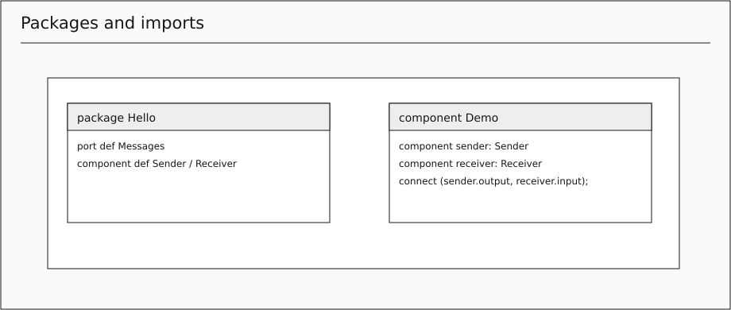

**Source:** [Hello::Demo](../examples/01-hello.swaml). **Grammar:** Model, Package, Import, QualifiedName.

Preserve owned source and distinct definition/occurrence identities. Drawing is a projection; it does not add execution semantics. A canonical source-backed projection; geometry is separate from semantics.

## Typed copied values

swa.ml 3.0; Values::Demo.

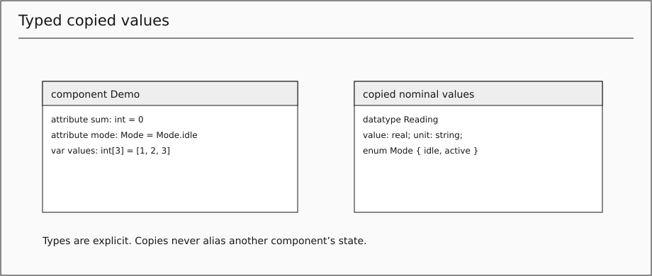

**Source:** [Values::Demo](../examples/05-values-and-flow.swaml). **Grammar:** DataType, Field, EnumType, TypeRef, ValueType, RecordLiteral, FieldValue, ArrayLiteral.

Preserve owned source and distinct definition/occurrence identities. Drawing is a projection; it does not add execution semantics. A canonical source-backed projection; geometry is separate from semantics.

## Component definitions and usages

swa.ml 3.0; Reuse::Demo.

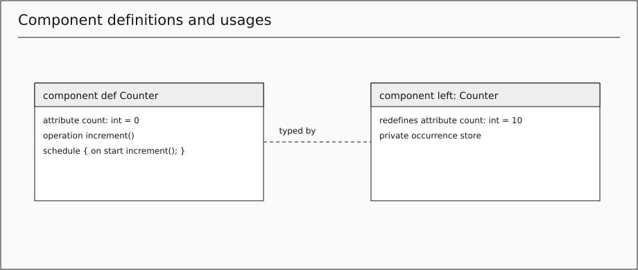

**Source:** [Reuse::Demo](../examples/15-component-specialization.swaml). **Grammar:** ComponentDef, ComponentUsage, ComponentMember, Element.

Preserve owned source and distinct definition/occurrence identities. Drawing is a projection; it does not add execution semantics. A canonical source-backed projection; geometry is separate from semantics.

## Indexed occurrence identity

swa.ml 3.0; Multiplicity::Demo.

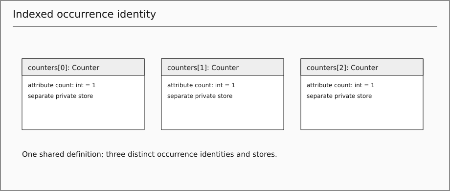

**Source:** [Multiplicity::Demo](../examples/23-multiplicity.swaml).

Preserve owned source and distinct definition/occurrence identities. Drawing is a projection; it does not add execution semantics. A canonical source-backed projection; geometry is separate from semantics.

## Attributes and lexical locals

swa.ml 3.0; Values::Demo.

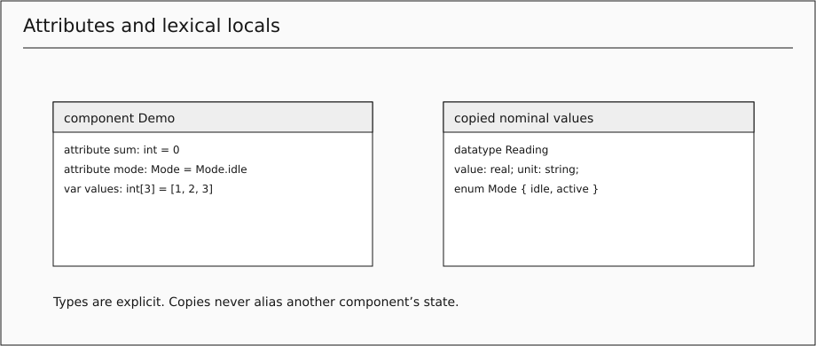

**Source:** [Values::Demo](../examples/05-values-and-flow.swaml). **Grammar:** Attribute, LocalVariable, Argument.

Preserve owned source and distinct definition/occurrence identities. Drawing is a projection; it does not add execution semantics. A canonical source-backed projection; geometry is separate from semantics.

## Mixed directed port members

swa.ml 3.0; Mixed::Boundary.

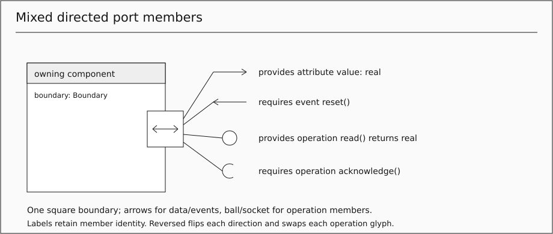

**Source:** [Mixed::Boundary](../examples/27-mixed-port.swaml). **Grammar:** PortDef, PortUsage, PortMember, MemberPath, Send.

One square boundary can contain attribute, event and operation members together. Arrowheads show data/event direction; an outward arrow means provides and inward means requires. A ball marks a provided operation; an open socket marks a required operation. These are member glyphs, not port types. A compact double arrow summarizes opposite data/event directions only; expanded labels retain each member name and type. Reversed flips every direction, arrow and operation glyph; geometry never adds members or routes. A canonical source-backed projection; geometry is separate from semantics.

## Policy-bearing connection

swa.ml 3.0; Policies::Demo.

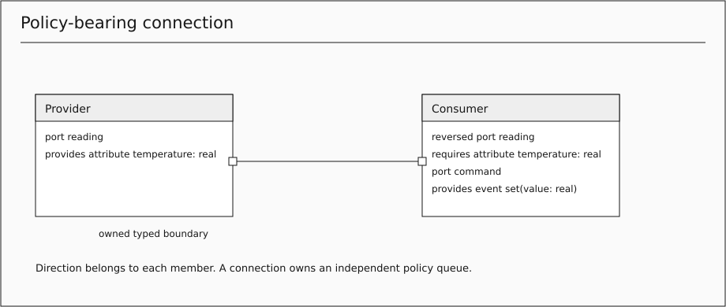

**Source:** [Policies::Demo](../examples/10-reusable-qos.swaml). **Grammar:** Connect, MemberPolicy, QosPolicy, PolicySetting.

Preserve owned source and distinct definition/occurrence identities. Drawing is a projection; it does not add execution semantics. A canonical source-backed projection; geometry is separate from semantics.

## Queue-free boundary forwarding

swa.ml 3.0; Boundary::Demo.

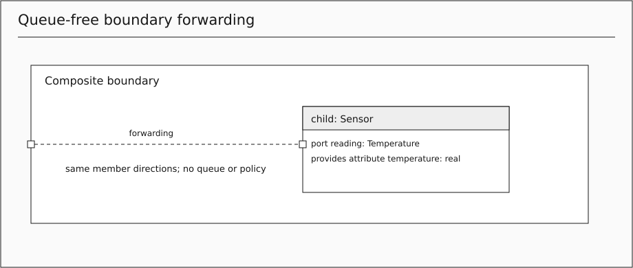

**Source:** [Boundary::Demo](../examples/26-boundary-forwarding.swaml).

Preserve owned source and distinct definition/occurrence identities. Boundary alias adds no queue, policy or message. A canonical source-backed projection; geometry is separate from semantics.

## Operations and nested ownership

swa.ml 3.0; OperationUsage::Demo.

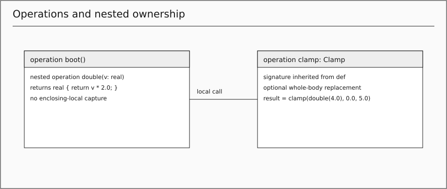

**Source:** [OperationUsage::Demo](../examples/24-operation-usage.swaml). **Grammar:** Operation, OperationUsage, Executable, OperationBody.

Preserve owned source and distinct definition/occurrence identities. Drawing is a projection; it does not add execution semantics. A canonical source-backed projection; geometry is separate from semantics.

## Expression calls and copied out values

swa.ml 3.0; ClientServer::Client.

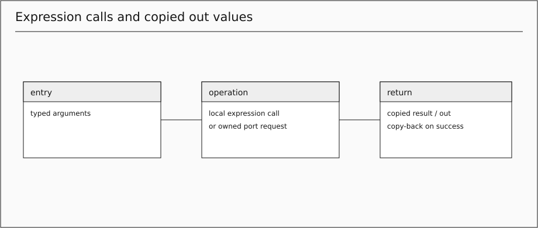

**Source:** [ClientServer::Client](../examples/07-client-server.swaml). **Grammar:** CallExpression, ExpressionStatement, Return.

Preserve owned source and distinct definition/occurrence identities. Drawing is a projection; it does not add execution semantics. A canonical source-backed projection; geometry is separate from semantics.

## Runtime failure and lazy fallback

swa.ml 3.0; ClientServer::Client.

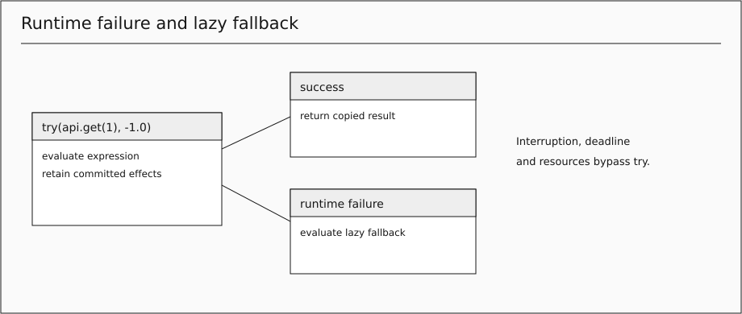

**Source:** [ClientServer::Client](../examples/07-client-server.swaml). **Grammar:** TryExpression, Fail, Assert.

Preserve owned source and distinct definition/occurrence identities. Drawing is a projection; it does not add execution semantics. A canonical source-backed projection; geometry is separate from semantics.

## Statements and decisions

swa.ml 3.0; Values::Demo.

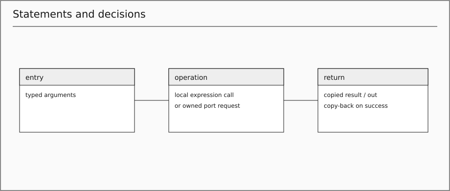

**Source:** [Values::Demo](../examples/05-values-and-flow.swaml). **Grammar:** Block, Statement, Assign, If, ElseIf.

Preserve owned source and distinct definition/occurrence identities. Drawing is a projection; it does not add execution semantics. A canonical source-backed projection; geometry is separate from semantics.

## Loops and copied iteration

swa.ml 3.0; Loops::Demo.

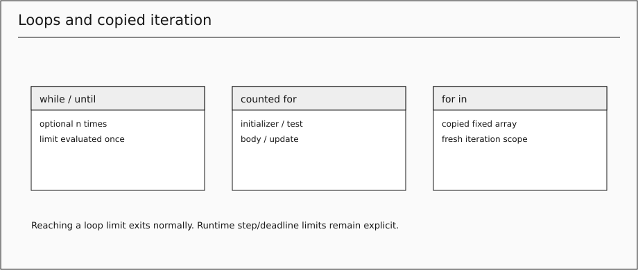

**Source:** [Loops::Demo](../examples/18-control-loops.swaml). **Grammar:** While, Until, For, ForUpdate, ForEach.

Preserve owned source and distinct definition/occurrence identities. Drawing is a projection; it does not add execution semantics. A canonical source-backed projection; geometry is separate from semantics.

## Schedule entry and successful chaining

swa.ml 3.0; Chaining::Demo.

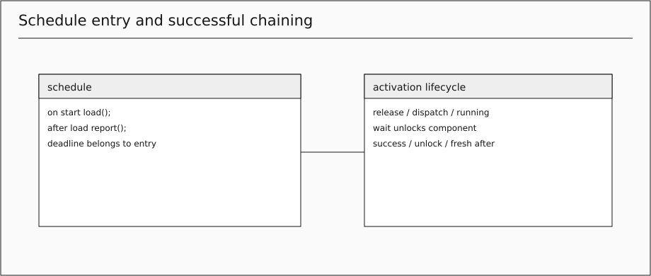

**Source:** [Chaining::Demo](../examples/25-function-completion.swaml). **Grammar:** Schedule, ScheduleEntry.

Preserve owned source and distinct definition/occurrence identities. Drawing is a projection; it does not add execution semantics. A canonical source-backed projection; geometry is separate from semantics.

## Suspending wait and receive

swa.ml 3.0; Receiving::Receiver.

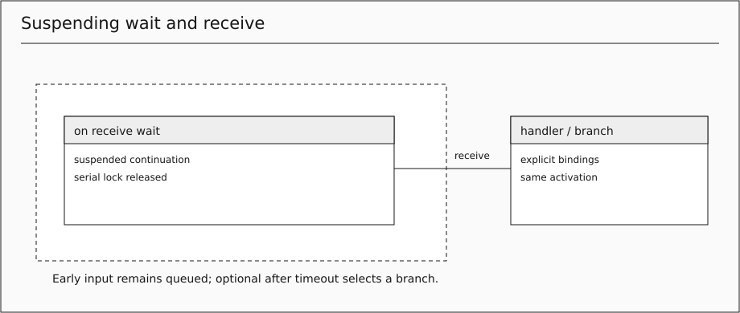

**Source:** [Receiving::Receiver](../examples/21-receive-and-try.swaml). **Grammar:** Wait, Receive, ReceiveBranch.

Preserve owned source and distinct definition/occurrence identities. Drawing is a projection; it does not add execution semantics. A canonical source-backed projection; geometry is separate from semantics.

## Armed interrupt and cancellation

swa.ml 3.0; Interrupts::Receiver.

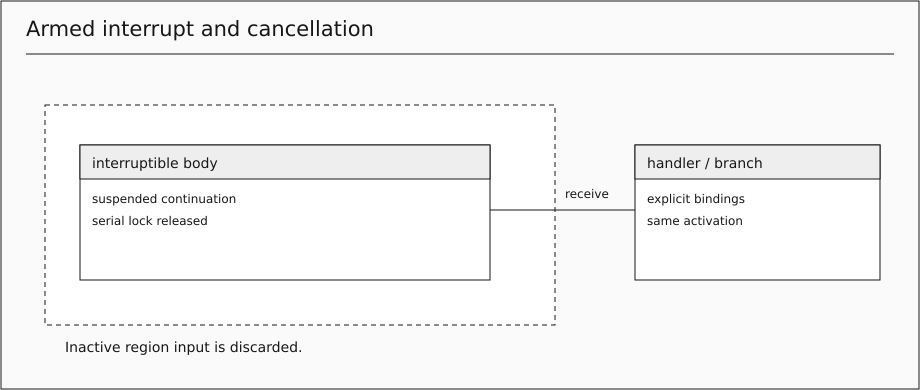

**Source:** [Interrupts::Receiver](../examples/19-interruptible-function.swaml). **Grammar:** Interruptible.

Preserve owned source and distinct definition/occurrence identities. Drawing is a projection; it does not add execution semantics. A canonical source-backed projection; geometry is separate from semantics.

## States as steps of the flow

swa.ml 3.0; States::Demo.lamp.

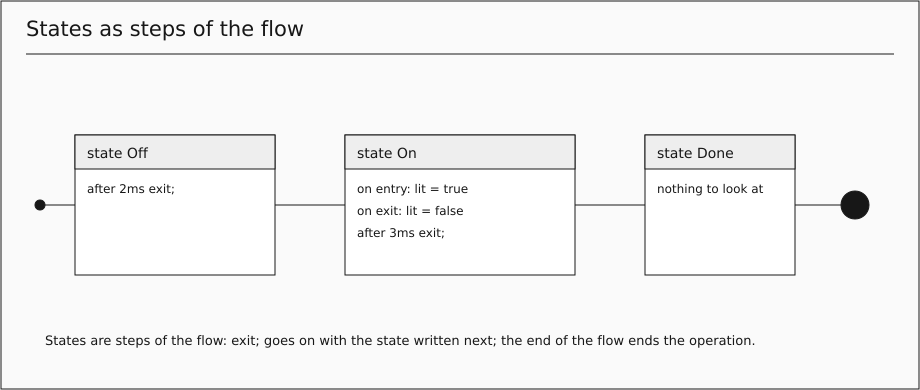

**Source:** [States::Demo.lamp](../examples/04-stateful-function.swaml). **Grammar:** StateAction, StateStep, StateMember, EventLine, ShortBody, Leave, Exit, Jump.

Preserve owned source and distinct definition/occurrence identities. Drawing is a projection; it does not add execution semantics. A canonical source-backed projection; geometry is separate from semantics.

## Platform Nodes and placement

swa.ml 3.0; Placement::Demo.

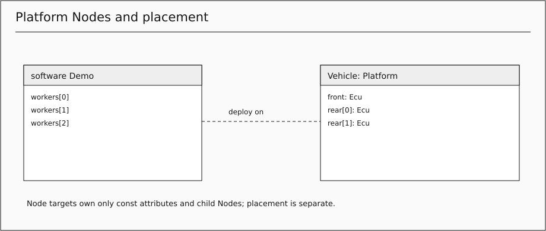

**Source:** [Placement::Demo](../examples/22-platform-deployment.swaml). **Grammar:** Deployment, Placement.

Preserve owned source and distinct definition/occurrence identities. Drawing is a projection; it does not add execution semantics. A canonical source-backed projection; geometry is separate from semantics.

## Requirements and package intent links

swa.ml 3.0; Traceability::Delivery.

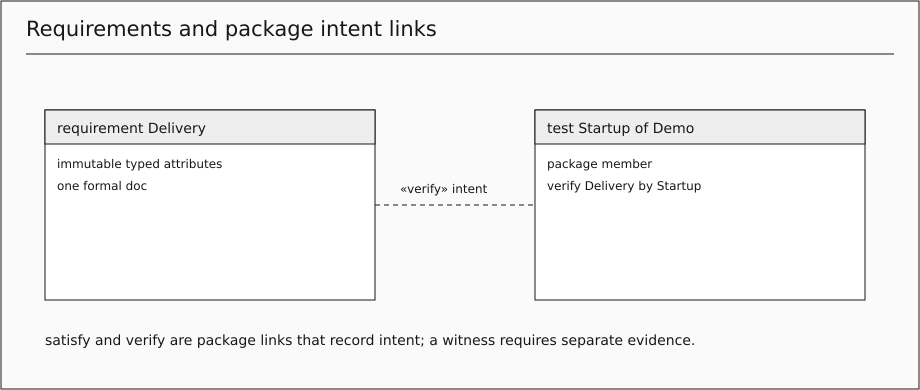

**Source:** [Traceability::Delivery](../examples/16-requirements-and-views.swaml). **Grammar:** Requirement, Satisfaction, Verification.

Preserve owned source and distinct definition/occurrence identities. Drawing is a projection; it does not add execution semantics. A canonical source-backed projection; geometry is separate from semantics.

## Use cases, tests and associations

swa.ml 3.0; Cash Machine::Withdraw cash.

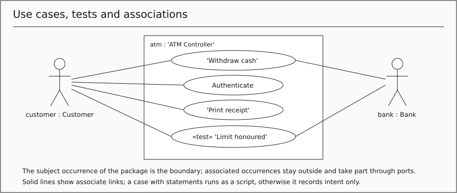

**Source:** [Cash Machine::Withdraw cash](../examples/28-use-cases.swaml). **Grammar:** Scenario, CaseKind, Association.

Preserve owned source and distinct definition/occurrence identities. Drawing is a projection; it does not add execution semantics. A canonical source-backed projection; geometry is separate from semantics.

## Executable case scripts

swa.ml 3.0; AtmTests::Bank refusal.

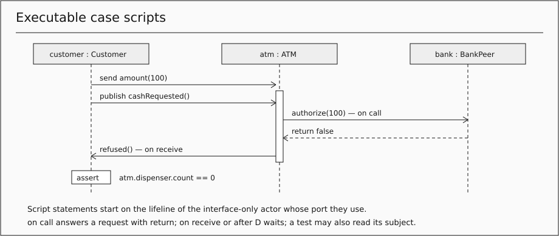

**Source:** [AtmTests::Bank refusal](../examples/29-executable-cases.swaml). **Grammar:** EndpointPath.

Preserve owned source and distinct definition/occurrence identities. Drawing is a projection; it does not add execution semantics. A canonical source-backed projection; geometry is separate from semantics.

## Seven library view definitions

swa.ml 3.0; Traceability::Demo.

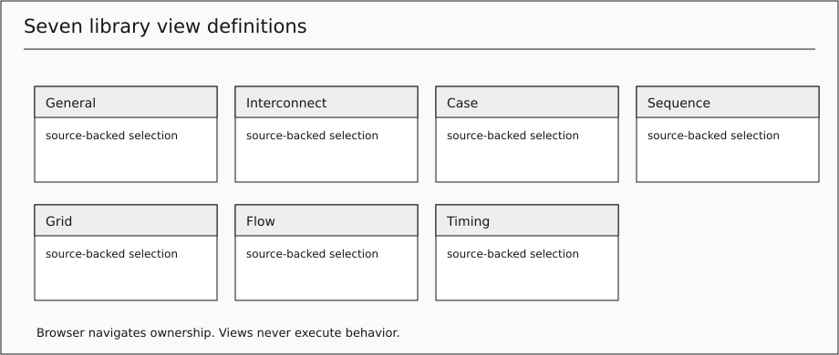

**Source:** [Traceability::Demo](../examples/16-requirements-and-views.swaml). **Grammar:** ViewDef, View, ViewSelection, FilterExpression, FilterOr, FilterAnd, FilterPrimary, FilterBinary, FilterNot, FilterComparison.

Preserve owned source and distinct definition/occurrence identities. Drawing is a projection; it does not add execution semantics. A canonical source-backed projection; geometry is separate from semantics.

## Declared and observed timing

swa.ml 3.0; Timing::Demo.sample.

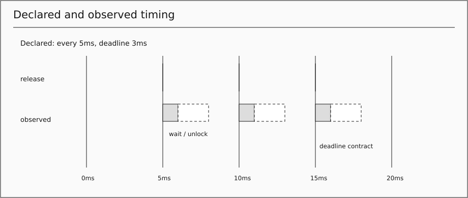

**Source:** [Timing::Demo.sample](../examples/17-function-timing.swaml).

Preserve owned source and distinct definition/occurrence identities. Drawing is a projection; it does not add execution semantics. A canonical source-backed projection; geometry is separate from semantics.

## Owned documentation and lexical notes

swa.ml 3.0; Traceability::Delivery.

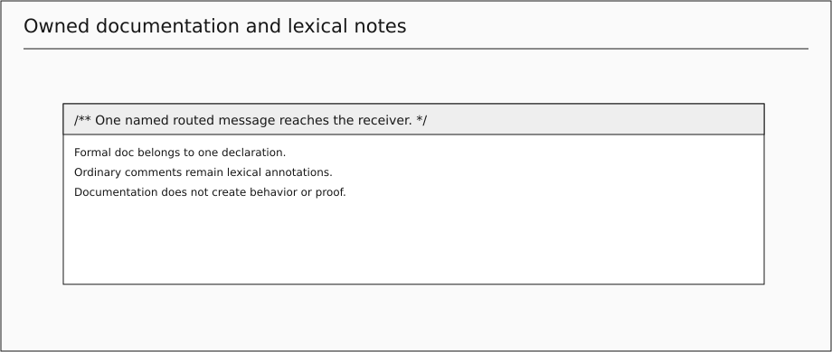

**Source:** [Traceability::Delivery](../examples/16-requirements-and-views.swaml). **Grammar:** Documentation, DOC_COMMENT.

Preserve owned source and distinct definition/occurrence identities. Drawing is a projection; it does not add execution semantics. A canonical source-backed projection; geometry is separate from semantics.

## Typed expressions and operators

swa.ml 3.0; Values::Demo.

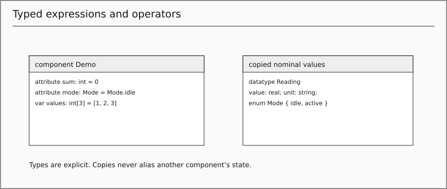

**Source:** [Values::Demo](../examples/05-values-and-flow.swaml). **Grammar:** Expression, OrExpression, AndExpression, EqualityExpression, RelationalExpression, AdditiveExpression, MultiplicativeExpression, UnaryExpression, PrimaryExpression, BinaryExpression, ConditionalExpression, ReferenceExpression, Selector, ValuePath, Literal, Numeric.

Preserve owned source and distinct definition/occurrence identities. Drawing is a projection; it does not add execution semantics. A canonical source-backed projection; geometry is separate from semantics.

## Lexical and path spelling

swa.ml 3.0; Hello::Demo.

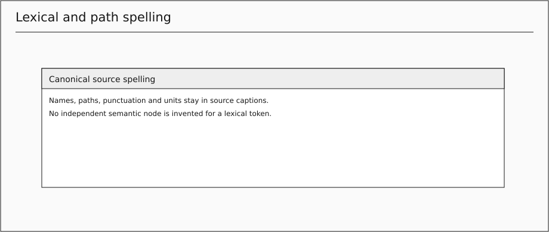

**Source:** [Hello::Demo](../examples/01-hello.swaml). **Grammar:** Duration, Name, Path, WS, ID, UNRESTRICTED_NAME, NUMBER, INT, STRING, ML_COMMENT, SL_COMMENT.

Text-only spelling; show as a source caption without invented semantic nodes. Drawing is a projection; it does not add execution semantics. Lexical spelling has no independent graphical identity.


---

<a id="chapter-16"></a>

# swa.ml 3.0 worked diagrams

Generated from original scene geometry; source subjects remain authoritative.

## Directed ports and explicit connections

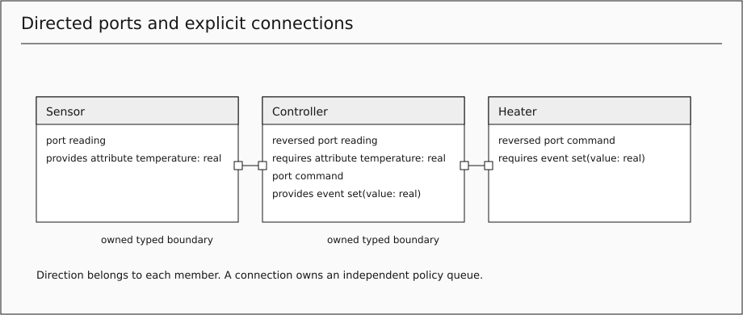

Source: [Control::Demo](../examples/02-realtime-controller.swaml).

## Forwarding preserves boundary direction

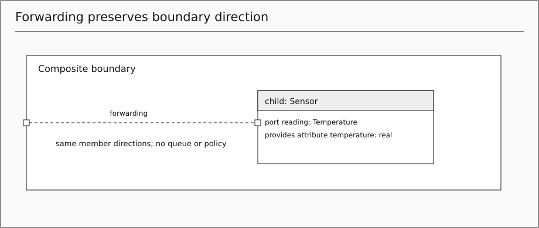

Source: [Boundary::Demo](../examples/26-boundary-forwarding.swaml).

## Schedule and success chaining

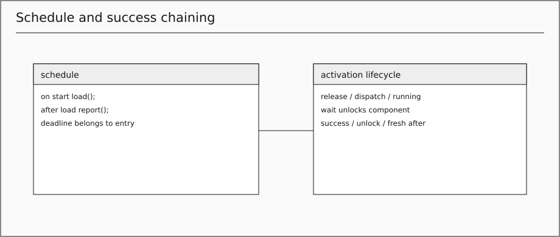

Source: [Chaining::Demo](../examples/25-function-completion.swaml).

## Operation-owned ordered states

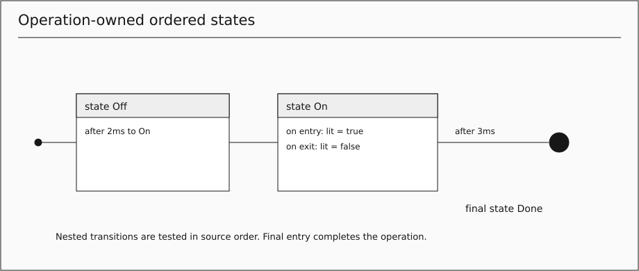

Source: [States::Demo.lamp](../examples/04-stateful-function.swaml).

## Indexed placement on platform Nodes

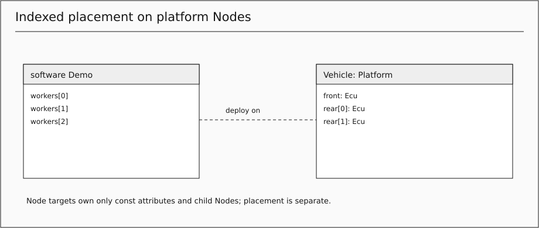

Source: [Placement::Demo](../examples/22-platform-deployment.swaml).

## Declared contracts and observed intervals

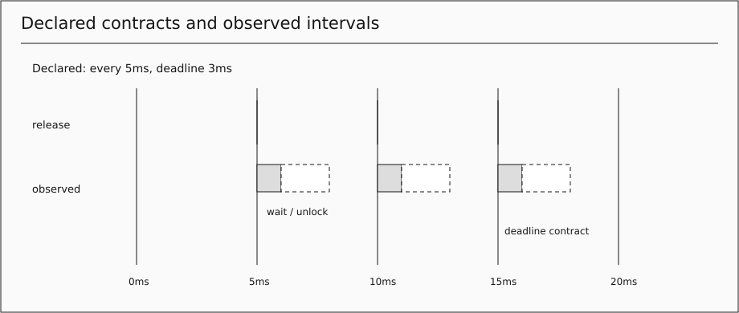

Source: [Timing::Demo.sample](../examples/17-function-timing.swaml).


---

<a id="chapter-17"></a>

# swa.ml 3.0 reference simulation

The portable interpreter selects **swaml-reference/3.0** (a 2.2 model without a state machine runs with its 2.2 results and trace) and requires linked, validated source. All activation comes from ordinary source schedules/ports/routes, including authored test drivers. [Execution semantics](spec/06-execution-contract.md) is normative; this guide covers the reference host.

```sh
npm ci
npm run build
node out/src/cli/main.js --json examples/01-hello.swaml
node out/src/cli/main.js simulate --until-ns 10000000 examples/28-use-cases.swaml
node out/src/cli/main.js simulate --target Hello::Demo --options examples/simulation/01-hello.json examples/01-hello.swaml
node out/src/cli/simulate.js Hello::Demo examples/simulation/01-hello.json examples/01-hello.swaml
node out/src/cli/main.js test examples/29-executable-cases.swaml
node out/src/cli/main.js test --json --case 'AtmTests::Bank refusal' examples/29-executable-cases.swaml
node scripts/check-simulations.mjs
```

A run target is a package or one top-level component occurrence (ADR 0019). A package target such as 'Cash Machine' runs every top-level software occurrence of the package with its internal connections, the package connections between top-level ports and each occurrence's deployment. Platform roots, top-level occurrences that specialize Swaml::Platform::Node, only describe deployment targets and do not run. A component target such as Hello::Demo runs that top-level occurrence alone: its package connections are absent and its top-level ports are open, so emissions find no route and requests fail as unavailable. swaml simulate takes --target Package or --target Package::component and defaults to the package when the supplied sources declare exactly one; it needs either --options file.json or --until-ns N. The positional swaml-simulate host takes the same targets. The core exports runTargets and runTarget for hosts that list or resolve targets.

Options include required untilNs and optional maxSteps (100000), maxPending (1024), maxConcurrent (64), latencyNs (0) and explicit offer-indexed faults. Unknown options are rejected. A top-level occurrence has at most one deployment (SW2009), and every run applies it to that occurrence's tree; there is no deployment selection option. faults contains an offer number, kind drop/duplicate/transport and optional delayNs. Faults operate on real routed source emissions/requests, never destination injection. The deterministic backend chooses insertion order for unordered queues and records its delivery assumptions.

Serial wait/request/receive suspensions release the component lock; resumption reads live state. Concurrent activations retain a dispatch snapshot and cannot write. Default connection policy is atMostOnce/fifo/16/reject/requestTimeout 1s. Attribute queues keep latest values independently. try catches runtime expression failures with lazy fallback and retained effects; deadlines/resources/interrupts bypass it. Requests retain route correlation, timeout wins ties and late replies are suppressed. After edges release fresh work after successful whole completion/unlock.

The JSON result records profile, target (kind package or component and its identity), options, logical trace ordinals/identities, sources, final occurrence stores, the current state of each operation with states (`machines`) and placements. Store and deployment keys are occurrence paths that begin with the top-level occurrence name, such as atm or Demo.receiver. Route identities are occurrence-relative: Demo.@connect0 inside a component, and the connection name or @packageN for the Nth package connection. CLI adds SHA-256 source digests. Status is quiescent, horizon, violation, limit, or stopped for a case run that ended with its script; a case run whose script still waits with no event left is quiescent. Failure observations remain evidence even when a caller catches them. Horizon retains live/open intervals. An event left pending without possible progress may be quiescent; that is not proof of useful behavior.

## Statement sources

Trace events carry source, the statementIdentity of the statement or schedule entry that caused them: write, publish, send, assert, failure, caught, arm, wait, receiveWait and requestWait name the executing statement; release and dispatch name the schedule entry; state names the entered state. A state observation names the state reached and the leave that led there (`trigger`); a look whose line ran and did not leave records `stay: true` with that line. A wake (a look caused by a value, SIF-T03) names the state and its cause (write with writer and attributes, sample with cell, own with names, and pending when it was recorded while the machine was busy); a periodic machine records its one activation and the release number on release and skip, held: true on a state arrival that ended the release, and periodicEnd when its flow reached its end; a leave observation records that the flow went on outside every state, and a StepLimit violation carries a message naming the instant and the activations that ran. Message lifecycle events name the statement that emitted or requested the message: offer, deliver, replaceAttribute, overflow, drop, retry, discardAge, discardInput and interrupt (which also records the armed interruptible statement as region) name the emitting send or publish or the requesting call; request, reply, timeout, lateReply and cancelRequest name the requesting call. A loop condition belongs to its loop statement on every iteration. In an operation with states, the wait belongs to the state, and every statement of a look, a condition and its failure included, names itself. Offers record the leaf ports as sourcePort and targetPort, deliveries as targetPort. An assert event records passed; a failed assert also produces a failure.

A statement identity is the identity of its executable, a slash and a statement path, for example Hello::Sender.emit/0 or Banking::ATM.serve/2/then/0. The executable identity is the declaring operation, or a case, with decoded names; an operation usage that inherits its body names the definition. The path walks the abstract syntax from the executable's body: a statement contributes its index in the enclosing statement list and every other step its slot name, followed by an index for list slots: then, otherwise, body, branches/N, timeoutBody, handler, initializer and update. The if of an else if (3.0) has the identity of the if in the 2.2 form else { if … }, as in Banking::ATM.serve/2/otherwise/0/then/0 for both spellings, so a trace source does not change when one spelling is rewritten as the other. A state is a statement, so it has the index of its statement list; its items (on entry, on exit, event lines, statements, inner states and leaves) are its statement list, and the block of an action or event line is body, as in LockController::Lock.control/1/1/body/0 for the exit; of the second item of the state that is statement 1. A body written without braces (after 250ms exit;) has the identities of its braced form. A migrated 2.2 machine maps its new identities to the 2.2 ones through the identity map of the migration. A schedule entry is the component identity followed by /schedule/N. resolveStatement maps an identity back to its node, trying the longest declared owner first because a quoted name may contain a slash. Legal names can therefore make it ambiguous: an operation 'run/0/then' with statement 0 and an operation run with statement path 0/then/0 both yield Pkg::Def.run/0/then/0, and resolveStatement selects the longer owner. Avoid such names when trace sources must be unambiguous. Identities follow source structure, so reordering statements changes them. Preserve available subject and activation fields; these often distinguish occurrences but cannot distinguish every borrowed-call failure or repeated invocation. Do not copy a shared declaration's facts to every instance, or claim that an individual read, short-circuited subexpression or return was observed when the trace provides no such observation.

The examples' expected final stores and placements are checked independently, every use case and test of the examples runs with its expected result (examples/simulation/cases.json), and deterministic reruns check reproducibility. The current [3.0 hello trace](../examples/simulation/3.0/hello-trace.json) uses the selected 3.0 profile; the [2.2 hello trace](../examples/simulation/2.2/hello-trace.json) and the [published 2.1 trace](../examples/simulation/hello-trace.json) stays frozen. Tests cover package and isolated component runs, adversarial requests, interruptions, failure effects and resource limits. Physical CPU/WCET, production transport/retry protocols, target scheduling and universal analysis remain outside this logical interpreter. Exporting a trace does not establish those claims.

Outcome failure-observed includes caught expression failures as well as failed activations; status separately records whether execution reached quiescence, a horizon or a resource/contract stop. The CLI returns 1 when a failure was observed, including a successfully handled fallback, so automation must inspect the trace and final stores when exercising expected failure scenarios.

## Use cases and tests

A use case or test with statements is a script ([behavior](spec/03-behavior.md), [case runs](spec/06-execution-contract.md)). swaml test runs the cases of the supplied sources:

```text
swaml test [--language-version 3.0] [--package P] [--case Package::Case|Case] [--json] [--options options.json | --until-ns N] file.swaml [more files...]
```

Each case with statements runs in its own fresh run of its package. The default horizon is 10 s of logical time (untilNs 10000000000); the run stops earlier when the script completes or fails. The script is one serial activation released at 0 ns after every on start entry. Both case kinds may call operations of the exact primary subject, including its own port communication, receive and wait behavior; the actual frame uses the subject's context, releases its lock while suspended and restores the caller context on return or failure. This remains a local call, with no new schedule release or implicit transport timeout. The script also acts at the ports of its associated interface-only occurrences. Input that reaches an actor port before the script waits for it is retained under the connection's policy and attributes keep their latest value. A request to an actor port waits until an on call branch answers it or the caller's request times out; a later branch in the same case cannot run while blocked in a synchronous subject call. A test additionally reads private attributes and calls eligible helpers of explicitly associated same-package roots and single parts. Those extra helper calls cannot communicate or suspend. Associations do not create occurrences or alter the whole-package run.

Results are pass, fail, inconclusive and no checks. The first failure in trace order decides a failed case, with its statement identity and time: the script's own (a failed assert reports Assertion and the assert source, fail reports its message, a runtime failure its code), an uncaught failure of another activation (run-failure, with the failing activation as observed), or a contract violation (violation). An earlier run failure, such as a request timeout of the subject at 1 s, therefore wins over a later fail of the script. A case is inconclusive when the run ends before the script completes without a failure: at the horizon (horizon), at the step limit (limit), or because the script waits but no further event can occur (stalled); a stalled case run has status quiescent, since nothing remains that could reach the script, while ordinary runs keep horizon for waiting activations so that their intervals stay open. A case without statements has no checks. Caught failures stay evidence without failing a case: a passing case can carry run.outcome failure-observed, with caught events in its trace, when a try fallback handled a failure, so consumers read result rather than outcome. The summary prints one line per case and a count; --json prints languageVersion, profile, options, summary and cases with case, kind, subject, result, reason, message, source, timeNs and the run (target, status, trace and stores, without source text), plus implementation identity and source digests. The exit code is 1 when a case fails or the sources are invalid, 2 for usage errors and 0 otherwise.

The core exports runCase(models, 'Package::Case', options), runTests(models, options, { package, case }) and workspaceCases(models), returning CaseResult values, and caseTarget from semantic, which resolves a script path to an actor port member, a white-box operation or an attribute. Script trace events name the case identity as subject, for example AtmTests::Bank refusal, and carry case statement identities such as AtmTests::Bank refusal/2/branches/0/body/0 as source; failure events also record the message of fail and of a failed case assert. A package run, without a case, leaves interface-only occurrences idle.


---

<a id="chapter-18"></a>

# Architecture patterns

swa.ml 3.0.

Start each pattern from owned component state and explicit typed boundary members. Components may be leaves or composites and both may own operations. A composite forwards a port to an immediate child with same-direction connect; peer connections use opposite-compatible directions and own queues.

A pipeline sends latest attributes when freshness matters and publishes events when every occurrence matters. [The controller model](../examples/02-realtime-controller.swaml) samples temperature, computes power and publishes an actuator command. Each receiver owns its input once; no private data is read through a sibling path.

A service uses required/provided operation members, on call schedule bindings and a policy request timeout. try supplies a lazy fallback. Suspension unlocks the caller; recheck live state before committing a decision. [Service model](../examples/07-client-server.swaml).

Publish/subscribe fanout uses event-only required ports and several explicit connections. Each connection occurrence has an independent policy queue; partial fanout may commit before a failed offer. Adding an attribute or operation requirement changes cardinality to exactly one peer.

Reusable components use single specializes inheritance and explicit compatible whole-member redefines. Usage bodies configure per-occurrence const/attribute values without sharing stores. [Reuse](../examples/15-component-specialization.swaml) and [multiplicity](../examples/23-multiplicity.swaml).

Classic, Adaptive, web and cloud example filenames illustrate these software patterns. They do not claim generated RTE/task, middleware, broker, infrastructure or production timing bindings. [Deployment](../examples/22-platform-deployment.swaml) places software on platform Node occurrences; target translation is separate.


---

<a id="chapter-19"></a>

# Requirements, documentation and intent

swa.ml 3.0.

A requirement owns immutable typed attributes and at most one formal doc. Use `/** ... */` first in a body or immediately before the semicolon of a leaf declaration. Ordinary `//` and `/* ... */` comments remain separate lexical annotations. Formal documentation is owned source, not an executable statement or proof.

satisfy Requirement by design; links intent from a component definition or occurrence path declared in the same package. verify Requirement by Test; links a test of the package; a use case never verifies. Use cases describe an intended interaction without asserting verification. A use case or test is a package member; of names its subject, a top-level occurrence of the same package, and associate Occurrence to Case; names the other occurrences that take part. A case without of or without statements records intent only; a case with statements is a script that swaml test runs.

Subjects, associations and design paths must resolve in the package. Cases do not create channels or inject events at a destination; a case script emits only through the ports of its associated interface-only actors. A passing script is an identified witness execution of one deterministic run; it does not prove realization in every execution. A requirement needs associated test/analysis/review evidence before fulfillment can be claimed.

[The complete traceability model](../examples/16-requirements-and-views.swaml) contains a documented requirement, satisfaction, a test with its verify link and selected views. General/Grid can inspect intent relations; Case/Sequence present cases. All preserve occurrence identity and retain unproven status where evidence is absent.


---

<a id="chapter-20"></a>

# Ontology and views

swa.ml 3.0.

The semantic families are package, nominal values/types, component definition/usage, attribute/local/parameter, port/member, operation definition/declaration/usage, schedule/entry, connection/forwarding, state and leave, deployment, requirement, case and view. A nested operation has no closure capture; an operation body has no independent executable identity. An indexed occurrence is distinct from its shared definition.

Browser navigates ownership. Seven imported library definitions provide source views: General, Interconnect, Case, Sequence, Grid, Flow and Timing. General and Grid can select named model identities; Interconnect selects components; Case selects packages, cases and components; Sequence also selects operations; Flow/Timing select operations, use cases and tests. General Box in box and Tree retain the same selected graph. Flow contains statements, loops, receive/interrupt regions and states.

Compact of selects one subject. Include/recursive/where selects a stable union with Boolean name/kind/path predicates. Structural/executable kinds are component and operation. Filters do not call behavior. Timing declared mode shows schedules/deadlines/static waits; observed mode requires a run identity and preserves open intervals. Geometry/routing/camera live in sidecars. See [normative view rules](spec/04-systems-and-conformance.md) and [traceability example](../examples/16-requirements-and-views.swaml).


---

<a id="chapter-21"></a>

# swa.ml 3.0 keyword reference

Generated from spec/keywords.json and the normative grammar. Examples here are grammar fragments; complete runnable models are in the usage guide and examples. 19 contextual words remain legal names outside their positions. call appears in the on call schedule trigger and in on call branches of case scripts.

[after](#keyword-after) · [and](#keyword-and) · [assert](#keyword-assert) · [associate](#keyword-associate) · [attribute](#keyword-attribute) · [bool](#keyword-bool) · [by](#keyword-by) · [byte](#keyword-byte) · [call](#keyword-call) · [case](#keyword-case) · [component](#keyword-component) · [concurrent](#keyword-concurrent) · [connect](#keyword-connect) · [const](#keyword-const) · [datatype](#keyword-datatype) · [deadline](#keyword-deadline) · [def](#keyword-def) · [deploy](#keyword-deploy) · [deployment](#keyword-deployment) · [else](#keyword-else) · [entry](#keyword-entry) · [enum](#keyword-enum) · [event](#keyword-event) · [every](#keyword-every) · [exit](#keyword-exit) · [fail](#keyword-fail) · [false](#keyword-false) · [for](#keyword-for) · [idempotent](#keyword-idempotent) · [if](#keyword-if) · [import](#keyword-import) · [in](#keyword-in) · [include](#keyword-include) · [int](#keyword-int) · [interruptible](#keyword-interruptible) · [kind](#keyword-kind) · [ms](#keyword-ms) · [name](#keyword-name) · [not](#keyword-not) · [ns](#keyword-ns) · [of](#keyword-of) · [on](#keyword-on) · [operation](#keyword-operation) · [optional](#keyword-optional) · [or](#keyword-or) · [out](#keyword-out) · [package](#keyword-package) · [path](#keyword-path) · [port](#keyword-port) · [provides](#keyword-provides) · [publish](#keyword-publish) · [qos](#keyword-qos) · [real](#keyword-real) · [receive](#keyword-receive) · [record](#keyword-record) · [recursive](#keyword-recursive) · [redefines](#keyword-redefines) · [requirement](#keyword-requirement) · [requires](#keyword-requires) · [return](#keyword-return) · [returns](#keyword-returns) · [reversed](#keyword-reversed) · [s](#keyword-s) · [satisfy](#keyword-satisfy) · [schedule](#keyword-schedule) · [send](#keyword-send) · [specializes](#keyword-specializes) · [start](#keyword-start) · [state](#keyword-state) · [string](#keyword-string) · [test](#keyword-test) · [times](#keyword-times) · [to](#keyword-to) · [true](#keyword-true) · [try](#keyword-try) · [uint](#keyword-uint) · [until](#keyword-until) · [us](#keyword-us) · [use](#keyword-use) · [var](#keyword-var) · [verify](#keyword-verify) · [view](#keyword-view) · [void](#keyword-void) · [wait](#keyword-wait) · [where](#keyword-where) · [while](#keyword-while)

## Keyword: after

Introduces a state timer, receive timeout or success schedule dependency.

**Context:** States as steps of the flow. **Grammar:** ScheduleEntry, EventLine, Receive. **Name use:** reserved.

[Normative rule](spec/03-behavior.md) · [Graphical catalog](GRAPHICAL_CATALOG.md).

## Keyword: and

Used in typed expressions and operators; see its grammar contexts and normative constraints.

**Context:** Typed expressions and operators. **Grammar:** FilterAnd, Expression, AndExpression. **Name use:** reserved.

[Normative rule](spec/01-structure-and-types.md) · [Graphical catalog](GRAPHICAL_CATALOG.md).

## Keyword: assert

Used in runtime failure and lazy fallback; see its grammar contexts and normative constraints.

**Context:** Runtime failure and lazy fallback. **Grammar:** Assert. **Name use:** reserved.

[Normative rule](spec/03-behavior.md) · [Graphical catalog](GRAPHICAL_CATALOG.md).

## Keyword: associate

Records that a top-level occurrence of the package takes part in a use case or test other than as its subject.

**Context:** Use cases, tests and associations. **Grammar:** Association, Name. **Name use:** contextual.

[Normative rule](spec/04-systems-and-conformance.md) · [Graphical catalog](GRAPHICAL_CATALOG.md).

## Keyword: attribute

Declares typed occurrence state or an immutable requirement value.

**Context:** Attributes and lexical locals. **Grammar:** Attribute, PortMember. **Name use:** reserved.

[Normative rule](spec/01-structure-and-types.md) · [Graphical catalog](GRAPHICAL_CATALOG.md).

## Keyword: bool

Used in typed copied values; see its grammar contexts and normative constraints.

**Context:** Typed copied values. **Grammar:** TypeRef. **Name use:** reserved.

[Normative rule](spec/01-structure-and-types.md) · [Graphical catalog](GRAPHICAL_CATALOG.md).

## Keyword: by

Names the design that a satisfy claim refers to, or the test that a verify claim refers to.

**Context:** Requirements and package intent links. **Grammar:** Satisfaction, Verification, Name. **Name use:** contextual.

[Normative rule](spec/04-systems-and-conformance.md) · [Graphical catalog](GRAPHICAL_CATALOG.md).

## Keyword: byte

Used in typed copied values; see its grammar contexts and normative constraints.

**Context:** Typed copied values. **Grammar:** TypeRef. **Name use:** reserved.

[Normative rule](spec/01-structure-and-types.md) · [Graphical catalog](GRAPHICAL_CATALOG.md).

## Keyword: call

Serves a provided operation as an on call schedule trigger, or answers a request at an actor port as an on call branch of a case script.

**Context:** Schedule entry and successful chaining. **Grammar:** ScheduleEntry, ReceiveBranch. **Name use:** reserved.

[Normative rule](spec/03-behavior.md) · [Graphical catalog](GRAPHICAL_CATALOG.md).

## Keyword: case

Completes the use case keyword pair use case.

**Context:** Use cases, tests and associations. **Grammar:** CaseKind, Name. **Name use:** contextual.

[Normative rule](spec/04-systems-and-conformance.md) · [Graphical catalog](GRAPHICAL_CATALOG.md).

## Keyword: component

Declares a reusable definition or a distinct owned occurrence.

**Context:** Component definitions and usages. **Grammar:** ComponentDef, ComponentUsage. **Name use:** reserved.

[Normative rule](spec/01-structure-and-types.md) · [Graphical catalog](GRAPHICAL_CATALOG.md).

## Keyword: concurrent

Permits overlapping non-writing snapshot activations.

**Context:** Schedule entry and successful chaining. **Grammar:** ScheduleEntry. **Name use:** reserved.

[Normative rule](spec/03-behavior.md) · [Graphical catalog](GRAPHICAL_CATALOG.md).

## Keyword: connect

Joins compatible ports; boundary-to-child derives forwarding.

**Context:** Policy-bearing connection. **Grammar:** Connect. **Name use:** reserved.

[Normative rule](spec/02-communication.md) · [Graphical catalog](GRAPHICAL_CATALOG.md).

## Keyword: const

Makes an attribute immutable for its occurrence.

**Context:** Attributes and lexical locals. **Grammar:** Attribute. **Name use:** reserved.

[Normative rule](spec/01-structure-and-types.md) · [Graphical catalog](GRAPHICAL_CATALOG.md).

## Keyword: datatype

Used in typed copied values; see its grammar contexts and normative constraints.

**Context:** Typed copied values. **Grammar:** DataType. **Name use:** reserved.

[Normative rule](spec/01-structure-and-types.md) · [Graphical catalog](GRAPHICAL_CATALOG.md).

## Keyword: deadline

Used in schedule entry and successful chaining; see its grammar contexts and normative constraints.

**Context:** Schedule entry and successful chaining. **Grammar:** ScheduleEntry. **Name use:** reserved.

[Normative rule](spec/03-behavior.md) · [Graphical catalog](GRAPHICAL_CATALOG.md).

## Keyword: def

Used in component definitions and usages; see its grammar contexts and normative constraints.

**Context:** Component definitions and usages. **Grammar:** ComponentDef, PortDef, QosPolicy, Operation, ViewDef. **Name use:** reserved.

[Normative rule](spec/01-structure-and-types.md) · [Graphical catalog](GRAPHICAL_CATALOG.md).

## Keyword: deploy

Used in platform nodes and placement; see its grammar contexts and normative constraints.

**Context:** Platform Nodes and placement. **Grammar:** Placement. **Name use:** reserved.

[Normative rule](spec/04-systems-and-conformance.md) · [Graphical catalog](GRAPHICAL_CATALOG.md).

## Keyword: deployment

Places software root occurrences on platform Node occurrences.

**Context:** Platform Nodes and placement. **Grammar:** Deployment. **Name use:** reserved.

[Normative rule](spec/04-systems-and-conformance.md) · [Graphical catalog](GRAPHICAL_CATALOG.md).

## Keyword: else

Used in statements and decisions; see its grammar contexts and normative constraints.

**Context:** Statements and decisions. **Grammar:** If, ConditionalExpression. **Name use:** reserved.

[Normative rule](spec/03-behavior.md) · [Graphical catalog](GRAPHICAL_CATALOG.md).

## Keyword: entry

Names the action that runs once when a state is reached (on entry).

**Context:** States as steps of the flow. **Grammar:** StateAction. **Name use:** reserved.

[Normative rule](spec/03-behavior.md) · [Graphical catalog](GRAPHICAL_CATALOG.md).

## Keyword: enum

Used in typed copied values; see its grammar contexts and normative constraints.

**Context:** Typed copied values. **Grammar:** EnumType. **Name use:** reserved.

[Normative rule](spec/01-structure-and-types.md) · [Graphical catalog](GRAPHICAL_CATALOG.md).

## Keyword: event

Used in directed port members; see its grammar contexts and normative constraints.

**Context:** Directed port members. **Grammar:** PortMember. **Name use:** reserved.

[Normative rule](spec/02-communication.md) · [Graphical catalog](GRAPHICAL_CATALOG.md).

## Keyword: every

Used in schedule entry and successful chaining; see its grammar contexts and normative constraints.

**Context:** Schedule entry and successful chaining. **Grammar:** ScheduleEntry. **Name use:** reserved.

[Normative rule](spec/03-behavior.md) · [Graphical catalog](GRAPHICAL_CATALOG.md).

## Keyword: exit

Leaves the state it is written in and goes on with what is written next (exit;), or names the action that runs when a state is left (on exit).

**Context:** States as steps of the flow. **Grammar:** Exit, StateAction. **Name use:** reserved.

[Normative rule](spec/03-behavior.md) · [Graphical catalog](GRAPHICAL_CATALOG.md).

## Keyword: fail

Used in runtime failure and lazy fallback; see its grammar contexts and normative constraints.

**Context:** Runtime failure and lazy fallback. **Grammar:** Fail. **Name use:** reserved.

[Normative rule](spec/03-behavior.md) · [Graphical catalog](GRAPHICAL_CATALOG.md).

## Keyword: false

Used in typed expressions and operators; see its grammar contexts and normative constraints.

**Context:** Typed expressions and operators. **Grammar:** Literal. **Name use:** reserved.

[Normative rule](spec/01-structure-and-types.md) · [Graphical catalog](GRAPHICAL_CATALOG.md).

## Keyword: for

Used in loops and copied iteration; see its grammar contexts and normative constraints.

**Context:** Loops and copied iteration. **Grammar:** For, ForEach. **Name use:** reserved.

[Normative rule](spec/03-behavior.md) · [Graphical catalog](GRAPHICAL_CATALOG.md).

## Keyword: idempotent

Used in directed port members; see its grammar contexts and normative constraints.

**Context:** Directed port members. **Grammar:** PortMember. **Name use:** reserved.

[Normative rule](spec/02-communication.md) · [Graphical catalog](GRAPHICAL_CATALOG.md).

## Keyword: if

Starts a decision: an if statement, whose else may be followed by another if (else if, SIF-G01), a whole-expression conditional (WP2-G01), or (from 3.0) the release guard of an every, receive or after schedule entry (WP7-S01).

**Context:** Statements and decisions. **Grammar:** ScheduleEntry, If, ConditionalExpression. **Name use:** reserved.

[Normative rule](spec/03-behavior.md) · [Graphical catalog](GRAPHICAL_CATALOG.md).

## Keyword: import

Used in packages and imports; see its grammar contexts and normative constraints.

**Context:** Packages and imports. **Grammar:** Import. **Name use:** reserved.

[Normative rule](spec/01-structure-and-types.md) · [Graphical catalog](GRAPHICAL_CATALOG.md).

## Keyword: in

Used in attributes and lexical locals; see its grammar contexts and normative constraints.

**Context:** Attributes and lexical locals. **Grammar:** Argument, ForEach, Name. **Name use:** contextual.

[Normative rule](spec/01-structure-and-types.md) · [Graphical catalog](GRAPHICAL_CATALOG.md).

## Keyword: include

Adds a subject selection to a view.

**Context:** Seven library view definitions. **Grammar:** ViewSelection. **Name use:** reserved.

[Normative rule](spec/04-systems-and-conformance.md) · [Graphical catalog](GRAPHICAL_CATALOG.md).

## Keyword: int

Used in typed copied values; see its grammar contexts and normative constraints.

**Context:** Typed copied values. **Grammar:** TypeRef. **Name use:** reserved.

[Normative rule](spec/01-structure-and-types.md) · [Graphical catalog](GRAPHICAL_CATALOG.md).

## Keyword: interruptible

Used in armed interrupt and cancellation; see its grammar contexts and normative constraints.

**Context:** Armed interrupt and cancellation. **Grammar:** Interruptible. **Name use:** reserved.

[Normative rule](spec/03-behavior.md) · [Graphical catalog](GRAPHICAL_CATALOG.md).

## Keyword: kind

Used in seven library view definitions; see its grammar contexts and normative constraints.

**Context:** Seven library view definitions. **Grammar:** FilterComparison, Name. **Name use:** contextual.

[Normative rule](spec/04-systems-and-conformance.md) · [Graphical catalog](GRAPHICAL_CATALOG.md).

## Keyword: ms

Used in lexical and path spelling; see its grammar contexts and normative constraints.

**Context:** Lexical and path spelling. **Grammar:** Duration, Name. **Name use:** contextual.

[Normative rule](spec/01-structure-and-types.md) · [Graphical catalog](GRAPHICAL_CATALOG.md).

## Keyword: name

Used in seven library view definitions; see its grammar contexts and normative constraints.

**Context:** Seven library view definitions. **Grammar:** FilterComparison, Name. **Name use:** contextual.

[Normative rule](spec/04-systems-and-conformance.md) · [Graphical catalog](GRAPHICAL_CATALOG.md).

## Keyword: not

Used in typed expressions and operators; see its grammar contexts and normative constraints.

**Context:** Typed expressions and operators. **Grammar:** FilterPrimary, UnaryExpression. **Name use:** reserved.

[Normative rule](spec/01-structure-and-types.md) · [Graphical catalog](GRAPHICAL_CATALOG.md).

## Keyword: ns

Used in lexical and path spelling; see its grammar contexts and normative constraints.

**Context:** Lexical and path spelling. **Grammar:** Duration, Name. **Name use:** contextual.

[Normative rule](spec/01-structure-and-types.md) · [Graphical catalog](GRAPHICAL_CATALOG.md).

## Keyword: of

Used in use cases, tests and associations; see its grammar contexts and normative constraints.

**Context:** Use cases, tests and associations. **Grammar:** Deployment, Scenario, View. **Name use:** reserved.

[Normative rule](spec/04-systems-and-conformance.md) · [Graphical catalog](GRAPHICAL_CATALOG.md).

## Keyword: on

Starts a schedule trigger (on start, on every, on receive, on call), an action or event line of a state (on entry, on exit, on receive), a receive statement, an on call branch of a case script or an interrupt handler, or the target of a deployment or deploy statement.

**Context:** States as steps of the flow. **Grammar:** ScheduleEntry, EventLine, Receive, Interruptible, StateAction, Deployment, Placement. **Name use:** reserved.

[Normative rule](spec/03-behavior.md) · [Graphical catalog](GRAPHICAL_CATALOG.md).

## Keyword: operation

Declares executable behavior; def supplies a reusable signature/body.

**Context:** Operations and nested ownership. **Grammar:** PortMember, Operation, OperationUsage. **Name use:** reserved.

[Normative rule](spec/03-behavior.md) · [Graphical catalog](GRAPHICAL_CATALOG.md).

## Keyword: optional

Used in directed port members; see its grammar contexts and normative constraints.

**Context:** Directed port members. **Grammar:** PortUsage. **Name use:** reserved.

[Normative rule](spec/02-communication.md) · [Graphical catalog](GRAPHICAL_CATALOG.md).

## Keyword: or

Used in suspending wait and receive; see its grammar contexts and normative constraints.

**Context:** Suspending wait and receive. **Grammar:** Receive, FilterOr, Expression, OrExpression. **Name use:** reserved.

[Normative rule](spec/03-behavior.md) · [Graphical catalog](GRAPHICAL_CATALOG.md).

## Keyword: out

Used in attributes and lexical locals; see its grammar contexts and normative constraints.

**Context:** Attributes and lexical locals. **Grammar:** Argument, Name. **Name use:** contextual.

[Normative rule](spec/01-structure-and-types.md) · [Graphical catalog](GRAPHICAL_CATALOG.md).

## Keyword: package

Used in packages and imports; see its grammar contexts and normative constraints.

**Context:** Packages and imports. **Grammar:** Package. **Name use:** reserved.

[Normative rule](spec/01-structure-and-types.md) · [Graphical catalog](GRAPHICAL_CATALOG.md).

## Keyword: path

Used in seven library view definitions; see its grammar contexts and normative constraints.

**Context:** Seven library view definitions. **Grammar:** FilterComparison, Name. **Name use:** contextual.

[Normative rule](spec/04-systems-and-conformance.md) · [Graphical catalog](GRAPHICAL_CATALOG.md).

## Keyword: port

Used in directed port members; see its grammar contexts and normative constraints.

**Context:** Directed port members. **Grammar:** PortDef, PortUsage. **Name use:** reserved.

[Normative rule](spec/02-communication.md) · [Graphical catalog](GRAPHICAL_CATALOG.md).

## Keyword: provides

Offers an attribute/event or implements an operation member.

**Context:** Directed port members. **Grammar:** PortMember. **Name use:** reserved.

[Normative rule](spec/02-communication.md) · [Graphical catalog](GRAPHICAL_CATALOG.md).

## Keyword: publish

Used in directed port members; see its grammar contexts and normative constraints.

**Context:** Directed port members. **Grammar:** Send. **Name use:** reserved.

[Normative rule](spec/02-communication.md) · [Graphical catalog](GRAPHICAL_CATALOG.md).

## Keyword: qos

Used in policy-bearing connection; see its grammar contexts and normative constraints.

**Context:** Policy-bearing connection. **Grammar:** QosPolicy. **Name use:** reserved.

[Normative rule](spec/02-communication.md) · [Graphical catalog](GRAPHICAL_CATALOG.md).

## Keyword: real

Used in typed copied values; see its grammar contexts and normative constraints.

**Context:** Typed copied values. **Grammar:** TypeRef. **Name use:** reserved.

[Normative rule](spec/01-structure-and-types.md) · [Graphical catalog](GRAPHICAL_CATALOG.md).

## Keyword: receive

Used in suspending wait and receive; see its grammar contexts and normative constraints.

**Context:** Suspending wait and receive. **Grammar:** ScheduleEntry, EventLine, ReceiveBranch, Interruptible. **Name use:** reserved.

[Normative rule](spec/03-behavior.md) · [Graphical catalog](GRAPHICAL_CATALOG.md).

## Keyword: record

Used in typed copied values; see its grammar contexts and normative constraints.

**Context:** Typed copied values. **Grammar:** RecordLiteral. **Name use:** reserved.

[Normative rule](spec/01-structure-and-types.md) · [Graphical catalog](GRAPHICAL_CATALOG.md).

## Keyword: recursive

Used in seven library view definitions; see its grammar contexts and normative constraints.

**Context:** Seven library view definitions. **Grammar:** ViewSelection. **Name use:** reserved.

[Normative rule](spec/04-systems-and-conformance.md) · [Graphical catalog](GRAPHICAL_CATALOG.md).

## Keyword: redefines

Used in component definitions and usages; see its grammar contexts and normative constraints.

**Context:** Component definitions and usages. **Grammar:** ComponentUsage, Attribute, PortUsage, Connect, Operation, OperationUsage. **Name use:** reserved.

[Normative rule](spec/01-structure-and-types.md) · [Graphical catalog](GRAPHICAL_CATALOG.md).

## Keyword: requirement

Used in requirements and package intent links; see its grammar contexts and normative constraints.

**Context:** Requirements and package intent links. **Grammar:** Requirement. **Name use:** reserved.

[Normative rule](spec/04-systems-and-conformance.md) · [Graphical catalog](GRAPHICAL_CATALOG.md).

## Keyword: requires

Receives an attribute/event or requests an operation member.

**Context:** Directed port members. **Grammar:** PortMember. **Name use:** reserved.

[Normative rule](spec/02-communication.md) · [Graphical catalog](GRAPHICAL_CATALOG.md).

## Keyword: return

Used in expression calls and copied out values; see its grammar contexts and normative constraints.

**Context:** Expression calls and copied out values. **Grammar:** Return. **Name use:** reserved.

[Normative rule](spec/03-behavior.md) · [Graphical catalog](GRAPHICAL_CATALOG.md).

## Keyword: returns

Declares the result type; omitted result is void.

**Context:** Operations and nested ownership. **Grammar:** PortMember, Operation. **Name use:** reserved.

[Normative rule](spec/03-behavior.md) · [Graphical catalog](GRAPHICAL_CATALOG.md).

## Keyword: reversed

Flips each direction of a port usage.

**Context:** Directed port members. **Grammar:** PortUsage, Name. **Name use:** contextual.

[Normative rule](spec/02-communication.md) · [Graphical catalog](GRAPHICAL_CATALOG.md).

## Keyword: s

Used in lexical and path spelling; see its grammar contexts and normative constraints.

**Context:** Lexical and path spelling. **Grammar:** Duration, Name. **Name use:** contextual.

[Normative rule](spec/01-structure-and-types.md) · [Graphical catalog](GRAPHICAL_CATALOG.md).

## Keyword: satisfy

Records the intent that a component definition or occurrence path declared in the package satisfies a requirement.

**Context:** Requirements and package intent links. **Grammar:** Satisfaction. **Name use:** reserved.

[Normative rule](spec/04-systems-and-conformance.md) · [Graphical catalog](GRAPHICAL_CATALOG.md).

## Keyword: schedule

Owns trigger-to-operation bindings.

**Context:** Schedule entry and successful chaining. **Grammar:** Schedule. **Name use:** reserved.

[Normative rule](spec/03-behavior.md) · [Graphical catalog](GRAPHICAL_CATALOG.md).

## Keyword: send

Used in directed port members; see its grammar contexts and normative constraints.

**Context:** Directed port members. **Grammar:** Send. **Name use:** reserved.

[Normative rule](spec/02-communication.md) · [Graphical catalog](GRAPHICAL_CATALOG.md).

## Keyword: specializes

Used in component definitions and usages; see its grammar contexts and normative constraints.

**Context:** Component definitions and usages. **Grammar:** ComponentDef. **Name use:** reserved.

[Normative rule](spec/01-structure-and-types.md) · [Graphical catalog](GRAPHICAL_CATALOG.md).

## Keyword: start

Used in schedule entry and successful chaining; see its grammar contexts and normative constraints.

**Context:** Schedule entry and successful chaining. **Grammar:** ScheduleEntry. **Name use:** reserved.

[Normative rule](spec/03-behavior.md) · [Graphical catalog](GRAPHICAL_CATALOG.md).

## Keyword: state

Declares a state, a step of an operation's flow that runs on entry once and looks at its items each time something happens to it (chapter 3.6).

**Context:** States as steps of the flow. **Grammar:** StateStep, Name. **Name use:** contextual.

[Normative rule](spec/03-behavior.md) · [Graphical catalog](GRAPHICAL_CATALOG.md).

## Keyword: string

Used in typed copied values; see its grammar contexts and normative constraints.

**Context:** Typed copied values. **Grammar:** TypeRef. **Name use:** reserved.

[Normative rule](spec/01-structure-and-types.md) · [Graphical catalog](GRAPHICAL_CATALOG.md).

## Keyword: test

Declares a test: a package member that may name a top-level subject occurrence with of and is the target of verify links.

**Context:** Use cases, tests and associations. **Grammar:** CaseKind, Name. **Name use:** contextual.

[Normative rule](spec/04-systems-and-conformance.md) · [Graphical catalog](GRAPHICAL_CATALOG.md).

## Keyword: times

Introduces a once-evaluated uint loop limit.

**Context:** Loops and copied iteration. **Grammar:** While, Until, Name. **Name use:** contextual.

[Normative rule](spec/03-behavior.md) · [Graphical catalog](GRAPHICAL_CATALOG.md).

## Keyword: to

Starts a jump to a state, to S; (SIF-G01), or introduces the case of an associate link.

**Context:** States as steps of the flow. **Grammar:** Jump, Association, Name. **Name use:** contextual.

[Normative rule](spec/03-behavior.md) · [Graphical catalog](GRAPHICAL_CATALOG.md).

## Keyword: true

Used in typed expressions and operators; see its grammar contexts and normative constraints.

**Context:** Typed expressions and operators. **Grammar:** Literal. **Name use:** reserved.

[Normative rule](spec/01-structure-and-types.md) · [Graphical catalog](GRAPHICAL_CATALOG.md).

## Keyword: try

Catches runtime expression failures with a lazy compatible fallback.

**Context:** Runtime failure and lazy fallback. **Grammar:** TryExpression. **Name use:** reserved.

[Normative rule](spec/03-behavior.md) · [Graphical catalog](GRAPHICAL_CATALOG.md).

## Keyword: uint

Used in typed copied values; see its grammar contexts and normative constraints.

**Context:** Typed copied values. **Grammar:** TypeRef. **Name use:** reserved.

[Normative rule](spec/01-structure-and-types.md) · [Graphical catalog](GRAPHICAL_CATALOG.md).

## Keyword: until

Runs body then tests the stopping condition.

**Context:** Loops and copied iteration. **Grammar:** Until. **Name use:** reserved.

[Normative rule](spec/03-behavior.md) · [Graphical catalog](GRAPHICAL_CATALOG.md).

## Keyword: us

Used in lexical and path spelling; see its grammar contexts and normative constraints.

**Context:** Lexical and path spelling. **Grammar:** Duration, Name. **Name use:** contextual.

[Normative rule](spec/01-structure-and-types.md) · [Graphical catalog](GRAPHICAL_CATALOG.md).

## Keyword: use

Starts the use case keyword pair use case: a package member that names a top-level occurrence of its package as subject with of.

**Context:** Use cases, tests and associations. **Grammar:** CaseKind, Name. **Name use:** contextual.

[Normative rule](spec/04-systems-and-conformance.md) · [Graphical catalog](GRAPHICAL_CATALOG.md).

## Keyword: var

Used in attributes and lexical locals; see its grammar contexts and normative constraints.

**Context:** Attributes and lexical locals. **Grammar:** LocalVariable. **Name use:** reserved.

[Normative rule](spec/01-structure-and-types.md) · [Graphical catalog](GRAPHICAL_CATALOG.md).

## Keyword: verify

Records the intent that a test of the package verifies a requirement; many-to-many.

**Context:** Requirements and package intent links. **Grammar:** Verification. **Name use:** reserved.

[Normative rule](spec/04-systems-and-conformance.md) · [Graphical catalog](GRAPHICAL_CATALOG.md).

## Keyword: view

Used in seven library view definitions; see its grammar contexts and normative constraints.

**Context:** Seven library view definitions. **Grammar:** ViewDef, View, Name. **Name use:** contextual.

[Normative rule](spec/04-systems-and-conformance.md) · [Graphical catalog](GRAPHICAL_CATALOG.md).

## Keyword: void

Used in typed copied values; see its grammar contexts and normative constraints.

**Context:** Typed copied values. **Grammar:** TypeRef. **Name use:** reserved.

[Normative rule](spec/01-structure-and-types.md) · [Graphical catalog](GRAPHICAL_CATALOG.md).

## Keyword: wait

Suspends for a duration and releases the serial lock.

**Context:** Suspending wait and receive. **Grammar:** Wait. **Name use:** reserved.

[Normative rule](spec/03-behavior.md) · [Graphical catalog](GRAPHICAL_CATALOG.md).

## Keyword: where

Used in seven library view definitions; see its grammar contexts and normative constraints.

**Context:** Seven library view definitions. **Grammar:** ViewSelection. **Name use:** reserved.

[Normative rule](spec/04-systems-and-conformance.md) · [Graphical catalog](GRAPHICAL_CATALOG.md).

## Keyword: while

Used in loops and copied iteration; see its grammar contexts and normative constraints.

**Context:** Loops and copied iteration. **Grammar:** While. **Name use:** reserved.

[Normative rule](spec/03-behavior.md) · [Graphical catalog](GRAPHICAL_CATALOG.md).

## Symbols and precedence

Colon means typed by; returns names results. Dot is containment/member access; :: qualifies packages. Brackets express fixed extents, multiplicity or indexing. Parentheses group conditions/arguments and connector endpoints. There are no source arrows. Operators in ascending precedence are or, and, equality, numeric comparison, addition/subtraction, multiplication/division/remainder and unary not/minus. Only and/or short-circuit. Formal docs use /** */; ordinary comments remain lexical.


---

<a id="chapter-22"></a>

# swa.ml 3.0 implementation status

**Standard:** 3.0 (19 November 2026) · **Implementation package:** 4.0.0 · **Selected host semantics:** 3.0 · **Reference profile:** swaml-reference/3.0. The reference implementation accepts the swa.ml 3.0 language. Values: assignment to places such as `statuses[i].confirmed = true;` (indexes, then the right side, then one read-modify-write of the root; `Bounds` leaves the root unchanged; `write` observations gain `place`), member access after an index such as `recent[i].vehicleId` and literal component indexes in test inspection paths such as `backend.twins[0].link` (WP1); the whole-expression conditional `if (c) a else b` (never a statement, only the selected branch evaluated), `view`, `state`, `in` and `out` as contextual words (edition-aware name services write them unquoted for a 3.0 workspace and quoted for 2.2) and association lists `associate a, b to 'X', 'Y';` (WP2). Libraries: `Swaml::Numeric` (`minInt`, `maxInt`, `clampInt`, `clamp`, the correctly rounded `sqrt`), `Swaml::Text` (`intText`, `realText`, `boolText`) and `Swaml::Time` (`now()`, the live logical time in nanoseconds) in the separate built-in document `libraries/swaml-3.0.swaml`; a workspace that declares its own package of one of these names uses it (WP3). Time: a duration literal is a `uint` value in nanoseconds; `wait (e);`, `or after (e)`, state timers `after (e)`, `on every (e)` and `deadline (e)` take computed durations, periods and deadlines use the constant sublanguage evaluated per expanded occurrence by `constantValue`, a value that is not a positive representable duration is the catchable runtime failure `DurationRange`, and SW2016 warns on a computed duration without a unit (WP4). Communication: sampled reads of required attributes that declare initial values and per-member connection policies (WP6). Schedules: release guards `if (g)` on `every`, `receive` and `after` entries; a false guard is a `skip` that cancels the deadline and counts as a completion for `after` successors (WP7). Deployment: deploy paths that end at released operations, the library package `Swaml::Os` (`Core`, `Task`, `TaskKind`), task rules T1 to T7 and WP8-D11 (SW2009), priority and in-task ordering keys in the reference run, and the `swaml-binding/1` schema with `swaml binding check` (WP8). Flow: `else if`, and states as steps of the flow, which replace the state machines of 2.2 (chapters 3.6 and 6.5); `swaml migrate` rewrites 2.2 machines ([tooling](TOOLING.md#migrating-22-state-machines)). The [compatibility gates](design/3.0-release-plan.md#compatibility-gates) compare every 2.2 corpus source without a state machine (AST, references, diagnostics, types, projections, runs, cases and traces) with fixtures recorded from implementation 3.1.0, and every recorded run of a 2.2 source with a machine after its migration. The published [2.2 reference](SWAML-2.2-Reference.md) and [PDF](../output/pdf/SWAML-2.2-Specification.pdf) record the 2.2 release sources. The published 2.1 [reference book](SWAML-2.1-Reference.md) and [complete PDF](../output/pdf/SWAML-2.1-Specification.pdf), manifest and checksum remain frozen. The strict current-source [publication gate](PDF_PUBLICATION.md) checks the new edition independently of historical publications. The General view does not yet draw operation placements; the binding check is static resolution, not schedulability evidence.

The 2.0 core replaced the 1.x grammar, AST, resolver, validator and interpreter; 2.1 adds the package context, executable use cases and tests, package links, run targets and statement identities of [ADR 0019](decisions/0019-package-context.md). It does not accept 1.x or 2.0 source; the [release notes](RELEASE_2_1.md) describe the migration. Published 1.x and 2.0.0 books, PDFs, manifests/checksums and historical figure files remain unchanged. [ADR 0016](decisions/0016-swaml-2-0.md) defines the restart; [conformance obligations](spec/08-conformance-obligations.md) separate syntax, validation, execution, analysis, kernel and graphical claims.

## Reference implementation

The 2.2 edition adds explicit test access to the subject and associated software occurrence roots and their single parts, using the existing grammar. Both case kinds may call their exact primary subject's operations normally, including its own port communication and waits, with actual context/lock restoration and local activation semantics. Use cases gain no private reads or direct part/peer calls; extra test-owner calls remain restricted helpers. Actor port and whole-package run rules remain unchanged. [ADR 0020](decisions/0020-associated-test-access.md) and [ADR 0021](decisions/0021-case-subject-calls.md) specify the boundaries. The [ten-component integration](../examples/30-associated-integration.swaml) exercises real routes and checks explicitly associated occurrences.

| Capability | Implemented evidence and boundary |
| --- | --- |
| Syntax and recovery | Normative Langium grammar, generated AST/TextMate, quoted names with naming hints for spaces, reserved words, double quotes, non-ASCII letters and misplaced docs, malformed input and retired-syntax rejection tests |
| Components and values | Single specialization, whole redefinition, usage bodies, typed roots, indexed multiplicity, private copied stores, nominal records/enums/arrays and checked domains; 3.0 (WP1): places with record field and array element selectors, rooted in mutable locals, out parameters (after definite assignment) and non-const attributes, evaluated indexes first, then the right side, then one read-modify-write under the serial lock with `Bounds` leaving the root unchanged and a `write.place` trace field; selector reads after an index; SW2011 treats a place write as a write of its root. Places are not out arguments; 3.0 (WP2): the whole-expression conditional with branch typing under scalar widening and only the selected branch evaluated, view, state, in and out as contextual names, and association lists by pair |
| Operations | Definitions/usages, explicit returns, nested no-capture scope, expression calls, in/out, success-only copy-back, definite out assignment and acyclic calls |
| Effects and failures | Transitive write/read/communication/suspension flags, pure initializers, read-only guards, non-writing concurrency, lazy try and allowed suspension placement |
| Ports and routes | Per-member direction/reversal, structural compatibility with variance and individual diagnostics, connection/forwarding, package connections between top-level occurrences, per-package closure, resolved cardinality and ownership/emission provenance with the interface-only exemption |
| Policies | Versioned complete typed QoS definitions, Default/Latest/Reliable/BestEffort, per-use idempotency; occurrence/direction/member queues and latest attributes |
| Schedule and runtime | Start/every/receive/call/after entries, inherited entry replacement, dispatch copying, deadlines, lock release/reacquisition, live serial reads and concurrent snapshots; 3.0 (WP4): computed periods and deadlines in the constant sublanguage, evaluated per expanded occurrence by `constantValue` (exact bigint arithmetic, exact integral division, positive safe values checked per occurrence), trigger identity by canonical expression text, per-occurrence Timing projection |
| Flow and state | Loops and copied iteration, wait/receive, interruption across callees and queued startup input; computed waits and receive timeouts evaluated when they start waiting (`durationNs`), computed state timers evaluated after `on entry` (`timer` observation), `DurationRange` caught by `try`, SW2016; states as steps of the flow with `on entry`, `on exit`, event lines, statements and inner states, left by `exit;` and `to S;`: waiting machines (SIF-R01 to SIF-R13), parents (SIF-R11, gate D), values that wake a state with pending wakes and the own-write re-look (SIF-R07, SIF-R08, SIF-D04), periodic machines released `on every P` with one look per release, the bound within one release, the periodic end and failure (SIF-R14 to SIF-R17, gate F), T4 for waiting and periodic machines and the periodic Timing projection; a loop without time passing ends at the step limit with a report of the instant and its activations (SIF-R18); `swaml migrate` for 2.2 machines and `when` release guards, validated as a workspace (gates B and C) |
| Correlation and adverse behavior | Routed results/out values, failures, timeout ties, terminal cancellation, late-reply suppression, policy overflow, age at eligibility and explicit resource limits |
| Deployment | Separate software/platform roots, Node-only contents/targets, indexed/family placements and most-specific selection |
| Requirements/cases/views | Immutable intent; package-owned use case/test with an optional subject that is a top-level occurrence of the same package; case scripts with the environment role of associated interface-only actors, on call replies, normal primary-subject operation calls in both case kinds and tests' private reads/helper calls (SW2010/SW2004/SW2005/SW2006); intent-only cases without statements; package associate, satisfy … by and verify … by links with SW2010 rules; seven library definitions, package/member subjects and stable occurrence unions |
| AI authoring | Usage and AI guides, portable author/validate skills, --json diagnostics with code/range/URI/declaration/occurrence metadata and selected safe repair edits |
| Authoring services | Canonical token-preserving full-document formatting; semantic index, definition/references and versioned multi-file rename over indexed paths, port members, nested operations, schedules, states, placements, package connection ends, case subjects, associate, satisfy and verify links and view subjects/eligible filters; rename writes quoted names where required and unquoted names inside string paths; portable name spelling helpers for hosts |
| Case runs | A fresh package run per case script released after startup entries, retained early actor input, on call replies, white-box access under the serial lock (in 3.0 also to part family members by a literal index, such as backend.twins[0]), stop on completion or failure, pass/fail/inconclusive/no checks with statement identities; swaml test with summary, JSON and exit codes; every example case runs with its expected result |
| Host behavior | CLI exit/JSON/edition checks and LSP negotiation pinned to 3.0 with the swaml-reference/3.0 profile and package identity, complete dependency enforcement, standard-library validation (both built-in documents, the 2.2 library and the 3.0 packages) and workspace negative-lookup invalidation; 3.0 (WP3): host intrinsics `sqrt` (IEEE-754), `intText`, `realText` (exact integer rounding of the binary64 value, never `toFixed`) and `now()` (the run clock) |
| Diagrams and page | Exhaustive notation/mapping inventories; original SVG/PNG/scenes labeled with the standard version and source-subject checks; generated source/trace site data, seven interactive views, light/dark/system themes and responsive preview |

The unit suite exercises observable positive/negative language behavior, malformed recovery, final stores/traces and validated authoring edits. The example gate validates every current model, checks explicit expected stores and deterministic reruns. These are reference implementation tests, not an independent formal certification of all possible executions.

## Deliberate implementation limits

The stale-read analysis behind warning SW2011 visits at most 200,000 statements per document, followed calls included. When a document reaches that work limit, the validator reports one SW2013 warning at the operation where the analysis stopped, and SW2011 is not checked for that operation or for the operations validated after it in the document; other validation is unaffected. An expression nested more than 1,000 levels deep (for example a sum of more than 1,000 terms) is reported with the SW2013 error instead of a stack overflow and is neither type-checked nor run; local variables avoid the limit. Bracket nesting exceeds the stack of the Langium parser itself much earlier. The binary chains of the expression grammar are written into one rule, so a nesting level costs three parser rule calls instead of the nine of 3.1.0. On Node.js 26.12.0 with the default stack, through the document builder, bracket nesting therefore parses deeper than in 3.1.0 for every form: in a fresh process, for example, 228 parentheses (3.1.0: 148), 205 indexes `a[a[…]]` (122), 236 calls (126) and 246 nested record literals (132); the [implementation record](design/3.0-release-plan.md#parser-nesting-wp2-d05) lists every form. Nested blocks take the same parser calls per level as in 3.1.0, and their deepest nesting varies with the state of the JavaScript engine by about 5% in either version (compatibility exception X1 in the [implementation record](design/3.0-release-plan.md#parser-nesting-wp2-d05)). To fail fast instead of overflowing the stack or exhausting memory, the lexer applies the parser nesting limits of WP2-D05 (SW2013, chapter 4.4): a statement with more than 200 brackets open at once (counting the braces of record literals and any brace inside brackets) or one that ends with brackets unclosed after more than 32 were open is reported (`Bracket nesting exceeds the reference parser limit of … levels`) and not parsed, and the rest of the file is parsed as usual. Without the limits, 800 unclosed `a[` overflowed the stack and 1,200 unclosed `f(record R { v =` exhausted memory after 35 s in 3.1.0; now each takes milliseconds. A statement left unclosed is bounded where its brackets stop matching (a `}` of the enclosing block, or a `;` while a parenthesis is innermost); unclosed parentheses and braces that keep pairing up with the brackets of the following members extend it, at worst to the end of the file. A parse that still overflows the stack within the limits, such as about 180 unclosed blocks or array literals nested about 175 to 200 levels deep in a fresh process, reports SW2013 (`Bracket nesting exceeds the reference parser limit: the parser ran out of stack space …`) for its file, which is then not parsed, instead of throwing; other documents are unaffected. These are reference resource boundaries, not language rules.

The reference validator expands at most 10000 component occurrences per top-level occurrence and reports SW2013 above that host limit; closure is not checked for a top-level occurrence that exceeds it. This is a reference resource boundary, not a new mathematical language multiplicity restriction. The reference simulator runs a package target (all top-level software occurrences with their package connections and deployments) or one top-level component alone with its ports open, and records statement identities as trace sources. A case script runs in one deterministic order; a pass is evidence of that run only. Script endpoints reach only top-level actors without multiplicity, white-box paths follow single parts and, from 3.0, part family members by a literal index and helper calls outside the exact primary subject cannot communicate or suspend. Normal primary-subject calls in both case kinds may use the subject's own ports and wait. An unassigned out binding of on call replies with its zero value. Stale-read analysis is conservative and may warn after a safe recheck. Definite-return/out assignment is conservative. Formatter range/on-type operations are not implemented. A rename that introduces an error, changes any indexed reference binding, or cannot preserve selected view identities is refused; persistent editor sidecar identity/native undo belongs to the editor integration.

Math abs/min/max/concat are ordinary source; floor/round/trunc/length are explicitly documented host intrinsics with checked semantics. The interpreter uses zero physical CPU cost and one deterministic permitted order, with finite resources and recorded fault assumptions. It does not implement a production scheduler, real network reliability protocol or universal analysis.

No validated KerML exporter or executable KerML semantic library exists; chapter 5 and the mapping inventory remain a proposed contract. No XMI adapter, generic UML/SysML importer or graphical conformance certification is claimed. The adjacent editor has its own pin, source-edit, desktop/browser and package gates; its completion must be reported separately from a passing core suite.

The 2.1 edition is published with the production website and a separately versioned [PDF](../output/pdf/SWAML-2.1-Specification.pdf), SWAML-2.1-Specification.pdf with its [manifest](../output/pdf/SWAML-2.1-Specification.manifest.json) and [checksum](../output/pdf/SWAML-2.1-Specification.sha256), under the [publication gate](PDF_PUBLICATION.md); see the [2.1 release notes](RELEASE_2_1.md). The 2.0 standard remains published under the legacy v2.0.0 tag with its [review resolution](REVIEW_2_0.md) and [release notes](RELEASE_2_0_0.md). Draft mockups are excluded; archived editions are never rebuilt from current sources.


---

<a id="chapter-23"></a>

# swa.ml 2.0 review resolution

The 22 October 2026 source review of revision 46044b5 identified the following defects. Each row records implemented corrections and evidence; pending rows are not acceptance claims. The reference interpreter remains bounded evidence under its recorded assumptions.

| Finding | Resolution and regression evidence |
| --- | --- |
| F01 Package operation out writes bypass concurrency validation | Fixed: resolve package callees and preserve the caller's out-target write effect; imported/transitive negative cases and serial/local positive cases in review-validation.test.ts |
| F02 Package calls capture component helpers | Fixed: Lexical package calls and reused bodies cannot capture occurrence helpers; inheritance still dispatches effective component members. Regression evidence in review-runtime.test.ts |
| F03 Rename changes reference binding | Fixed: Trial rename compares every indexed binding by stable AST identity and translated token ranges, rejecting capture even when validation passes. Regression evidence in review-authoring.test.ts |
| F04 Request out variance crashes | Fixed: Request out cells use the provider type before successful caller copy-back. Regression evidence in review-runtime.test.ts |
| F05 Port payloads bypass numeric domains | Fixed: Outgoing attribute/event/request values check the own port domain before offers, including wider peers. Regression evidence in review-runtime.test.ts |
| F06 Negative computed loop limits succeed | Fixed: Computed limits check uint once; negative counts fail and can be caught. Regression evidence in review-runtime.test.ts |
| F07 Initializer failure escapes evidence | Fixed: Initializer faults yield source-attributed failure evidence before startup; CLI returns JSON and exit 1. Regression evidence in review-runtime.test.ts |
| F08 QoS capacity accepts duration | Fixed: capacity is a positive integer count; duration/boolean/string/fraction/zero rejection in review-validation.test.ts |
| F09 Enum token indexing is ambiguous | Fixed: Enum heads use the first path segment with concrete token ranges, including qualified names and comments. Regression evidence in review-authoring.test.ts |
| F10 Inherited case via references are missing | Fixed: Case navigation shares effective occurrence/alias route resolution with validation, including inherited repeated occurrences. Regression evidence in review-authoring.test.ts |
| F11 Projection drops package containment | Fixed: Projection records package ownership without inventing namespace-prefix containment. Regression evidence in review-authoring.test.ts |
| F12 Ownerless redefines is accepted | Fixed: replacement requires a containing component's inherited member; package/nested negative and valid replacement tests |
| F13 Duplicate delivery exceeds queue capacity | Fixed: Every duplicate copy observes capacity/reject/dropNewest/dropOldest; committed copies remain observable. Regression evidence in review-runtime.test.ts |
| F14 Linking diagnostics have missing/wrong code | Fixed: shared DocumentValidator assigns SW2001 to linking and SW2000 to syntax; CLI and malformed-recovery regression checks |


All fourteen findings have implemented corrections and regression coverage. The validation, runtime and authoring groups passed npm run check with 185, 197 and 202 tests respectively, including example, simulation, documentation and inventory gates. Production site model data reflects corrected ownership. Final publication is gated separately on the versioned PDF, visual inspection and cross-platform checks. These results do not establish universal verification, production scheduling or kernel conformance.

Timers begin at state entry before entry actions, including suspension. Elapsed timers precede queued input after entry; equal expiry uses source order, deadline ties win, and final entry completes once. Tests cover each ordering and successful after dependencies.


---

<a id="chapter-24"></a>

# swa.ml 2.0.0 release

22 October 2026. Parser 2.0, package 2.0.0, reference profile swaml-reference/2.0.

The clean 2.0 language replaces the 1.x grammar and runtime with components, private attributes, reusable operations, mixed directed port members, explicit routes, schedules and operation-owned states. It accepts only 2.0 source. Published 1.x editions retain their original artifacts.

All fourteen findings from the source review have corrections and regression coverage in [the resolution record](REVIEW_2_0.md). The language gate passes 202 tests plus example, simulation, source/diagram inventory and documentation checks. These checks are bounded implementation evidence, not universal verification.

State timer epochs begin at state entry before entry actions. Time spent suspended in entry counts toward the delay. Entry finishes before a transition runs; an elapsed timer precedes queued input, equal-expiry timers follow declaration order, and deadlines win ties. Final entry completes once and releases successful after dependencies.

The port symbol is one square boundary with member-level glyphs: arrows for attribute/event direction and ball/socket for provided/required operations. Mixed members retain their individual names, types and directions.

The release includes the [reference book](SWAML-2.0.0-Reference.md), [PDF](../output/pdf/SWAML-2.0.0-Specification.pdf), [source manifest](../output/pdf/SWAML-2.0.0-Specification.manifest.json) and [checksum](../output/pdf/SWAML-2.0.0-Specification.sha256). The manifest identifies the source base commit, package revision and exact canonical source bundle, fonts and dependency versions. Embedded sources use repository LF text bytes; the final publication commit also contains the generated PDF itself.

The production website publishes the validated model views, current release downloads and mixed-port notation. Draft mockups are excluded. A bounded run does not establish production scheduling, real transport reliability, universal correctness or KerML export conformance; [implementation limits](IMPLEMENTATION_STATUS.md) remain explicit.


---

<a id="chapter-25"></a>

# swa.ml 2.1 release

1 November 2026. Standard 2.1, parser 2.1, reference profile swaml-reference/2.1, reference implementation package 3.0.0.

swa.ml 2.1 makes the package the context in which a system, its surroundings and the scenarios that exercise them live side by side, and makes use cases and tests executable. [ADR 0019](decisions/0019-package-context.md) records the design; it supersedes [ADR 0018](decisions/0018-cases-belong-to-their-subject.md), which was never published, and the case clauses of [ADR 0016](decisions/0016-swaml-2-0.md) and [ADR 0017](decisions/0017-readable-names-and-use-cases.md). The edition also includes the quoted names of ADR 0017.

This is an incompatible edition. The owner approved it as 2.1 because swa.ml has no external adopters. There is no compatibility parser, alias or deprecation period: removed forms are ordinary parse or validation errors, and a host selecting 2.1 rejects --language-version 2.0. The published 2.0 edition, its legacy v2.0.0 tag, PDF, manifest, checksum and [frozen reference](../history/2.0.0/docs/SWAML-2.0.0-Reference.md) remain unchanged.

The release includes the [reference book](SWAML-2.1-Reference.md). The [complete PDF](../output/pdf/SWAML-2.1-Specification.pdf), its [per-source manifest](../output/pdf/SWAML-2.1-Specification.manifest.json) and [SHA-256 checksum](../output/pdf/SWAML-2.1-Specification.sha256) are produced by the [publication gate](PDF_PUBLICATION.md).

## What is new

### Package context

A package is a closed context. connect may be a package member that joins ports of top-level component occurrences of the same package, with the existing forms connect (a.p, b.q);, connect name (a.p, b.q); and connect name: Policy (a.p, b.q);. Occurrences are never connected across packages; definitions may still be imported. Closure of top-level ports is checked per package: every required port of a top-level occurrence needs a peer through the package connections, and the existing compatibility, variance, duplicate and peer-count rules apply across the whole package.

### Interface-only components

A component with ports but no operations, schedule entries or parts is interface-only. It needs no implementation, so the emitter and input-owner rules of SW2005 do not apply to it, and it does nothing on its own in a run. Actors (external systems) and test stubs are written as interface-only components.

### Executable use cases and tests

use case X of y { … } and test X of y { … } are package members; test replaces verification case. The optional subject y is a top-level occurrence of the same package. A case without of, or without statements, records intent only.

After its documentation, a case body may contain statements: a script that acts as its associated interface-only actors through occurrence.port.member endpoints (send, publish, calls, on receive … or after D), answers requests at actor ports with on call actor.port.op(bindings) { return v; } branches, and, in a test only, reads and calls into its subject and the single parts inside it (atm.fee(20, 10), atm.dispenser.count) without assigning them. A white-box call may only target an operation that neither communicates nor suspends (SW2006). Statements require of.

Each case with statements runs in its own fresh deterministic package run. The script starts after the on start entries. Input that reaches an actor port before the script waits for it is retained under the connection policy, and attributes keep their latest value. The run stops when the script completes or fails. Results are pass, fail (the first failure in the run, with its statement identity, message, time and trace), inconclusive (horizon, step limit or a stalled script) and no checks. A failure caught by try does not fail a case; it remains evidence in the trace. A passing case is bounded evidence of one deterministic run, not proof.

swaml test [--package P] [--case X] [--json] [--options file | --until-ns N] runs the cases of the given sources, prints one line per case and a summary, and exits 1 when a case fails. See [the simulation guide](SIMULATION.md).

### Links live in the package

associate Z to X; associates a top-level occurrence Z with a use case or test X of the same package. satisfy R by X; claims that a component definition or a component occurrence path declared in the package satisfies R. verify R by T; links R to a test T of the package, never to a use case. Duplicate pairs and bad references are reported with SW2010 at the offending reference. Requirements and links remain intent, not proof.

### Run targets and statement identities

A run targets a whole package, with its top-level software occurrences, package connections and deployments, or one top-level component alone, with its package connections absent and its ports open. A top-level occurrence has at most one deployment (SW2009), and every run applies it. swaml simulate [--target Package|Package::component] (--options file | --until-ns N) selects the target and defaults to the package of single-package sources.

Every trace event carries source, the statement identity of the statement, state, transition or schedule entry that caused it, such as Banking::Controller.withdraw/1 or a case statement path. Offers record sourcePort and targetPort and deliveries targetPort; asserts are observed with their outcome.

### Readable names

Names may be quoted, such as 'Withdraw cash', 'Bestellübersicht' or 'state', for spaces, letters outside ASCII and reserved words. Quoted names exclude path separators and untidy spaces, and rename writes quoted names where required. test, associate, by, name, kind, path and the duration units ns, us, ms and s are contextual words. verification, actor, extend, request, reply, via and from are no longer keywords.

### Views

Case views draw the subject occurrence as the boundary with associated occurrences outside it; a selected package contributes its cases. Sequence views select cases, components, packages and operations; Flow and Timing views select use cases and tests.

## Removed forms

- useCase and verificationCase (2.0), verification case (ADR 0018) and the of root form of 2.0 cases.
- Declarative case steps: send, publish, request and reply with from, to, via and after.
- verify R; inside a case.
- Cases inside components, actor roles (actor customer: Customer;), and include and extend between cases.
- satisfy R of path (2.0) and satisfy R; inside a component (ADR 0018).
- SW2015 and the deprecated 2.0 case spellings it reported.

## Migration from 2.0 and ADR 0018 syntax

Components, operations, ports, schedules, states, deployments and views keep their 2.0 meaning. A concrete root component that owns and wires its parts remains valid. Only models with cases, requirement links or actors need changes:

1. Declare the system and its surroundings as top-level occurrences of the package and join them with package connections.
2. Write each actor or external system as an interface-only component: keep its ports and remove the behavior that only played a scenario.
3. Move every case into the package as use case X of subject or test X of subject. Replace verificationCase or verification case by test.
4. Replace actor roles by associate actor to X; and rewrite steps as a script, or keep the case as documentation-only intent. include and extend have no replacement; describe the relationship in documentation.
5. Rewrite satisfy R of path; as satisfy R by path; and verify R; inside a case as verify R by T; in the package.
6. Select parser 2.1 (--language-version 2.1, or initializationOptions languageVersion 2.1) and the profile swaml-reference/2.1.

### From 2.0

In 2.0 the actor had to emit its own scenario, the case was a list of declarative steps on a concrete root, and satisfy and verify used of and a nested verify:

```text
component def Visitor {
  port panel: Panel;
  operation arrive() {
    publish panel.order("tea");
  }
  schedule {
    on start arrive();
  }
}
component Demo {
  component visitor: Visitor;
  component counter: Counter;
  connect (visitor.panel, counter.panel);
}
satisfy Service of Demo.counter;
verificationCase Served of Demo {
  verify Service;
  publish order from visitor.panel.order to counter.panel.order;
  publish served from counter.panel.served to visitor.panel.served after order;
}
```

In 2.1 the visitor is interface-only, the occurrences and their connection are package members, and the test is a script that acts as the visitor and checks the result:

```swaml
package Kiosk {
  port def Panel {
    provides event order(item: string);
    requires event served(item: string);
  }
  component def Visitor {
    /** Actor: interface-only; a case script acts through its panel. */
    port panel: Panel;
  }
  component def Counter {
    reversed port panel: Panel;
    operation serve(item: string) {
      publish panel.served(item);
    }
    schedule {
      on receive panel.order(item) serve(item);
    }
  }
  requirement Service {
    /** Every order is served. */
    attribute description: string = "Serve each order";
  }
  component visitor: Visitor;
  component counter: Counter;
  connect (visitor.panel, counter.panel);
  test Served of counter {
    /** One order is served within a second. */
    publish visitor.panel.order("tea");
    on receive visitor.panel.served(item) {
      assert item == "tea";
    } or after 1s {
      fail "not served";
    }
  }
  associate visitor to Served;
  satisfy Service by counter;
  verify Service by Served;
}
```

swaml test reports pass Kiosk::Served. [Example 16](../examples/16-requirements-and-views.swaml) shows the same migration of the 2.0 traceability example.

### From ADR 0018

Development builds after 2.0 placed cases inside their subject component with typed actor roles, include and extend:

```text
component def 'ATM Controller' {
  reversed port panel: Panel;
  port bank: Authorization;
  use case 'Withdraw cash' {
    actor customer: Customer;
    actor issuer: Bank;
    include Authenticate;
    publish 'insert card' from customer.panel.cardInserted to panel.cardInserted;
    publish 'ask for cash' from customer.panel.cashRequested to panel.cashRequested after 'insert card';
  }
}
component def Bank {
  reversed port link: Authorization;
  satisfy 'Cash limit';
}
```

In 2.1 the case is a package member with a subject, the actors are associated top-level occurrences and the claim is a package link:

```text
component customer: Customer;
component atm: 'ATM Controller';
component bank: Bank;
connect (customer.panel, atm.panel);
connect (atm.bank, bank.link);
use case 'Withdraw cash' of atm {
  /** The customer inserts a card, asks for cash and receives it. */
  publish customer.panel.cardInserted("4711");
  publish customer.panel.cashRequested(100);
  on receive customer.panel.cashDispensed(amount) {
    assert amount == 100;
  } or after 2s {
    fail "no cash dispensed";
  }
}
associate customer to 'Withdraw cash';
associate bank to 'Withdraw cash';
satisfy 'Cash limit' by Bank;
```

[Example 28](../examples/28-use-cases.swaml) is the complete model. [Example 29](../examples/29-executable-cases.swaml) adds an isolation package with an interface-only bank stub answered by on call and white-box reads in tests.

### Hosts and programs

The reference implementation package is 3.0.0 because its exported API changed incompatibly:

| 2.0 (package 2.0.0) | 2.1 (package 3.0.0) |
| --- | --- |
| SimulationResult.root | target with kind package or component and its identity |
| simulate(models, root, options) | simulate(models, target, options), with a package or Package::component target |
| SimulationOptions.deployment | removed; each top-level occurrence has at most one deployment and every run applies it |
| offer and deliver fields source and target (port paths) | sourcePort and targetPort; source is the statement identity on every event |
| profile swaml-reference/2.0 | swaml-reference/2.1 (REFERENCE_PROFILE) |
| languageVersion 2.0 in CLI, LSP and projections | 2.1 (SWAML_LANGUAGE_VERSION) |
| Scenario root, steps, verifications and actors | Scenario subject and statements; Package connections, associations, satisfactions and verifications |

New exports include runCase, runTests, workspaceCases, runTarget, runTargets, statementIdentity and resolveStatement. [The implementation status](IMPLEMENTATION_STATUS.md) lists tested scope and limits.


---

<a id="chapter-26"></a>

# swa.ml 2.2 release

10 November 2026. Standard 2.2, parser/host semantics 2.2, reference profile `swaml-reference/2.2`, reference implementation package 3.1.0. The concrete grammar is unchanged from 2.1. Hosts select the new semantics and pin an exact implementation revision; source models need no new syntax.

## Primary-subject operation calls

Both use cases and tests may also call operations of their exact primary subject, including operations that communicate through their own ports, receive or wait. The call uses the subject's actual serial context, releases its lock during suspension and returns to the case on completion. It retains local-call semantics without a new schedule activation, route, transport timeout or `after` release. Caller context restores on return or failure; failing statements retain their actual source and outputs copy back only after success. Stateful operations remain on-start-only. See [ADR 0021](decisions/0021-case-subject-calls.md) and [example 31](../examples/31-case-subject-calls.swaml).

A case is sequential: a later actor reply branch cannot execute while that same case is blocked in a subject call. Use independently behaving actors or stimulate the subject asynchronously before serving its reply. Waiting calls occupy ordinary whole-value statements, declarations or assignments, with optional `try`; evaluate a call before a loop if its result is needed in the header.

## Referencing associated test components

Tests may inspect their subject, explicitly associated software component occurrences and those roots' single parts. Existing `associate` links and dotted paths express the references. Use cases gain no private reads or direct calls on parts or associated peers. Tests' helper calls outside the primary subject may change the target through its operation but must neither communicate nor suspend. Direct attribute assignment remains forbidden. See [ADR 0020](decisions/0020-associated-test-access.md) and the [ten-component integration](../examples/30-associated-integration.swaml).

Neither case kind owns components. Associations reference existing same-package software occurrences; they do not select execution roots, choose a fixture topology or suppress unrelated startup work. Every case still runs a fresh package configuration. Indexed component paths remain outside the grammar. Actor-port association, interface-only, direction and route rules are unchanged.

## Publication and compatibility

The release includes the [complete reference](SWAML-2.2-Reference.md), [PDF](../output/pdf/SWAML-2.2-Specification.pdf), [source manifest](../output/pdf/SWAML-2.2-Specification.manifest.json) and [SHA-256 checksum](../output/pdf/SWAML-2.2-Specification.sha256). The [publication gate](PDF_PUBLICATION.md) checks exact current sources, embedded attachments, navigation, readable bounds and every rendered page. A tagged release and uploaded artifacts establish publication; a source merge alone does not.

All published [2.1 reference](SWAML-2.1-Reference.md), [2.1 PDF](../output/pdf/SWAML-2.1-Specification.pdf), manifests, checksums, figures, release notes and tags retain their bytes, as do earlier editions. The 2.2 assets use their own paths. This edition extends the supported 2.1 behavior without a compatibility parser or source migration. Passing tests and example cases remain bounded evidence, not universal verification or production scheduling certification.


---

<a id="chapter-27"></a>

# swa.ml 3.0 release

19 November 2026. Standard 3.0, parser and host semantics 3.0, reference profile `swaml-reference/3.0`, reference implementation package 4.0.0. The edition is published by the `v3.0` tag with its [complete reference](SWAML-3.0-Reference.md), [PDF](../output/pdf/SWAML-3.0-Specification.pdf), [source manifest](../output/pdf/SWAML-3.0-Specification.manifest.json) and [SHA-256 checksum](../output/pdf/SWAML-3.0-Specification.sha256) ([VERSIONING.md](VERSIONING.md)).

swa.ml 3.0 is a **major edition**: it replaces the 2.2 state machines by states that are steps of the flow and removes the `when` keyword. Every valid 2.2 source without a state machine stays valid with unchanged meaning; a 2.2 source with a state machine is rewritten by `swaml migrate` ([migration guide](MIGRATION_3_0.md)). The edition was drafted under the name 2.3; its design record is kept in [docs/design](design/3.0-release-plan.md).

## States in the flow

A state is an ordinary statement of a flow: `state s { … }`. The flow reaches it, its `on entry` runs once, and it waits until a look leaves it. Inside its braces it holds `on entry`, `on exit`, event lines (`on receive p.m(x) { … }`, `after D { … }`), ordinary statements and, last, inner states. `if` never waits: the state waits and looks at what is inside its braces again each time something happens to it (arrival, a message it or a parent names, a timer, a value its statements read being written or sampled, and in a periodic machine each release). `exit;` goes on with what is written next and `to S;` goes to `S`; they are the only bodies that may drop their braces. A leave written on a parent leaves everything inside it. Unhandled input is dropped while a state waits; what must be remembered is a variable. An operation with states released `on every P` is a periodic machine that keeps its state, locals and timers across releases. See chapter [3.6](spec/03-behavior.md), [6.5](spec/06-execution-contract.md) and [ADR 0026](decisions/0026-states-in-the-flow.md); examples [44](../examples/44-uplink-session.swaml) to [47](../examples/47-sensor-warmup.swaml) and [54](../examples/54-interior-light.swaml) to [57](../examples/57-turn-signal-flasher.swaml), and the [door-controller showcase](../examples/showcase/autosar-classic-door-controller.swaml) (window lifter with parent states, mirror heater and supply monitor as periodic machines).

**Removed:** `initial S;`, `final state`, ordered transitions `on receive … when (g) to T { … }` and `after D when (g) to T { … }`, and the `when` keyword (`initial`, `final` and `when` are basic names in 3.0). A file in 2.2 machine syntax gets one SW2000 error that names `swaml migrate`.

## Other additions

| Area | Addition | Decision |
| --- | --- | --- |
| Places | Element and field assignment (`statuses[i].confirmed = true;`), member access after an index (`recent[i].vehicleId`), literal component indexes in test paths (`backend.twins[0].link`) | [ADR 0022](decisions/0022-values-places-and-expressions.md) |
| Expressions | The whole-expression conditional `x = if (c) a else b;` (never a statement); `else if` | ADR 0022, ADR 0026 |
| Names | `view`, `state`, `in`, `out` are contextual words, written unquoted; association lists `associate a, b to 'X', 'Y';` | [ADR 0024](decisions/0024-communication-and-package-links.md) |
| Library | `Swaml::Numeric` (`minInt`, `maxInt`, `clampInt`, `clamp`, `sqrt`), `Swaml::Text` (`intText`, `realText`, `boolText`), `Swaml::Time` (`now()`), `Swaml::Os` (`Core`, `Task`, `TaskKind`), in the built-in document `builtin:///swaml-3.0.swaml` | ADR 0022, [ADR 0025](decisions/0025-real-time-placement-and-binding.md) |
| Durations | A duration literal is a `uint` value in nanoseconds; computed waits `wait (e);`, receive timeouts, state timers `after (e)`, periods `on every (e)` and deadlines `deadline (e)` in the constant sublanguage; the runtime failure `DurationRange`; the single-form `PolicySetting` | ADR 0022 |
| Communication | Sampled reads `p.m` of required attributes that declare an initial value (sample cells, the `sample` observation); policies per connection member `connect … { crash: CanEvent; }` | ADR 0024 |
| Schedules | Release guards `on every 20ms slot() if (g) deadline 2ms;` on `every`, `receive` and `after` entries; a false guard is a `skip` that counts as completion for `after` successors | ADR 0025 |
| Placement | Deploy paths that end at released operations; `Swaml::Os` tasks with the static rules T1 to T7; equal-time work ordered by task priority and in-task position; the `swaml-binding/1` schema and `swaml binding check` | ADR 0025 |
| Tools | `swaml migrate [--write] <file or directory>`: rewrites 2.2 machines and `when` release guards, a dry run by default, validated as a workspace | [MIGRATION_3_0.md](MIGRATION_3_0.md) |

**New diagnostics** (warnings): SW2016 (a computed duration without a unit), SW2019 (two `every` entries of one occurrence with equal periods but different triggers), SW2020 (a release guard that folds to false, or a replacing entry that drops an inherited guard), SW2021 (an operation placement on a platform without a task). State rules use SW2008 and SW2006 (SIF-D01 to SIF-D04); task rules use SW2009. SW2017 and SW2018 are not used by any rule of 3.0.

**Trace observations**, only where new syntax is used: `skip`, `sample`, `write` with `place`, `discardInput` with reason `releaseGuard`, `durationNs` on computed waits and timeouts, `timer` for computed state timers, `task` on a release on a task, and for states `state` (with `trigger`, `held`, `stay`), `wake`, `leave` and `periodicEnd`. A loop without time passing ends at the step limit, whose `StepLimit` report names the instant and the activations that ran.

## Compatibility with 2.2

Checked by `npm run check` on every change (the numbers at the release preparation, [RELEASE_VALIDATION_3_0.md](RELEASE_VALIDATION_3_0.md)):

- **Gate 1, sources:** every recorded 2.2 source without a machine keeps its AST, resolved references, diagnostics, inferred types, projections and view selections.
- **Gate 2, behaviour:** every recorded 2.2 run and case without a machine (46 of 46) keeps its status, stores, verdicts and canonical trace digest, ignoring only `profile` and `languageVersion`. The nine extended sets of 2.2 models outside the corpus show no difference.
- **Gate 3:** the grammar builds without a Langium warning.
- **Gate B, migrated machines:** every recorded 2.2 run and case with a machine is migrated in memory, run and mapped back: 113 of 114 identical, 0 verdict differences.
- **Gate C, accepted differences**, pinned by models in `test/fixtures/compatibility-2-2/accepted/`:
  - **r10:** input queued for a waiting state is looked at in delivery order (2.2 walked its queues in creation order), which can change which unnamed input is dropped. Generated 2.2 machines without `if`: 41 of 194 differ (12 in the final store); with a helper activation 19 of 151 and 39 of 152; none with 2.2's queue order emulated.
  - **C-3:** an `if` test in a migrated transition block is no scheduling step. With 2.2's queue order emulated, of 794 generated valid machines 2 differ in the final store, 7 in the order inside a component and 372 only across components; r10 and C-3 together: 78, 66 and 304.
- **Migrator refusals:** about 2 % of generated valid 2.2 machines (8 of 387), where removing a never-taken transition would delete the only publish of a member, and every source that uses a form of the unreleased draft (completion and internal transitions, guarded timers, `defer`).

Published 2.2 and older references, PDFs, manifests, checksums, figures, notes and traces keep their bytes (`check-frozen-publications.mjs`). Behaviour remains bounded evidence of deterministic reference runs, not production scheduling or universal verification.

## Consumers

What a tool that reads swa.ml must change (details per area in the [implementation record](design/3.0-release-plan.md#compatibility-gates); its WP5 notes are void):

- **Edition:** pass `languageVersion` / `--language-version` 3.0; the 3.0 host rejects 2.2, and rejects 2.3 (the name of the unreleased draft) with a hint that names 3.0. Name services are edition-aware: `formatName(name, '3.0')` writes `view`, `state`, `in`, `out`, `initial`, `final` and `when` unquoted, `'2.2'` quotes them; diagnostics keep the 2.2 spelling (`MESSAGE_SPELLING`).
- **Library:** load `builtin:///swaml-3.0.swaml` (`LIBRARY_3_0_URI`, `STANDARD_LIBRARY_3_0`) beside `swaml-2.0.swaml`; `createSwamlServices` does. A user package named like a library package hides it.
- **Renamed exports, without aliases:** a consumer that synced to the unreleased draft must rename `LIBRARY_2_3_URI` to `LIBRARY_3_0_URI`, `STANDARD_LIBRARY_2_3` to `STANDARD_LIBRARY_3_0`, `CONTEXTUAL_FROM_2_3`, `KEYWORDS_FROM_2_3` and `RETIRED_IN_2_3` to their `_3_0` names, the document URI `builtin:///swaml-2.3.swaml` to `builtin:///swaml-3.0.swaml`, the edition string `'2.3'` to `'3.0'` and the profile to `swaml-reference/3.0`.
- **AST:** `StateStep`, `StateMember`, `EventLine`, `Leave` (`Exit`, `Jump`), `ConditionalExpression`, `Selector`, `MemberPolicy`, `ElseIf`; `Association.moreOccurrences`/`moreTargets`; `PortMember.initial`; `PolicySetting.value` (read durations with `settingDuration`); computed `delayValue`, `timeoutValue`, `periodValue`, `deadlineValue`. Removed: `OperationBody.initial`/`states`, `State`, `Transition`, `PolicySetting.duration`.
- **API:** `flowStates`, `isStateful`, `innerStates`, `stateItems`, `isShortBody`, `statementReads`, `associationPairs`, `entryPeriod`, `entryDeadline`, `displayText`, `libraryIntrinsic`, `isClockRead`; the migrator `migrateSource`, `migrateFile`, `migrateReleaseGuards`, `migrationTools` and `validateMigrated` from the package export `@swaml/language/migrate`.
- **Identities and projection:** a state is identified by its statement path (`Pkg::C.op/0`); states are view candidates of kind `state` owned by their parent state; each leave is a `transition` edge labelled with its line and branch. Flow View draws states.
- **CST:** a binary expression built at the top of an `Expression` has the CST rule `Expression`; recognise operators by `BinaryExpression.operator`.

## Publication checklist

Following [VERSIONING.md](VERSIONING.md) and [PDF_PUBLICATION.md](PDF_PUBLICATION.md). Steps 1 to 4 are done (the PDF tools ran; see [RELEASE_VALIDATION_3_0.md](RELEASE_VALIDATION_3_0.md)); step 5, the tag and the GitHub release, establishes the publication.

1. Review and merge the release-preparation PR after its independent adversarial review; the complete `npm run check` and `node --test test/ci/*.test.mjs` on Node 26.12.0.
2. Regenerate and check figures with the Python builders (`build-graphical-examples.py`, `build-notation.py`, `build-modeling-overview.py`, each then with `--check`).
3. Build the PDF with `python scripts/build-spec-pdf-3.0.py`, check it with `python scripts/check-spec-pdf-3.0.py` (strict current-source) and `python scripts/test-publication-3-0.py`; render and inspect every page.
4. Add the 3.0 PDF, manifest and checksum to `check-frozen-publications.mjs` and the Publication workflow, move the changelog notes to `## 3.0 — YYYY-MM-DD`, and update this status line.
5. Run the Publication and compatibility workflow on the release commit; tag `v3.0` and create the GitHub release with the PDF, manifest and checksum only when publication is authorized.


---

<a id="chapter-28"></a>

# Migrating to swa.ml 3.0

swa.ml 3.0 is a major edition: it removes the 2.2 state-machine syntax and the `when` keyword, and replaces them by states that are steps of the flow ([ADR 0026](decisions/0026-states-in-the-flow.md), chapters [3.6](spec/03-behavior.md) and [6.5](spec/06-execution-contract.md)). Everything else that was valid 2.2 stays valid with unchanged meaning. This guide says what changes for a 2.2 model, how `swaml migrate` rewrites it, which behaviour differences the migration accepts, and what a tool that consumes swa.ml must change.

## What changes for a 2.2 model

- **Models without a state machine** need no change. Their AST, references, diagnostics, types, projections, run results and traces are those of 2.2 (compatibility gates 1 and 2 and the extended 2.2 sets, in `npm run check`).
- **Models with a state machine** (`initial S;`, `state S { … }`, `final state`, transitions `on receive p.m(x) when (g) to T { … }` and `after D when (g) to T { … }`) are a syntax error in 3.0. The first error says so: `This is swa.ml 2.2 state-machine syntax (…), which 3.0 replaces by states that are steps of the flow; swaml migrate <file> rewrites it.` Run `swaml migrate`.
- **Names.** `initial`, `final` and `when` are basic names in 3.0; `view`, `state`, `in` and `out` are contextual words that may be written unquoted. A 2.2 spelling such as `'state'` stays valid and is the same name.
- **Hosts** select the edition, never the source: `--language-version 3.0` on the command line and `languageVersion` 3.0 in the language server; the reference profile is `swaml-reference/3.0`. A host that passes 2.2 is refused.

## swaml migrate

```text
swaml migrate [--write] file.swaml|directory [more files or directories...]
```

- A **dry run** by default: for every file it prints the machines it would rewrite (`line:column` of the machine, its operation and number of states), what it removes or renames, and the changed lines; it writes nothing.
- `--write` writes the migrated files. Nothing is written unless every file migrates and validates, and nothing is written when a file cannot be written (every target is checked, the new texts replace the targets only after all of them were written beside them). Line ends (LF or CRLF) and a byte order mark are kept; a file named twice, in any spelling, is migrated once.
- A **directory** is walked for `.swaml` files (not into `node_modules`, `out` or hidden directories).
- Every migrated file is **validated** with the 3.0 language as one workspace with the other files given; a file that does not validate is reported with its errors.
- **Release guards** written `when (g)` (the spelling of an unreleased draft of this edition) are rewritten to `if (g)`.
- **Exit codes:** 0 when every file migrates or has nothing to migrate, 1 when a file is refused or does not validate, 2 on a usage error or a file that cannot be read. A refusal is printed as `file:line:column refused: reason`.

The recipe, for each 2.2 machine:

1. The states keep their names. The initial state comes first and final states last; the other states are ordered so that as many states as possible are followed by a state they go to.
2. Each state keeps its `on entry`. Timer transitions become lines `after D { effect; leave }`, sorted by duration; an unguarded timer not shorter than an earlier one was never taken and is removed (reported).
3. The receive transitions of one member become one line `on receive p.m(x) { … }` whose transitions are an `if` / `else if` chain in declaration order, the unguarded one as the final `else`. A transition after an unguarded one on the same member was never taken and is removed (reported). Bindings of later transitions are renamed to the first transition's names (reported), never inside strings, quoted names or comments.
4. A state whose `on exit` is not empty and that has a leaving transition with an effect writes its exit statements at the start of every leaving block, which keeps 2.2's order (exit, effect, entry).
5. A leave to the state written next is `exit;`, every other leave `to T;`; a body that is only the leave is written without braces.
6. Final states become ordinary states at the end; with several finals, `return;` follows each one but the last.
7. Nothing is written for unhandled input: 2.2 dropped it while a machine waited, and so does 3.0.
8. The migration keeps comments and every byte outside the machines, and gives an identity map from each new statement identity to its 2.2 identity (`migrateSource` and `migrateFile` of the package export `@swaml/language/migrate`), so old traces and overlays can be mapped.

## A worked example

The 2.2 machine:

```text
    operation control() {
      initial unlocked;
      state unlocked {
        on receive commands.lock() to locking { publish motor.pulse(1); }
      }
      state locking {
        on entry { pulses = pulses + 1; }
        after 50ms to isLocked { locked = true; }
      }
      state isLocked {
        on receive commands.unlock() when (locked) to unlocked { publish motor.pulse(-1); locked = false; }
      }
    }
```

`swaml migrate --write door.swaml` writes the operation below (shown in its complete model with a test that runs):

```swaml
package DoorLock {
  port def Commands {
    provides event lock();
    provides event unlock();
  }
  port def Motor {
    provides event pulse(direction: int);
  }
  component def Lock {
    reversed port commands: Commands;
    port motor: Motor;
    attribute locked: bool = false;
    attribute pulses: uint = 0;
    operation control() {
      state unlocked {
        on receive commands.lock() {
          publish motor.pulse(1);
          exit;
        }
      }
      state locking {
        on entry { pulses = pulses + 1; }
        after 50ms {
          locked = true;
          exit;
        }
      }
      state isLocked {
        on receive commands.unlock() {
          if (locked) {
            publish motor.pulse(-1);
            locked = false;
            to unlocked;
          }
        }
      }
    }
    schedule { on start control(); }
  }
  component def Body {
    port commands: Commands;
    reversed port motor: Motor;
  }
  component lock: Lock;
  component body: Body;
  connect (body.commands, lock.commands);
  connect (lock.motor, body.motor);
  associate body to 'Lock and unlock';
  test 'Lock and unlock' of lock {
    publish body.commands.lock();
    wait 60ms;
    assert lock.locked and lock.pulses == 1;
    publish body.commands.unlock();
    wait 1ms;
    assert not lock.locked;
  }
}
```

Read it as a flow: the operation starts in `unlocked`, which waits for `lock`; the lock line pulses the motor and leaves (`exit;`), so the flow reaches `locking`; its timer leaves after 50 ms into `isLocked`; there an `unlock` is taken only `if (locked)`, otherwise the message is dropped and the state waits on.

After migrating, rewrite where the new style reads better: a stop line shared by several states can move to a parent state; a check that 2.2 repeated in a self transition can stand in the state's braces, where it is looked at again whenever a value it reads changes; a periodic flag program can become a machine released `on every P`. The [door-controller showcase](../examples/showcase/autosar-classic-door-controller.swaml) shows all three (its window lifter with parents, its mirror heater and supply monitor as periodic machines).

## What the migration refuses

A refused file is left unchanged; the reason and location are printed.

- **A never-taken transition that holds the only publish of a member.** Removing it would leave the member without an emitting operation, so the migrated text does not validate (`… needs an emitting operation`). About 2 % of generated valid 2.2 machines (8 of 387) are of this kind. Delete the dead transition and the member, or make the transition reachable, then migrate again.
- **A binding that would be captured** by a name of a later transition, or a binding written before `.` (a port named like it): rename it by hand.
- **A non-final state without transitions** (it waited for ever in 2.2): give it the event it waits for, or make it final.
- **Forms of the unreleased draft** (completion transitions `when (g) to S`, internal transitions without `to`, guarded timers, `defer`): rewrite them by hand as an `if` in the state's braces, a line that does not leave, `after D { if (g) … }` and a variable.
- **A file that parses neither as 2.2 nor as 3.0**, such as a file that mixes a 2.2 machine with 3.0 forms: a file with 2.2 machine syntax is refused at the first error of the 2.2 grammar, any other file at the first error of the 3.0 grammar, each with its location and whole message.

## Accepted behaviour differences

A migrated machine gives the 2.2 results in 113 of the 114 recorded 2.2 runs and cases that contain a machine (gate B). Two differences are accepted and pinned by models in `test/fixtures/compatibility-2-2/accepted/`:

- **r10, delivery order.** Input queued for a waiting state is looked at in delivery order; 2.2 walked its queues in the order they were created. This can change which unnamed input is dropped and so a stored value. In generated 2.2 machines without `if`, 41 of 194 differ (12 in the final store).
- **C-3, an `if` test is no scheduling step.** An `if` in a migrated transition block is evaluated within the state's look. It can move a publish before or after another component's publish. With 2.2's queue order emulated, 2 of 794 generated machines differ in the final store, 7 in the order inside a component and 372 only in the order across components.

Review a migrated machine whose behaviour depends on the order of messages from different queues, and pin it with a test.

## For tools that consume swa.ml

- The AST has `StateStep`, `StateMember`, `EventLine` and `Leave` (`Exit`, `Jump`); `OperationBody.initial`, `states`, `State` and `Transition` are gone. A body without braces (`exit;`, `to S;`) is the same `Block` (`isShortBody`).
- A state's identity is its statement path (`Pkg::C.op/0`, inner states `…/0/2`), no longer `…/states/i`; the migration's identity map relates them.
- Trace: `state` (with `trigger`, `held`, `stay`), `wake`, `leave`, `periodicEnd`; `SimulationResult.machines["c.op"]` is the innermost current state, `''` outside every state.
- Libraries: the 3.0 library packages `Swaml::Numeric`, `Swaml::Text`, `Swaml::Time` and `Swaml::Os` are the built-in document `builtin:///swaml-3.0.swaml` (`LIBRARY_3_0_URI`); a host that assembles its own workspace loads it beside `swaml-2.0.swaml`.
- The full list of API, projection and trace changes is in the [release notes](RELEASE_3_0.md#consumers).


---

<a id="chapter-29"></a>

# Tool integration

swa.ml 3.0.

The language core is portable TypeScript over Langium 4.4.0 and the normative grammar. Node CLI/server adapters own file access and source hashing. Build with npm run build; validate with node out/src/cli/main.js --json and explicitly load all application dependencies. The host selects parser 3.0; unsupported edition flags are errors.

JSON diagnostics expose stable SW2xxx codes, range, URI and identity metadata. --format applies canonical token-preserving whitespace, printing places and selectors without spaces inside the path, as in statuses[i].confirmed = true; (WP1-M03), conditionals with every parenthesis of the source, as in x = 1 + (if (c) 2 else 3) + 4;, and association lists on one line when they fit in 100 characters, otherwise with one occurrence or case per continuation line; a list that contains a comment is not wrapped (WP2-M05); --check-format checks it without writing. It prints computed durations in parentheses, as in wait (n * 1ms); and on every (periodMs * 1ms) poll() deadline (periodMs * 1ms / 2);, and literal durations without them, as in wait 5ms; (WP4-M08). It prints one state item per line in source order and keeps a body written without braces short, as in after 250ms exit; and if (wanted) exit;, and a braced body braced. It prints a release guard between the operation call and `deadline`, as in on every 20ms slot() if (mode.current != PowerMode.sleep) deadline 2ms; (WP7-M03). It keeps else if on one line, with any comment between else and if, as in } else if (b) { (SIF-G01). The LSP exposes full-document formatting. Source repairs must be validated against the complete workspace before application.

node scripts/mutations-wp8.mjs [M1,X7,...] applies the WP8 mutations (the author's M1 to M26, the review's X1 to X17 and the review fixes) one at a time to the build output, runs the WP8 unit tests, the example cases and the extended 2.2 sets, and prints which mutations each kills. It edits out/ in place: run it only after npm run build and never beside other work on the same build. It is not part of npm run check.

swaml binding check [--language-version 3.0] [--json] binding.json file.swaml [more files...] validates a target binding (schema swaml-binding/1, spec/binding.schema.json, versioned independently of the language edition; a root "$schema" string for editors is allowed; WP8-M02, WP8-M03) and resolves its identities against the validated sources: the deployment by its canonical qualified identity (DoorEcu::'Front left door'), operations as occurrence path plus operation name from the deployed root (dcu.comMain.rxMainFunction), Tasks as Swaml::Os Task occurrence paths of the platform (vehicle.doorModules[0].core1.task20ms) and connections as route identities (owner.name, owner.@connectN counting every connect member, name or @packageN for package connections). Identities use canonical spelling (a quoted name keeps its quotes, app.'my link'), while traces record decoded names, so a route id with a quoted name differs from its binding identity by the quotes. It prints one line per finding, error|finding {JSON Pointer} {identity}: {reason}. (the root pointer is printed "", as in --json), then a summary; --json prints schema, deployment, errorCount, findingCount, modelErrors and findings. Exit 0: every identity resolves (placed operations without a cost are findings and do not fail). Exit 1: a schema error (an unknown or missing property, a wrong type or range, another schema version), an unresolved or duplicate identity, bcetNs > wcetNs, a file that is not JSON, or sources with errors. Exit 2: a usage error or a file that cannot be read. It computes no schedule; a resolved binding is not schedulability evidence (WP8-M05).

The simulator requires validated models and records swaml-reference/3.0, sources, options, trace, final stores and deployment. Source digests are added by the CLI. Its finite logical run does not supply production timing or universal verification.


## Migrating 2.2 state machines

swa.ml 3.0 replaces the state machines of 2.2 by states that are steps of the flow ([chapter 3.6](spec/03-behavior.md#36-states)). A 2.2 source with a machine (`initial S;`, `final state`, ordered transitions such as `on receive p.m(x) when (g) to T { … }`) does not parse in 3.0. The validator reports it once, at the machine, as SW2000 `This is swa.ml 2.2 state-machine syntax (initial S;, final state, ordered transitions with when and to T { … }), which 3.0 replaces by states that are steps of the flow; swaml migrate <file> rewrites it.`, instead of the parser's first error. The migration guide `docs/MIGRATION_3_0.md` explains the changes; this section documents the command.

```sh
swaml migrate [--write] file.swaml|directory [more files or directories...]
```

- **Dry run by default.** For each file that changes, it prints the machines it rewrites (`line:column Package::Component.operation: N state(s)`), what it removed or changed (transitions and timers that 2.2 never took, renamed bindings, exit actions copied into leaving blocks, notes) and the changed lines, old (`-`) then new (`+`). Nothing is written. `--write` writes the files.
- **Directories.** A directory is walked recursively for `.swaml` files in name order; `node_modules`, `out` and hidden directories are skipped. A file named twice, in any spelling (its real path), is migrated once.
- **Release guards.** A release guard written `when (g)` after the operation call of a schedule entry, as in drafts of 3.0, is rewritten to `if (g)`.
- **Validation.** Every migrated text is validated with the 3.0 language as one workspace together with the other files given, unchanged ones included, so give every file a model needs. Nothing is written for any file unless every file migrates or has nothing to migrate and every migrated file validates, and nothing is written when a file cannot be written: every target is checked first, the new texts are written beside the targets and replace them only when all were written, and a failure puts back what was replaced. Line ends (LF or CRLF) and a byte order mark are kept.
- **The rewrite** (the recipe in the [migration guide](MIGRATION_3_0.md#swaml-migrate)): the initial state comes first and final states last; each 2.2 timer becomes a line `after D { … }` and the transitions on one member one line `on receive p.m(x) { … }` whose block is an `if`/`else if` chain in their 2.2 order; a leave to the state written next is `exit;`, any other `to T;`, and a body that is only the leave is written short; a final state becomes a state at the end of the flow, so the operation completes when it is reached. No parents are introduced. Unhandled input needs nothing: 2.2 dropped it while a machine waited, and so does 3.0. The migrated text gives the 2.2 results apart from two accepted differences: queued input is looked at in delivery order, and an `if` test in a migrated block is no scheduling step (compatibility gates B and C of the [release notes](design/3.0-release-plan.md#compatibility-gates)).

A dry run over a directory with the 2.2 [state example](../examples/04-stateful-function.swaml) prints:

```text
mig/04-stateful-function.swaml: 1 state machine(s)
  6:7 States::Demo.lamp: 3 state(s)
    @@ line 6 @@
    -      initial Off;
    -      state Off {
    -        after 2ms to On {
    -        }
    -      }
    …
    +      state Off {
    +        after 2ms exit;
    +      }
    …
Dry run: 1 file(s) would change, 0 file(s) have nothing to migrate; nothing written (run again with --write).
```

A file that cannot be migrated is reported as `file:line:column refused: reason` (or, after validation, `file: the migrated text does not validate, nothing written` with the errors), and nothing is written:

- a file that parses neither as 3.0 nor as 2.2, such as one that mixes 3.0 syntax with a 2.2 machine, refused at its first syntax error (the 2.2 grammar's when the file holds 2.2 machine syntax, else the 3.0 grammar's, with location and whole message); a file that parses only as 2.2 but has no machine to migrate;
- the forms of the unreleased 3.0 drafts (completion transitions, internal transitions, guarded timers and `defer`), each refused with how to write it by hand;
- a machine the recipe cannot rewrite: a state that is not final and has no transitions, a final initial state, a binding rename that would capture a name, a binding written before `.` (a port or field named like it), or an end of the flow that would not match the reachability of a final state;
- a migrated text that does not validate. The known case is about 2% of generated 2.2 machines (8 of 387 in the verification review): removing a transition that 2.2 never took deletes the only `publish` of a member, which then has no emitting operation. Rewrite such a machine by hand.

Exit codes: 0 when every file migrates or has nothing to migrate (a dry run included); 1 when a file is refused or a migrated file has errors; 2 on a usage error (an unknown option or no path) or a file or directory that cannot be read. The repository's compatibility gates use the same migration through `scripts/migrate-machines.mjs`, which also returns the identity map from new statement identities to 2.2 ones for traces.

## Editors

The adjacent editor repository has separate acceptance, diagram, refactoring and packaging gates. Paths with multiplicity, port members, schedules, nested operations, deployments, cases and views need semantic path-aware navigation/rename; generic Langium references alone are insufficient. Preserve occurrence identity and validated source transactions, with geometry in sidecars. See [implementation status](IMPLEMENTATION_STATUS.md) for the current evidence boundary.


---

<a id="chapter-30"></a>

# ADR 0016: swa.ml 2.0 restart

Status: accepted for implementation, 2026-10-21.

The accepted design is [the 2.0 proposal](SWAML_2_0_TRANSITION.md), sections 1–11 and 13–15. This is a clean restart: no compatibility parser, aliases, conversion tool or new migration guide. Published 1.x books, PDFs and their provenance remain immutable.

swa.ml has one structural kind, component, and one executable kind, operation. Attributes belong to occurrences; locals belong to activations. Nested operations never capture enclosing locals. Operation definitions supply reusable signatures and bodies. Usage bodies replace whole operations or explicitly redefine component members. Inherited calls resolve against effective occurrence members.

Ports own directed attribute, event and operation members. Compatibility is structural by name, with nominal records/enums. Reversal flips every direction. Connect derives connection or forwarding from boundary ownership and direction. Only connections own queues and policies; omission selects the pinned Default. Attributes retain the latest value independently of buffering.

One effective schedule binds triggers to operations. Suspension releases the serial lock. Serial resumptions read live attributes; concurrent activations retain their dispatch snapshot and cannot write state through any callee. After dependencies create new activations only after successful whole completion and unlock. Out parameters copy back only on success. Try catches expression failures, preserving committed effects; it cannot catch interruption or contract/resource violations.

State transitions are nested, ordered and unnamed. Stateful operations have exactly one on start entry. Receive statements exclusively own their members. Interrupt regions are armed only during their protected body, including suspended callees; inactive input is discarded with trace evidence. Concurrent operations may receive/interrupt if their transitive effects do not write state. Each input is consumed once, in activation order in the reference interpreter.

Deployment is separate and targets platform Node occurrences. Multiplicity expands separate stores. Views use General, Interconnect, Case, Sequence, Grid, Flow and Timing library definitions. Browser remains the editor navigation surface. Timing separates declared contracts from identified observations. Geometry stays in sidecars.

Libraries are versioned source. Any Math host intrinsics must be explicitly identified and implemented by a backend. KerML remains a proposed mapping until an exporter, semantic library and kernel validation exist.

Stable diagnostics: SW2001 names/imports; SW2002 types/values; SW2003 structure/redefinition; SW2004 ports/routes; SW2005 ownership/provenance; SW2006 operations/effects; SW2007 schedules; SW2008 states; SW2009 deployment; SW2010 cases/views; SW2011 stale reads; SW2012 inactive interrupt input; SW2013 policies/durations. Diagnostics retain ranges and identity; attach edits only when unambiguous.

Supersedes ADRs 0007, 0008, 0011, 0014 and 0015 for 2.0. Amends ADR 0010 with from/to and returns; ADR 0012 with library views and declared/observed timing; ADR 0013 with source operations and schedules. Their published-edition decisions remain historical evidence. ADRs 0001, 0002, 0006 and 0009 retain the boundary, evidence, queue, requirement and identity constraints.

Acceptance requires positive/negative language tests, malformed recovery, runtime traces/stores, synchronized inventories/diagrams, executable guides and an honest support matrix. Preview the site before publication. A release additionally requires the PDF and visual publication gate.

The proposal’s deployment illustration spelling component def Ecu: Node is resolved consistently with its unchanged single-inheritance rule: definitions use specializes Node; colon types usages. No alias is accepted. The reference host reports an explicit 10000-expanded-occurrence validation resource limit, without changing the language’s finite multiplicity domain.


---

<a id="chapter-31"></a>

# ADR 0017: Readable names and structured use cases

Status: accepted for implementation, 2026-10-25. Normative additions for the next minor standard edition, included in the 2.1 edition. The case root, subject and actor clauses and the deprecated 2.0 case spellings were superseded by [ADR 0018](decisions/0018-cases-belong-to-their-subject.md); all case clauses are superseded by [ADR 0019](decisions/0019-package-context.md). Quoted names remain in force.

## Context

A usability review of the language and its editor found three problems. Names were limited to ASCII identifiers, so a use case could not be called "Withdraw cash", common words such as name, kind, state or event could not name fields, and letters outside ASCII were rejected with raw parser messages. Cases were message scenarios only: a case root contained every participant, so a Case view could not separate the system under consideration from its actors and had no include or extend relations. The owner asked for cases to be written use case and verification case.

## Decision

Names are basic ASCII names or quoted names in single quotes, following the KerML unrestricted-name form. The quoted content is the name, so 'Pump' and Pump are equal and a quoted reserved word is an ordinary name. Quoted names exclude '.', ':', '[' and ']', which delimit swa.ml paths, control characters and untidy spaces. This keeps every semantic path, occurrence identity and sidecar key an unambiguous string. Tools write the basic spelling whenever it is legal. name, kind and path become contextual words because they are only syntax inside view filters.

Cases are written use case and verification case. The 2.0 spellings useCase and verificationCase remain valid and report the SW2015 warning with a safe replacement, so every 2.0 model keeps its meaning. The new words use, case, verification, subject, actor and extend are contextual, so no existing name becomes reserved.

A case may name a subject occurrence inside its root and actor occurrences outside the subject. Actors remain ordinary components: exchanges with them still use ports and routes, so invariant I1 is unchanged and no hidden actor is introduced. When a subject is declared, steps stay within the subject and its actors. Use cases of one root may include or extend each other in an acyclic graph. Subject, actor, include and extend are intent, like satisfy and verify; they merge no steps and execute nothing.

The parser explains spaces in names, double-quoted names, reserved words used as names, letters outside ASCII and misplaced documentation comments. Identical diagnostics produced for a definition and the usages that inherit it are reported once.

## Consequences

The grammar, normative chapters 1, 4, 5, 7 and 8, inventories, canonical notation and guides change together. The Case notation draws use case ellipses inside a subject boundary, stick-figure actors outside it with association lines, and labeled «include», «extend», «satisfy» and «verify» arrows. Rename writes quoted names where needed and unquoted names inside string paths. Hosts can reuse the portable name helpers exported as names.

The parser, profile and edition identifiers remain 2.0 until the edition is prepared under the version policy. A model using the new syntax needs this implementation or a later one. Leading /** */ documentation before a declaration remains invalid; only its diagnostic improves.


---

<a id="chapter-32"></a>

# ADR 0018: Cases belong to their subject

Status: superseded by [ADR 0019](decisions/0019-package-context.md) on 2026-11-01 before the 2.1 edition was prepared. Accepted for implementation on 2026-10-26; it superseded the case root, subject and actor clauses of ADR 0017.

## Context

A usability review of the editor found that the case root was the hardest concept in the language. use case Name of Root { subject part; actor other; } asked authors for a root that was neither the subject nor the place the case was written, and a use case could not be recorded before a concrete system existed. Authors read use case A of B as "B is the subject" and expected a use case to be placed where they were modeling, with a subject and actors.

## Decision

A case belongs to the component that owns it, and that component is its subject. Cases are component members, written use case Name { … } or verification case Name { … } in a component definition or usage body, and are inherited by usages and specializations like other members. A case declared in a package has no subject: it records intent with documentation, actors, include, extend and verify links, and owns no steps.

Actors are typed roles, actor customer: Customer;. They are not occurrences of the model, because a component definition does not know its surroundings. A step either crosses the subject boundary, between an actor's port and a port of the subject itself, or stays inside the subject along one of its real connections. A boundary step needs structurally compatible ports and names no connector. Actor names differ from the subject's member names so step paths are unambiguous. A concrete root binds each role to the occurrence connected to the subject port that the role's steps use; tools report an absent or ambiguous binding instead of guessing.

include and extend relate use cases of the same subject, including inherited ones, or package use cases of one package. Inside a component, satisfy Requirement; claims that component. A package satisfy keeps of designPath for claims about one occurrence. Deployments and views keep of: a deployment pairs two independent roots and a view selects from anywhere, so ownership would not remove the reference.

The of root form, the subject clause and the 2.0 spellings useCase and verificationCase are removed rather than deprecated. SW2015 is retired.

## Consequences

This is an incompatible change. The version policy calls for a new major number, but the owner approved it for the 2.1 edition on 2026-10-26 because swa.ml has no external adopters yet. Published 2.0.0 artifacts and their frozen sources remain unchanged. A 2.0 model moves a case into its root component, replaces subject part; with an owning part or a step through the subject's ports, and turns actor paths into typed roles.

Case views draw the owning component as the boundary and actor roles outside it. Sequence views show the subject, its parts and the actor roles as lifelines. Hosts that overlay a case on a concrete root resolve roles through connections and mark unresolved roles unavailable. Cases remain intent: they execute nothing and prove nothing.


---

<a id="chapter-33"></a>

# ADR 0019: Package context, executable cases and package links

Status: accepted for implementation, 2026-11-01. Normative change for the 2.1 standard edition, prepared on 2026-11-01 with the 2.1 notes in CHANGELOG.md and [the release notes](RELEASE_2_1.md). Supersedes [ADR 0018](decisions/0018-cases-belong-to-their-subject.md) and the case clauses of [ADR 0016](decisions/0016-swaml-2-0.md) and [ADR 0017](decisions/0017-readable-names-and-use-cases.md); quoted names from ADR 0017 stay.

Implementation is incremental. The package context, interface-only components, package-owned intent-only cases and the package links are implemented with this decision. Run targets and trace identity are implemented by the run targets change. Executable use cases and tests are implemented by the executable cases change. The parts implemented by follow-up changes are marked below.

## Context

ADR 0018 placed cases inside the component they describe and modeled actors as typed roles. Actors therefore were not occurrences of the model, a concrete root had to bind each role through connections, and a case could not be executed: its declarative steps described exchanges that no occurrence performed. Requirements, cases and their links were spread over components and packages. The owner asked for a model in which the system, its surroundings and the scenarios that exercise them live side by side and can be run.

## Decision

swa.ml has no external adopters, so 2.1 may break 2.0 and ADR 0018 syntax. No deprecations, aliases or compatibility parsing are added. Removed forms are ordinary parse or validation errors.

### Package context

A package is a closed context. connect is allowed as a package member between ports of the package's own top-level component occurrences, with the existing forms connect (a.p, b.q);, connect name (a.p, b.q); and connect name: Policy (a.p, b.q);. Definitions may be imported; occurrences may not be connected across packages. Each end of a package connection is occurrence.port, where occurrence is a top-level component occurrence declared in the same package (SW2004). A package connection is always a connection, never forwarding, and follows the existing compatibility, duplicate, policy and idempotence rules. Named package connections share the package namespace with its elements.

Closure moves from per root to per package for top-level ports: every required (non-optional) port of a top-level occurrence needs a peer through package connections, and the existing rules (exactly one peer for required attributes and operations, duplicates after forwarding, compatibility and variance) apply across the whole package. Closure inside a component stays as before. Diagnostics name the package: Unconnected required port atm.link in package Banking.

A run target is a whole package, with all its top-level occurrences and package connections, or one top-level component alone, with its package connections absent and its ports open. A package run applies at most one deployment per top-level occurrence. *Implemented by the run targets change:* a top-level occurrence has at most one deployment (SW2009) and every run applies it to that occurrence's tree. Platform roots, top-level occurrences that specialize Swaml::Platform::Node, describe deployment targets and are not executed or offered as targets. Results record target with kind package or component and its identity, the package name or Package::component. Trace events carry source, the identity of the statement or schedule entry that caused them: Executable/statement path, such as Banking::ATM.serve/2/then/0, or Component/schedule/N; the format is specified in the reference simulation guide and the normalized model chapter.

### Interface-only components

A component, as its effective definition including specialization or as a bodied usage, that has ports but no operations, no schedule entries and no parts is interface-only. It needs no implementation: the emitter and input-owner rules (SW2005) do not apply to it. In a run it does nothing on its own; only a case script can act through its ports. Actors (external systems) and test stubs are written as interface-only components. A component without ports is not interface-only; it has no port members to check either way.

### Use cases and tests

use case X of y { … } and test X of y { … } are package members only; components no longer own cases. test replaces verification case. y names a top-level component occurrence of the same package: the subject. of is optional. A case without of, or without statements, records intent only. A use case of a sub-component is written in a package where that component is a top-level occurrence. The case body owns optional documentation. Case kinds are useCase and test in the abstract syntax.

*Implemented by the executable cases change:* after the documentation, a case body owns the existing statement language: var, assignment to locals, send p.m(v);, publish p.e(args);, calls through ports, on receive … { } or receive … { } or after D { }, on call actor.port.op(a) { return v; }, wait D;, if, while, for, for … in, assert, fail "reason"; and return. Cases own no nested operations, states or schedules. Statements require of. Endpoints in case scripts are occurrence.port.member. Statements act as associated interface-only components, through their ports. A use case may act only through ports of associated interface-only components (black box). A test may do the same and may additionally call operations of the subject and of parts inside it and read their attributes, such as atm.fee(20, 10), atm.dispensedToday or atm.dispenser.count; it cannot assign them. on call answers a request addressed to an actor port, a provided operation of the actor's port; inside it return v; is the reply, exactly like a served operation. A top-level return ends the case. Each case with statements runs in its own fresh deterministic run of its package; the script starts after the initialization barrier and the run stops when the script completes or fails, or at the horizon or limit. Results are pass (script completed, no failed assert or fail, no failure observed in the run), fail (with location and trace), inconclusive (horizon or limit first) and no checks (intent-only case). swaml test runs them. A use case runs the same way as an executable example.

### Links live in the package

associate Z to X; names a top-level component occurrence Z of the same package that is not the subject of X, and a use case or test X of the same package; duplicates are errors. satisfy R by X; names a component definition or a component occurrence path declared in this package, top-level or nested such as Workbench.editor or cells[1]; the claim is written in the package that declares the head of the path, the path resolves through effective members and a literal index stays within the multiplicity; R may be imported. verify R by T; names a test T of this package, never a use case; the relation is many-to-many and R may be imported. Duplicate satisfy or verify pairs are errors. All link diagnostics use SW2010 with the range of the offending reference.

### Removed

Declarative steps (publish a from … to … via … after …, with send, request and reply), actor roles, include and extend between cases, verify inside cases, cases inside components, satisfy R; inside components, satisfy R of path and the verification case keyword.

### Names and keywords

The new words test, associate and by are contextual and remain usable as names, like use and case. The duration units ns, us, ms and s become contextual too: a duration is always an integer immediately followed by its unit, and no other production accepts an integer followed by a name, so the grammar stays unambiguous. Words that no production uses any more stop being keywords: verification, actor, extend, request, reply, via and from. include stays for views, to for transitions and associations, after for timers, timeouts and schedule dependencies, and of for deployments, views and case subjects.

### Views

Case subjects include packages, cases and components; Sequence subjects include cases, components and packages; a selected package contributes its cases. *Implemented by the executable cases change:* Flow and Timing subjects include use cases and tests, and Sequence subjects include operations.

### Versions

The edition is standard 2.1 in spec/standard.json, parser family 2.1 and execution profile swaml-reference/2.1, with implementation npm package 3.0.0 because the exported API changes incompatibly. *Prepared by the edition change on 2026-11-01:* spec/standard.json is 2.1, hosts select parser 2.1 and record swaml-reference/2.1, and the implementation package is 3.0.0.

## Implementation choices

Until run targets existed the simulator could run only one root, so the S1 change temporarily removed example 28's reference run, and Customer kept its behavior (an emitting start operation and a receiving operation) because no case script can act through an interface-only actor yet; Customer becomes an interface-only actor with the executable cases change. The run targets change restores the run as a package run of 'Cash Machine' with its expected stores.

The run targets change resolves Package or Package::component through runTarget, with runTargets listing every package with software roots followed by each software root alone; a name that selects both a package and a component is ambiguous. The deployment selection option is removed rather than kept for one deployment per root, since there is nothing left to choose. Package connection route identities are the connection name or @packageN. The pre-existing offer and deliver fields source and target that held port paths become sourcePort and targetPort, because source now means the statement identity on every event. Asserts are observed as assert events with their outcome so that case results can cite them. Replies, timeouts and late replies name the requesting call rather than the serving return, which keeps one source for a correlation. Statement identities follow source structure, so reordering statements changes them; a quoted name may contain a slash, so resolveStatement tries the longest declared owner first. A top-level port that is open or over-connected is reported on its top-level occurrence, at the occurrence name, with the port declaration as related information.

The abstract syntax keeps Scenario for cases, with subject as a reference to a component usage. Package owns connections, associations, satisfactions and verifications beside its elements. The references of of, associate and verify resolve in the owning package first and fall back to imports only so that validation can explain a cross-package reference instead of reporting an unresolved name. semantic exports packageOccurrences, packageEndpoint, interfaceOnly, designComponent and caseSubject; connectionRoutes accepts a whole package and resolves package connections through forwarding aliases. Projections add subject, associate, satisfy and verify edges and package connection edges.

### Executable cases (implementation choices)

The executable cases change implements the case scripts with these choices, each the closest option consistent with the existing semantics:

- Grammar. Scenario owns statements after its documentation. Send and ReceiveBranch take an EndpointPath of two or three names, and ReceiveBranch gains kind receive or call; the validator decides by context: occurrence.port.member only in case scripts, port.member in operations, and on call branches only in case scripts. Interrupt regions, schedule entries, states and nested operations stay outside cases; interruptible is rejected in a case (SW2006) because its endpoint form belongs to operations.
- Environment role. An endpoint occurrence is a top-level occurrence of the case's package, not the subject, associated with the case and interface-only (SW2010); its kind and direction follow the actor port (SW2004 for emissions and calls, SW2005 for inputs). Calls through actor ports use the existing call expression, and a white-box call is an ordinary expression call.
- White-box access. A test reads attributes, with record fields and indexes, and calls operations of its subject and of single (unindexed) parts inside it. Calls are restricted to operations that neither communicate nor suspend, so they can occur inside expressions such as assert atm.fee(20, 10) == 2;; they borrow the occurrence's context and serial lock like a local call, and reads observe the live store; both wait while another activation holds that lock. Assignment syntax names locals only, so a test cannot assign its subject.
- Early input. Input reaching an actor port before the script waits stays in the connection queue under its policy, attributes keep the latest value, and requests wait for an on call branch or the caller's timeout. This needs no new mechanism: an interface-only occurrence has no input owner, so the existing rule that receive input stays queued applies.
- Start and stop. The script is one serial activation, released at 0 ns after every on start entry, with the case identity as trace subject and case statement identities as sources. The run stops after the event that completes or fails the script, with the new status stopped; a case run whose script waits with no event left is quiescent.
- Results. A failure observed in the run means an uncaught activation failure or a contract violation; a caught expression failure is handled behavior and does not fail a case, so a test can check a fallback such as a refusal after a bank timeout. The first failure in trace order decides a failed case, so an earlier run failure wins over a later script failure. A script that waits while no further event can occur is inconclusive with reason stalled, like a script that reaches the horizon: the run ended before the script completed without a failed check, and the result must not depend on unrelated activity that merely moves the end of the run to the horizon. A passing case may carry the failure-observed run outcome when a try fallback handled a failure. A failure inside on call replies with a remote failure and fails the case; an out binding that the branch does not assign replies with its zero value.
- API and host. The core exports runCase, runTests and workspaceCases with CaseResult values (case, kind, subject, result, reason, message, source, observed, timeNs, run) and caseTarget, associatedOccurrences and executableCase from semantic. swaml test shares loading and option parsing with swaml simulate, defaults to a 10 s horizon, prints a summary or JSON without repeating source text, and exits 1 when a case fails.
- Examples. Customer in example 28 is an interface-only actor driven by its use cases; its reference run is now the run of the use case 'Withdraw cash' with the ATM's expected store, and every example case runs with its expected result in the simulation gate. Example 29 is the reference example of the design with a composite ATM, so that white-box reads reach parts such as atm.dispenser.count; its fee operation uses real values because division yields real.

## Consequences

This is an incompatible change, approved by the owner for the 2.1 edition because swa.ml has no external adopters. Published 2.0.0 artifacts and their frozen sources remain unchanged. A 2.0 or ADR 0018 model declares its system and surroundings as top-level occurrences joined by package connections, moves its cases into the package with of naming the subject, replaces actor roles by associated interface-only occurrences, drops include, extend and steps, and rewrites satisfy and verify as package links.

Case views draw the subject occurrence as the boundary and associated occurrences outside it. Sequence views show the subject, its parts and the associated occurrences as lifelines. A case without statements remains intent: it executes nothing and proves nothing. A passing case script is bounded evidence of one deterministic run, not proof.


---

<a id="chapter-34"></a>

# ADR 0020: Associated software components in tests

Status: accepted for standard 2.2, 10 November 2026. Amends the white-box access clauses of ADR 0019. Published 2.1 artifacts remain unchanged.

[ADR 0021](decisions/0021-case-subject-calls.md) subsequently allows normal calls on the exact primary subject from both case kinds. It supersedes the primary-subject call/effect restrictions below; the additional test inspection/helper boundary remains unchanged.

## Context

The 2.1 test script can inspect only its primary subject and that subject's single parts. An integration spanning existing peer components therefore cannot inspect all of its explicitly associated participants. The owner selected existing associations as the access boundary, with neither new reference syntax nor case-owned components.

## Decision

A test may read attributes and directly call operations of its subject and explicitly associated software component occurrences of its own package, following single effective child occurrences. A root must actually execute in the package run and have a non-multiple identity. Association is a reference to that same occurrence, never containment, cloning or an instruction to select execution roots.

Use cases remain black-box. Both case kinds may act through associated interface-only actor ports, with ordinary direction, ownership and route rules. Associating an active component permits test inspection and eligible direct calls; it does not permit impersonating that component's ports or schedule. A test's direct calls may mutate the target through its operation but must neither communicate nor suspend. Direct attribute assignment remains forbidden. Reads borrow the target's live serial context; calls keep the existing lock and success-only output-copy rules. Multi-component reads do not constitute an atomic snapshot.

Value reads retain lexical local precedence. Dotted operation calls retain their existing occurrence-call namespace. Resolve inherited effective members and preserve exact occurrence identity, including when several references share a definition. An unassociated same-prefix name, an imported foreign occurrence, a platform root or an unindexed multiplicity family does not gain access.

The concrete grammar is unchanged. Existing `of`, `associate` and dotted expression paths carry this meaning. Nested/indexed association paths and intermediate component indexes remain unsupported. `of` remains required for a script; an empty case remains intent only. Every case still starts a fresh whole-package configuration, including unrelated startup work, and stops under the existing bounded result rules.

## Consequences

Shared semantic helpers expose the exact permitted roots and single-part lookup to consumers. Validator, completion, graphical editing and inspection must use that rule consistently. Test collaborators should retain their component identity; an association does not turn an implemented component into a fictional external actor. Presentation visibility is not an access permission.

This is a compatible normative addition with a new 2.2 draft edition, implementation 3.1.0 and `swaml-reference/2.2`. Hosts select 2.2 semantics even though the source grammar is unchanged. The published 2.1 book/PDF and its source attachments, notes, manifests and checksums are immutable. No 2.2 publication is authorized by implementation alone.

Validation includes accepted associated roots and inherited parts, rejected unassociated roots/use-case access/effectful calls, quoted names, lexical precedence, per-run store isolation, actual routed ten-component integration and exact occurrence evidence in consuming tools.


---

<a id="chapter-35"></a>

# ADR 0021: Normal subject calls from use cases and tests

Status: accepted for standard 2.2, 10 November 2026. Amends the primary-subject call clauses of ADRs 0019 and 0020. Published editions remain unchanged.

## Decision

Both a use case and a test may call operations of their exact primary subject using the existing `subject.operation(arguments)` syntax. The subject remains a referenced top-level software occurrence of the case's package. The case owns no component, and no runner component, implicit port or connection is created.

The call borrows the subject's serial execution context as a local call. Its body may use the subject's own state and ports, communicate, receive and wait. Suspension releases the subject lock; resumption reacquires it and reads live state. The case continues only after the call returns. Stateful operations retain their existing on-start-only rule. Normal suspension-position rules apply: a suspending call is the whole value of an ordinary variable declaration or assignment, or a standalone statement, optionally in `try`. It cannot occupy a for-header initializer/update; evaluate it before the loop. Existing immediate expression calls remain legal.

The interpreter switches the actual running frame into the subject context for the call, rather than executing a copied case frame. It restores the case context and releases the subject lock on normal return and failure. Results and successful output values return to the caller; failed calls do not copy outputs. Ordinary runtime failures remain catchable by `try`; contract and resource violations remain outside it.

This is a local call within the case activation, not a fresh schedule release. It creates no transport queue, route, QoS policy or implicit request timeout and does not release `after` successors on return. The case horizon and existing runtime limits remain effective. Trace consumers preserve source, occurrence and activation context without inventing a separate invocation observation.

## Access boundary

A use case may call only its primary subject's own operations. It cannot inspect private component attributes or directly call subject parts or associated components. Tests additionally retain the private reads and helper calls authorized by ADR 0020: subject and explicitly associated software roots and their single parts. Calls on those extra owners must neither communicate nor suspend. Neither case kind assigns component attributes directly.

Actor interaction remains through associated interface-only actor ports with the existing direction, ownership and explicit-route rules. Association does not permit impersonating an active component's ports or choosing execution roots.

## Sequential actor replies

A direct call is synchronous from the script's perspective. An actor message sent before return remains queued for a later receive. If the subject waits for a reply that the same case would provide in a later `on call` branch, that branch cannot run while the case is blocked. Model an independently behaving actor, or stimulate the subject through an actor event before serving the reply. Do not silently execute later case statements concurrently or turn the call into a fire-and-forget invocation.

## Validation evidence

Require positive use-case and test calls with state/results, own-port emission and request/reply, waits with live-state interleaving, receive, failure/`try`, success-only outputs, context restoration and bounded unfinished calls. Reject use-case private reads, part/peer calls and subject-port impersonation; retain the test-helper restrictions. Graphical creation and completion use the same core call policy and retain the actual case source identity.


---

<a id="chapter-36"></a>

# ADR 0022: Values, places and expressions

Status: accepted on 18 November 2026 for the unreleased candidate then called 2.3, released as standard 3.0 ([ADR 0026](decisions/0026-states-in-the-flow.md) explains the major number). Owner approval of the 2.3 scope and decisions D1, D2, D4, D5, D6 and D14 of the [2.3 proposal](proposals/NEXT_MINOR_PROPOSAL.md). Not implemented: each rule lands with the work package named in the [2.3 chapter drafts](design/3.0-drafts/README.md). This ADR is normative where it differs from the proposal. Amends the indexed-path clause of [ADR 0020](decisions/0020-associated-test-access.md). Published editions remain unchanged.

Items: B1 element and field assignment, B2 index followed by member access, B3 conditional expression, B4 numbers and text, B5 logical clock, B6 computed durations, B11a indexed parts in tests. Work packages: WP1 (B1, B2, B11a), WP2 (B3), WP3 (B4, B5), WP4 (B6). The compatibility gates are added by the allocation package WP1a.

## Context

The three showcase models at `showcase/all` `cc16c25` (door, v2x and cloud; line numbers below refer to that commit) work around missing value forms with code that hides intent:

- **Whole-array rebuilds instead of element writes.** Door `Dem` (967–975, 1008–1040) rebuilds a six-element array with `pickInt(index == k, value, counters[k])` for each slot and replaces a whole `DtcStatus` record to change one flag. Cloud `WithValue`/`WithView`/`WithAlert` (330–380) and v2x `withNeighbour`/`withBatch` repeat the pattern.
- **Copies before member access.** Cloud `AlertRouter.findOpen` (1405–1412) copies `recent[i]` into a local to read one field; its test (2307) copies `backend.fleet.views[0]`. Tests cannot reach any twin of `backend.twins` at all, so the breaker is tested on a separate top-level `writer` with stubs (2927–2978).
- **Selection functions instead of a conditional.** Door `DoorEcu::Types` declares `pickInt`/`pickStatus` (137–148).
- **Hand-written numerics.** v2x `AdaptiveV2x::Types` (399–409) implements `squareRoot` by 24 Newton steps.
- **Counted time.** Door `ComMain` (774–798) and v2x `camCycle` (1013) and `TelemetryAggregator` (1394) count elapsed time with `rxAgeMs = rxAgeMs + 20`, which is only correct while the period does not change.
- **Literal-only durations.** v2x `hazardLifecycle` (1066–1079) repeats `ownHazardValidityMs` as the literal `after 5s`, and `UplinkTransfer.backoff` (1589–1606) waits in 250 ms steps because `wait` cannot take a computed delay.

The adversarial review of the proposal (17 November 2026) found that a naive `Literal{duration}` makes `PolicySetting` ambiguous and silently changes the AST of every 2.2 QoS duration, including the bundled library (finding 1); that computed periods had no identity, evaluator or per-occurrence projection (finding 4); that the state timer was evaluated before entry actions changed its operands (finding 5); that the place and conditional rules left evaluation order, out arguments, statement use and precedence open (finding 9); that host trigonometry and `realText` ties are not reproducible (finding 11); and that read and call index forms disagreed (finding 12). This decision adopts the revised rules.

## Decision

### Places (B1, WP1)

An assignment target is a place: a value path followed, after a first `[index]`, by any sequence of `.field` and `[index]` selectors, as in `statuses[index].confirmed = true;`. A dotted target without an index (`record.field = v;`) is a place as well.

- **Root.** The first segment is a mutable local, an `out` parameter or a non-const attribute of the executing component. In case scripts it is one of the script's own locals or an `on call` out binding. `in` parameters, const attributes, ports, child components and qualified names are rejected (SW2006).
- **Typing.** `.f` selects a field of a record type; `[i]` indexes a fixed array with an integral index. A literal index outside the extent is a static error. All are SW2002.
- **`out` roots.** An `out` parameter used as a root must be definitely assigned before the place assignment (SW2006).
- **Out arguments.** A place is not an out argument in 3.0; out arguments stay bare names (SW2006, the existing rule).
- **`for` updates.** The `for` header update keeps a bare name.
- **Evaluation order.** Evaluate the target's index expressions left to right, then the right side, then read the root cell, check every index against the value read, and write the root with exactly one place replaced. A write performed by the right side, as in `counters[i] = bump();` where `bump` writes `counters`, is therefore kept.
- **Failure.** An index outside the extent at runtime is the runtime failure `Bounds`; the root is unchanged.
- **Effects and evidence.** A place assignment has the write effect of its root; an attribute root is an attribute write. The trace records one `write` observation of the root whose `value` is the new whole root value and whose new field `place` holds the evaluated place text, for example `statuses[2].confirmed`. Values remain copies (invariant I4); no reference value is introduced.
- **Locks.** The read-modify-write happens under the serial lock after any resumption, so a suspension never splits it. The conservative stale-read warning (SW2011, tool fix A2) treats a place write as a write of its root and tracks index values read before a suspension.

### Indexed reads and test paths (B2, B11a, WP1)

A value reference may continue after a first `[index]` with selectors, as in `recent[i].vehicleId`. A read yields a copy and follows the place typing rules (SW2002); index expressions evaluate left to right.

In test inspection paths, a component segment with multiplicity takes a literal index, for reads (`backend.twins[0].link`) and for helper calls (`backend.twins[0].currentView()`). This amends ADR 0020, which left intermediate component indexes unsupported.

- A non-literal index on a component segment is an error (SW2010). Reads and calls therefore agree: the call grammar admits only literal indexes, and the validator holds reads to the same rule.
- A literal index outside the multiplicity is an error (SW2002).
- Roots stay non-multiple top-level occurrences (ADR 0020). Only parts inside the root are indexed. Association paths stay unindexed.
- Outside test scripts, a call path that contains an index is an error (SW2006), because operations never call another component by a structural path.

### Conditional expression (B3, WP2)

`if (c) a else b` is an expression only as a whole expression: the right side of an assignment or declaration, an argument, a return value, a guard, an index, or a parenthesized operand. As an operand it needs parentheses: `(if (p) 0 else q) + 1`.

- It is never a statement. `if (c) g() else h();` is a syntax error, so void branches cannot occur.
- Within a whole conditional, `else` extends to the end: `assert if (p) a else b == 3;` reads `if (p) a else (b == 3)`. `if (a) 1 else if (b) 2 else 3` chains. The formatter never drops parentheses.
- `c` is `bool`. The result type is the common type of the branches under widening; records, enums and arrays must be identical (SW2002). The conditional is not a known literal, so the general computed-assignment rule of chapter 1.4 applies when it initializes a smaller integral domain.
- The effect is the union of condition and both branches. A suspending call may appear in neither (SW2006).
- Only the selected branch is evaluated.
- KerML: `ControlFunctions::'if'`. The existing keywords `if`/`else` gain the `ConditionalExpression` production.

### Library additions (B4, B5, WP3)

New source packages are loaded like the existing libraries and imported explicitly. A workspace that declares a package named like one of them uses its own, and the library package is not available there (WP3-L04, added in the WP3 review), so a valid 2.2 source that declares such a package keeps its meaning. `Swaml::Math` and `Swaml::Platform` are not extended, because door `DoorEcu` imports both `Swaml::Math` and `DoorEcu::Types`, which already declares `clampInt`; an addition to `Swaml::Math` would make that model ambiguous (SW2001).

| Package | Operations | Semantics |
| --- | --- | --- |
| `Swaml::Numeric` | `minInt`, `maxInt`, `clampInt(v, low, high)` on `int`; `clamp(v, low, high)` on `real`; `sqrt(v: real) returns real` | Source bodies except `sqrt`. `sqrt` is a host intrinsic, IEEE-754 correctly rounded; an argument below zero is the runtime failure `Arithmetic`. |
| `Swaml::Text` | `intText(v: int)`, `realText(v: real, decimals: uint)`, `boolText(v: bool)`, all `returns string` | `intText` writes decimal digits with `-` for negatives. `realText` rounds the exact binary value of `v` to `decimals` fraction digits, ties away from zero, and writes plain decimal notation with no exponent. A result that rounds to zero has no sign, so `realText(-0.0001, 2)` is `0.00`. `decimals` above 15, or an absolute value of `v` of at least 1e21, is the runtime failure `Bounds`. `boolText` is source. |
| `Swaml::Time` | `now() returns uint` | Host intrinsic: the logical time of the evaluating step in nanoseconds since the run epoch. |

`sqrt` is the only new numeric intrinsic (D6). `intText` and `realText` are text intrinsics with the exact rules above.

**Rounding of `realText`.** Round half away from zero is the conventional rule for decimal text, and it is not the rule of `Swaml::Math::round`, which rounds ties toward positive infinity: `round(-2.5)` is `-2`, while `realText(-2.5, 0)` is `-3`. JavaScript `toFixed` applies the same tie rule to the exact binary value, but it writes `-0.00` for small negatives and exponent notation from 1e21. An implementation must therefore not rely on `toFixed` alone; the conformance tests cover ties of both signs, values that round to zero and the 1e21 bound.

`now()` has the effect class *reads state*.
- It is not allowed in attribute initializers (which are pure, SW2006), in completion guards (SW2008, ADR 0023) or in the constant sublanguage below (SW2007).
- It is allowed in every other expression, including transition, timer and release guards.
- A concurrent activation reads live time, not its dispatch snapshot.
- The stale-read warning never reports a `now()` value.
- Clock overflow remains the existing `ClockRange` violation.

### Durations as values (B6, WP4)

A `Duration` literal in an expression is a `uint` value in nanoseconds: `5ms` is `5000000`. Computed durations are written in parentheses in four positions:

| Position | Evaluated | Allowed expression |
| --- | --- | --- |
| `wait (e);` and `or after (e) { … }` | when the statement starts waiting | any non-suspending expression (SW2006) |
| state `after (e) …` | once per state entry, when the entry actions finish; expiry = state-update time + value | pure or reads state, as a guard (SW2008) |
| `on every (e)` and `deadline (e)` | once per expanded occurrence, statically | the constant sublanguage (SW2007) |

The expression is integral (`byte`, `uint` or `int`); a `real` result is SW2002. The value is checked as an integer before any widening to `uint`. A value that is not positive or not a representable duration is one runtime failure, `DurationRange`, never `Bounds`. It is an ordinary runtime failure of the statement or state reaction: it unwinds to the nearest `try` around a calling expression or fails the activation. An expiry that leaves the clock range remains the `ClockRange` violation. If entry actions suspend past a computed state-timer expiry, the timer has already elapsed and is selected after the completion transitions (ADR 0023).

**Constant sublanguage.**
- **Allowed:** integer and duration literals; const attributes of the owning occurrence, with their effective value after redefinition, whose effective initializers are themselves in the sublanguage (acyclic); unary `-`; `+ - * / %`; comparisons; `and`/`or`/`not`; the conditional; parentheses.
- **Not allowed:** calls, mutable attributes, locals, parameters, sampled reads and `now()`.
- **Exact integral division.** In the constant sublanguage, `/` on two integral operands is integral and must divide exactly for every occurrence. `deadline (periodMs * 1ms / 2)` is valid when the period is even in nanoseconds. A non-exact quotient or a zero divisor is a named SW2013 error. Outside the constant sublanguage, `/` keeps the chapter 1.4 rule and yields `real`, so a dynamic computed duration (`wait`, timeouts, state timers) that uses `/` is rejected as non-integral (SW2002).
- **Evaluator.** One evaluator in `semantic.ts`, `constantValue(expression, occurrence)`, used by the validator, `projection.ts`, the simulator and consuming tools. It replaces `constantNumber`, which folds only literals and negation.
- **Where values are checked.** Values are checked per expanded occurrence of every top-level occurrence of a package: positivity and representability (SW2013) and `deadline ≤ period` for `every` entries (SW2007). A definition that is never instantiated is checked only for sublanguage membership and typing, because its default const values need not be meaningful.

**Trigger identity.** The trigger of `on every (e)` is identified by the normalized expression text: comments and whitespace removed, names in canonical spelling. A parenthesized single literal normalizes to its nanoseconds, so `every (20ms)` and `every 20ms` are the same identity, but `every (2 * 10ms)` is a different one. Identity drives inheritance replacement, duplicate detection and `semantic.ts` `entryKey`. A release guard (ADR 0025) is not part of identity.

**Timing projection** becomes per occurrence. A definition-level view shows the expression text; an occurrence-level view shows the evaluated nanoseconds.

**Policy settings (compatibility fix).** `PolicySetting` has the single form `name = Expression;`, and a 2.2 duration setting becomes `Literal{duration}`. The settings `requestTimeout`, `maxLatency` and `maxAge` must be a duration literal; computed policy values are not allowed. Any other setting must not be a duration literal, so `capacity = 5ms;` stays invalid. Both rules are SW2013. The validator and `semantic.ts` `effectiveQos` read `value.duration`.

**Unit warning (D4).** SW2016 is a new stable warning on a computed duration expression that contains none of the following:
- a duration literal;
- a `now()` call;
- a reference to a const attribute whose effective initializer, followed through const references with `constantValue` provenance, contains a duration literal or `now()`, for example `const attribute timeoutNs: uint = 5ms;`.

For example, `after (pulseMs)` with `pulseMs = 250` means 250 ns and warns, while `wait (timeoutNs);` does not.

### Tier 2 (not in 3.0)

- **Trigonometry** (`sin`, `cos`, `atan2`, `pi`) as swa.ml library source with documented range reduction and polynomial coefficients. Only IEEE `+ - * /` are used, so results are bit-identical on every binary64 host. A backend must not contract to fused multiply-add.
- **Enum conversions** `ordinal(v: enum)` and `literalText(v: enum)`, with `enum` as a parameter type allowed only in `Swaml::*` library operations (D14).

## Alternatives rejected

- **Keeping `PolicySetting` with two alternatives, reordered.** This restores 38 of 38 identical ASTs, but Langium still reports the ambiguity at parser construction (review finding 1). Gate 3 below requires a warning-free grammar.
- **A nominal `duration` type (D4 alternative).** Clearer units, but every arithmetic rule, library signature and comparison would need a second numeric family. The `uint` nanosecond reading together with the SW2016 unit warning catches the observed mistake (`after (pulseMs)`) at much lower cost.
- **Full static evaluation of periods**, including pure calls. This needs a static interpreter with loops and real arithmetic inside the validator (finding 4b). The constant sublanguage covers every showcase period and deadline.
- **Evaluating the state timer at the state update, before entry** (proposal revision 1). It reads stale operands: `on entry { delayMs = min(delayMs * 2, capMs); } after (delayMs * 1ms) …` would use the old delay (finding 5).
- **A conditional usable as an operand without parentheses.** `x = 1 + if (c) 2 else 3 + 4` silently means `1 + (if c 2 else 7)` (finding 9d).
- **A conditional statement form.** `if (c) g() else h();` parsed as an expression statement with void branches (finding 9c).
- **Places as out arguments.** Out copy-back into a place would add a second read-modify-write path with its own ordering rules. This is not needed by any showcase model and can be added compatibly later.
- **Adding the operations to `Swaml::Math`.** This breaks door `DoorEcu` by import ambiguity.
- **Trigonometry as host intrinsics (D6 alternative).** Results differ between hosts and Node versions, so stores, traces and control flow on them diverge (finding 11).
- **`realText` ties to even, or ties toward positive infinity.** Ties to even is unusual for decimal text. Ties toward positive infinity (the rule of `round`) writes `-2` for `-2.5`, which readers do not expect from a text conversion. Revision 2 claimed that `round` and `toFixed` agree; they disagree for negatives (finding 11 and the WP0 review).
- **`/` always yielding `real` in the constant sublanguage.** Without exact integral division, half-period deadlines need rescaling such as `periodMs * 500us`, and calls (`trunc`) are excluded.
- **Expression indexes in test call paths.** Read and call forms disagreed (finding 12a). Literal indexes keep component identity static.

## Consequences

- **Grammar.** `Assign`, `ReferenceExpression` and `Selector` (WP1); `CallExpression.target` becomes `Path` (WP1); `Expression`, `ConditionalExpression` and `ExpressionStatement` (WP2); `Literal`, `Wait`, `Receive`, `ScheduleEntry` periods and deadlines, `Transition` delays and `PolicySetting` (WP4). Inventories (`spec/keywords.json`, `spec/notation.json`, `spec/kerml-mapping.json`) are regenerated by the work package that changes a production, because `npm run check` verifies them.
- **AST (D2).** Only `Transition.target` and `Wait.duration` become optional. The breaking part is silent widening:
  - `Assign.target` may be dotted and carries `index` and `selectors`;
  - `CallExpression.target` may contain `[n]`;
  - `PolicySetting.duration` is removed.

  A consumer compiled against 3.1.0 keeps compiling and misreads these, so the implementation package becomes 4.0.0.
- **Validator.** Place roots and typing, the literal-index rule, conditional typing and effects, `now()` placement, the constant sublanguage per occurrence, trigger identity and the SW2016 warning.
- **Simulator.** Place evaluation order and `Bounds`; the `place` field on `write`; conditional evaluation; the `sqrt`, `intText`, `realText` and `now()` intrinsics; computed waits, timeouts and state timers; `DurationRange`.
- **Formatter** (prerequisite A1). Prints places, conditionals with their parentheses and computed durations.
- **Projection.** `constantValue` and per-occurrence Timing values.
- **Consuming tools.** A tool that compares an assignment target with a bare name, for example to find out parameters, must handle places. Test-path tools must accept literal component indexes. Tools must accept an absent `Wait.duration`. Timing tools must read periods and deadlines through `constantValue` per occurrence instead of a literal.

## Compatibility

Every valid 2.2 source without a state machine stays valid with unchanged meaning (for the 3.0 library packages through WP3-L04: a user package of the same name hides the library package). It was planned as a compatible minor edition (D1), established by three release gates; replacing the 2.2 state machines (ADR 0026) made the release the major edition 3.0, and the gates hold for every 2.2 source without a state machine, while migrated machines are compared by gates B and C. The allocation package WP1a adds all three gates before any language change. It requires the showcase models merged to main as `examples/showcase/*.swaml` and tool fixes A1, A2, A4 and A7 merged. Every later package reruns them, and WP9 runs them on the final grammar.

1. **Corpus AST identity.** Parse every repository `.swaml` file, including the showcase models at `examples/showcase/*.swaml`, with the 2.2 grammar (kept as a test fixture) and the current grammar. Compare the ASTs (references as text; positions and empty defaults stripped) after exactly one normalization, N1, applied to both sides: `PolicySetting{duration: d}` is rewritten to `PolicySetting{value: Literal{duration: d}}`. The gate is `test/compatibility-2-2.test.ts`, which lists the corpus and N1. Prototype result: 39 files, 38 identical, 1 skipped (a 2.2 negative example with parse errors), 0 differences.
2. **Behaviour identity.** The result of every run in `examples/simulation/runs.json`, every case of every example (`examples/simulation/cases.json`) and every test of the showcase models (`examples/showcase/*.swaml` at the commit where WP1a records the fixture, run through the API or `--json`) is compared with a fixture recorded once with the 3.1.0 implementation. The fixture holds status, full final stores, case verdicts and a SHA-256 digest of the canonical JSON trace, with lengths and kind counts. Only `profile` and `languageVersion` are ignored. The exact fixture and mismatch report are rule WP1a-M02 of the drafts. New trace fields and observation kinds appear only where new syntax is used, so a 2.2 model's trace stays identical.
3. **Warning-free grammar.** `langium generate` and parser construction emit no ambiguity warning. A unit test captures `console.warn` during `createSwamlServices` and fails on any output.

The formatter may print a 2.2 source differently where a new form is shorter. Meaning does not change. Contextual words are written unquoted only for a 3.0 workspace (ADR 0024).

## Open items

- Places as out arguments: deliberately excluded; revisit only with a showcase need.
- Trigonometry and enum conversions: Tier 2.
- Whether consuming tools show definition-level period expressions or one value per occurrence in their Timing view is a presentation decision of each tool. The language requires only that occurrence values come from `constantValue`.


---

<a id="chapter-37"></a>

# ADR 0024: Sampled reads, member policies, association lists and contextual words

Status: accepted on 18 November 2026 for the unreleased candidate then called 2.3, released as standard 3.0 ([ADR 0026](decisions/0026-states-in-the-flow.md) explains the major number). Owner approval of the 2.3 scope and decisions D7 and D12 of the [2.3 proposal](proposals/NEXT_MINOR_PROPOSAL.md). Not implemented: each rule lands with the work package named in the [2.3 chapter drafts](design/3.0-drafts/README.md). This ADR is normative where it differs from the proposal. It amends the "per-use overrides do not exist" sentence of chapter 2.4 and the one-owner rule of chapter 2.1 for sampled attributes. Published editions remain unchanged. WP6 implements B13 and B14 (chapter 2.6, rules WP6-*); see *Implementation in WP6* below for the two choices it made to keep every 2.2 source unchanged.

Items: B13 policy per member, B14 sampled read of a required attribute, B15 reserved member names, B16 association lists. Rejected: B11b port arrays (an additive 2.4 candidate), B11c per-index configuration, B16 absence construct, B21 service discovery. Deferred: B12 boundary port to several children (Tier 2). Work packages: WP2 (B15, B16), WP6 (B13, B14).

## Context

Showcase evidence at `showcase/all` `cc16c25`:

- **Store handlers instead of reads (B14).** Door `ComMain` (754–760, 811–816) keeps `doorAjar` and `windowState` copies only to read the latest required attribute value in `txMainFunction`. Each copy needs a `store…` operation and a receive entry. The model's own documentation (444–455) says swa.ml "has no non-activating read of a required attribute". The door mode is broadcast as an event (`ModeBroadcast.changed`), so eight consumers keep a `sleeping` or `powerMode` copy.
- **One policy per connection (B13).** Door `BodyCanFrames` (163–174, connection at 2779) must give event-triggered frames and cyclic frames one policy, although a body CAN queues and retransmits the first and keeps only the latest of the second.
- **Reserved words as names (B15).** v2x 1452 names a state attribute `sessionState` because `state` is reserved. Its tests at 2322, 2363, 2379 and 2391 read it.
- **Repeated links (B16).** Cloud 2256–2266 writes eleven `associate` statements for four cases.
- **Port selection by `if` (B11b).** Cloud router 896–916 selects `slot0`/`slot1` by an `if` ladder.

The review (finding 7) required:
- a mandatory initial value, because a failing read inside a guard has no meaning;
- the wording "sampling is not ownership";
- rejecting forwarded boundaries;
- an honest account of the edge handlers that remain.

It (finding 12c) corrected the port-array rationale: static port arrays with literal-index connects select among statically closed routes and are not dynamic topology. It (finding 14) required the chapter 2.4 wording change and a rule for `redefines connect`.

## Decision

### Sampled reads (B14, WP6)

In an operation body or a guard of the owning component, `p.m` reads a sample cell when `p` is an owned port of that component and `m` is a required attribute member of `p`, after reversal.

| Aspect | Rule |
| --- | --- |
| Port | `p` is owned by the executing component and is not a forwarded boundary (SW2005). A child's port is not readable (SW2006, unchanged). |
| Cell | One per port occurrence and sampled member, initialized to the member's initial value before startup work is released. |
| Update instant | A cell takes a value at the instant the value is delivered to the port: the message's delivery time after the route's latency and fault delay. This is independent of consumption by any receive owner. A dropped offer never updates the cell; each duplicate copy updates it again at its own delivery instant. A value offered before the value the cell holds never updates it, so a cell does not go back under fault delays or unequal latencies (owner decision B of WP6, provisional). Within an instant, a read sees the cell updates ordered before it in the deterministic event order. A zero-latency delivery produced later in the same instant is seen only by later reads (worked example in the chapter 2 draft, WP6-R02). |
| Initial value (D7) | Mandatory. When any component samples a member, the sampling port's effective member declaration has `= e`, a pure expression assignable to the member type (SW2004, port shape; typing SW2002). The provider side's initial value, if written, has no runtime meaning in 3.0. Reads never fail, including in transition, completion, timer and release guards. |
| Ownership | Sampling is not ownership. A sampled required attribute has zero or one consuming owner. An unsampled one keeps exactly one owner (SW2005). |
| Effects | Reads state. Every activation, serial or concurrent, reads the live cell and copies the whole value atomically; within an activation segment the first read fixes the value until the next suspension (WP6-R03). Cells are not part of a concurrent dispatch snapshot, like `now()`; concurrent entries still read attributes from their snapshot (WP6-R07 amends chapter 3.4). A guard and the body of one activation see the same value unless the body suspends in between. A body read after a suspension sees the newer value. |
| Forbidden positions | Attribute initializers (pure), the constant sublanguage (ADR 0022) and case scripts. Scripts keep `on receive` at actor ports. |
| Trace | A cell update is a new `sample` observation, separate from `deliver`, which keeps meaning consumption by an owner. Reads are not traced. |

Sampled reads serve level-triggered use. Edge reactions keep their receive handlers: resetting on a mode change, switching outputs off on entering sleep, detecting wake-up. In the door rewrite (WP6, WP9):
- a new `ModeState` port carries the mode as a level;
- `ModeManager` sends it, and eight consumers gain `reversed port mode: ModeState` and a connection;
- `ComMain.onMode`, `LinMaster.onMode`, `IoHwAbOutput.onMode` and the wake detection of `IoHwAbInput`/`CanInterface` keep their `ModeBroadcast` handlers.

### Member policies (B13, WP6)

A connection may name a policy per member:

```text
connect bodyCan: BodyCanFrames (bcm.bus, dcu.canBus) {
  crash: CanEvent;
  lockStatus: CanEvent;
}
```

- **Static (SW2004).** Not on forwarding. The member exists, by name, in both connected ports and is routed by this connection. At most one policy per member. Package connections may carry member policies.
- **Static (SW2013).** The policy is a complete `qos def`.
- **Effective policy of a member route:** the member policy, else the connection policy, else `Swaml::Qos::Default`. Every SW2013 check, including the idempotency obligation of `atLeastOnce` requests, applies per member route.
- **Redefinition.** `redefines connect` replaces the whole connection, including all its member policies. Member policies are never merged with the inherited connection's.
- **Runtime.** Queues are already per connection occurrence, direction and member. Only the policy lookup becomes per member.
- **Chapter 2.4 wording.** "Inline policies and per-use overrides do not exist" becomes "Member policies select a named policy per member; inline policies and field overrides do not exist."

### Contextual words (B15, WP2)

`view`, `state`, `in` and `out` become contextual words, legal as names outside their syntactic positions: attribute, local, parameter, operation, state, initial state, port endpoint, view and both `for … in` positions. `defer` (ADR 0023) is contextual from the start. For a 3.0 workspace, name services (`names.ts` `formatName`) write these words unquoted, since a basic name is legal. They are edition-aware: for a 2.2 workspace they keep quoting the words, which are reserved there. A quoted spelling such as `'state'` stays valid and denotes the same name.

### Association lists (B16, WP2)

`associate a, b to 'X', 'Y';` associates every listed occurrence with every listed case.
- Each pair follows the existing SW2010 rules.
- A pair repeated in one statement or across statements is an error (SW2010), reported at the later reference.
- The normalized model records pairs, each with its statement and list positions as provenance.
- A tool that deletes one pair must rewrite the list and keep the other pairs. A consumer that reads only the first occurrence and case of a statement misses pairs.

## Rejected and deferred

- **Port arrays and connector loops (B11b, D12): not in 3.0.** An additive 2.4 candidate. Static port arrays with literal-index connects and a runtime-indexed emission such as `publish slots[t.slot].reading(t);` (failing `Bounds` out of range) select among statically closed routes, exactly like the `if` ladder. They are not dynamic topology, so they can be added in a compatible minor later. They stay out of 3.0 to bound the scope.
- **Per-index configuration (B11c): rejected.** Distinct usages express different configurations more clearly than per-index overrides of one multiplicity family.
- **Service discovery (B21): rejected.** Dynamic topology is outside the language (chapter 2 of the specification, ADR 0019, invariants I1 and I5). Model each binding as a static, optionally `optional`, connection; expose availability as `provides attribute available: bool = false;`; read it by sampling and use it in release guards (ADR 0025). An unconnected optional request already fails `unavailable`.
- **A "did not arrive" construct (B16 absence assertion): rejected.** A bounded wait already expresses it and keeps the bound visible: `on receive … { fail "…"; } or after D { }`.
- **Boundary port to several children (B12): Tier 2.** No instance remains in the revised models: cloud `CommandService` splits its ports by multiplicity (1708–1735), which is B11b. A later addition would require:
  - exactly one forwarded child port for each boundary member;
  - every required member of each child in the boundary;
  - at most one forwarding of a child port;
  - one peer for required attributes and operations.

## Alternatives rejected

- **An optional initial value, with early reads failing `unavailable` (D7 alternative).** A failure inside a transition or completion guard has no defined meaning (finding 7a). *Amended in WP7:* a release guard is evaluated inside its activation, at the first step after `release` and `dispatch` and before the arguments, and a failure there is a failure of that activation (WP7-R01, WP7-R06), so the original remark that no activation exists yet for a release guard no longer holds; an early-read failure in a release guard would still fail every release while the cell is unset, which is why the initial value stays mandatory.
- **Counting sampling as ownership.** This contradicts allowing a sampled attribute with no consumer (finding 7b).
- **Sampling forwarded boundaries.** A forwarded boundary is never locally handled (chapter 2.1), and its cell would duplicate the child's (finding 7c).
- **Field overrides in a member policy.** These are inline policies under another name. Named policies stay inspectable and checkable.
- **Merging member policies on `redefines connect`.** This makes the effective policy depend on inheritance order; whole-member redefinition is the 2.0 rule.
- **Quoting only (B15 status quo).** Quoting works but pushes reserved-word knowledge onto every author for common member names.

## Consequences

- **Grammar.** `PortMember` gains an optional initial value and `Connect` an optional member-policy body with `MemberPolicy` (WP6). `Association` takes lists and `Name` gains `view`, `state`, `in` and `out` (WP2). Inventories are regenerated in those packages.
- **AST.** `Association` holds several pairs, a silent widening of ADR 0022's 4.0.0 reasoning.
- **Validator.** SW2005 sampling and ownership changes; SW2004 initial values; SW2004 and SW2013 member policies; SW2010 list pairs and duplicates.
- **Simulator.** Sample cells and their `sample` observations; per-member policy lookup.
- **Formatter** (A1). Prints lists, member-policy bodies and initial values.
- **Name services.** Edition-aware unquoting of contextual words.
- **Projection.** Interconnect labels member policies.
- **Consuming tools.** Tools must read and edit every pair of a list statement, and must show sampled reads and member policies.

## Compatibility

The new forms are new syntax. A 2.2 source has no sampled reads, because 2.2 rejects `p.m` as a value. It also has no member-policy body, no initial value on a port member and no list association. The new contextual words were reserved in 2.2, so no valid 2.2 source uses them as basic names. Quoted uses keep their meaning. The SW2005 change only relaxes the rule for sampled members. Release gates: corpus AST identity, unchanged simulation results and a warning-free grammar (ADR 0022).

## Implementation in WP6

- **Opt-in by initial value, per member (compatibility; owner decision A of WP6, provisional).** `p.m` was already valid 2.2 syntax with a 2.2 diagnostic (SW2002 `Unknown local value p.m; …`, plus SW2005 for the unowned member). Recognizing every `p.m` on an owned port as a sampled read would change those diagnostics on 2.2 sources: the missing initial value of D7 would turn SW2002 into SW2004, a forwarded boundary SW2002 into SW2005, and the owner error SW2005 would disappear. WP6 therefore treats `p.m` as a sampled read only when the member `m` itself declares an initial value (3.0 syntax), in the definition the port has in the executing occurrence after redefinition; all the WP6 diagnostics apply there, and `p.m` of any other member keeps its 2.2 meaning and messages. A first version opted in per port (any attribute member with an initial value); the review showed that an initial value then changed the diagnostics of sibling members and of 2.2 files using a library port, and that a port redefinition could drop the opt-in under inherited reads (WP6 review F1). With the opt-in per member, D7's "mandatory initial value" is decidable only where a port redefinition removes the initial value of a member that inherited behaviour samples (WP6-D02, at the redefinition); a read of a member without one is not a sampled read. The owner may still accept the 2.2 diagnostic change instead.
- **Stable reads within a segment.** The reference interpreter interleaves the steps of activations of different occurrences within an instant, so a zero-latency delivery can fall between two reads of one activation. To honour "a guard and the body of one activation see the same value unless the body suspends in between", the first read of a cell after an activation starts or resumes copies it, and the later reads of that cell until the next suspension see that copy (WP6-R03).
- **Replaced and aged values.** A value replaced in the owner's pending queue still updates the cell at its delivery instant; a value older than `maxAge` at delivery is discarded (`discardAge`) and does not.

## Open items

- **When a sampled value becomes readable.** Decided by the owner for WP0: the delivery instant, ordered within the instant by the event order, with live reads; see the table above. Implemented in WP6 with the simulator's delivery events; `test/v2/sampled-reads.test.ts` shows that latency, drops, duplicates, fault delays and `maxAge` update the cell as stated, and the worked example in both orders.
- Port arrays: 2.4 candidate.
- B12: Tier 2.


---

<a id="chapter-38"></a>

# ADR 0025: Release guards, operation placement, tasks and the target binding

Status: accepted on 18 November 2026 for the unreleased candidate then called 2.3, released as standard 3.0 ([ADR 0026](decisions/0026-states-in-the-flow.md) explains the major number). Owner approval of the 2.3 scope and decisions D9, D10, D11 and D13 of the [2.3 proposal](proposals/NEXT_MINOR_PROPOSAL.md). The owner decided the state-machine rule T4. Not implemented: each rule lands with the work package named in the [2.3 chapter drafts](design/3.0-drafts/README.md). This ADR is normative where it differs from the proposal. It amends chapter 4.1 of the specification, which leaves core and task allocation to target translation. Published editions remain unchanged. WP7 implements B19 (chapters 3.5, 6.2, 6.6 and 6.7, rules WP7-*); see *Implementation in WP7*.

Items: B19 mode-dependent schedules, B17 operation-level deployment, B18 tasks (Tier 1). Deferred: B18 timed run and B20 latency chains (Tier 2). Work packages: WP7 (B19, after WP4), WP8 (B17, B18, after WP4, WP7 and tool fix A4).

## Context

Showcase evidence at `showcase/all` `cc16c25`:

- **Mode gating inside bodies (B19).** Door `LinMaster` (873–921) and `ComMain.txMainFunction` (799–803) keep a local `sleeping` flag only to return early in every periodic release, so the Timing view shows activations that do nothing.
- **Components split by task (B17).** The door deployment (2786–2815, model documentation 444–455) splits `IoHwAbInput`/`IoHwAbOutput` and `CanInterface`/`ComMain` so that each occurrence's deadline-carrying runnables share one task. Receive entries that only copy a value stand in for RTE buffer updates.
- **Task data as unchecked attributes (B18).** Door 2667–2744 declares a local `OsTask` with `periodUs`, `responseUs`, `priority` and `category`, documented as "the reference run does not schedule by them".

The review (findings 2, 3 and 13) found:
- skipped releases broke the proposal's own `after` chain;
- an armed deadline contradicted the skip;
- one serial lock could span two Cores;
- event entries landed on periodic tasks;
- suspending operations landed on basic tasks;
- in-task order and preemptability were missing;
- without a binding schema, the 3.0 door schedule could not be checked by any 3.0 tool;
- the closing claim of the proposal overstated what 3.0 derives.

## Decision

### Release guards (B19, WP7)

`if (g)` may follow the operation call of an `every`, `receive` or `after` schedule entry, before `deadline` (spelled `when (g)` until states-in-flow package 1, which made `if` the one word for conditions, SIF-G01):

```text
on every 20ms slot() if (mode.current != PowerMode.sleep) deadline 2ms;
```

- **Allowed entries (SW2007).** A guard on `start` or `call` entries is an error.
- **Effects (SW2007).** The guard is pure or reads state. Its scope is the component's attributes, its sampled ports (ADR 0024), `now()` and the entry's receive bindings.
- **Evaluation.** At the activation's first execution step, before its dispatch arguments (amended in WP7, see *Implementation in WP7*). It sees the deliveries and sample-cell updates ordered before that step in the instant's event order (ADR 0024). A serial entry evaluates under the serial lock. A concurrent entry reads attributes from its dispatch snapshot and sample cells live.
- **False guard.**
  - No argument is evaluated, no operation runs, and the deadline armed at release is cancelled.
  - The trace records `skip` with the entry as source.
  - The skip counts as a successful whole completion for `after` successors: they are released at the time of the skip and apply their own guards. AUTOSAR mode disabling suppresses one runnable, not its successors.
  - A `receive` entry's input, consumed at release as in 2.2, is discarded with `discardInput` reason `releaseGuard`.
  - The periodic grid stays on the root epoch (D9), and the serial lock is released.
- **Guard failure.** A runtime failure inside the guard is an uncaught failure of that release. The trace records `failure` with the entry as source, or the failing statement of an operation the guard calls, as for the arguments (amended in WP7); the deadline is cancelled, no successor is released and the lock is released. Sampled reads cannot cause it (D7); arithmetic can.
- **Identity.** The guard is not part of entry identity.

### Operation placement (B17, WP8)

A placement may end at an operation: `deploy comMain.storePdu on doorModules[0].core1.isrCan;`. No new syntax is needed; the existing `Path` admits it.

- **Target (SW2009).** The operation is the target of at least one effective schedule entry of that occurrence.
- **Scope.** The placement applies to every activation released by those entries. Callees run in their caller's placement. It overrides any placement of the occurrence or an ancestor. A multiplicity family path applies to every index, and an indexed path overrides it.
- **Effective placement.** Each schedule entry's effective placement is the most specific placement among its operation, its occurrence and that occurrence's ancestors.
- **Same Core (T7, SW2009).** The effective placements of all entries of one component occurrence reach at most one Core. A placement reaches a Core when its target is that Core or lies below it; Tasks without a Core ancestor belong to the implicit Core of their platform root. Placements on Nodes outside any Core, explicit or implicit, do not count. One serial lock therefore never spans Cores until the Tier 2 timed run defines cross-core blocking.
- **Granularity (D13).** Per operation. An operation released both periodically and by an event that needs different Tasks is split with a wrapper operation (`operation pollEvent() { poll(); }`).

### Tasks (B18 Tier 1, WP8)

```text
package Swaml::Os {
  import Swaml::Platform;
  enum TaskKind { basic, extended, isr }
  component def Core specializes Node { }
  component def Task specializes Process {
    const attribute kind: TaskKind = TaskKind.basic;
    const attribute priority: uint = 0;
    const attribute preemptive: bool = true;
    const attribute periodNs: uint = 0 /** 0: event-activated. */;
    const attribute responseNs: uint = 0 /** Response bound of an event-activated task or ISR; 0: none. */;
  }
}
```

**Core grouping.**
- The Tasks of a Core are the Task occurrences whose nearest `Core` ancestor is that Core.
- Tasks with no `Core` ancestor form one implicit Core per platform root, so single-core targets need not declare one.
- An entry is *on* Task K when its effective placement target is K or a Node whose nearest Task ancestor is K.

**Static rules (SW2009).** T1–T6 apply to every deployment whose platform tree contains a `Swaml::Os::Task` occurrence. T7 applies whenever the platform tree contains a `Swaml::Os::Core` or `Task` occurrence. Re-pointing placements from Tasks to Cores or plain Nodes therefore cannot switch the rules off. A 2.2 platform contains neither, so it keeps its 2.2 meaning. T6 reports each unplaced entry with an example `deploy` line for a Task of the platform.

| # | Rule |
| --- | --- |
| T1 | Priorities are unique among the Tasks of one Core (D11). |
| T2 | A Task with `periodNs > 0` receives only `every` entries whose period is a positive multiple of `periodNs`, plus `after` successors of entries on the same Task. Event entries (`receive`, `call`, `start`) go to Tasks with `periodNs = 0`. |
| T3 | An `isr` Task has `periodNs = 0`, is preemptive, and receives only `receive` entries and their `after` successors. |
| T4 | An activation that may suspend is placed only on an `extended` Task. Suspension here means a transitive suspend effect: `wait`, a request, a `receive` statement or suspending callees. A stateful operation may sit on a `basic` Task only if none of its reactions can suspend, counting the entry actions, exit actions, transition effects (including internal and completion effects) and their callees. Otherwise it needs an `extended` Task. The idle wait between reactions does not count: each reaction runs to completion and maps to one activation of a basic task. **Amended by states in the flow ([proposal](proposals/STATES_IN_FLOW_PROPOSAL.md) section 9, 3.0):** the 2.2 stateful operation no longer exists, and the exception for its idle wait is withdrawn. A waiting machine (an operation with states released `on start`) waits between looks inside its one activation, which is a suspension: it is placed only on an `extended` Task. A periodic machine (released `on every P`) never waits inside a release; its place, locals, loops and timer starts live between releases, and it may be placed on a `basic` Task when nothing it runs in a release can suspend (no `wait`, request or suspending call in any item, entry, exit, line block or flow between states, transitively). |
| T5 | If `responseNs > 0`, every entry on the Task that has an explicit deadline has `deadline ≥ responseNs`. |
| T6 | Complete mapping: every schedule entry of the deployed tree is on a Task. |
| T7 | Same Core per component occurrence (above). |

**In-task position.**
- The position of an entry in its Task is the order of the `deploy` statements whose target is that Task or a Node whose nearest Task ancestor is that Task.
- An operation placement contributes the entries of that operation in schedule order.
- An occurrence placement contributes, in schedule order, those entries of the occurrence that no more specific placement claims. Its descendants without their own placement follow depth-first in declaration order, with multiplicity indexes ascending.
- *Schedule order* is the effective schedule order of `semantic.ts` `schedule()`: inherited entries first in their base order, a replacing entry at the position of the entry it replaces, then new entries in authored order.

**Reference run (Tier 1).**
- Releases, dispatches and ready continuations at equal logical time and phase are ordered by:
  1. descending Task priority, with unplaced activations at priority 0;
  2. then activations on a Task before unplaced activations of equal priority;
  3. then, between activations on the same Task, in-task position;
  4. then the existing insertion ordinal.
- A case-script activation is unplaced. A primary-subject call borrowed by a case (ADR 0021) runs within the case's activation and keeps its keys; it does not take the Task of the subject's entries.
- No preemption: on a Core that has Tasks, a dispatched (or resumed) activation runs until it waits or ends before any other activation of that Core is dispatched or continued; the keys decide only which ready activation goes next (WP8-R02, review F1). Different Cores and unplaced activations interleave statement by statement as in 2.2.
- With zero-cost steps, `preemptive`, `kind` and `responseNs` affect only the static rules. Release notes and documentation say so.
- A run without Tasks has all keys equal and keeps its 2.2 order.

### Target binding (B18, WP8)

`spec/binding.schema.json` defines `"schema": "swaml-binding/1"` (first written `swaml-binding/2.3`; decoupled from the language edition after the WP8 review, F6, so that renaming the release does not invalidate binding files; a root `$schema` string for editors is allowed):
- `deployment`: the deployment's qualified identity;
- `costs`: per operation occurrence `wcetNs`, optional `bcetNs ≤ wcetNs` and a `source` reference;
- `budgets`: per Task occurrence, `budgetNs`;
- `crossCoreLatencyNs`: per connection occurrence, `maxNs`.

No other properties are allowed.

**Identities.**
- Paths use the canonical name spelling of the normalized model: software operations as occurrence path plus operation name from the deployed root, and Tasks as platform occurrence paths.
- A connection is identified by the route identity that runs and traces already use, so there is one identity scheme. A component connection is `owner.name`, or `owner.@connectN` when unnamed, where `N` is the zero-based index among all `connect` members of the owner, forwarding included. A package connection is its `name`, or `@packageN` when unnamed, where `N` is the index among the package's connections.

`swaml binding check <binding> <sources…>`:
- validates the file against the schema;
- resolves every identity against the validated model and deployment;
- exits 1 on a schema error, an unresolved identity or `bcetNs > wcetNs`;
- reports every placed operation without a cost as a finding without failing.

It computes no schedule in 3.0.

### Tier 2 (not in 3.0)

- **Timed profile.** `swaml-reference-timed/2.4` uses the binding for fixed-priority scheduling per Core, preemption at statement boundaries, budget and deadline violations and cross-core blocking. Its results are evidence under the stated assumptions.
- **Latency chains (B20).** Deferred. A declarative chain needs causal correlation across sampling activations and an analysis level with stated assumptions. With `now()` (ADR 0022) a test can already assert a bounded latency.

### What 3.0 derives for a door ECU

**Statically checked:**
- the task set per Core: kind, priority, preemptability, and period or response bound;
- runnable-to-task mapping per operation and the position within each task;
- per-entry deadlines consistent with periods and response bounds;
- one Core per component occurrence;
- no event entries on periodic tasks;
- no suspension on basic tasks or ISRs;
- level-triggered mode gating;
- per-member communication policies;
- typed data and behaviour precise enough for a backend to generate code.

**Run:** in logical zero time, with equal-time work ordered by task priority and in-task position. A binding file can be validated against the model.

**Not derived:**
- response times or schedulability;
- WCET;
- cross-core blocking;
- CAN signal packing;
- the OS configuration format;
- memory mapping;
- generated code.

## Implementation in WP7

- **Scope of the guard.** The guard has exactly the scope of the entry's dispatch arguments, which the validator already types: the component's attributes, its sampled ports, `now()` and the entry's receive bindings. A sampled read in a guard is a sampled read of the component (ownership and the mandatory initial value of ADR 0024 apply), and a binding of the same name hides the port, by the validator's scope rules (`localVisible`).
- **Order at dispatch.** The guard is evaluated first, then, only when it is true, the arguments (owner decision E in the WP7 review, replacing the proposal's order). A false guard therefore evaluates no argument: a skipped release never runs an argument helper that writes or communicates, and a guard may protect its own arguments (`use(sum % count) when (count != 0)`). An argument failure keeps its 2.2 meaning and can only follow a true guard. The guard, the arguments and the body read one sampled value (WP6-R03).
- **Observations.** The activation exists from its release: a skipped serial release records `release`, `dispatch`, `unlock`, `skip` (a concurrent one has no `unlock`), and a receive entry adds `discardInput`; no argument or operation observation belongs to it. A skip replaces `complete` and, like it, follows the activation's `unlock`; a skipped receive entry's `discardInput` (reason `releaseGuard`, with `activation` and `message`) directly follows its `skip`. A failing guard's `failure` names the entry as `source` when its own expression fails, and the failing statement when the failure happens inside an operation the guard calls, exactly as for a dispatch argument (owner decision H in the WP7 review, replacing the draft's entry-only source).
- **Diagnostics.** A suspending, remote or unresolved call in a guard is reported by the existing call rules only; the guard rule reports calls that write or communicate. A guard on a `start` or `call` entry is reported once, where it is written, and is not typed.
- **Inherited guards.** Like the arguments, a guard of an inherited entry is typed in every effective structure, so a redefined helper that writes is an error before any run; a guard whose document has syntax errors is typed nowhere until its syntax is fixed: the validation of a document with syntax errors reports only those errors, and a structure in another document that inherits the entry skips the guard, so a valid file that specializes it gets no error for the unfinished guard. An entry with the same trigger and operation in a specialization or usage replaces the inherited entry with its guard (WP7-S03).
- **Independent of state machines.** Release guards apply to schedule entries only. They use none of the WP5 state forms (completion transitions, internal reactions, deferral); an operation with states (states in the flow, 3.0) has exactly one `on start` entry, which cannot carry a guard, or one `on every` entry, whose guard is evaluated at each release by the machine's one persistent activation; a false guard is a `skip` of that release, recorded after the activation's `unlock` like every skip, and followed by its wait for the next release (`receiveWait`).

## Implementation in WP8

- **Plan.** One function, `deploymentPlan` (`src/language/placement.ts`), resolves every deploy statement to an occurrence or operation placement, the platform's `Swaml::Os` Tasks with their Core and constant attributes, and each effective schedule entry's placement, Task, Core and in-task position. The validator, the reference run and the binding check read it, so they cannot disagree. Tasks and Cores are recognised by the built-in declaration (`osRole`); a workspace's own `Swaml::Os` hides the library package and keeps the 2.2 meaning.
- **D01 and compatibility.** WP8-D01 is reported only on a platform that contains a `Swaml::Os` Core or Task; elsewhere a path naming an unreleased operation keeps the 2.2 message `Unknown software occurrence {path}.` (owner decision A in the release draft). A path to a released operation, an error in 2.2, is valid, as decided above.
- **T4.** Decided on the property "the activation can wait apart from the idle selection of a machine" (decision C): no other WP5 form is used.
- **Ordering.** Releases, deliveries that release entries, dispatch steps and ready continuations carry the key of their activation; equal-priority Tasks on different Cores are ordered by their declaration rank, so the order is total (decision B). A run without Tasks carries no key and keeps its 2.2 order; gate 2 and the nine extended 2.2 sets confirm it.
- **No preemption (review F1).** The first WP8 commit let a higher-priority activation released at an instant run between two statements of a lower-priority one of the same Core, which contradicted WP8-R02 and made `preemptive = false` meaningless to a designer. Each Core now has one running activation, from its dispatch or resumption to its next wait or end; the scan for the next one visits activations in key order, kept sorted on release instead of sorted at every step. The reviewer's model (`L` publishes to `H` and then to `C` at 10 ms) logs 32 on Tasks of one Core as on plain Nodes, and 23 when `H` and `C` run on another Core.
- **Task rules per Core (review F2, F3, F4).** T6 applies to the entries of occurrences deployed in a Core that has Tasks, and (verification V1) to software on a Node in no Core that has such Cores below it, such as an ECU Node or the platform root; only software on a plain Node with no Core with Tasks below it keeps the 2.2 meaning, so a platform mixes OS Cores with plain Nodes as the door showcase does. The D07 example names a Task of the occurrence's own Core that accepts the entry under T2 to T5, preferring a Task that is no ISR and one Task per occurrence (verification V3). A platform root that is a Task is WP8-D13. An `after` successor runs on its predecessor's Task on every Task kind (OSEK chaining). An operation placement on a platform without a Task is the warning SW2021 (WP8-D12).
- **Plan cost (review F5).** The plan indexes placements by path and walks each occurrence's ancestors once, so it is linear in occurrences, entries and placements; on a platform without `Swaml::Os` the validator reads only the placement kinds and the entries are never computed.
- **Binding.** `spec/binding.schema.json` and the checker's `BINDING_SHAPE` (every property with its type and range) are kept equal by a unit test; no schema library is added. The schema id is `swaml-binding/1`; a root-level finding has the pointer `""` in text and JSON. Findings are `error|finding {pointer} {identity}: {reason}.`; exit codes 0, 1 and 2 as in the release draft.
- **Proof.** Example 52 is the door deployment: ComMain's main functions on the 20 ms task of core 1 and its receive entries on the CAN interrupt and an event task of the same Core, rxMainFunction first by deploy order, a higher-priority 10 ms supervision and NvM on the extended background task. Its cases fail when the deploy order or the priorities are swapped, and the obvious misplacements (a receive entry on the 20 ms task, NvM on a basic task, ComMain across Cores, equal priorities, a deadline below a response bound) are rejected.
- **Open.** The General view does not yet draw operation placements: the language projection has no deployment projection, and the drawing belongs to the consuming tools (WP8-M04, second sentence, now marked as a consumer obligation; the release draft lists what the extension must do, review F7).

## Alternatives rejected

- **"A skip releases nothing"** (proposal revision 1). The door rewrite would stop `txMainFunction` in `startup` and `postRun`, where it transmits today, and AUTOSAR suppresses one runnable, not its successors (finding 2).
- **Restarting the periodic phase on guard change (D9 alternative).** The grid would depend on mode history, and a declared period would no longer be exact.
- **Everything in source or everything in the binding (D10 alternatives).** Costs are measured or analysed per target and change without a model change, so they belong in the binding. Task kind, priority, preemptability, period and response bound are design decisions and belong in reviewed source (finding 3e).
- **Equal priorities with FIFO order (D11 alternative).** The order would depend on release history, and AUTOSAR OS configurations commonly avoid it.
- **Per-entry placement (D13 alternative).** It needs entry names, which do not exist. Wrapper operations cover the showcase.
- **Cross-core operations of one component.** This is cross-core blocking under one serial lock, with no defined semantics before Tier 2 (finding 3a).
- **Releasing event entries at the next grid point of a periodic task.** It hides queueing delay in the release semantics; T2 makes the mapping explicit instead (finding 3b).
- **State machines on extended tasks only.** (Superseded for 3.0 by states in the flow: waiting machines are on extended tasks only; periodic machines keep the rule below.) Rejected by the owner's decision: a machine whose reactions never suspend runs each reaction to completion like a basic-task runnable. A machine with a suspending reaction (door `ModeManager`, whose entry action requests `nvm.writeAll()`) needs an extended task under T4.
- **Activating the T rules only when something is placed on a Task** (first WP0 draft). Re-pointing every placement to a Core silently switched off T1–T6 (WP0 review finding 3).
- **Separate binding identities for connections** (first WP0 draft, `owner@connectN` counting connections only). They disagreed with trace route identities whenever a forwarding connect precedes (WP0 review finding 4).
- **Leaving the in-task order to insertion order.** A generator must still decide it (finding 3d). Deploy order expresses it with existing syntax.

## Consequences

- **Grammar.** `ScheduleEntry` gains `if (g)` (WP7, respelled from `when (g)` by SIF-G01). Placement needs no grammar change.
- **Library.** `Swaml::Os` (WP8). The door model's `OsTask` is replaced by `Task`; `taskBackground` becomes `kind = TaskKind.extended`.
- **Validator.**
  - SW2007 for release guards;
  - SW2009 for operation placement, T1–T7 and the in-task position computation.
- **Simulator.**
  - Release guards: `skip`, deadline cancellation, skip as completion, `releaseGuard` discard and guard failure.
  - Ordering keys for priority and position.
  - Per-model simulation options (tool fix A4) for the door's 1 ms task.
- **CLI.** The `swaml binding check` command and the binding schema with tests.
- **Projection.** Timing gains Task lanes, guarded entries and skip markers. The General view shows operation placements.
- **Consuming tools.** Tools must accept release guards and `skip` evidence, operation placements and Task lanes.

## Compatibility

Release guards are new syntax. An operation placement path was a SW2009 error in 2.2 and is now valid; every valid 2.2 placement keeps its meaning. `Swaml::Os` is a new package; no 2.2 source imports it. The T rules apply only to platforms that contain a `Swaml::Os` Task or Core, and the ordering keys are equal without Tasks, so every 2.2 run keeps its trace (gate 2). Release gates: corpus AST identity, unchanged simulation results and a warning-free grammar (ADR 0022).

## Open items

- The Tier 2 timed profile and its binding use: preemption points, budget enforcement and cross-core blocking.
- Whether `responseNs` should constrain entries without an explicit deadline is left to the timed profile. T5 checks explicit deadlines only.
- WP8 fixes the schema's JSON Pointer–based finding format and the exact CLI output. The binding remains outside source validation (no SW code).


---

<a id="chapter-39"></a>

# ADR 0026: States in the flow

Status: accepted for standard 3.0, 19 November 2026. Supersedes [ADR 0023](decisions/0023-state-reactions.md) (state reactions, never released) and replaces the state machines of 2.2. The normative rules are chapter [3.6](spec/03-behavior.md) (text and static rules), [4](spec/04-systems-and-conformance.md) (diagnostics, placement on tasks) and [6.5](spec/06-execution-contract.md) (execution); the migration is [MIGRATION_3_0.md](MIGRATION_3_0.md).

## Context

A 2.2 state machine was a separate sublanguage inside an operation: `initial S;`, `state S { … }`, `final state`, ordered transitions `on receive p.m(x) when (g) to T { … }` and `after D when (g) to T { … }`. The showcase models needed a second component to decide on a value the machine had just computed, could not write a check that is repeated while a state waits, and repeated every stop line in every movement state. The first design for the next edition (ADR 0023: completion transitions, guarded timers, internal transitions, `defer`) added more forms to that sublanguage. The owner rejected that direction: one set of words for conditions, a state is a step of the flow, the minimum set of keywords. Because the change removes syntax, the edition is a major one: 3.0.

## Decision

1. **A state is an ordinary statement of a flow**, `state s { … }`, of an operation released `on start` (a waiting machine) or `on every P` (a periodic machine, with or without a release guard and deadline). There is no `states {}` block, no `initial` and no `final`: the flow reaches its first state like any statement, and the end of the flow (or `return`) is the end of the machine.
2. **`if` is the only word for a condition**, everywhere: statements, `else if`, the whole-expression conditional, release guards (`on every 20ms slot() if (ready) …`). `when` is no keyword of 3.0.
3. **`if` never waits; the state waits.** A state holds `on entry`, `on exit`, event lines (`on receive p.m(x) { … }`, `after D { … }`), ordinary statements and, last, inner states. It looks at what is inside its braces again each time something happens to it: arrival, a message it or a parent names, its or a parent's timer, a write by another activation or a sample update of a value its statements read, one of its own lines writing a value an earlier statement of the same look read, and in a periodic machine each release. A look reads values as they are when it runs and ends at the first leave.
4. **Two leaves, the only short bodies.** `exit;` leaves and goes on with what is written next; `to S;` goes to state `S`, also into a state inside a parent. Only these may drop their braces (`after 250ms exit;`, `if (done) to idle;`). A leave written on a parent leaves everything inside it.
5. **Unhandled input is dropped while a state waits; remembering is a variable.** There is no `defer`, `keep` or `ignore`. A message is taken when a line on its member runs for it; a look that leaves before that line leaves it queued for the state reached.
6. **Periodic machines use the schedule**, not a new keyword: an operation with states released `on every P` keeps its place, locals and timers across releases, looks once per release, holds a state reached twice in one release, and starts again from the top after reaching its end.
7. **Minimum keywords, no pointless warnings.** States in the flow add no keyword: they reuse `state`, `on entry`, `on exit`, `exit`, `to`, `on receive` and `after` of 2.2 in new positions (`state` and `to` remain usable as names), and `initial`, `final` and `when` became basic names. Plain statements in a state run at every look without a warning.
8. **Migration, not compatibility parsing.** A 2.2 source with a machine is a syntax error with one SW2000 message that names `swaml migrate`, which rewrites the machine mechanically (one line per member, transitions as an `if`/`else if` chain, `exit;` for the next state, never-taken transitions removed) and validates the result as a workspace.

## What was cut, and why

- **WP5 forms** (completion transitions `when (g) to S`, guarded timers, internal transitions without `to`, `defer p.m;`, `CompletionLoop`, SW2017, the deferral meaning of SW2018, the observations `defer` and `discardTimer`): an `if` in a state's braces, a line that does not leave and a variable express each of them.
- **`StateLoop`** (a violation for a loop of leaves without time passing): it also stopped loops that would end. Such a loop now ends at the step limit, whose `StepLimit` report names the instant and the activations that ran.
- **SIF-D05** (states that leave each other at once): it rejected valid models.
- **SIF-D06 and the periodic backlog** (a warning on a member taken one per release, and a queue of releases a busy machine missed): the warning fired on the natural form, and the backlog was unreachable because a deadline at most the period stops the run first.
- **The zero-time wait** of a state that begins to wait: replaced by looking at queued input at the next scheduling point, in activation order, as 2.2 did (review finding C-1).

## Accepted differences from 2.2

Gate B migrates every recorded 2.2 run and case with a machine, runs it and compares it with its 3.1.0 result: 113 of 114 results are identical; the remaining one is r10. Both accepted differences are pinned by models in `test/fixtures/compatibility-2-2/accepted/` (gate C), and the release notes repeat them.

- **r10, delivery order.** Owned input queued for a waiting state is looked at in delivery order; 2.2 walked the queues in the order they were created, which also decided which unnamed input was dropped. Measured with a generator of 2.2 machines: 41 of 194 valid generated machines without `if` differ (12 in the final store), 19 of 151 and 39 of 152 with a helper activation; with 2.2's queue order emulated, none.
- **C-3, an `if` test is no scheduling step.** An `if` in a migrated transition block or copied exit action is evaluated within the look (SIF-R12). Relative to 2.2 with its queue order emulated (so that only C-3 remains), of 794 valid generated machines 2 differ in the final store, 7 in the order inside a component and 372 only in the order across components. Without the emulation (r10 and C-3 together): 78 in the final store, 66 in the order inside a component, 304 only across components. Within 3.0 no store depends on it (795 generated machines compared with a build where such an `if` is a step again: 0 store differences).
- **Refusals.** The migrator refuses about 2 % of valid generated 2.2 machines (8 of 387 in the verification review), where removing a never-taken transition would delete the only publish of a member, and every source that uses a never-released WP5 form. A refused file is left unchanged and reported with its reason and location.

## Consequences

- Every valid 2.2 source without a state machine keeps its AST, references, diagnostics, types, projections, results and traces (gates 1 and 2, the extended 2.2 sets).
- State identities are statement paths (`Pkg::C.op/i/j`); old traces map through the migration's identity map.
- A waiting machine is placed only on an `extended` task; a periodic machine may use a `basic` task when nothing it runs in a release can suspend (T4).
- Flow View draws states; the 2.2 State view has nothing to draw for a migrated source.
- The number of looks in one instant can depend on delivery order, so plain statements in a state must not count events; a line counts them.


---

## Complete concrete grammar

```text
grammar Swaml

entry Model: packages+=Package*;
Package: 'package' name=QualifiedName '{' documentation=Documentation? (imports+=Import | elements+=Element | connections+=Connect | associations+=Association | satisfactions+=Satisfaction | verifications+=Verification)* '}';
Import: 'import' namespace=QualifiedName ';';
Element: DataType | EnumType | ComponentDef | ComponentUsage | PortDef | Operation | QosPolicy | ViewDef | Requirement | Scenario | View | Deployment;
DataType: 'datatype' name=Name '{' documentation=Documentation? fields+=Field* '}';
Field: name=Name ':' type=TypeRef documentation=Documentation? ';';
EnumType: 'enum' name=Name '{' documentation=Documentation? literals+=Name (',' literals+=Name)* '}';
TypeRef: (primitive=('bool'|'byte'|'uint'|'int'|'real'|'string'|'void') | type=[ValueType:QualifiedName]) ('[' size=INT ']')?;
type ValueType = DataType | EnumType;
Argument: (direction=('in'|'out'))? name=Name ':' type=TypeRef;
ComponentDef: 'component' 'def' name=Name ('specializes' specializes=[ComponentDef:QualifiedName])? '{' documentation=Documentation? members+=ComponentMember* '}';
ComponentUsage: (redefines?='redefines')? 'component' name=Name (':' definition=[ComponentDef:QualifiedName] ('[' size=INT ']')?)? (';' | '{' documentation=Documentation? members+=ComponentMember* '}');
ComponentMember: ComponentUsage | PortUsage | Attribute | Operation | OperationUsage | Connect | Schedule;
Attribute: (redefines?='redefines')? (constant?='const')? 'attribute' name=Name ':' type=TypeRef '=' value=Expression documentation=Documentation? ';';
PortDef: 'port' 'def' name=Name '{' documentation=Documentation? members+=PortMember* '}';
PortUsage: (redefines?='redefines')? (optional?='optional')? (reversed?='reversed')? 'port' name=Name (':' definition=[PortDef:QualifiedName] documentation=Documentation? ';' | '{' documentation=Documentation? members+=PortMember* '}');
PortMember: direction=('provides'|'requires') (idempotent?='idempotent')? kind=('attribute'|'event'|'operation') name=Name (':' type=TypeRef ('=' initial=Expression)? | '(' (parameters+=Argument (',' parameters+=Argument)*)? ')' ('returns' result=TypeRef)?) documentation=Documentation? ';';
Connect: (redefines?='redefines')? 'connect' (name=Name)? (':' policy=[QosPolicy:QualifiedName])? '(' source=Path ',' target=Path ')' (documentation=Documentation? ';' | '{' documentation=Documentation? memberPolicies+=MemberPolicy+ '}');
MemberPolicy: member=Name ':' policy=[QosPolicy:QualifiedName] documentation=Documentation? ';';
QosPolicy: 'qos' 'def' name=Name (':' base=QualifiedName)? '{' documentation=Documentation? settings+=PolicySetting* '}';
PolicySetting: name=Name '=' value=Expression ';';
Operation: (redefines?='redefines')? 'operation' (definition?='def')? name=Name '(' (parameters+=Argument (',' parameters+=Argument)*)? ')' ('returns' result=TypeRef)? body=OperationBody;
OperationUsage: (redefines?='redefines')? 'operation' name=Name ':' definition=[Operation:QualifiedName] (documentation=Documentation? ';' | body=OperationBody);
Executable: Operation | OperationUsage;
OperationBody: '{' documentation=Documentation? operations+=Executable* statements+=Statement* '}';
Schedule: 'schedule' '{' entries+=ScheduleEntry* '}';
ScheduleEntry: ('on' (kind='start' | kind='every' (period=Duration | '(' periodValue=Expression ')') | kind=('receive'|'call') endpoint=MemberPath '(' (bindings+=Name (',' bindings+=Name)*)? ')') | kind='after' predecessor=Name) operation=Name '(' (args+=Expression (',' args+=Expression)*)? ')' ('if' '(' guard=Expression ')')? ('deadline' (deadline=Duration | '(' deadlineValue=Expression ')'))? (concurrent?='concurrent')? ';';
Block: '{' statements+=Statement* '}';
Statement: LocalVariable | Assign | Send | ExpressionStatement | Return | If | While | Until | For | ForEach | Wait | Receive | Interruptible | Fail | Assert | StateStep | Leave;
// 3.0 states in the flow (SIF-G01): a state is a statement. Its braces hold on entry/on exit, event lines and statements, then
// inner states (SIF-S03 is checked by the validator). Every item stands in `statements`, so items have statement identities.
StateStep: 'state' name=Name '{' documentation=Documentation? statements+=StateMember* '}';
StateMember: StateAction | EventLine | LocalVariable | Assign | Send | ExpressionStatement | Return | If | While | Until | For | ForEach | Wait | Interruptible | Fail | Assert | StateStep | Leave;
EventLine: ('on' 'receive' endpoint=MemberPath '(' (bindings+=Name (',' bindings+=Name)*)? ')' | 'after' (delay=Duration | '(' delayValue=Expression ')')) (body=Block | body=ShortBody);
// The short form (SIF-S08): a body that is only exit; or to S; may drop its braces. It builds the same Block, so identities,
// diagrams and every rule see a block; only the concrete syntax tells the two apart (isShortBody).
ShortBody infers Block: statements+=Leave;
Leave: Exit | Jump;
Exit: {infer Exit} 'exit' ';';
Jump: 'to' target=Name ';';
LocalVariable: 'var' name=Name ':' type=TypeRef '=' value=Expression ';';
Assign: target=ValuePath ('[' index=Expression ']' selectors+=Selector*)? '=' value=Expression ';';
Selector: '.' field=Name | '[' index=Expression ']';
ExpressionStatement: expression=OrExpression ';';
Send: kind=('send'|'publish') endpoint=EndpointPath '(' (args+=Expression (',' args+=Expression)*)? ')' ';';
Return: 'return' value=Expression? ';';
// 3.0 (SIF-G01): else if. An ElseIf holds the one If written after else, as a one-statement list, so every block walker runs
// it as 2.2 runs else { if … }, and its If has the identity of that statement (…/otherwise/0). The alternation stays inside
// If, without a rule of its own, so a 2.2 else block costs the parser no extra rule call per nesting level (WP2-D05).
If: 'if' '(' condition=Expression ')' (then=Block | then=ShortBody) ('else' (otherwise=Block | otherwise=ShortBody | otherwise=ElseIf))?;
ElseIf: statements+=If;
While: 'while' '(' condition=Expression (',' limit=Expression 'times')? ')' body=Block;
Until: 'until' '(' condition=Expression (',' limit=Expression 'times')? ')' body=Block;
For: 'for' '(' initializer=LocalVariable condition=Expression ';' update=ForUpdate ')' body=Block;
ForUpdate infers Assign: target=Name '=' value=Expression;
ForEach: 'for' '(' variable=Argument 'in' collection=Expression ')' body=Block;
Wait: 'wait' (duration=Duration | '(' delay=Expression ')') ';';
Receive: 'on' branches+=ReceiveBranch ('or' branches+=ReceiveBranch)* ('or' 'after' (timeout=Duration | '(' timeoutValue=Expression ')') timeoutBody=Block)?;
ReceiveBranch: kind=('receive'|'call') endpoint=EndpointPath '(' (bindings+=Name (',' bindings+=Name)*)? ')' body=Block;
Interruptible: 'interruptible' body=Block 'on' 'receive' endpoint=MemberPath '(' (bindings+=Name (',' bindings+=Name)*)? ')' handler=Block;
Fail: 'fail' reason=STRING ';';
Assert: 'assert' condition=Expression ';';
StateAction: 'on' kind=('entry'|'exit') body=Block;
Deployment: 'deployment' name=Name 'of' root=[ComponentUsage:QualifiedName] 'on' platform=[ComponentUsage:QualifiedName] '{' documentation=Documentation? placements+=Placement* '}';
Placement: 'deploy' target=Path? 'on' node=Path ';';
Requirement: 'requirement' name=Name '{' documentation=Documentation? attributes+=Attribute* '}';
Documentation: text=DOC_COMMENT;
Satisfaction: 'satisfy' requirement=[Requirement:QualifiedName] 'by' design=Path ';';
Verification: 'verify' requirement=[Requirement:QualifiedName] 'by' test=[Scenario:Name] ';';
Association: 'associate' occurrence=[ComponentUsage:Name] (',' moreOccurrences+=[ComponentUsage:Name])* 'to' target=[Scenario:Name] (',' moreTargets+=[Scenario:Name])* ';';
Scenario: kind=CaseKind name=Name ('of' subject=[ComponentUsage:Name])? '{' documentation=Documentation? statements+=Statement* '}';
CaseKind returns string: 'use' 'case' | 'test';
ViewDef: 'view' 'def' name=Name documentation=Documentation? ';';
View: 'view' name=Name ':' definition=[ViewDef:QualifiedName] ('of' subject=Path documentation=Documentation? ';' | '{' documentation=Documentation? selections+=ViewSelection+ '}');
ViewSelection: 'include' subject=Path (recursive?='recursive')? ('where' filter=FilterExpression)? ';';
type FilterExpression = FilterBinary | FilterNot | FilterComparison;
FilterExpression returns FilterExpression: FilterOr;
FilterOr returns FilterExpression: FilterAnd ({infer FilterBinary.left=current} operator='or' right=FilterAnd)*;
FilterAnd returns FilterExpression: FilterPrimary ({infer FilterBinary.left=current} operator='and' right=FilterPrimary)*;
FilterPrimary returns FilterExpression: {infer FilterNot} 'not' operand=FilterPrimary | FilterComparison | '(' FilterExpression ')';
FilterComparison: field=('name'|'kind'|'path') operator=('=='|'!=') value=STRING;
Duration: value=INT unit=('ns'|'us'|'ms'|'s');
Name returns string: ID | UNRESTRICTED_NAME | 'reversed' | 'to' | 'times' | 'name' | 'kind' | 'path' | 'use' | 'case' | 'test' | 'associate' | 'by' | 'ns' | 'us' | 'ms' | 's' | 'view' | 'state' | 'in' | 'out';
MemberPath returns string: Name '.' Name;
EndpointPath returns string: Name '.' Name ('.' Name)?;
Path returns string: QualifiedName ('[' INT ']')? ('.' Name ('[' INT ']')?)*;
QualifiedName returns string: Name ('::' Name)*;
ValuePath returns string: QualifiedName ('.' Name)*;
type Expression = ConditionalExpression | BinaryExpression | UnaryExpression | Literal | CallExpression | TryExpression | ReferenceExpression | RecordLiteral | ArrayLiteral;
// Expression is ConditionalExpression | OrExpression (WP2-G01). The binary chains of OrExpression down to
// MultiplicativeExpression are written out here rather than called, one loop per precedence level from the highest:
// each loop extends the expression so far as its left operand and takes its right operands from the next higher level,
// which builds the same tree as the called rules. A nesting level then costs three rule calls instead of nine, so valid
// nesting parses deeper than in 2.2 although the alternation adds a parser frame (WP2-D05). The rule stays on one line
// for the inventories (scripts/build-inventories.mjs reads productions line by line).
Expression returns Expression: ConditionalExpression | UnaryExpression ({infer BinaryExpression.left=current} operator=('*'|'/'|'%') right=UnaryExpression)* ({infer BinaryExpression.left=current} operator=('+'|'-') right=MultiplicativeExpression)* ({infer BinaryExpression.left=current} operator=('<'|'<='|'>'|'>=') right=AdditiveExpression)* ({infer BinaryExpression.left=current} operator=('=='|'!=') right=RelationalExpression)* ({infer BinaryExpression.left=current} operator='and' right=EqualityExpression)* ({infer BinaryExpression.left=current} operator='or' right=AndExpression)*;
ConditionalExpression: 'if' '(' condition=Expression ')' then=Expression 'else' otherwise=Expression;
OrExpression returns Expression: AndExpression ({infer BinaryExpression.left=current} operator='or' right=AndExpression)*;
AndExpression returns Expression: EqualityExpression ({infer BinaryExpression.left=current} operator='and' right=EqualityExpression)*;
EqualityExpression returns Expression: RelationalExpression ({infer BinaryExpression.left=current} operator=('=='|'!=') right=RelationalExpression)*;
RelationalExpression returns Expression: AdditiveExpression ({infer BinaryExpression.left=current} operator=('<'|'<='|'>'|'>=') right=AdditiveExpression)*;
AdditiveExpression returns Expression: MultiplicativeExpression ({infer BinaryExpression.left=current} operator=('+'|'-') right=MultiplicativeExpression)*;
MultiplicativeExpression returns Expression: UnaryExpression ({infer BinaryExpression.left=current} operator=('*'|'/'|'%') right=UnaryExpression)*;
UnaryExpression returns Expression: {infer UnaryExpression} operator=('not'|'-') operand=UnaryExpression | PrimaryExpression;
PrimaryExpression returns Expression: Literal | TryExpression | CallExpression | ReferenceExpression | RecordLiteral | ArrayLiteral | '(' Expression ')';
TryExpression: 'try' '(' expression=Expression (',' fallback=Expression)? ')';
CallExpression: target=Path '(' (args+=Expression (',' args+=Expression)*)? ')';
ReferenceExpression: path=ValuePath ('[' index=Expression ']' selectors+=Selector*)?;
Literal: {infer Literal} (number=Numeric | text=STRING | boolean=('true'|'false') | duration=Duration);
RecordLiteral: 'record' type=[DataType:QualifiedName] '{' fields+=FieldValue* '}';
FieldValue: name=Name '=' value=Expression ';';
ArrayLiteral: '[' (values+=Expression (',' values+=Expression)*)? ']';
Numeric returns number: NUMBER | INT;
hidden terminal WS: /\s+/;
terminal DOC_COMMENT: /\/\*\*(?:\/|[\s\S]*?\*\/)/;
terminal ID: /[_a-zA-Z][\w]*/;
terminal UNRESTRICTED_NAME: /'([^'\\\x00-\x1F\x7F]|\\['\\])*'/;
terminal NUMBER returns number: /[0-9]+\.[0-9]+/;
terminal INT returns number: /[0-9]+/;
terminal STRING: /"([^"\\\x00-\x1F]|\\["\\nrt])*"/;
hidden terminal ML_COMMENT: /\/\*(?!\*)[\s\S]*?\*\//;
hidden terminal SL_COMMENT: /\/\/[^\n\r]*/;
```

## Worked model sources

### 01-hello.swaml

```swaml
package Hello {
  port def Messages {
    provides event message(value: string);
  }
  component def Sender {
    port output: Messages;
    operation emit() {
      publish output.message("Hello, SWAML");
    }
    schedule {
      on start emit();
    }
  }
  component def Receiver {
    reversed port input: Messages;
    attribute last: string = "";
    operation accept(value: string) {
      last = value;
    }
    schedule {
      on receive input.message(value) accept(value);
    }
  }
  component Demo {
    component sender: Sender;
    component receiver: Receiver;
    connect (sender.output, receiver.input);
  }
}
```

### 02-realtime-controller.swaml

```swaml
package Control {
  import Swaml::Views;
  port def Temperature {
    provides attribute temperature: real;
  }
  port def Commands {
    provides event set(value: real);
  }
  component def Sensor {
    port reading: Temperature;
    operation sample() {
      wait 1ms;
      send reading.temperature(18.5);
    }
    schedule {
      on every 10ms sample();
    }
  }
  component def Controller {
    reversed port reading: Temperature;
    port command: Commands;
    attribute target: real = 21.0;
    operation regulate(measured: real) {
      var power: real = (target - measured) * 0.1;
      publish command.set(power);
    }
    schedule {
      on receive reading.temperature(t) regulate(t) deadline 5ms;
    }
  }
  component def Heater {
    reversed port command: Commands;
    attribute power: real = 0.0;
    operation apply(value: real) {
      power = value;
    }
    schedule {
      on receive command.set(value) apply(value);
    }
  }
  component Demo {
    component sensor: Sensor;
    component controller: Controller;
    component heater: Heater;
    connect samples (sensor.reading, controller.reading);
    connect commands (controller.command, heater.command);
  }
  requirement Responsive {
    attribute limitMs: uint = 5;
  }
  test ControlLoop of Demo {
    /** A sample reaches the controller, which commands the heater within its deadline. */
    wait 12ms;
    assert Demo.heater.power > 0.2 and Demo.heater.power < 0.3;
  }
  satisfy Responsive by Demo.controller;
  verify Responsive by ControlLoop;
  view overview: General of Demo;
  view intent: Case of ControlLoop;
  view sequence: Sequence of ControlLoop;
  view inventory: Grid of Demo;
  view architecture: Interconnect of Demo;
  view logic: Flow of Demo.controller.regulate;
  view timing: Timing of Demo.sensor.sample;
}
```

### 03-service-pubsub.swaml

```swaml
package Commerce {
  import Swaml::Qos;
  port def Catalog {
    provides idempotent operation get(key: int) returns real;
    provides event changed(key: int);
  }
  component def Store {
    port api: Catalog;
    attribute value: real = 4.5;
    operation get(key: int) returns real {
      wait 1ms;
      return value;
    }
    operation announce() {
      publish api.changed(1);
    }
    schedule {
      on call api.get(k) get(k);
      on start announce();
    }
  }
  component def Client {
    reversed port api: Catalog;
    attribute last: real = 0.0;
    attribute changedKey: int = 0;
    operation read() {
      last = try(api.get(1), - 1.0);
    }
    operation changed(key: int) {
      changedKey = key;
    }
    schedule {
      on start read();
      on receive api.changed(k) changed(k);
    }
  }
  component Demo {
    component store: Store;
    component client: Client;
    connect catalog: Reliable (store.api, client.api);
  }
}
```

### 04-stateful-function.swaml

```swaml
package States {
  import Swaml::Views;
  component Demo {
    attribute lit: bool = false;
    operation lamp() {
      state Off {
        after 2ms exit;
      }
      state On {
        on entry {
          lit = true;
        }
        on exit {
          lit = false;
        }
        after 3ms exit;
      }
      state Done {
      }
    }
    schedule {
      on start lamp();
    }
  }
  view states: Flow of Demo.lamp;
}
```

### 05-values-and-flow.swaml

```swaml
package Values {
  import Swaml::Math;
  datatype Reading {
    value: real;
    unit: string;
  }
  enum Mode {
    idle, active
  }
  component Demo {
    attribute sum: int = 0;
    attribute mode: Mode = Mode.idle;
    attribute reading: Reading = record Reading {
      value = 4.5;
      unit = "C";
    };
    operation add(a: int, b: int) returns int {
      return a + b;
    }
    operation boot() {
      var values: int[3] =[1, 2, 3];
      for (value: int in values) {
        sum = add(sum, value);
      }
      mode = Mode.active;
    }
    schedule {
      on start boot();
    }
  }
}
```

### 06-mixed-gateway.swaml

```swaml
package Gateway {
  port def Messages {
    provides event message(value: int);
  }
  component def Sender {
    port output: Messages;
    operation emit() {
      publish output.message(9);
    }
    schedule {
      on start emit();
    }
  }
  component def Receiver {
    reversed port input: Messages;
    attribute last: int = 0;
    operation accept(value: int) {
      last = value;
    }
    schedule {
      on receive input.message(value) accept(value);
    }
  }
  component Demo {
    component sender: Sender;
    component receiver: Receiver;
    connect (sender.output, receiver.input);
  }
}
```

### 07-client-server.swaml

```swaml
package ClientServer {
  import Swaml::Qos;
  port def Catalog {
    provides idempotent operation get(key: int) returns real;
    provides event changed(key: int);
  }
  component def Store {
    port api: Catalog;
    attribute value: real = 4.5;
    operation get(key: int) returns real {
      wait 1ms;
      return value;
    }
    operation announce() {
      publish api.changed(1);
    }
    schedule {
      on call api.get(k) get(k);
      on start announce();
    }
  }
  component def Client {
    reversed port api: Catalog;
    attribute last: real = 0.0;
    attribute changedKey: int = 0;
    operation read() {
      last = try(api.get(1), - 1.0);
    }
    operation changed(key: int) {
      changedKey = key;
    }
    schedule {
      on start read();
      on receive api.changed(k) changed(k);
    }
  }
  component Demo {
    component store: Store;
    component client: Client;
    connect catalog: Reliable (store.api, client.api);
  }
}
```

### 08-service-field.swaml

```swaml
package Settings {
  import Swaml::Qos;
  port def Catalog {
    provides idempotent operation get(key: int) returns real;
    provides event changed(key: int);
  }
  component def Store {
    port api: Catalog;
    attribute value: real = 4.5;
    operation get(key: int) returns real {
      wait 1ms;
      return value;
    }
    operation announce() {
      publish api.changed(1);
    }
    schedule {
      on call api.get(k) get(k);
      on start announce();
    }
  }
  component def Client {
    reversed port api: Catalog;
    attribute last: real = 0.0;
    attribute changedKey: int = 0;
    operation read() {
      last = try(api.get(1), - 1.0);
    }
    operation changed(key: int) {
      changedKey = key;
    }
    schedule {
      on start read();
      on receive api.changed(k) changed(k);
    }
  }
  component Demo {
    component store: Store;
    component client: Client;
    connect catalog: Reliable (store.api, client.api);
  }
}
```

### 09-component-roots.swaml

```swaml
package Roots {
  component def Counter {
    attribute count: int = 0;
    operation increment() {
      count = count + 1;
    }
    operation boot() {
      increment();
    }
    schedule {
      on start boot();
    }
  }
  component def Fast specializes Counter {
    redefines operation increment() {
      count = count + 2;
    }
  }
  component Demo {
    component left: Counter {
      redefines attribute count: int = 10;
    }
    component right: Fast;
  }
}
```

### 10-reusable-qos.swaml

```swaml
package Policies {
  import Swaml::Qos;
  qos def Small: Policy {
    delivery = Delivery.atMostOnce;
    ordering = Ordering.fifo;
    capacity = 2;
    overflow = Overflow.reject;
    requestTimeout = 50ms;
  }
  port def Messages {
    provides event message(value: int);
  }
  component def Sender {
    port output: Messages;
    operation emit() {
      publish output.message(7);
    }
    schedule {
      on start emit();
    }
  }
  component def Receiver {
    reversed port input: Messages;
    attribute last: int = 0;
    operation accept(value: int) {
      last = value;
    }
    schedule {
      on receive input.message(value) accept(value);
    }
  }
  component Demo {
    component sender: Sender;
    component receiver: Receiver;
    connect delivery: Small (sender.output, receiver.input);
  }
}
```

### 11-autosar-classic.swaml

```swaml
package Classic {
  import Swaml::Views;
  port def Temperature {
    provides attribute temperature: real;
  }
  port def Commands {
    provides event set(value: real);
  }
  component def Sensor {
    port reading: Temperature;
    operation sample() {
      send reading.temperature(18.5);
    }
    schedule {
      on every 10ms sample();
    }
  }
  component def Controller {
    reversed port reading: Temperature;
    port command: Commands;
    attribute target: real = 21.0;
    operation regulate(measured: real) {
      var power: real = (target - measured) * 0.1;
      publish command.set(power);
    }
    schedule {
      on receive reading.temperature(t) regulate(t) deadline 5ms;
    }
  }
  component def Heater {
    reversed port command: Commands;
    attribute power: real = 0.0;
    operation apply(value: real) {
      power = value;
    }
    schedule {
      on receive command.set(value) apply(value);
    }
  }
  component Demo {
    component sensor: Sensor;
    component controller: Controller;
    component heater: Heater;
    connect samples (sensor.reading, controller.reading);
    connect commands (controller.command, heater.command);
  }
  view architecture: Interconnect of Demo;
  view logic: Flow of Demo.controller.regulate;
  view timing: Timing of Demo.sensor.sample;
}
```

### 12-autosar-adaptive.swaml

```swaml
package Adaptive {
  import Swaml::Qos;
  port def Catalog {
    provides idempotent operation get(key: int) returns real;
    provides event changed(key: int);
  }
  component def Store {
    port api: Catalog;
    attribute value: real = 4.5;
    operation get(key: int) returns real {
      wait 1ms;
      return value;
    }
    operation announce() {
      publish api.changed(1);
    }
    schedule {
      on call api.get(k) get(k);
      on start announce();
    }
  }
  component def Client {
    reversed port api: Catalog;
    attribute last: real = 0.0;
    attribute changedKey: int = 0;
    operation read() {
      last = try(api.get(1), - 1.0);
    }
    operation changed(key: int) {
      changedKey = key;
    }
    schedule {
      on start read();
      on receive api.changed(k) changed(k);
    }
  }
  component Demo {
    component store: Store;
    component client: Client;
    connect catalog: Reliable (store.api, client.api);
  }
}
```

### 13-web-application.swaml

```swaml
package Web {
  import Swaml::Qos;
  port def Catalog {
    provides idempotent operation get(key: int) returns real;
    provides event changed(key: int);
  }
  component def Store {
    port api: Catalog;
    attribute value: real = 4.5;
    operation get(key: int) returns real {
      wait 1ms;
      return value;
    }
    operation announce() {
      publish api.changed(1);
    }
    schedule {
      on call api.get(k) get(k);
      on start announce();
    }
  }
  component def Client {
    reversed port api: Catalog;
    attribute last: real = 0.0;
    attribute changedKey: int = 0;
    operation read() {
      last = try(api.get(1), - 1.0);
    }
    operation changed(key: int) {
      changedKey = key;
    }
    schedule {
      on start read();
      on receive api.changed(k) changed(k);
    }
  }
  component Demo {
    component store: Store;
    component client: Client;
    connect catalog: Reliable (store.api, client.api);
  }
}
```

### 14-cloud-service.swaml

```swaml
package Cloud {
  import Swaml::Qos;
  port def Catalog {
    provides idempotent operation get(key: int) returns real;
    provides event changed(key: int);
  }
  component def Store {
    port api: Catalog;
    attribute value: real = 4.5;
    operation get(key: int) returns real {
      wait 1ms;
      return value;
    }
    operation announce() {
      publish api.changed(1);
    }
    schedule {
      on call api.get(k) get(k);
      on start announce();
    }
  }
  component def Client {
    reversed port api: Catalog;
    attribute last: real = 0.0;
    attribute changedKey: int = 0;
    operation read() {
      last = try(api.get(1), - 1.0);
    }
    operation changed(key: int) {
      changedKey = key;
    }
    schedule {
      on start read();
      on receive api.changed(k) changed(k);
    }
  }
  component Demo {
    component store: Store;
    component client: Client;
    connect catalog: Reliable (store.api, client.api);
  }
}
```

### 15-component-specialization.swaml

```swaml
package Reuse {
  component def Counter {
    attribute count: int = 0;
    operation increment() {
      count = count + 1;
    }
    operation boot() {
      increment();
    }
    schedule {
      on start boot();
    }
  }
  component def Fast specializes Counter {
    redefines operation increment() {
      count = count + 2;
    }
  }
  component Demo {
    component left: Counter {
      redefines attribute count: int = 10;
    }
    component right: Fast;
  }
}
```

### 16-requirements-and-views.swaml

```swaml
package Traceability {
  import Swaml::Views;
  port def Messages {
    provides event message(value: string);
  }
  component def Sender {
    port output: Messages;
    operation emit() {
      publish output.message("Hello, SWAML");
    }
    schedule {
      on start emit();
    }
  }
  component def Receiver {
    reversed port input: Messages;
    attribute last: string = "";
    operation accept(value: string) {
      last = value;
    }
    schedule {
      on receive input.message(value) accept(value);
    }
  }
  requirement Delivery {
    /** One named routed message reaches the receiver. */
    attribute description: string = "Deliver startup message";
  }
  component Demo {
    component sender: Sender;
    component receiver: Receiver;
    connect (sender.output, receiver.input);
  }
  test Startup of Demo {
    /** The startup greeting reaches the receiver. */
    wait 1ms;
    assert Demo.receiver.last == "Hello, SWAML";
  }
  satisfy Delivery by Demo.receiver;
  verify Delivery by Startup;
  view overview: General of Demo;
  view delivery: Sequence of Startup;
}
```

### 17-function-timing.swaml

```swaml
package Timing {
  import Swaml::Views;
  component Demo {
    attribute count: int = 0;
    operation sample() {
      wait 1ms;
      count = count + 1;
    }
    schedule {
      on every 5ms sample() deadline 3ms;
    }
  }
  view observed: Timing of Demo.sample;
}
```

### 18-control-loops.swaml

```swaml
package Loops {
  component Demo {
    attribute count: int = 0;
    operation boot() {
      while (count < 2, 3 times) {
        count = count + 1;
      }
      until (count == 4, 5 times) {
        count = count + 1;
      }
      for (var i: int = 0; i < 2; i = i + 1) {
        count = count + i;
      }
      for (x: int in[1, 2]) {
        count = count + x;
      }
    }
    schedule {
      on start boot();
    }
  }
}
```

### 19-interruptible-function.swaml

```swaml
package Interrupts {
  port def Messages {
    provides event message(value: int);
  }
  component def Sender {
    port output: Messages;
    operation emit() {
      wait 2ms;
      publish output.message(5);
    }
    schedule {
      on start emit();
    }
  }
  component def Receiver {
    reversed port input: Messages;
    attribute last: int = 0;
    operation work() {
      interruptible {
        wait 8ms;
        last = 99;
      } on receive input.message(value) {
        last = value;
      }
    }
    schedule {
      on start work();
    }
  }
  component Demo {
    component sender: Sender;
    component receiver: Receiver;
    connect (sender.output, receiver.input);
  }
}
```

### 20-classes-and-operations.swaml

```swaml
package Operations {
  operation def Clamp(v: real, lo: real, hi: real) returns real {
    if (v < lo) {
      return lo;
    }
    if (v > hi) {
      return hi;
    }
    return v;
  }
  component Demo {
    attribute result: real = 0.0;
    operation clamp: Clamp;
    operation low: Clamp {
      return lo;
    }
    operation boot() {
      operation double(v: real) returns real {
        return v * 2.0;
      }
      result = clamp(double(4.0), 0.0, 5.0);
    }
    schedule {
      on start boot();
    }
  }
}
```

### 21-receive-and-try.swaml

```swaml
package Receiving {
  port def Messages {
    provides event message(value: int);
  }
  component def Sender {
    port output: Messages;
    operation emit() {
      publish output.message(8);
    }
    schedule {
      on start emit();
    }
  }
  component def Receiver {
    reversed port input: Messages;
    attribute last: int = 0;
    operation work() {
      wait 2ms;
      on receive input.message(value) {
        last = value;
      } or after 1ms {
        last = - 1;
      }
    }
    schedule {
      on start work();
    }
  }
  component Demo {
    component sender: Sender;
    component receiver: Receiver;
    connect (sender.output, receiver.input);
  }
}
```

### 22-platform-deployment.swaml

```swaml
package Placement {
  import Swaml::Platform;
  component def Worker {
    attribute count: int = 0;
    operation boot() {
      count = count + 1;
    }
    schedule {
      on start boot();
    }
  }
  component Demo {
    component workers: Worker[3];
  }
  component def Ecu specializes Node {
    const attribute cores: uint = 2;
    const attribute ref: string = "sysml:Vehicle::ecu";
    component os: Partition;
  }
  component Vehicle: Platform {
    component front: Ecu;
    component rear: Ecu[2];
  }
  deployment OnVehicle of Demo on Vehicle {
    deploy on front;
    deploy workers on rear[0];
    deploy workers[2] on rear[1];
  }
}
```

### 23-multiplicity.swaml

```swaml
package Multiplicity {
  component def Counter {
    attribute count: int = 0;
    operation increment() {
      count = count + 1;
    }
    operation boot() {
      increment();
    }
    schedule {
      on start boot();
    }
  }
  component def Fast specializes Counter {
    redefines operation increment() {
      count = count + 2;
    }
  }
  component Demo {
    component counters: Counter[3];
  }
}
```

### 24-operation-usage.swaml

```swaml
package OperationUsage {
  operation def Clamp(v: real, lo: real, hi: real) returns real {
    if (v < lo) {
      return lo;
    }
    if (v > hi) {
      return hi;
    }
    return v;
  }
  component Demo {
    attribute result: real = 0.0;
    operation clamp: Clamp;
    operation low: Clamp {
      return lo;
    }
    operation boot() {
      operation double(v: real) returns real {
        return v * 2.0;
      }
      result = clamp(double(4.0), 0.0, 5.0);
    }
    schedule {
      on start boot();
    }
  }
}
```

### 25-function-completion.swaml

```swaml
package Chaining {
  component Demo {
    attribute count: int = 0;
    operation load() {
      wait 1ms;
      count = 1;
    }
    operation report() {
      count = count + 1;
    }
    schedule {
      on start load();
      after load report();
    }
  }
}
```

### 26-boundary-forwarding.swaml

```swaml
package Boundary {
  port def Temperature {
    provides attribute temperature: real;
  }
  component def Sensor {
    port reading: Temperature;
    operation sample() {
      send reading.temperature(18.5);
    }
    schedule {
      on start sample();
    }
  }
  component def Composite {
    port boundary: Temperature;
    component child: Sensor;
    connect (boundary, child.reading);
  }
  component def Display {
    reversed port reading: Temperature;
    attribute last: real = 0.0;
    operation display(value: real) {
      last = value;
    }
    schedule {
      on receive reading.temperature(value) display(value);
    }
  }
  component Demo {
    component source: Composite;
    component display: Display;
    connect (source.boundary, display.reading);
  }
}
```

### 27-mixed-port.swaml

```swaml
package Mixed {
  /** One boundary may combine data, event and operation members. */
  port def Boundary {
    provides attribute value: real;
    requires event reset();
    provides operation read() returns real;
    requires operation acknowledge();
  }
}
```

### 28-use-cases.swaml

```swaml
package 'Cash Machine' {
  import Swaml::Views;
  port def Panel {
    provides event cardInserted(cardId: string);
    provides event cashRequested(amount: uint);
    requires event cashDispensed(amount: uint);
  }
  port def Authorization {
    requires operation authorize(cardId: string, amount: uint) returns bool;
  }
  component def Customer {
    /** Actor: a bank customer at the machine. Interface-only: the use cases act through its panel. */
    port panel: Panel;
  }
  component def 'ATM Controller' {
    /** The system under consideration: the subject of the machine's use cases. */
    reversed port panel: Panel;
    port bank: Authorization;
    attribute card: string = "";
    operation remember(cardId: string) {
      card = cardId;
    }
    operation withdraw(amount: uint) {
      var approved: bool = bank.authorize(card, amount);
      if (approved) {
        publish panel.cashDispensed(amount);
      }
    }
    schedule {
      on receive panel.cardInserted(cardId) remember(cardId);
      on receive panel.cashRequested(amount) withdraw(amount);
    }
  }
  component def Bank {
    /** Actor: the card issuer's authorization service. */
    reversed port link: Authorization;
    operation authorize(cardId: string, amount: uint) returns bool {
      return amount <= 500;
    }
    schedule {
      on call link.authorize(cardId, amount) authorize(cardId, amount);
    }
  }
  requirement 'Cash limit' {
    /** A single withdrawal never exceeds the limit. */
    attribute limit: uint = 500;
  }
  component customer: Customer;
  component atm: 'ATM Controller';
  component bank: Bank;
  connect (customer.panel, atm.panel);
  connect (atm.bank, bank.link);
  use case 'Withdraw cash' of atm {
    /** The customer inserts a card, asks for cash and receives it. */
    publish customer.panel.cardInserted("4711");
    publish customer.panel.cashRequested(100);
    on receive customer.panel.cashDispensed(amount) {
      assert amount == 100;
    } or after 2s {
      fail "no cash dispensed";
    }
  }
  use case Authenticate of atm {
    /** The machine reads the card before any transaction. */
    publish customer.panel.cardInserted("4711");
  }
  use case 'Print receipt' of atm {
    /** A receipt may follow a withdrawal. */
  }
  test 'Limit honoured' of atm {
    /** A request above the limit is refused by the bank: no cash, and the card stays known. */
    publish customer.panel.cardInserted("4711");
    publish customer.panel.cashRequested(600);
    on receive customer.panel.cashDispensed(amount) {
      fail "cash above the limit";
    } or after 1s {
    }
    assert atm.card == "4711";
  }
  use case 'Open a branch' {
    /** A use case without of states intent before its subject is chosen. */
  }
  associate customer to 'Withdraw cash';
  associate bank to 'Withdraw cash';
  associate customer to Authenticate;
  associate customer to 'Print receipt';
  associate customer to 'Limit honoured';
  associate bank to 'Limit honoured';
  satisfy 'Cash limit' by Bank;
  verify 'Cash limit' by 'Limit honoured';
  view 'use cases': Case of 'Cash Machine';
  view withdrawal: Sequence of 'Withdraw cash';
}
```

### 29-executable-cases.swaml

```swaml
package Banking {
  import Swaml::Views;
  port def Panel {
    provides attribute amount: uint;
    provides event cashRequested();
    requires event cashOut(paid: uint);
    requires event refused();
  }
  port def BankLink {
    requires operation authorize(amount: uint) returns bool;
  }
  port def Cash {
    provides event pay(amount: uint);
  }
  requirement 'Cash limit' {
    /** Withdrawals above the limit are refused. */
    attribute limit: uint = 500;
  }
  component def Customer {
    /** Actor: a customer at the machine. Interface-only: a case script acts through its panel. */
    port panel: Panel;
  }
  component def Controller {
    reversed port panel: Panel;
    port link: BankLink;
    port cash: Cash;
    attribute amount: uint = 0;
    operation remember(value: uint) {
      amount = value;
    }
    operation withdraw() {
      var requested: uint = amount;
      var approved: bool = link.authorize(requested);
      if (approved) {
        publish cash.pay(requested);
        publish panel.cashOut(requested);
      } else {
        publish panel.refused();
      }
    }
    schedule {
      on receive panel.amount(value) remember(value);
      on receive panel.cashRequested() withdraw();
    }
  }
  component def Dispenser {
    reversed port cash: Cash;
    attribute count: uint = 0;
    attribute dispensedToday: uint = 0;
    operation pay(amount: uint) {
      count = count + 1;
      dispensedToday = dispensedToday + amount;
    }
    schedule {
      on receive cash.pay(amount) pay(amount);
    }
  }
  component def ATM {
    /** The machine: a controller and a cash dispenser behind one panel and one bank link. */
    reversed port panel: Panel;
    port link: BankLink;
    component controller: Controller;
    component dispenser: Dispenser;
    connect (panel, controller.panel);
    connect (link, controller.link);
    connect (controller.cash, dispenser.cash);
    operation fee(amount: real, percent: real) returns real {
      return amount * percent / 100.0;
    }
  }
  component def BankHost {
    reversed port link: BankLink;
    operation authorize(amount: uint) returns bool {
      return amount <= 500;
    }
    schedule {
      on call link.authorize(amount) authorize(amount);
    }
  }
  component atm: ATM;
  component customer: Customer;
  component bank: BankHost;
  connect (customer.panel, atm.panel);
  connect (atm.link, bank.link);
  use case Withdraw of atm {
    /** A customer withdraws 200 within the limit. */
    send customer.panel.amount(200);
    publish customer.panel.cashRequested();
    on receive customer.panel.cashOut(paid) {
      assert paid == 200;
    } or after 2s {
      fail "no cash";
    }
  }
  associate customer to Withdraw;
  associate bank to Withdraw;
  satisfy 'Cash limit' by atm;
  view withdrawal: Sequence of Withdraw;
}
package AtmTests {
  /** An isolation package: the machine under test with an interface-only bank stub. */
  import Swaml::Views;
  import Banking;
  component def BankPeer {
    /** Stub: the test answers authorization requests itself. */
    reversed port link: BankLink;
  }
  component atm: ATM;
  component customer: Customer;
  component bank: BankPeer;
  connect (customer.panel, atm.panel);
  connect (atm.link, bank.link);
  test 'Fee rounding' of atm {
    assert atm.fee(20, 10) == 2;
  }
  test 'Bank refusal' of atm {
    /** The bank refuses: the machine refuses the customer and pays nothing. */
    send customer.panel.amount(100);
    publish customer.panel.cashRequested();
    on call bank.link.authorize(amount) {
      assert amount == 100;
      return false;
    } or after 1s {
      fail "no authorization request";
    }
    on receive customer.panel.refused() {
    } or after 1s {
      fail "not refused";
    }
    assert atm.dispenser.count == 0;
  }
  test 'Approved withdrawal' of atm {
    /** An approved request pays once and counts the amount. */
    send customer.panel.amount(300);
    publish customer.panel.cashRequested();
    on call bank.link.authorize(amount) {
      return amount <= 500;
    } or after 1s {
      fail "no authorization request";
    }
    on receive customer.panel.cashOut(paid) {
      assert paid == 300;
    } or after 1s {
      fail "no cash";
    }
    wait 1ms;
    assert atm.dispenser.count == 1 and atm.dispenser.dispensedToday == 300;
  }
  associate customer to 'Bank refusal';
  associate bank to 'Bank refusal';
  associate customer to 'Approved withdrawal';
  associate bank to 'Approved withdrawal';
  verify 'Cash limit' by 'Bank refusal';
  view refusal: Sequence of 'Bank refusal';
  view checks: Case of AtmTests;
}
```

### 30-associated-integration.swaml

```swaml
package AssociatedIntegration {
  import Swaml::Views;
  port def Values { provides event value(n: int); }
  component def Source {
    port output: Values;
    attribute sent: bool = false;
    operation emit() { sent = true; publish output.value(0); }
    schedule { on start emit(); }
  }
  component def Cell {
    reversed port input: Values;
    optional port output: Values;
    attribute last: int = -1;
    operation accept(n: int) { last = n + 1; publish output.value(last); }
    schedule { on receive input.value(n) accept(n); }
  }
  component source: Source;
  component c2: Cell;
  component c3: Cell;
  component c4: Cell;
  component c5: Cell;
  component c6: Cell;
  component c7: Cell;
  component c8: Cell;
  component c9: Cell;
  component c10: Cell;
  connect (source.output, c2.input);
  connect (c2.output, c3.input);
  connect (c3.output, c4.input);
  connect (c4.output, c5.input);
  connect (c5.output, c6.input);
  connect (c6.output, c7.input);
  connect (c7.output, c8.input);
  connect (c8.output, c9.input);
  connect (c9.output, c10.input);
  test Delivery of source {
    /** Nine real routed deliveries exercise ten existing components. */
    wait 1ns;
    assert source.sent;
    assert c2.last == 1 and c5.last == 4 and c10.last == 9;
  }
  associate c2 to Delivery;
  associate c3 to Delivery;
  associate c4 to Delivery;
  associate c5 to Delivery;
  associate c6 to Delivery;
  associate c7 to Delivery;
  associate c8 to Delivery;
  associate c9 to Delivery;
  associate c10 to Delivery;
  view integration: Sequence of Delivery;
}
```

### 31-case-subject-calls.swaml

```swaml
package SubjectCalls {
  import Swaml::Views;
  port def Status { provides event changed(value: int); }
  component def Counter {
    port status: Status;
    attribute count: int = 0;
    operation advance() returns int {
      count = count + 1;
      wait 1ns;
      publish status.changed(count);
      return count;
    }
  }
  component subject: Counter;
  component observer { reversed port status: Status; }
  connect (subject.status, observer.status);
  use case Advance of subject {
    /** Invoke the subject, then consume the actor message retained during the call. */
    var result: int = subject.advance();
    on receive observer.status.changed(value) {
      assert result == 1 and value == result;
    }
  }
  associate observer to Advance;
  test AdvanceAndInspect of subject {
    var result: int = subject.advance();
    on receive observer.status.changed(value) {
      assert result == 1 and value == subject.count;
    }
  }
  associate observer to AdvanceAndInspect;
  view behavior: Sequence of Advance;
}
```

### 32-calibration-bench.swaml

```swaml
package Calibration {
  /** A calibration bench. A probe reports raw byte counts, and a calibrator converts them through out parameters. Out values are copied back only after a whole successful return: an interrupted conversion leaves its target unchanged. Three bench variants redefine parts of the bench, and a test checks each. Some members are deliberately named with words that are keywords elsewhere (reversed, to, by, case, test, use, name, path, ns, us, ms): in 2.2 they stay ordinary names outside their keyword positions. */
  import Swaml::Qos;
  import Swaml::Views;
  enum Unit {
    ns, us, ms, s
  }
  datatype Approval {
    by: string;
    to: string;
    associate: string;
    case: uint;
  }
  port def Counts {
    provides event sample(raw: byte, times: uint) /** One raw count, seen times in a row. */;
    provides event abort(reason: string, code: uint);
  }
  port def Control {
    provides event hold(code: uint);
  }
  port def Service {
    provides operation calibrate(raw: byte, out gain: real, out unit: Unit);
  }
  operation def Scale(raw: byte, out value: real) returns void {
    value = raw / 255.0;
  }
  component def Probe {
    port reading: Counts;
    attribute reversed: bool = false;
    // Two counts at 1 ms; a reversed probe aborts the conversion of the count it caused at 3.5 ms.
    operation emit() {
      wait 1ms;
      publish reading.sample(200, 2);
      publish reading.sample(100, 1);
      if (reversed) {
        wait 2500us;
        publish reading.abort("reversed wiring", 7);
      }
    }
    schedule {
      on start emit();
    }
  }
  component def ReversedProbe specializes Probe {
    // A port redefinition keeps the port type (SW2003), so it changes no behaviour.
    redefines port reading: Counts /** The same counts, wired in reverse. */;
    redefines attribute reversed: bool = true;
  }
  component def Calibrator {
    port api: Service;
    reversed port input: Counts /** Raw counts from the probe. */;
    reversed port control: Control;
    attribute name: string = "bench";
    attribute path: string = "";
    attribute use: uint = 0;
    attribute test: real = 0.0;
    attribute last: byte = 0;
    attribute approval: Approval = record Approval {
      by = "lab";
      to = "bench";
      associate = "none";
      case = 0;
    };
    operation scale: Scale /** The shared scaling rule. */;
    operation convert(in raw: byte, out value: real) {
      wait 1ms;
      scale(raw, value);
    }
    operation calibrate(raw: byte, out gain: real, out unit: Unit) {
      operation half: Scale {
        value = raw / 510.0;
      }
      half(raw, gain);
      unit = Unit.ms;
    }
    // Takes one queued input at 3 ms: the oldest count, or a hold that arrived first.
    operation listen() {
      wait 3ms;
      on receive input.sample(raw, times) {
        last = raw;
        use = use + times;
        interruptible {
          convert(raw, test);
        } on receive input.abort(reason, code) {
          path = reason;
          approval = record Approval {
            by = name;
            to = path;
            associate = reason;
            case = code;
          };
        }
      } or receive control.hold(code) {
        path = "held";
        use = code;
      }
    }
    schedule {
      on start listen();
      on call api.calibrate(raw, gain, unit) calibrate(raw, gain, unit);
    }
  }
  component def Client {
    reversed port api: Service;
    port control: Control;
    attribute holdFirst: bool = false;
    attribute gain: real = 0.0;
    attribute unit: Unit = Unit.s;
    operation ask() {
      if (holdFirst) {
        publish control.hold(9);
      }
      api.calibrate(102, gain, unit);
    }
    schedule {
      on start ask();
    }
  }
  component def Bench {
    component probe: Probe;
    component calibrator: Calibrator;
    component client: Client;
    connect counts (probe.reading, calibrator.input) /** Raw counts, queued in order. */;
    connect (client.control, calibrator.control);
    connect service (calibrator.api, client.api);
  }
  component Demo: Bench;
  component Reversed: Bench {
    redefines component probe: ReversedProbe;
    redefines connect counts: Latest(probe.reading, calibrator.input) /** Keeps only the newest count. */;
  }
  component Scaled: Bench {
    redefines component calibrator: Calibrator {
      redefines operation scale: Scale {
        value = raw / 100.0;
      }
    }
  }
  component Held: Bench {
    redefines component client: Client {
      redefines attribute holdFirst: bool = true;
    }
  }
  view audit: General {
    include Demo recursive where not (kind == "port") and path != "Demo.client";
  }
  test 'Converted through out parameters' of Demo {
    wait 5ms;
    assert Demo.calibrator.test == 200 / 255.0 and Demo.calibrator.use == 2 and Demo.calibrator.last == 200;
    assert Demo.client.gain == 0.2 and Demo.client.unit == Unit.ms;
  }
  test 'Interrupted conversion copies nothing back' of Reversed {
    wait 5ms;
    assert Reversed.calibrator.last == 100 and Reversed.calibrator.use == 1;
    assert Reversed.calibrator.test == 0.0 and Reversed.calibrator.path == "reversed wiring";
    assert Reversed.calibrator.approval.case == 7 and Reversed.calibrator.approval.to == "reversed wiring";
  }
  test 'Redefined scaling' of Scaled {
    wait 5ms;
    assert Scaled.calibrator.test == 2.0;
  }
  test 'A hold arrives first' of Held {
    wait 5ms;
    assert Held.calibrator.path == "held" and Held.calibrator.use == 9 and Held.calibrator.test == 0.0;
  }
}
```

### 33-element-assignment.swaml

```swaml
package EventMemory {
  /** A diagnostic event memory written twice, as in the door controller's Dem. The 2.2 shape rebuilds the whole counter array with one selection per slot and replaces a whole status record to change one flag. The 3.0 shape assigns the element and the field directly: counters[index] = counter; and statuses[index].confirmed = true;. A test feeds both memories the same reports and checks that they end in the same state. */
  enum Fault {
    voltage, motor, hall
  }
  datatype DtcStatus {
    testFailed: bool;
    pending: bool;
    confirmed: bool;
    occurrences: uint;
  }
  port def Reports {
    provides event report(fault: Fault, failed: bool);
  }
  operation def indexOf(fault: Fault) returns uint {
    if (fault == Fault.voltage) {
      return 0;
    }
    if (fault == Fault.motor) {
      return 1;
    }
    return 2;
  }
  operation def clampInt(v: int, low: int, high: int) returns int {
    if (v < low) {
      return low;
    }
    if (v > high) {
      return high;
    }
    return v;
  }
  operation def pickInt(condition: bool, whenTrue: int, otherwise: int) returns int {
    if (condition) {
      return whenTrue;
    }
    return otherwise;
  }
  operation def pickStatus(condition: bool, whenTrue: DtcStatus, otherwise: DtcStatus) returns DtcStatus {
    if (condition) {
      return whenTrue;
    }
    return otherwise;
  }
  component def Memory {
    /** The counter rules both shapes share: a failed report counts up from zero or above, a passed report counts down from zero or below. */
    reversed port input: Reports;
    const attribute stepUp: int = 2;
    const attribute stepDown: int = 2;
    const attribute failedThreshold: int = 4;
    const attribute passedThreshold: int = -4;
    attribute reports: uint = 0;
    attribute counters: int[3] = [0, 0, 0];
    attribute statuses: DtcStatus[3] = [record DtcStatus {
      testFailed = false;
      pending = false;
      confirmed = false;
      occurrences = 0;
    }, record DtcStatus {
      testFailed = false;
      pending = false;
      confirmed = false;
      occurrences = 0;
    }, record DtcStatus {
      testFailed = false;
      pending = false;
      confirmed = false;
      occurrences = 0;
    }];
    operation next(previous: int, failed: bool) returns int {
      if (failed) {
        return clampInt(pickInt(previous < 0, 0, previous) + stepUp, passedThreshold, failedThreshold);
      }
      return clampInt(pickInt(previous > 0, 0, previous) - stepDown, passedThreshold, failedThreshold);
    }
    operation report(fault: Fault, failed: bool) {
    }
    schedule {
      on receive input.report(fault, failed) report(fault, failed);
    }
  }
  component def Rebuilding specializes Memory {
    /** The 2.2 shape: every change rebuilds a whole array. */
    operation withCounter(index: uint, value: int) {
      counters = [pickInt(index == 0, value, counters[0]), pickInt(index == 1, value, counters[1]), pickInt(index == 2, value, counters[2])];
    }
    operation withStatus(index: uint, value: DtcStatus) {
      statuses = [pickStatus(index == 0, value, statuses[0]), pickStatus(index == 1, value, statuses[1]), pickStatus(index == 2, value, statuses[2])];
    }
    redefines operation report(fault: Fault, failed: bool) {
      reports = reports + 1;
      var index: uint = indexOf(fault);
      var previous: int = counters[index];
      var counter: int = next(previous, failed);
      if (counter == previous) {
        return;
      }
      withCounter(index, counter);
      var status: DtcStatus = statuses[index];
      if (counter >= failedThreshold and not status.testFailed) {
        withStatus(index, record DtcStatus {
          testFailed = true; pending = true; confirmed = true; occurrences = status.occurrences + 1;
        });
      }
      if (counter <= 0 and status.testFailed) {
        withStatus(index, record DtcStatus {
          testFailed = false; pending = status.pending; confirmed = status.confirmed; occurrences = status.occurrences;
        });
      }
    }
  }
  component def Placing specializes Memory {
    /** The 3.0 shape: the element and the fields are assigned in place. */
    redefines operation report(fault: Fault, failed: bool) {
      reports = reports + 1;
      var index: uint = indexOf(fault);
      var previous: int = counters[index];
      var counter: int = next(previous, failed);
      if (counter == previous) {
        return;
      }
      counters[index] = counter;
      if (counter >= failedThreshold and not statuses[index].testFailed) {
        statuses[index].testFailed = true;
        statuses[index].pending = true;
        statuses[index].confirmed = true;
        statuses[index].occurrences = statuses[index].occurrences + 1;
      }
      if (counter <= 0 and statuses[index].testFailed) {
        statuses[index].testFailed = false;
      }
    }
  }
  component rebuilt: Rebuilding;
  component placed: Placing;
  component monitor {
    port output: Reports;
  }
  connect (monitor.output, rebuilt.input);
  connect (monitor.output, placed.input);
  test 'Same memory either way' of placed {
    /** Two failed voltage reports confirm the fault, one failed motor report leaves it pending, and three passed voltage reports heal the voltage counter. */
    publish monitor.output.report(Fault.voltage, true);
    publish monitor.output.report(Fault.voltage, true);
    publish monitor.output.report(Fault.motor, true);
    wait 1ms;
    assert placed.counters[0] == 4 and placed.statuses[0].confirmed and placed.statuses[0].occurrences == 1;
    assert placed.counters[1] == 2 and not placed.statuses[1].testFailed;
    publish monitor.output.report(Fault.voltage, false);
    publish monitor.output.report(Fault.voltage, false);
    publish monitor.output.report(Fault.voltage, false);
    wait 1ms;
    assert placed.counters[0] == -4 and not placed.statuses[0].testFailed and placed.statuses[0].confirmed;
    assert rebuilt.reports == placed.reports and rebuilt.counters == placed.counters and rebuilt.statuses == placed.statuses;
  }
  associate monitor to 'Same memory either way';
  associate rebuilt to 'Same memory either way';
  component def Ledger {
    /** The evaluation order of a place: its index first, then the right side, then one write of the root that keeps what the right side wrote. A bad index is Bounds and leaves the root unchanged. */
    attribute counters: int[3] = [0, 0, 0];
    attribute order: int = 0;
    operation pick() returns int {
      order = order * 10 + 1;
      return 1;
    }
    operation bump() returns int {
      order = order * 10 + 2;
      counters[2] = 40;
      return 7;
    }
    operation put(index: int, value: int) {
      counters[index] = value;
    }
    operation settle() {
      counters[pick()] = bump();
    }
    operation overflow() {
      try(put(3, 99));
      counters[0] = counters[0] + 5;
    }
  }
  component ledger: Ledger;
  test 'Place order and bounds' of ledger {
    ledger.settle();
    assert ledger.order == 12 and ledger.counters == [0, 7, 40];
    ledger.overflow();
    assert ledger.counters == [5, 7, 40];
  }
}
```

### 34-indexed-reads.swaml

```swaml
package FleetBackend {
  /** A fleet backend in the shape of the cloud model's AlertRouter and vehicle twins. The 2.2 shape copies an array element into a local to read one of its fields; the 3.0 shape reads the member after the index, as in recent[i].vehicleId. A test may now also inspect one twin of the family twins[2] by a literal index, reading backend.twins[0].link and calling backend.twins[0].currentView(), instead of testing the twin behaviour on a separate stand-in occurrence. */
  enum AlertStatus {
    open, acknowledged, resolved
  }
  enum LinkState {
    offline, online
  }
  datatype Alert {
    vehicleId: string;
    kind: string;
    status: AlertStatus;
  }
  datatype VehicleView {
    vehicleId: string;
    speed: int;
  }
  component def AlertRouter {
    attribute recent: Alert[4] = [record Alert {
      vehicleId = "TRK-101";
      kind = "overheat";
      status = AlertStatus.resolved;
    }, record Alert {
      vehicleId = "TRK-101";
      kind = "overheat";
      status = AlertStatus.open;
    }, record Alert {
      vehicleId = "VAN-7";
      kind = "overheat";
      status = AlertStatus.open;
    }, record Alert {
      vehicleId = "TRK-101";
      kind = "tyre";
      status = AlertStatus.open;
    }];
    operation findOpenByCopy(vehicle: string, kind: string) returns int {
      /** The 2.2 shape: a copy of each element before reading its fields. */
      for (var i: int = 0; i < 4; i = i + 1) {
        var a: Alert = recent[i];
        if (a.vehicleId == vehicle and a.kind == kind and a.status != AlertStatus.resolved) {
          return i;
        }
      }
      return -1;
    }
    operation findOpen(vehicle: string, kind: string) returns int {
      /** The 3.0 shape: member access after the index. */
      for (var i: int = 0; i < 4; i = i + 1) {
        if (recent[i].vehicleId == vehicle and recent[i].kind == kind and recent[i].status != AlertStatus.resolved) {
          return i;
        }
      }
      return -1;
    }
    operation acknowledge(vehicle: string, kind: string) returns int {
      var i: int = findOpen(vehicle, kind);
      if (i >= 0) {
        recent[i].status = AlertStatus.acknowledged;
      }
      return i;
    }
  }
  component def Twin {
    attribute link: LinkState = LinkState.offline;
    attribute latest: VehicleView = record VehicleView {
      vehicleId = "";
      speed = 0;
    };
    operation attach(vehicle: string) {
      link = LinkState.online;
      latest.vehicleId = vehicle;
    }
    operation report(speed: int) {
      latest.speed = speed;
    }
    operation currentView() returns VehicleView {
      return latest;
    }
  }
  component def Backend {
    component router: AlertRouter;
    component twins: Twin[2];
  }
  component backend: Backend;
  test 'Open alert lookup' of backend {
    /** Both shapes find the same open alert; acknowledging it updates one field of one element. */
    assert backend.router.findOpen("TRK-101", "overheat") == 1 and backend.router.findOpenByCopy("TRK-101", "overheat") == 1;
    assert backend.router.findOpen("VAN-7", "tyre") == -1 and backend.router.findOpenByCopy("VAN-7", "tyre") == -1;
    assert backend.router.acknowledge("VAN-7", "overheat") == 2;
    assert backend.router.recent[2].status == AlertStatus.acknowledged and backend.router.recent[2].vehicleId == "VAN-7";
    assert backend.router.recent[1].status == AlertStatus.open;
  }
  test 'Twin inspection' of backend {
    /** Each twin of the family is its own occurrence with its own store. */
    assert backend.twins[0].link == LinkState.offline;
    backend.twins[0].attach("TRK-101");
    backend.twins[0].report(72);
    var shown: VehicleView = backend.twins[0].currentView();
    assert shown.vehicleId == "TRK-101" and shown.speed == 72;
    assert backend.twins[0].latest.speed == 72 and backend.twins[1].link == LinkState.offline and backend.twins[1].latest.vehicleId == "";
  }
}
```

### 35-conditional-expression.swaml

```swaml
package FaultDebounce {
  /** A fault-memory debounce in the shape of the door model's DoorEcu::Types helpers. The 2.2 shape selects values through helper operations pickInt and pickStatus, which evaluate every argument; the 3.0 shape writes the whole-expression conditional if (c) a else b, which evaluates its condition and then only the selected branch. As an operand a conditional is parenthesized, as in clampInt((if (previous < 0) 0 else previous) + stepUp, …). */
  datatype DtcStatus {
    testFailed: bool;
    confirmed: bool;
    occurrences: uint;
  }
  operation def pickInt(condition: bool, whenTrue: int, otherwise: int) returns int {
    /** The 2.2 selection helper. */
    if (condition) {
      return whenTrue;
    }
    return otherwise;
  }
  operation def pickStatus(condition: bool, whenTrue: DtcStatus, otherwise: DtcStatus) returns DtcStatus {
    if (condition) {
      return whenTrue;
    }
    return otherwise;
  }
  operation def clampInt(value: int, low: int, high: int) returns int {
    return if (value < low) low else if (value > high) high else value;
  }
  component def Dem {
    /** Debounce counters per fault. failedThreshold and passedThreshold bound each counter. */
    const attribute stepUp: int = 3;
    const attribute stepDown: int = 1;
    const attribute failedThreshold: int = 6;
    const attribute passedThreshold: int = -4;
    attribute helperCounters: int[2] = [0, 0];
    attribute counters: int[2] = [0, 0];
    attribute statuses: DtcStatus[2] = [record DtcStatus {
      testFailed = false;
      confirmed = false;
      occurrences = 0;
    }, record DtcStatus {
      testFailed = false;
      confirmed = false;
      occurrences = 0;
    }];
    attribute helperStatuses: DtcStatus[2] = [record DtcStatus {
      testFailed = false;
      confirmed = false;
      occurrences = 0;
    }, record DtcStatus {
      testFailed = false;
      confirmed = false;
      occurrences = 0;
    }];
    operation reportByHelper(index: uint, failed: bool) {
      /** The 2.2 shape: pickInt evaluates both candidates. */
      var previous: int = helperCounters[index];
      var counter: int = 0;
      if (failed) {
        counter = clampInt(pickInt(previous < 0, 0, previous) + stepUp, passedThreshold, failedThreshold);
      } else {
        counter = clampInt(pickInt(previous > 0, 0, previous) - stepDown, passedThreshold, failedThreshold);
      }
      helperCounters[index] = counter;
      var status: DtcStatus = helperStatuses[index];
      helperStatuses[index] = pickStatus(counter >= failedThreshold and not status.testFailed, record DtcStatus {
        testFailed = true; confirmed = true; occurrences = status.occurrences + 1;
      }, status);
    }
    operation report(index: uint, failed: bool) {
      /** The 3.0 shape: a conditional per value. */
      var previous: int = counters[index];
      counters[index] = if (failed) clampInt((if (previous < 0) 0 else previous) + stepUp, passedThreshold, failedThreshold) else clampInt((if (previous > 0) 0 else previous) - stepDown, passedThreshold, failedThreshold);
      var status: DtcStatus = statuses[index];
      statuses[index] = if (counters[index] >= failedThreshold and not status.testFailed) record DtcStatus {
        testFailed = true;
        confirmed = true;
        occurrences = status.occurrences + 1;
      } else status;
    }
    operation readiness(index: uint) returns string {
      return if (statuses[index].confirmed) "failed" else if (counters[index] < 0) "passed" else "pending";
    }
  }
  component def Probe {
    /** Records which branch of a conditional was evaluated. */
    attribute evaluatedThen: uint = 0;
    attribute evaluatedOtherwise: uint = 0;
    attribute lastValue: real = 0.0;
    operation thenValue() returns int {
      evaluatedThen = evaluatedThen + 1;
      return 1;
    }
    operation otherwiseValue() returns real {
      evaluatedOtherwise = evaluatedOtherwise + 1;
      return 2.5;
    }
    operation select(choose: bool) {
      /** int and real branches have the common type real. */
      lastValue = if (choose) thenValue() else otherwiseValue();
    }
  }
  component dem: Dem;
  component probe: Probe;
  test 'Same counters either way' of dem {
    /** Both shapes reach the same counters and statuses through failures, passes and a confirmation. */
    dem.report(0, true);
    dem.reportByHelper(0, true);
    dem.report(0, true);
    dem.reportByHelper(0, true);
    dem.report(1, false);
    dem.reportByHelper(1, false);
    dem.report(1, true);
    dem.reportByHelper(1, true);
    assert dem.counters[0] == 6 and dem.counters[1] == 3;
    assert dem.counters[0] == dem.helperCounters[0] and dem.counters[1] == dem.helperCounters[1];
    assert dem.statuses[0].confirmed and dem.statuses[0].occurrences == 1 and not dem.statuses[1].confirmed;
    assert dem.statuses[0] == dem.helperStatuses[0] and dem.statuses[1] == dem.helperStatuses[1];
    var text: string = dem.readiness(0);
    assert text == "failed";
    dem.report(1, false);
    text = dem.readiness(1);
    assert text == "passed" and dem.counters[1] == -1;
  }
  test 'Only the selected branch runs' of probe {
    /** The condition is evaluated, then only the selected branch: each side-effecting branch counts its own evaluations. */
    probe.select(true);
    assert probe.evaluatedThen == 1 and probe.evaluatedOtherwise == 0 and probe.lastValue == 1.0;
    probe.select(false);
    probe.select(false);
    assert probe.evaluatedThen == 1 and probe.evaluatedOtherwise == 2 and probe.lastValue == 2.5;
  }
}
```

### 36-contextual-words.swaml

```swaml
package UplinkSession {
  /** A cloud uplink session in the shape of the V2X model's UplinkSessionManager. In 2.2 the words view, state, in and out were reserved, so the session state was an attribute named sessionState or a quoted 'state'. From 3.0 they are contextual: they keep their keyword roles (state machines, views, parameter directions, for … in) and are also ordinary names, here an attribute state, a port in, a member state, parameters in and out and a view named view. 'state' and state are the same name. */
  import Swaml::Views;
  enum SessionState {
    offline, connecting, connected
  }
  port def Link {
    /** The cellular link reports coverage and the state of the session it carries. */
    provides event coverage(in: bool);
    requires attribute state: SessionState;
  }
  operation def next(state: SessionState, in: bool) returns SessionState {
    return if (not in) SessionState.offline else if (state == SessionState.offline) SessionState.connecting else SessionState.connected;
  }
  operation def count(in values: bool[3], out out: uint) {
    out = 0;
    for (in: bool in values) {
      out = out + (if (in) 1 else 0);
    }
  }
  component def Modem {
    /** Reports coverage and keeps the latest session state it receives. */
    port out: Link;
    attribute state: SessionState = SessionState.offline;
    operation run() {
      publish out.coverage(true);
      wait 10ms;
      publish out.coverage(false);
    }
    operation keep(value: SessionState) {
      state = value;
    }
    schedule {
      on start run();
      on receive out.state(value) keep(value);
    }
  }
  component def SessionManager {
    /** The session state machine; its attribute is named state. */
    reversed port in: Link;
    attribute state: SessionState = SessionState.offline;
    attribute changes: uint = 0;
    attribute covered: uint = 0;
    attribute view: bool[3] = [false, false, false];
    operation enter(target: SessionState) {
      'state' = target;
      changes = changes + 1;
      view[if (changes > 2) 2 else changes] = state != SessionState.offline;
      send in.state(state);
    }
    operation session() {
      state idle {
        on receive in.coverage(in) {
          if (in) {
            enter(next(state, in));
            exit;
          }
        }
      }
      state working {
        on receive in.coverage(in) {
          enter(next(state, in));
          count(view, covered);
          to idle;
        }
      }
    }
    schedule {
      on start session();
    }
  }
  component def Telematics {
    /** The boundary port in forwards to the session's port in. */
    reversed port in: Link;
    component session: SessionManager;
    connect (in, session.in);
  }
  component modem: Modem;
  component app: Telematics;
  connect (modem.out, app.in);
  view view: General of app.session;
  view state: General {
    include app recursive where name == "state" or name == "in";
  }
  test 'Session state is a plain name' of app {
    /** A test reads the attribute state of a part, unquoted and quoted. */
    wait 5ms;
    assert app.session.state == SessionState.connecting and app.session.'state' == app.session.state;
    wait 20ms;
    assert app.session.state == SessionState.offline and app.session.changes == 2;
    assert app.session.view[1] and not app.session.view[2] and app.session.covered == 1;
    assert modem.state == SessionState.offline;
  }
  associate modem to 'Session state is a plain name';
}
```

### 37-association-lists.swaml

```swaml
package FleetCases {
  /** Grouped associations in the shape of the cloud model's use cases and tests. In 2.2 each pair needed its own statement: associate truck to 'Monitor live position'; associate van to 'Monitor live position'; associate truck to 'Command a vehicle'; and so on. From 3.0 one statement lists occurrences and cases, associate truck, van to 'Monitor live position', 'Command a vehicle';, and associates every listed occurrence with every listed case. A pair repeated in one statement or across statements is an error. */
  port def Telemetry {
    provides event position(vehicle: string, km: int);
  }
  port def Commands {
    requires event command(vehicle: string, code: int);
  }
  component def Vehicle {
    /** An actor: interface-only, so a case acts through its ports. */
    port uplink: Telemetry;
    port downlink: Commands;
  }
  component def Backend {
    reversed port truckIn: Telemetry;
    reversed port vanIn: Telemetry;
    reversed port truckOut: Commands;
    reversed port vanOut: Commands;
    attribute positions: uint = 0;
    attribute lastKm: int = 0;
    attribute commands: uint = 0;
    operation track(vehicle: string, km: int) {
      positions = positions + 1;
      lastKm = km;
    }
    operation commandTruck(code: int) {
      commands = commands + 1;
      publish truckOut.command("truck", code);
    }
    operation commandVan(code: int) {
      commands = commands + 1;
      publish vanOut.command("van", code);
    }
    schedule {
      on receive truckIn.position(vehicle, km) track(vehicle, km);
      on receive vanIn.position(vehicle, km) track(vehicle, km);
    }
  }
  component def Archive {
    /** A separate software component that a test inspects. */
    attribute stored: uint = 0;
    operation store() {
      stored = stored + 1;
    }
    schedule {
      on start store();
    }
  }
  component truck: Vehicle;
  component van: Vehicle;
  component backend: Backend;
  component archive: Archive;
  connect (truck.uplink, backend.truckIn);
  connect (van.uplink, backend.vanIn);
  connect (backend.truckOut, truck.downlink);
  connect (backend.vanOut, van.downlink);
  use case 'Monitor live position' of backend {
    publish truck.uplink.position("truck", 12);
    publish van.uplink.position("van", 40);
    wait 1ms;
  }
  test 'Command a vehicle' of backend {
    /** Uses the second listed occurrence with the second listed case of the first list. */
    backend.commandVan(7);
    on receive van.downlink.command(vehicle, code) {
      assert vehicle == "van" and code == 7;
    }
    publish van.uplink.position("van", 41);
    wait 1ms;
    assert backend.commands == 1 and backend.lastKm == 41;
  }
  test 'Positions and archive' of backend {
    /** Uses the truck and inspects the archive, both associated by the second list. */
    publish truck.uplink.position("truck", 5);
    publish truck.uplink.position("truck", 6);
    wait 1ms;
    assert backend.positions == 2 and backend.lastKm == 6 and archive.stored == 1;
  }
  associate truck, van to 'Monitor live position', 'Command a vehicle';
  associate truck, archive to 'Positions and archive';
}
```

### 38-square-root.swaml

```swaml
package HazardDistance {
  /** Hazard relevance by distance, in the shape of the V2X model's AdaptiveV2x::Types. The 2.2 shape computes a square root by a fixed number of Newton steps, because the library had none; it is not correctly rounded and does not converge for large distances. The 3.0 shape imports Swaml::Numeric and calls sqrt, the host's IEEE-754 correctly rounded square root, whose argument below zero is the runtime failure Arithmetic. */
  import Swaml::Math;
  import Swaml::Numeric;
  datatype Position {
    eastM: real;
    northM: real;
  }
  operation def squareRoot(v: real) returns real {
    /** The 2.2 shape: 24 Newton steps from max(v, 1.0). */
    if (v <= 0.0) {
      return 0.0;
    }
    var x: real = max(v, 1.0);
    for (var i: int = 0; i < 24; i = i + 1) {
      x = (x + v / x) / 2.0;
    }
    return x;
  }
  component def Relevance {
    /** Distances in metres to the last hazard, computed both ways, and whether the hazard is within radiusM. */
    const attribute radiusM: real = 500.0;
    attribute newtonM: real = 0.0;
    attribute sqrtM: real = 0.0;
    attribute relevant: bool = false;
    attribute invalidInputs: uint = 0;
    operation squaredDistance(own: Position, hazard: Position) returns real {
      var dx: real = hazard.eastM - own.eastM;
      var dy: real = hazard.northM - own.northM;
      return dx * dx + dy * dy;
    }
    operation locate(own: Position, hazard: Position) {
      var d2: real = squaredDistance(own, hazard);
      newtonM = squareRoot(d2);
      sqrtM = sqrt(d2);
      relevant = sqrtM <= radiusM;
    }
    operation calibrated(d2: real, offset: real) returns real {
      /** A negative corrected square is an invalid input: sqrt fails with Arithmetic, caught here. */
      var root: real = try(sqrt(d2 - offset), -1.0);
      if (root < 0.0) {
        invalidInputs = invalidInputs + 1;
      }
      return root;
    }
  }
  component relevance: Relevance;
  test 'Same distance for a 3-4-5 triangle' of relevance {
    /** Small exact squares: both shapes agree. */
    relevance.locate(record Position {
      eastM = 100.0; northM = 200.0;
    }, record Position {
      eastM = 400.0; northM = 600.0;
    });
    assert relevance.newtonM == 500.0 and relevance.sqrtM == 500.0 and relevance.relevant;
  }
  test 'Correctly rounded' of relevance {
    /** sqrt(2) is the double nearest the exact root; 24 Newton steps end one unit in the last place away. */
    relevance.locate(record Position {
      eastM = 0.0; northM = 0.0;
    }, record Position {
      eastM = 1.0; northM = 1.0;
    });
    assert relevance.sqrtM == 1.4142135623730951 and relevance.sqrtM * relevance.sqrtM != 2.0;
    assert relevance.newtonM != relevance.sqrtM;
  }
  test 'Far hazard' of relevance {
    /** At 3,000 km the fixed Newton loop has not converged; sqrt is exact and the hazard is not relevant. */
    relevance.locate(record Position {
      eastM = 0.0; northM = 0.0;
    }, record Position {
      eastM = 0.0; northM = 3000000.0;
    });
    assert relevance.sqrtM == 3000000.0 and not relevance.relevant;
    assert relevance.newtonM > 3000080.0;
  }
  test 'Negative argument fails' of relevance {
    /** sqrt below zero is the runtime failure Arithmetic, which try catches; -0.0 is not below zero. */
    var root: real = relevance.calibrated(16.0, 7.0);
    assert root == 3.0 and relevance.invalidInputs == 0;
    root = relevance.calibrated(16.0, 16.5);
    assert root == -1.0 and relevance.invalidInputs == 1;
    root = relevance.calibrated(0.0, 0.0);
    assert root == 0.0 and relevance.invalidInputs == 1;
  }
}
```

### 39-logical-clock.swaml

```swaml
package ReceptionAge {
  /** A reception timeout in the shape of the door model's ComMain. The 2.2 shape counts the age of the last frame with rxAgeMs = rxAgeMs + 20, which is right only while the main function runs every 20 ms. The 3.0 shape stores the logical time of the last frame, lastRxNs = now(), and compares now() - lastRxNs with the timeout in nanoseconds, so it does not depend on the period. now() is the logical time of the evaluating step in nanoseconds since the run epoch; it reads state and is therefore not allowed in attribute initializers. */
  import Swaml::Time;
  port def Bus {
    provides event frame(rolling: uint);
  }
  component def ComCore {
    /** The reception logic, without its period. */
    reversed port bus: Bus;
    const attribute rxTimeoutMs: uint = 100;
    attribute rxAgeMs: uint = 0;
    attribute lastRxNs: uint = 0;
    attribute timedOutByTicks: bool = false;
    attribute timedOutByClock: bool = false;
    attribute frames: uint = 0;
    operation onFrame(rolling: uint) {
      frames = frames + 1;
      rxAgeMs = 0;
      lastRxNs = now();
      timedOutByTicks = false;
      timedOutByClock = false;
    }
    operation rxMainFunction() {
      // 2.2 shape: a counter that assumes the 20 ms period.
      rxAgeMs = rxAgeMs + 20;
      if (rxAgeMs >= rxTimeoutMs) {
        timedOutByTicks = true;
      }
      // 3.0 shape: the age is now() - lastRxNs.
      if (now() - lastRxNs >= rxTimeoutMs * 1000000) {
        timedOutByClock = true;
      }
    }
    operation ageNs() returns uint {
      return now() - lastRxNs;
    }
    schedule {
      on receive bus.frame(rolling) onFrame(rolling);
    }
  }
  component def ComMain20 specializes ComCore {
    /** The period the counter was written for. */
    schedule {
      on every 20ms rxMainFunction();
    }
  }
  component def ComMain10 specializes ComCore {
    /** The same logic every 10 ms: the counter now runs twice as fast. */
    schedule {
      on every 10ms rxMainFunction();
    }
  }
  component def Gateway {
    /** Interface-only actor that sends frames to both receivers. */
    port toSlow: Bus;
    port toFast: Bus;
  }
  component slow: ComMain20;
  component fast: ComMain10;
  component gateway: Gateway;
  connect (gateway.toSlow, slow.bus);
  connect (gateway.toFast, fast.bus);
  associate gateway to 'Timeout at 20 ms', 'Timeout at 10 ms';
  test 'Timeout at 20 ms' of slow {
    /** With its own period both shapes agree: no timeout at 90 ms, a timeout at 100 ms. */
    wait 90ms;
    assert not slow.timedOutByTicks and not slow.timedOutByClock;
    wait 10ms;
    assert slow.timedOutByTicks and slow.timedOutByClock;
  }
  test 'Timeout at 10 ms' of fast {
    /** At 50 ms the counter claims 100 ms; the clock age is 50 ms. A frame at 60 ms restarts both. */
    wait 50ms;
    assert fast.timedOutByTicks and not fast.timedOutByClock;
    var age: uint = fast.ageNs();
    assert age == 50000000 and now() == 50000000;
    wait 10ms;
    publish gateway.toFast.frame(1);
    wait 90ms;
    assert fast.frames == 1 and fast.lastRxNs == 60000000 and not fast.timedOutByClock;
    wait 10ms;
    assert fast.timedOutByClock and now() - fast.lastRxNs == 100000000;
  }
}
```

### 40-number-text.swaml

```swaml
package DiagnosticText {
  /** Diagnostic labels with numbers. In 2.2 a number could not become text, so a label named one of a fixed set of values through a selection helper. In 3.0 Swaml::Text writes intText(v) in decimal, realText(v, decimals) rounded to exactly decimals fraction digits (ties away from zero, no exponent and no negative zero; more than 15 decimals or a magnitude of at least 1e21 is the runtime failure Bounds) and boolText(v). */
  import Swaml::Math;
  import Swaml::Text;
  operation def levelName(level: int) returns string {
    /** The 2.2 shape: only the listed values have text. */
    if (level == 0) {
      return "0";
    }
    if (level == 1) {
      return "1";
    }
    if (level == 2) {
      return "2";
    }
    return "many";
  }
  component def Monitor {
    attribute legacy: string = "";
    attribute label: string = "";
    attribute tooPrecise: uint = 0;
    operation legacyReport(code: int, level: int) {
      legacy = concat("DTC level ", levelName(level));
    }
    operation report(code: int, voltage: real, latched: bool) {
      label = "DTC " + intText(code) + " at " + realText(voltage, 2) + " V, latched " + boolText(latched);
    }
    operation precise(v: real, decimals: uint) returns string {
      return try(realText(v, decimals), "?");
    }
    operation tooPreciseCount(v: real) {
      var text: string = precise(v, 16);
      if (text == "?") {
        tooPrecise = tooPrecise + 1;
      }
    }
  }
  component monitor: Monitor;
  test 'Labels' of monitor {
    /** A level of 7 has no 2.2 text; the 3.0 label writes every value. */
    monitor.legacyReport(4711, 7);
    assert monitor.legacy == "DTC level many";
    monitor.report(4711, 11.996, true);
    assert monitor.label == "DTC 4711 at 12.00 V, latched true";
    monitor.report(-12, -0.004, false);
    assert monitor.label == "DTC -12 at 0.00 V, latched false";
  }
  test 'Rounding' of monitor {
    /** Ties away from zero (unlike Swaml::Math::round, which rounds -2.5 to -2), no negative zero, exact binary values. */
    var a: string = monitor.precise(-2.5, 0);
    var b: string = monitor.precise(-0.0001, 2);
    var c: string = monitor.precise(0.125, 2);
    var d: string = monitor.precise(1.005, 2);
    assert a == "-3" and b == "0.00" and c == "0.13" and d == "1.00" and round(-2.5) == -2;
    var e: string = monitor.precise(999999999999999868928.0, 1);
    assert e == "999999999999999868928.0";
  }
  test 'Bounds' of monitor {
    /** More than 15 decimals or a magnitude of at least 1e21 is the runtime failure Bounds. */
    monitor.tooPreciseCount(1.0);
    var big: string = monitor.precise(1000000000000000000000.0, 0);
    var fifteen: string = monitor.precise(0.1, 15);
    assert monitor.tooPrecise == 1 and big == "?" and fifteen == "0.100000000000000";
  }
}
```

### 41-computed-backoff.swaml

```swaml
package Backoff {
  /** Retry backoff in the shapes of the V2X uplink and the cloud gateway. In 2.2 a wait takes a literal only, so the uplink waits out a computed delay in a loop of 250 ms steps, which rounds every delay up to the next multiple of 250 ms, and the gateway keeps a fixed table of delays. From 3.0 a duration literal is a uint value in nanoseconds and wait (e), or after (e) and state timers after (e) take a computed integral delay: the backoff doubles up to a cap and is waited exactly. A delay that is not positive is the runtime failure DurationRange, which try catches like any runtime failure. */
  import Swaml::Numeric;
  import Swaml::Time;
  component def CountedUplink {
    /** The 2.2 shape: a delay in milliseconds waited in 250 ms steps. */
    attribute waitedMs: uint = 0;
    attribute backoffs: uint = 0;
    operation backoff(delayMs: uint) {
      var waited: uint = 0;
      while (waited < delayMs) {
        wait 250ms;
        waited = waited + 250;
      }
      waitedMs = waited;
      backoffs = backoffs + 1;
    }
  }
  component def ComputedUplink {
    /** The 3.0 shape: the delay doubles from firstMs up to capMs and is waited exactly. */
    const attribute firstMs: uint = 100;
    const attribute capMs: uint = 1000;
    attribute delayMs: uint = 0;
    attribute backoffs: uint = 0;
    attribute lastWakeNs: uint = 0;
    operation backoff() {
      delayMs = if (delayMs == 0) firstMs else minInt(delayMs * 2, capMs);
      wait (delayMs * 1ms);
      lastWakeNs = now();
      backoffs = backoffs + 1;
    }
    operation pause(millis: int) returns bool {
      /** Waits millis milliseconds; a delay that is not positive fails with DurationRange. */
      wait (millis * 1ms);
      return true;
    }
  }
  port def Ack {
    provides event ack(id: uint);
  }
  component def Requester {
    /** Waits for an acknowledgement with a receive timeout that doubles after every loss: or after (timeoutMs * 1ms) is evaluated each time the statement starts waiting. */
    reversed port acks: Ack;
    attribute timeoutMs: uint = 10;
    attribute lost: uint = 0;
    attribute ackedAt: uint = 0;
    operation awaitAck() {
      var waiting: bool = true;
      var tries: uint = 0;
      while (waiting and tries < 5) {
        tries = tries + 1;
        on receive acks.ack(id) {
          ackedAt = now();
          waiting = false;
        } or after (timeoutMs * 1ms) {
          lost = lost + 1;
          timeoutMs = timeoutMs * 2;
        }
      }
    }
    schedule {
      on start awaitAck();
    }
  }
  component def Peer {
    /** Interface-only actor that acknowledges. */
    port acks: Ack;
  }
  component def Session {
    /** A connection machine whose Backoff state doubles the delay on entry and then waits it: the timer is evaluated when the entry actions finish, so it waits the new delay. */
    const attribute capMs: uint = 400;
    attribute delayMs: uint = 50;
    attribute attempts: uint = 0;
    attribute connectedAt: uint = 0;
    operation run() {
      state Connecting {
        on entry {
          attempts = attempts + 1;
        }
        after 10ms exit;
      }
      state Backoff {
        on entry {
          delayMs = minInt(delayMs * 2, capMs);
        }
        after (delayMs * 1ms) exit;
      }
      state Retry {
        on entry {
          connectedAt = now();
        }
        after 5ms to Connecting;
      }
    }
    schedule {
      on start run();
    }
  }
  component requester: Requester;
  component peer: Peer;
  connect (peer.acks, requester.acks);
  associate peer to 'Timeout doubles after a loss';
  component counted: CountedUplink;
  component computed: ComputedUplink;
  component session: Session;
  test 'Counted loop rounds up' of counted {
    /** The 2.2 loop waits 500 ms for a 300 ms delay. */
    counted.backoff(300);
    assert counted.waitedMs == 500 and now() == 500000000;
  }
  test 'Computed wait is exact' of computed {
    /** The computed backoff waits 100, 200, 400, 800 and then the 1000 ms cap. */
    computed.backoff();
    assert now() == 100000000;
    computed.backoff();
    computed.backoff();
    computed.backoff();
    assert computed.delayMs == 800 and now() == 1500000000;
    computed.backoff();
    assert computed.delayMs == 1000 and computed.lastWakeNs == 2500000000 and computed.backoffs == 5;
  }
  test 'A delay that is not positive fails' of computed {
    /** pause(0) and pause(-5) fail with DurationRange before waiting; try catches it and time does not advance. */
    var ok: bool = try(computed.pause(0), false);
    assert not ok and now() == 0;
    ok = try(computed.pause(-5), false);
    assert not ok and now() == 0;
    ok = try(computed.pause(3), false);
    assert ok and now() == 3000000;
  }
  test 'Timeout doubles after a loss' of requester {
    /** The first 10 ms timeout expires at 10 ms; the second wait lasts 20 ms, so an acknowledgement at 25 ms is taken. */
    wait 25ms;
    publish peer.acks.ack(1);
    wait 1ms;
    assert requester.lost == 1 and requester.timeoutMs == 20 and requester.ackedAt == 25000000;
  }
  test 'Backoff timer uses the new delay' of session {
    /** Each Backoff entry doubles the delay first: 100 ms, then 200 ms, then the 400 ms cap. */
    wait 112ms;
    assert session.attempts == 1 and session.delayMs == 100 and session.connectedAt == 110000000;
    wait 215ms;
    assert session.attempts == 2 and session.delayMs == 200 and session.connectedAt == 325000000;
    wait 415ms;
    assert session.attempts == 3 and session.delayMs == 400 and session.connectedAt == 740000000;
  }
}
```

### 42-lock-pulse.swaml

```swaml
package LockPulse {
  /** A door lock actuator in the shape of the door model's LockControl. The pulse length is a calibration attribute, pulseMs. In 2.2 a state timer takes a literal only, so the locking state repeats the calibration as after 250ms and ignores a recalibration. From 3.0 the timer is after (pulseMs * 1ms): it is evaluated when the entry actions of the state finish, and each pulse uses the current calibration. Without the unit, after (pulseMs) would count nanoseconds; the validator warns about it (SW2016). */
  import Swaml::Time;
  port def Request {
    provides event lock();
  }
  component def LiteralLock {
    /** The 2.2 shape. */
    reversed port requests: Request;
    attribute pulseMs: uint = 250;
    attribute pulses: uint = 0;
    attribute pulseEndNs: uint = 0;
    operation calibrate(ms: uint) {
      pulseMs = ms;
    }
    operation control() {
      state unlocked {
        on receive requests.lock() exit;
      }
      state locking {
        on entry {
          pulses = pulses + 1;
        }
        after 250ms {
          pulseEndNs = now();
          exit;
        }
      }
      state locked {
        on receive requests.lock() to locking;
      }
    }
    schedule {
      on start control();
    }
  }
  component def ComputedLock {
    /** The 3.0 shape: the pulse follows the calibration. */
    reversed port requests: Request;
    attribute pulseMs: uint = 250;
    attribute pulses: uint = 0;
    attribute pulseEndNs: uint = 0;
    operation calibrate(ms: uint) {
      pulseMs = ms;
    }
    operation control() {
      state unlocked {
        on receive requests.lock() exit;
      }
      state locking {
        on entry {
          pulses = pulses + 1;
        }
        after (pulseMs * 1ms) {
          pulseEndNs = now();
          exit;
        }
      }
      state locked {
        on receive requests.lock() to locking;
      }
    }
    schedule {
      on start control();
    }
  }
  component def Body {
    /** Interface-only actor that requests locking. */
    port toLiteral: Request;
    port toComputed: Request;
  }
  component literal: LiteralLock;
  component computed: ComputedLock;
  component body: Body;
  connect (body.toLiteral, literal.requests);
  connect (body.toComputed, computed.requests);
  associate body, literal to 'Recalibrated pulse';
  test 'Recalibrated pulse' of computed {
    /** Both locks pulse 250 ms; after recalibration to 400 ms only the computed timer follows. */
    publish body.toLiteral.lock();
    publish body.toComputed.lock();
    wait 300ms;
    assert literal.pulseEndNs == 250000000 and computed.pulseEndNs == 250000000;
    computed.calibrate(400);
    literal.calibrate(400);
    publish body.toLiteral.lock();
    publish body.toComputed.lock();
    wait 500ms;
    assert literal.pulses == 2 and computed.pulses == 2;
    assert literal.pulseEndNs == 550000000 and computed.pulseEndNs == 700000000;
  }
}
```

### 43-derived-period.swaml

```swaml
package DerivedPeriod {
  /** A sampler whose period and deadline derive from a const attribute that each usage may redefine. In 2.2 periods and deadlines are literals, so a faster variant needs its own definition with its own schedule. From 3.0 on every (e) and deadline (e) take an expression of the constant sublanguage: integer and duration literals, const attributes with their effective value in the occurrence, arithmetic with exact integral division, comparisons and the conditional, without calls. The validator evaluates it for every occurrence: here every (periodMs * 1ms) is 20 ms in slow and 10 ms in fast, and the half-period deadline must divide exactly in every usage. */
  component def Sampler {
    const attribute periodMs: uint = 20;
    attribute samples: uint = 0;
    attribute busyMs: uint = 0;
    operation sample() {
      samples = samples + 1;
      if (busyMs > 0) {
        wait (busyMs * 1ms);
      }
    }
    operation load(ms: uint) {
      busyMs = ms;
    }
    schedule {
      on every (periodMs * 1ms) sample() deadline (periodMs * 1ms / 2);
    }
  }
  component def Logger {
    /** A literal period with a computed deadline: every 20ms, deadline (budgetMs * 1ms). The deadline is the constant value of each usage, the period stays the 2.2 literal. */
    const attribute budgetMs: uint = 5;
    attribute entries: uint = 0;
    attribute busyMs: uint = 0;
    operation log() {
      entries = entries + 1;
      if (busyMs > 0) {
        wait (busyMs * 1ms);
      }
    }
    operation load(ms: uint) {
      busyMs = ms;
    }
    schedule {
      on every 20ms log() deadline (budgetMs * 1ms);
    }
  }
  component logger: Logger {
    redefines const attribute budgetMs: uint = 3;
  }
  component slow: Sampler;
  component fast: Sampler {
    redefines const attribute periodMs: uint = 10;
  }
  component late: Sampler {
    redefines const attribute periodMs: uint = 8;
  }
  associate fast to 'Period per usage', 'Busy within the deadline';
  associate slow to 'Literal period, computed deadline';
  test 'Period per usage' of slow {
    /** In 100 ms slow samples five times and fast ten times. */
    wait 100ms;
    assert slow.samples == 5 and fast.samples == 10;
  }
  test 'Busy within the deadline' of slow {
    /** A 9 ms sample meets the 10 ms deadline of slow. In fast, whose deadline is 5 ms, it would be a Deadline violation. */
    slow.load(9);
    wait 100ms;
    assert slow.samples == 5 and fast.samples == 10;
  }
  test 'Literal period, computed deadline' of logger {
    /** logger logs every 20 ms; a 2 ms entry meets its redefined 3 ms deadline (5 ms in the definition). */
    logger.load(2);
    wait 100ms;
    assert logger.entries == 5 and slow.samples == 5;
  }
  test 'Deadline per usage' of late {
    /** late runs every 8 ms with a deadline of 4 ms, half its own period. A 5 ms sample released at 8 ms misses it at 12 ms: the run stops with the Deadline violation, so this case fails by design. With the 10 ms deadline of slow it would pass. */
    late.load(5);
    wait 20ms;
    assert late.samples >= 1;
  }
}
```

### 44-uplink-session.swaml

```swaml
package UplinkSessionManager {
  /** A V2X uplink session manager. Connecting asks the cloud for a session in its entry action, and its arrival look decides on the answer at once: to Connected with a session, to Backoff without one. The coverage line is written once, on the parent online, so a coverage loss leaves online from whichever state inside it is current; Offline then waits for coverage before the manager tries again. A coverage message that arrives during the request stays queued until a waiting state looks at it. */
  port def CloudApi {
    provides operation openSession(vehicle: uint) returns uint;
  }
  port def Coverage {
    provides event coverage(up: bool);
  }
  component def Cloud {
    /** Answers each open request after 2 ms: it refuses the first two, then grants sessions 101, 102 and so on. */
    port api: CloudApi;
    attribute calls: uint = 0;
    operation open(vehicle: uint) returns uint {
      calls = calls + 1;
      wait 2ms;
      if (calls <= 2) {
        return 0;
      }
      return 98 + calls;
    }
    schedule {
      on call api.openSession(vehicle) open(vehicle);
    }
  }
  component def Session {
    reversed port cloud: CloudApi;
    reversed port network: Coverage;
    const attribute vehicleId: uint = 7;
    attribute sessionId: uint = 0;
    attribute attempts: uint = 0;
    attribute backoffs: uint = 0;
    attribute coverageLosses: uint = 0;
    operation run() {
      while (true) {
        state online {
          on receive network.coverage(up) {
            if (not up) {
              coverageLosses = coverageLosses + 1;
              sessionId = 0;
              exit;
            }
          }
          state Connecting {
            on entry {
              attempts = attempts + 1;
              sessionId = try(cloud.openSession(vehicleId), 0);
            }
            if (sessionId > 0) to Connected;
            else to Backoff;
          }
          state Backoff {
            on entry {
              backoffs = backoffs + 1;
            }
            after 10ms to Connecting;
          }
          state Connected {
          }
        }
        state Offline {
          on receive network.coverage(up) {
            if (up) exit;
          }
        }
      }
    }
    schedule {
      on start run();
    }
  }
  component def Car {
    /** Interface-only actor that reports radio coverage. */
    port radio: Coverage;
  }
  component session: Session;
  component cloud: Cloud;
  component car: Car;
  connect (session.cloud, cloud.api);
  connect (car.radio, session.network);
  associate car, cloud to 'Opens after two refusals', 'Coverage loss during the request', 'Coverage loss while connected';
  test 'Opens after two refusals' of session {
    /** Two refusals and two 10 ms backoffs: the third request, sent at 24 ms, is answered with session 101 at 26 ms. */
    wait 25ms;
    assert session.sessionId == 0 and session.attempts == 3 and session.backoffs == 2;
    wait 5ms;
    assert session.sessionId == 101 and cloud.calls == 3;
  }
  test 'Coverage loss during the request' of session {
    /** The loss arrives at 1 ms, while the first request is in flight, and stays queued. The refusal at 2 ms reaches Backoff, whose wait looks at the loss first: the parent's line leaves online before the backoff timer runs out. Coverage at 6 ms starts again from Connecting. */
    wait 1ms;
    publish car.radio.coverage(false);
    wait 5ms;
    assert session.coverageLosses == 1 and session.backoffs == 1 and session.attempts == 1;
    publish car.radio.coverage(true);
    wait 30ms;
    assert session.sessionId == 101 and session.attempts == 3 and cloud.calls == 3;
  }
  test 'Coverage loss while connected' of session {
    /** Connected at 26 ms. The loss at 30 ms clears the session through the same parent line; coverage at 31 ms opens session 102 at once, without a backoff. */
    wait 30ms;
    publish car.radio.coverage(false);
    wait 1ms;
    assert session.sessionId == 0 and session.coverageLosses == 1;
    publish car.radio.coverage(true);
    wait 5ms;
    assert session.sessionId == 102 and session.attempts == 4 and session.backoffs == 2;
  }
}
```

### 45-lock-latest-request.swaml

```swaml
package LockLatestRequest {
  /** A door lock that drives a 250 ms motor pulse to lock or unlock. Requests also arrive during a pulse, when the lock cannot act on them; what must be remembered until it can is a variable. The request line is written once, on the parent serving, so every state inside it keeps the latest request in wanted; the resting states unlocked and isLocked leave when wanted differs from where they rest. Only the latest request counts: requests that arrive during one pulse never queue up a sequence of pulses. */
  import Swaml::Qos;
  qos def Queued: Policy {
    delivery = Delivery.atMostOnce;
    ordering = Ordering.fifo;
    capacity = 8;
    overflow = Overflow.dropOldest;
    requestTimeout = 1s;
  }
  port def Requests {
    provides event request(lock: bool);
  }
  component def Lock {
    reversed port requests: Requests;
    attribute locked: bool = false;
    attribute pulses: uint = 0;
    operation control() {
      var wanted: bool = false;
      state serving {
        on receive requests.request(lock) {
          wanted = lock;
        }
        state unlocked {
          on entry {
            locked = false;
          }
          if (wanted) exit;
        }
        state locking {
          on entry {
            pulses = pulses + 1;
          }
          after 250ms exit;
        }
        state isLocked {
          on entry {
            locked = true;
          }
          if (not wanted) exit;
        }
        state unlocking {
          on entry {
            pulses = pulses + 1;
          }
          after 250ms to unlocked;
        }
      }
    }
    schedule {
      on start control();
    }
  }
  component def Body {
    /** Interface-only actor: the body controller sends lock requests. */
    port toLock: Requests;
  }
  component def Fob {
    /** Interface-only actor: a key fob with its own connection to the lock, so its requests have their own queue. */
    port toLock: Requests;
  }
  component lock: Lock;
  component body: Body;
  component fob: Fob;
  connect: Queued (body.toLock, lock.requests);
  connect: Queued (fob.toLock, lock.requests);
  associate body, fob to 'Requests during the pulse', 'Unlock during the lock pulse', 'Request order across the pulse';
  test 'Requests during the pulse' of lock {
    /** lock at 0 ms, then unlock at 100 ms and lock at 200 ms, both during the pulse. The latest request is lock, so isLocked, reached at 250 ms, finds nothing to do: one pulse, locked. */
    publish body.toLock.request(true);
    wait 100ms;
    publish body.toLock.request(false);
    wait 100ms;
    publish body.toLock.request(true);
    wait 600ms;
    assert lock.locked and lock.pulses == 1;
  }
  test 'Unlock during the lock pulse' of lock {
    /** An unlock at 100 ms is remembered during the lock pulse. At 250 ms isLocked sets locked and its arrival look leaves at once for the unlock pulse, which ends at 500 ms in unlocked: two pulses. */
    publish body.toLock.request(true);
    wait 100ms;
    publish body.toLock.request(false);
    wait 200ms;
    assert lock.locked and lock.pulses == 2;
    wait 300ms;
    assert not lock.locked and lock.pulses == 2;
  }
  test 'Request order across the pulse' of lock {
    /** Two requests during one pulse are looked at in delivery order across their queues: the fob's unlock, then the body's lock, so wanted ends true and the lock rests locked after one pulse. Taking the older queue (the body's) first would leave wanted false: two pulses, unlocked. */
    publish body.toLock.request(true);
    wait 10ms;
    publish fob.toLock.request(false);
    publish body.toLock.request(true);
    wait 900ms;
    assert lock.locked and lock.pulses == 1;
  }
}
```

### 46-circuit-breaker.swaml

```swaml
package CircuitBreaker {
  /** A circuit breaker in front of a persistence store, in the shape of the cloud model's PersistenceWriter. A line that does not leave stays: Closed writes each arrival and stays, so its entry does not run again, and its trip condition, written after the line, is checked by the same look, right after the write that failed for the third time. Open sheds arrivals with a staying line, so its 20 ms cool-down keeps running from the trip. HalfOpen lets one arrival through as a probe: success closes the breaker, failure opens it again. */
  port def Stream {
    provides event accepted(t: uint);
  }
  port def StoreApi {
    provides operation put(t: uint) returns bool;
  }
  component def Store {
    /** Answers each put after 1 ms; while down, every put fails. */
    port api: StoreApi;
    attribute down: bool = false;
    attribute puts: uint = 0;
    operation handle(t: uint) returns bool {
      puts = puts + 1;
      wait 1ms;
      return not down;
    }
    operation setDown(value: bool) {
      down = value;
    }
    schedule {
      on call api.put(t) handle(t);
    }
  }
  component def Breaker {
    reversed port stream: Stream;
    reversed port store: StoreApi;
    const attribute failureThreshold: uint = 3;
    attribute consecutiveFailures: uint = 0;
    attribute written: uint = 0;
    attribute shedArrivals: uint = 0;
    attribute trips: uint = 0;
    attribute halfOpenAtNs: uint = 0;
    operation write(t: uint) {
      var ok: bool = try(store.put(t), false);
      if (ok) {
        consecutiveFailures = 0;
        written = written + 1;
      } else {
        consecutiveFailures = consecutiveFailures + 1;
      }
    }
    operation circuit() {
      state Closed {
        on receive stream.accepted(t) {
          write(t);
        }
        if (consecutiveFailures >= failureThreshold) {
          trips = trips + 1;
          exit;
        }
      }
      state Open {
        on receive stream.accepted(t) {
          shedArrivals = shedArrivals + 1;
        }
        after 20ms {
          halfOpenAtNs = Swaml::Time::now();
          exit;
        }
      }
      state HalfOpen {
        on receive stream.accepted(t) {
          consecutiveFailures = 0;
          write(t);
          if (consecutiveFailures == 0) to Closed;
          trips = trips + 1;
          to Open;
        }
      }
    }
    schedule {
      on start circuit();
    }
  }
  component def Feed {
    /** Interface-only actor that delivers arrivals to the breaker. */
    port out: Stream;
  }
  component breaker: Breaker;
  component store: Store;
  component feed: Feed;
  connect (breaker.store, store.api);
  connect (feed.out, breaker.stream);
  associate feed, store to 'Store outage trips the breaker and recovers', 'A failed probe opens the breaker again';
  test 'Store outage trips the breaker and recovers' of breaker {
    /** The store is down; arrivals every 5 ms from 0 to 30 ms. The breaker trips right after its third failed write, at 11 ms, sheds the four arrivals from 15 to 30 ms without restarting the cool-down, and is half open at 31 ms. The store is back for the next arrival, which closes the breaker. */
    store.setDown(true);
    for (var i: uint = 0; i <= 6; i = i + 1) {
      publish feed.out.accepted(i);
      wait 5ms;
    }
    wait 1ms;
    assert breaker.trips == 1 and breaker.shedArrivals == 4 and breaker.halfOpenAtNs == 31000000;
    assert store.puts == 3;
    store.setDown(false);
    publish feed.out.accepted(7);
    wait 5ms;
    assert breaker.written == 1 and breaker.consecutiveFailures == 0 and store.puts == 4;
    // The successful probe closed the breaker: the next arrival is written, not shed.
    publish feed.out.accepted(8);
    wait 5ms;
    assert breaker.written == 2 and breaker.shedArrivals == 4 and breaker.trips == 1 and store.puts == 5;
  }
  test 'A failed probe opens the breaker again' of breaker {
    /** Three failures trip the breaker at 11 ms; it is half open at 31 ms. The probe at 35 ms fails at 36 ms and opens the breaker again, with a fresh cool-down: half open at 56 ms. */
    store.setDown(true);
    for (var i: uint = 0; i < 3; i = i + 1) {
      publish feed.out.accepted(i);
      wait 5ms;
    }
    wait 20ms;
    publish feed.out.accepted(3);
    wait 25ms;
    assert breaker.trips == 2 and breaker.halfOpenAtNs == 56000000 and store.puts == 4;
  }
}
```

### 47-sensor-warmup.swaml

```swaml
package SensorWarmup {
  /** The heater of an exhaust gas sensor. The heater starts at full power and drops to half power after 10 ms, while the probe readings are recorded: both lines stay in heating. The warm-up deadline is computed from the calibration, after (warmupMs * 1ms), and its line checks the temperature once, when the deadline comes: ready, or a fault. A condition in a timer's line does not wait; a later reading cannot make the sensor ready from the fault. The fault retries after 50 ms, and a ready sensor that cools down heats again. */
  port def Probe {
    provides event reading(celsius: int);
  }
  port def Heater {
    provides event power(percent: uint);
  }
  component def SensorHeater {
    reversed port probe: Probe;
    port heater: Heater;
    const attribute readyCelsius: int = 350;
    const attribute coolCelsius: int = 300;
    attribute warmupMs: uint = 30;
    attribute celsius: int = 20;
    attribute power: uint = 0;
    attribute attempts: uint = 0;
    attribute faults: uint = 0;
    attribute readyAtNs: uint = 0;
    operation drive(percent: uint) {
      power = percent;
      publish heater.power(percent);
    }
    operation control() {
      while (true) {
        state heating {
          on entry {
            attempts = attempts + 1;
            drive(100);
          }
          on receive probe.reading(c) {
            celsius = c;
          }
          after 10ms {
            drive(50);
          }
          after (warmupMs * 1ms) {
            if (celsius >= readyCelsius) to ready;
            faults = faults + 1;
            exit;
          }
        }
        state fault {
          on entry {
            drive(0);
          }
          after 50ms to heating;
        }
        state ready {
          on entry {
            readyAtNs = Swaml::Time::now();
            drive(20);
          }
          on receive probe.reading(c) {
            celsius = c;
          }
          if (celsius < coolCelsius) exit;
        }
      }
    }
    schedule {
      on start control();
    }
  }
  component def Exhaust {
    /** Interface-only actor: the probe readings and the heater driver. */
    port toSensor: Probe;
    reversed port fromSensor: Heater;
  }
  component sensor: SensorHeater;
  component exhaust: Exhaust;
  connect (exhaust.toSensor, sensor.probe);
  connect (sensor.heater, exhaust.fromSensor);
  associate exhaust to 'Ready at the deadline', 'Too cold at the deadline', 'Cooling heats again';
  test 'Half power after 10 ms' of sensor {
    /** The heater runs at full power for 10 ms after the warm-up starts, then at half power. */
    wait 9500us;
    assert sensor.power == 100;
    wait 1ms;
    assert sensor.power == 50;
  }
  test 'Ready at the deadline' of sensor {
    /** Full power until 10 ms, then half power. The reading at 20 ms is hot enough, but the sensor is ready only at the 30 ms deadline. */
    wait 5ms;
    publish exhaust.toSensor.reading(100);
    wait 10ms;
    assert sensor.power == 50 and sensor.attempts == 1;
    wait 5ms;
    publish exhaust.toSensor.reading(400);
    wait 5ms;
    assert sensor.readyAtNs == 0;
    wait 10ms;
    assert sensor.readyAtNs == 30000000 and sensor.power == 20 and sensor.faults == 0;
  }
  test 'Too cold at the deadline' of sensor {
    /** At 30 ms the last reading is 100: a fault, heater off. A hot reading at 35 ms changes nothing, because fault does not read the probe. The retry starts heating at 80 ms; a hot reading at 90 ms makes the sensor ready at its deadline, 110 ms. */
    wait 5ms;
    publish exhaust.toSensor.reading(100);
    wait 30ms;
    publish exhaust.toSensor.reading(400);
    wait 5ms;
    assert sensor.faults == 1 and sensor.power == 0 and sensor.celsius == 100;
    wait 50ms;
    publish exhaust.toSensor.reading(400);
    wait 25ms;
    assert sensor.attempts == 2 and sensor.readyAtNs == 110000000;
  }
  test 'Cooling heats again' of sensor {
    /** Ready at 30 ms. A reading of 320 at 40 ms is below readiness but not below the cool limit: the sensor stays ready. A reading of 280 at 50 ms starts heating again at full power. */
    publish exhaust.toSensor.reading(400);
    wait 40ms;
    publish exhaust.toSensor.reading(320);
    wait 5ms;
    assert sensor.power == 20 and sensor.attempts == 1;
    wait 5ms;
    publish exhaust.toSensor.reading(280);
    wait 1ms;
    assert sensor.power == 100 and sensor.attempts == 2;
  }
}
```

### 48-door-status-sampling.swaml

```swaml
package DoorStatus {
  /** A transmit task in the shape of the door model's ComMain. In 2.2 it needs a store handler per required attribute (StoringCom: a receive entry and an attribute copy for each value it sends). From 3.0 an attribute member that declares an initial value is sampled: door.ajar reads the latest value delivered to the port without a handler (SamplingCom). The cell holds the initial value until the first delivery, takes each delivered value at its delivery instant whether or not an owner consumes it, and is read live, also after a suspension. */
  datatype StatusPdu {
    ajar: bool;
    window: int;
  }
  port def DoorState {
    provides attribute ajar: bool = false;
    provides attribute window: int = -1;
  }
  port def StatusFrames {
    provides event status(pdu: StatusPdu);
  }
  component def StoringCom {
    /** The 2.2 shape: one stored copy and one handler per sent value. */
    reversed port door: DoorState;
    port tx: StatusFrames;
    attribute ajarCopy: bool = false;
    attribute windowCopy: int = -1;
    attribute frames: uint = 0;
    operation storeAjar(v: bool) {
      ajarCopy = v;
    }
    operation storeWindow(v: int) {
      windowCopy = v;
    }
    operation txMain() {
      publish tx.status(record StatusPdu { ajar = ajarCopy; window = windowCopy; });
      frames = frames + 1;
    }
    schedule {
      on receive door.ajar(v) storeAjar(v);
      on receive door.window(v) storeWindow(v);
      on every 10ms txMain();
    }
  }
  component def SamplingCom {
    /** The 3.0 shape: ajar is sampled only; window is sampled and also consumed by a handler that counts its changes. */
    reversed port door: DoorState;
    port tx: StatusFrames;
    attribute sentAjar: bool = false;
    attribute sentWindow: int = 0;
    attribute frames: uint = 0;
    attribute windowChanges: uint = 0;
    attribute settled: int = 0;
    operation onWindow(v: int) {
      windowChanges = windowChanges + 1;
    }
    operation txMain() {
      sentAjar = door.ajar;
      sentWindow = door.window;
      publish tx.status(record StatusPdu { ajar = door.ajar; window = door.window; });
      frames = frames + 1;
    }
    operation settle() {
      /** Reads the window position, waits, and reads it again: the second read sees a value delivered during the wait. */
      var before: int = door.window;
      wait 4ms;
      settled = door.window - before;
    }
    schedule {
      on receive door.window(v) onWindow(v);
      on every 10ms txMain();
      on every 20ms settle();
    }
  }
  component def Sensors {
    /** Interface-only actor for the door sensors. */
    port toStoring: DoorState;
    port toSampling: DoorState;
  }
  component def Gateway {
    /** Interface-only actor that receives the status frames. */
    reversed port fromStoring: StatusFrames;
    reversed port fromSampling: StatusFrames;
  }
  component storing: StoringCom;
  component sampling: SamplingCom;
  component sensors: Sensors;
  component gateway: Gateway;
  connect (sensors.toStoring, storing.door);
  connect (sensors.toSampling, sampling.door);
  connect (storing.tx, gateway.fromStoring);
  connect (sampling.tx, gateway.fromSampling);
  associate sensors, gateway to 'Initial values before the first delivery', 'Latest value at each frame', 'Live read after a wait';
  test 'Initial values before the first delivery' of sampling {
    /** Nothing is sent: the 10 ms frame carries the declared initial values, false and -1 (not the zero value 0). */
    wait 15ms;
    assert sampling.frames == 1 and not sampling.sentAjar and sampling.sentWindow == -1;
  }
  test 'Latest value at each frame' of sampling {
    /** The door opens at 2 ms and the window moves to 30 and then 60 before the 10 ms frame; the frame carries the latest values. Only window is consumed, so ajar has no pending value and no deliver observation, and both window values are counted. At 11 ms the door closes; the 20 ms frame carries false. */
    wait 2ms;
    send sensors.toSampling.ajar(true);
    send sensors.toSampling.window(30);
    send sensors.toSampling.window(60);
    wait 9ms;
    assert sampling.frames == 1 and sampling.sentAjar and sampling.sentWindow == 60;
    send sensors.toSampling.ajar(false);
    wait 9ms;
    assert sampling.frames == 2 and not sampling.sentAjar and sampling.sentWindow == 60 and sampling.windowChanges == 2;
  }
  test 'Live read after a wait' of sampling {
    /** settle reads the window at 20 ms, waits 4 ms and reads again. A value delivered at 22 ms is seen by the second read: settled is the difference 50 - 10. */
    wait 5ms;
    send sensors.toSampling.window(10);
    wait 17ms;
    send sensors.toSampling.window(50);
    wait 8ms;
    assert sampling.settled == 40;
  }
}
```

### 49-body-can-member-policies.swaml

```swaml
package BodyCan {
  /** A body CAN link in the shape of the door model's BodyCanFrames. Event-triggered frames (crash) must be queued and kept in order, while a cyclic frame (lockStatus) only needs its latest value. A connection names a policy per member: connect bodyCan: Cyclic (bcm.bus, dcu.canBus) { crash: CanEvent; } queues crash frames with CanEvent and keeps only the newest lockStatus frame with Cyclic. The effective policy of a member route is its member policy, else the connection policy, else Swaml::Qos::Default. The connection to onePolicy names one policy for both members, so its crash frames are lost like status frames. */
  import Swaml::Qos;
  qos def CanEvent: Policy {
    delivery = Delivery.atMostOnce;
    ordering = Ordering.fifo;
    capacity = 8;
    overflow = Overflow.dropOldest;
    requestTimeout = 1s;
  }
  qos def Cyclic: Policy {
    delivery = Delivery.atMostOnce;
    ordering = Ordering.fifo;
    capacity = 1;
    overflow = Overflow.dropOldest;
    requestTimeout = 1s;
  }
  port def BodyCanFrames {
    provides event crash(severity: int);
    provides event lockStatus(locked: bool);
  }
  component def DoorEcu {
    /** Takes one frame and stays busy for 5 ms in the line that took it. The frames that arrive meanwhile stay in their connection queues, where each member route's policy applies, and listening looks at them one by one when it waits again. */
    reversed port canBus: BodyCanFrames;
    attribute crashes: uint = 0;
    attribute crashOrder: int = 0;
    attribute statuses: uint = 0;
    attribute locked: bool = false;
    operation run() {
      state listening {
        on receive canBus.crash(severity) {
          crashes = crashes + 1;
          crashOrder = crashOrder * 10 + severity;
          wait 5ms;
        }
        on receive canBus.lockStatus(v) {
          statuses = statuses + 1;
          locked = v;
          wait 5ms;
        }
      }
    }
    schedule {
      on start run();
    }
  }
  component def Bcm {
    /** Interface-only actor: the body control module. */
    port bus: BodyCanFrames;
    port onePolicyBus: BodyCanFrames;
  }
  component dcu: DoorEcu;
  component onePolicy: DoorEcu;
  component bcm: Bcm;
  connect bodyCan: Cyclic (bcm.bus, dcu.canBus) {
    crash: CanEvent;
  }
  connect onePolicyCan: Cyclic (bcm.onePolicyBus, onePolicy.canBus);
  associate bcm to 'Crash frames queue, status frames keep the newest';
  associate bcm, dcu to 'One policy for both members loses crash frames';
  test 'Crash frames queue, status frames keep the newest' of dcu {
    /** Three lock status frames and three crash frames in one burst. dcu takes the first status frame at once; while it is busy its status queue keeps only the newest of the two others (Cyclic, capacity 1, dropOldest) and its crash queue keeps every crash frame (CanEvent): two status frames, the last one true, and three crashes in the order 1, 2, 3. */
    publish bcm.bus.lockStatus(true);
    publish bcm.bus.lockStatus(false);
    publish bcm.bus.lockStatus(true);
    publish bcm.bus.crash(1);
    publish bcm.bus.crash(2);
    publish bcm.bus.crash(3);
    wait 100ms;
    assert dcu.statuses == 2 and dcu.locked;
    assert dcu.crashes == 3 and dcu.crashOrder == 123;
  }
  test 'One policy for both members loses crash frames' of onePolicy {
    /** The same crash burst on the connection with the one policy Cyclic: onePolicy takes crash 1 at once, crash 2 is replaced by crash 3 in the queue, so it handles crash 1 and then only crash 3. dcu receives nothing. */
    publish bcm.onePolicyBus.crash(1);
    publish bcm.onePolicyBus.crash(2);
    publish bcm.onePolicyBus.crash(3);
    wait 100ms;
    assert onePolicy.crashes == 2 and onePolicy.crashOrder == 13;
    assert dcu.crashes == 0;
  }
}
```

### 50-lin-master-mode-gating.swaml

```swaml
package LinMasterGating {
  /** A LIN master in the shape of the door model's LinMaster. In 2.2 it keeps a sleeping flag and returns early from every 20 ms slot, so the Timing view shows activations that do nothing. From 3.0 a release guard, if (g), gates the release: while the sampled power mode is sleep no slot runs and no header is sent, the deadline armed at the release is cancelled, and the skip counts as a completion, so the alive checkpoint after each slot still runs. A response that arrives while asleep is consumed and discarded by the guarded receive entry. Periodic releases stay on the 20 ms grid. */
  import Swaml::Time;
  enum PowerMode {
    startup,
    run,
    sleep
  }
  datatype LinResponse {
    switches: uint;
    alive: uint;
  }
  port def ModeState {
    provides attribute current: PowerMode = PowerMode.startup;
  }
  port def LinBus {
    provides event response(frame: LinResponse);
    requires event header(id: uint);
  }
  port def SwitchFrames {
    provides event frame(switches: uint);
  }
  component def LinMaster {
    /** One unconditional frame per 20 ms slot: each slot evaluates the response to the previous header and sends the next one. */
    reversed port bus: LinBus;
    reversed port mode: ModeState;
    port frames: SwitchFrames;
    attribute response: LinResponse = record LinResponse {
      switches = 0;
      alive = 256;
    };
    attribute received: bool = false;
    attribute lastAlive: uint = 256;
    attribute missed: uint = 0;
    attribute headers: uint = 0;
    attribute checkpoints: uint = 0;
    attribute lastSlotNs: uint = 0;
    operation storeResponse(frame: LinResponse) {
      response = frame;
      received = true;
    }
    operation slot() {
      /** No early return: the release guard decides whether the slot runs. */
      if (headers > 0) {
        if (received and response.alive != lastAlive) {
          missed = 0;
          lastAlive = response.alive;
          publish frames.frame(response.switches);
        } else {
          missed = missed + 1;
        }
      }
      received = false;
      headers = headers + 1;
      lastSlotNs = now();
      publish bus.header(16);
    }
    operation checkpoint() {
      /** The alive supervision checkpoint of the slot, awake or asleep. */
      checkpoints = checkpoints + 1;
    }
    schedule {
      on receive bus.response(frame) storeResponse(frame) if (mode.current != PowerMode.sleep);
      on every 20ms slot() if (mode.current != PowerMode.sleep) deadline 2ms;
      after slot checkpoint();
    }
  }
  component def Slave {
    /** Interface-only actor: the LIN slave that answers headers. */
    port bus: LinBus;
  }
  component def Ecu {
    /** Interface-only actor: the ECU state manager that broadcasts the power mode. */
    port mode: ModeState;
  }
  component def Gateway {
    /** Interface-only actor that receives the switch frames. */
    reversed port frames: SwitchFrames;
  }
  component lin: LinMaster;
  component slave: Slave;
  component ecu: Ecu;
  component gateway: Gateway;
  connect (slave.bus, lin.bus);
  connect (ecu.mode, lin.mode);
  connect (lin.frames, gateway.frames);
  associate slave, ecu, gateway to 'Headers every slot while awake', 'No headers while asleep, checkpoints continue', 'Responses while asleep are dropped', 'Slots stay on the grid after waking';
  test 'Headers every slot while awake' of lin {
    /** Slots at 20, 40 and 60 ms; the response to the first header is published at the second slot. */
    wait 25ms;
    publish slave.bus.response(record LinResponse { switches = 5; alive = 1; });
    wait 40ms;
    assert lin.headers == 3 and lin.checkpoints == 3 and lin.lastSlotNs == 60000000;
    assert lin.lastAlive == 1 and lin.missed == 1;
  }
  test 'No headers while asleep, checkpoints continue' of lin {
    /** The power mode becomes sleep at 30 ms: the slots at 40 to 100 ms are skipped, but every skip releases the checkpoint after it. */
    wait 30ms;
    send ecu.mode.current(PowerMode.sleep);
    wait 75ms;
    assert lin.headers == 1 and lin.checkpoints == 5 and lin.lastSlotNs == 20000000;
  }
  test 'Responses while asleep are dropped' of lin {
    /** A response at 25 ms is evaluated at 40 ms. The response at 50 ms arrives while asleep and is discarded, so after waking at 70 ms the slot at 80 ms counts a missed response instead of publishing a stale one. */
    wait 25ms;
    publish slave.bus.response(record LinResponse { switches = 5; alive = 1; });
    wait 20ms;
    send ecu.mode.current(PowerMode.sleep);
    wait 5ms;
    publish slave.bus.response(record LinResponse { switches = 9; alive = 2; });
    wait 20ms;
    send ecu.mode.current(PowerMode.run);
    wait 15ms;
    assert lin.headers == 3 and lin.lastAlive == 1 and lin.missed == 1 and not lin.received;
  }
  test 'Slots stay on the grid after waking' of lin {
    /** Asleep from 10 ms, awake again at 47 ms: the next slot runs at 60 ms on the 20 ms grid, not 20 ms after waking. */
    wait 10ms;
    send ecu.mode.current(PowerMode.sleep);
    wait 37ms;
    send ecu.mode.current(PowerMode.run);
    wait 18ms;
    assert lin.headers == 1 and lin.lastSlotNs == 60000000 and lin.checkpoints == 3;
  }
}
```

### 51-com-main-release-guard.swaml

```swaml
package ComMainGating {
  /** Com main functions in the shape of the door model's ComMain. In 2.2 txMainFunction returns early while the power mode is sleep. From 3.0 the after entry carries a release guard: reception runs every 20 ms whatever the mode, transmission only while awake, and its 100 ms timer pauses while asleep instead of advancing. The diagnostics entry is guarded by a helper that reads the sampled mode. */
  import Swaml::Time;
  enum PowerMode {
    startup,
    run,
    sleep
  }
  datatype DoorStatusPdu {
    ajar: bool;
    alive: uint;
  }
  port def ModeState {
    provides attribute current: PowerMode = PowerMode.run;
  }
  port def DoorState {
    provides attribute ajar: bool = false;
  }
  port def TxPdu {
    provides event doorStatus(pdu: DoorStatusPdu);
  }
  port def Diagnostics {
    provides event report(rxCycles: uint);
  }
  component def ComMain {
    reversed port mode: ModeState;
    reversed port door: DoorState;
    port tx: TxPdu;
    port diag: Diagnostics;
    const attribute txPeriodMs: uint = 100;
    attribute rxCycles: uint = 0;
    attribute txRuns: uint = 0;
    attribute txTimerMs: uint = 0;
    attribute txAlive: uint = 0;
    attribute framesSent: uint = 0;
    attribute lastFrameNs: uint = 0;
    attribute reports: uint = 0;
    operation networkActive() returns bool {
      return mode.current == PowerMode.run;
    }
    operation rxMainFunction() {
      /** 20 ms reception; it runs in every mode. */
      rxCycles = rxCycles + 1;
    }
    operation txMainFunction() {
      /** 20 ms: cyclic transmission of the door status every 100 ms of awake time. */
      txRuns = txRuns + 1;
      txTimerMs = txTimerMs + 20;
      if (txTimerMs >= txPeriodMs) {
        txTimerMs = 0;
        txAlive = (txAlive + 1) % 16;
        framesSent = framesSent + 1;
        lastFrameNs = now();
        publish tx.doorStatus(record DoorStatusPdu { ajar = door.ajar; alive = txAlive; });
      }
    }
    operation reportDiagnostics() {
      reports = reports + 1;
      publish diag.report(rxCycles);
    }
    schedule {
      on every 20ms rxMainFunction() deadline 2ms;
      after rxMainFunction txMainFunction() if (mode.current != PowerMode.sleep) deadline 5ms;
      on every 100ms reportDiagnostics() if (networkActive()) deadline 10ms;
    }
  }
  component def Ecu {
    /** Interface-only actor: the ECU state manager and the door sensor. */
    port mode: ModeState;
    port door: DoorState;
  }
  component def Gateway {
    /** Interface-only actor that receives the frames and the diagnostics. */
    reversed port tx: TxPdu;
    reversed port diag: Diagnostics;
  }
  component com: ComMain;
  component ecu: Ecu;
  component gateway: Gateway;
  connect (ecu.mode, com.mode);
  connect (ecu.door, com.door);
  connect (com.tx, gateway.tx);
  connect (com.diag, gateway.diag);
  associate ecu, gateway to 'Frames every 100 ms while awake', 'Transmission pauses while asleep, reception continues', 'The transmit timer resumes after waking';
  test 'Frames every 100 ms while awake' of com {
    wait 5ms;
    send ecu.door.ajar(true);
    wait 200ms;
    assert com.rxCycles == 10 and com.txRuns == 10 and com.framesSent == 2 and com.lastFrameNs == 200000000;
    assert com.reports == 2;
  }
  test 'Transmission pauses while asleep, reception continues' of com {
    /** Asleep from 50 ms: transmission ran at 20 and 40 ms only, its timer holds 40 ms, and no frame or report is sent. */
    wait 50ms;
    send ecu.mode.current(PowerMode.sleep);
    wait 155ms;
    assert com.rxCycles == 10 and com.txRuns == 2 and com.txTimerMs == 40 and com.framesSent == 0 and com.reports == 0;
  }
  test 'The transmit timer resumes after waking' of com {
    /** Asleep from 50 to 130 ms: the timer continues from 40 ms at 140 ms and reaches 100 ms at 180 ms, which sends the first frame. */
    wait 50ms;
    send ecu.mode.current(PowerMode.sleep);
    wait 80ms;
    send ecu.mode.current(PowerMode.run);
    wait 55ms;
    assert com.txRuns == 5 and com.framesSent == 1 and com.lastFrameNs == 180000000 and com.txTimerMs == 0;
    assert com.reports == 0;
  }
}
```

### 52-door-deployment.swaml

```swaml
package DoorDeployment {
  /** The task mapping of the door model, in its shape, with Swaml::Os. Two Cores carry the door module's tasks. ComMain keeps its periodic main functions on the 20 ms task of core 1, while its receive entries run on the CAN interrupt and the low event task of the same Core (operation placement, T2, T7). The deploy order fixes the in-task position: rxMainFunction runs before txMainFunction in every 20 ms slot although the schedule lists it second. The 10 ms supervision task has the higher priority, so at a shared instant it observes the state before the 20 ms functions. NvM writes suspend and run on the extended background task (T4). The switch panel, a LIN slave, runs on a plain Node of the same platform with no OS Core below it, so its entries need no Task; a component left on the door module by the root placement would need one, because the door module has OS Cores below it. Each placement is checked statically; with zero-cost steps the run orders equal-time work by priority and in-task position only. */
  import Swaml::Platform;
  import Swaml::Os;
  enum PowerMode {
    run,
    sleep
  }
  port def CanRx {
    provides event pdu(lockRequest: uint);
  }
  port def ModeState {
    provides attribute current: PowerMode = PowerMode.run;
  }
  port def PowerState {
    provides event changed(m: PowerMode);
  }
  port def DoorStatus {
    provides event status(lockRequest: uint);
  }
  port def LinBus {
    provides event header(frameId: uint);
  }
  port def NvmStore {
    requires operation writeAll() returns bool;
  }
  component def CanInterface {
    /** Lower-layer reception on the CAN interrupt: forwards each frame to ComMain. */
    reversed port bus: CanRx;
    port com: CanRx;
    attribute frames: uint = 0;
    operation rxIndication(lockRequest: uint) {
      frames = frames + 1;
      publish com.pdu(lockRequest);
    }
    schedule {
      on receive bus.pdu(lockRequest) rxIndication(lockRequest) deadline 1ms;
    }
  }
  component def ComMain {
    /** Com main functions. storePdu is the RTE buffer update on the CAN interrupt; the main functions copy and transmit every 20 ms. */
    reversed port pdus: CanRx;
    reversed port mode: PowerState;
    port tx: DoorStatus;
    attribute pending: uint = 0;
    attribute received: uint = 0;
    attribute sent: uint = 0;
    attribute supervised: uint = 0;
    attribute supervisions: uint = 0;
    attribute asleep: bool = false;
    operation storePdu(lockRequest: uint) {
      pending = lockRequest;
    }
    operation onMode(m: PowerMode) {
      asleep = m == PowerMode.sleep;
    }
    operation txMainFunction() {
      sent = received;
      publish tx.status(sent);
    }
    operation rxMainFunction() {
      received = pending;
    }
    operation supervise() {
      supervised = sent;
      supervisions = supervisions + 1;
    }
    schedule {
      on every 20ms txMainFunction() deadline 5ms;
      on every 20ms rxMainFunction() deadline 2ms;
      on receive pdus.pdu(lockRequest) storePdu(lockRequest) deadline 1ms;
      on receive mode.changed(m) onMode(m);
      on every 10ms supervise() deadline 10ms;
    }
  }
  component def NvmManager {
    /** Writes all blocks at shutdown; each write waits for the flash driver, so NvM needs an extended task. */
    reversed port api: NvmStore;
    attribute writes: uint = 0;
    operation writeAll() returns bool {
      wait 3ms;
      writes = writes + 1;
      return true;
    }
    schedule {
      on call api.writeAll() writeAll();
    }
  }
  component def EcuMode {
    /** Distributes the power mode and requests the NvM write-all when it changes to sleep. */
    reversed port mode: ModeState;
    port state: PowerState;
    port nvm: NvmStore;
    attribute stored: bool = false;
    operation onMode(m: PowerMode) {
      publish state.changed(m);
      if (m == PowerMode.sleep) {
        stored = nvm.writeAll();
      }
    }
    schedule {
      on receive mode.current(m) onMode(m);
    }
  }
  component def LinSwitchPanel {
    /** A LIN slave without an operating system: it answers each frame header and checks the bus every 100 ms. */
    reversed port bus: LinBus;
    attribute responses: uint = 0;
    attribute checks: uint = 0;
    operation respond(frameId: uint) {
      responses = responses + 1;
    }
    operation monitorBus() {
      checks = checks + 1;
    }
    schedule {
      on receive bus.header(frameId) respond(frameId);
      on every 100ms monitorBus();
    }
  }
  component def DoorControlUnit {
    reversed port can: CanRx;
    reversed port mode: ModeState;
    port status: DoorStatus;
    component canIf: CanInterface;
    component comMain: ComMain;
    component nvm: NvmManager;
    component ecuMode: EcuMode;
    connect (can, canIf.bus);
    connect (canIf.com, comMain.pdus);
    connect (mode, ecuMode.mode);
    connect (ecuMode.state, comMain.mode);
    connect (comMain.tx, status);
    connect (ecuMode.nvm, nvm.api);
  }
  component def SafetyCore specializes Core {
    /** Core 0: mode management. */
    component taskEventLow: Task {
      redefines const attribute kind: TaskKind = TaskKind.extended;
      redefines const attribute responseNs: uint = 10ms;
      redefines const attribute priority: uint = 15;
    }
  }
  component def ComfortCore specializes Core {
    /** Core 1: communication and memory services. */
    component isrCan: Task {
      redefines const attribute kind: TaskKind = TaskKind.isr;
      redefines const attribute responseNs: uint = 500us;
      redefines const attribute priority: uint = 60;
    }
    component task10ms: Task {
      redefines const attribute periodNs: uint = 10ms;
      redefines const attribute priority: uint = 40;
    }
    component task20ms: Task {
      redefines const attribute periodNs: uint = 20ms;
      redefines const attribute priority: uint = 30;
    }
    component taskEventLow: Task {
      redefines const attribute responseNs: uint = 5ms;
      redefines const attribute priority: uint = 18;
    }
    component taskBackground: Task {
      redefines const attribute kind: TaskKind = TaskKind.extended;
      redefines const attribute priority: uint = 1;
    }
  }
  component def DoorModule specializes Node {
    component core0: SafetyCore;
    component core1: ComfortCore;
  }
  component def BodyPlatform specializes Platform {
    component doorModules: DoorModule[2];
    component switchPanelNode: Node;
  }
  component def BodyControlModule {
    /** Interface-only actor: the body controller on the CAN bus and the power mode master. */
    port can: CanRx;
    port mode: ModeState;
    reversed port status: DoorStatus;
    port lin: LinBus;
  }
  component dcu: DoorControlUnit;
  component bcm: BodyControlModule;
  component switchPanel: LinSwitchPanel;
  component vehicle: BodyPlatform;
  connect bodyCan (bcm.can, dcu.can);
  connect modeLine (bcm.mode, dcu.mode);
  connect statusLine (dcu.status, bcm.status);
  connect linSlot (bcm.lin, switchPanel.bus);
  deployment 'Front left door' of dcu on vehicle {
    /** rxMainFunction is placed before the rest of ComMain on the 20 ms task, so it runs first in each slot. */
    deploy on doorModules[0];
    deploy canIf on doorModules[0].core1.isrCan;
    deploy comMain.rxMainFunction on doorModules[0].core1.task20ms;
    deploy comMain on doorModules[0].core1.task20ms;
    deploy comMain.storePdu on doorModules[0].core1.isrCan;
    deploy comMain.onMode on doorModules[0].core1.taskEventLow;
    deploy comMain.supervise on doorModules[0].core1.task10ms;
    deploy nvm on doorModules[0].core1.taskBackground;
    deploy ecuMode on doorModules[0].core0.taskEventLow;
  }
  deployment 'Switch panel' of switchPanel on vehicle {
    /** A plain Node with no Core below it: outside the task rules (WP8-S04), as in the door showcase. */
    deploy on switchPanelNode;
  }
  associate bcm to 'A request is transmitted in the next slot', 'Supervision sees the state before the slot', 'Shutdown stores through the background task';
  test 'A request is transmitted in the next slot' of dcu {
    /** The PDU stored at 5 ms is copied by rxMainFunction and transmitted by txMainFunction in the 20 ms slot, in deploy order. */
    wait 5ms;
    publish bcm.can.pdu(7);
    wait 20ms;
    assert dcu.comMain.pending == 7 and dcu.comMain.received == 7 and dcu.comMain.sent == 7;
    assert dcu.canIf.frames == 1;
  }
  test 'Supervision sees the state before the slot' of dcu {
    /** At 20 ms the 10 ms task (priority 40) runs before the 20 ms task (priority 30): it still sees nothing sent. At 30 ms it sees the PDU. */
    wait 5ms;
    publish bcm.can.pdu(9);
    wait 20ms;
    assert dcu.comMain.sent == 9 and dcu.comMain.supervised == 0 and dcu.comMain.supervisions == 2;
    wait 10ms;
    assert dcu.comMain.supervised == 9 and dcu.comMain.supervisions == 3;
  }
  test 'Shutdown stores through the background task' of dcu {
    /** The mode manager forwards the sleep request to ComMain; the write-all waits 3 ms on the extended background task. */
    wait 2ms;
    send bcm.mode.current(PowerMode.sleep);
    wait 5ms;
    assert dcu.comMain.asleep and dcu.ecuMode.stored and dcu.nvm.writes == 1;
  }
}
```

### 53-task-order.swaml

```swaml
package TaskOrder {
  /** Equal-time order on Swaml::Os Tasks of one ECU without a declared Core (one implicit Core). FastFilter inherits Filter's schedule, replaces its smooth entry with a tighter deadline and adds an audit and two after successors. The 5 ms task has the higher priority, so audit runs first at every shared instant; on the 10 ms task the deploy order puts smooth before report although the schedule lists report first, and check, released when smooth completes, follows by its in-task position. The edge interrupt stores the input and its after successor flags it on the ISR task. Filter, deployed as a whole, keeps its schedule order. */
  import Swaml::Platform;
  import Swaml::Os;
  port def Edges {
    provides event edge(n: uint);
  }
  component def Filter {
    reversed port input: Edges;
    attribute raw: uint = 0;
    attribute filtered: uint = 0;
    attribute order: uint = 0;
    operation capture(n: uint) {
      raw = n;
    }
    operation report() {
      order = order * 10 + 3;
    }
    operation smooth() {
      filtered = raw;
      order = order * 10 + 2;
    }
    schedule {
      on receive input.edge(n) capture(n);
      on every 10ms report();
      on every 10ms smooth() deadline 10ms;
    }
  }
  component def FastFilter specializes Filter {
    attribute flagged: uint = 0;
    operation audit() {
      order = order * 10 + 5;
    }
    operation check() {
      order = order * 10 + 4;
    }
    operation flag() {
      flagged = flagged + 1;
    }
    schedule {
      on every 10ms smooth() deadline 4ms;
      on every 10ms audit();
      after smooth check();
      after capture flag();
    }
  }
  component def App {
    reversed port a: Edges;
    reversed port b: Edges;
    component left: FastFilter;
    component right: Filter;
    connect (a, left.input);
    connect (b, right.input);
  }
  component def Ecu specializes Node {
    /** Tasks without a Core ancestor: one implicit Core of the platform root. */
    component edgeIsr: Task {
      redefines const attribute kind: TaskKind = TaskKind.isr;
      redefines const attribute priority: uint = 50;
    }
    component task5ms: Task {
      redefines const attribute periodNs: uint = 5ms;
      redefines const attribute priority: uint = 30;
    }
    component task10ms: Task {
      redefines const attribute periodNs: uint = 10ms;
      redefines const attribute priority: uint = 20;
      redefines const attribute responseNs: uint = 4ms;
    }
  }
  component def Sensor {
    /** Interface-only actor that sends the edges. */
    port a: Edges;
    port b: Edges;
  }
  component app: App;
  component sensor: Sensor;
  component ecu: Ecu;
  connect (sensor.a, app.a);
  connect (sensor.b, app.b);
  deployment Filters of app on ecu {
    deploy left.capture on edgeIsr;
    deploy left.flag on edgeIsr;
    deploy left.smooth on task10ms;
    deploy left on task10ms;
    deploy left.audit on task5ms;
    deploy right on task10ms;
    deploy right.capture on edgeIsr;
  }
  associate sensor to 'Priority first, then deploy order', 'The interrupt stores the edge and flags it';
  test 'Priority first, then deploy order' of app {
    /** Each 10 ms instant runs audit (5 ms task), then smooth, report and check on the 10 ms task: check is released when smooth completes and takes its in-task position after report. */
    wait 25ms;
    assert app.left.order == 52345234;
    assert app.right.order == 3232;
  }
  test 'The interrupt stores the edge and flags it' of app {
    /** smooth at 10 ms copies the edge stored at 5 ms. */
    wait 5ms;
    publish sensor.a.edge(8);
    publish sensor.b.edge(6);
    wait 10ms;
    assert app.left.raw == 8 and app.left.flagged == 1 and app.left.filtered == 8;
    assert app.right.filtered == 6;
  }
}
```

### 54-interior-light.swaml

```swaml
package InteriorLight {
  /** The interior light of a car. A state is a step of the operation's flow, like a call or an if: asleep waits for a wake-up and keeps its reason in a local, the if after it decides which light comes next, and the loop goes back to sleep. A key wake turns on the courtesy light for 20 ms; a door that opens meanwhile restarts the time, because to courtesy; enters courtesy again. A crash wake keeps the light on until sleep. Lines that only leave are written without braces: after 20ms exit; and on receive power.sleep() exit;. */
  enum WakeReason {
    key,
    crash
  }
  port def Power {
    provides event wake(reason: WakeReason);
    provides event sleep();
  }
  port def Door {
    provides event opened();
  }
  component def Light {
    reversed port power: Power;
    reversed port door: Door;
    attribute lit: bool = false;
    attribute wakes: uint = 0;
    attribute courtesyStarts: uint = 0;
    operation run() {
      while (true) {
        var reason: WakeReason = WakeReason.key;
        state asleep {
          on receive power.wake(r) {
            reason = r;
            exit;
          }
        }
        wakes = wakes + 1;
        lit = true;
        if (reason == WakeReason.crash) {
          state crashLight {
            on receive power.sleep() exit;
          }
        } else {
          state courtesy {
            on entry {
              courtesyStarts = courtesyStarts + 1;
            }
            on receive door.opened() to courtesy;
            on receive power.sleep() exit;
            after 20ms exit;
          }
        }
        lit = false;
      }
    }
    schedule {
      on start run();
    }
  }
  component def Body {
    /** Interface-only actor: power management and the door switch. */
    port toPower: Power;
    port toDoor: Door;
  }
  component light: Light;
  component body: Body;
  connect (body.toPower, light.power);
  connect (body.toDoor, light.door);
  associate body to 'Courtesy light after a key wake', 'A door opening restarts the courtesy time', 'A crash wake keeps the light on', 'Sleep ends the courtesy light at once';
  test 'Courtesy light after a key wake' of light {
    /** A door opening before the wake is dropped while asleep waits. The key wake at 1 ms lights the courtesy light until 21 ms; then the light sleeps again. */
    publish body.toDoor.opened();
    wait 1ms;
    publish body.toPower.wake(WakeReason.key);
    wait 10ms;
    assert light.lit and light.wakes == 1;
    wait 9500us;
    assert light.lit;
    wait 1ms;
    assert not light.lit and light.courtesyStarts == 1;
  }
  test 'Sleep ends the courtesy light at once' of light {
    /** A sleep request during the courtesy time leaves courtesy at once (its sleep line), not at the end of its 20 ms. */
    publish body.toPower.wake(WakeReason.key);
    wait 5ms;
    assert light.lit;
    publish body.toPower.sleep();
    wait 1ms;
    assert not light.lit and light.wakes == 1 and light.courtesyStarts == 1;
  }
  test 'A door opening restarts the courtesy time' of light {
    /** Key wake at 0 ms, door opened at 15 ms: courtesy is entered again and lights until 35 ms. */
    publish body.toPower.wake(WakeReason.key);
    wait 15ms;
    publish body.toDoor.opened();
    wait 15ms;
    assert light.lit and light.courtesyStarts == 2;
    wait 10ms;
    assert not light.lit and light.wakes == 1;
  }
  test 'A crash wake keeps the light on' of light {
    /** The crash light has no timer: it stays on until sleep, and door openings are dropped. A key wake afterwards gives the courtesy light again. */
    publish body.toPower.wake(WakeReason.crash);
    wait 100ms;
    publish body.toDoor.opened();
    wait 1ms;
    assert light.lit and light.courtesyStarts == 0;
    publish body.toPower.sleep();
    wait 1ms;
    assert not light.lit;
    publish body.toPower.wake(WakeReason.key);
    wait 1ms;
    assert light.lit and light.wakes == 2 and light.courtesyStarts == 1;
  }
}
```

### 55-window-auto-up.swaml

```swaml
package WindowAutoUp {
  /** One-touch closing of a power window. closing is a parent: what is written on it applies in both of its inner states. Its stop line leaves from fast and from seal alike, its on exit stops the motor however closing is left, and its 400 ms timer counts from closing's arrival and keeps running while fast gives way to seal, so a window that never reaches the seal is stopped. When seal leaves at the end stop, it is the last inner state, so closing is left too. */
  enum Drive {
    stop,
    fast,
    slow
  }
  port def Switch {
    provides event autoUp();
    provides event stop();
  }
  port def EndStop {
    provides event reached();
  }
  component def WindowLift {
    reversed port switch: Switch;
    reversed port endStop: EndStop;
    attribute drive: Drive = Drive.stop;
    attribute closings: uint = 0;
    attribute timeouts: uint = 0;
    operation control() {
      while (true) {
        state idle {
          on receive switch.autoUp() exit;
        }
        state closing {
          on entry {
            closings = closings + 1;
          }
          on exit {
            drive = Drive.stop;
          }
          on receive switch.stop() exit;
          after 400ms {
            timeouts = timeouts + 1;
            exit;
          }
          state fast {
            on entry {
              drive = Drive.fast;
            }
            after 300ms exit;
          }
          state seal {
            on entry {
              drive = Drive.slow;
            }
            on receive endStop.reached() exit;
          }
        }
      }
    }
    schedule {
      on start control();
    }
  }
  component def Door {
    /** Interface-only actor: the window switch and the end stop at the seal. */
    port toSwitch: Switch;
    port toEndStop: EndStop;
  }
  component lift: WindowLift;
  component door: Door;
  connect (door.toSwitch, lift.switch);
  connect (door.toEndStop, lift.endStop);
  associate door to 'Closes fast, then slowly into the seal', 'Stop works in both inner states', 'The parent timer covers both inner states';
  test 'Closes fast, then slowly into the seal' of lift {
    /** Fast until 300 ms, slow into the seal, stopped at the end stop at 350 ms. */
    publish door.toSwitch.autoUp();
    wait 100ms;
    assert lift.drive == Drive.fast;
    wait 199500us;
    assert lift.drive == Drive.fast;
    wait 1ms;
    assert lift.drive == Drive.slow;
    wait 19500us;
    publish door.toEndStop.reached();
    wait 1ms;
    assert lift.drive == Drive.stop and lift.closings == 1 and lift.timeouts == 0;
  }
  test 'Stop works in both inner states' of lift {
    /** A stop at 100 ms leaves fast, and a stop at 550 ms, during the second closing, leaves seal: one line on closing for both. */
    publish door.toSwitch.autoUp();
    wait 100ms;
    publish door.toSwitch.stop();
    wait 1ms;
    assert lift.drive == Drive.stop;
    wait 99ms;
    publish door.toSwitch.autoUp();
    wait 350ms;
    assert lift.drive == Drive.slow;
    publish door.toSwitch.stop();
    wait 1ms;
    assert lift.drive == Drive.stop and lift.closings == 2 and lift.timeouts == 0;
  }
  test 'The parent timer covers both inner states' of lift {
    /** The end stop never comes. seal is entered at 300 ms, but closing's timer counts from 0 ms: the motor stops at 400 ms, not 700 ms. */
    publish door.toSwitch.autoUp();
    wait 399500us;
    assert lift.drive == Drive.slow;
    wait 1ms;
    assert lift.drive == Drive.stop and lift.timeouts == 1;
  }
}
```

### 56-cooling-fan.swaml

```swaml
package CoolingFan {
  /** A radiator fan with hysteresis and a minimum run time. coolant.celsius is a sampled port member: an attribute with an initial value, read without a handler. A condition written in a state's braces is checked again each time something happens to the state, so off and running look again at every delivered temperature. The minimum run time is a local, minRunDone, written by running's timer line; the condition that reads it is written above that line, so the write makes running look again at once. */
  port def Coolant {
    provides attribute celsius: int = 20;
  }
  component def Fan {
    reversed port coolant: Coolant;
    const attribute onCelsius: int = 95;
    const attribute offCelsius: int = 80;
    attribute fanOn: bool = false;
    attribute starts: uint = 0;
    attribute startedAtNs: uint = 0;
    attribute stoppedAtNs: uint = 0;
    operation control() {
      while (true) {
        state off {
          if (coolant.celsius >= onCelsius) exit;
        }
        var minRunDone: bool = false;
        state running {
          on entry {
            fanOn = true;
            starts = starts + 1;
            startedAtNs = Swaml::Time::now();
          }
          on exit {
            fanOn = false;
            stoppedAtNs = Swaml::Time::now();
          }
          if (minRunDone and coolant.celsius < offCelsius) exit;
          after 50ms {
            minRunDone = true;
          }
        }
      }
    }
    schedule {
      on start control();
    }
  }
  component def Engine {
    /** Interface-only actor: the coolant temperature sensor. */
    port toFan: Coolant;
  }
  component fan: Fan;
  component engine: Engine;
  connect (engine.toFan, fan.coolant);
  associate engine to 'Starts at the threshold', 'Runs at least the minimum time', 'Stops below the lower threshold';
  test 'Starts at the threshold' of fan {
    /** The sample holds its initial 20 degrees until the first delivery. 90 degrees at 5 ms is not enough; 95 degrees at 10 ms starts the fan at once. */
    wait 5ms;
    assert not fan.fanOn;
    send engine.toFan.celsius(90);
    wait 5ms;
    assert not fan.fanOn;
    send engine.toFan.celsius(95);
    wait 1ms;
    assert fan.fanOn and fan.startedAtNs == 10000000;
  }
  test 'Runs at least the minimum time' of fan {
    /** Started at 0 ms; the coolant is cold again at 20 ms, but the fan stops only when the minimum run time ends, at 50 ms, without a new delivery. */
    send engine.toFan.celsius(100);
    wait 20ms;
    send engine.toFan.celsius(70);
    wait 20ms;
    assert fan.fanOn;
    wait 20ms;
    assert not fan.fanOn and fan.stoppedAtNs == 50000000;
  }
  test 'Stops below the lower threshold' of fan {
    /** After the minimum time, 80 degrees at 60 ms, the lower threshold itself, keeps the fan running; 75 degrees at 70 ms stops the fan. 90 degrees at 80 ms does not start it again. */
    send engine.toFan.celsius(100);
    wait 60ms;
    send engine.toFan.celsius(80);
    wait 10ms;
    assert fan.fanOn;
    send engine.toFan.celsius(75);
    wait 10ms;
    send engine.toFan.celsius(90);
    wait 1ms;
    assert not fan.fanOn and fan.stoppedAtNs == 70000000 and fan.starts == 1;
  }
}
```

### 57-turn-signal-flasher.swaml

```swaml
package TurnSignalFlasher {
  /** A turn signal flasher released every 10 ms. Released on every, the operation keeps its place between releases: each release makes one look at the current state, which reads the sampled stalk position as it is at that release. The 40 ms timers count from their state's arrival across releases, so the lamp changes every fourth release. The neutral check is written once, on the parent blinking, and applies in lit and dark. A position that comes and goes between two releases is never seen. */
  enum Stalk {
    neutral,
    left,
    right
  }
  port def StalkState {
    provides attribute position: Stalk = Stalk.neutral;
  }
  component def Flasher {
    reversed port stalk: StalkState;
    attribute lamp: bool = false;
    attribute flashes: uint = 0;
    attribute lastFlashNs: uint = 0;
    operation flash() {
      while (true) {
        state idle {
          if (stalk.position != Stalk.neutral) exit;
        }
        state blinking {
          on exit {
            lamp = false;
          }
          if (stalk.position == Stalk.neutral) exit;
          state lit {
            on entry {
              lamp = true;
              flashes = flashes + 1;
              lastFlashNs = Swaml::Time::now();
            }
            after 40ms exit;
          }
          state dark {
            on entry {
              lamp = false;
            }
            after 40ms to lit;
          }
        }
      }
    }
    schedule {
      on every 10ms flash();
    }
  }
  component def Steering {
    /** Interface-only actor: the turn signal stalk. */
    port toFlasher: StalkState;
  }
  component flasher: Flasher;
  component steering: Steering;
  connect (steering.toFlasher, flasher.stalk);
  associate steering to 'Flashes while the stalk is set', 'Neutral turns the lamp off at the next release', 'A blip between releases is not seen';
  test 'Flashes while the stalk is set' of flasher {
    /** The stalk is set at 5 ms. The release at 10 ms lights the lamp; dark from 50 ms, lit again at 90 ms and at 170 ms. */
    wait 5ms;
    send steering.toFlasher.position(Stalk.left);
    wait 50ms;
    assert not flasher.lamp and flasher.flashes == 1;
    wait 120ms;
    assert flasher.lamp and flasher.flashes == 3 and flasher.lastFlashNs == 170000000;
  }
  test 'Neutral turns the lamp off at the next release' of flasher {
    /** Lit at 10 ms; the stalk returns at 25 ms. The release at 30 ms leaves blinking from lit, and its on exit turns the lamp off. */
    wait 5ms;
    send steering.toFlasher.position(Stalk.right);
    wait 22ms;
    assert flasher.lamp;
    send steering.toFlasher.position(Stalk.neutral);
    wait 4ms;
    assert not flasher.lamp and flasher.flashes == 1;
  }
  test 'A blip between releases is not seen' of flasher {
    /** The stalk is set at 12 ms and back at 15 ms; the release at 20 ms reads neutral, and the lamp never lights. */
    wait 12ms;
    send steering.toFlasher.position(Stalk.left);
    wait 3ms;
    send steering.toFlasher.position(Stalk.neutral);
    wait 50ms;
    assert not flasher.lamp and flasher.flashes == 0;
  }
}
```
