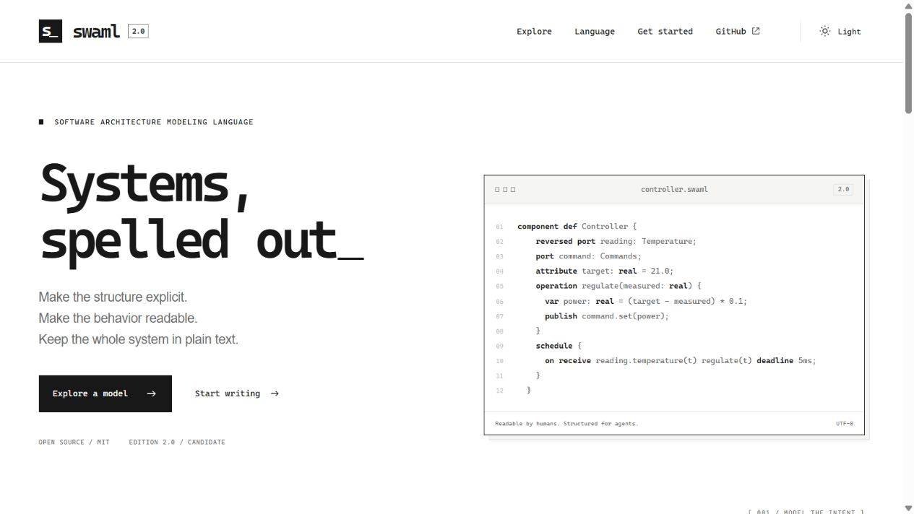
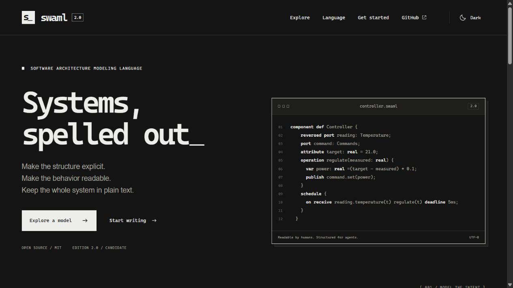
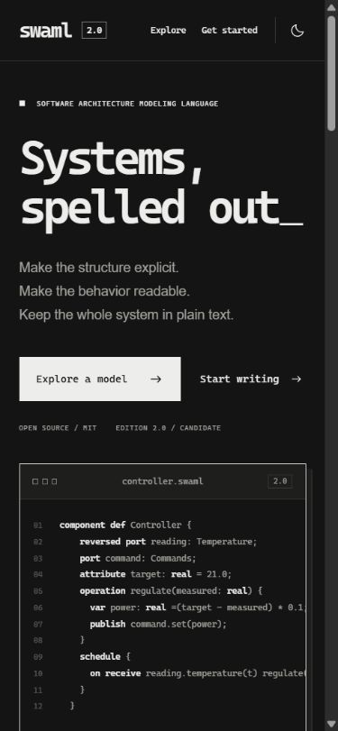

# SWAML 2.0 site design review

Local preview: http://127.0.0.1:5188/. Publication is pending owner approval.

The direction is monochrome, with thin gray rules, paper-like surfaces, console-inspired monospace headings/code and light/dark/system theme selection. The layout uses a restrained terminal source window and a model explorer with Browser plus General, Interconnect, Case, Sequence, Grid, Flow and Timing. General supports the same identities in Box in box/Tree. Timing separates declared contracts from the identified 2.0 reference trace.

The explorer's source, occurrence identities, directed members, schedules, case steps and observed trace come from the validated controller example. Its generated data retains a source fingerprint. Copy and download controls use current 2.0 source/guides/skills. No example, testimonial or production evidence is invented.

Desktop light/dark and a 390px mobile viewport were reviewed in the browser. All seven tabs rendered without console errors; the narrow page had no horizontal document overflow. The diagram/source areas scroll internally. These are development QA observations, not complete accessibility certification.

